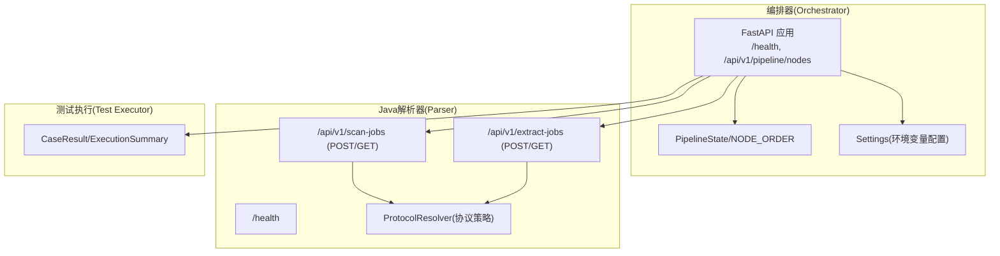
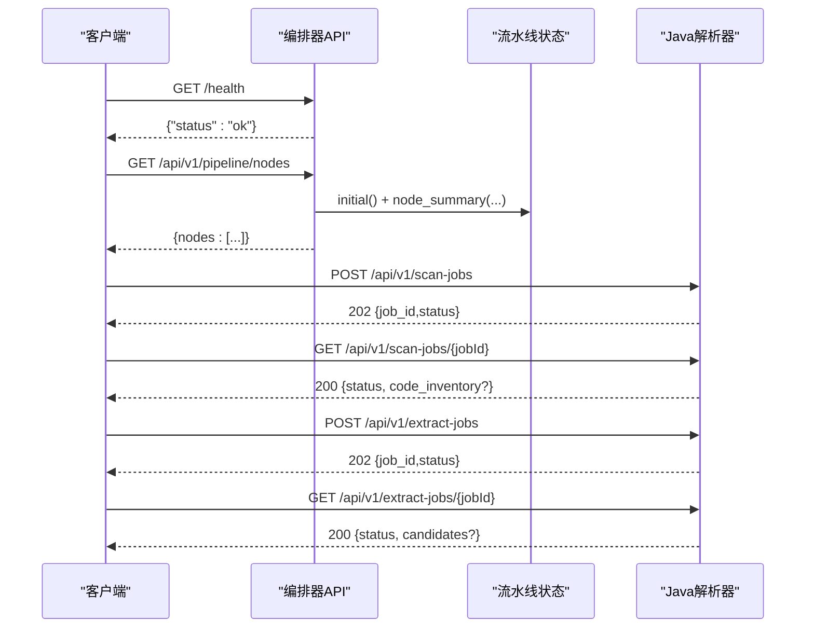
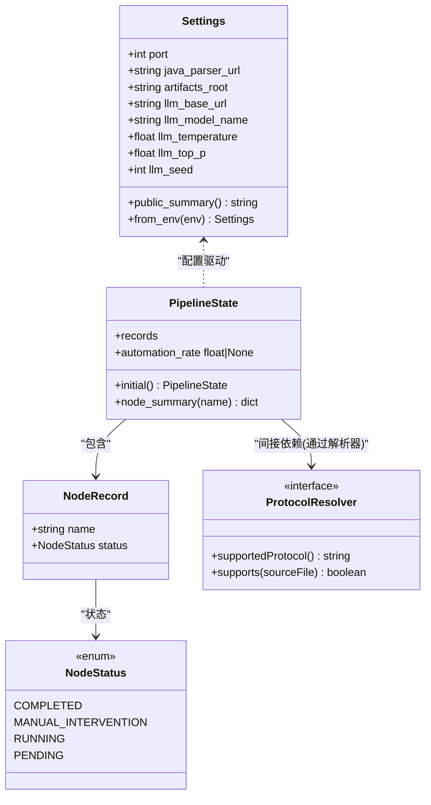

# API参考

<cite>
**本文引用的文件**
- [services/orchestrator/src/orchestrator/api.py](file://services/orchestrator/src/orchestrator/api.py)
- [services/orchestrator/src/orchestrator/pipeline.py](file://services/orchestrator/src/orchestrator/pipeline.py)
- [services/orchestrator/src/orchestrator/config.py](file://services/orchestrator/src/orchestrator/config.py)
- [schemas/contracts/java-parser.openapi.yaml](file://schemas/contracts/java-parser.openapi.yaml)
- [services/java-parser/src/main/java/com/llmautotest/parser/HealthController.java](file://services/java-parser/src/main/java/com/llmautotest/parser/HealthController.java)
- [services/java-parser/src/main/java/com/llmautotest/parser/ProtocolResolver.java](file://services/java-parser/src/main/java/com/llmautotest/parser/ProtocolResolver.java)
- [services/java-parser/src/main/resources/application.yml](file://services/java-parser/src/main/resources/application.yml)
- [services/test-executor/src/executor/result.py](file://services/test-executor/src/executor/result.py)
</cite>

## 目录
1. [简介](#简介)
2. [项目结构](#项目结构)
3. [核心组件](#核心组件)
4. [架构总览](#架构总览)
5. [详细API说明](#详细api说明)
6. [依赖关系分析](#依赖关系分析)
7. [性能与扩展性](#性能与扩展性)
8. [故障排查指南](#故障排查指南)
9. [结论](#结论)
10. [附录：客户端集成示例](#附录客户端集成示例)

## 简介
本API参考文档面向LLM-AutoTest平台的编排器（Orchestrator）与Java解析器（Java Parser）服务，覆盖以下能力：
- 编排器的流水线管理接口：查询流水线节点清单与状态。
- Java解析器的代码扫描与接口候选提取接口：基于多仓库静态分析，产出code_inventory与接口候选清单。
- 健康检查接口：用于容器编排与健康探测。
文档包含HTTP方法、URL模式、请求与响应模型、错误码与处理策略，并提供调用示例与集成建议。

## 项目结构
平台由多个服务组成：
- Orchestrator（Python/FastAPI）：提供流水线节点查询与健康检查，并负责后续与LLM及下游服务的编排。
- Java Parser（Spring Boot）：提供多仓库扫描与接口候选提取的异步任务接口，以及健康检查。
- Test Executor（Python）：提供执行结果判定与汇总的数据模型（供编排器在测试阶段使用）。

图表来源
- [services/orchestrator/src/orchestrator/api.py:11-27](file://services/orchestrator/src/orchestrator/api.py#L11-L27)
- [services/orchestrator/src/orchestrator/pipeline.py:23-59](file://services/orchestrator/src/orchestrator/pipeline.py#L23-L59)
- [services/orchestrator/src/orchestrator/config.py:9-49](file://services/orchestrator/src/orchestrator/config.py#L9-L49)
- [schemas/contracts/java-parser.openapi.yaml:11-116](file://schemas/contracts/java-parser.openapi.yaml#L11-L116)
- [services/java-parser/src/main/java/com/llmautotest/parser/ProtocolResolver.java:6-16](file://services/java-parser/src/main/java/com/llmautest/parser/ProtocolResolver.java#L6-L16)

章节来源
- [services/orchestrator/src/orchestrator/api.py:11-27](file://services/orchestrator/src/orchestrator/api.py#L11-L27)
- [services/java-parser/src/main/resources/application.yml:1-8](file://services/java-parser/src/main/resources/application.yml#L1-L8)

## 核心组件
- 编排器API层：定义健康检查与流水线节点查询端点，返回固定九节点的当前状态摘要。
- 流水线状态：维护九个固定节点及其四态（completed、manual_intervention、running、pending），并提供自动化率计算。
- Java解析器契约：定义多仓库扫描与接口候选提取的异步任务模型，包括请求体、状态机与产物结构。
- 协议解析策略：通过可插拔接口支持多种协议（rest、grpc、graphql、soap、mq等）。
- 测试结果模型：区分断言失败与环境失败，提供程序化汇总能力。

章节来源
- [services/orchestrator/src/orchestrator/pipeline.py:11-70](file://services/orchestrator/src/orchestrator/pipeline.py#L11-L70)
- [schemas/contracts/java-parser.openapi.yaml:117-369](file://schemas/contracts/java-parser.openapi.yaml#L117-L369)
- [services/java-parser/src/main/java/com/llmautest/parser/ProtocolResolver.java:6-16](file://services/java-parser/src/main/java/com/llmautest/parser/ProtocolResolver.java#L6-L16)
- [services/test-executor/src/executor/result.py:10-61](file://services/test-executor/src/executor/result.py#L10-L61)

## 架构总览
编排器对外暴露REST接口，Java解析器提供静态分析与候选提取的异步任务接口。两者通过HTTP交互，遵循统一错误结构与任务状态机。

图表来源
- [services/orchestrator/src/orchestrator/api.py:16-25](file://services/orchestrator/src/orchestrator/api.py#L16-L25)
- [schemas/contracts/java-parser.openapi.yaml:24-116](file://schemas/contracts/java-parser.openapi.yaml#L24-L116)

## 详细API说明

### 编排器API
- 基础信息
  - 框架：FastAPI
  - 版本：0.1.0
  - 端口：默认8000（可通过环境变量PORT覆盖）
  - 配置来源：环境变量（详见“配置项”小节）

- 健康检查
  - 方法：GET
  - URL：/health
  - 认证：无
  - 请求体：无
  - 响应体：{"status": "ok"}
  - 用途：容器编排与健康探测

- 流水线节点清单
  - 方法：GET
  - URL：/api/v1/pipeline/nodes
  - 认证：无
  - 请求体：无
  - 响应体：{ "nodes": [ { "name": "...", "status": "pending|running|completed|manual_intervention" }, ... ] }
  - 节点顺序（固定九节点）：req_parse、code_scan、interface_reconstruct、code_review、testcase_generate、auto_execute、test_report、defect_list、retest_regression
  - 自动化率：由编排器内部计算（已完成节点数/9），当前骨架阶段未实测时返回None

章节来源
- [services/orchestrator/src/orchestrator/api.py:11-27](file://services/orchestrator/src/orchestrator/api.py#L11-L27)
- [services/orchestrator/src/orchestrator/pipeline.py:23-70](file://services/orchestrator/src/orchestrator/pipeline.py#L23-L70)
- [services/orchestrator/src/orchestrator/config.py:9-49](file://services/orchestrator/src/orchestrator/config.py#L9-L49)

### Java解析器API（基于OpenAPI契约）
- 基础信息
  - 框架：Spring Boot
  - 端口：默认8080（可通过application.yml或环境变量覆盖）
  - 并发度：scan-concurrency（默认4）

- 健康检查
  - 方法：GET
  - URL：/health
  - 认证：无
  - 响应体：{"status": "ok", "service": "java-parser"}

- 创建多仓库扫描任务
  - 方法：POST
  - URL：/api/v1/scan-jobs
  - 认证：无
  - 请求体：ScanRequest
    - job_id：字符串，由上游生成
    - repositories：数组，至少2个元素；每项为RepositoryInput
      - name：显示名
      - path：已检出正确分支的本地路径（容器内可见）
      - branch：分支名
      - is_fallback：是否兜底演示仓库（默认false）
      - include_paths：超大仓库截断时的核心模块目录列表
  - 成功响应：202 JobAccepted
    - job_id：字符串
    - status：queued | running | completed | failed
  - 错误响应：400 Error（如repositories为空）

- 查询扫描任务状态与产物
  - 方法：GET
  - URL：/api/v1/scan-jobs/{jobId}
  - 路径参数：jobId（字符串）
  - 成功响应：200 ScanJob
    - 继承JobAccepted字段
    - code_inventory：对象，包含schema_version、job_id、repositories（RepoInventory数组）
      - RepoInventory包含：name、path、branch、is_fallback、status（ok|empty|truncated|error）、file_count、truncated_scope、encoding_skipped、error、files（SourceFile数组）
        - SourceFile：repo、module、path
  - 错误响应：404 Error（job不存在）

- 创建接口候选提取任务
  - 方法：POST
  - URL：/api/v1/extract-jobs
  - 认证：无
  - 请求体：ExtractRequest
    - job_id：字符串
    - repositories：数组（同RepositoryInput）
    - protocols：可选，枚举[rest, grpc, graphql, soap, mq]，默认全部识别
  - 成功响应：202 JobAccepted
  - 错误响应：400 Error

- 查询候选提取任务状态与产物
  - 方法：GET
  - URL：/api/v1/extract-jobs/{jobId}
  - 路径参数：jobId（字符串）
  - 成功响应：200 ExtractJob
    - 继承JobAccepted字段
    - candidates：InterfaceCandidate数组
      - InterfaceCandidate：candidate_id、protocol、signature、code_location、snippet、related_files、is_fallback、confidence
        - CodeLocation：repo、file、start_line、end_line
        - RelatedFile：repo、file、role（controller|service|dto|proto|wsdl|listener|other）、start_line、end_line
    - warnings：字符串数组（如候选数低于底线提示、单文件解析失败记录跳过原因）
  - 错误响应：404 Error（job不存在）

- 统一错误结构
  - 字段：code（稳定错误码）、message（人类可读信息，不泄露堆栈/路径细节）、node_id（可选，关联流水线节点）、details（结构化补充，如无效路径列表）

章节来源
- [schemas/contracts/java-parser.openapi.yaml:11-116](file://schemas/contracts/java-parser.openapi.yaml#L11-L116)
- [schemas/contracts/java-parser.openapi.yaml:117-369](file://schemas/contracts/java-parser.openapi.yaml#L117-L369)
- [services/java-parser/src/main/java/com/llmautest/parser/HealthController.java:12-16](file://services/java-parser/src/main/java/com/llmautest/parser/HealthController.java#L12-L16)
- [services/java-parser/src/main/resources/application.yml:1-8](file://services/java-parser/src/main/resources/application.yml#L1-L8)

### 健康检查接口（跨服务）
- 编排器：GET /health → {"status":"ok"}
- Java解析器：GET /health → {"status":"ok","service":"java-parser"}

章节来源
- [services/orchestrator/src/orchestrator/api.py:16-19](file://services/orchestrator/src/orchestrator/api.py#L16-L19)
- [services/java-parser/src/main/java/com/llmautest/parser/HealthController.java:12-16](file://services/java-parser/src/main/java/com/llmautest/parser/HealthController.java#L12-L16)

### 配置项与环境变量
- 编排器（Orchestrator）
  - PORT：服务端口（默认8000）
  - JAVA_PARSER_URL：Java解析器服务地址
  - ARTIFACTS_ROOT：产物根目录（默认/data/llm-autotest）
  - LLM_BASE_URL：LLM基址（必填）
  - LLM_MODEL_NAME：模型名称（默认glm-5.3）
  - LLM_TEMPERATURE：采样温度（默认0.2）
  - LLM_TOP_P：Top-P采样（默认0.8）
  - LLM_SEED：随机种子（可选）

- Java解析器
  - server.port：服务端口（默认8080）
  - parser.scan-concurrency：扫描并发度（默认4）

章节来源
- [services/orchestrator/src/orchestrator/config.py:9-49](file://services/orchestrator/src/orchestrator/config.py#L9-L49)
- [services/java-parser/src/main/resources/application.yml:1-8](file://services/java-parser/src/main/resources/application.yml#L1-L8)

## 依赖关系分析
- 编排器依赖流水线状态与配置模块，对外暴露健康检查与节点清单接口。
- Java解析器通过ProtocolResolver实现协议策略的可插拔扩展，支持多种协议识别。
- 测试执行模块提供用例结果与汇总的数据模型，便于编排器在测试阶段进行统计与报告。

图表来源
- [services/orchestrator/src/orchestrator/config.py:9-49](file://services/orchestrator/src/orchestrator/config.py#L9-L49)
- [services/orchestrator/src/orchestrator/pipeline.py:11-70](file://services/orchestrator/src/orchestrator/pipeline.py#L11-L70)
- [services/java-parser/src/main/java/com/llmautest/parser/ProtocolResolver.java:6-16](file://services/java-parser/src/main/java/com/llmautest/parser/ProtocolResolver.java#L6-L16)

章节来源
- [services/orchestrator/src/orchestrator/config.py:9-49](file://services/orchestrator/src/orchestrator/config.py#L9-L49)
- [services/orchestrator/src/orchestrator/pipeline.py:11-70](file://services/orchestrator/src/orchestrator/pipeline.py#L11-L70)
- [services/java-parser/src/main/java/com/llmautest/parser/ProtocolResolver.java:6-16](file://services/java-parser/src/main/java/com/llmautest/parser/ProtocolResolver.java#L6-L16)

## 性能与扩展性
- 扫描并发度：Java解析器支持parser.scan-concurrency配置，默认4，可根据资源调整以提升吞吐。
- 大仓库截断：当仓库过大时，可通过include_paths限定扫描范围，减少IO与解析开销。
- 协议策略可扩展：新增协议只需实现ProtocolResolver接口，不影响主流程。
- 异步任务：扫描与提取采用异步job模式，避免长耗时阻塞请求。

章节来源
- [services/java-parser/src/main/resources/application.yml:5-8](file://services/java-parser/src/main/resources/application.yml#L5-L8)
- [schemas/contracts/java-parser.openapi.yaml:162-184](file://schemas/contracts/java-parser.openapi.yaml#L162-L184)
- [schemas/contracts/java-parser.openapi.yaml:274-290](file://schemas/contracts/java-parser.openapi.yaml#L274-L290)
- [services/java-parser/src/main/java/com/llmautest/parser/ProtocolResolver.java:6-16](file://services/java-parser/src/main/java/com/llmautest/parser/ProtocolResolver.java#L6-L16)

## 故障排查指南
- 健康检查失败
  - 编排器：确认服务端口与进程存活。
  - Java解析器：确认服务端口与依赖可用。
- 扫描任务报错
  - 400：检查repositories是否为空或格式是否正确。
  - 404：检查jobId是否存在。
  - 错误结构Error：关注code与message，必要时查看details中的结构化信息。
- 流水线节点状态异常
  - 确认各节点状态流转是否符合预期（pending→running→completed/manual_intervention）。
  - 自动化率计算：若未完成任何节点，自动化率为None属正常。

章节来源
- [schemas/contracts/java-parser.openapi.yaml:130-148](file://schemas/contracts/java-parser.openapi.yaml#L130-L148)
- [services/orchestrator/src/orchestrator/pipeline.py:11-70](file://services/orchestrator/src/orchestrator/pipeline.py#L11-L70)

## 结论
本API参考覆盖了编排器与Java解析器的核心接口，明确了请求/响应模型、错误处理与扩展点。通过异步任务与可插拔协议策略，系统具备良好的扩展性与可维护性。建议在集成时严格遵循契约与错误结构，并结合健康检查与监控指标保障稳定性。

## 附录：客户端集成示例
以下为常见调用流程的示例（以伪代码形式展示，不包含具体代码内容）：

- 编排器健康检查
  - 请求：GET /health
  - 期望响应：{"status":"ok"}

- 获取流水线节点清单
  - 请求：GET /api/v1/pipeline/nodes
  - 期望响应：{ "nodes": [ { "name": "req_parse", "status": "pending" }, ... ] }

- 创建扫描任务
  - 请求：POST /api/v1/scan-jobs
  - 请求体：{ "job_id": "xxx", "repositories": [ { "name": "A", "path": "/data/repoA", "branch": "main", "is_fallback": false, "include_paths": ["src/main"] }, ... ] }
  - 期望响应：202 { "job_id": "xxx", "status": "queued" }

- 轮询扫描任务
  - 请求：GET /api/v1/scan-jobs/{jobId}
  - 期望响应：200 { "job_id": "xxx", "status": "completed", "code_inventory": { "schema_version": "v1", "job_id": "xxx", "repositories": [...] } }

- 创建提取任务
  - 请求：POST /api/v1/extract-jobs
  - 请求体：{ "job_id": "yyy", "repositories": [...], "protocols": ["rest", "grpc"] }
  - 期望响应：202 { "job_id": "yyy", "status": "queued" }

- 轮询提取任务
  - 请求：GET /api/v1/extract-jobs/{jobId}
  - 期望响应：200 { "job_id": "yyy", "status": "completed", "candidates": [...], "warnings": [...] }

- 错误处理
  - 捕获400/404等状态码，读取Error结构中的code与message，必要时根据details定位问题。

章节来源
- [services/orchestrator/src/orchestrator/api.py:16-25](file://services/orchestrator/src/orchestrator/api.py#L16-L25)
- [schemas/contracts/java-parser.openapi.yaml:24-116](file://schemas/contracts/java-parser.openapi.yaml#L24-L116)
- [schemas/contracts/java-parser.openapi.yaml:117-369](file://schemas/contracts/java-parser.openapi.yaml#L117-L369)