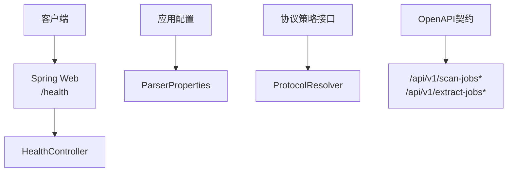
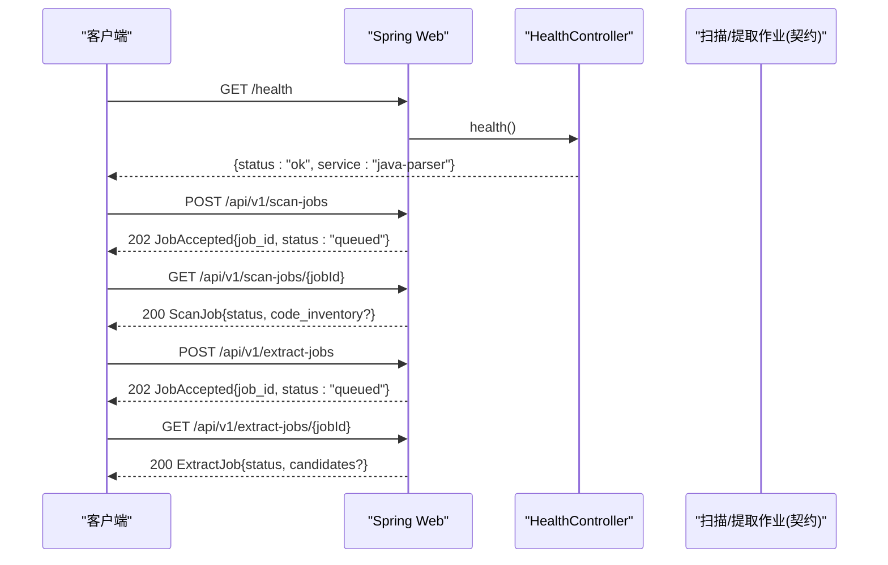
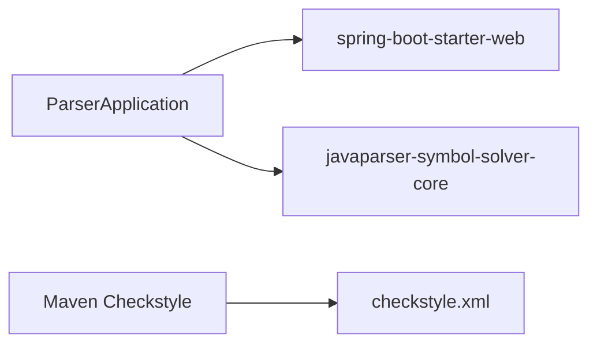

# Java解析器API

<cite>
**本文引用的文件**
- [java-parser.openapi.yaml](file://schemas/contracts/java-parser.openapi.yaml)
- [HealthController.java](file://services/java-parser/src/main/java/com/llmautotest/parser/HealthController.java)
- [ParserApplication.java](file://services/java-parser/src/main/java/com/llmautotest/parser/ParserApplication.java)
- [ParserProperties.java](file://services/java-parser/src/main/java/com/llmautotest/parser/ParserProperties.java)
- [ProtocolResolver.java](file://services/java-parser/src/main/java/com/llmautotest/parser/ProtocolResolver.java)
- [application.yml](file://services/java-parser/src/main/resources/application.yml)
- [pom.xml](file://services/java-parser/pom.xml)
- [HealthControllerTest.java](file://services/java-parser/src/test/java/com/llmautotest/parser/HealthControllerTest.java)
</cite>

## 目录
1. [简介](#简介)
2. [项目结构](#项目结构)
3. [核心组件](#核心组件)
4. [架构总览](#架构总览)
5. [详细组件分析](#详细组件分析)
6. [依赖关系分析](#依赖关系分析)
7. [性能考虑](#性能考虑)
8. [故障排查指南](#故障排查指南)
9. [结论](#结论)
10. [附录：API参考与调用示例](#附录api参考与调用示例)

## 简介
本服务提供Java多仓库静态扫描与接口候选提取能力，遵循“契约先行”的OpenAPI规范。长任务采用异步Job模式：POST创建任务→GET轮询状态与产物。当前实现包含健康检查端点与完整的API契约定义；其余REST端点（扫描、提取）在契约中已明确，待后续控制器实现接入。

## 项目结构
- OpenAPI契约位于 schemas/contracts/java-parser.openapi.yaml，定义了所有REST端点、请求/响应模型与错误结构。
- Spring Boot应用入口为 ParserApplication，暴露 /health 健康检查端点。
- 配置通过 application.yml 注入，支持环境变量覆盖。
- 可插拔协议解析策略由 ProtocolResolver 接口定义，便于扩展新协议。
- 并发度等运行参数通过 ParserProperties 读取并校验。

图表来源
- [HealthController.java:1-18](file://services/java-parser/src/main/java/com/llmautotest/parser/HealthController.java#L1-L18)
- [application.yml:1-8](file://services/java-parser/src/main/resources/application.yml#L1-L8)
- [ParserProperties.java:1-17](file://services/java-parser/src/main/java/com/llmautotest/parser/ParserProperties.java#L1-L17)
- [ProtocolResolver.java:1-17](file://services/java-parser/src/main/java/com/llmautotest/parser/ProtocolResolver.java#L1-L17)
- [java-parser.openapi.yaml:11-115](file://schemas/contracts/java-parser.openapi.yaml#L11-L115)

章节来源
- [ParserApplication.java:1-17](file://services/java-parser/src/main/java/com/llmautotest/parser/ParserApplication.java#L1-L17)
- [application.yml:1-8](file://services/java-parser/src/main/resources/application.yml#L1-L8)
- [java-parser.openapi.yaml:1-115](file://schemas/contracts/java-parser.openapi.yaml#L1-L115)

## 核心组件
- 健康检查：GET /health，返回固定JSON，用于编排与健康探测。
- 异步任务：
  - 扫描任务：POST /api/v1/scan-jobs 创建，GET /api/v1/scan-jobs/{jobId} 查询。
  - 提取任务：POST /api/v1/extract-jobs 创建，GET /api/v1/extract-jobs/{jobId} 查询。
- 数据模型：ScanRequest、ExtractRequest、RepositoryInput、JobAccepted、JobStatus、Error、ScanJob、ExtractJob、InterfaceCandidate 等。
- 配置与扩展：ParserProperties 控制扫描并发；ProtocolResolver 定义协议解析策略接口。

章节来源
- [java-parser.openapi.yaml:11-115](file://schemas/contracts/java-parser.openapi.yaml#L11-L115)
- [java-parser.openapi.yaml:117-369](file://schemas/contracts/java-parser.openapi.yaml#L117-L369)
- [ParserProperties.java:1-17](file://services/java-parser/src/main/java/com/llmautotest/parser/ParserProperties.java#L1-L17)
- [ProtocolResolver.java:1-17](file://services/java-parser/src/main/java/com/llmautotest/parser/ProtocolResolver.java#L1-L17)

## 架构总览
服务基于Spring Boot提供HTTP接口，遵循OpenAPI契约。健康检查已实现；扫描与提取任务按契约定义以异步Job方式处理，客户端通过POST创建任务后轮询GET获取状态与结果。协议解析采用策略接口，便于后续扩展多种协议识别。

图表来源
- [HealthController.java:1-18](file://services/java-parser/src/main/java/com/llmautotest/parser/HealthController.java#L1-L18)
- [java-parser.openapi.yaml:11-115](file://schemas/contracts/java-parser.openapi.yaml#L11-L115)

## 详细组件分析

### 健康检查端点
- 路径与方法：GET /health
- 功能：返回服务存活信息，供编排系统健康检查使用。
- 响应体：包含 status 与 service 字段。
- 测试：单元测试验证 /health 返回200且status为ok。

章节来源
- [HealthController.java:1-18](file://services/java-parser/src/main/java/com/llmautotest/parser/HealthController.java#L1-L18)
- [HealthControllerTest.java:1-27](file://services/java-parser/src/test/java/com/llmautotest/parser/HealthControllerTest.java#L1-L27)

### 异步任务处理模式
- 统一模式：POST 创建任务 → 立即返回202 JobAccepted（含 job_id 与初始状态 queued）→ GET 轮询任务状态与产物。
- 扫描任务：
  - 创建：POST /api/v1/scan-jobs，请求体为 ScanRequest。
  - 查询：GET /api/v1/scan-jobs/{jobId}，返回 ScanJob（完成后包含 code_inventory）。
- 提取任务：
  - 创建：POST /api/v1/extract-jobs，请求体为 ExtractRequest。
  - 查询：GET /api/v1/extract-jobs/{jobId}，返回 ExtractJob（完成后包含 candidates 与 warnings）。

章节来源
- [java-parser.openapi.yaml:24-115](file://schemas/contracts/java-parser.openapi.yaml#L24-L115)

### 数据模型说明
- Health：健康检查响应，包含 status="ok" 与 service="java-parser"。
- Error：统一错误结构，包含 code、message，可选 node_id 与 details。
- JobAccepted：任务受理响应，包含 job_id 与 status（queued/running/completed/failed）。
- RepositoryInput：仓库输入，包含 name、path、branch、is_fallback、include_paths。
- ScanRequest：扫描请求，包含 job_id 与 repositories（至少2个）。
- RepoScanStatus：仓库扫描状态枚举（ok/empty/truncated/error）。
- RepoInventory：仓库扫描结果，包含状态、文件数、截断范围、编码跳过列表、错误与源码清单。
- SourceFile：源码文件条目（repo/module/path）。
- ScanJob：继承 JobAccepted，完成后包含 code_inventory（schema_version、job_id、repositories）。
- ExtractRequest：提取请求，包含 job_id、repositories、protocols（rest/grpc/graphql/soap/mq）。
- CodeLocation：代码位置（repo/file/start_line/end_line）。
- RelatedFile：关联文件（controller/service/dto/proto/wsdl/listener/other）。
- InterfaceCandidate：接口候选（candidate_id、protocol、signature、code_location、snippet、related_files、is_fallback、confidence）。
- ExtractJob：继承 JobAccepted，完成后包含 candidates 与 warnings。

章节来源
- [java-parser.openapi.yaml:117-369](file://schemas/contracts/java-parser.openapi.yaml#L117-L369)

### 配置与扩展点
- 应用端口：server.port=8080（可通过环境变量覆盖）。
- 扫描并发：parser.scan-concurrency（默认4），由 ParserProperties 读取并校验必须为正整数。
- 协议解析：ProtocolResolver 定义 supportedProtocol、supports(Path) 等方法，作为可插拔策略，便于新增协议识别逻辑。

章节来源
- [application.yml:1-8](file://services/java-parser/src/main/resources/application.yml#L1-L8)
- [ParserProperties.java:1-17](file://services/java-parser/src/main/java/com/llmautotest/parser/ParserProperties.java#L1-L17)
- [ProtocolResolver.java:1-17](file://services/java-parser/src/main/java/com/llmautotest/parser/ProtocolResolver.java#L1-L17)

## 依赖关系分析
- 运行时框架：Spring Boot Starter Web 提供HTTP能力。
- 静态分析：JavaParser Symbol Solver 为核心依赖，支撑后续协议解析与源码分析。
- 构建与质量：Maven Checkstyle 插件保障代码风格。

图表来源
- [pom.xml:31-47](file://services/java-parser/pom.xml#L31-L47)
- [pom.xml:49-81](file://services/java-parser/pom.xml#L49-L81)

章节来源
- [pom.xml:1-83](file://services/java-parser/pom.xml#L1-L83)

## 性能考虑
- 并发控制：通过 parser.scan-concurrency 限制多仓库扫描并发度，避免资源争用。
- 大仓库处理：支持 include_paths 指定核心模块目录进行截断扫描，减少IO与解析开销。
- 编码异常：对无法解析的文件记录 encoding_skipped，保证流程继续不中断。
- 建议：合理设置并发度与截断范围，结合监控观察CPU/IO峰值。

章节来源
- [application.yml:5-8](file://services/java-parser/src/main/resources/application.yml#L5-L8)
- [ParserProperties.java:7-16](file://services/java-parser/src/main/java/com/llmautotest/parser/ParserProperties.java#L7-L16)
- [java-parser.openapi.yaml:179-184](file://schemas/contracts/java-parser.openapi.yaml#L179-L184)
- [java-parser.openapi.yaml:229-234](file://schemas/contracts/java-parser.openapi.yaml#L229-L234)

## 故障排查指南
- 健康检查失败：确认 /health 返回200且status为ok；若失败，检查容器启动与端口绑定。
- 任务创建失败（400）：检查 repositories 是否为空或不符合约束（如数量不足）。
- 任务不存在（404）：确认 jobId 正确且任务尚未过期或被清理。
- 统一错误结构：服务端返回 Error 对象，包含稳定错误码与可读消息，避免泄露内部细节。
- 日志与告警：关注 ExtractJob 的 warnings 列表，了解单文件解析失败或候选数低于底线的提示。

章节来源
- [java-parser.openapi.yaml:41-70](file://schemas/contracts/java-parser.openapi.yaml#L41-L70)
- [java-parser.openapi.yaml:130-148](file://schemas/contracts/java-parser.openapi.yaml#L130-L148)
- [java-parser.openapi.yaml:362-369](file://schemas/contracts/java-parser.openapi.yaml#L362-L369)

## 结论
该服务以OpenAPI契约驱动，提供健康检查与完整的异步任务接口定义。当前已实现健康检查端点，扫描与提取任务按契约就绪，待控制器实现后即可对外提供服务。通过可插拔协议策略与可配置并发，具备良好的可扩展性与性能可控性。

## 附录：API参考与调用示例

### 健康检查
- 方法：GET
- 路径：/health
- 成功响应：
  - 状态码：200
  - 内容类型：application/json
  - 响应体：包含 status="ok" 与 service="java-parser"
- 示例（概念性）：
  - 请求：GET /health
  - 响应：{"status":"ok","service":"java-parser"}

章节来源
- [HealthController.java:12-16](file://services/java-parser/src/main/java/com/llmautotest/parser/HealthController.java#L12-L16)
- [java-parser.openapi.yaml:12-23](file://schemas/contracts/java-parser.openapi.yaml#L12-L23)

### 扫描任务
- 创建任务
  - 方法：POST
  - 路径：/api/v1/scan-jobs
  - 请求体：ScanRequest（必填：job_id、repositories；repositories 至少2项）
  - 成功响应：202 JobAccepted（job_id、status="queued"）
  - 错误响应：400 Error（如 repositories 为空）
- 查询任务
  - 方法：GET
  - 路径：/api/v1/scan-jobs/{jobId}
  - 成功响应：200 ScanJob（完成后包含 code_inventory）
  - 错误响应：404 Error（jobId 不存在）

章节来源
- [java-parser.openapi.yaml:24-70](file://schemas/contracts/java-parser.openapi.yaml#L24-L70)
- [java-parser.openapi.yaml:185-273](file://schemas/contracts/java-parser.openapi.yaml#L185-L273)

### 接口候选提取任务
- 创建任务
  - 方法：POST
  - 路径：/api/v1/extract-jobs
  - 请求体：ExtractRequest（必填：job_id、repositories；可选：protocols）
  - 成功响应：202 JobAccepted（job_id、status="queued"）
- 查询任务
  - 方法：GET
  - 路径：/api/v1/extract-jobs/{jobId}
  - 成功响应：200 ExtractJob（完成后包含 candidates 与 warnings）
  - 错误响应：404 Error（jobId 不存在）

章节来源
- [java-parser.openapi.yaml:72-115](file://schemas/contracts/java-parser.openapi.yaml#L72-L115)
- [java-parser.openapi.yaml:274-369](file://schemas/contracts/java-parser.openapi.yaml#L274-L369)

### 请求与响应模型速查
- RepositoryInput：name、path、branch、is_fallback、include_paths
- ScanRequest：job_id、repositories（≥2）
- RepoInventory：name、path、branch、is_fallback、status、file_count、truncated_scope、encoding_skipped、error、files
- SourceFile：repo、module、path
- ScanJob：继承 JobAccepted，完成后包含 code_inventory（schema_version、job_id、repositories）
- ExtractRequest：job_id、repositories、protocols（rest/grpc/graphql/soap/mq）
- InterfaceCandidate：candidate_id、protocol、signature、code_location、snippet、related_files、is_fallback、confidence
- ExtractJob：继承 JobAccepted，完成后包含 candidates、warnings

章节来源
- [java-parser.openapi.yaml:162-369](file://schemas/contracts/java-parser.openapi.yaml#L162-L369)

### 错误处理指南
- 统一错误结构：Error（code、message、node_id、details）
- 常见错误：
  - 400：请求非法（如 repositories 为空）
  - 404：任务不存在
- 建议：客户端根据 code 分类处理，message 面向用户展示，details 可用于调试。

章节来源
- [java-parser.openapi.yaml:130-148](file://schemas/contracts/java-parser.openapi.yaml#L130-L148)
- [java-parser.openapi.yaml:41-70](file://schemas/contracts/java-parser.openapi.yaml#L41-L70)