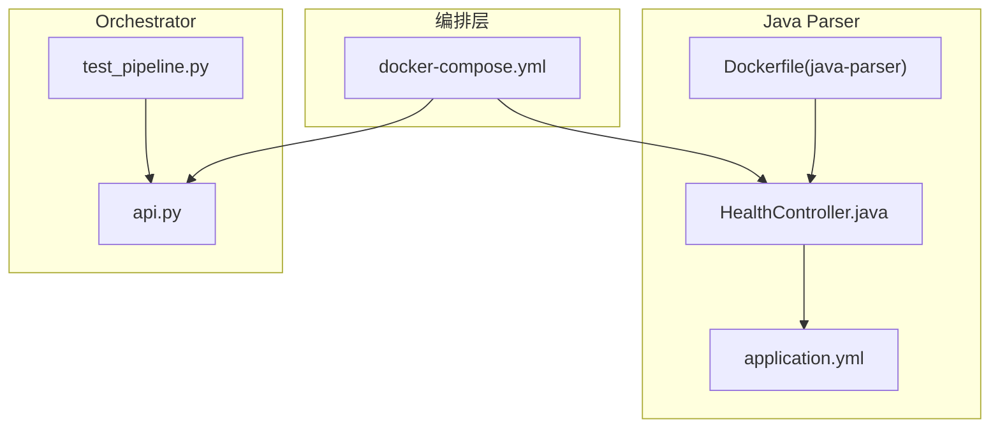
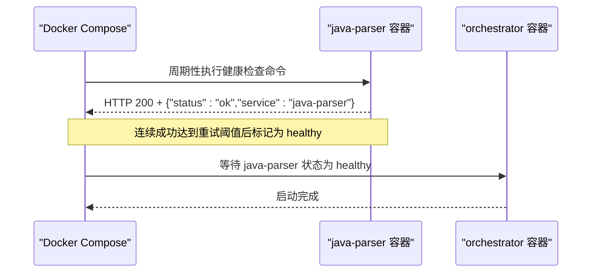
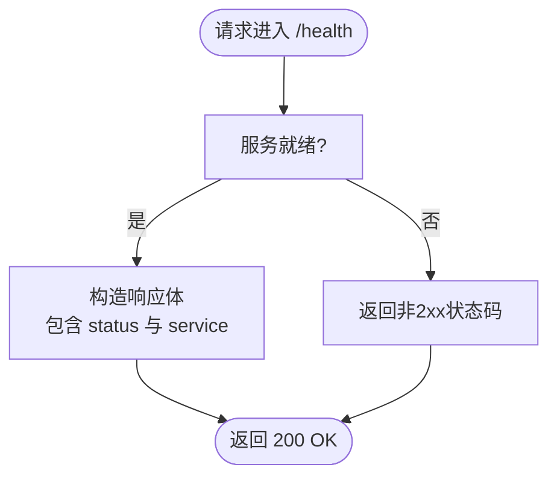
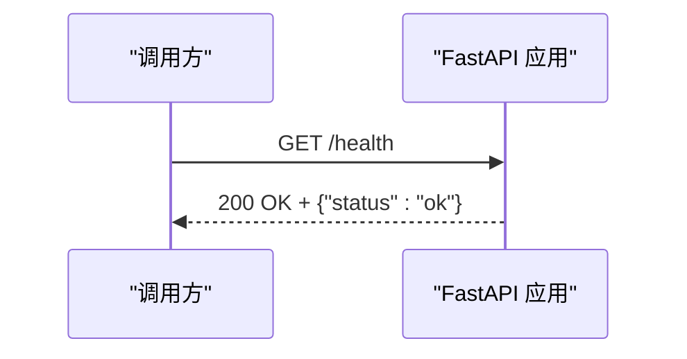
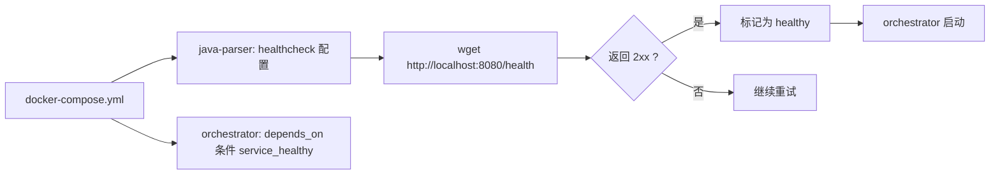
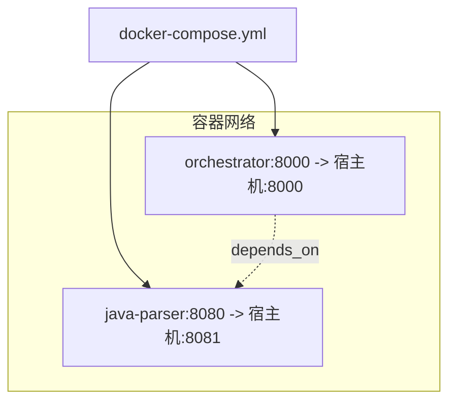

# 健康检查API

<cite>
**本文引用的文件**
- [services/java-parser/src/main/java/com/llmautotest/parser/HealthController.java](file://services/java-parser/src/main/java/com/llmautotest/parser/HealthController.java)
- [services/java-parser/src/test/java/com/llmautotest/parser/HealthControllerTest.java](file://services/java-parser/src/test/java/com/llmautotest/parser/HealthControllerTest.java)
- [services/orchestrator/src/orchestrator/api.py](file://services/orchestrator/src/orchestrator/api.py)
- [services/orchestrator/tests/test_pipeline.py](file://services/orchestrator/tests/test_pipeline.py)
- [deploy/docker-compose.yml](file://deploy/docker-compose.yml)
- [services/java-parser/Dockerfile](file://services/java-parser/Dockerfile)
- [services/java-parser/src/main/resources/application.yml](file://services/java-parser/src/main/resources/application.yml)
</cite>

## 目录
1. [简介](#简介)
2. [项目结构](#项目结构)
3. [核心组件](#核心组件)
4. [架构总览](#架构总览)
5. [详细组件分析](#详细组件分析)
6. [依赖关系分析](#依赖关系分析)
7. [性能考量](#性能考量)
8. [故障排查指南](#故障排查指南)
9. [结论](#结论)
10. [附录](#附录)

## 简介
本文件面向服务健康检查API，覆盖以下目标：
- 说明各微服务的健康检查端点实现、HTTP状态码与响应格式。
- 记录Docker Compose编排中的健康检查配置与使用方式。
- 提供基于API的服务监控与故障排查操作指南。

本项目包含两个对外暴露健康检查端点的微服务：
- Java Parser（Spring Boot）：提供 /health 端点，用于容器健康检查与基础可用性探测。
- Orchestrator（FastAPI）：提供 /health 端点，用于编排层可用性探测。

前端服务为静态资源服务，未暴露健康检查端点；测试执行器与Mock服务按Profile启用，当前未暴露健康检查端点。

## 项目结构
与健康检查相关的代码与配置主要分布在以下位置：
- Java Parser 服务：控制器实现、应用端口配置、容器镜像构建与依赖工具安装。
- Orchestrator 服务：FastAPI路由定义与单元测试。
- Docker Compose：编排中针对Java Parser的健康检查策略，以及Orchestrator对Java Parser的启动依赖条件。

图表来源
- [deploy/docker-compose.yml:1-62](file://deploy/docker-compose.yml#L1-L62)
- [services/java-parser/src/main/java/com/llmautotest/parser/HealthController.java:1-18](file://services/java-parser/src/main/java/com/llmautotest/parser/HealthController.java#L1-L18)
- [services/java-parser/src/main/resources/application.yml:1-8](file://services/java-parser/src/main/resources/application.yml#L1-L8)
- [services/java-parser/Dockerfile:1-20](file://services/java-parser/Dockerfile#L1-L20)
- [services/orchestrator/src/orchestrator/api.py:1-28](file://services/orchestrator/src/orchestrator/api.py#L1-L28)
- [services/orchestrator/tests/test_pipeline.py:1-47](file://services/orchestrator/tests/test_pipeline.py#L1-L47)

章节来源
- [deploy/docker-compose.yml:1-62](file://deploy/docker-compose.yml#L1-L62)
- [services/java-parser/src/main/java/com/llmautotest/parser/HealthController.java:1-18](file://services/java-parser/src/main/java/com/llmautotest/parser/HealthController.java#L1-L18)
- [services/orchestrator/src/orchestrator/api.py:1-28](file://services/orchestrator/src/orchestrator/api.py#L1-L28)

## 核心组件
- Java Parser 健康检查端点
  - 路径：/health
  - 方法：GET
  - 状态码：200
  - 响应体字段：status、service
  - 用途：容器健康检查与外部探针探测
- Orchestrator 健康检查端点
  - 路径：/health
  - 方法：GET
  - 状态码：200
  - 响应体字段：status
  - 用途：编排层可用性探测

章节来源
- [services/java-parser/src/main/java/com/llmautotest/parser/HealthController.java:1-18](file://services/java-parser/src/main/java/com/llmautotest/parser/HealthController.java#L1-L18)
- [services/orchestrator/src/orchestrator/api.py:1-28](file://services/orchestrator/src/orchestrator/api.py#L1-L28)

## 架构总览
下图展示了编排层如何通过Docker Compose对Java Parser进行健康检查，并以此作为Orchestrator启动的前置条件。

图表来源
- [deploy/docker-compose.yml:1-62](file://deploy/docker-compose.yml#L1-L62)
- [services/java-parser/src/main/java/com/llmautotest/parser/HealthController.java:1-18](file://services/java-parser/src/main/java/com/llmautotest/parser/HealthController.java#L1-L18)

## 详细组件分析

### Java Parser 健康检查端点
- 实现要点
  - 通过REST控制器暴露 /health 接口。
  - 返回固定JSON结构，包含服务标识与状态。
  - 应用默认监听端口由配置文件指定。
- 健康指标
  - status：字符串，表示服务是否可用。
  - service：字符串，标识当前服务名称。
- HTTP语义
  - 成功：200 OK
  - 失败：当进程不可用或端口未监听时，Docker健康检查将收到非2xx响应，容器被标记为不健康。
- 测试保障
  - 单元测试断言 /health 返回200且响应体包含预期字段。

图表来源
- [services/java-parser/src/main/java/com/llmautotest/parser/HealthController.java:1-18](file://services/java-parser/src/main/java/com/llmautotest/parser/HealthController.java#L1-L18)
- [services/java-parser/src/main/resources/application.yml:1-8](file://services/java-parser/src/main/resources/application.yml#L1-L8)

章节来源
- [services/java-parser/src/main/java/com/llmautotest/parser/HealthController.java:1-18](file://services/java-parser/src/main/java/com/llmautotest/parser/HealthController.java#L1-L18)
- [services/java-parser/src/test/java/com/llmautotest/parser/HealthControllerTest.java:1-27](file://services/java-parser/src/test/java/com/llmautotest/parser/HealthControllerTest.java#L1-L27)
- [services/java-parser/src/main/resources/application.yml:1-8](file://services/java-parser/src/main/resources/application.yml#L1-L8)

### Orchestrator 健康检查端点
- 实现要点
  - FastAPI应用内定义 /health GET 路由。
  - 返回固定JSON结构，仅包含状态字段。
- 健康指标
  - status：字符串，表示服务是否可用。
- HTTP语义
  - 成功：200 OK
  - 失败：当进程不可用时，健康检查将收到非2xx响应。
- 测试保障
  - 单元测试断言 /health 返回200且响应体等于预期字典。

图表来源
- [services/orchestrator/src/orchestrator/api.py:1-28](file://services/orchestrator/src/orchestrator/api.py#L1-L28)
- [services/orchestrator/tests/test_pipeline.py:1-47](file://services/orchestrator/tests/test_pipeline.py#L1-L47)

章节来源
- [services/orchestrator/src/orchestrator/api.py:1-28](file://services/orchestrator/src/orchestrator/api.py#L1-L28)
- [services/orchestrator/tests/test_pipeline.py:1-47](file://services/orchestrator/tests/test_pipeline.py#L1-L47)

### Docker Compose 健康检查配置与使用
- Java Parser 健康检查
  - 使用 wget 访问 http://localhost:8080/health。
  - 间隔、超时、重试次数已配置，确保容器在应用完全启动前不被判定为健康。
  - 容器镜像中预装 wget，以支持健康检查命令。
- 启动依赖
  - Orchestrator 依赖 java-parser 处于 healthy 状态后再启动，避免上游不可用导致的错误。
- 端口映射
  - Java Parser 容器内部8080端口映射到宿主机8081，便于本地调试与外部探测。

图表来源
- [deploy/docker-compose.yml:1-62](file://deploy/docker-compose.yml#L1-L62)
- [services/java-parser/Dockerfile:1-20](file://services/java-parser/Dockerfile#L1-L20)

章节来源
- [deploy/docker-compose.yml:1-62](file://deploy/docker-compose.yml#L1-L62)
- [services/java-parser/Dockerfile:1-20](file://services/java-parser/Dockerfile#L1-L20)

## 依赖关系分析
- 编排依赖
  - orchestrator 依赖 java-parser 健康检查通过后才启动。
- 运行时依赖
  - java-parser 健康检查仅依赖JVM与应用启动完成，无外部依赖。
  - orchestrator 健康检查为轻量级内存级检查，无外部依赖。
- 网络与端口
  - java-parser 内部端口8080，宿主机映射8081。
  - orchestrator 内部端口8000，宿主机映射8000。

图表来源
- [deploy/docker-compose.yml:1-62](file://deploy/docker-compose.yml#L1-L62)

章节来源
- [deploy/docker-compose.yml:1-62](file://deploy/docker-compose.yml#L1-L62)

## 性能考量
- 健康检查频率
  - 间隔与超时已在编排中设定，建议保持较短间隔与合理超时，避免频繁探测影响业务。
- 响应体积
  - 健康检查响应体极小，对带宽与CPU开销可忽略。
- 冷启动时间
  - Java Parser 冷启动可能较慢，需确保重试次数足够，避免误判。
- 扩展性
  - 若后续增加更多健康指标（如依赖数据库、消息队列等），应保证健康检查逻辑快速返回，避免阻塞。

[本节为通用指导，无需特定文件引用]

## 故障排查指南
- 常见问题定位
  - 无法访问 /health：确认端口映射是否正确（java-parser 宿主机8081，orchestrator 宿主机8000）。
  - 健康检查反复失败：检查容器日志、应用启动耗时、wget 是否可用（java-parser 镜像已安装）。
  - orchestrator 启动失败：确认 java-parser 已处于 healthy 状态。
- 验证步骤
  - 本地验证：curl 或浏览器访问 http://localhost:8081/health 与 http://localhost:8000/health。
  - 容器内验证：进入容器执行 wget http://localhost:8080/health。
  - 查看编排状态：使用 docker compose ps 查看服务健康状态。
- 回归测试
  - 运行单元测试：
    - Java Parser：HealthControllerTest 断言 /health 返回200与期望字段。
    - Orchestrator：test_pipeline 中 test_health_endpoint 断言 /health 返回200与期望响应体。

章节来源
- [services/java-parser/src/test/java/com/llmautotest/parser/HealthControllerTest.java:1-27](file://services/java-parser/src/test/java/com/llmautotest/parser/HealthControllerTest.java#L1-L27)
- [services/orchestrator/tests/test_pipeline.py:1-47](file://services/orchestrator/tests/test_pipeline.py#L1-L47)
- [deploy/docker-compose.yml:1-62](file://deploy/docker-compose.yml#L1-L62)

## 结论
- 本项目为关键微服务提供了统一的健康检查端点，便于编排层进行自动化健康探测与启动顺序控制。
- Java Parser 与 Orchestrator 均实现了最小化、稳定的 /health 接口，满足容器健康检查与外部监控需求。
- 建议在后续迭代中按需扩展健康指标（如依赖服务连通性、资源使用率等），并保持响应轻量与快速。

[本节为总结性内容，无需特定文件引用]

## 附录
- API参考
  - Java Parser
    - 路径：/health
    - 方法：GET
    - 状态码：200
    - 响应体：包含 status、service 字段
  - Orchestrator
    - 路径：/health
    - 方法：GET
    - 状态码：200
    - 响应体：包含 status 字段
- 编排参数
  - 健康检查间隔、超时、重试次数见 docker-compose.yml。
  - 启动依赖条件：orchestrator 依赖 java-parser 健康检查通过。

章节来源
- [services/java-parser/src/main/java/com/llmautotest/parser/HealthController.java:1-18](file://services/java-parser/src/main/java/com/llmautotest/parser/HealthController.java#L1-L18)
- [services/orchestrator/src/orchestrator/api.py:1-28](file://services/orchestrator/src/orchestrator/api.py#L1-L28)
- [deploy/docker-compose.yml:1-62](file://deploy/docker-compose.yml#L1-L62)