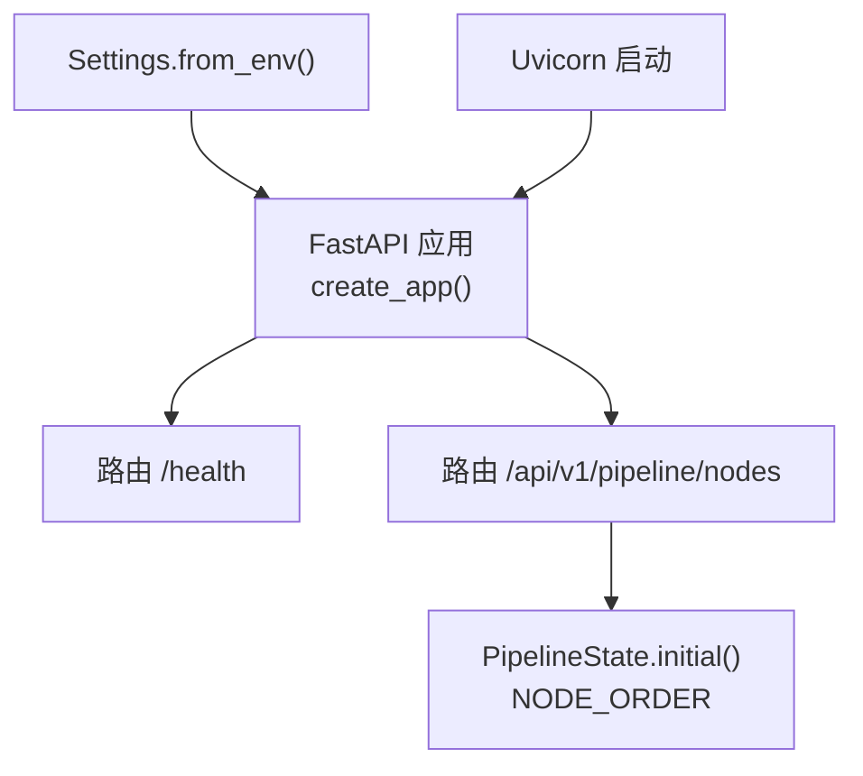
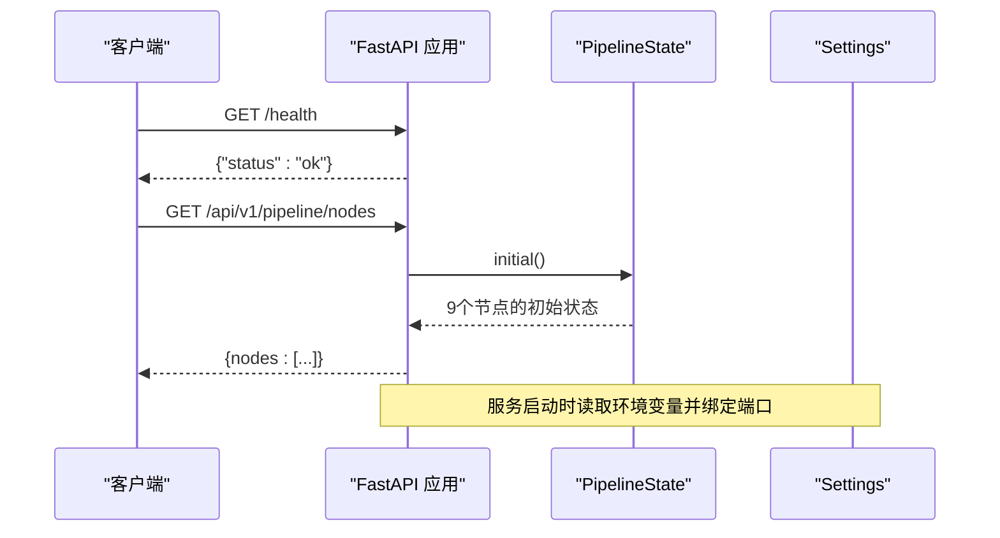
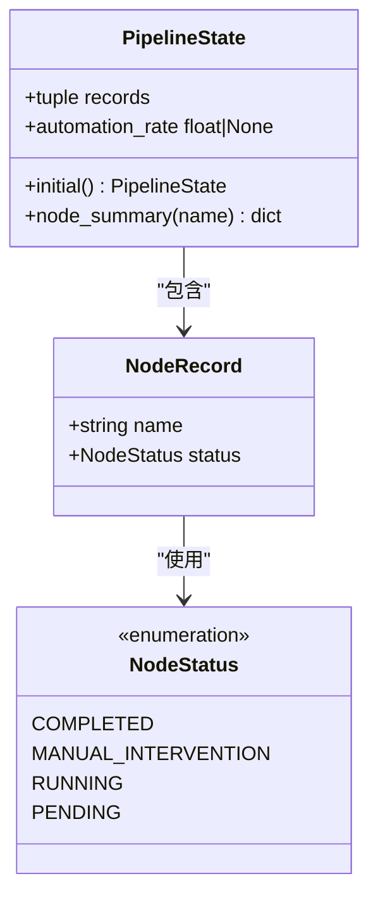
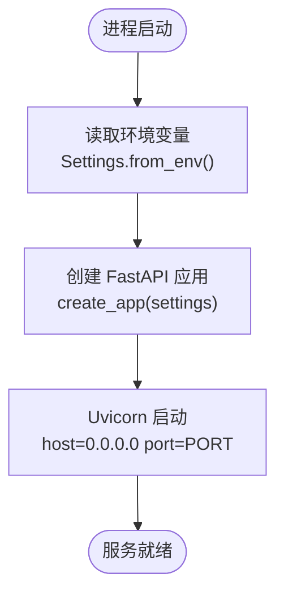
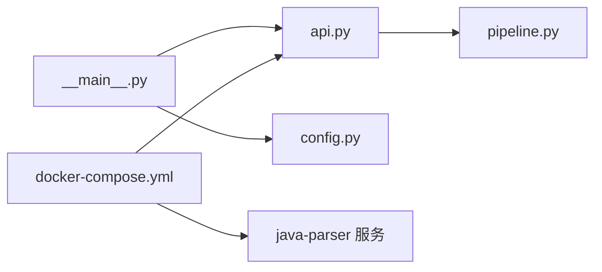

# 编排器API

<cite>
**本文引用的文件**
- [services/orchestrator/src/orchestrator/api.py](file://services/orchestrator/src/orchestrator/api.py)
- [services/orchestrator/src/orchestrator/pipeline.py](file://services/orchestrator/src/orchestrator/pipeline.py)
- [services/orchestrator/src/orchestrator/config.py](file://services/orchestrator/src/orchestrator/config.py)
- [services/orchestrator/src/orchestrator/__main__.py](file://services/orchestrator/src/orchestrator/__main__.py)
- [services/orchestrator/tests/test_pipeline.py](file://services/orchestrator/tests/test_pipeline.py)
- [services/orchestrator/tests/test_config.py](file://services/orchestrator/tests/test_config.py)
- [deploy/docker-compose.yml](file://deploy/docker-compose.yml)
- [docs/04_功能规格说明.md](file://docs/04_功能规格说明.md)
</cite>

## 目录
1. [简介](#简介)
2. [项目结构](#项目结构)
3. [核心组件](#核心组件)
4. [架构总览](#架构总览)
5. [详细组件分析](#详细组件分析)
6. [依赖关系分析](#依赖关系分析)
7. [性能与可扩展性](#性能与可扩展性)
8. [故障排查指南](#故障排查指南)
9. [结论](#结论)
10. [附录：API 参考与客户端集成](#附录api-参考与客户端集成)

## 简介
本文件为“编排器服务”的完整 API 文档，聚焦于当前已实现的 REST 接口与九节点流水线的状态管理。当前版本提供健康检查与流水线节点清单查询能力，并定义了九节点固定顺序与四态（待运行、运行中、已完成、人工介入）的状态模型。后续将在此基础上扩展流水线控制、节点执行、产物管理与度量等接口。

## 项目结构
编排器服务基于 FastAPI 构建，采用分层设计：
- API 层：定义 HTTP 路由与响应结构
- 业务层：定义流水线节点顺序与状态模型
- 配置层：从环境变量加载运行参数
- 入口层：启动 Uvicorn 服务器

**图表来源**
- [services/orchestrator/src/orchestrator/api.py:11-27](file://services/orchestrator/src/orchestrator/api.py#L11-L27)
- [services/orchestrator/src/orchestrator/pipeline.py:23-59](file://services/orchestrator/src/orchestrator/pipeline.py#L23-L59)
- [services/orchestrator/src/orchestrator/config.py:32-50](file://services/orchestrator/src/orchestrator/config.py#L32-L50)
- [services/orchestrator/src/orchestrator/__main__.py:15-21](file://services/orchestrator/src/orchestrator/__main__.py#L15-L21)

**章节来源**
- [services/orchestrator/src/orchestrator/api.py:1-27](file://services/orchestrator/src/orchestrator/api.py#L1-L27)
- [services/orchestrator/src/orchestrator/pipeline.py:1-84](file://services/orchestrator/src/orchestrator/pipeline.py#L1-L84)
- [services/orchestrator/src/orchestrator/config.py:1-50](file://services/orchestrator/src/orchestrator/config.py#L1-L50)
- [services/orchestrator/src/orchestrator/__main__.py:1-26](file://services/orchestrator/src/orchestrator/__main__.py#L1-L26)

## 核心组件
- 健康检查端点：用于容器编排与健康探测
- 节点清单端点：返回九节点固定顺序与当前状态摘要
- 节点状态模型：四态枚举与初始态构造
- 配置模型：环境变量驱动，包含 LLM 调用参数与服务地址

**章节来源**
- [services/orchestrator/src/orchestrator/api.py:16-25](file://services/orchestrator/src/orchestrator/api.py#L16-L25)
- [services/orchestrator/src/orchestrator/pipeline.py:11-59](file://services/orchestrator/src/orchestrator/pipeline.py#L11-L59)
- [services/orchestrator/src/orchestrator/config.py:9-50](file://services/orchestrator/src/orchestrator/config.py#L9-L50)

## 架构总览
编排器作为统一入口，对外暴露 REST API；内部通过 PipelineState 维护九节点顺序与状态；配置由环境变量注入，便于容器化部署。

**图表来源**
- [services/orchestrator/src/orchestrator/api.py:11-27](file://services/orchestrator/src/orchestrator/api.py#L11-L27)
- [services/orchestrator/src/orchestrator/pipeline.py:51-59](file://services/orchestrator/src/orchestrator/pipeline.py#L51-L59)
- [services/orchestrator/src/orchestrator/config.py:32-50](file://services/orchestrator/src/orchestrator/config.py#L32-L50)
- [services/orchestrator/src/orchestrator/__main__.py:15-21](file://services/orchestrator/src/orchestrator/__main__.py#L15-L21)

## 详细组件分析

### 健康检查接口
- 方法：GET
- URL：/health
- 认证：无
- 请求体：无
- 响应体：JSON，字段 status 值为字符串
- 用途：容器编排健康检查
- 错误处理：默认 FastAPI 异常处理

**章节来源**
- [services/orchestrator/src/orchestrator/api.py:16-19](file://services/orchestrator/src/orchestrator/api.py#L16-L19)
- [services/orchestrator/tests/test_pipeline.py:33-38](file://services/orchestrator/tests/test_pipeline.py#L33-L38)

### 流水线节点清单接口
- 方法：GET
- URL：/api/v1/pipeline/nodes
- 认证：无
- 请求体：无
- 响应体：JSON，字段 nodes 为数组，每项包含 name 与 status
- 语义：返回九节点固定顺序与当前状态摘要（骨架阶段全部为待运行）
- 错误处理：默认 FastAPI 异常处理

**章节来源**
- [services/orchestrator/src/orchestrator/api.py:21-25](file://services/orchestrator/src/orchestrator/api.py#L21-L25)
- [services/orchestrator/tests/test_pipeline.py:41-46](file://services/orchestrator/tests/test_pipeline.py#L41-L46)

### 九节点顺序与状态模型
- 节点顺序：固定九项，禁止增删
- 节点状态：四态枚举（completed、manual_intervention、running、pending）
- 初始态：所有节点均为 pending
- 自动化率：已完成节点数除以 9；骨架阶段未实测时返回 None

**图表来源**
- [services/orchestrator/src/orchestrator/pipeline.py:11-59](file://services/orchestrator/src/orchestrator/pipeline.py#L11-L59)

**章节来源**
- [services/orchestrator/src/orchestrator/pipeline.py:11-84](file://services/orchestrator/src/orchestrator/pipeline.py#L11-L84)

### 配置与环境变量
- 关键环境变量：
  - PORT：服务监听端口（默认 8000）
  - JAVA_PARSER_URL：Java 解析服务地址（必填）
  - ARTIFACTS_ROOT：产物根目录（默认 /data/llm-autotest）
  - LLM_BASE_URL：LLM 基址（必填）
  - LLM_MODEL_NAME：模型名（默认 glm-5.3）
  - LLM_TEMPERATURE：采样温度（默认 0.2）
  - LLM_TOP_P：Top-P（默认 0.8）
  - LLM_SEED：随机种子（可选）
- 安全：public_summary 不包含密钥等敏感信息

**章节来源**
- [services/orchestrator/src/orchestrator/config.py:9-50](file://services/orchestrator/src/orchestrator/config.py#L9-L50)
- [services/orchestrator/tests/test_config.py:10-43](file://services/orchestrator/tests/test_config.py#L10-L43)

### 服务启动与部署
- 启动命令：通过 Python 模块入口启动 Uvicorn
- 绑定地址：0.0.0.0，端口来自配置
- 容器编排：docker-compose 中 orchestrator 依赖 java-parser 健康后启动，共享 artifacts 卷

**图表来源**
- [services/orchestrator/src/orchestrator/__main__.py:15-21](file://services/orchestrator/src/orchestrator/__main__.py#L15-L21)
- [services/orchestrator/src/orchestrator/config.py:32-50](file://services/orchestrator/src/orchestrator/config.py#L32-L50)

**章节来源**
- [services/orchestrator/src/orchestrator/__main__.py:1-26](file://services/orchestrator/src/orchestrator/__main__.py#L1-L26)
- [deploy/docker-compose.yml:18-32](file://deploy/docker-compose.yml#L18-L32)

## 依赖关系分析
- API 层依赖 PipelineState 与 NODE_ORDER
- 入口层依赖 Settings 与 create_app
- 容器编排依赖 java-parser 健康检查与共享卷

**图表来源**
- [services/orchestrator/src/orchestrator/__main__.py:8-21](file://services/orchestrator/src/orchestrator/__main__.py#L8-L21)
- [services/orchestrator/src/orchestrator/api.py:7-25](file://services/orchestrator/src/orchestrator/api.py#L7-L25)
- [deploy/docker-compose.yml:4-32](file://deploy/docker-compose.yml#L4-L32)

**章节来源**
- [services/orchestrator/src/orchestrator/__main__.py:1-26](file://services/orchestrator/src/orchestrator/__main__.py#L1-L26)
- [services/orchestrator/src/orchestrator/api.py:1-27](file://services/orchestrator/src/orchestrator/api.py#L1-L27)
- [deploy/docker-compose.yml:1-62](file://deploy/docker-compose.yml#L1-L62)

## 性能与可扩展性
- 当前接口轻量，无外部 I/O，延迟低
- 未来扩展建议：
  - 引入异步任务队列以支持长耗时节点执行
  - 增加缓存层以减少重复计算
  - 增加限流与鉴权中间件
  - 指标采集与可观测性接入

[本节为通用指导，不直接分析具体文件]

## 故障排查指南
- 健康检查失败：检查容器端口映射与服务是否启动
- 节点清单为空或数量不为 9：确认 NODE_ORDER 未被修改，且 PipelineState.initial() 正确初始化
- 环境变量缺失：确保 JAVA_PARSER_URL、LLM_BASE_URL 等必填项存在
- 日志定位：查看服务启动日志中的 public_summary 输出，确认配置加载成功

**章节来源**
- [services/orchestrator/tests/test_pipeline.py:21-46](file://services/orchestrator/tests/test_pipeline.py#L21-L46)
- [services/orchestrator/tests/test_config.py:26-43](file://services/orchestrator/tests/test_config.py#L26-L43)
- [services/orchestrator/src/orchestrator/config.py:23-50](file://services/orchestrator/src/orchestrator/config.py#L23-L50)

## 结论
当前编排器服务提供了健康检查与九节点清单查询两个基础接口，明确了节点顺序与状态模型，并通过环境变量实现灵活配置。后续可在该基础上扩展流水线控制、节点执行、产物管理与度量等能力，形成完整的端到端自动化测试编排平台。

[本节为总结性内容，不直接分析具体文件]

## 附录：API 参考与客户端集成

### 端点一览
- GET /health
  - 描述：健康检查
  - 响应：{"status": "ok"}
- GET /api/v1/pipeline/nodes
  - 描述：返回九节点清单与当前状态摘要
  - 响应：{"nodes": [{"name": "...", "status": "..."}, ...]}

**章节来源**
- [services/orchestrator/src/orchestrator/api.py:16-25](file://services/orchestrator/src/orchestrator/api.py#L16-L25)
- [services/orchestrator/tests/test_pipeline.py:33-46](file://services/orchestrator/tests/test_pipeline.py#L33-L46)

### 请求与响应模式
- 请求：
  - 方法：GET
  - 路径：/health 或 /api/v1/pipeline/nodes
  - 头部：无特殊要求
  - 主体：无
- 响应：
  - 编码：UTF-8 JSON
  - 状态码：200 表示成功；其他错误遵循 FastAPI 默认行为

**章节来源**
- [services/orchestrator/src/orchestrator/api.py:16-25](file://services/orchestrator/src/orchestrator/api.py#L16-L25)

### 认证方法
- 当前版本未启用认证
- 建议在网关或反向代理层统一鉴权

[本节为通用指导，不直接分析具体文件]

### 实际调用示例
- 健康检查
  - curl http://localhost:8000/health
- 节点清单
  - curl http://localhost:8000/api/v1/pipeline/nodes

**章节来源**
- [deploy/docker-compose.yml:18-32](file://deploy/docker-compose.yml#L18-L32)

### 客户端集成指南
- 语言：Python、JavaScript、Go 等均可
- 步骤：
  - 获取服务地址（默认 http://localhost:8000）
  - 发起 GET 请求到 /health 验证连通性
  - 发起 GET 请求到 /api/v1/pipeline/nodes 获取节点清单
  - 根据 nodes 数组进行 UI 展示或流程编排
- 注意事项：
  - 处理网络超时与重试
  - 校验响应结构与状态码
  - 在容器环境中注意 DNS 与端口映射

[本节为通用指导，不直接分析具体文件]

### 九节点状态管理与控制（规划）
- 当前状态：骨架实现，全部节点初始为 pending
- 未来能力：
  - 节点级断点续跑：产物存在则跳过
  - 节点人工介入标记：记录日志并支持复核
  - 自动化率计算：已完成节点数 / 9
  - 报告生成：程序化汇总，不经 LLM

**章节来源**
- [docs/04_功能规格说明.md:9-31](file://docs/04_功能规格说明.md#L9-L31)
- [services/orchestrator/src/orchestrator/pipeline.py:61-70](file://services/orchestrator/src/orchestrator/pipeline.py#L61-L70)