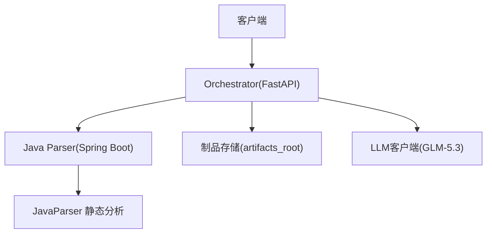
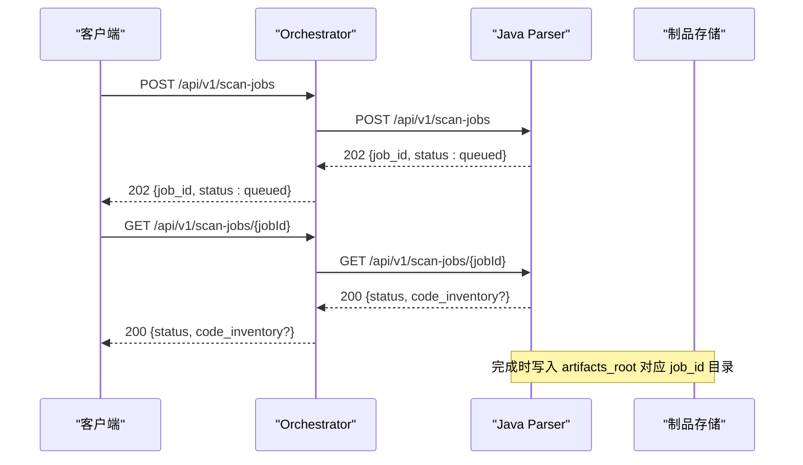
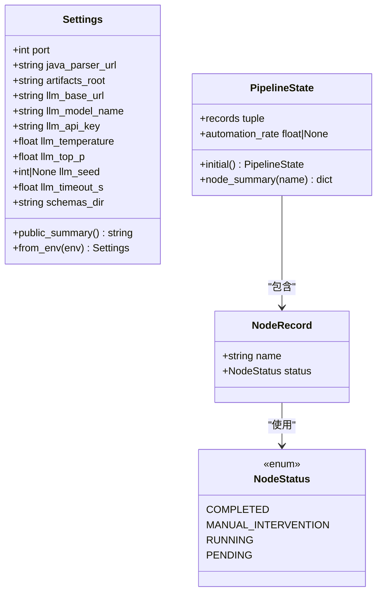
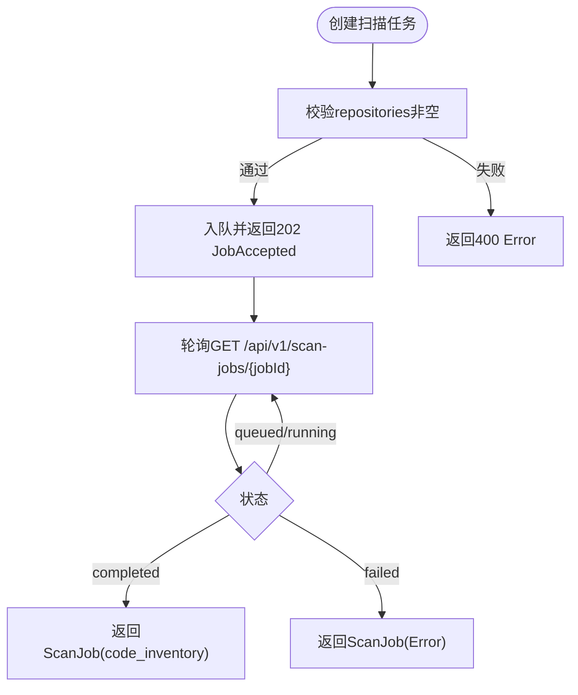
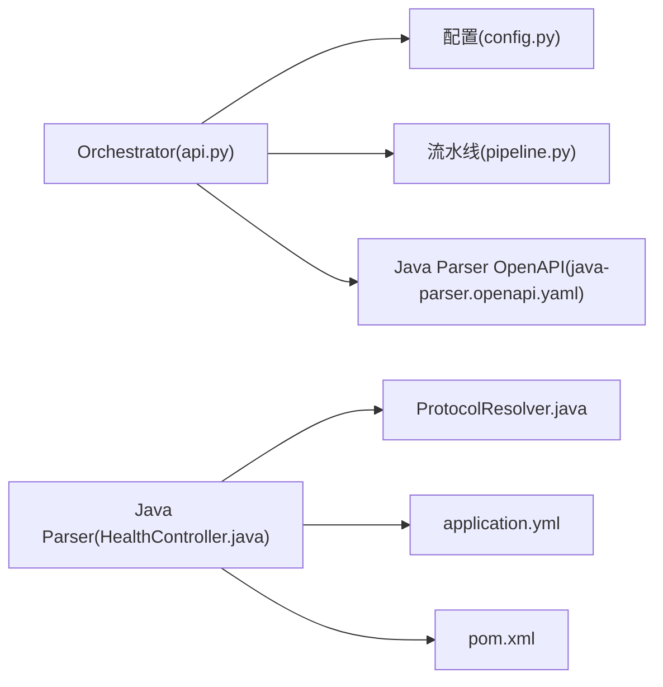
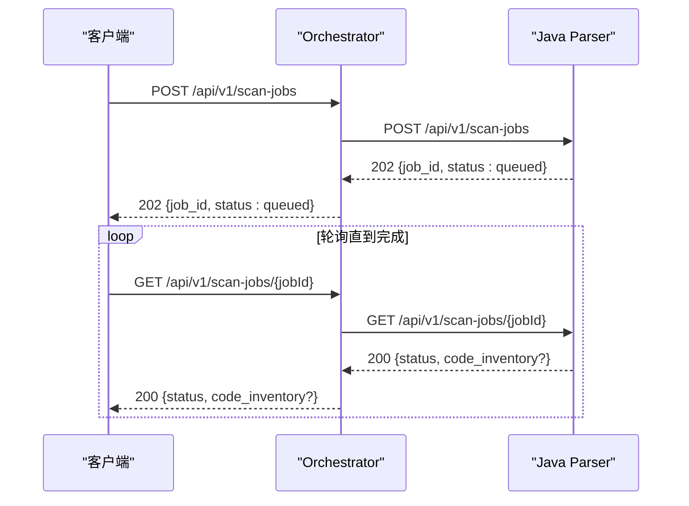

# API参考文档

<cite>
**本文引用的文件**
- [java-parser.openapi.yaml](file://schemas/contracts/java-parser.openapi.yaml)
- [api.py](file://services/orchestrator/src/orchestrator/api.py)
- [HealthController.java](file://services/java-parser/src/main/java/com/llmautotest/parser/HealthController.java)
- [ProtocolResolver.java](file://services/java-parser/src/main/java/com/llmautotest/parser/ProtocolResolver.java)
- [application.yml](file://services/java-parser/src/main/resources/application.yml)
- [pom.xml](file://services/java-parser/pom.xml)
- [config.py](file://services/orchestrator/src/orchestrator/config.py)
- [pipeline.py](file://services/orchestrator/src/orchestrator/pipeline.py)
- [code_inventory.json](file://schemas/code_inventory.json)
- [interface_candidates.json](file://schemas/interface_candidates.json)
- [README.md](file://schemas/README.md)
- [09-API接口规格.md](file://MumuSpec/09-API接口规格.md)
</cite>

## 目录
1. [简介](#简介)
2. [项目结构](#项目结构)
3. [核心组件](#核心组件)
4. [架构总览](#架构总览)
5. [详细组件分析](#详细组件分析)
6. [依赖关系分析](#依赖关系分析)
7. [性能与限流](#性能与限流)
8. [认证与授权](#认证与授权)
9. [版本兼容性与演进](#版本兼容性与演进)
10. [最佳实践与错误处理](#最佳实践与错误处理)
11. [故障排查指南](#故障排查指南)
12. [结论](#结论)
13. [附录：API端点清单与示例](#附录api端点清单与示例)

## 简介
本参考文档面向LLM-AutoTest的编排服务（orchestrator）与Java解析器服务（java-parser），提供完整的REST API说明，包括HTTP方法、URL路径、请求参数、响应格式、错误码、调用流程、认证与限流策略、版本兼容性以及最佳实践。文档严格基于仓库中的契约定义与源码实现进行整理，确保可追溯与可验证。

## 项目结构
- orchestrator（Python FastAPI）：负责流水线编排、节点状态查询与健康检查等对外API。
- java-parser（Java Spring Boot）：负责多仓库代码扫描与接口候选提取，采用异步Job模式（创建Job→轮询结果）。
- schemas：集中存放产物Schema与服务间契约（OpenAPI/JSON Schema），作为数据模型单一事实来源。

图表来源
- [api.py:11-27](file://services/orchestrator/src/orchestrator/api.py#L11-L27)
- [java-parser.openapi.yaml:1-116](file://schemas/contracts/java-parser.openapi.yaml#L1-L116)
- [config.py:9-24](file://services/orchestrator/src/orchestrator/config.py#L9-L24)

章节来源
- [api.py:11-27](file://services/orchestrator/src/orchestrator/api.py#L11-L27)
- [java-parser.openapi.yaml:1-116](file://schemas/contracts/java-parser.openapi.yaml#L1-L116)
- [config.py:9-24](file://services/orchestrator/src/orchestrator/config.py#L9-L24)

## 核心组件
- Orchestrator API
  - 健康检查：GET /health
  - 流水线节点清单与当前状态：GET /api/v1/pipeline/nodes
- Java Parser API（异步Job模式）
  - 健康检查：GET /health
  - 创建代码扫描任务：POST /api/v1/scan-jobs
  - 查询扫描任务状态与产物：GET /api/v1/scan-jobs/{jobId}
  - 创建接口候选提取任务：POST /api/v1/extract-jobs
  - 查询候选提取任务状态与产物：GET /api/v1/extract-jobs/{jobId}

章节来源
- [api.py:16-25](file://services/orchestrator/src/orchestrator/api.py#L16-L25)
- [java-parser.openapi.yaml:12-116](file://schemas/contracts/java-parser.openapi.yaml#L12-L116)

## 架构总览
编排服务通过FastAPI暴露REST接口，内部维护9个固定节点的流水线状态；Java解析器服务以Spring Boot运行，提供异步Job接口用于多仓库扫描与接口候选提取。两者通过明确的契约（OpenAPI/JSON Schema）交互，产物统一遵循schemas目录下的Schema定义。

图表来源
- [java-parser.openapi.yaml:24-70](file://schemas/contracts/java-parser.openapi.yaml#L24-L70)
- [config.py:13-15](file://services/orchestrator/src/orchestrator/config.py#L13-L15)

章节来源
- [java-parser.openapi.yaml:24-70](file://schemas/contracts/java-parser.openapi.yaml#L24-L70)
- [config.py:13-15](file://services/orchestrator/src/orchestrator/config.py#L13-L15)

## 详细组件分析

### Orchestrator 服务
- 框架：FastAPI
- 关键端点
  - GET /health：返回服务存活信息
  - GET /api/v1/pipeline/nodes：返回9个固定节点及其当前状态摘要
- 配置
  - 端口、制品根目录、Java解析器地址、LLM调用参数等通过环境变量注入
- 流水线节点
  - 固定顺序：req_parse → code_scan → interface_reconstruct → code_review → testcase_generate → auto_execute → test_report → defect_list → retest_regression

图表来源
- [config.py:9-56](file://services/orchestrator/src/orchestrator/config.py#L9-L56)
- [pipeline.py:11-84](file://services/orchestrator/src/orchestrator/pipeline.py#L11-L84)

章节来源
- [api.py:11-27](file://services/orchestrator/src/orchestrator/api.py#L11-L27)
- [config.py:9-56](file://services/orchestrator/src/orchestrator/config.py#L9-L56)
- [pipeline.py:11-84](file://services/orchestrator/src/orchestrator/pipeline.py#L11-L84)

### Java Parser 服务
- 框架：Spring Boot 3.4 + JavaParser
- 关键端点（异步Job模式）
  - GET /health：健康检查
  - POST /api/v1/scan-jobs：创建多仓库扫描任务
  - GET /api/v1/scan-jobs/{jobId}：查询扫描任务状态与产物（含code_inventory）
  - POST /api/v1/extract-jobs：创建接口候选提取任务
  - GET /api/v1/extract-jobs/{jobId}：查询候选提取任务状态与产物（含candidates）
- 协议解析策略
  - 通过ProtocolResolver接口支持rest/grpc/graphql/soap/mq等协议的扩展

图表来源
- [java-parser.openapi.yaml:24-70](file://schemas/contracts/java-parser.openapi.yaml#L24-L70)
- [ProtocolResolver.java:6-16](file://services/java-parser/src/main/java/com/llmautotest/parser/ProtocolResolver.java#L6-L16)

章节来源
- [java-parser.openapi.yaml:12-116](file://schemas/contracts/java-parser.openapi.yaml#L12-L116)
- [ProtocolResolver.java:6-16](file://services/java-parser/src/main/java/com/llmautotest/parser/ProtocolResolver.java#L6-L16)
- [application.yml:1-8](file://services/java-parser/src/main/resources/application.yml#L1-L8)
- [pom.xml:11-47](file://services/java-parser/pom.xml#L11-L47)

## 依赖关系分析
- Orchestrator依赖
  - FastAPI框架
  - 环境变量配置（Settings）
  - 流水线状态管理（PipelineState/NODE_ORDER）
- Java Parser依赖
  - Spring Boot Web
  - JavaParser Symbol Solver
  - 可插拔协议解析策略（ProtocolResolver）

图表来源
- [api.py:11-27](file://services/orchestrator/src/orchestrator/api.py#L11-L27)
- [config.py:9-56](file://services/orchestrator/src/orchestrator/config.py#L9-L56)
- [pipeline.py:11-84](file://services/orchestrator/src/orchestrator/pipeline.py#L11-L84)
- [java-parser.openapi.yaml:1-116](file://schemas/contracts/java-parser.openapi.yaml#L1-L116)
- [HealthController.java:1-18](file://services/java-parser/src/main/java/com/llmautotest/parser/HealthController.java#L1-L18)
- [ProtocolResolver.java:6-16](file://services/java-parser/src/main/java/com/llmautotest/parser/ProtocolResolver.java#L6-L16)
- [application.yml:1-8](file://services/java-parser/src/main/resources/application.yml#L1-L8)
- [pom.xml:11-47](file://services/java-parser/pom.xml#L11-L47)

章节来源
- [api.py:11-27](file://services/orchestrator/src/orchestrator/api.py#L11-L27)
- [config.py:9-56](file://services/orchestrator/src/orchestrator/config.py#L9-L56)
- [pipeline.py:11-84](file://services/orchestrator/src/orchestrator/pipeline.py#L11-L84)
- [java-parser.openapi.yaml:1-116](file://schemas/contracts/java-parser.openapi.yaml#L1-L116)
- [HealthController.java:1-18](file://services/java-parser/src/main/java/com/llmautotest/parser/HealthController.java#L1-L18)
- [ProtocolResolver.java:6-16](file://services/java-parser/src/main/java/com/llmautotest/parser/ProtocolResolver.java#L6-L16)
- [application.yml:1-8](file://services/java-parser/src/main/resources/application.yml#L1-L8)
- [pom.xml:11-47](file://services/java-parser/pom.xml#L11-L47)

## 性能与限流
- 并发控制
  - Java Parser支持扫描并发度配置（默认值见配置文件），可按资源情况调整
- 超时控制
  - Orchestrator侧对LLM调用设置超时时间，避免长尾阻塞
- 建议
  - 合理设置扫描并发度与LLM超时，结合制品存储IO能力调优
  - 大仓库建议使用include_paths截断扫描范围，减少I/O与解析开销

章节来源
- [application.yml:5-8](file://services/java-parser/src/main/resources/application.yml#L5-L8)
- [config.py:16-24](file://services/orchestrator/src/orchestrator/config.py#L16-L24)
- [java-parser.openapi.yaml:162-184](file://schemas/contracts/java-parser.openapi.yaml#L162-L184)

## 认证与授权
- 当前骨架阶段未内置鉴权中间件
- LLM密钥通过环境变量传入，不进入日志输出
- 建议在网关或反向代理层统一接入认证与访问控制

章节来源
- [config.py:16-24](file://services/orchestrator/src/orchestrator/config.py#L16-L24)

## 版本兼容性与演进
- 服务版本
  - Orchestrator：FastAPI应用版本在创建时声明
  - Java Parser：Maven项目版本与OpenAPI契约版本独立管理
- 数据模型版本
  - 所有结构化产物必须包含schema_version字段，禁止原地破坏性变更
  - 契约优先：java-parser的接口与返回结构与OpenAPI契约对齐

章节来源
- [api.py:13-14](file://services/orchestrator/src/orchestrator/api.py#L13-L14)
- [pom.xml:18-22](file://services/java-parser/pom.xml#L18-L22)
- [java-parser.openapi.yaml:5-10](file://schemas/contracts/java-parser.openapi.yaml#L5-L10)
- [README.md:5-10](file://schemas/README.md#L5-L10)

## 最佳实践与错误处理
- 调用模式
  - 长任务一律采用异步Job模式：创建Job后轮询状态直至完成或失败
- 错误结构
  - 统一错误对象包含稳定错误码、可读消息、可选节点ID与结构化详情
- 重试与退避
  - 对4xx/5xx进行指数退避重试，避免雪崩
- 输入校验
  - 严格校验必填字段与枚举值，尽早返回400错误
- 产物校验
  - 下游消费前使用对应JSON Schema校验，确保一致性

章节来源
- [java-parser.openapi.yaml:130-148](file://schemas/contracts/java-parser.openapi.yaml#L130-L148)
- [README.md:5-10](file://schemas/README.md#L5-L10)

## 故障排查指南
- 常见问题
  - repositories为空：返回400，检查请求体
  - job不存在：返回404，确认jobId是否正确
  - 扫描结果为empty/truncated/error：根据RepoScanStatus判断后续策略
- 定位步骤
  - 先查健康检查端点确认服务存活
  - 再查Job状态，关注warnings与error字段
  - 核对artifacts_root下对应job_id产物是否生成

章节来源
- [java-parser.openapi.yaml:41-70](file://schemas/contracts/java-parser.openapi.yaml#L41-L70)
- [java-parser.openapi.yaml:199-235](file://schemas/contracts/java-parser.openapi.yaml#L199-L235)

## 结论
本参考文档基于仓库中的OpenAPI契约与源码实现，梳理了orchestrator与java-parser的核心API、数据模型、调用流程与错误规范。建议在生产环境补充认证授权、限流与监控告警，并持续以Schema与契约驱动演进。

## 附录：API端点清单与示例

### Orchestrator API
- GET /health
  - 描述：健康检查
  - 响应：{status: "ok"}
- GET /api/v1/pipeline/nodes
  - 描述：返回9个节点及其当前状态摘要
  - 响应：{nodes: [{name, status}, ...]}

章节来源
- [api.py:16-25](file://services/orchestrator/src/orchestrator/api.py#L16-L25)

### Java Parser API（异步Job）
- GET /health
  - 描述：健康检查
  - 响应：{status: "ok", service: "java-parser"}
- POST /api/v1/scan-jobs
  - 描述：创建多仓库扫描任务
  - 请求体：{job_id, repositories[]}
  - 响应：202 {job_id, status: queued}
  - 错误：400 {code, message, details?}
- GET /api/v1/scan-jobs/{jobId}
  - 描述：查询扫描任务状态与产物
  - 响应：200 {job_id, status, code_inventory?}
  - 错误：404 {code, message}
- POST /api/v1/extract-jobs
  - 描述：创建接口候选提取任务
  - 请求体：{job_id, repositories[], protocols?}
  - 响应：202 {job_id, status: queued}
- GET /api/v1/extract-jobs/{jobId}
  - 描述：查询候选提取任务状态与产物
  - 响应：200 {job_id, status, candidates?, warnings?}
  - 错误：404 {code, message}

章节来源
- [java-parser.openapi.yaml:12-116](file://schemas/contracts/java-parser.openapi.yaml#L12-L116)

### 数据模型与Schema
- code_inventory.json
  - 描述：源码扫描清单（仓库四态：ok/empty/truncated/error）
  - 关键字段：schema_version, job_id, repositories[]
- interface_candidates.json
  - 描述：接口候选清单（静态特征定位产物）
  - 关键字段：schema_version, job_id, candidates[], warnings[]

章节来源
- [code_inventory.json:1-57](file://schemas/code_inventory.json#L1-L57)
- [interface_candidates.json:1-58](file://schemas/interface_candidates.json#L1-L58)
- [README.md:12-29](file://schemas/README.md#L12-L29)

### 错误码与统一错误结构
- 统一错误对象：{code, message, node_id?, details?}
- 常见错误场景：请求非法、job不存在、扫描失败、解析失败等

章节来源
- [java-parser.openapi.yaml:130-148](file://schemas/contracts/java-parser.openapi.yaml#L130-L148)

### 版本与兼容性
- Orchestrator版本：在应用创建时声明
- Java Parser版本：Maven项目版本与OpenAPI契约版本
- 数据模型版本：schema_version字段强制升级，禁止破坏性变更

章节来源
- [api.py:13-14](file://services/orchestrator/src/orchestrator/api.py#L13-L14)
- [pom.xml:18-22](file://services/java-parser/pom.xml#L18-L22)
- [java-parser.openapi.yaml:5-10](file://schemas/contracts/java-parser.openapi.yaml#L5-L10)
- [README.md:5-10](file://schemas/README.md#L5-L10)

### 调用流程图（扫描任务）

图表来源
- [java-parser.openapi.yaml:24-70](file://schemas/contracts/java-parser.openapi.yaml#L24-L70)

### 参考文档与契约
- OpenAPI契约：schemas/contracts/java-parser.openapi.yaml
- 需求与API规格：MumuSpec/09-API接口规格.md

章节来源
- [java-parser.openapi.yaml:1-116](file://schemas/contracts/java-parser.openapi.yaml#L1-L116)
- [09-API接口规格.md:29-178](file://MumuSpec/09-API接口规格.md#L29-L178)