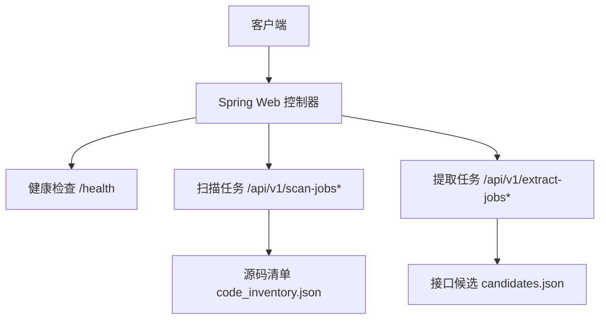
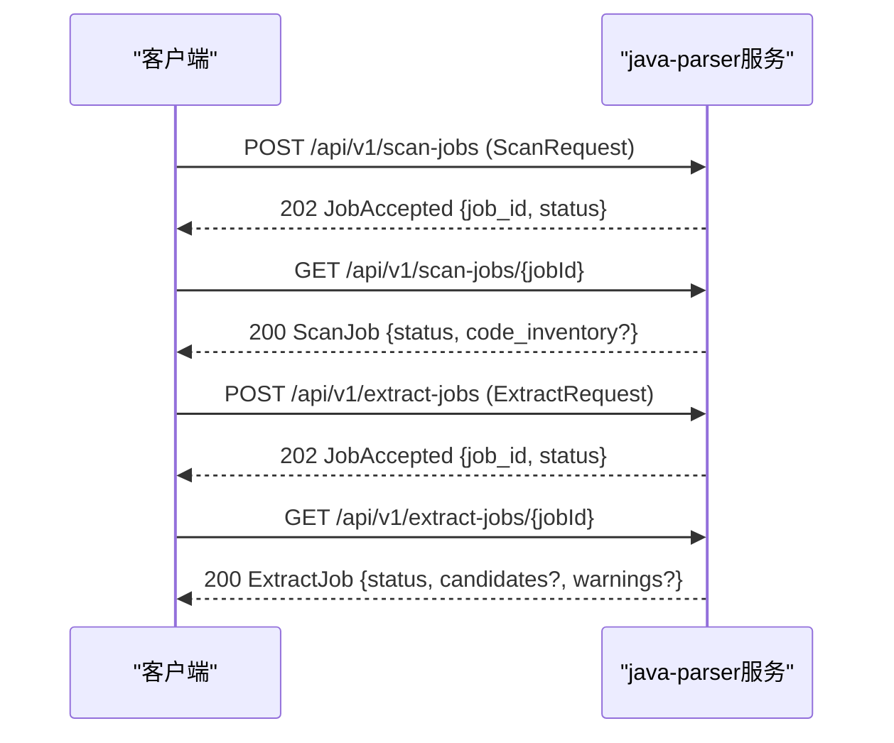
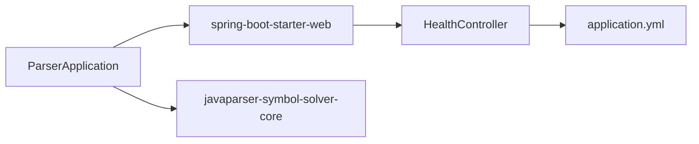

# Java解析器服务API

<cite>
**本文引用的文件**
- [java-parser.openapi.yaml](file://schemas/contracts/java-parser.openapi.yaml)
- [ParserApplication.java](file://services/java-parser/src/main/java/com/llmautotest/parser/ParserApplication.java)
- [HealthController.java](file://services/java-parser/src/main/java/com/llmautotest/parser/HealthController.java)
- [ProtocolResolver.java](file://services/java-parser/src/main/java/com/llmautotest/parser/ProtocolResolver.java)
- [application.yml](file://services/java-parser/src/main/resources/application.yml)
- [pom.xml](file://services/java-parser/pom.xml)
- [code_inventory.json](file://schemas/code_inventory.json)
- [interface_candidates.sample.json](file://schemas/samples/interface_candidates.sample.json)
- [interfaces.sample.json](file://schemas/samples/interfaces.sample.json)
</cite>

## 目录
1. [简介](#简介)
2. [项目结构](#项目结构)
3. [核心组件](#核心组件)
4. [架构总览](#架构总览)
5. [详细接口说明](#详细接口说明)
6. [依赖关系分析](#依赖关系分析)
7. [性能与最佳实践](#性能与最佳实践)
8. [故障排查指南](#故障排查指南)
9. [结论](#结论)
10. [附录：多协议调用方式](#附录多协议调用方式)

## 简介
本服务提供Java代码扫描与接口候选提取能力，面向多仓库静态分析场景。通过REST API暴露异步任务模型（创建任务→轮询状态与产物），输出源码清单与接口候选项，供编排侧进行后续LLM语义解析与最终接口还原。服务支持REST、gRPC、GraphQL、SOAP、MQ等协议的静态特征定位，并以统一错误结构与可观测字段（如置信度、兜底标记）增强下游处理。

## 项目结构
- Spring Boot应用入口与配置位于 services/java-parser 模块；OpenAPI契约定义于 schemas/contracts；数据模型与示例位于 schemas 目录。
- 健康检查端点已实现；扫描与提取任务为异步Job模式，由编排侧驱动。

图表来源
- [java-parser.openapi.yaml:11-116](file://schemas/contracts/java-parser.openapi.yaml#L11-L116)
- [HealthController.java:12-16](file://services/java-parser/src/main/java/com/llmautotest/parser/HealthController.java#L12-L16)

章节来源
- [ParserApplication.java:1-17](file://services/java-parser/src/main/java/com/llmautotest/parser/ParserApplication.java#L1-L17)
- [application.yml:1-8](file://services/java-parser/src/main/resources/application.yml#L1-L8)
- [java-parser.openapi.yaml:1-116](file://schemas/contracts/java-parser.openapi.yaml#L1-L116)

## 核心组件
- 应用入口：Spring Boot启动类，启用属性扫描。
- 健康检查：返回服务存活信息，用于编排与健康探针。
- 协议解析策略：抽象接口，支持按协议扩展解析逻辑（REST/gRPC/GraphQL/SOAP/MQ）。
- OpenAPI契约：定义所有REST端点、请求/响应体、枚举与错误结构。
- 数据模型：源码清单与接口候选的数据Schema与示例。

章节来源
- [ParserApplication.java:1-17](file://services/java-parser/src/main/java/com/llmautotest/parser/ParserApplication.java#L1-L17)
- [HealthController.java:1-18](file://services/java-parser/src/main/java/com/llmautotest/parser/HealthController.java#L1-L18)
- [ProtocolResolver.java:1-17](file://services/java-parser/src/main/java/com/llmautotest/parser/ProtocolResolver.java#L1-L17)
- [java-parser.openapi.yaml:117-369](file://schemas/contracts/java-parser.openapi.yaml#L117-L369)

## 架构总览
服务采用“异步Job + 轮询”的REST工作流：
- 创建扫描任务：提交仓库列表，返回job_id与初始状态。
- 查询扫描任务：根据job_id获取当前状态与产物（源码清单）。
- 创建提取任务：基于源码清单执行静态特征定位，返回job_id。
- 查询提取任务：根据job_id获取候选清单与告警。

图表来源
- [java-parser.openapi.yaml:24-116](file://schemas/contracts/java-parser.openapi.yaml#L24-L116)

章节来源
- [java-parser.openapi.yaml:24-116](file://schemas/contracts/java-parser.openapi.yaml#L24-L116)

## 详细接口说明

### 健康检查
- 方法: GET
- URL: /health
- 请求头: 无特殊要求
- 请求体: 无
- 响应体: Health对象
  - status: 固定字符串
  - service: 固定字符串
- 状态码: 200

章节来源
- [java-parser.openapi.yaml:12-23](file://schemas/contracts/java-parser.openapi.yaml#L12-L23)
- [HealthController.java:12-16](file://services/java-parser/src/main/java/com/llmautotest/parser/HealthController.java#L12-L16)

### 创建扫描任务
- 方法: POST
- URL: /api/v1/scan-jobs
- 请求头: Content-Type: application/json
- 请求体: ScanRequest
  - job_id: 字符串（由编排侧生成）
  - repositories: 数组，至少2项
    - name: 仓库显示名
    - path: 容器内可见的本地路径
    - branch: 分支名
    - is_fallback: 是否兜底演示仓库（默认false）
    - include_paths: 可选，超大仓库截断时的核心模块目录
- 响应体:
  - 202: JobAccepted {job_id, status}
  - 400: Error {code, message, node_id?, details?}
- 说明: 长任务异步处理，需轮询状态与结果。

章节来源
- [java-parser.openapi.yaml:24-47](file://schemas/contracts/java-parser.openapi.yaml#L24-L47)
- [java-parser.openapi.yaml:162-198](file://schemas/contracts/java-parser.openapi.yaml#L162-L198)
- [java-parser.openapi.yaml:130-148](file://schemas/contracts/java-parser.openapi.yaml#L130-L148)

### 查询扫描任务
- 方法: GET
- URL: /api/v1/scan-jobs/{jobId}
- 路径参数: jobId（字符串）
- 响应体:
  - 200: ScanJob
    - allOf: JobAccepted
    - code_inventory?: 完成时包含源码清单
      - schema_version: 字符串
      - job_id: 字符串
      - repositories: 数组
        - name/path/branch/is_fallback/status/file_count
        - truncated_scope?: 截断范围
        - encoding_skipped?: 异常编码跳过文件
        - error?: 错误对象
        - files?: 源码文件清单
          - repo/module/path
  - 404: Error
- 说明: 未完成时可能仅返回job_id与status。

章节来源
- [java-parser.openapi.yaml:48-71](file://schemas/contracts/java-parser.openapi.yaml#L48-L71)
- [java-parser.openapi.yaml:199-273](file://schemas/contracts/java-parser.openapi.yaml#L199-L273)
- [code_inventory.json:1-57](file://schemas/code_inventory.json#L1-L57)

### 创建接口候选提取任务
- 方法: POST
- URL: /api/v1/extract-jobs
- 请求头: Content-Type: application/json
- 请求体: ExtractRequest
  - job_id: 字符串
  - repositories: 数组（同RepositoryInput）
  - protocols?: 可选，指定需要识别的协议集合，枚举值: rest, grpc, graphql, soap, mq
- 响应体:
  - 202: JobAccepted {job_id, status}
  - 400: Error
- 说明: 基于源码清单做静态特征定位，产出候选清单供后续LLM语义解析使用。

章节来源
- [java-parser.openapi.yaml:72-92](file://schemas/contracts/java-parser.openapi.yaml#L72-L92)
- [java-parser.openapi.yaml:274-290](file://schemas/contracts/java-parser.openapi.yaml#L274-L290)

### 查询接口候选提取任务
- 方法: GET
- URL: /api/v1/extract-jobs/{jobId}
- 路径参数: jobId（字符串）
- 响应体:
  - 200: ExtractJob
    - allOf: JobAccepted
    - candidates?: 完成时包含候选数组
      - candidate_id: 字符串
      - protocol: 枚举 {rest, grpc, graphql, soap, mq}
      - signature: 静态签名（HTTP方法+路径或service方法等）
      - code_location: CodeLocation
        - repo/file/start_line/end_line
      - snippet?: 源码片段
      - related_files?: 关联文件
        - repo/file/role(start_line?, end_line?)
        - role: {controller, service, dto, proto, wsdl, listener, other}
      - is_fallback: 布尔
      - confidence?: 0~1的置信度
    - warnings?: 告警数组
  - 404: Error

章节来源
- [java-parser.openapi.yaml:93-116](file://schemas/contracts/java-parser.openapi.yaml#L93-L116)
- [java-parser.openapi.yaml:291-369](file://schemas/contracts/java-parser.openapi.yaml#L291-L369)

### 数据结构与字段说明
- RepositoryInput: 仓库输入，含name/path/branch/is_fallback/include_paths
- RepoScanStatus: ok/empty/truncated/error
- SourceFile: repo/module/path
- CodeLocation: repo/file/start_line/end_line
- RelatedFile: repo/file/role及行号区间
- InterfaceCandidate: 候选项核心结构，含protocol/signature/code_location/snippet/related_files/is_fallback/confidence
- ExtractJob: 包含candidates与warnings

章节来源
- [java-parser.openapi.yaml:162-369](file://schemas/contracts/java-parser.openapi.yaml#L162-L369)
- [code_inventory.json:1-57](file://schemas/code_inventory.json#L1-L57)

### 请求与响应示例（以路径引用代替具体内容）
- 健康检查响应示例: 参考 [java-parser.openapi.yaml:119-129](file://schemas/contracts/java-parser.openapi.yaml#L119-L129)
- 创建扫描任务请求体示例: 参考 [java-parser.openapi.yaml:185-198](file://schemas/contracts/java-parser.openapi.yaml#L185-L198)
- 扫描任务产物（源码清单）示例: 参考 [code_inventory.json:1-57](file://schemas/code_inventory.json#L1-L57)
- 接口候选示例: 参考 [interface_candidates.sample.json:1-62](file://schemas/samples/interface_candidates.sample.json#L1-L62)
- 最终接口还原示例（供对比理解）: 参考 [interfaces.sample.json:1-75](file://schemas/samples/interfaces.sample.json#L1-L75)

章节来源
- [java-parser.openapi.yaml:119-129](file://schemas/contracts/java-parser.openapi.yaml#L119-L129)
- [java-parser.openapi.yaml:185-198](file://schemas/contracts/java-parser.openapi.yaml#L185-L198)
- [code_inventory.json:1-57](file://schemas/code_inventory.json#L1-L57)
- [interface_candidates.sample.json:1-62](file://schemas/samples/interface_candidates.sample.json#L1-L62)
- [interfaces.sample.json:1-75](file://schemas/samples/interfaces.sample.json#L1-L75)

## 依赖关系分析
- 运行时依赖: Spring Boot Web（提供REST能力）、JavaParser Symbol Solver（源码解析核心）。
- 构建与质量: Checkstyle插件在verify阶段执行代码风格检查。
- 配置: 端口与扫描并发度可通过application.yml与环境变量覆盖。

图表来源
- [pom.xml:31-47](file://services/java-parser/pom.xml#L31-L47)
- [application.yml:1-8](file://services/java-parser/src/main/resources/application.yml#L1-L8)
- [HealthController.java:9-16](file://services/java-parser/src/main/java/com/llmautotest/parser/HealthController.java#L9-L16)

章节来源
- [pom.xml:1-83](file://services/java-parser/pom.xml#L1-L83)
- [application.yml:1-8](file://services/java-parser/src/main/resources/application.yml#L1-L8)

## 性能与最佳实践
- 并发控制: 通过parser.scan-concurrency调整多仓库扫描并发度，避免资源争用。
- 大仓库处理: 使用include_paths限定扫描范围，结合truncated_scope记录实际范围，减少IO与解析开销。
- 编码容错: 对异常编码文件记录encoding_skipped并跳过，保证流程继续。
- 错误收敛: 统一Error结构，避免堆栈与敏感路径泄露。
- 异步轮询: 客户端应实现退避重试，避免频繁轮询造成压力。
- 协议过滤: 在提取阶段通过protocols限制协议范围，降低解析成本。
- 版本兼容: 遵循schema_version与契约演进，避免破坏下游。

章节来源
- [application.yml:5-8](file://services/java-parser/src/main/resources/application.yml#L5-L8)
- [java-parser.openapi.yaml:179-184](file://schemas/contracts/java-parser.openapi.yaml#L179-L184)
- [java-parser.openapi.yaml:229-234](file://schemas/contracts/java-parser.openapi.yaml#L229-L234)
- [java-parser.openapi.yaml:130-148](file://schemas/contracts/java-parser.openapi.yaml#L130-L148)

## 故障排查指南
- 400 非法请求: 检查repositories是否为空或不符合约束（如minItems=2）。
- 404 任务不存在: 确认job_id是否正确且任务尚未被清理。
- 扫描状态error: 检查path是否存在、权限是否足够、分支是否正确。
- 扫描状态empty: 无可分析内容，流程继续，可在编排侧提示。
- 扫描状态truncated: 确认include_paths设置是否合理，查看truncated_scope。
- 编码跳过: 关注encoding_skipped列表，必要时转换编码后重试。
- 提取告警: 关注warnings，例如候选数低于阈值时建议切换兜底仓库。

章节来源
- [java-parser.openapi.yaml:41-47](file://schemas/contracts/java-parser.openapi.yaml#L41-L47)
- [java-parser.openapi.yaml:65-71](file://schemas/contracts/java-parser.openapi.yaml#L65-L71)
- [java-parser.openapi.yaml:199-206](file://schemas/contracts/java-parser.openapi.yaml#L199-L206)
- [java-parser.openapi.yaml:229-234](file://schemas/contracts/java-parser.openapi.yaml#L229-L234)
- [java-parser.openapi.yaml:362-369](file://schemas/contracts/java-parser.openapi.yaml#L362-L369)

## 结论
本服务以REST API暴露异步扫描与提取能力，提供稳定的错误结构与可扩展的协议解析策略，满足多仓库静态分析与接口候选提取需求。配合编排侧的轮询与后续LLM语义解析，可实现从源码到接口的完整还原链路。

## 附录：多协议调用方式
- REST: 通过HTTP方法+路径声明接口；在候选中体现为signature（如GET /api/v1/users/{id}）。
- gRPC: 通过.proto定义service/rpc；候选signature为service_method（如user.UserService/GetUser）。
- GraphQL: 通过schema定义query/mutation；候选signature可为操作名或类型描述。
- SOAP: 通过WSDL定义服务；候选signature为服务/操作名。
- MQ: 通过消息监听器/主题标识；候选signature为队列/主题名或事件名。

调用要点
- 在ExtractRequest.protocols中指定需要识别的协议集合，以减少不必要的解析。
- 相关上下文通过related_files与snippet提供，便于后续语义解析与人工复核。
- 置信度confidence与兜底标记is_fallback辅助下游决策与分列统计。

章节来源
- [java-parser.openapi.yaml:284-290](file://schemas/contracts/java-parser.openapi.yaml#L284-L290)
- [java-parser.openapi.yaml:323-352](file://schemas/contracts/java-parser.openapi.yaml#L323-L352)
- [ProtocolResolver.java:6-16](file://services/java-parser/src/main/java/com/llmautotest/parser/ProtocolResolver.java#L6-L16)