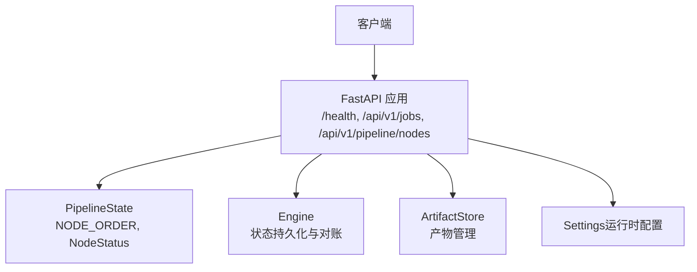
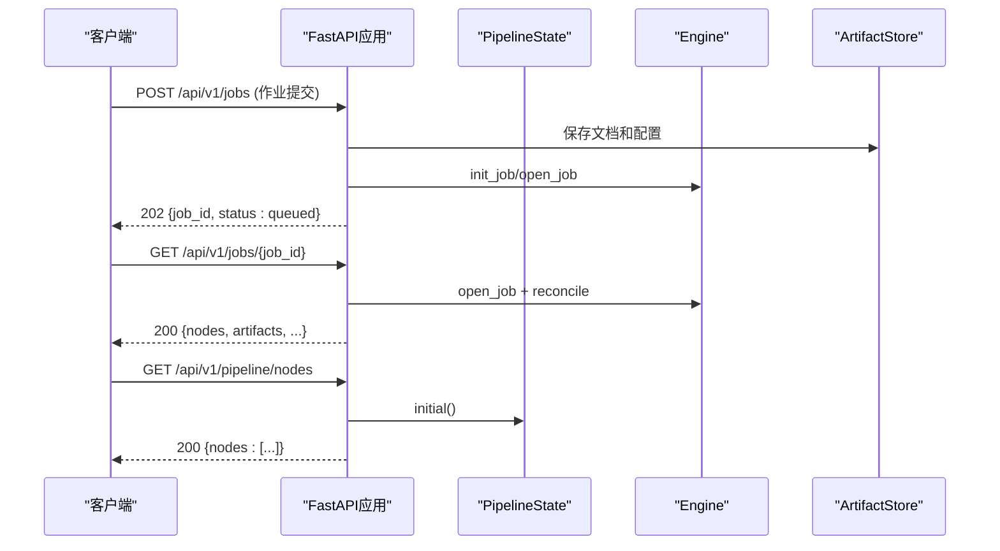
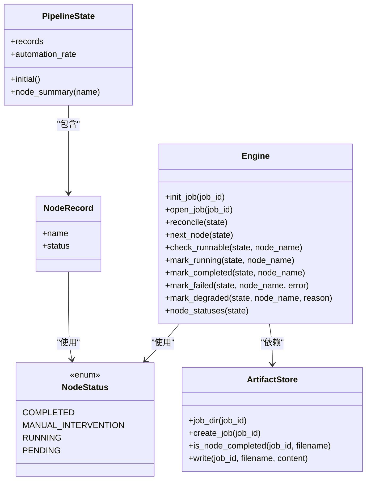

# 编排服务API

<cite>
**本文引用的文件**
- [services/orchestrator/src/orchestrator/api.py](file://services/orchestrator/src/orchestrator/api.py)
- [services/orchestrator/src/orchestrator/pipeline.py](file://services/orchestrator/src/orchestrator/pipeline.py)
- [services/orchestrator/src/orchestrator/engine.py](file://services/orchestrator/src/orchestrator/engine.py)
- [services/orchestrator/src/orchestrator/errors.py](file://services/orchestrator/src/orchestrator/errors.py)
- [services/orchestrator/src/orchestrator/config.py](file://services/orchestrator/src/orchestrator/config.py)
- [services/orchestrator/tests/test_api.py](file://services/orchestrator/tests/test_api.py)
</cite>

## 更新摘要
**变更内容**
- 从简单健康检查扩展为完整的RESTful作业管理系统
- 新增作业提交、状态监控、产物管理和重测功能
- 支持base64编码文档提交和多仓库配置
- 实现断点续跑、人工审核、重跑等高级功能
- 完善错误处理机制和安全验证

## 目录
1. [简介](#简介)
2. [项目结构](#项目结构)
3. [核心组件](#核心组件)
4. [架构总览](#架构总览)
5. [接口详细文档](#接口详细文档)
6. [依赖关系分析](#依赖关系分析)
7. [性能与可用性](#性能与可用性)
8. [故障排查指南](#故障排查指南)
9. [结论](#结论)
10. [附录：版本控制与兼容性](#附录版本控制与兼容性)

## 简介
本文件为"编排服务"的完整REST API规范，现已从简单的健康检查扩展为功能完备的作业管理系统。当前实现基于FastAPI，提供稳定的v1版本路径前缀，支持作业提交、状态监控、产物管理、重测和人工审核等功能。该文档详细说明所有HTTP端点、请求参数、响应格式和状态码，并解释PipelineState对象结构与NodeRecord字段含义。

## 项目结构
- **API层**：定义HTTP路由与响应格式，支持作业全生命周期管理
- **领域模型**：定义节点顺序、状态枚举、流水线状态聚合
- **引擎层**：负责状态持久化、对账、跳序防护、降级清单
- **配置层**：从环境变量加载运行参数
- **入口**：启动Uvicorn服务器并挂载应用



**图表来源**
- [services/orchestrator/src/orchestrator/api.py:201-220](file://services/orchestrator/src/orchestrator/api.py#L201-L220)
- [services/orchestrator/src/orchestrator/pipeline.py:23-34](file://services/orchestrator/src/orchestrator/pipeline.py#L23-L34)
- [services/orchestrator/src/orchestrator/config.py:9-24](file://services/orchestrator/src/orchestrator/config.py#L9-L24)

**章节来源**
- [services/orchestrator/src/orchestrator/api.py:201-220](file://services/orchestrator/src/orchestrator/api.py#L201-L220)
- [services/orchestrator/src/orchestrator/config.py:9-24](file://services/orchestrator/src/orchestrator/config.py#L9-L24)

## 核心组件
- **FastAPI应用**：创建并注册路由，设置应用元信息（标题、版本）
- **PipelineState**：维护9个节点的初始状态与摘要输出
- **NodeStatus**：四态枚举（completed、manual_intervention、running、pending）
- **NODE_ORDER**：固定九节点顺序（req_parse、code_scan、interface_reconstruct、code_review、testcase_generate、auto_execute、test_report、defect_list、retest_regression）
- **Engine**：负责state.json持久化、断点续跑、跳序防护、降级清单
- **ArtifactStore**：产物存储与管理
- **Settings**：从环境变量读取端口、LLM、产物根目录等配置

**章节来源**
- [services/orchestrator/src/orchestrator/pipeline.py:11-34](file://services/orchestrator/src/orchestrator/pipeline.py#L11-L34)
- [services/orchestrator/src/orchestrator/pipeline.py:37-70](file://services/orchestrator/src/orchestrator/pipeline.py#L37-L70)
- [services/orchestrator/src/orchestrator/engine.py:134-160](file://services/orchestrator/src/orchestrator/engine.py#L134-L160)
- [services/orchestrator/src/orchestrator/config.py:9-24](file://services/orchestrator/src/orchestrator/config.py#L9-L24)

## 架构总览


**图表来源**
- [services/orchestrator/src/orchestrator/api.py:268-369](file://services/orchestrator/src/orchestrator/api.py#L268-L369)
- [services/orchestrator/src/orchestrator/api.py:404-424](file://services/orchestrator/src/orchestrator/api.py#L404-L424)
- [services/orchestrator/src/orchestrator/api.py:260-264](file://services/orchestrator/src/orchestrator/api.py#L260-L264)

## 接口详细文档

### 通用约定
- **基础路径**：/api/v1（版本前缀）
- **内容类型**：application/json
- **字符编码**：UTF-8
- **成功响应**：HTTP 200/202
- **失败响应**：HTTP 4xx/5xx + 统一错误体

### 健康检查
- **方法**：GET
- **路径**：/health
- **请求参数**：无
- **响应体**：
  - status: string，固定值 "ok"
- **状态码**：
  - 200：服务正常

**示例响应**
```json
{
  "status": "ok"
}
```

**章节来源**
- [services/orchestrator/src/orchestrator/api.py:241-244](file://services/orchestrator/src/orchestrator/api.py#L241-L244)

### 流水线节点查询
- **方法**：GET
- **路径**：/api/v1/pipeline/nodes
- **请求参数**：无
- **响应体**：
  - nodes: array<NodeSummary>
    - name: string，节点名称（来自固定九节点顺序）
    - status: string，节点状态（completed | manual_intervention | running | pending）
- **状态码**：
  - 200：成功返回9个节点摘要

**示例响应**
```json
{
  "nodes": [
    {"name": "req_parse", "status": "pending"},
    {"name": "code_scan", "status": "pending"},
    {"name": "interface_reconstruct", "status": "pending"},
    {"name": "code_review", "status": "pending"},
    {"name": "testcase_generate", "status": "pending"},
    {"name": "auto_execute", "status": "pending"},
    {"name": "test_report", "status": "pending"},
    {"name": "defect_list", "status": "pending"},
    {"name": "retest_regression", "status": "pending"}
  ]
}
```

**章节来源**
- [services/orchestrator/src/orchestrator/api.py:260-264](file://services/orchestrator/src/orchestrator/api.py#L260-L264)
- [services/orchestrator/src/orchestrator/pipeline.py:23-34](file://services/orchestrator/src/orchestrator/pipeline.py#L23-L34)

### 作业提交
- **方法**：POST
- **路径**：/api/v1/jobs
- **请求体**：JobSubmitRequest
  - job_id: string?，可选作业ID（自动生成）
  - docs: array<DocInput>?，多文档支持（优先于旧字段）
  - document_pairs: array<RequirementDocumentPair>?，版本文档配对
  - doc_name: string?，旧字段（兼容保留）
  - doc_content_b64: string?，旧字段（兼容保留）
  - repos: array<RepoConfig>，至少一个仓库配置
  - rest_url: string，被测服务地址
  - resume: boolean?，是否断点续跑（默认true）
  - auth: AuthConfig?，鉴权配置
  - llm: LlmConfig?，LLM配置
  - e2e: E2eConfig?，端到端测试配置
- **响应体**：
  - job_id: string，作业ID
  - status: string，"queued"表示已入队
- **状态码**：
  - 202：作业已接受
  - 400：请求参数验证失败
  - 409：作业正在运行中
  - 413：请求体过大

**示例请求**
```json
{
  "job_id": "job-web-c3e382183000-demo",
  "docs": [
    {
      "doc_name": "requirements.md",
      "doc_content_b64": "IyBSZXF1aXJlbWVudHMKCjEuIFF1ZXJ5IFVzZXIKMi4gQ3JlYXRlIFVzZXI="
    }
  ],
  "repos": [
    {
      "name": "order-center",
      "path": "/app/repo/order-center",
      "branch": "main",
      "language": "java"
    }
  ],
  "rest_url": "http://127.0.0.1:9000",
  "resume": true
}
```

**示例响应**
```json
{
  "job_id": "job-web-c3e382183000-demo",
  "status": "queued"
}
```

**章节来源**
- [services/orchestrator/src/orchestrator/api.py:268-369](file://services/orchestrator/src/orchestrator/api.py#L268-L369)
- [services/orchestrator/src/orchestrator/api.py:118-139](file://services/orchestrator/src/orchestrator/api.py#L118-L139)

### 作业列表查询
- **方法**：GET
- **路径**：/api/v1/jobs
- **请求参数**：无
- **响应体**：
  - jobs: array<JobSummary>
    - job_id: string，作业ID
    - created_at: string?，创建时间
    - updated_at: string?，更新时间
    - running: boolean，是否运行中
    - completed: integer，已完成节点数
    - degraded: integer，降级节点数
    - has_report: boolean，是否有测试报告
- **状态码**：
  - 200：成功返回作业列表

**示例响应**
```json
{
  "jobs": [
    {
      "job_id": "job-web-c3e382183000-demo",
      "created_at": "2024-01-01T00:00:00+00:00",
      "updated_at": "2024-01-01T00:05:00+00:00",
      "running": false,
      "completed": 9,
      "degraded": 0,
      "has_report": true
    }
  ]
}
```

**章节来源**
- [services/orchestrator/src/orchestrator/api.py:371-402](file://services/orchestrator/src/orchestrator/api.py#L371-L402)

### 作业状态查询
- **方法**：GET
- **路径**：/api/v1/jobs/{job_id}
- **路径参数**：
  - job_id: string，作业ID
- **响应体**：
  - job_id: string，作业ID
  - running: boolean，是否运行中
  - updated_at: string?，更新时间
  - nodes: array<NodeState>，9个节点状态
  - degraded: array<DegradedInfo>，降级信息
  - artifacts: array<string>，可用产物列表
  - rest_url: string?，被测服务地址
  - e2e: E2eConfig?，E2E配置
- **状态码**：
  - 200：成功返回作业状态
  - 404：作业不存在

**示例响应**
```json
{
  "job_id": "job-web-c3e382183000-demo",
  "running": false,
  "updated_at": "2024-01-01T00:05:00+00:00",
  "nodes": [
    {"name": "req_parse", "status": "completed", "updated_at": "...", "attempts": 1},
    {"name": "code_scan", "status": "completed", "updated_at": "...", "attempts": 1},
    {"name": "interface_reconstruct", "status": "completed", "updated_at": "...", "attempts": 1},
    {"name": "code_review", "status": "completed", "updated_at": "...", "attempts": 1},
    {"name": "testcase_generate", "status": "completed", "updated_at": "...", "attempts": 1},
    {"name": "auto_execute", "status": "completed", "updated_at": "...", "attempts": 1},
    {"name": "test_report", "status": "completed", "updated_at": "...", "attempts": 1},
    {"name": "defect_list", "status": "completed", "updated_at": "...", "attempts": 1},
    {"name": "retest_regression", "status": "completed", "updated_at": "...", "attempts": 1}
  ],
  "degraded": [],
  "artifacts": ["requirement_items.json", "test_report.md", "metrics.json"],
  "rest_url": "http://127.0.0.1:9000",
  "e2e": null
}
```

**章节来源**
- [services/orchestrator/src/orchestrator/api.py:404-424](file://services/orchestrator/src/orchestrator/api.py#L404-L424)

### 作业配置查询
- **方法**：GET
- **路径**：/api/v1/jobs/{job_id}/configuration
- **路径参数**：
  - job_id: string，作业ID
- **响应体**：可编辑的配置信息（脱敏处理）
- **状态码**：
  - 200：成功返回配置
  - 404：作业不存在

**章节来源**
- [services/orchestrator/src/orchestrator/api.py:426-465](file://services/orchestrator/src/orchestrator/api.py#L426-L465)

### 作业配置更新
- **方法**：PUT
- **路径**：/api/v1/jobs/{job_id}/configuration
- **路径参数**：
  - job_id: string，作业ID
- **请求体**：JobConfigurationUpdateRequest
- **响应体**：
  - job_id: string，作业ID
  - status: string，"configuration-saved-and-rerun-queued"
  - from_node: string，重跑起始节点
- **状态码**：
  - 202：配置已保存并重跑入队
  - 400：请求参数验证失败
  - 404：作业不存在
  - 409：作业正在运行中

**章节来源**
- [services/orchestrator/src/orchestrator/api.py:467-573](file://services/orchestrator/src/orchestrator/api.py#L467-L573)

### 作业日志查询
- **方法**：GET
- **路径**：/api/v1/jobs/{job_id}/logs
- **路径参数**：
  - job_id: string，作业ID
- **响应体**：
  - logs: array<LogEntry>，合并的日志条目
- **状态码**：
  - 200：成功返回日志
  - 404：作业不存在

**章节来源**
- [services/orchestrator/src/orchestrator/api.py:575-591](file://services/orchestrator/src/orchestrator/api.py#L575-L591)

### 作业导出
- **方法**：GET
- **路径**：/api/v1/jobs/{job_id}/export
- **路径参数**：
  - job_id: string，作业ID
- **响应体**：ZIP文件流，包含用户可见的产物
- **状态码**：
  - 200：成功返回ZIP文件
  - 404：作业不存在

**章节来源**
- [services/orchestrator/src/orchestrator/api.py:593-613](file://services/orchestrator/src/orchestrator/api.py#L593-L613)

### 产物读取
- **方法**：GET
- **路径**：/api/v1/jobs/{job_id}/artifacts/{name}
- **路径参数**：
  - job_id: string，作业ID
  - name: string，产物文件名
- **响应体**：JSON或文本内容
- **状态码**：
  - 200：成功返回产物
  - 404：产物不在白名单或未生成
  - 404：作业不存在

**章节来源**
- [services/orchestrator/src/orchestrator/api.py:615-630](file://services/orchestrator/src/orchestrator/api.py#L615-L630)

### 测试报告
- **方法**：GET
- **路径**：/api/v1/jobs/{job_id}/report
- **路径参数**：
  - job_id: string，作业ID
- **响应体**：Markdown格式的测试报告
- **状态码**：
  - 200：成功返回报告
  - 404：报告未生成或作业不存在

**章节来源**
- [services/orchestrator/src/orchestrator/api.py:632-640](file://services/orchestrator/src/orchestrator/api.py#L632-L640)

### 作业复测
- **方法**：POST
- **路径**：/api/v1/jobs/{job_id}/retest
- **路径参数**：
  - job_id: string，作业ID
- **请求体**：RetestRequest
  - defect_id: string?，缺陷ID（为空则全量复测）
- **响应体**：
  - job_id: string，作业ID
  - mode: string，"full"或"single"
  - status: string，"queued"（全量模式）
  - retested: array，单条模式下的复测结果
  - archived: integer，归档数量
  - warnings: array，警告信息
- **状态码**：
  - 200：成功
  - 404：作业不存在
  - 409：作业正在运行中

**章节来源**
- [services/orchestrator/src/orchestrator/api.py:644-669](file://services/orchestrator/src/orchestrator/api.py#L644-L669)

### 作业重跑
- **方法**：POST
- **路径**：/api/v1/jobs/{job_id}/rerun
- **路径参数**：
  - job_id: string，作业ID
- **请求体**：RerunRequest
  - from_node: string?，重跑起始节点
  - llm: LlmConfig?，LLM配置覆盖
  - rest_url: string?，被测服务地址覆盖
  - e2e: E2eConfig?，E2E配置覆盖
- **响应体**：
  - job_id: string，作业ID
  - status: string，"rerun-queued"
  - from_node: string，重跑起始节点
- **状态码**：
  - 200：成功
  - 400：from_node无效
  - 404：作业不存在
  - 409：作业正在运行中

**章节来源**
- [services/orchestrator/src/orchestrator/api.py:673-706](file://services/orchestrator/src/orchestrator/api.py#L673-L706)

### 人工审核
- **方法**：POST
- **路径**：/api/v1/jobs/{job_id}/review-log
- **路径参数**：
  - job_id: string，作业ID
- **请求体**：ReviewLogRequest
  - decision: string，"approved"或"rejected"
  - reviewer: string，审核人
  - note: string，备注
- **响应体**：
  - job_id: string，作业ID
  - decision: string，审核决定
  - reviewer: string，审核人
  - note: string，备注
  - rerun: string?，驳回时回流节点
- **状态码**：
  - 200：成功
  - 400：decision无效
  - 404：作业不存在
  - 409：作业正在运行中

**章节来源**
- [services/orchestrator/src/orchestrator/api.py:710-731](file://services/orchestrator/src/orchestrator/api.py#L710-L731)

## 依赖关系分析
- **API层**依赖PipelineState与NODE_ORDER以生成节点列表
- **PipelineState**依赖NodeStatus枚举与固定节点顺序
- **Engine模块**定义了更完整的运行时状态与持久化逻辑
- **ArtifactStore**负责产物文件的读写操作
- **配置模块**通过环境变量注入运行时参数



**图表来源**
- [services/orchestrator/src/orchestrator/pipeline.py:11-70](file://services/orchestrator/src/orchestrator/pipeline.py#L11-L70)
- [services/orchestrator/src/orchestrator/engine.py:134-267](file://services/orchestrator/src/orchestrator/engine.py#L134-L267)

**章节来源**
- [services/orchestrator/src/orchestrator/pipeline.py:11-70](file://services/orchestrator/src/orchestrator/pipeline.py#L11-L70)
- [services/orchestrator/src/orchestrator/engine.py:134-267](file://services/orchestrator/src/orchestrator/engine.py#L134-L267)

## 性能与可用性
- **健康检查接口**为轻量级返回，适合容器编排健康探针
- **作业提交接口**采用异步处理，立即返回202状态码
- **作业状态查询**直接读取state.json，响应快速
- **产物读取**支持白名单限制，防止敏感信息泄露
- **批量操作**支持断点续跑，提高执行效率
- **内存优化**：LLM密钥仅驻留内存，不持久化到磁盘

## 故障排查指南
- **常见错误码**：
  - X-ORCH-01：产物校验失败或state.json结构不合规
  - X-ORCH-02：断点续跑跳序请求（前序未完成）
  - X-ORCH-03：java-parser服务不可达/通信失败
  - X-LLM-01：LLM调用超时/网络失败（可重试）
  - X-LLM-02：LLM输出未过Schema校验（不重试，人工介入）
  - X-LLM-03：Prompt文件缺失/元信息不合规（配置错误，人工介入）
- **错误体结构**：
  - code: string，错误码
  - message: string，人类可读描述
  - node_id: string?，可选，关联节点
  - details: object?，可选，附加上下文
- **安全限制**：
  - 文档大小限制：单文档≤10MB，最多10份文档
  - 请求体大小限制：≤64MB
  - 文档名安全检查：禁止路径穿越和控制字符
  - 产物访问白名单：仅允许特定文件类型

**章节来源**
- [services/orchestrator/src/orchestrator/errors.py:8-39](file://services/orchestrator/src/orchestrator/errors.py#L8-L39)
- [services/orchestrator/src/orchestrator/engine.py:196-219](file://services/orchestrator/src/orchestrator/engine.py#L196-L219)
- [services/orchestrator/src/orchestrator/api.py:52-55](file://services/orchestrator/src/orchestrator/api.py#L52-L55)

## 结论
编排服务已从简单的健康检查扩展为功能完备的RESTful作业管理系统，支持作业的全生命周期管理。系统提供了健壮的API设计，包括作业提交、状态监控、产物管理、重测和人工审核等功能。通过严格的输入验证、安全限制和错误处理机制，确保了系统的稳定性和安全性。PipelineState与NodeRecord清晰表达了节点状态语义，Engine模块为后续扩展奠定了坚实基础。

## 附录：版本控制与兼容性
- **版本策略**：
  - 所有业务接口位于/api/v1前缀下，便于未来升级至v2而不影响现有调用方
  - 应用元信息中包含版本号（FastAPI title/version），便于网关与文档工具识别
- **向后兼容保证**：
  - 节点顺序与数量冻结为9个（R-MTR-01），禁止增删，确保下游解析稳定
  - 节点状态枚举保持四态不变，新增状态需评估兼容性
  - 响应结构保持稳定：/health返回{"status":"ok"}；/api/v1/pipeline/nodes返回{"nodes":[...]}
  - 作业ID格式要求：必须以"job-"开头，防止路径穿越攻击
- **扩展建议**：
  - 新增接口继续采用/api/vN前缀
  - 对破坏性变更进行版本迁移计划，并在文档中标注弃用时间线
  - 保持错误码体系的稳定性，避免影响现有客户端

**章节来源**
- [services/orchestrator/src/orchestrator/api.py:201-203](file://services/orchestrator/src/orchestrator/api.py#L201-L203)
- [services/orchestrator/src/orchestrator/pipeline.py:23-34](file://services/orchestrator/src/orchestrator/pipeline.py#L23-L34)
- [services/orchestrator/tests/test_api.py:367-380](file://services/orchestrator/tests/test_api.py#L367-L380)