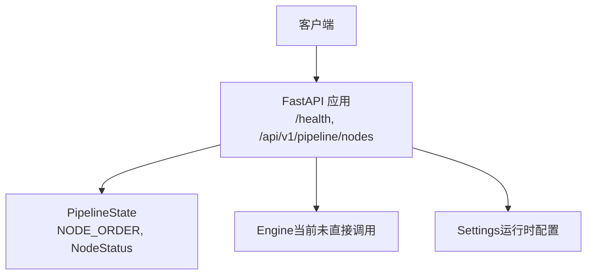
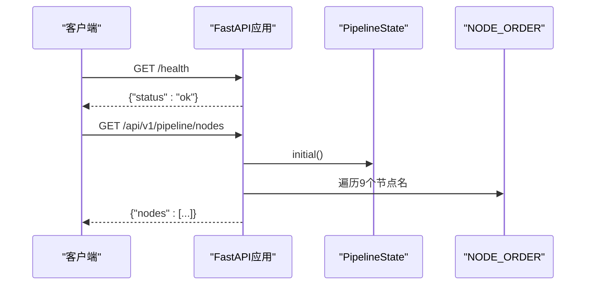
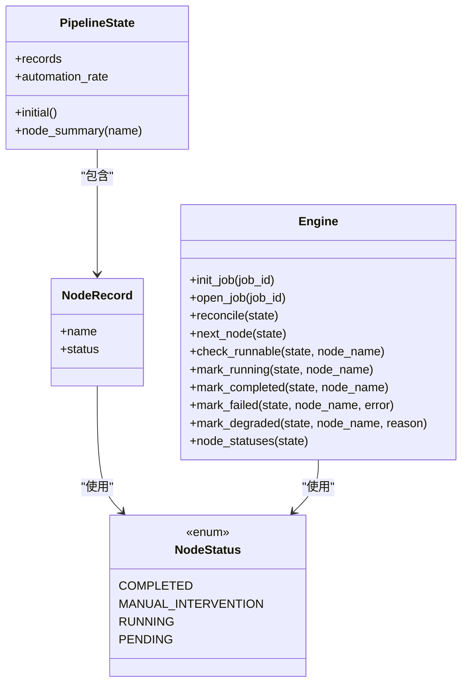

# 编排服务API

<cite>
**本文引用的文件**
- [services/orchestrator/src/orchestrator/api.py](file://services/orchestrator/src/orchestrator/api.py)
- [services/orchestrator/src/orchestrator/pipeline.py](file://services/orchestrator/src/orchestrator/pipeline.py)
- [services/orchestrator/src/orchestrator/engine.py](file://services/orchestrator/src/orchestrator/engine.py)
- [services/orchestrator/src/orchestrator/errors.py](file://services/orchestrator/src/orchestrator/errors.py)
- [services/orchestrator/src/orchestrator/config.py](file://services/orchestrator/src/orchestrator/config.py)
- [services/orchestrator/src/orchestrator/__main__.py](file://services/orchestrator/src/orchestrator/__main__.py)
- [services/orchestrator/tests/test_pipeline.py](file://services/orchestrator/tests/test_pipeline.py)
</cite>

## 目录
1. [简介](#简介)
2. [项目结构](#项目结构)
3. [核心组件](#核心组件)
4. [架构总览](#架构总览)
5. [接口详细文档](#接口详细文档)
6. [依赖关系分析](#依赖关系分析)
7. [性能与可用性](#性能与可用性)
8. [故障排查指南](#故障排查指南)
9. [结论](#结论)
10. [附录：版本控制与兼容性](#附录版本控制与兼容性)

## 简介
本文件为“编排服务”的REST API规范，覆盖健康检查与流水线节点查询两个端点。当前实现基于FastAPI，提供稳定的v1版本路径前缀，并以固定九节点的流水线口径对外暴露状态。该文档同时说明PipelineState对象与NodeRecord字段含义、错误处理机制、以及版本控制策略。

## 项目结构
- API层：定义HTTP路由与响应格式
- 领域模型：定义节点顺序、状态枚举、流水线状态聚合
- 引擎层：负责状态持久化、对账、跳序防护等（当前API仅使用初始态）
- 配置层：从环境变量加载运行参数
- 入口：启动Uvicorn服务器并挂载应用

图表来源
- [services/orchestrator/src/orchestrator/api.py:11-27](file://services/orchestrator/src/orchestrator/api.py#L11-L27)
- [services/orchestrator/src/orchestrator/pipeline.py:11-34](file://services/orchestrator/src/orchestrator/pipeline.py#L11-L34)
- [services/orchestrator/src/orchestrator/config.py:9-24](file://services/orchestrator/src/orchestrator/config.py#L9-L24)

章节来源
- [services/orchestrator/src/orchestrator/api.py:11-27](file://services/orchestrator/src/orchestrator/api.py#L11-L27)
- [services/orchestrator/src/orchestrator/config.py:9-24](file://services/orchestrator/src/orchestrator/config.py#L9-L24)
- [services/orchestrator/src/orchestrator/__main__.py:15-21](file://services/orchestrator/src/orchestrator/__main__.py#L15-L21)

## 核心组件
- FastAPI应用：创建并注册路由，设置应用元信息（标题、版本）
- PipelineState：维护9个节点的初始状态与摘要输出
- NodeStatus：四态枚举（completed、manual_intervention、running、pending）
- NODE_ORDER：固定九节点顺序（req_parse、code_scan、interface_reconstruct、code_review、testcase_generate、auto_execute、test_report、defect_list、retest_regression）
- Engine：负责state.json持久化、断点续跑、跳序防护、降级清单（当前API仅使用初始态，但后续扩展将复用）
- Settings：从环境变量读取端口、LLM、产物根目录等配置

章节来源
- [services/orchestrator/src/orchestrator/pipeline.py:11-34](file://services/orchestrator/src/orchestrator/pipeline.py#L11-L34)
- [services/orchestrator/src/orchestrator/pipeline.py:37-70](file://services/orchestrator/src/orchestrator/pipeline.py#L37-L70)
- [services/orchestrator/src/orchestrator/engine.py:22-35](file://services/orchestrator/src/orchestrator/engine.py#L22-L35)
- [services/orchestrator/src/orchestrator/engine.py:43-130](file://services/orchestrator/src/orchestrator/engine.py#L43-L130)
- [services/orchestrator/src/orchestrator/config.py:9-24](file://services/orchestrator/src/orchestrator/config.py#L9-L24)

## 架构总览

图表来源
- [services/orchestrator/src/orchestrator/api.py:16-25](file://services/orchestrator/src/orchestrator/api.py#L16-L25)
- [services/orchestrator/src/orchestrator/pipeline.py:23-34](file://services/orchestrator/src/orchestrator/pipeline.py#L23-L34)
- [services/orchestrator/src/orchestrator/pipeline.py:51-59](file://services/orchestrator/src/orchestrator/pipeline.py#L51-L59)

## 接口详细文档

### 通用约定
- 基础路径：/api/v1（版本前缀）
- 内容类型：application/json
- 字符编码：UTF-8
- 成功响应：HTTP 200
- 失败响应：HTTP 4xx/5xx + 统一错误体（见“错误处理”）

### 健康检查
- 方法：GET
- 路径：/health
- 请求参数：无
- 响应体：
  - status: string，固定值 "ok"
- 状态码：
  - 200：服务正常

示例响应
{
  "status": "ok"
}

章节来源
- [services/orchestrator/src/orchestrator/api.py:16-19](file://services/orchestrator/src/orchestrator/api.py#L16-L19)
- [services/orchestrator/tests/test_pipeline.py:33-38](file://services/orchestrator/tests/test_pipeline.py#L33-L38)

### 流水线节点查询
- 方法：GET
- 路径：/api/v1/pipeline/nodes
- 请求参数：无
- 响应体：
  - nodes: array<NodeSummary>
    - name: string，节点名称（来自固定九节点顺序）
    - status: string，节点状态（completed | manual_intervention | running | pending）
- 状态码：
  - 200：成功返回9个节点摘要

示例响应
{
  "nodes": [
    {"name": "req_parse", "status": "pending"},
    {"name": "code_scan", "status": "pending"},
    {"name": "interface_reconstruct", "status": "pending"},
    {"name": "code_review", "status": "pending"},
    {"name": "testcase_generate", "status": "pending"},
    {"name": "auto_execute", "status": "pending"},
    {"name": "test_report", "status": "pending"},
    {"name": "defect_list", "status": "pending"},
    {"name": "retest_regression", "status": "pending"}
  ]
}

章节来源
- [services/orchestrator/src/orchestrator/api.py:21-25](file://services/orchestrator/src/orchestrator/api.py#L21-L25)
- [services/orchestrator/src/orchestrator/pipeline.py:23-34](file://services/orchestrator/src/orchestrator/pipeline.py#L23-L34)
- [services/orchestrator/src/orchestrator/pipeline.py:56-59](file://services/orchestrator/src/orchestrator/pipeline.py#L56-L59)
- [services/orchestrator/tests/test_pipeline.py:41-46](file://services/orchestrator/tests/test_pipeline.py#L41-L46)

## 依赖关系分析
- API层依赖PipelineState与NODE_ORDER以生成节点列表
- PipelineState依赖NodeStatus枚举与固定节点顺序
- Engine模块定义了更完整的运行时状态与持久化逻辑，当前API仅使用其初始态能力
- 配置模块通过环境变量注入运行时参数，不影响当前只读API行为

图表来源
- [services/orchestrator/src/orchestrator/pipeline.py:11-70](file://services/orchestrator/src/orchestrator/pipeline.py#L11-L70)
- [services/orchestrator/src/orchestrator/engine.py:43-130](file://services/orchestrator/src/orchestrator/engine.py#L43-L130)

章节来源
- [services/orchestrator/src/orchestrator/pipeline.py:11-70](file://services/orchestrator/src/orchestrator/pipeline.py#L11-L70)
- [services/orchestrator/src/orchestrator/engine.py:43-130](file://services/orchestrator/src/orchestrator/engine.py#L43-L130)

## 性能与可用性
- 健康检查接口为轻量级返回，适合容器编排健康探针
- 节点查询接口在当前骨架阶段直接返回初始态，无IO开销，响应极快
- 未来接入Engine后，若引入state.json读取与对账，建议增加缓存或限流策略以避免频繁磁盘访问

## 故障排查指南
- 常见错误码（由Engine与错误模块定义，供后续扩展使用）：
  - X-ORCH-01：产物校验失败或state.json结构不合规
  - X-ORCH-02：断点续跑跳序请求（前序未完成）
  - X-ORCH-03：java-parser服务不可达/通信失败
  - X-LLM-01：LLM调用超时/网络失败（可重试）
  - X-LLM-02：LLM输出未过Schema校验（不重试，人工介入）
  - X-LLM-03：Prompt文件缺失/元信息不合规（配置错误，人工介入）
- 错误体结构（当发生异常时）：
  - code: string，错误码
  - message: string，人类可读描述
  - node_id: string?，可选，关联节点
  - details: object?，可选，附加上下文
- 当前健康与节点查询接口在骨架阶段不会抛出上述错误；若后续集成Engine，请确保上游捕获PipelineError并转换为HTTP响应

章节来源
- [services/orchestrator/src/orchestrator/errors.py:8-39](file://services/orchestrator/src/orchestrator/errors.py#L8-L39)
- [services/orchestrator/src/orchestrator/engine.py:120-124](file://services/orchestrator/src/orchestrator/engine.py#L120-L124)
- [services/orchestrator/src/orchestrator/engine.py:196-219](file://services/orchestrator/src/orchestrator/engine.py#L196-L219)

## 结论
当前编排服务提供了稳定、简洁的REST API，用于健康检查与九节点流水线状态查询。接口设计遵循版本化路径前缀，便于后续扩展。PipelineState与NodeRecord清晰表达了节点状态语义，Engine模块为后续持久化与执行流程奠定基础。建议在后续迭代中逐步接入Engine能力，并完善错误处理与监控指标。

## 附录：版本控制与兼容性
- 版本策略：
  - 所有业务接口位于/api/v1前缀下，便于未来升级至v2而不影响现有调用方
  - 应用元信息中包含版本号（FastAPI title/version），便于网关与文档工具识别
- 向后兼容保证：
  - 节点顺序与数量冻结为9个（R-MTR-01），禁止增删，确保下游解析稳定
  - 节点状态枚举保持四态不变，新增状态需评估兼容性
  - 响应结构保持稳定：/health返回{"status":"ok"}；/api/v1/pipeline/nodes返回{"nodes":[...]}
- 扩展建议：
  - 新增接口继续采用/api/vN前缀
  - 对破坏性变更进行版本迁移计划，并在文档中标注弃用时间线

章节来源
- [services/orchestrator/src/orchestrator/api.py:11-14](file://services/orchestrator/src/orchestrator/api.py#L11-L14)
- [services/orchestrator/src/orchestrator/pipeline.py:23-34](file://services/orchestrator/src/orchestrator/pipeline.py#L23-L34)
- [services/orchestrator/tests/test_pipeline.py:21-23](file://services/orchestrator/tests/test_pipeline.py#L21-L23)