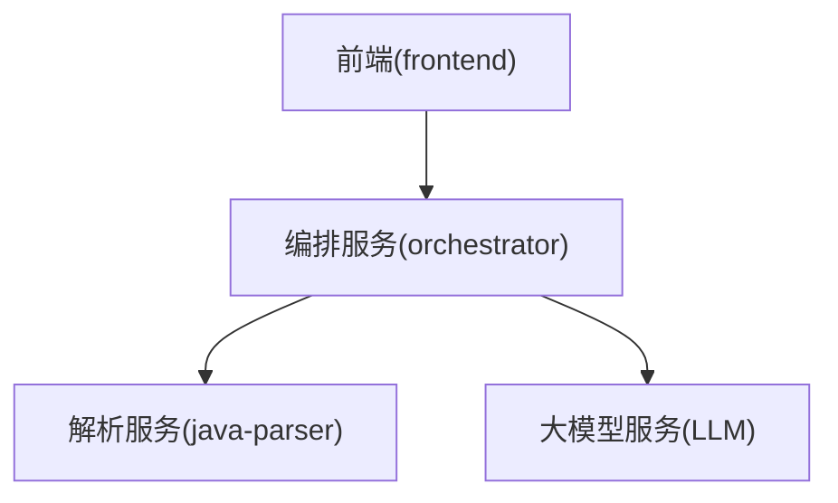
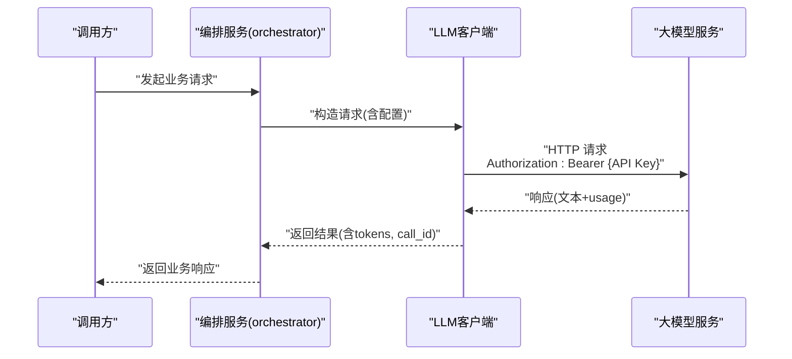
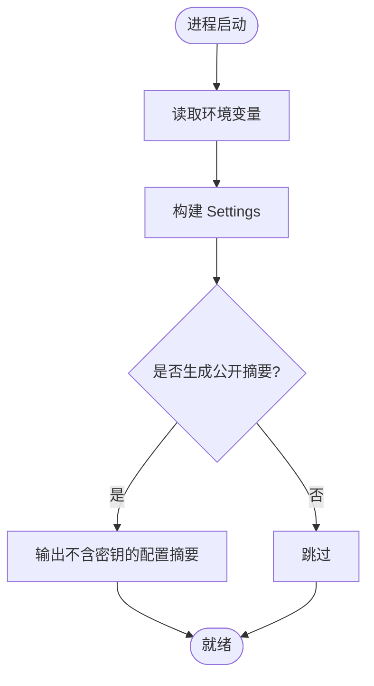
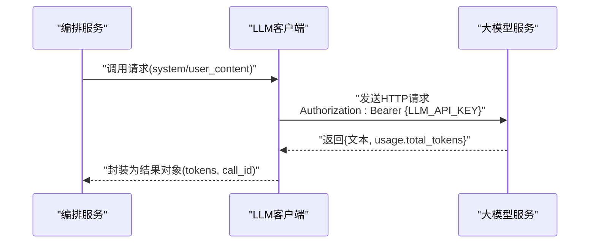
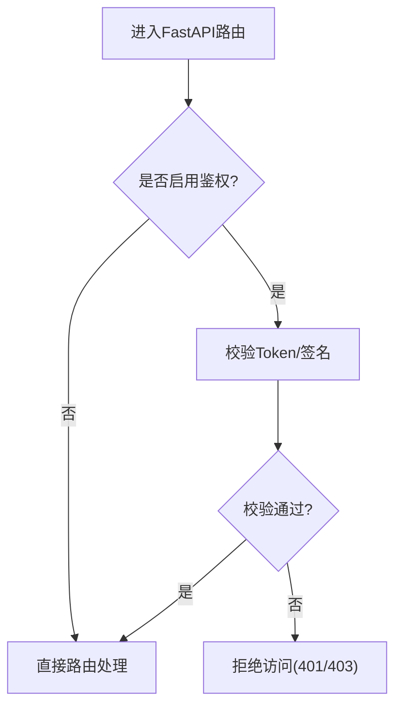
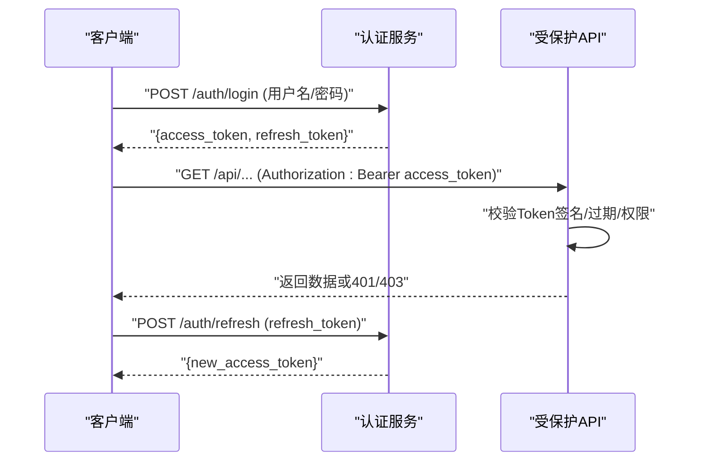
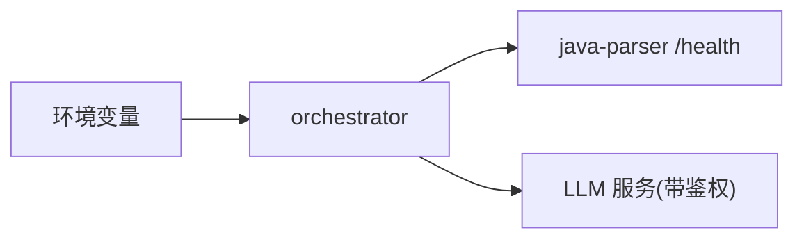

# 认证授权

<cite>
**本文引用的文件**
- [services/orchestrator/src/orchestrator/config.py](file://services/orchestrator/src/orchestrator/config.py)
- [services/orchestrator/src/orchestrator/api.py](file://services/orchestrator/src/orchestrator/api.py)
- [services/orchestrator/src/orchestrator/llm/client.py](file://services/orchestrator/src/orchestrator/llm/client.py)
- [services/java-parser/src/main/resources/application.yml](file://services/java-parser/src/main/resources/application.yml)
- [services/java-parser/src/main/java/com/llmautotest/parser/HealthController.java](file://services/java-parser/src/main/java/com/llmautotest/parser/HealthController.java)
- [deploy/docker-compose.yml](file://deploy/docker-compose.yml)
- [MumuSpec/09-API接口规格.md](file://MumuSpec/09-API接口规格.md)
- [docs/spec-templates/example-投研助手/11-安全设计规格.md](file://docs/spec-templates/example-投研助手/11-安全设计规格.md)
- [docs/spec-templates/example-投研助手/08-系统架构与技术选型.md](file://docs/spec-templates/example-投研助手/08-系统架构与技术选型.md)
</cite>

## 目录
1. [简介](#简介)
2. [项目结构](#项目结构)
3. [核心组件](#核心组件)
4. [架构总览](#架构总览)
5. [详细组件分析](#详细组件分析)
6. [依赖关系分析](#依赖关系分析)
7. [性能考虑](#性能考虑)
8. [故障排查指南](#故障排查指南)
9. [结论](#结论)
10. [附录](#附录)

## 简介
本文件聚焦 LLM-AutoTest 的认证与授权机制，覆盖以下方面：
- 各服务（orchestrator、java-parser、frontend）的身份验证现状与扩展点
- 环境变量配置与 API 密钥管理（以 orchestrator 对 LLM 调用的鉴权为例）
- 用户权限控制模型与角色矩阵（规划层面）
- JWT 令牌使用方式、生命周期与安全最佳实践（建议方案）
- 不同环境（开发、测试、生产）的认证配置差异
- 认证失败的错误处理与重试策略
- 安全考虑与常见威胁防护

当前代码库中，orchestrator 对外暴露的 REST API 未启用访问鉴权；LLM 调用通过请求头携带 API Key 进行外部服务鉴权。java-parser 提供健康检查端点，亦无鉴权。前端作为消费方，按现有 API 契约调用 orchestrator。

**章节来源**
- [services/orchestrator/src/orchestrator/api.py:11-27](file://services/orchestrator/src/orchestrator/api.py#L11-L27)
- [services/java-parser/src/main/java/com/llmautotest/parser/HealthController.java:12-16](file://services/java-parser/src/main/java/com/llmautotest/parser/HealthController.java#L12-L16)
- [MumuSpec/09-API接口规格.md:39-76](file://MumuSpec/09-API接口规格.md#L39-L76)

## 项目结构
- orchestrator（Python FastAPI）：编排流水线、产物管理与对外 API
- java-parser（Java Spring Boot）：Java 代码扫描与接口还原，提供健康检查
- frontend（Vue 3）：Web 界面，消费 orchestrator API
- 部署编排：docker-compose 统一启动并注入环境变量

**图示来源**
- [services/orchestrator/src/orchestrator/api.py:11-27](file://services/orchestrator/src/orchestrator/api.py#L11-L27)
- [services/java-parser/src/main/java/com/llmautotest/parser/HealthController.java:12-16](file://services/java-parser/src/main/java/com/llmautotest/parser/HealthController.java#L12-L16)
- [services/orchestrator/src/orchestrator/llm/client.py:130-140](file://services/orchestrator/src/orchestrator/llm/client.py#L130-L140)

**章节来源**
- [deploy/docker-compose.yml:1-62](file://deploy/docker-compose.yml#L1-L62)

## 核心组件
- 配置与密钥管理（orchestrator）
  - 通过环境变量加载运行配置，包含 LLM 基地址、模型名、API Key、超时等
  - 提供“公开摘要”属性，用于日志输出时自动剔除敏感字段
- LLM 客户端（orchestrator）
  - 在发起 HTTP 请求时，若存在 API Key，则通过 Authorization: Bearer 头传递
  - 记录 token 用量与调用 ID，便于审计与追踪
- 对外 API（orchestrator）
  - 当前 /health 与 /api/v1/pipeline/nodes 未启用访问鉴权
- 解析服务（java-parser）
  - 提供 /health 健康检查，无鉴权

**章节来源**
- [services/orchestrator/src/orchestrator/config.py:9-56](file://services/orchestrator/src/orchestrator/config.py#L9-L56)
- [services/orchestrator/src/orchestrator/llm/client.py:130-140](file://services/orchestrator/src/orchestrator/llm/client.py#L130-L140)
- [services/orchestrator/src/orchestrator/api.py:11-27](file://services/orchestrator/src/orchestrator/api.py#L11-L27)
- [services/java-parser/src/main/resources/application.yml:1-8](file://services/java-parser/src/main/resources/application.yml#L1-L8)

## 架构总览
下图展示 orchestrator 在调用 LLM 时的鉴权流程与数据流向。

**图示来源**
- [services/orchestrator/src/orchestrator/llm/client.py:130-140](file://services/orchestrator/src/orchestrator/llm/client.py#L130-L140)
- [services/orchestrator/src/orchestrator/llm/client.py:160-170](file://services/orchestrator/src/orchestrator/llm/client.py#L160-L170)

## 详细组件分析

### 环境变量与 API 密钥管理（orchestrator）
- 关键变量
  - JAVA_PARSER_URL：解析服务地址
  - LLM_BASE_URL：LLM 服务基地址
  - LLM_MODEL_NAME：模型名称（默认值可配置）
  - LLM_API_KEY：可选，用于向 LLM 服务鉴权
  - LLM_TEMPERATURE、LLM_TOP_P、LLM_SEED、LLM_TIMEOUT_S：采样与超时参数
  - ARTIFACTS_ROOT、SCHEMAS_DIR：产物与 Schema 目录
- 安全要点
  - 所有配置来自环境变量，禁止硬编码
  - 公开摘要不包含任何密钥或敏感信息，避免日志泄露
  - LLM_API_KEY 可为空，适用于本地 Mock 或内网网关免鉴权场景

**图示来源**
- [services/orchestrator/src/orchestrator/config.py:9-56](file://services/orchestrator/src/orchestrator/config.py#L9-L56)

**章节来源**
- [services/orchestrator/src/orchestrator/config.py:9-56](file://services/orchestrator/src/orchestrator/config.py#L9-L56)
- [services/orchestrator/tests/test_config.py:10-42](file://services/orchestrator/tests/test_config.py#L10-L42)

### LLM 调用鉴权（Authorization: Bearer）
- 当设置 LLM_API_KEY 时，客户端会在请求头中附加 Authorization: Bearer {key}
- 该机制用于与外部 LLM 服务建立可信通道，确保只有持有有效密钥的请求被接受
- 调用结果包含 tokens 用量与 call_id，便于审计与问题定位

**图示来源**
- [services/orchestrator/src/orchestrator/llm/client.py:130-140](file://services/orchestrator/src/orchestrator/llm/client.py#L130-L140)
- [services/orchestrator/src/orchestrator/llm/client.py:160-170](file://services/orchestrator/src/orchestrator/llm/client.py#L160-L170)

**章节来源**
- [services/orchestrator/src/orchestrator/llm/client.py:130-140](file://services/orchestrator/src/orchestrator/llm/client.py#L130-L140)
- [services/orchestrator/src/orchestrator/llm/client.py:160-170](file://services/orchestrator/src/orchestrator/llm/client.py#L160-L170)

### 对外 API 鉴权现状与扩展点
- 当前状态
  - /health：健康检查，无鉴权
  - /api/v1/pipeline/nodes：流水线节点清单查询，无鉴权
- 扩展建议
  - 引入中间件实现统一鉴权（如 JWT 校验）
  - 对敏感接口增加访问控制（RBAC/ABAC）
  - 结合网关层做速率限制与 IP 白名单

**图示来源**
- [services/orchestrator/src/orchestrator/api.py:11-27](file://services/orchestrator/src/orchestrator/api.py#L11-L27)

**章节来源**
- [services/orchestrator/src/orchestrator/api.py:11-27](file://services/orchestrator/src/orchestrator/api.py#L11-L27)
- [MumuSpec/09-API接口规格.md:39-76](file://MumuSpec/09-API接口规格.md#L39-L76)

### 解析服务（java-parser）鉴权现状
- 提供 /health 健康检查，无鉴权
- 端口与并发度可通过 application.yml 配置
- 建议在后续版本中为内部接口增加鉴权或仅在内网暴露

**章节来源**
- [services/java-parser/src/main/resources/application.yml:1-8](file://services/java-parser/src/main/resources/application.yml#L1-L8)
- [services/java-parser/src/main/java/com/llmautotest/parser/HealthController.java:12-16](file://services/java-parser/src/main/java/com/llmautotest/parser/HealthController.java#L12-L16)

### 用户权限控制（RBAC 规划）
- 建议角色
  - 分析师：上传、阅读、问答、对比分析
  - 管理员：系统管理、审计查看
- 权限矩阵
  - 按功能域划分权限，遵循最小权限原则
- 实施建议
  - 在 API 层基于角色进行资源访问控制
  - 结合审计日志记录关键操作

**章节来源**
- [docs/spec-templates/example-投研助手/11-安全设计规格.md:39-45](file://docs/spec-templates/example-投研助手/11-安全设计规格.md#L39-L45)

### JWT 令牌使用方式与生命周期管理（建议方案）
- 登录流程
  - 客户端提交用户名/密码至认证接口
  - 服务端校验后签发 Access Token（短效）与 Refresh Token（长效）
- 令牌生命周期
  - Access Token：短期有效（例如 15-30 分钟），每次请求携带
  - Refresh Token：长期有效（例如 7 天），用于续期 Access Token
- 安全最佳实践
  - 传输层强制 HTTPS
  - Token 存储于 HttpOnly Cookie 或安全存储
  - 服务端维护黑名单（注销/吊销）
  - 定期轮换密钥与算法
  - 严格校验签名、过期时间、受众与范围

[此图为概念性流程图，不直接映射具体源码]

### 不同环境的认证配置差异
- 开发环境
  - 可关闭对外鉴权或使用弱口令/固定 Token 快速联调
  - LLM_API_KEY 可留空，走本地 Mock 或内网网关免鉴权
- 测试环境
  - 启用基础鉴权（如固定 Token 或测试用 JWT）
  - 开启更严格的输入校验与日志脱敏
- 生产环境
  - 强制 HTTPS、启用 JWT 鉴权与 RBAC
  - 使用密钥管理服务（Vault/KMS）管理 LLM_API_KEY 与 JWT 密钥
  - 接入网关层做速率限制、IP 白名单与审计

**章节来源**
- [docs/spec-templates/example-投研助手/08-系统架构与技术选型.md:129-134](file://docs/spec-templates/example-投研助手/08-系统架构与技术选型.md#L129-L134)
- [deploy/docker-compose.yml:18-32](file://deploy/docker-compose.yml#L18-L32)

### 认证失败的错误处理与重试机制
- 失败类型
  - 401：未认证（缺少或无效 Token）
  - 403：权限不足（Token 有效但无资源访问权限）
  - 网络/超时：上游服务不可达或响应过慢
- 处理策略
  - 客户端根据状态码区分重试策略（幂等接口可重试，非幂等需提示）
  - 指数退避重试，限制最大重试次数
  - 记录错误上下文（call_id、时间戳、端点）以便审计
  - 对敏感错误信息进行脱敏，避免泄露

[此图为概念性流程图，不直接映射具体源码]

## 依赖关系分析
- orchestrator 依赖
  - 环境变量：JAVA_PARSER_URL、LLM_* 系列
  - 外部服务：java-parser（健康检查）、LLM（鉴权调用）
- java-parser 依赖
  - 应用配置：application.yml（端口、并发度）
- 部署编排
  - docker-compose 注入环境变量，定义服务间依赖与健康检查

**图示来源**
- [services/orchestrator/src/orchestrator/config.py:9-56](file://services/orchestrator/src/orchestrator/config.py#L9-L56)
- [services/java-parser/src/main/resources/application.yml:1-8](file://services/java-parser/src/main/resources/application.yml#L1-L8)
- [deploy/docker-compose.yml:18-32](file://deploy/docker-compose.yml#L18-L32)

**章节来源**
- [services/orchestrator/src/orchestrator/config.py:9-56](file://services/orchestrator/src/orchestrator/config.py#L9-L56)
- [deploy/docker-compose.yml:18-32](file://deploy/docker-compose.yml#L18-L32)

## 性能考虑
- 鉴权开销
  - JWT 校验应在网关或中间件层集中处理，减少重复计算
  - 缓存公共公钥或证书，降低签名校验成本
- 超时与限流
  - 合理设置 LLM_TIMEOUT_S，避免长尾请求阻塞
  - 在网关层实施速率限制，防止滥用
- 日志与审计
  - 记录必要上下文（call_id、时间戳、端点），避免记录敏感信息
  - 定期归档与分析异常模式

[本节为通用指导，不直接分析具体文件]

## 故障排查指南
- 常见问题
  - 环境变量缺失：orchestrator 启动时报错，提示缺少必填项
  - LLM_API_KEY 为空：无法鉴权外部 LLM 服务，需检查配置
  - 健康检查失败：java-parser /health 不可达，检查容器与服务端口
- 排查步骤
  - 检查 docker-compose 注入的环境变量是否正确
  - 确认 LLM_BASE_URL 与 LLM_API_KEY 配置无误
  - 查看 orchestrator 日志中的公开摘要与错误堆栈
  - 验证 java-parser 健康检查端点可达

**章节来源**
- [services/orchestrator/src/orchestrator/config.py:35-56](file://services/orchestrator/src/orchestrator/config.py#L35-L56)
- [services/java-parser/src/main/java/com/llmautotest/parser/HealthController.java:12-16](file://services/java-parser/src/main/java/com/llmautotest/parser/HealthController.java#L12-L16)
- [deploy/docker-compose.yml:11-16](file://deploy/docker-compose.yml#L11-L16)

## 结论
- 当前 orchestrator 对外 API 未启用访问鉴权，LLM 调用通过 Bearer Token 鉴权
- 配置与密钥管理采用环境变量，支持公开摘要以避免日志泄露
- 建议在后续迭代中引入统一的鉴权中间件（JWT + RBAC），并在网关层加强安全防护
- 针对不同环境制定差异化配置，生产环境务必启用强安全策略与密钥管理服务

[本节为总结性内容，不直接分析具体文件]

## 附录
- 环境变量清单（示例）
  - PORT、JAVA_PARSER_URL、ARTIFACTS_ROOT、SCHEMAS_DIR
  - LLM_BASE_URL、LLM_MODEL_NAME、LLM_API_KEY、LLM_TEMPERATURE、LLM_TOP_P、LLM_SEED、LLM_TIMEOUT_S
- 参考规范
  - 安全设计规格模板（角色与权限矩阵、加密策略、接口安全）
  - API 接口规格（健康检查与流水线状态查询）

**章节来源**
- [services/orchestrator/src/orchestrator/config.py:9-56](file://services/orchestrator/src/orchestrator/config.py#L9-L56)
- [docs/spec-templates/example-投研助手/11-安全设计规格.md:47-71](file://docs/spec-templates/example-投研助手/11-安全设计规格.md#L47-L71)
- [MumuSpec/09-API接口规格.md:39-76](file://MumuSpec/09-API接口规格.md#L39-L76)