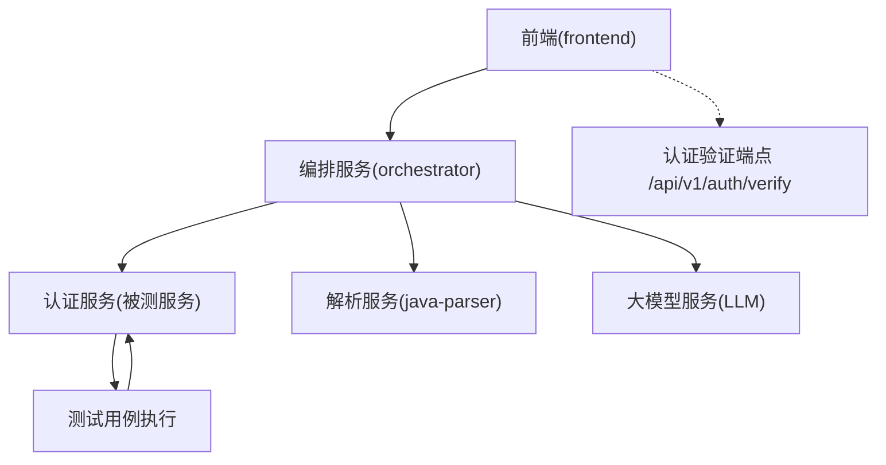
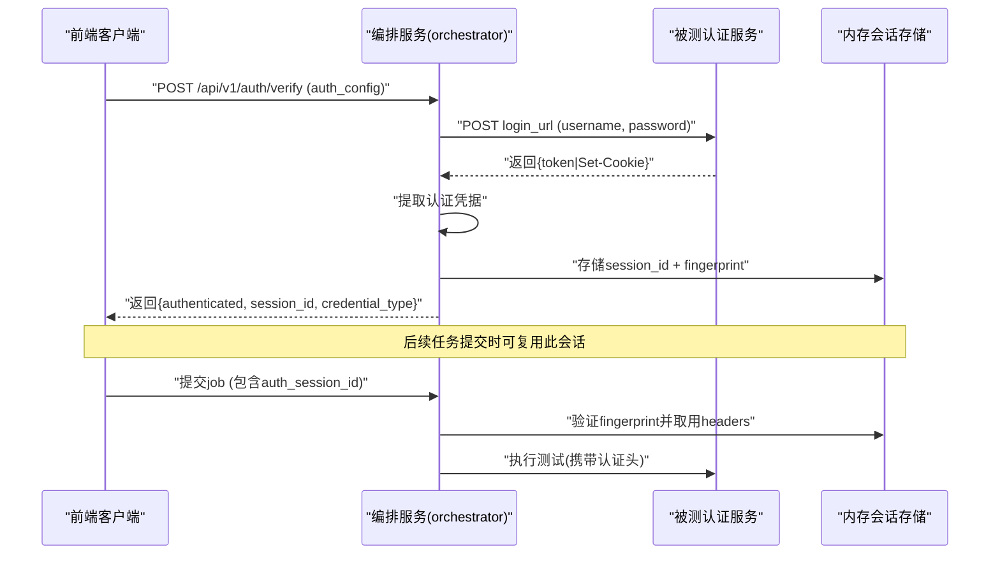
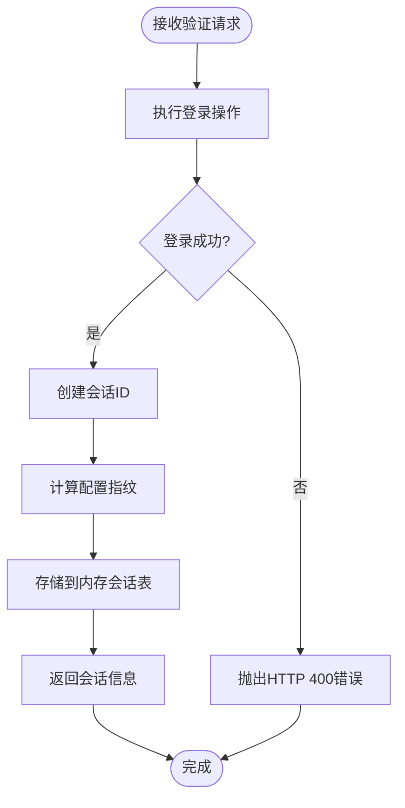
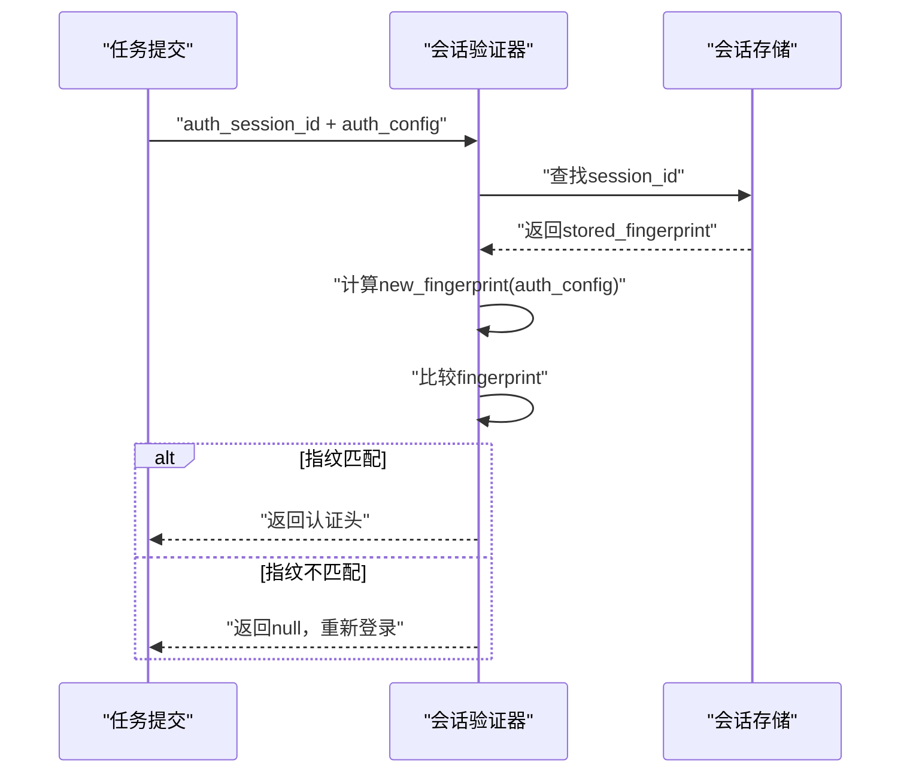
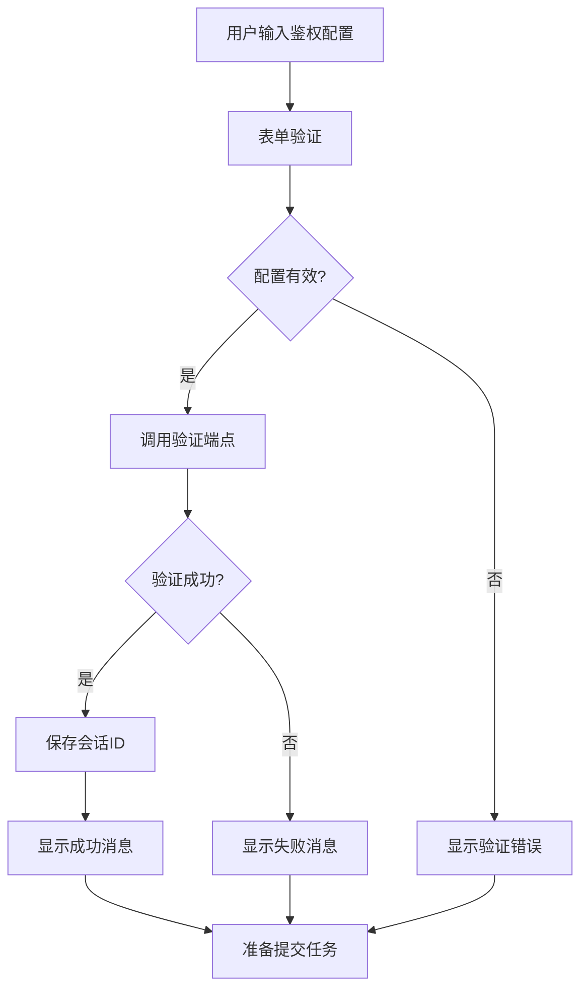
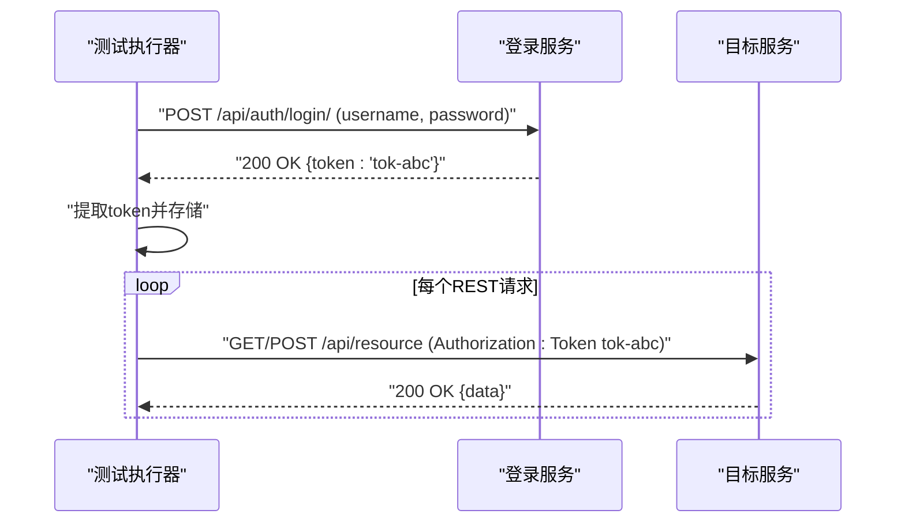
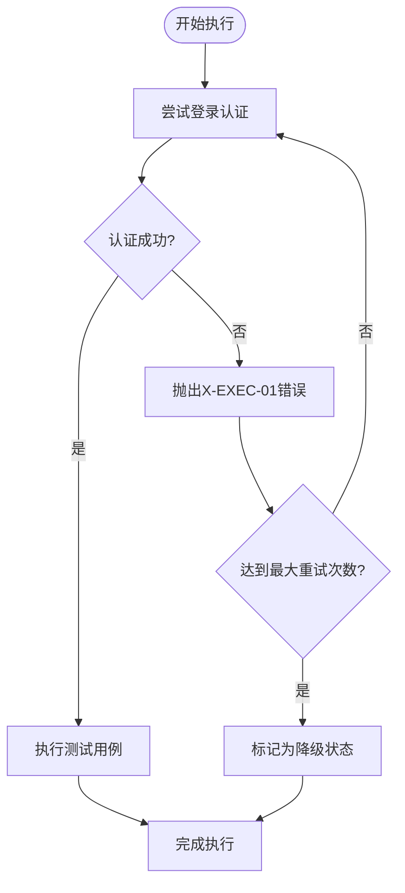
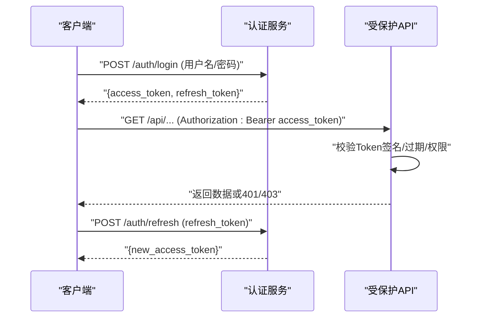
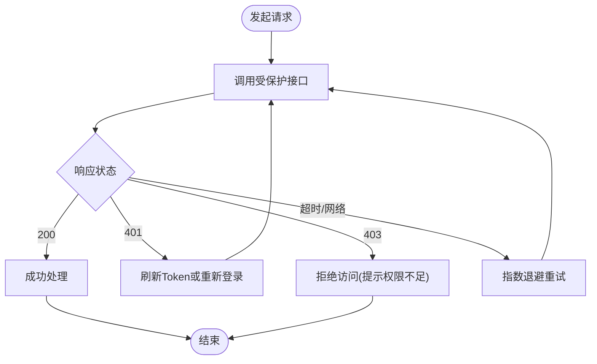
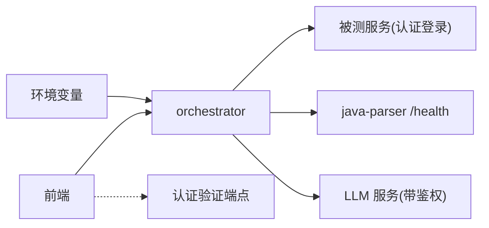

# 认证授权

<cite>
**本文引用的文件**
- [services/orchestrator/src/orchestrator/api.py](file://services/orchestrator/src/orchestrator/api.py)
- [services/orchestrator/src/orchestrator/runner.py](file://services/orchestrator/src/orchestrator/runner.py)
- [services/orchestrator/tests/test_auto_execute.py](file://services/orchestrator/tests/test_auto_execute.py)
- [tests/test_login.py](file://tests/test_login.py)
- [services/frontend/src/api/types.ts](file://services/frontend/src/api/types.ts)
- [services/frontend/src/views/TaskConfigView.vue](file://services/frontend/src/views/TaskConfigView.vue)
- [services/frontend/src/api/client.ts](file://services/frontend/src/api/client.ts)
- [services/java-parser/src/main/resources/application.yml](file://services/java-parser/src/main/resources/application.yml)
- [services/java-parser/src/main/java/com/llmautotest/parser/HealthController.java](file://services/java-parser/src/main/java/com/llmautotest/parser/HealthController.java)
- [deploy/docker-compose.yml](file://deploy/docker-compose.yml)
- [MumuSpec/09-API接口规格.md](file://MumuSpec/09-API接口规格.md)
- [docs/spec-templates/example-投研助手/11-安全设计规格.md](file://docs/spec-templates/example-投研助手/11-安全设计规格.md)
- [docs/spec-templates/example-投研助手/08-系统架构与技术选型.md](file://docs/spec-templates/example-投研助手/08-系统架构与技术选型.md)
</cite>

## 更新摘要
**变更内容**
- **新增认证验证端点** `/api/v1/auth/verify`：支持用户在提交任务前测试鉴权配置并保存会话
- **实现会话指纹验证**：通过SHA256哈希确保会话仅用于完全相同的登录配置
- **内存中的安全会话管理**：凭据头仅存储在进程内存中，不返回浏览器或持久化到磁盘
- **增强用户体验**：前端集成实时鉴权验证，提供即时反馈和会话状态管理
- **完善的安全机制**：防止凭据泄露，确保会话与任务的绑定关系

## 目录
1. [简介](#简介)
2. [项目结构](#项目结构)
3. [核心组件](#核心组件)
4. [架构总览](#架构总览)
5. [详细组件分析](#详细组件分析)
6. [依赖关系分析](#依赖关系分析)
7. [性能考虑](#性能考虑)
8. [故障排查指南](#故障排查指南)
9. [结论](#结论)
10. [附录](#附录)

## 简介
本文档详细说明 LLM-AutoTest 的认证与授权机制，重点涵盖以下增强功能：
- **受保护服务自动登录**：在执行测试前自动调用被测服务的登录接口获取认证凭据
- **双认证流程支持**：同时支持Token（Authorization: Token）和Cookie（Session会话）两种认证方式
- **HTTPS自签名证书处理**：针对内网环境常见的自签名证书场景，提供灵活的TLS验证配置
- **安全凭据管理**：敏感信息仅在服务内存中存储，避免持久化泄露风险
- **统一错误处理**：认证失败统一返回X-EXEC-01错误码，便于上层重试和降级处理
- **预验证会话机制**：新增 `/api/v1/auth/verify` 端点，支持用户提前测试鉴权配置并建立安全会话

当前系统已实现orchestrator对受保护服务的自动登录能力，支持在auto_execute和retest_regression节点执行前自动注入认证头，并通过会话指纹验证确保安全性。

**章节来源**
- [services/orchestrator/src/orchestrator/api.py:273-293](file://services/orchestrator/src/orchestrator/api.py#L273-L293)
- [services/orchestrator/src/orchestrator/api.py:1083-1107](file://services/orchestrator/src/orchestrator/api.py#L1083-L1107)
- [services/frontend/src/views/TaskConfigView.vue:165-187](file://services/frontend/src/views/TaskConfigView.vue#L165-L187)

## 项目结构
- orchestrator（Python FastAPI）：编排流水线、产物管理与对外 API，新增认证验证端点与会话管理
- java-parser（Java Spring Boot）：Java 代码扫描与接口还原，提供健康检查
- frontend（Vue 3）：Web 界面，消费 orchestrator API，集成认证配置验证界面
- 部署编排：docker-compose 统一启动并注入环境变量

**图示来源**
- [services/orchestrator/src/orchestrator/api.py:273-293](file://services/orchestrator/src/orchestrator/api.py#L273-L293)
- [services/orchestrator/src/orchestrator/runner.py:261-283](file://services/orchestrator/src/orchestrator/runner.py#L261-L283)
- [services/frontend/src/api/client.ts:74-82](file://services/frontend/src/api/client.ts#L74-L82)

**章节来源**
- [deploy/docker-compose.yml:1-62](file://deploy/docker-compose.yml#L1-L62)

## 核心组件
- **认证配置管理（orchestrator）**
  - AuthConfig类定义登录URL、用户名、密码和TLS验证配置
  - EditableAuthConfig支持任务编辑时保留原密码，避免回传敏感信息
  - insecure_tls字段默认启用，适配内网自签名证书场景
- **预验证会话机制**
  - `/api/v1/auth/verify` 端点支持提前测试鉴权配置
  - 生成唯一session_id并存储在内存中的pending_auth_sessions字典
  - 使用SHA256哈希创建会话指纹，确保配置一致性
- **自动登录机制**
  - 执行前调用login_url进行登录，提取token或cookie作为认证凭据
  - 支持两种响应格式：JSON token字段或Set-Cookie会话头
  - 登录失败统一抛出PipelineError(code="X-EXEC-01")
- **凭据注入策略**
  - Token模式：Authorization: Token {token}
  - Cookie模式：Cookie: sessionid=xxx; csrftoken=yyy
  - 登录接口本身排除在会话注入之外，避免循环登录
- **安全内存管理**
  - LLM API Key和认证凭据仅存储在进程内存中
  - job_llm_configs字典用于运行时临时存储，禁止落盘
  - pending_auth_sessions字典管理预验证会话，进程退出后自动清理

**章节来源**
- [services/orchestrator/src/orchestrator/api.py:87-106](file://services/orchestrator/src/orchestrator/api.py#L87-L106)
- [services/orchestrator/src/orchestrator/api.py:227-229](file://services/orchestrator/src/orchestrator/api.py#L227-L229)
- [services/orchestrator/src/orchestrator/api.py:273-293](file://services/orchestrator/src/orchestrator/api.py#L273-L293)
- [services/orchestrator/src/orchestrator/api.py:1083-1107](file://services/orchestrator/src/orchestrator/api.py#L1083-L1107)

## 架构总览
下图展示新增的认证验证端点工作流程和会话管理机制。

**图示来源**
- [services/orchestrator/src/orchestrator/api.py:273-293](file://services/orchestrator/src/orchestrator/api.py#L273-L293)
- [services/orchestrator/src/orchestrator/api.py:1083-1107](file://services/orchestrator/src/orchestrator/api.py#L1083-L1107)
- [services/frontend/src/views/TaskConfigView.vue:165-187](file://services/frontend/src/views/TaskConfigView.vue#L165-L187)

## 详细组件分析

### 认证验证端点（/api/v1/auth/verify）
- **核心功能**
  - 接收AuthVerificationRequest参数，包含登录配置信息
  - 调用login_for_headers执行实际登录操作
  - 生成唯一session_id并存储在内存中
  - 计算会话指纹确保配置一致性
  - 返回非敏感的会话标识和认证类型
- **安全特性**
  - 绝不返回实际的token或cookie值
  - 会话数据仅存在于进程内存中
  - 使用SHA256哈希创建不可逆的指纹
  - 支持可选的job_id关联，将会话绑定到特定任务
- **响应格式**
  - authenticated: true/false - 验证结果
  - session_id: string - 唯一会话标识符
  - credential_type: 'token' | 'cookie' - 认证类型

**图示来源**
- [services/orchestrator/src/orchestrator/api.py:273-293](file://services/orchestrator/src/orchestrator/api.py#L273-L293)
- [services/orchestrator/src/orchestrator/api.py:1083-1095](file://services/orchestrator/src/orchestrator/api.py#L1083-L1095)

**章节来源**
- [services/orchestrator/src/orchestrator/api.py:273-293](file://services/orchestrator/src/orchestrator/api.py#L273-L293)
- [services/orchestrator/src/orchestrator/api.py:1083-1107](file://services/orchestrator/src/orchestrator/api.py#L1083-L1107)

### 会话指纹验证机制
- **指纹生成算法**
  - 使用SHA256哈希对登录配置进行加密
  - 包含login_url、username、password、insecure_tls等关键参数
  - 排序键值确保相同配置的指纹一致性
  - 输出32字节十六进制字符串作为指纹
- **验证流程**
  - 任务提交时传入auth_session_id
  - 从pending_auth_sessions查找对应会话
  - 比较新配置的指纹与存储的指纹
  - 匹配成功则取用缓存的认证头
- **安全优势**
  - 防止会话被不同配置滥用
  - 确保凭据与配置严格绑定
  - 避免凭据在不同任务间泄露

**图示来源**
- [services/orchestrator/src/orchestrator/api.py:1083-1107](file://services/orchestrator/src/orchestrator/api.py#L1083-L1107)

**章节来源**
- [services/orchestrator/src/orchestrator/api.py:1083-1107](file://services/orchestrator/src/orchestrator/api.py#L1083-L1107)

### 前端认证验证集成
- **用户交互流程**
  - 用户在任务配置页面填写鉴权信息
  - 点击"测试鉴权并保存会话"按钮触发验证
  - 调用verifyAuthentication函数发送验证请求
  - 显示验证结果和会话状态信息
- **状态管理**
  - verifyingAuth: 验证状态标志
  - authSessionId: 存储有效的会话ID
  - authVerificationMessage: 显示验证结果消息
  - authValid: 表单有效性验证
- **错误处理**
  - 网络错误：显示连接失败信息
  - 认证失败：显示具体错误原因
  - 表单验证：阻止无效配置提交

**图示来源**
- [services/frontend/src/views/TaskConfigView.vue:165-187](file://services/frontend/src/views/TaskConfigView.vue#L165-L187)
- [services/frontend/src/views/TaskConfigView.vue:698-720](file://services/frontend/src/views/TaskConfigView.vue#L698-L720)

**章节来源**
- [services/frontend/src/views/TaskConfigView.vue:165-187](file://services/frontend/src/views/TaskConfigView.vue#L165-L187)
- [services/frontend/src/views/TaskConfigView.vue:698-720](file://services/frontend/src/views/TaskConfigView.vue#L698-L720)
- [services/frontend/src/api/client.ts:74-82](file://services/frontend/src/api/client.ts#L74-L82)

### 自动登录实现机制
- **登录流程**
  1. 在auto_execute和retest_regression节点执行前调用login_url
  2. 发送POST请求包含username和password
  3. 解析响应提取认证凭据：
     - JSON响应中的token字段 → Authorization: Token {token}
     - Set-Cookie响应头 → Cookie: sessionid=xxx; csrftoken=yyy
  4. 将凭据注入到后续所有REST请求中
- **错误处理**
  - 401未授权：返回X-EXEC-01错误码，标记为环境类错误
  - 网络不可达：返回X-EXEC-01错误码
  - 无凭据响应：返回X-EXEC-01错误码
- **特殊处理**
  - 登录接口路径自动排除在会话注入之外，避免循环登录
  - 支持Django APPEND_SLASH的301重定向补偿

**图示来源**
- [services/orchestrator/tests/test_auto_execute.py:591-612](file://services/orchestrator/tests/test_auto_execute.py#L591-L612)
- [services/orchestrator/tests/test_auto_execute.py:662-687](file://services/orchestrator/tests/test_auto_execute.py#L662-L687)

**章节来源**
- [services/orchestrator/tests/test_auto_execute.py:591-660](file://services/orchestrator/tests/test_auto_execute.py#L591-L660)
- [services/orchestrator/tests/test_auto_execute.py:662-789](file://services/orchestrator/tests/test_auto_execute.py#L662-L789)

### HTTPS自签名证书处理
- **配置选项**
  - rest_insecure_tls：REST客户端TLS验证开关（默认True）
  - auth.insecure_tls：认证登录TLS验证开关（默认True）
  - e2e.insecure_tls：E2E浏览器测试TLS验证开关（默认True）
- **适用场景**
  - 内网环境常见自签名证书
  - 开发测试环境快速联调
  - 生产环境建议关闭此选项启用严格证书验证
- **前端集成**
  - TaskConfigView提供TLS验证配置界面
  - PipelineOverviewView支持重新执行时的TLS配置覆盖

**章节来源**
- [services/orchestrator/src/orchestrator/api.py:133-133](file://services/orchestrator/src/orchestrator/api.py#L133-L133)
- [services/orchestrator/src/orchestrator/api.py:115-115](file://services/orchestrator/src/orchestrator/api.py#L115-L115)
- [services/frontend/src/views/TaskConfigView.vue:246-379](file://services/frontend/src/views/TaskConfigView.vue#L246-L379)

### 安全凭据管理
- **内存存储策略**
  - job_llm_configs：存储LLM API Key，仅存在于进程内存
  - pending_auth_sessions：存储预验证会话，仅存在于进程内存
  - 认证凭据在执行期间临时存储，不写入文件或数据库
  - 进程退出后凭据自动清理，避免持久化泄露
- **数据流控制**
  - 公开摘要不包含任何敏感信息
  - 日志输出自动过滤API Key和认证凭据
  - 错误消息脱敏处理，避免泄露敏感细节
- **最佳实践**
  - 使用环境变量或密钥管理服务注入敏感配置
  - 定期轮换API Key和认证凭据
  - 在生产环境启用严格的TLS证书验证

**章节来源**
- [services/orchestrator/src/orchestrator/api.py:227-229](file://services/orchestrator/src/orchestrator/api.py#L227-L229)
- [services/orchestrator/src/orchestrator/config.py:9-56](file://services/orchestrator/src/orchestrator/config.py#L9-L56)

### 认证失败的错误处理
- **统一错误码**
  - X-EXEC-01：环境类错误（认证失败、网络不可达等）
  - 错误信息包含具体原因（如"401"、"无凭据"等）
- **重试机制**
  - 节点级自动重试最多2次（首次+1次重试）
  - LLM调用内部另有网络级重试
  - 非LLM类失败立即终止重试
- **降级策略**
  - 认证失败标记为manual_intervention状态
  - 不影响其他节点的正常执行
  - 产物中记录详细的降级原因

**图示来源**
- [services/orchestrator/tests/test_auto_execute.py:630-660](file://services/orchestrator/tests/test_auto_execute.py#L630-L660)
- [services/orchestrator/src/orchestrator/runner.py:184-214](file://services/orchestrator/src/orchestrator/runner.py#L184-L214)

**章节来源**
- [services/orchestrator/tests/test_auto_execute.py:630-660](file://services/orchestrator/tests/test_auto_execute.py#L630-L660)
- [services/orchestrator/src/orchestrator/runner.py:184-214](file://services/orchestrator/src/orchestrator/runner.py#L184-L214)

### 用户权限控制（RBAC 规划）
- **建议角色**
  - 分析师：上传、阅读、问答、对比分析
  - 管理员：系统管理、审计查看
- **权限矩阵**
  - 按功能域划分权限，遵循最小权限原则
- **实施建议**
  - 在 API 层基于角色进行资源访问控制
  - 结合审计日志记录关键操作

**章节来源**
- [docs/spec-templates/example-投研助手/11-安全设计规格.md:39-45](file://docs/spec-templates/example-投研助手/11-安全设计规格.md#L39-L45)

### JWT 令牌使用方式与生命周期管理（建议方案）
- **登录流程**
  - 客户端提交用户名/密码至认证接口
  - 服务端校验后签发 Access Token（短效）与 Refresh Token（长效）
- **令牌生命周期**
  - Access Token：短期有效（例如 15-30 分钟），每次请求携带
  - Refresh Token：长期有效（例如 7 天），用于续期 Access Token
- **安全最佳实践**
  - 传输层强制 HTTPS
  - Token 存储于 HttpOnly Cookie 或安全存储
  - 服务端维护黑名单（注销/吊销）
  - 定期轮换密钥与算法
  - 严格校验签名、过期时间、受众与范围

[此图为概念性流程图，不直接映射具体源码]

### 不同环境的认证配置差异
- **开发环境**
  - 可关闭对外鉴权或使用弱口令/固定 Token 快速联调
  - LLM_API_KEY 可留空，走本地 Mock 或内网网关免鉴权
  - insecure_tls默认启用，方便自签名证书调试
- **测试环境**
  - 启用基础鉴权（如固定 Token 或测试用 JWT）
  - 开启更严格的输入校验与日志脱敏
  - 保持insecure_tls启用以支持测试环境自签证书
- **生产环境**
  - 强制 HTTPS、启用 JWT 鉴权与 RBAC
  - 使用密钥管理服务（Vault/KMS）管理 LLM_API_KEY 与 JWT 密钥
  - 接入网关层做速率限制、IP 白名单与审计
  - 关闭insecure_tls，启用严格证书验证

**章节来源**
- [docs/spec-templates/example-投研助手/08-系统架构与技术选型.md:129-134](file://docs/spec-templates/example-投研助手/08-系统架构与技术选型.md#L129-L134)
- [deploy/docker-compose.yml:18-32](file://deploy/docker-compose.yml#L18-L32)

### 认证失败的错误处理与重试机制
- **失败类型**
  - 401：未认证（缺少或无效 Token）
  - 403：权限不足（Token 有效但无资源访问权限）
  - 网络/超时：上游服务不可达或响应过慢
- **处理策略**
  - 客户端根据状态码区分重试策略（幂等接口可重试，非幂等需提示）
  - 指数退避重试，限制最大重试次数
  - 记录错误上下文（call_id、时间戳、端点）以便审计
  - 对敏感错误信息进行脱敏，避免泄露

[此图为概念性流程图，不直接映射具体源码]

## 依赖关系分析
- **orchestrator依赖**
  - 环境变量：JAVA_PARSER_URL、LLM_* 系列
  - 外部服务：java-parser（健康检查）、LLM（鉴权调用）、被测服务（认证登录）
- **java-parser依赖**
  - 应用配置：application.yml（端口、并发度）
- **前端依赖**
  - TypeScript类型定义：AuthConfig、EditableAuthConfig、AuthVerificationResponse等
  - Vue组件：TaskConfigView、PipelineOverviewView等
- **部署编排**
  - docker-compose 注入环境变量，定义服务间依赖与健康检查

**图示来源**
- [services/orchestrator/src/orchestrator/config.py:9-56](file://services/orchestrator/src/orchestrator/config.py#L9-L56)
- [services/orchestrator/src/orchestrator/api.py:273-293](file://services/orchestrator/src/orchestrator/api.py#L273-L293)
- [services/frontend/src/api/types.ts:123-135](file://services/frontend/src/api/types.ts#L123-L135)

**章节来源**
- [services/orchestrator/src/orchestrator/config.py:9-56](file://services/orchestrator/src/orchestrator/config.py#L9-L56)
- [deploy/docker-compose.yml:18-32](file://deploy/docker-compose.yml#L18-L32)

## 性能考虑
- **鉴权开销**
  - JWT 校验应在网关或中间件层集中处理，减少重复计算
  - 缓存公共公钥或证书，降低签名校验成本
  - 认证登录仅在测试执行前执行一次，避免重复开销
  - 预验证会话机制减少重复登录请求
- **超时与限流**
  - 合理设置 LLM_TIMEOUT_S，避免长尾请求阻塞
  - 在网关层实施速率限制，防止滥用
  - 认证登录接口应设置合理的超时和重试策略
- **日志与审计**
  - 记录必要上下文（call_id、时间戳、端点），避免记录敏感信息
  - 定期归档与分析异常模式
  - 监控认证失败率，及时发现安全问题

## 故障排查指南
- **常见问题**
  - 环境变量缺失：orchestrator 启动时报错，提示缺少必填项
  - LLM_API_KEY 为空：无法鉴权外部 LLM 服务，需检查配置
  - 健康检查失败：java-parser /health 不可达，检查容器与服务端口
  - 认证失败：登录接口返回401或网络不可达，检查凭据和网络连通性
  - 会话失效：预验证会话过期或被清理，需重新验证
- **排查步骤**
  - 检查 docker-compose 注入的环境变量是否正确
  - 确认 LLM_BASE_URL 与 LLM_API_KEY 配置无误
  - 查看 orchestrator 日志中的公开摘要与错误堆栈
  - 验证 java-parser 健康检查端点可达
  - 测试被测服务登录接口是否正常响应
  - 检查HTTPS证书配置，必要时启用insecure_tls
  - 验证预验证会话是否有效，必要时重新执行验证

**章节来源**
- [services/orchestrator/src/orchestrator/config.py:35-56](file://services/orchestrator/src/orchestrator/config.py#L35-L56)
- [services/java-parser/src/main/java/com/llmautotest/parser/HealthController.java:12-16](file://services/java-parser/src/main/java/com/llmautotest/parser/HealthController.java#L12-L16)
- [deploy/docker-compose.yml:11-16](file://deploy/docker-compose.yml#L11-L16)

## 结论
- 系统已实现受保护服务的自动登录功能，支持Token和Cookie两种认证流程
- **新增预验证会话机制**：通过 `/api/v1/auth/verify` 端点提供用户友好的认证配置验证
- **实现会话指纹验证**：确保会话与登录配置的严格绑定，防止凭据泄露
- **提供灵活的HTTPS自签名证书处理**，适配内网环境需求
- **采用安全的凭据管理策略**，敏感信息仅存储在内存中
- **统一的错误处理机制**，认证失败返回X-EXEC-01错误码
- **前端集成认证配置界面**，支持任务级鉴权参数编辑和实时验证
- 建议在后续迭代中引入统一的JWT鉴权中间件，并在网关层加强安全防护

## 附录
- **环境变量清单（示例）**
  - PORT、JAVA_PARSER_URL、ARTIFACTS_ROOT、SCHEMAS_DIR
  - LLM_BASE_URL、LLM_MODEL_NAME、LLM_API_KEY、LLM_TEMPERATURE、LLM_TOP_P、LLM_SEED、LLM_TIMEOUT_S
- **认证配置字段**
  - login_url：登录接口地址
  - username：用户名
  - password：密码（可空表示复用内存中的原密码）
  - insecure_tls：是否跳过HTTPS证书验证
- **API端点**
  - POST /api/v1/auth/verify：认证验证端点
  - POST /api/v1/jobs：提交任务
  - PUT /api/v1/jobs/{job_id}/configuration：更新任务配置
- **参考规范**
  - 安全设计规格模板（角色与权限矩阵、加密策略、接口安全）
  - API 接口规格（健康检查与流水线状态查询）

**章节来源**
- [services/orchestrator/src/orchestrator/config.py:9-56](file://services/orchestrator/src/orchestrator/config.py#L9-L56)
- [docs/spec-templates/example-投研助手/11-安全设计规格.md:47-71](file://docs/spec-templates/example-投研助手/11-安全设计规格.md#L47-L71)
- [MumuSpec/09-API接口规格.md:39-76](file://MumuSpec/09-API接口规格.md#L39-L76)