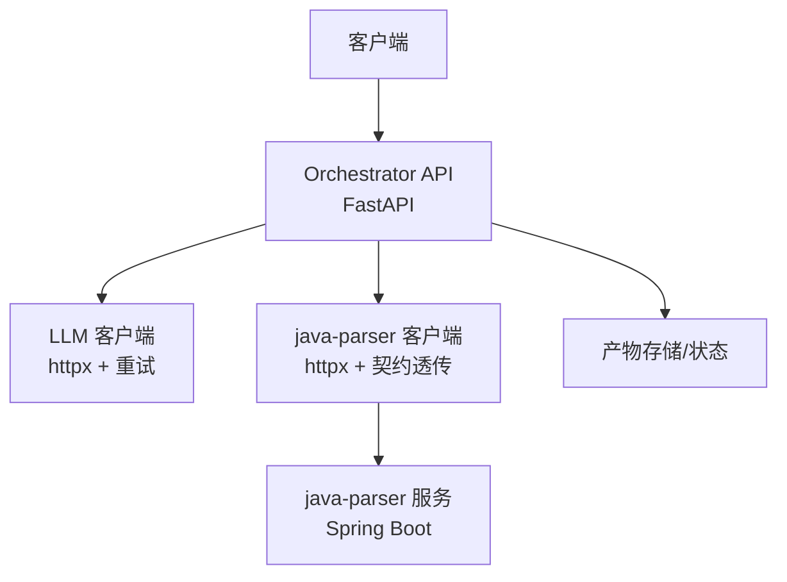
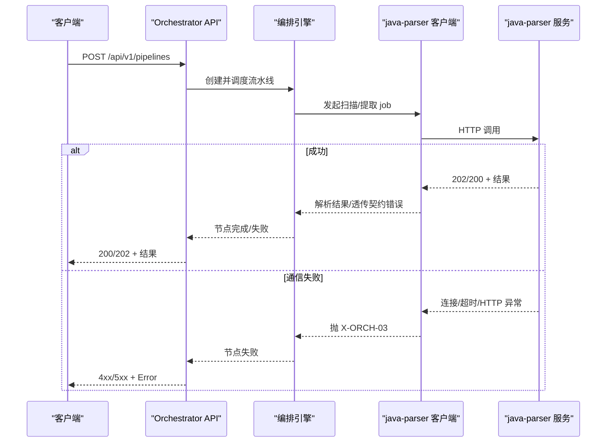
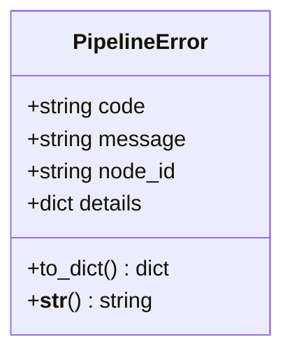
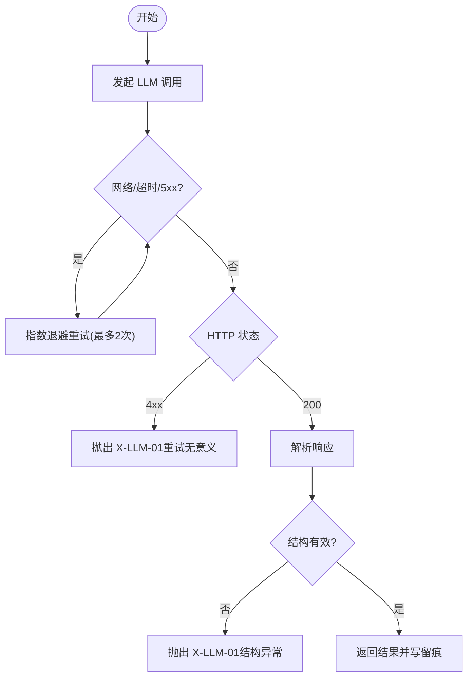
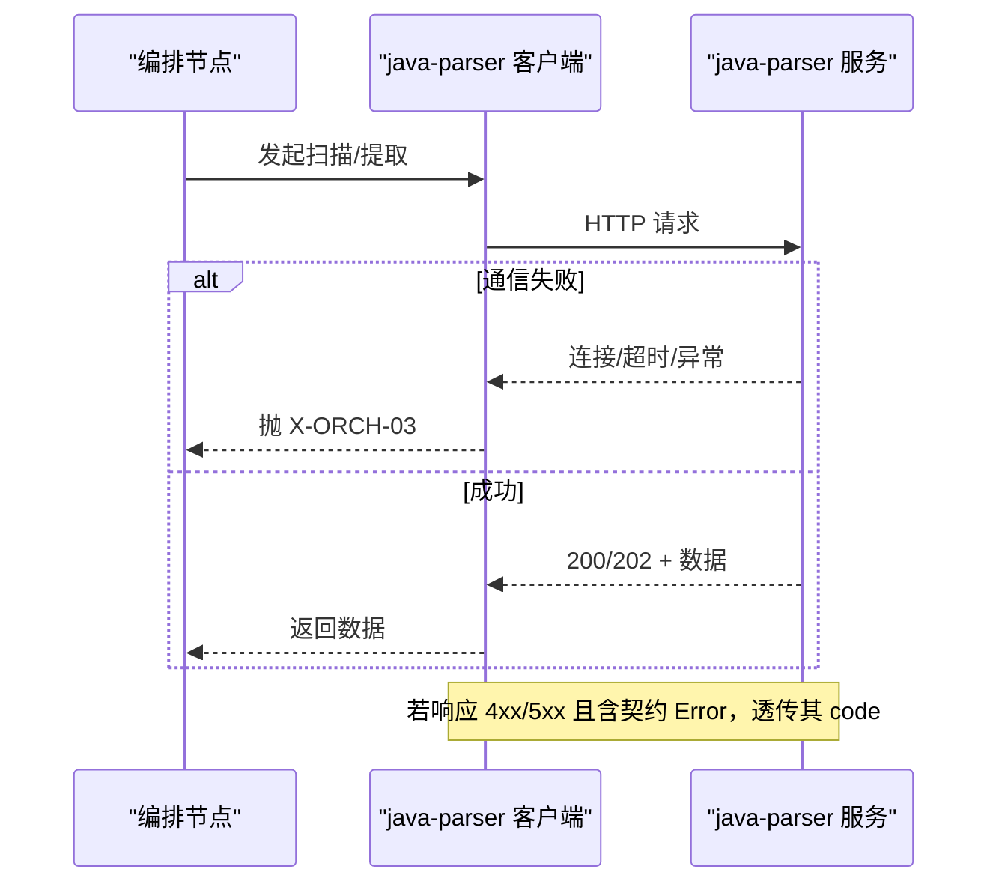
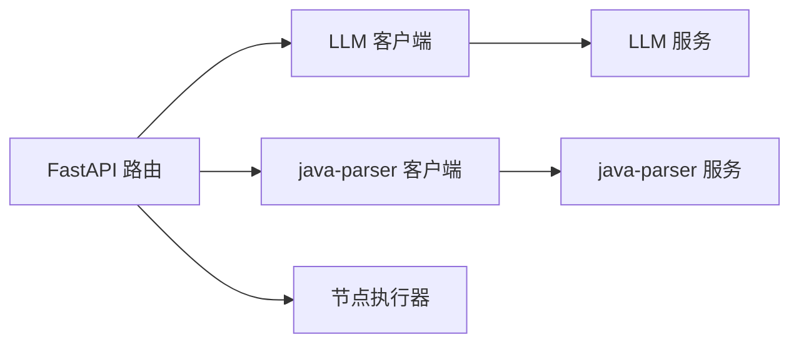

# 错误处理

<cite>
**本文引用的文件**
- [services/orchestrator/src/orchestrator/errors.py](file://services/orchestrator/src/orchestrator/errors.py)
- [services/orchestrator/src/orchestrator/api.py](file://services/orchestrator/src/orchestrator/api.py)
- [services/orchestrator/src/orchestrator/llm/client.py](file://services/orchestrator/src/orchestrator/llm/client.py)
- [services/orchestrator/src/orchestrator/javaparser_client.py](file://services/orchestrator/src/orchestrator/javaparser_client.py)
- [services/orchestrator/src/orchestrator/nodes/code_scan.py](file://services/orchestrator/src/orchestrator/nodes/code_scan.py)
- [MumuSpec/09-API接口规格.md](file://MumuSpec/09-API接口规格.md)
- [schemas/contracts/java-parser.openapi.yaml](file://schemas/contracts/java-parser.openapi.yaml)
- [services/java-parser/src/main/java/com/llmautotest/parser/HealthController.java](file://services/java-parser/src/main/java/com/llmautotest/parser/HealthController.java)
- [services/orchestrator/src/orchestrator/__main__.py](file://services/orchestrator/src/orchestrator/__main__.py)
- [docs/09_开发规范说明.md](file://docs/09_开发规范说明.md)
- [services/orchestrator/tests/test_code_scan.py](file://services/orchestrator/tests/test_code_scan.py)
- [services/orchestrator/tests/test_req_parse.py](file://services/orchestrator/tests/test_req_parse.py)
</cite>

## 目录
1. [简介](#简介)
2. [项目结构](#项目结构)
3. [核心组件](#核心组件)
4. [架构总览](#架构总览)
5. [详细组件分析](#详细组件分析)
6. [依赖关系分析](#依赖关系分析)
7. [性能与可靠性](#性能与可靠性)
8. [故障排查指南](#故障排查指南)
9. [结论](#结论)
10. [附录](#附录)

## 简介
本文件面向 orchestrator（Python/FastAPI）与 java-parser（Java/Spring Boot）等服务的 API 错误处理机制，统一说明：
- 系统定义的错误类型、错误码规范与错误响应格式
- 异常处理流程：业务异常、系统异常、网络异常的处理策略
- 常见错误的诊断方法与解决方案（服务不可用、参数验证失败、资源不存在等）
- 错误日志记录格式与调试信息获取方式
- 客户端错误处理建议模式与重试机制实现

## 项目结构
- orchestrator 提供 REST API 与流水线编排能力，集中定义 PipelineError 与 X-* 错误码，负责 LLM 调用与 java-parser 通信的异常归一化。
- java-parser 通过 OpenAPI 契约暴露扫描与提取任务接口，并返回统一的 Error 结构。
- 前端与外部客户端通过 HTTP 访问 orchestrator；orchestrator 再调用 java-parser 与 LLM 服务。

**图示来源**
- [services/orchestrator/src/orchestrator/api.py:11-27](file://services/orchestrator/src/orchestrator/api.py#L11-L27)
- [services/orchestrator/src/orchestrator/llm/client.py:41-106](file://services/orchestrator/src/orchestrator/llm/client.py#L41-L106)
- [services/orchestrator/src/orchestrator/javaparser_client.py:131-161](file://services/orchestrator/src/orchestrator/javaparser_client.py#L131-L161)
- [schemas/contracts/java-parser.openapi.yaml:130-148](file://schemas/contracts/java-parser.openapi.yaml#L130-L148)

**章节来源**
- [services/orchestrator/src/orchestrator/api.py:11-27](file://services/orchestrator/src/orchestrator/api.py#L11-L27)
- [MumuSpec/09-API接口规格.md:29-38](file://MumuSpec/09-API接口规格.md#L29-L38)

## 核心组件
- 统一错误模型：PipelineError（code/message/node_id/details），to_dict() 输出标准错误体。
- 错误码域划分：
  - X-LLM-*：LLM 调用相关（网络/超时、Schema 校验失败、Prompt 配置问题）
  - X-ORCH-*：编排侧（产物校验失败、跳序请求、下游服务不可达）
  - X-CODE-*：由 java-parser 契约定义，orchestrator 透传
- 对外错误响应：遵循 OpenAPI 契约中的 Error 结构 {code, message, node_id?, details}。

**章节来源**
- [services/orchestrator/src/orchestrator/errors.py:1-39](file://services/orchestrator/src/orchestrator/errors.py#L1-L39)
- [schemas/contracts/java-parser.openapi.yaml:130-148](file://schemas/contracts/java-parser.openapi.yaml#L130-L148)
- [MumuSpec/09-API接口规格.md:325-336](file://MumuSpec/09-API接口规格.md#L325-L336)

## 架构总览
- 入口层：FastAPI 路由仅做协议转换与基础校验，业务逻辑下沉至节点与服务。
- 编排层：引擎在节点执行前进行可运行性检查（如断点续跑顺序），不满足则抛出 X-ORCH-02。
- 外部依赖：
  - LLM：httpx 调用，网络/超时/5xx 视为可重试，最多 3 次尝试（指数退避）。
  - java-parser：HTTP 通信失败或契约错误体，分别映射为 X-ORCH-03 或透传 X-CODE-*。
- 健康检查：orchestrator 与 java-parser 均提供 /health 端点用于编排探测。

**图示来源**
- [services/orchestrator/src/orchestrator/api.py:11-27](file://services/orchestrator/src/orchestrator/api.py#L11-L27)
- [services/orchestrator/src/orchestrator/javaparser_client.py:131-161](file://services/orchestrator/src/orchestrator/javaparser_client.py#L131-L161)
- [schemas/contracts/java-parser.openapi.yaml:24-70](file://schemas/contracts/java-parser.openapi.yaml#L24-L70)

## 详细组件分析

### 统一错误模型与错误码
- PipelineError：包含 code、message、node_id、details；to_dict() 生成标准错误体。
- 错误码域：
  - X-LLM-01：LLM 调用超时/网络失败（可重试）
  - X-LLM-02：LLM 输出未过 Schema 校验（不重试，人工介入）
  - X-LLM-03：Prompt 文件缺失/元信息不合规（配置错误，人工介入）
  - X-ORCH-01：产物校验失败
  - X-ORCH-02：断点续跑跳序请求
  - X-ORCH-03：java-parser 服务不可达/通信失败
- 对外错误响应：遵循 OpenAPI Error 结构，字段可选 node_id 与 details。

**图示来源**
- [services/orchestrator/src/orchestrator/errors.py:17-39](file://services/orchestrator/src/orchestrator/errors.py#L17-L39)

**章节来源**
- [services/orchestrator/src/orchestrator/errors.py:1-39](file://services/orchestrator/src/orchestrator/errors.py#L1-L39)
- [schemas/contracts/java-parser.openapi.yaml:130-148](file://schemas/contracts/java-parser.openapi.yaml#L130-L148)

### LLM 客户端异常与重试
- 重试策略：对网络/超时/5xx 视为可重试，最多 3 次尝试（指数退避 5s/20s）。
- 失败分类：
  - 网络/超时/5xx → _RetryableError → 重试耗尽后抛出 X-LLM-01
  - 4xx → 直接失败（鉴权/参数错误，重试无意义），以 X-LLM-01 记录并在 message 注明
  - 响应结构异常 → X-LLM-01
- 留痕：每次调用写入 llm_calls.jsonl，包含 call_id、采样参数、耗时、tokens、错误码等。

**图示来源**
- [services/orchestrator/src/orchestrator/llm/client.py:108-170](file://services/orchestrator/src/orchestrator/llm/client.py#L108-L170)
- [services/orchestrator/src/orchestrator/llm/client.py:191-197](file://services/orchestrator/src/orchestrator/llm/client.py#L191-L197)

**章节来源**
- [services/orchestrator/src/orchestrator/llm/client.py:41-106](file://services/orchestrator/src/orchestrator/llm/client.py#L41-L106)
- [services/orchestrator/src/orchestrator/llm/client.py:108-170](file://services/orchestrator/src/orchestrator/llm/client.py#L108-L170)
- [services/orchestrator/src/orchestrator/llm/client.py:191-197](file://services/orchestrator/src/orchestrator/llm/client.py#L191-L197)

### java-parser 客户端异常与契约透传
- 通信异常：httpx.TimeoutException/TransportError → X-ORCH-03
- HTTP 非 2xx：
  - 若响应体含契约 Error（{code,message,...}）→ 透传其 code（X-CODE-*）
  - 否则 → X-ORCH-03
- 节点级错误聚合：仓库级 error 状态（X-CODE-01）将导致节点失败。

**图示来源**
- [services/orchestrator/src/orchestrator/javaparser_client.py:131-161](file://services/orchestrator/src/orchestrator/javaparser_client.py#L131-L161)
- [schemas/contracts/java-parser.openapi.yaml:24-70](file://schemas/contracts/java-parser.openapi.yaml#L24-L70)

**章节来源**
- [services/orchestrator/src/orchestrator/javaparser_client.py:131-161](file://services/orchestrator/src/orchestrator/javaparser_client.py#L131-L161)
- [services/orchestrator/src/orchestrator/nodes/code_scan.py:78-93](file://services/orchestrator/src/orchestrator/nodes/code_scan.py#L78-L93)

### 编排侧业务异常
- 产物校验失败：X-ORCH-01（如文档缺失、payload 不符 Schema）
- 跳序请求：X-ORCH-02（断点续跑时前序未完成）
- 测试覆盖：需求解析缺失文档、跳序防护等行为均有单测断言对应错误码。

**章节来源**
- [services/orchestrator/src/orchestrator/errors.py:8-14](file://services/orchestrator/src/orchestrator/errors.py#L8-L14)
- [services/orchestrator/tests/test_req_parse.py:129-155](file://services/orchestrator/tests/test_req_parse.py#L129-L155)

### 健康检查与可观测性
- orchestrator：/health 返回 {"status":"ok"}
- java-parser：/health 返回 {"status":"ok","service":"java-parser"}
- 日志：Python 使用 logging 统一配置（INFO 级别，结构化行格式），禁止裸 except/pass。

**章节来源**
- [services/orchestrator/src/orchestrator/api.py:16-19](file://services/orchestrator/src/orchestrator/api.py#L16-L19)
- [services/java-parser/src/main/java/com/llmautotest/parser/HealthController.java:12-16](file://services/java-parser/src/main/java/com/llmautotest/parser/HealthController.java#L12-L16)
- [services/orchestrator/src/orchestrator/__main__.py:11-21](file://services/orchestrator/src/orchestrator/__main__.py#L11-L21)
- [docs/09_开发规范说明.md:96-101](file://docs/09_开发规范说明.md#L96-L101)

## 依赖关系分析
- orchestrator 对外暴露 FastAPI 路由，内部依赖：
  - LLM 客户端：httpx 异步调用，带重试与留痕
  - java-parser 客户端：httpx 异步调用，契约错误透传
  - 节点执行器：按顺序执行，校验前序节点状态
- 外部依赖：
  - LLM 服务：OpenAI 兼容接口
  - java-parser：Spring Boot 服务，提供扫描/提取 job

**图示来源**
- [services/orchestrator/src/orchestrator/api.py:11-27](file://services/orchestrator/src/orchestrator/api.py#L11-L27)
- [services/orchestrator/src/orchestrator/llm/client.py:41-106](file://services/orchestrator/src/orchestrator/llm/client.py#L41-L106)
- [services/orchestrator/src/orchestrator/javaparser_client.py:131-161](file://services/orchestrator/src/orchestrator/javaparser_client.py#L131-L161)

**章节来源**
- [services/orchestrator/src/orchestrator/api.py:11-27](file://services/orchestrator/src/orchestrator/api.py#L11-L27)
- [services/orchestrator/src/orchestrator/llm/client.py:41-106](file://services/orchestrator/src/orchestrator/llm/client.py#L41-L106)
- [services/orchestrator/src/orchestrator/javaparser_client.py:131-161](file://services/orchestrator/src/orchestrator/javaparser_client.py#L131-L161)

## 性能与可靠性
- 重试与退避：LLM 调用采用指数退避（5s/20s），最大 3 次尝试，降低瞬时抖动影响。
- 契约错误透传：java-parser 的契约错误码原样透传，避免上层误判。
- 健康检查：编排依赖健康端点快速判定服务可用性。
- 日志与留痕：
  - Python 日志统一配置，节点失败必须落盘状态+原因+时间戳，支撑断点续跑。
  - LLM 调用留痕到 llm_calls.jsonl，便于回溯与排障。

[本节为通用指导，无需具体文件引用]

## 故障排查指南
- 服务不可用（java-parser）
  - 现象：X-ORCH-03，节点失败
  - 排查：检查 /health、网络连通、超时配置；查看 java-parser 日志
  - 解决：重启服务、调整超时、修复网络
- 参数验证失败
  - 现象：INVALID_REQUEST 或契约 400 + Error
  - 排查：核对请求体字段与约束；参考 OpenAPI 契约
  - 解决：修正请求参数
- 资源不存在
  - 现象：PIPELINE_NOT_FOUND/NODE_NOT_FOUND/ARTIFACT_NOT_FOUND
  - 排查：确认 pipeline_id/node_id/artifact 路径是否正确
  - 解决：修正路径或重新创建资源
- LLM 调用失败
  - 现象：X-LLM-01（网络/超时/5xx）或 X-LLM-02（Schema 校验失败）
  - 排查：查看 llm_calls.jsonl 留痕；检查鉴权、模型配置、超时
  - 解决：重试（自动）、修正 Prompt/模型配置、联系上游服务

**章节来源**
- [MumuSpec/09-API接口规格.md:325-336](file://MumuSpec/09-API接口规格.md#L325-L336)
- [schemas/contracts/java-parser.openapi.yaml:130-148](file://schemas/contracts/java-parser.openapi.yaml#L130-L148)
- [services/orchestrator/src/orchestrator/llm/client.py:108-170](file://services/orchestrator/src/orchestrator/llm/client.py#L108-L170)
- [services/orchestrator/src/orchestrator/javaparser_client.py:131-161](file://services/orchestrator/src/orchestrator/javaparser_client.py#L131-L161)

## 结论
本错误处理机制通过统一错误模型、明确的错误码域、契约透传与健壮的重试策略，确保 orchestrator 在多依赖场景下的稳定性与可观测性。客户端应基于错误码与 HTTP 状态进行差异化处理，结合健康检查与重试退避提升整体鲁棒性。

[本节为总结性内容，无需具体文件引用]

## 附录

### 错误码总表（节选）
- INTERNAL_ERROR：500，服务内部错误
- PIPELINE_NOT_FOUND：404，流水线不存在
- INVALID_REQUEST：400，请求参数无效
- NODE_NOT_FOUND：404，节点不存在
- ARTIFACT_NOT_FOUND：404，产物不存在
- SCAN_FAILED：500，代码扫描失败
- PARSE_FAILED：500，接口解析失败
- EXECUTION_FAILED：500，测试执行失败

**章节来源**
- [MumuSpec/09-API接口规格.md:325-336](file://MumuSpec/09-API接口规格.md#L325-L336)

### 客户端错误处理建议模式
- 读取 HTTP 状态码与 error.code：
  - 4xx：提示用户修正请求（如 INVALID_REQUEST）
  - 404：提示资源不存在（如 PIPELINE_NOT_FOUND）
  - 5xx：触发重试（指数退避），超过阈值转告用户
- 针对 X-ORCH-03/X-LLM-01：
  - 网络/超时类错误：自动重试（指数退避），记录日志
  - 达到最大重试次数：上报监控并提示“服务暂时不可用”
- 针对 X-LLM-02/X-LLM-03：
  - 不重试，提示人工介入（检查 Prompt/模型配置）

[本节为通用指导，无需具体文件引用]

### 重试机制实现要点
- LLM 客户端：
  - 网络/超时/5xx → 重试（最多 2 次重试，间隔 5s/20s）
  - 4xx → 直接失败（鉴权/参数错误）
- java-parser 客户端：
  - 通信异常 → X-ORCH-03（可重试）
  - 契约错误体 → 透传 X-CODE-*（由上层决定重试策略）

**章节来源**
- [services/orchestrator/src/orchestrator/llm/client.py:108-170](file://services/orchestrator/src/orchestrator/llm/client.py#L108-L170)
- [services/orchestrator/src/orchestrator/javaparser_client.py:131-161](file://services/orchestrator/src/orchestrator/javaparser_client.py#L131-L161)

### 错误日志与调试信息
- Python 日志：统一使用 logging，INFO 级别，结构化行格式；禁止裸 except/pass
- LLM 留痕：llm_calls.jsonl，包含 call_id、采样参数、耗时、tokens、错误码
- 节点失败：必须落盘状态+原因+时间戳，支撑断点续跑与度量

**章节来源**
- [docs/09_开发规范说明.md:96-101](file://docs/09_开发规范说明.md#L96-L101)
- [services/orchestrator/src/orchestrator/llm/client.py:172-183](file://services/orchestrator/src/orchestrator/llm/client.py#L172-L183)