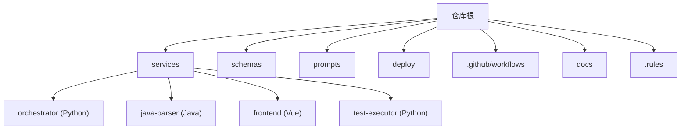
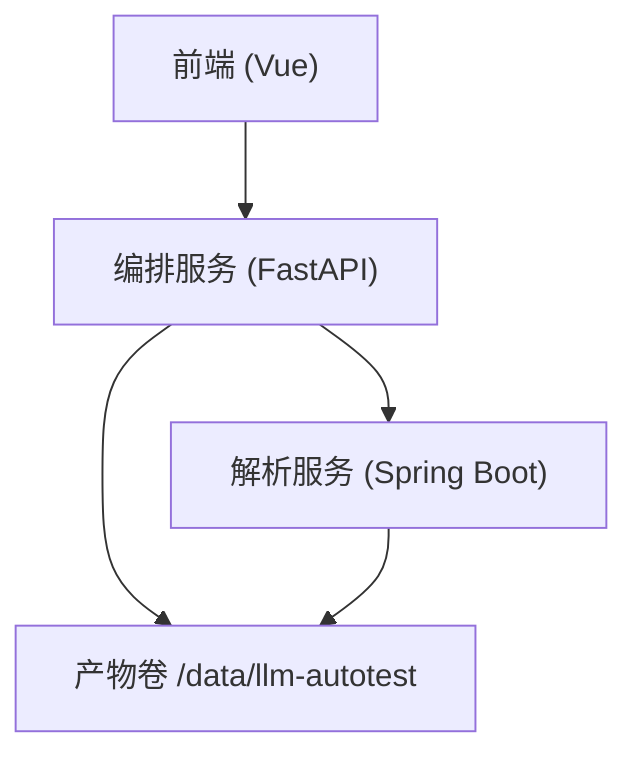
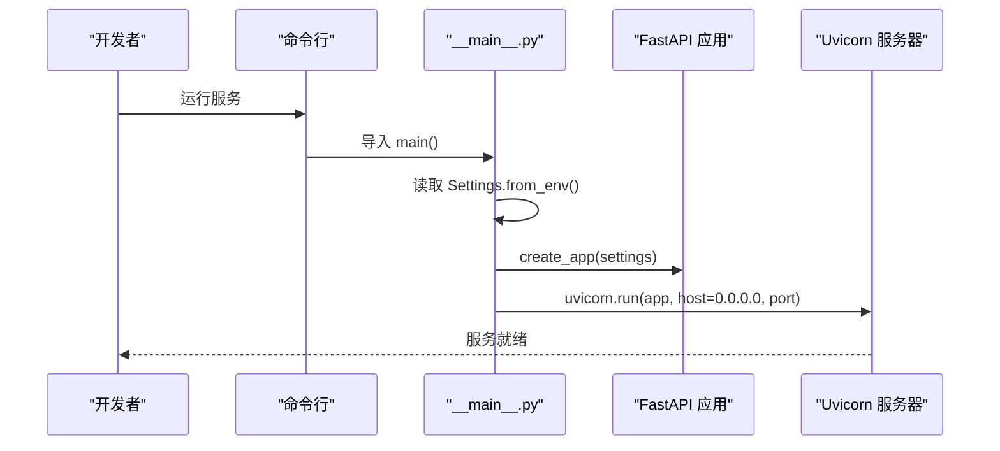
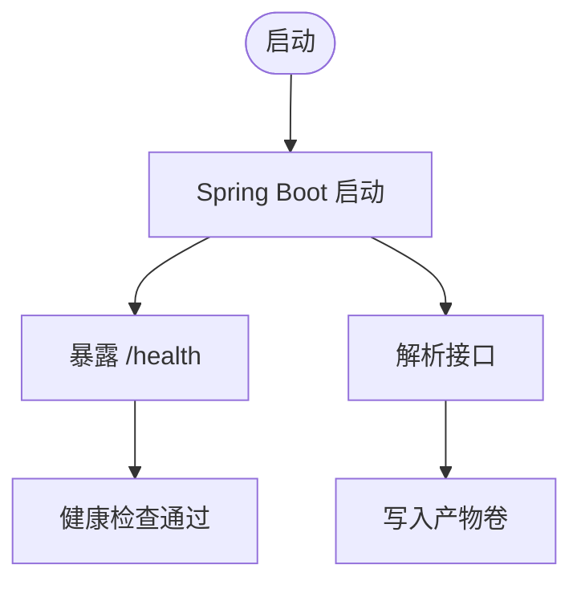
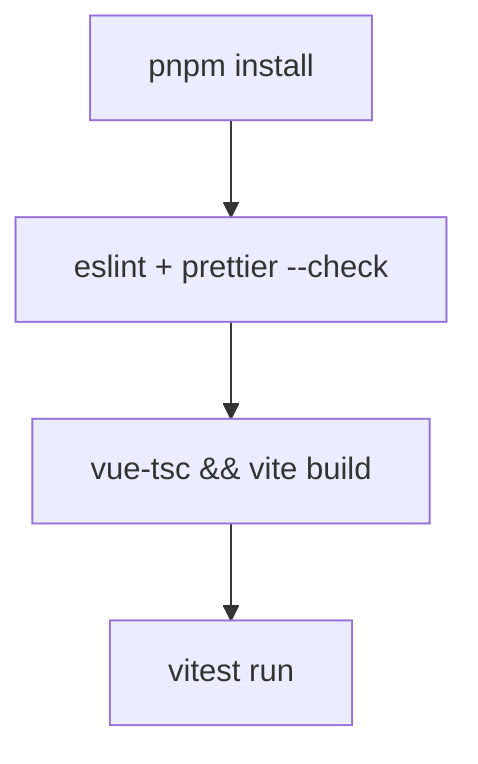

# 开发指南

<cite>
**本文引用的文件**
- [services/orchestrator/pyproject.toml](file://services/orchestrator/pyproject.toml)
- [services/frontend/package.json](file://services/frontend/package.json)
- [services/java-parser/pom.xml](file://services/java-parser/pom.xml)
- [.github/workflows/ci.yml](file://.github/workflows/ci.yml)
- [deploy/docker-compose.yml](file://deploy/docker-compose.yml)
- [.rules/python-code-style.md](file://.rules/python-code-style.md)
- [.rules/frontend-code-style.md](file://.rules/frontend-code-style.md)
- [services/java-parser/checkstyle.xml](file://services/java-parser/checkstyle.xml)
- [services/frontend/.prettierrc.json](file://services/frontend/.prettierrc.json)
- [services/frontend/eslint.config.js](file://services/frontend/eslint.config.js)
- [services/orchestrator/src/orchestrator/__main__.py](file://services/orchestrator/src/orchestrator/__main__.py)
- [services/java-parser/src/main/java/com/llmautotest/parser/ParserApplication.java](file://services/java-parser/src/main/java/com/llmautotest/parser/ParserApplication.java)
- [services/frontend/src/main.ts](file://services/frontend/src/main.ts)
- [docs/09_开发规范说明.md](file://docs/09_开发规范说明.md)
</cite>

## 目录
1. [简介](#简介)
2. [项目结构](#项目结构)
3. [核心组件](#核心组件)
4. [架构总览](#架构总览)
5. [详细组件分析](#详细组件分析)
6. [依赖分析](#依赖分析)
7. [性能与可维护性建议](#性能与可维护性建议)
8. [故障排查指南](#故障排查指南)
9. [结论](#结论)
10. [附录：本地开发与贡献流程](#附录：本地开发与贡献流程)

## 简介
本指南面向 LLM-AutoTest 项目的开发者，覆盖从环境搭建、工具链配置到代码规范、测试策略、质量门禁、贡献流程的完整实践。项目采用 Monorepo 组织，包含 Python 编排服务（orchestrator）、Java 解析服务（java-parser）、Vue 前端（frontend）以及可选的测试执行器（test-executor）。所有语言栈版本、包管理方式、构建与 CI 规则在仓库中已明确定义，本文据此给出落地步骤与最佳实践。

## 项目结构
- 顶层目录
  - services：各服务独立模块（Python/Java/Vue）
  - schemas：产物 JSON Schema（单一事实来源）
  - prompts：LLM Prompt 集中管理
  - deploy：docker-compose 编排与环境
  - .github/workflows：CI 流水线
  - docs：需求与规范文档
  - .rules：按 glob 触发的代码风格规则



**章节来源**
- [docs/09_开发规范说明.md:21-35](file://docs/09_开发规范说明.md#L21-L35)

## 核心组件
- orchestrator（Python）：提供 REST API、节点编排、断点续跑、产物管理与对外接口调用。入口通过 uvicorn 启动 FastAPI 应用。
- java-parser（Java）：基于 Spring Boot + JavaParser，实现多仓库扫描与接口逆向还原，暴露健康检查与解析接口。
- frontend（Vue 3 + TypeScript）：任务配置、监控、报告等页面，统一通过 API 层调用后端。
- test-executor（Python）：测试脚本加载与无人值守执行（按需启用）。

**章节来源**
- [services/orchestrator/src/orchestrator/__main__.py:1-26](file://services/orchestrator/src/orchestrator/__main__.py#L1-L26)
- [services/java-parser/src/main/java/com/llmautotest/parser/ParserApplication.java:1-17](file://services/java-parser/src/main/java/com/llmautotest/parser/ParserApplication.java#L1-L17)
- [services/frontend/src/main.ts:1-7](file://services/frontend/src/main.ts#L1-L7)
- [docs/09_开发规范说明.md:37-45](file://docs/09_开发规范说明.md#L37-L45)

## 架构总览
系统由前端、编排服务、解析服务组成，数据通过 REST 交互，产物持久化于共享卷。



**图表来源**
- [deploy/docker-compose.yml:4-41](file://deploy/docker-compose.yml#L4-L41)

**章节来源**
- [deploy/docker-compose.yml:1-62](file://deploy/docker-compose.yml#L1-L62)

## 详细组件分析

### Python 编排服务（orchestrator）
- 运行环境与依赖
  - Python 3.11+，使用 uv 管理依赖并锁定 uv.lock；依赖包括 FastAPI、Uvicorn、Pydantic、HTTPX、JSONSchema 等。
  - 开发依赖包含 pytest、pytest-asyncio、ruff、mypy 等。
- 启动方式
  - 通过 __main__ 读取配置并启动 Uvicorn 服务器，监听 0.0.0.0 与指定端口。
- 代码规范与质量
  - Ruff 行宽 100，目标版本 py311；Mypy strict 模式；测试路径 tests。
- 容器与编排
  - Dockerfile 位于 services/orchestrator；compose 中映射端口 8000，挂载产物卷，依赖 java-parser 健康后启动。



**图表来源**
- [services/orchestrator/src/orchestrator/__main__.py:15-22](file://services/orchestrator/src/orchestrator/__main__.py#L15-L22)

**章节来源**
- [services/orchestrator/pyproject.toml:1-57](file://services/orchestrator/pyproject.toml#L1-L57)
- [services/orchestrator/src/orchestrator/__main__.py:1-26](file://services/orchestrator/src/orchestrator/__main__.py#L1-L26)
- [deploy/docker-compose.yml:18-32](file://deploy/docker-compose.yml#L18-L32)

### Java 解析服务（java-parser）
- 运行环境与依赖
  - Java 21 LTS，Spring Boot 3.4，Maven 构建；核心依赖 JavaParser。
- 启动方式
  - Spring Boot 主类 ParserApplication 启动应用，暴露健康检查端点。
- 代码规范与质量
  - Checkstyle 基于 Google 风格，行宽放宽至 120；禁止 System.out 打印，强制 SLF4J。
- 容器与编排
  - Dockerfile 位于 services/java-parser；compose 中映射端口 8081→8080，挂载产物卷，健康检查通过后再被 orchestrator 依赖。



**图表来源**
- [services/java-parser/src/main/java/com/llmautotest/parser/ParserApplication.java:9-15](file://services/java-parser/src/main/java/com/llmautotest/parser/ParserApplication.java#L9-L15)
- [services/java-parser/checkstyle.xml:12-20](file://services/java-parser/checkstyle.xml#L12-L20)
- [deploy/docker-compose.yml:4-16](file://deploy/docker-compose.yml#L4-L16)

**章节来源**
- [services/java-parser/pom.xml:1-83](file://services/java-parser/pom.xml#L1-L83)
- [services/java-parser/checkstyle.xml:1-34](file://services/java-parser/checkstyle.xml#L1-L34)
- [deploy/docker-compose.yml:4-16](file://deploy/docker-compose.yml#L4-L16)

### 前端（frontend）
- 运行环境与依赖
  - Vue 3 + TypeScript + Vite，pnpm 包管理；ESLint + Prettier 校验与格式化；Vitest 单元测试。
- 启动与构建
  - dev/build/lint/test 脚本齐全；构建时先类型检查再打包。
- 代码规范与质量
  - ESLint 推荐规则 + Vue 插件；Prettier 单引号、无分号、行宽 100；TypeScript 严格模式。
- 容器与编排
  - compose 中映射端口 8080→80，依赖 orchestrator 启动。



**图表来源**
- [services/frontend/package.json:8-13](file://services/frontend/package.json#L8-L13)
- [services/frontend/eslint.config.js:1-31](file://services/frontend/eslint.config.js#L1-L31)
- [services/frontend/.prettierrc.json:1-6](file://services/frontend/.prettierrc.json#L1-L6)

**章节来源**
- [services/frontend/package.json:1-30](file://services/frontend/package.json#L1-L30)
- [services/frontend/eslint.config.js:1-31](file://services/frontend/eslint.config.js#L1-L31)
- [services/frontend/.prettierrc.json:1-6](file://services/frontend/.prettierrc.json#L1-L6)
- [deploy/docker-compose.yml:34-41](file://deploy/docker-compose.yml#L34-L41)

## 依赖分析
- 语言与包管理基线
  - Python 3.11+，uv；Java 21 LTS，Maven；Node 20 LTS，pnpm。
- 服务间依赖
  - orchestrator 依赖 java-parser（环境变量 JAVA_PARSER_URL），compose 中通过 healthcheck 确保顺序。
- 构建与镜像
  - CI 对 Python/Java/Frontend 分别执行 lint、build、test；push 分支触发 Docker 构建。

```mermaid
graph LR
FE["frontend"] --> ORCH["orchestrator"]
ORCH --> JP["java-parser"]
ORCH -.env. --> ENV["JAVA_PARSER_URL"]
```

**图表来源**
- [deploy/docker-compose.yml:23-31](file://deploy/docker-compose.yml#L23-L31)
- [.github/workflows/ci.yml:9-75](file://.github/workflows/ci.yml#L9-L75)

**章节来源**
- [docs/09_开发规范说明.md:11-19](file://docs/09_开发规范说明.md#L11-L19)
- [.github/workflows/ci.yml:9-75](file://.github/workflows/ci.yml#L9-L75)

## 性能与可维护性建议
- 异步与外部调用
  - orchestrator 节点调度使用 asyncio；外部请求设置超时与重试边界，避免阻塞事件循环。
- 日志与可观测性
  - Python 使用 logging 统一格式；每次 LLM 调用记录输入摘要、输出、耗时、token 数，便于问题定位与度量采集。
- 产物与存储
  - 产物按任务 ID 分目录写入共享卷，路径由 orchestrator artifacts 模块统一管理，避免散落路径拼接。
- 前端展示口径
  - 度量数值一律来自后端 API 返回的程序化汇总结果，前端不做计算或估算，保证口径一致。

[本节为通用指导，不直接分析具体文件]

## 故障排查指南
- 常见启动问题
  - 端口冲突：确认 8000/8080/8081 未被占用；compose 端口映射正确。
  - 健康检查失败：java-parser 未就绪导致 orchestrator 等待；检查 /health 端点与网络连通。
  - 环境变量缺失：orchestrator 需 JAVA_PARSER_URL；必要时通过 .env 注入。
- 构建与测试失败
  - Python：ruff/mypy/pytest 失败时根据报错修复代码或类型注解；确保 uv sync 成功。
  - Java：checkstyle 失败需遵循 Google 风格并移除 System.out；Maven verify 失败检查依赖与测试。
  - Frontend：eslint/prettier/vitest 失败需按提示修复格式与逻辑错误。
- 日志定位
  - 查看各服务容器日志；关注节点失败落盘信息（状态、原因、时间戳），用于断点续跑与回溯。

**章节来源**
- [deploy/docker-compose.yml:11-16](file://deploy/docker-compose.yml#L11-L16)
- [.rules/python-code-style.md:44-48](file://.rules/python-code-style.md#L44-L48)
- [services/java-parser/checkstyle.xml:16-20](file://services/java-parser/checkstyle.xml#L16-L20)

## 结论
LLM-AutoTest 以清晰的 Monorepo 结构与严格的规范/门禁保障交付质量。通过统一的依赖管理、静态检查、测试与 CI 流水线，结合容器编排与健康检查，可实现稳定可靠的开发与部署体验。遵循本文档的环境搭建、规范与流程，将显著提升协作效率与代码质量。

[本节为总结，不直接分析具体文件]

## 附录：本地开发与贡献流程

### 环境搭建
- 前置要求
  - Python 3.11+、Java 21、Node 20 LTS、Docker、Docker Compose。
- 安装依赖
  - Python：进入 services/orchestrator 与 services/test-executor，使用 uv sync 安装依赖。
  - Java：进入 services/java-parser，使用 mvn 构建。
  - Frontend：进入 services/frontend，使用 pnpm install 安装依赖。
- 启动服务
  - 使用 docker compose 启动全部服务；或通过各自服务的 dev 脚本本地调试。

**章节来源**
- [services/orchestrator/pyproject.toml:16-24](file://services/orchestrator/pyproject.toml#L16-L24)
- [services/java-parser/pom.xml:24-47](file://services/java-parser/pom.xml#L24-L47)
- [services/frontend/package.json:14-28](file://services/frontend/package.json#L14-L28)
- [deploy/docker-compose.yml:1-62](file://deploy/docker-compose.yml#L1-L62)

### IDE 配置建议
- Python
  - 解释器指向 3.11+；启用 ruff 与 mypy；设置行宽 100；导入分组标准库/第三方/内部。
- Java
  - JDK 21；Maven 构建；启用 checkstyle 插件；禁止 System.out 打印。
- Frontend
  - Node 20；pnpm；ESLint + Prettier；TypeScript 严格模式；Vitest 支持。

**章节来源**
- [.rules/python-code-style.md:20-27](file://.rules/python-code-style.md#L20-L27)
- [services/java-parser/checkstyle.xml:1-34](file://services/java-parser/checkstyle.xml#L1-L34)
- [services/frontend/eslint.config.js:1-31](file://services/frontend/eslint.config.js#L1-L31)
- [services/frontend/.prettierrc.json:1-6](file://services/frontend/.prettierrc.json#L1-L6)

### 代码规范与约定
- Python
  - PEP 8；ruff 行宽 100；mypy strict；类型注解强制；docstring 中文；异常处理与日志规范；测试隔离与 Mock。
- Java
  - Google 风格（行宽 120）；Checkstyle 检查；SLF4J 日志；契约对齐 schemas。
- Frontend
  - Vue 3 组合式 API + TS；ESLint + Prettier；组件 PascalCase；API 层收敛；度量数值仅来自后端。

**章节来源**
- [.rules/python-code-style.md:9-56](file://.rules/python-code-style.md#L9-L56)
- [services/java-parser/checkstyle.xml:1-34](file://services/java-parser/checkstyle.xml#L1-L34)
- [.rules/frontend-code-style.md:12-55](file://.rules/frontend-code-style.md#L12-L55)

### 单元测试运行
- Python
  - 使用 pytest；异步模式 auto；测试路径 tests；覆盖率目标逐步提升。
- Java
  - Maven Surefire；verify 阶段执行 checkstyle 与测试。
- Frontend
  - Vitest；lint 与 build 通过后运行测试。

**章节来源**
- [services/orchestrator/pyproject.toml:54-57](file://services/orchestrator/pyproject.toml#L54-L57)
- [services/java-parser/pom.xml:49-81](file://services/java-parser/pom.xml#L49-L81)
- [services/frontend/package.json:8-13](file://services/frontend/package.json#L8-L13)

### 新功能开发流程
- 需求分析与规格对齐
  - 参考 docs 中的规格编号与约束；修改前阅读同目录实现与测试，保持最小改动。
- 设计与实现
  - 新增节点或服务能力时，遵循命名与类型标注规范；对外 API 变更需同步 schema 与契约。
- 测试与验证
  - 补充单测覆盖成功/边界/失败路径；确保相关测试通过；避免真实外部依赖。
- 提交与审查
  - 提交信息格式：[服务名] 类型: 摘要；CI 绿灯 + 至少 1 人 review 通过后方可合入。

**章节来源**
- [docs/09_开发规范说明.md:103-108](file://docs/09_开发规范说明.md#L103-L108)
- [.rules/python-code-style.md:11-18](file://.rules/python-code-style.md#L11-L18)

### 代码审查流程与质量门禁
- 本地门禁
  - pre-commit（ruff/mypy/checkstyle/eslint）拦截不规范代码。
- CI 门禁
  - Python：ruff check/format、mypy、pytest；Java：mvn verify；Frontend：lint/build；Docker 构建（push 分支）。
- 覆盖率
  - 核心逻辑覆盖率目标 ≥70%（逐步启用）。

**章节来源**
- [.github/workflows/ci.yml:9-75](file://.github/workflows/ci.yml#L9-L75)
- [docs/09_开发规范说明.md:110-121](file://docs/09_开发规范说明.md#L110-L121)

### 贡献代码、提交 Issue 与参与讨论
- 分支策略
  - 主干 main 受保护；特性分支 feat/、修复分支 fix/，短期存活。
- 提交规范
  - 类型限定 feat/fix/refactor/test/docs/chore；禁止 force push 到 main。
- 社区参与
  - 依据 docs 中的规格编号进行追溯；遵循红线与契约先行原则。

**章节来源**
- [docs/09_开发规范说明.md:103-108](file://docs/09_开发规范说明.md#L103-L108)