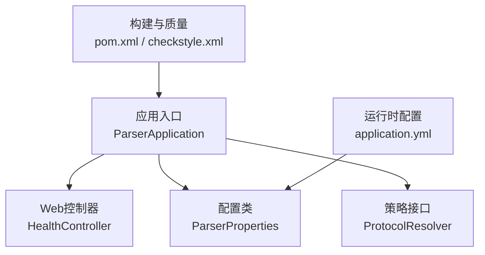
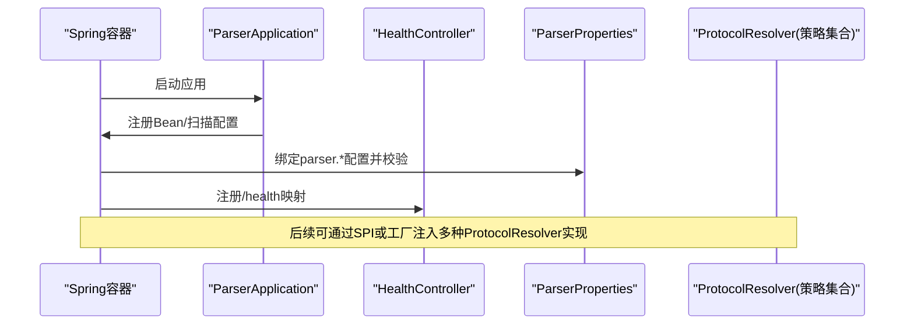
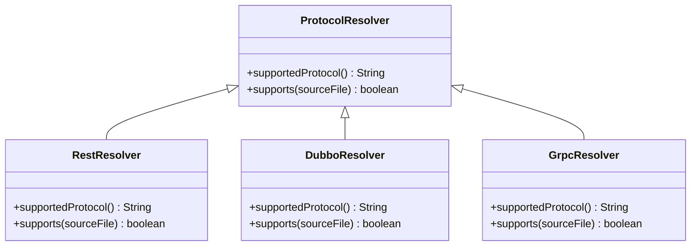
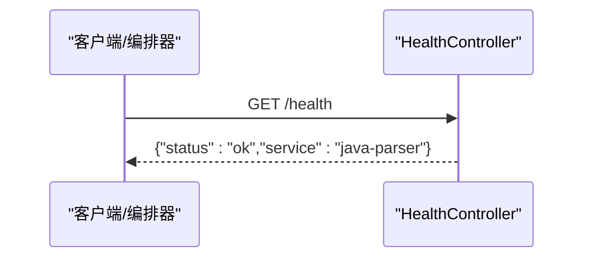
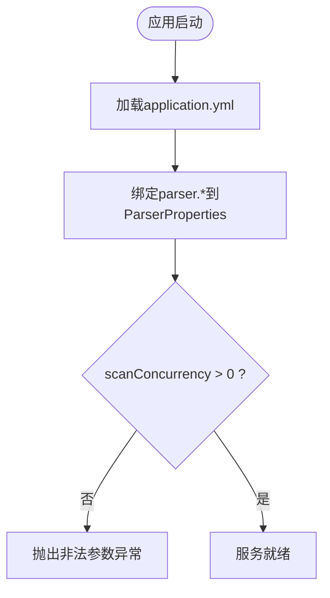
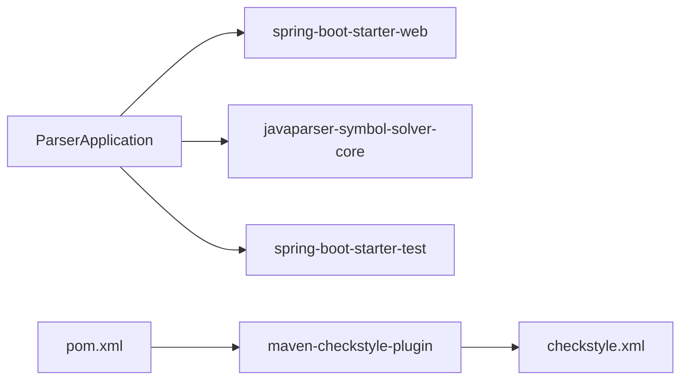

# Java代码规范

<cite>
**本文引用的文件**
- [ParserApplication.java](file://services/java-parser/src/main/java/com/llmautotest/parser/ParserApplication.java)
- [HealthController.java](file://services/java-parser/src/main/java/com/llmautotest/parser/HealthController.java)
- [ProtocolResolver.java](file://services/java-parser/src/main/java/com/llmautotest/parser/ProtocolResolver.java)
- [ParserProperties.java](file://services/java-parser/src/main/java/com/llmautotest/parser/ParserProperties.java)
- [application.yml](file://services/java-parser/src/main/resources/application.yml)
- [pom.xml](file://services/java-parser/pom.xml)
- [checkstyle.xml](file://services/java-parser/checkstyle.xml)
- [HealthControllerTest.java](file://services/java-parser/src/test/java/com/llmautotest/parser/HealthControllerTest.java)
- [09_开发规范说明.md](file://docs/09_开发规范说明.md)
</cite>

## 目录
1. [简介](#简介)
2. [项目结构](#项目结构)
3. [核心组件](#核心组件)
4. [架构总览](#架构总览)
5. [详细组件分析](#详细组件分析)
6. [依赖关系分析](#依赖关系分析)
7. [性能与可观测性](#性能与可观测性)
8. [故障排查指南](#故障排查指南)
9. [结论](#结论)
10. [附录：示例与最佳实践清单](#附录示例与最佳实践清单)

## 简介
本规范面向LLM-AutoTest项目的Java服务（java-parser），基于Spring Boot 3.4 + Java 21 LTS，结合项目内既有实现与文档约定，统一命名、注释、包结构、配置管理、健康检查、协议解析扩展机制、质量门禁与测试规范。目标是让新增协议、接口与功能时保持“可插拔、可验证、可回归”的工程化能力。

## 项目结构
java-parser采用Maven标准目录布局，遵循Spring Boot工程约定；通过Checkstyle进行静态检查，通过Spring Web暴露REST端点，使用JavaParser作为源码解析核心，并以可插拔的ProtocolResolver策略模式支持多协议解析。

图表来源
- [ParserApplication.java:9-15](file://services/java-parser/src/main/java/com/llmautotest/parser/ParserApplication.java#L9-L15)
- [HealthController.java:9-16](file://services/java-parser/src/main/java/com/llmautotest/parser/HealthController.java#L9-L16)
- [ParserProperties.java:7-15](file://services/java-parser/src/main/java/com/llmautotest/parser/ParserProperties.java#L7-L15)
- [ProtocolResolver.java:7-16](file://services/java-parser/src/main/java/com/llmautotest/parser/ProtocolResolver.java#L7-L16)
- [pom.xml:31-47](file://services/java-parser/pom.xml#L31-L47)
- [checkstyle.xml:1-34](file://services/java-parser/checkstyle.xml#L1-L34)
- [application.yml:1-8](file://services/java-parser/src/main/resources/application.yml#L1-L8)

章节来源
- [ParserApplication.java:1-17](file://services/java-parser/src/main/java/com/llmautotest/parser/ParserApplication.java#L1-L17)
- [pom.xml:1-83](file://services/java-parser/pom.xml#L1-L83)
- [checkstyle.xml:1-34](file://services/java-parser/checkstyle.xml#L1-L34)
- [application.yml:1-8](file://services/java-parser/src/main/resources/application.yml#L1-L8)

## 核心组件
- 应用入口：Spring Boot启动类，启用自动装配与配置属性扫描。
- 健康检查：提供容器编排依赖的/health端点，返回稳定JSON结构。
- 配置管理：使用@ConfigurationProperties绑定外部配置，包含参数校验。
- 协议解析：定义ProtocolResolver策略接口，支持按协议标识与源码路径判断是否由该策略处理，便于新增协议不改动主流程。

章节来源
- [ParserApplication.java:9-15](file://services/java-parser/src/main/java/com/llmautotest/parser/ParserApplication.java#L9-L15)
- [HealthController.java:9-16](file://services/java-parser/src/main/java/com/llmautotest/parser/HealthController.java#L9-L16)
- [ParserProperties.java:7-15](file://services/java-parser/src/main/java/com/llmautotest/parser/ParserProperties.java#L7-L15)
- [ProtocolResolver.java:7-16](file://services/java-parser/src/main/java/com/llmautotest/parser/ProtocolResolver.java#L7-L16)

## 架构总览
下图展示java-parser在Spring Boot中的关键交互：启动后加载配置、注册控制器、暴露健康检查；后续可扩展多个ProtocolResolver实现以支持不同协议解析。

图表来源
- [ParserApplication.java:9-15](file://services/java-parser/src/main/java/com/llmautotest/parser/ParserApplication.java#L9-L15)
- [HealthController.java:9-16](file://services/java-parser/src/main/java/com/llmautotest/parser/HealthController.java#L9-L16)
- [ParserProperties.java:7-15](file://services/java-parser/src/main/java/com/llmautotest/parser/ParserProperties.java#L7-L15)
- [ProtocolResolver.java:7-16](file://services/java-parser/src/main/java/com/llmautotest/parser/ProtocolResolver.java#L7-L16)

## 详细组件分析

### 命名约定
- 包名：全小写，按公司域名倒序组织，如com.llmautotest.parser。
- 类名：大驼峰（PascalCase），如HealthController、ParserProperties、ProtocolResolver。
- 方法名：小驼峰（camelCase），动词开头，语义清晰，如health()、supportedProtocol()、supports(Path)。
- 变量名：小驼峰，语义明确；常量使用UPPER_SNAKE_CASE（若出现）。
- 配置文件键：application.yml中采用短横线分隔（kebab-case），如scan-concurrency，对应Java record字段为驼峰形式。

章节来源
- [ParserApplication.java:1-17](file://services/java-parser/src/main/java/com/llmautotest/parser/ParserApplication.java#L1-L17)
- [HealthController.java:1-18](file://services/java-parser/src/main/java/com/llmautotest/parser/HealthController.java#L1-L18)
- [ProtocolResolver.java:1-17](file://services/java-parser/src/main/java/com/llmautotest/parser/ProtocolResolver.java#L1-L17)
- [ParserProperties.java:1-17](file://services/java-parser/src/main/java/com/llmautotest/parser/ParserProperties.java#L1-L17)
- [application.yml:1-8](file://services/java-parser/src/main/resources/application.yml#L1-L8)

### 注释规范
- Javadoc：对公共API（接口、类、方法）编写中文Javadoc，说明职责、参数、返回值与异常。
- 行内注释：用于解释复杂逻辑或业务约束，避免冗余注释。
- 类头注释：标注对应规格编号与模块归属，便于追溯（例如模块2/3，G3/R2）。

章节来源
- [ProtocolResolver.java:1-17](file://services/java-parser/src/main/java/com/llmautotest/parser/ProtocolResolver.java#L1-L17)
- [ParserProperties.java:1-17](file://services/java-parser/src/main/java/com/llmautotest/parser/ParserProperties.java#L1-L17)
- [09_开发规范说明.md:56-63](file://docs/09_开发规范说明.md#L56-L63)

### 包结构设计
- 根包：com.llmautotest.parser
- 控制器：controller（当前HealthController位于根包，建议后续迁移至controller子包）
- 配置：config（ParserProperties建议迁移至config子包）
- 领域/策略：strategy或resolver（ProtocolResolver及其实现放于此）
- 资源：resources下放置application.yml等配置

章节来源
- [ParserApplication.java:1-17](file://services/java-parser/src/main/java/com/llmautotest/parser/ParserApplication.java#L1-L17)
- [HealthController.java:1-18](file://services/java-parser/src/main/java/com/llmautotest/parser/HealthController.java#L1-L18)
- [ParserProperties.java:1-17](file://services/java-parser/src/main/java/com/llmautotest/parser/ParserProperties.java#L1-L17)
- [ProtocolResolver.java:1-17](file://services/java-parser/src/main/java/com/llmautotest/parser/ProtocolResolver.java#L1-L17)

### ProtocolResolver接口设计与扩展机制
- 设计目标：将协议解析逻辑抽象为策略，新增协议无需修改主流程，仅新增实现类并在容器中注册。
- 关键方法：
  - supportedProtocol()：声明支持的协议标识（如rest/dubbo/grpc/graphql/soap/mq）。
  - supports(Path sourceFile)：根据源码路径判断是否属于本协议，用于扫描阶段过滤。
- 扩展方式：
  - 新增实现类实现上述两个方法。
  - 通过Spring容器自动发现或工厂/策略注册表收集所有实现，供调度器选择。
  - 未来可在接口中增加解析方法（如parse(sourceFile) -> Result），与契约对齐。

图表来源
- [ProtocolResolver.java:7-16](file://services/java-parser/src/main/java/com/llmautotest/parser/ProtocolResolver.java#L7-L16)

章节来源
- [ProtocolResolver.java:1-17](file://services/java-parser/src/main/java/com/llmautotest/parser/ProtocolResolver.java#L1-L17)

### 健康检查端点实现规范
- 端点：GET /health
- 响应：稳定的JSON对象，至少包含status与服务标识，便于编排系统判定存活。
- 测试：使用@WebMvcTest与MockMvc断言状态码与关键字段。
- 部署：docker-compose编排依赖该端点进行健康检查。

图表来源
- [HealthController.java:9-16](file://services/java-parser/src/main/java/com/llmautotest/parser/HealthController.java#L9-L16)
- [HealthControllerTest.java:14-25](file://services/java-parser/src/test/java/com/llmautotest/parser/HealthControllerTest.java#L14-L25)

章节来源
- [HealthController.java:1-18](file://services/java-parser/src/main/java/com/llmautotest/parser/HealthController.java#L1-L18)
- [HealthControllerTest.java:1-27](file://services/java-parser/src/test/java/com/llmautotest/parser/HealthControllerTest.java#L1-L27)

### 配置与校验
- 使用@ConfigurationProperties(prefix = "parser")绑定配置项，如scanConcurrency。
- 在record构造器中进行参数校验，非法值抛出IllegalArgumentException，确保运行期安全。
- application.yml中使用kebab-case键名，与Java字段自动映射。

图表来源
- [ParserProperties.java:7-15](file://services/java-parser/src/main/java/com/llmautotest/parser/ParserProperties.java#L7-L15)
- [application.yml:5-7](file://services/java-parser/src/main/resources/application.yml#L5-L7)

章节来源
- [ParserProperties.java:1-17](file://services/java-parser/src/main/java/com/llmautotest/parser/ParserProperties.java#L1-L17)
- [application.yml:1-8](file://services/java-parser/src/main/resources/application.yml#L1-L8)

### API设计原则
- REST风格：使用@RestController与@GetMapping等注解声明端点。
- 响应结构：简洁稳定，便于编排与前端消费；错误响应统一结构（code/message/details）。
- 契约先行：对外接口结构与schemas/contracts中定义保持一致，变更需向后兼容。

章节来源
- [HealthController.java:9-16](file://services/java-parser/src/main/java/com/llmautotest/parser/HealthController.java#L9-L16)
- [09_开发规范说明.md:89-94](file://docs/09_开发规范说明.md#L89-L94)

### 单元测试规范
- 使用JUnit 5与Spring Boot Test。
- Web层使用@WebMvcTest配合MockMvc进行控制器测试，断言HTTP状态码与JSON字段。
- 覆盖率要求：核心逻辑≥70%（见CI门禁）。

章节来源
- [HealthControllerTest.java:1-27](file://services/java-parser/src/test/java/com/llmautotest/parser/HealthControllerTest.java#L1-L27)
- [pom.xml:42-46](file://services/java-parser/pom.xml#L42-L46)
- [09_开发规范说明.md:110-119](file://docs/09_开发规范说明.md#L110-L119)

### 代码质量检查（Checkstyle）
- 基于Google风格，放宽行宽至120字符。
- 禁止System.out打印，强制使用SLF4J参数化日志。
- 启用UnusedImports、AvoidStarImport、ConstantName、MethodName、TypeName、PackageName、ParameterName、LocalVariableName、EmptyCatchBlock等规则。
- 在verify阶段执行，失败即阻断构建。

章节来源
- [checkstyle.xml:1-34](file://services/java-parser/checkstyle.xml#L1-L34)
- [pom.xml:55-79](file://services/java-parser/pom.xml#L55-L79)

## 依赖关系分析
- Spring Boot Starter Web：提供Web MVC能力。
- JavaParser Symbol Solver：源码解析与符号求解，支撑ProtocolResolver策略的实际解析实现。
- Spring Boot Starter Test：单元测试依赖。
- Maven Checkstyle Plugin：静态检查插件，集成checkstyle.xml规则。

图表来源
- [pom.xml:31-47](file://services/java-parser/pom.xml#L31-L47)
- [pom.xml:55-79](file://services/java-parser/pom.xml#L55-L79)
- [checkstyle.xml:1-34](file://services/java-parser/checkstyle.xml#L1-L34)

章节来源
- [pom.xml:1-83](file://services/java-parser/pom.xml#L1-L83)

## 性能与可观测性
- 并发控制：scanConcurrency通过配置限定扫描并发度，避免资源耗尽。
- 日志规范：使用SLF4J参数化日志，禁止System.out输出；按任务ID归档日志，便于追踪。
- 健康检查：/health端点保证编排系统快速感知服务状态。

章节来源
- [ParserProperties.java:7-15](file://services/java-parser/src/main/java/com/llmautotest/parser/ParserProperties.java#L7-L15)
- [checkstyle.xml:16-20](file://services/java-parser/checkstyle.xml#L16-L20)
- [HealthController.java:9-16](file://services/java-parser/src/main/java/com/llmautotest/parser/HealthController.java#L9-L16)
- [09_开发规范说明.md:96-101](file://docs/09_开发规范说明.md#L96-L101)

## 故障排查指南
- 启动失败：检查application.yml中parser.scan-concurrency是否为正数；非法值会抛出异常。
- 健康检查失败：确认/health端点可达且返回status=ok；检查容器端口与编排配置。
- 构建失败：检查Checkstyle规则是否违反（如System.out、命名、空catch块等）。
- 协议解析问题：确认新增ProtocolResolver实现了supportedProtocol与supports，并被容器正确注册。

章节来源
- [ParserProperties.java:11-15](file://services/java-parser/src/main/java/com/llmautotest/parser/ParserProperties.java#L11-L15)
- [HealthController.java:12-16](file://services/java-parser/src/main/java/com/llmautotest/parser/HealthController.java#L12-L16)
- [checkstyle.xml:16-32](file://services/java-parser/checkstyle.xml#L16-L32)
- [ProtocolResolver.java:9-13](file://services/java-parser/src/main/java/com/llmautotest/parser/ProtocolResolver.java#L9-L13)

## 结论
本规范围绕Spring Boot最佳实践，明确了java-parser服务的命名、注释、包结构、配置与校验、健康检查、协议解析扩展机制、质量门禁与测试规范。通过ProtocolResolver的策略模式，新增协议只需实现接口并注册，不影响主流程；通过Checkstyle与单测保障代码质量与稳定性；通过健康检查与日志规范提升可运维性。

## 附录：示例与最佳实践清单
- 命名
  - 类名：PascalCase（如HealthController、ParserProperties）
  - 方法名：camelCase（如health()、supportedProtocol()）
  - 变量名：camelCase；常量：UPPER_SNAKE_CASE
- 注释
  - 公共API使用中文Javadoc；类头注明规格编号
- 包结构
  - com.llmautotest.parser.controller/config/strategy等子包
- 配置
  - application.yml使用kebab-case；Java侧使用@ConfigurationProperties绑定并校验
- 健康检查
  - GET /health返回稳定JSON；编写MockMvc单测
- 协议扩展
  - 新增ProtocolResolver实现，实现supportedProtocol与supports；必要时增加解析方法
- 质量门禁
  - Checkstyle规则严格；构建阶段failOnViolation=true
- 测试
  - Web层使用@WebMvcTest；核心逻辑覆盖率≥70%

章节来源
- [ParserApplication.java:1-17](file://services/java-parser/src/main/java/com/llmautotest/parser/ParserApplication.java#L1-L17)
- [HealthController.java:1-18](file://services/java-parser/src/main/java/com/llmautotest/parser/HealthController.java#L1-L18)
- [ProtocolResolver.java:1-17](file://services/java-parser/src/main/java/com/llmautotest/parser/ProtocolResolver.java#L1-L17)
- [ParserProperties.java:1-17](file://services/java-parser/src/main/java/com/llmautotest/parser/ParserProperties.java#L1-L17)
- [application.yml:1-8](file://services/java-parser/src/main/resources/application.yml#L1-L8)
- [pom.xml:55-79](file://services/java-parser/pom.xml#L55-L79)
- [checkstyle.xml:1-34](file://services/java-parser/checkstyle.xml#L1-L34)
- [HealthControllerTest.java:1-27](file://services/java-parser/src/test/java/com/llmautotest/parser/HealthControllerTest.java#L1-L27)
- [09_开发规范说明.md:56-63](file://docs/09_开发规范说明.md#L56-L63)
- [09_开发规范说明.md:110-119](file://docs/09_开发规范说明.md#L110-L119)