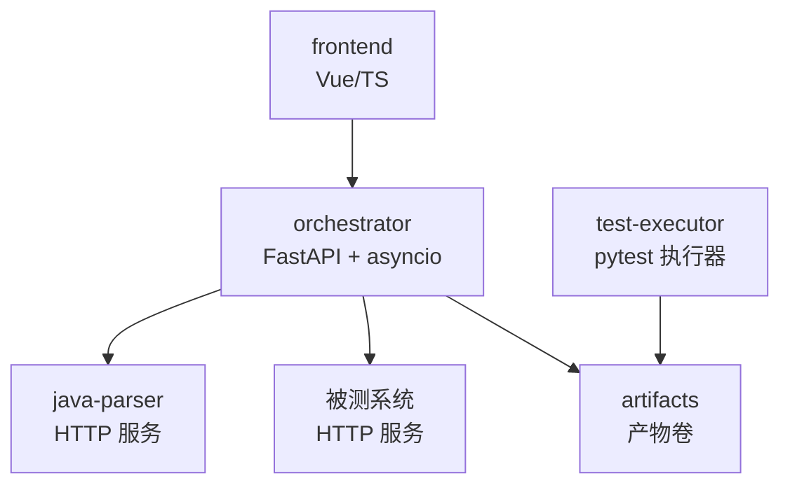
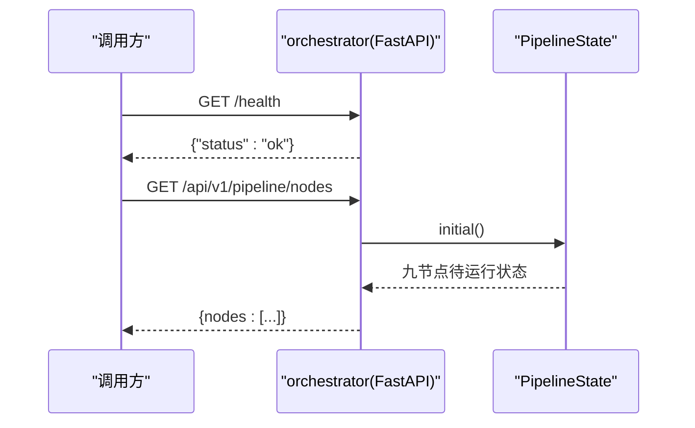
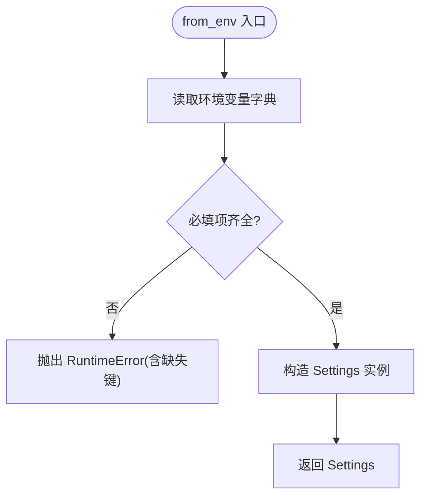
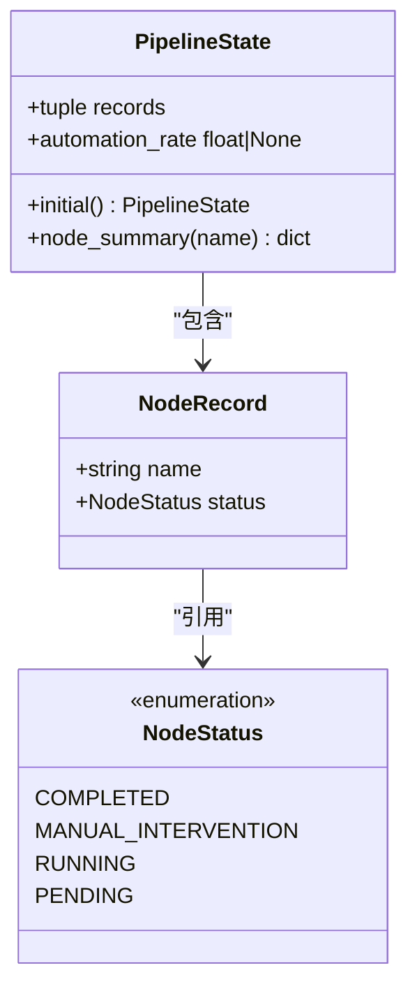
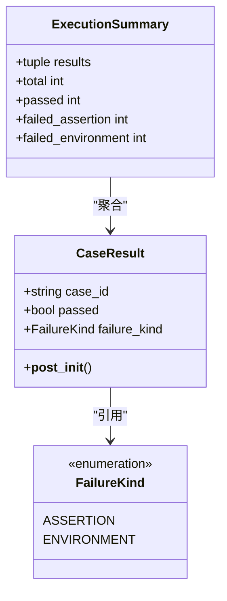
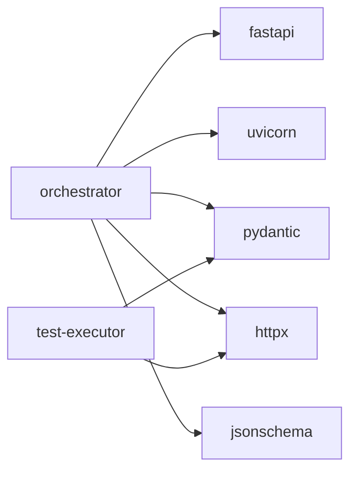

# Python代码规范

<cite>
**本文引用的文件**
- [.rules/python-code-style.md](file://.rules/python-code-style.md)
- [services/orchestrator/pyproject.toml](file://services/orchestrator/pyproject.toml)
- [services/test-executor/pyproject.toml](file://services/test-executor/pyproject.toml)
- [services/orchestrator/src/orchestrator/__main__.py](file://services/orchestrator/src/orchestrator/__main__.py)
- [services/orchestrator/src/orchestrator/api.py](file://services/orchestrator/src/orchestrator/api.py)
- [services/orchestrator/src/orchestrator/config.py](file://services/orchestrator/src/orchestrator/config.py)
- [services/orchestrator/src/orchestrator/pipeline.py](file://services/orchestrator/src/orchestrator/pipeline.py)
- [services/test-executor/src/executor/result.py](file://services/test-executor/src/executor/result.py)
- [services/orchestrator/tests/test_config.py](file://services/orchestrator/tests/test_config.py)
- [services/orchestrator/tests/test_pipeline.py](file://services/orchestrator/tests/test_pipeline.py)
- [services/test-executor/tests/test_result.py](file://services/test-executor/tests/test_result.py)
- [docs/09_开发规范说明.md](file://docs/09_开发规范说明.md)
</cite>

## 目录
1. [引言](#引言)
2. [项目结构](#项目结构)
3. [核心组件](#核心组件)
4. [架构总览](#架构总览)
5. [详细组件分析](#详细组件分析)
6. [依赖关系分析](#依赖关系分析)
7. [性能与可观测性](#性能与可观测性)
8. [故障排查指南](#故障排查指南)
9. [结论](#结论)
10. [附录：示例与反模式清单](#附录示例与反模式清单)

## 引言
本规范面向 LLM-AutoTest 项目的 Python 代码（Python 3.11+），覆盖 orchestrator 与 test-executor 两个服务，统一编码风格、类型标注、异常处理、日志记录、异步编程、外部调用超时、测试与覆盖率等要求。目标是确保代码质量、可维护性与可审计性，支撑九节点流水线与断点续跑能力。

## 项目结构
- Monorepo 包含多个服务：orchestrator（编排与REST API）、test-executor（用例执行与结果判定）、java-parser（Java解析服务）、frontend（前端）。
- Python 相关代码位于 services/orchestrator 与 services/test-executor；配置与工具链通过 pyproject.toml 管理。
- 规则与规范集中在 .rules 与 docs/09_开发规范说明.md。

图表来源
- [services/orchestrator/src/orchestrator/api.py:11-27](file://services/orchestrator/src/orchestrator/api.py#L11-L27)
- [services/orchestrator/src/orchestrator/config.py:9-49](file://services/orchestrator/src/orchestrator/config.py#L9-L49)
- [services/test-executor/src/executor/result.py:10-61](file://services/test-executor/src/executor/result.py#L10-L61)

章节来源
- [docs/09_开发规范说明.md:11-35](file://docs/09_开发规范说明.md#L11-L35)
- [services/orchestrator/pyproject.toml:1-53](file://services/orchestrator/pyproject.toml#L1-L53)
- [services/test-executor/pyproject.toml:1-45](file://services/test-executor/pyproject.toml#L1-L45)

## 核心组件
- orchestrator：提供 FastAPI REST 接口，暴露健康检查与九节点状态；承载配置加载、节点顺序与状态骨架；后续扩展节点调度与断点续跑。
- test-executor：负责加载并执行 pytest 脚本，产出二态失败结果（断言失败与环境失败）及汇总统计。
- 配置：Settings 从环境变量构建，禁止硬编码敏感信息；提供安全摘要用于日志。
- 数据模型：使用 dataclass/frozen 与 StrEnum 表达不可变、强类型的领域对象。

章节来源
- [services/orchestrator/src/orchestrator/api.py:1-27](file://services/orchestrator/src/orchestrator/api.py#L1-L27)
- [services/orchestrator/src/orchestrator/config.py:1-50](file://services/orchestrator/src/orchestrator/config.py#L1-L50)
- [services/orchestrator/src/orchestrator/pipeline.py:1-84](file://services/orchestrator/src/orchestrator/pipeline.py#L1-L84)
- [services/test-executor/src/executor/result.py:1-61](file://services/test-executor/src/executor/result.py#L1-L61)

## 架构总览
- orchestrator 启动 uvicorn 服务，绑定 0.0.0.0，端口来自配置；/health 与健康检查配合容器编排；/api/v1/pipeline/nodes 返回九节点清单与当前状态。
- 配置集中化：所有运行参数由环境变量注入，缺失必填项时抛出明确错误。
- 测试执行器独立部署，按任务 ID 写入产物到共享卷，供 orchestrator 读取与汇总。

图表来源
- [services/orchestrator/src/orchestrator/api.py:11-27](file://services/orchestrator/src/orchestrator/api.py#L11-L27)
- [services/orchestrator/src/orchestrator/pipeline.py:45-70](file://services/orchestrator/src/orchestrator/pipeline.py#L45-L70)

章节来源
- [services/orchestrator/src/orchestrator/__main__.py:1-26](file://services/orchestrator/src/orchestrator/__main__.py#L1-L26)
- [services/orchestrator/src/orchestrator/api.py:11-27](file://services/orchestrator/src/orchestrator/api.py#L11-L27)

## 详细组件分析

### 配置模块（Settings）
- 职责：集中读取环境变量，构建不可变配置对象；提供不含密钥的公开摘要用于日志。
- 类型标注：严格使用 Python 3.11 语法，如 str | None；字段类型清晰，避免 Any。
- 错误处理：缺失必填环境变量时抛出 RuntimeError，保留原始 KeyError 作为原因。
- 安全：public_summary 不包含敏感字段，防止日志泄露。

图表来源
- [services/orchestrator/src/orchestrator/config.py:32-49](file://services/orchestrator/src/orchestrator/config.py#L32-L49)

章节来源
- [services/orchestrator/src/orchestrator/config.py:1-50](file://services/orchestrator/src/orchestrator/config.py#L1-L50)
- [services/orchestrator/tests/test_config.py:10-43](file://services/orchestrator/tests/test_config.py#L10-L43)

### 流水线状态（PipelineState）
- 职责：定义九节点固定顺序与四态（completed/manual_intervention/running/pending），提供初始状态与自动化率计算。
- 类型标注：使用 StrEnum、Literal 与 tuple 表达强类型集合；节点名以 Literal 约束。
- 行为：automation_rate 在未实测时返回 None，体现诚实口径。

图表来源
- [services/orchestrator/src/orchestrator/pipeline.py:11-84](file://services/orchestrator/src/orchestrator/pipeline.py#L11-L84)

章节来源
- [services/orchestrator/src/orchestrator/pipeline.py:1-84](file://services/orchestrator/src/orchestrator/pipeline.py#L1-L84)
- [services/orchestrator/tests/test_pipeline.py:21-47](file://services/orchestrator/tests/test_pipeline.py#L21-L47)

### REST API（FastAPI）
- 职责：仅做协议转换与校验，业务逻辑下沉至 service/pipeline。
- 端点：/health 健康检查；/api/v1/pipeline/nodes 返回九节点清单与状态。
- 类型标注：返回值使用 dict[str, object] 等精确类型。

章节来源
- [services/orchestrator/src/orchestrator/api.py:1-27](file://services/orchestrator/src/orchestrator/api.py#L1-L27)
- [services/orchestrator/tests/test_pipeline.py:33-47](file://services/orchestrator/tests/test_pipeline.py#L33-L47)

### 执行结果（test-executor）
- 职责：区分“断言失败”与“环境失败”，提供单用例结果与一次执行的汇总统计。
- 类型标注：使用 StrEnum 与 frozen dataclass；__post_init__ 保证结果自洽。
- 指标：total、passed、failed_assertion、failed_environment 均为程序化汇总，不经过 LLM。

图表来源
- [services/test-executor/src/executor/result.py:10-61](file://services/test-executor/src/executor/result.py#L10-L61)

章节来源
- [services/test-executor/src/executor/result.py:1-61](file://services/test-executor/src/executor/result.py#L1-L61)
- [services/test-executor/tests/test_result.py:10-30](file://services/test-executor/tests/test_result.py#L10-L30)

## 依赖关系分析
- orchestrator 依赖 FastAPI、uvicorn、pydantic、httpx、jsonschema；dev 依赖 pytest、pytest-asyncio、ruff、mypy。
- test-executor 依赖 pydantic、httpx；dev 依赖 pytest、ruff、mypy。
- 两者均使用 ruff（line-length=100，target-version=py311）与 mypy（strict=true）。

图表来源
- [services/orchestrator/pyproject.toml:1-53](file://services/orchestrator/pyproject.toml#L1-L53)
- [services/test-executor/pyproject.toml:1-45](file://services/test-executor/pyproject.toml#L1-L45)

章节来源
- [services/orchestrator/pyproject.toml:14-53](file://services/orchestrator/pyproject.toml#L14-L53)
- [services/test-executor/pyproject.toml:11-45](file://services/test-executor/pyproject.toml#L11-L45)

## 性能与可观测性
- 异步与外部调用：orchestrator 节点调度使用 asyncio；所有外部请求设置连接与读取超时，处理非成功状态、无效响应、取消与重试边界；重试必须有限且避免重复副作用。
- 日志记录：使用 logging.getLogger(__name__)，JSON 行格式统一配置；每次 LLM 调用记录输入摘要、输出、耗时、token 数于节点执行日志；禁止 print。
- 资源管理：对文件和网络资源使用上下文管理器；路径使用 pathlib.Path，UTF-8 读写；结构化产物按任务 ID 分目录写入，路径统一经 orchestrator 的 artifacts 模块管理。
- 度量与报告：数值只经程序化汇总产生，不经过 LLM；自动化率未实测时返回 None，体现诚实口径。

章节来源
- [.rules/python-code-style.md:38-48](file://.rules/python-code-style.md#L38-L48)
- [docs/09_开发规范说明.md:73-101](file://docs/09_开发规范说明.md#L73-L101)
- [services/orchestrator/src/orchestrator/config.py:23-30](file://services/orchestrator/src/orchestrator/config.py#L23-L30)

## 故障排查指南
- 配置缺失：当必填环境变量缺失时，Settings.from_env 会抛出 RuntimeError，提示缺失键；检查环境变量是否完整注入。
- 健康检查失败：/health 应返回 {"status":"ok"}；若失败，检查 uvicorn 启动参数与端口绑定。
- 节点状态异常：确认 NODE_ORDER 未被修改；自动化率在无完成节点时为 None，属于预期。
- 执行结果不一致：CaseResult.__post_init__ 会在通过的用例携带失败类型时报错；检查用例执行逻辑是否正确标记 failure_kind。

章节来源
- [services/orchestrator/src/orchestrator/config.py:32-49](file://services/orchestrator/src/orchestrator/config.py#L32-L49)
- [services/orchestrator/src/orchestrator/api.py:16-19](file://services/orchestrator/src/orchestrator/api.py#L16-L19)
- [services/orchestrator/src/orchestrator/pipeline.py:23-70](file://services/orchestrator/src/orchestrator/pipeline.py#L23-L70)
- [services/test-executor/src/executor/result.py:25-29](file://services/test-executor/src/executor/result.py#L25-L29)

## 结论
本规范基于仓库现有实现与规则文件，明确了 Python 3.11+ 编码标准、类型标注、异常与日志、异步与外部调用、测试与覆盖率等要求。通过统一的配置、强类型数据模型与严格的静态检查，保障 orchestrator 与 test-executor 的可维护性与可审计性。建议在后续迭代中持续遵循本规范，并在 CI 中固化门禁。

## 附录：示例与反模式清单

### 编码风格与命名
- 遵循 PEP 8：模块、函数、变量 snake_case；类 PascalCase；常量 UPPER_SNAKE_CASE。
- 导入分组：标准库、第三方、项目内部；删除无用导入，禁止 import *。
- 新模块加入 from __future__ import annotations；使用 Python 3.11 类型语法，如 dict[str, str]、str | None。

章节来源
- [.rules/python-code-style.md:20-27](file://.rules/python-code-style.md#L20-L27)
- [services/orchestrator/pyproject.toml:29-43](file://services/orchestrator/pyproject.toml#L29-L43)
- [services/test-executor/pyproject.toml:25-36](file://services/test-executor/pyproject.toml#L25-L36)

### 类型标注规范
- 对外函数、类方法与数据模型强制准确类型标注；避免 Any；类型忽略需写明原因并缩小到具体行。
- 使用 dataclass(frozen=True) 与 StrEnum 表达不可变领域对象；__post_init__ 进行一致性校验。

章节来源
- [.rules/python-code-style.md:24-27](file://.rules/python-code-style.md#L24-L27)
- [services/orchestrator/src/orchestrator/config.py:9-49](file://services/orchestrator/src/orchestrator/config.py#L9-L49)
- [services/test-executor/src/executor/result.py:17-29](file://services/test-executor/src/executor/result.py#L17-L29)

### 异常处理最佳实践
- 捕获最具体异常，禁止裸 except；转换异常时使用 raise ... from exc；边界层映射为统一错误结构。
- 节点失败必须显式落盘（状态 + 原因 + 时间戳），作为断点续跑依据。

章节来源
- [.rules/python-code-style.md:44-48](file://.rules/python-code-style.md#L44-L48)
- [docs/09_开发规范说明.md:96-101](file://docs/09_开发规范说明.md#L96-L101)

### 日志记录规范
- 使用 logging.getLogger(__name__)，JSON 行格式统一配置；禁止 print。
- 每次 LLM 调用记录输入摘要、输出、耗时、token 数于节点执行日志；采样参数从配置文件读取。

章节来源
- [.rules/python-code-style.md:44-48](file://.rules/python-code-style.md#L44-L48)
- [docs/09_开发规范说明.md:73-79](file://docs/09_开发规范说明.md#L73-L79)

### 异步与外部调用超时
- orchestrator 节点调度使用 asyncio；禁止阻塞式网络/文件/DB 调用；必要时移交线程池并封装。
- 所有外部请求设置连接与读取超时，处理非成功状态、无效响应、取消与重试边界；重试有限且避免重复副作用。

章节来源
- [.rules/python-code-style.md:38-42](file://.rules/python-code-style.md#L38-L42)

### 测试编写规范（pytest、覆盖率≥70%）
- 使用 pytest 组织测试；测试确定、隔离，不依赖真实外部服务或随机结果；LLM 客户端一律 Mock。
- 缺陷修复先补回归测试；新增功能覆盖成功路径、边界输入、失败路径及关键副作用。
- 流水线核心逻辑覆盖率 ≥70%；测试文件命名为 test_*.py，与被测模块同构放置。

章节来源
- [.rules/python-code-style.md:50-55](file://.rules/python-code-style.md#L50-L55)
- [docs/09_开发规范说明.md:110-121](file://docs/09_开发规范说明.md#L110-L121)
- [services/orchestrator/tests/test_config.py:10-43](file://services/orchestrator/tests/test_config.py#L10-L43)
- [services/orchestrator/tests/test_pipeline.py:21-47](file://services/orchestrator/tests/test_pipeline.py#L21-L47)
- [services/test-executor/tests/test_result.py:10-30](file://services/test-executor/tests/test_result.py#L10-L30)

### 反模式说明
- 可变默认参数：禁止使用可变默认参数；使用 None 后在函数内创建集合。
- 降级截取：LLM 输出校验失败不得降级为“截取可用部分”，应按节点失败处理。
- 静默跳过：降级节点按“人工介入”计入并显式记录，禁止静默跳过。
- 数字不经 LLM：通过率、自动化率等数值只能由程序化汇总产生，禁止 LLM 生成或改写。

章节来源
- [.rules/python-code-style.md:31-36](file://.rules/python-code-style.md#L31-L36)
- [docs/09_开发规范说明.md:73-87](file://docs/09_开发规范说明.md#L73-L87)