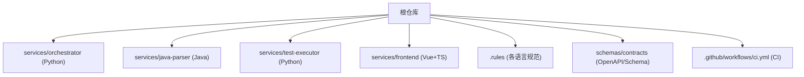
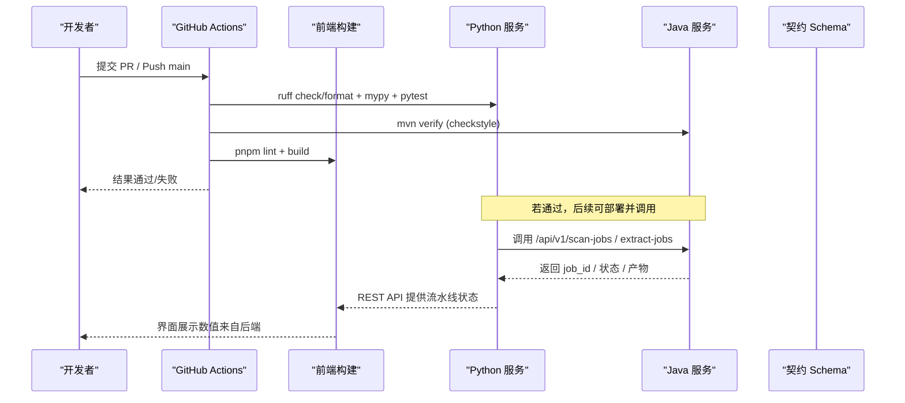
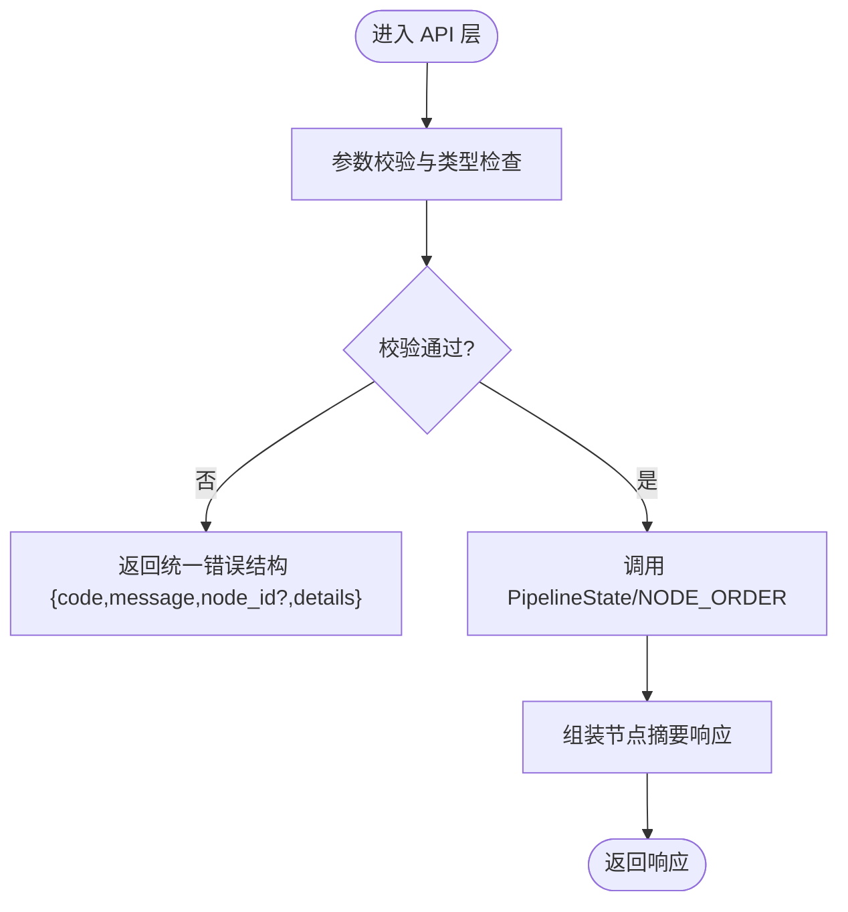
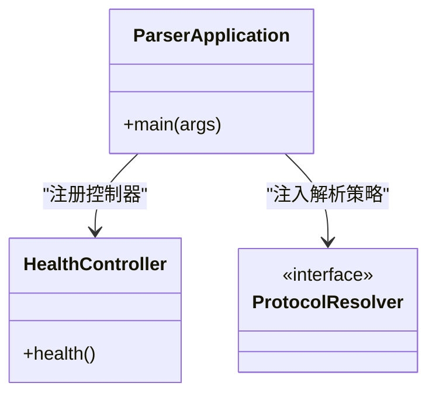
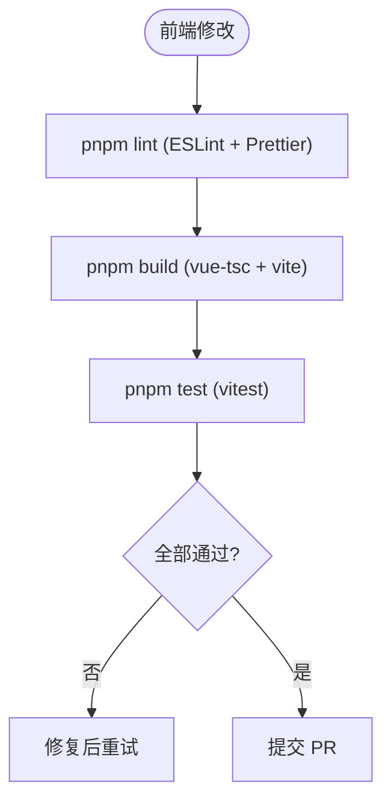
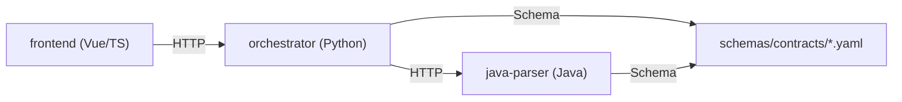

# 代码审查检查清单

<cite>
**本文引用的文件**
- [ci.yml](file://.github/workflows/ci.yml)
- [python-code-style.md](file://.rules/python-code-style.md)
- [frontend-code-style.md](file://.rules/frontend-code-style.md)
- [pyproject.toml](file://services/orchestrator/pyproject.toml)
- [pom.xml](file://services/java-parser/pom.xml)
- [checkstyle.xml](file://services/java-parser/checkstyle.xml)
- [package.json](file://services/frontend/package.json)
- [eslint.config.js](file://services/frontend/eslint.config.js)
- [api.py](file://services/orchestrator/src/orchestrator/api.py)
- [ParserApplication.java](file://services/java-parser/src/main/java/com/llmautotest/parser/ParserApplication.java)
- [App.vue](file://services/frontend/src/App.vue)
- [java-parser.openapi.yaml](file://schemas/contracts/java-parser.openapi.yaml)
- [09_开发规范说明.md](file://docs/09_开发规范说明.md)
</cite>

## 目录
1. [简介](#简介)
2. [项目结构](#项目结构)
3. [核心组件](#核心组件)
4. [架构总览](#架构总览)
5. [详细组件分析](#详细组件分析)
6. [依赖关系分析](#依赖关系分析)
7. [性能考量](#性能考量)
8. [故障排查指南](#故障排查指南)
9. [结论](#结论)
10. [附录：审查评分与流程](#附录：审查评分与流程)

## 简介
本检查清单面向 LLM-AutoTest 多语言 Monorepo，提供统一的代码审查流程与质量门禁标准，覆盖功能正确性、代码风格一致性、安全漏洞扫描、性能影响评估。针对 Python（orchestrator/test-executor）、Java（java-parser）与前端（Vue 3 + TypeScript）分别给出静态分析工具集成、自动化测试覆盖率要求、文档更新验证与常见问题处理流程，确保跨语言一致性与团队协作效率。

## 项目结构
仓库采用 Monorepo 组织，按服务划分子模块，并通过 GitHub Actions 统一 CI 门禁；规则与契约集中管理，便于 AI 编码代理与人工审查共同遵循。

**图表来源**
- [ci.yml:1-75](file://.github/workflows/ci.yml#L1-L75)
- [09_开发规范说明.md:21-35](file://docs/09_开发规范说明.md#L21-L35)

**章节来源**
- [ci.yml:1-75](file://.github/workflows/ci.yml#L1-L75)
- [09_开发规范说明.md:11-35](file://docs/09_开发规范说明.md#L11-L35)

## 核心组件
- Python 编排服务（orchestrator）：FastAPI 暴露健康检查与节点清单接口，承载流水线编排与状态管理。
- Java 解析服务（java-parser）：Spring Boot 应用，基于 JavaParser 进行源码扫描与接口候选提取，通过 OpenAPI 契约对外暴露异步 Job API。
- 前端（frontend）：Vue 3 + TypeScript + Vite，ESLint 校验与构建，展示口径严格来自后端 API。
- 测试执行器（test-executor）：Python 脚本加载与无人值守执行，配合 orchestrator 完成端到端闭环。

**章节来源**
- [api.py:1-28](file://services/orchestrator/src/orchestrator/api.py#L1-L28)
- [ParserApplication.java:1-17](file://services/java-parser/src/main/java/com/llmautotest/parser/ParserApplication.java#L1-L17)
- [package.json:1-29](file://services/frontend/package.json#L1-L29)
- [java-parser.openapi.yaml:1-369](file://schemas/contracts/java-parser.openapi.yaml#L1-L369)

## 架构总览
下图展示了前后端与解析服务的交互以及 CI 门禁在 Pull Request/Push 时的触发点。

**图表来源**
- [ci.yml:9-64](file://.github/workflows/ci.yml#L9-L64)
- [java-parser.openapi.yaml:24-115](file://schemas/contracts/java-parser.openapi.yaml#L24-L115)
- [api.py:16-25](file://services/orchestrator/src/orchestrator/api.py#L16-L25)

## 详细组件分析

### Python 服务（orchestrator）审查要点
- 入口与路由：仅做协议转换与校验，业务逻辑下沉至 service/pipeline。
- 类型与静态检查：ruff（E/F/I/UP/B/S/RUF），mypy strict；line-length=100；导入分组清晰，禁止 import *。
- 数据模型：Pydantic BaseModel，与 schemas/ 中 JSON Schema 一一对应，变更需升 schema_version。
- 异常与日志：捕获具体异常，禁止裸 except；JSON 行格式日志；节点失败落盘用于断点续跑。
- 异步与外部调用：asyncio 调度，阻塞 IO 必须线程池封装；所有外部请求设置超时与重试边界。
- 测试：pytest 组织，核心逻辑覆盖率≥70%。

**图表来源**
- [api.py:11-27](file://services/orchestrator/src/orchestrator/api.py#L11-L27)
- [pyproject.toml:30-53](file://services/orchestrator/pyproject.toml#L30-L53)

**章节来源**
- [api.py:1-28](file://services/orchestrator/src/orchestrator/api.py#L1-L28)
- [pyproject.toml:1-54](file://services/orchestrator/pyproject.toml#L1-L54)
- [python-code-style.md:20-55](file://.rules/python-code-style.md#L20-L55)

### Java 服务（java-parser）审查要点
- 构建与依赖：Maven + Spring Boot 3.4，Java 21 LTS；禁止 SNAPSHOT 依赖进入主干。
- 静态检查：Checkstyle（Google style，line-length=120），禁止 System.out 打印，强制 SLF4J。
- 解析策略：基于 JavaParser，新增协议以 ProtocolResolver 插拔实现，不改主流程。
- 契约对齐：REST 接口与 schemas/contracts/java-parser.openapi.yaml 保持一致；错误结构统一。
- 测试：Maven Surefire，核心逻辑覆盖率≥70%。

**图表来源**
- [ParserApplication.java:1-17](file://services/java-parser/src/main/java/com/llmautotest/parser/ParserApplication.java#L1-L17)
- [pom.xml:11-83](file://services/java-parser/pom.xml#L11-L83)
- [checkstyle.xml:1-34](file://services/java-parser/checkstyle.xml#L1-L34)

**章节来源**
- [pom.xml:1-83](file://services/java-parser/pom.xml#L1-L83)
- [checkstyle.xml:1-34](file://services/java-parser/checkstyle.xml#L1-L34)
- [java-parser.openapi.yaml:1-369](file://schemas/contracts/java-parser.openapi.yaml#L1-L369)

### 前端（Vue 3 + TypeScript）审查要点
- 框架与工具链：Vue 3 组合式 API + script setup + TS；pnpm 锁定依赖；Node 20 LTS。
- 风格与构建：ESLint recommended + Prettier；构建命令包含 vue-tsc 类型检查。
- 展示口径红线：数值一律来自后端 API，前端不做计算或估算；降级/兜底结果如实分列。
- 可访问性：语义化元素、键盘可达、ARIA 状态、焦点管理；避免仅用颜色表达状态。
- 网络与状态：统一 api 层；Pinia store 按页面域拆分；轮询需在页面离开时停止。

**图表来源**
- [package.json:8-12](file://services/frontend/package.json#L8-L12)
- [eslint.config.js:1-17](file://services/frontend/eslint.config.js#L1-L17)
- [frontend-code-style.md:22-54](file://.rules/frontend-code-style.md#L22-L54)

**章节来源**
- [package.json:1-29](file://services/frontend/package.json#L1-L29)
- [eslint.config.js:1-17](file://services/frontend/eslint.config.js#L1-L17)
- [frontend-code-style.md:12-55](file://.rules/frontend-code-style.md#L12-L55)
- [App.vue:1-12](file://services/frontend/src/App.vue#L1-L12)

## 依赖关系分析
- Python 服务依赖 FastAPI、uvicorn、pydantic、httpx、jsonschema；开发依赖 pytest、ruff、mypy。
- Java 服务依赖 Spring Boot Starter Web、JavaParser Symbol Solver；Checkstyle 插件在 verify 阶段执行。
- 前端依赖 Vue、TypeScript、Vite、ESLint、Prettier、Vitest。
- 服务间契约由 OpenAPI 定义，前后端与解析服务均以此为事实来源。

**图表来源**
- [pyproject.toml:6-21](file://services/orchestrator/pyproject.toml#L6-L21)
- [pom.xml:31-47](file://services/java-parser/pom.xml#L31-L47)
- [package.json:14-26](file://services/frontend/package.json#L14-L26)
- [java-parser.openapi.yaml:1-369](file://schemas/contracts/java-parser.openapi.yaml#L1-L369)

**章节来源**
- [pyproject.toml:1-54](file://services/orchestrator/pyproject.toml#L1-L54)
- [pom.xml:1-83](file://services/java-parser/pom.xml#L1-L83)
- [package.json:1-29](file://services/frontend/package.json#L1-L29)
- [java-parser.openapi.yaml:1-369](file://schemas/contracts/java-parser.openapi.yaml#L1-L369)

## 性能考量
- Python 侧：避免阻塞 IO 混入 asyncio；外部调用设置连接/读取超时；重试有限且幂等；结构化产物按任务 ID 分目录写入，减少 I/O 竞争。
- Java 侧：大仓库扫描使用 include_paths 截断；编码异常跳过但记录；异步 Job 模式避免同步阻塞。
- 前端侧：轮询逻辑在页面离开时停止；避免重复提交与不必要重渲染；样式复用设计令牌，减少重排。

[本节为通用指导，不直接分析具体文件]

## 故障排查指南
- Python 异常与日志：禁止裸 except；捕获后记录 JSON 行格式日志并转为节点失败状态；失败必须落盘（状态+原因+时间戳）。
- Java 静态检查失败：Checkstyle 报错需按 Google style 修正；禁止 System.out 打印，改用 SLF4J。
- 前端构建失败：检查 ESLint 与 Prettier 配置；确认 vue-tsc 类型无错；必要时运行 vitest 定位问题。
- 契约不一致：对照 OpenAPI 定义核对字段名、错误码与状态含义；三栈统一错误结构 {code, message, node_id?, details}。

**章节来源**
- [python-code-style.md:44-55](file://.rules/python-code-style.md#L44-L55)
- [checkstyle.xml:16-31](file://services/java-parser/checkstyle.xml#L16-L31)
- [frontend-code-style.md:22-54](file://.rules/frontend-code-style.md#L22-L54)
- [java-parser.openapi.yaml:130-147](file://schemas/contracts/java-parser.openapi.yaml#L130-L147)

## 结论
本检查清单将 CI 门禁、静态分析、契约约束与跨语言规范整合为统一评审流程。建议在每次 PR 前本地执行对应工具链，并在 CI 通过后发起 Review；对高风险变更（Schema/契约/核心逻辑）需额外增加用例与回归测试，确保交付质量与可维护性。

[本节为总结，不直接分析具体文件]

## 附录：审查评分与流程

### 标准化审查流程
- 提交前自检：
  - Python：ruff check/format、mypy、pytest（覆盖率≥70%）
  - Java：mvn verify（checkstyle 失败即阻断）
  - 前端：pnpm lint、pnpm build、pnpm test
- 人工审查关注点：
  - 功能正确性：是否满足需求规格编号（如 F-ORCH-01、R-REV-02）
  - 代码风格：遵循 .rules 下对应语言规范
  - 安全：无敏感信息泄露、输入输出校验完备
  - 性能：是否存在阻塞 IO、未设超时、过度渲染
  - 文档：变更是否更新相关文档与契约
- 合入门禁：
  - CI 绿灯 + 至少 1 人 Review 通过
  - 禁止 force push 到 main、禁止跳过钩子

**章节来源**
- [ci.yml:9-64](file://.github/workflows/ci.yml#L9-L64)
- [09_开发规范说明.md:110-121](file://docs/09_开发规范说明.md#L110-L121)

### 质量门禁标准
- 静态分析：
  - Python：ruff（E/F/I/UP/B/S/RUF），mypy strict
  - Java：checkstyle（Google style，line-length=120）
  - 前端：ESLint recommended + Prettier
- 测试覆盖率：
  - Python/Java 核心逻辑 ≥70%
  - 前端：冒烟测试通过（vitest）
- 契约一致性：
  - 前后端与解析服务严格遵循 schemas/contracts 定义
- 构建与镜像：
  - Docker 构建成功，健康检查通过

**章节来源**
- [pyproject.toml:30-53](file://services/orchestrator/pyproject.toml#L30-L53)
- [pom.xml:55-79](file://services/java-parser/pom.xml#L55-L79)
- [package.json:8-12](file://services/frontend/package.json#L8-L12)
- [java-parser.openapi.yaml:1-369](file://schemas/contracts/java-parser.openapi.yaml#L1-L369)

### 常见问题处理流程
- 静态检查失败：根据工具提示逐项修复，必要时调整 per-file ignores（谨慎）
- 单测失败：优先补回归测试，再修复实现
- 契约冲突：先改契约（向后兼容加字段），再同步实现
- 性能回退：定位热点路径，优化 I/O 与渲染，增加必要缓存

**章节来源**
- [python-code-style.md:20-55](file://.rules/python-code-style.md#L20-L55)
- [frontend-code-style.md:22-54](file://.rules/frontend-code-style.md#L22-L54)
- [09_开发规范说明.md:89-101](file://docs/09_开发规范说明.md#L89-L101)