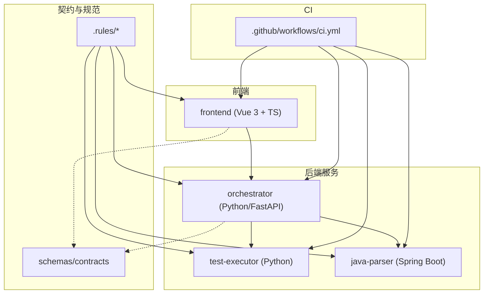
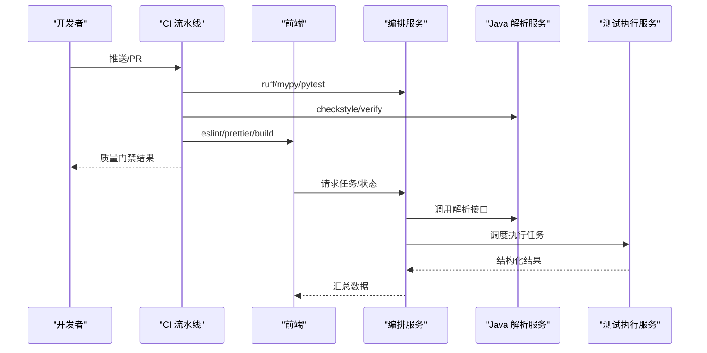
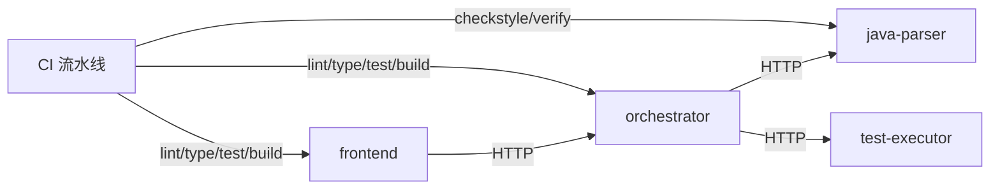

# 代码规范

<cite>
**本文引用的文件**
- [开发规范说明.md](file://docs/09_开发规范说明.md)
- [Python 代码风格规则](file://.rules/python-code-style.md)
- [前端代码风格规则](file://.rules/frontend-code-style.md)
- [CI 流水线配置](file://.github/workflows/ci.yml)
- [orchestrator 依赖与工具配置](file://services/orchestrator/pyproject.toml)
- [test-executor 依赖与工具配置](file://services/test-executor/pyproject.toml)
- [java-parser Maven 配置](file://services/java-parser/pom.xml)
- [java-parser Checkstyle 配置](file://services/java-parser/checkstyle.xml)
- [java-parser 应用配置](file://services/java-parser/src/main/resources/application.yml)
- [frontend ESLint 配置](file://services/frontend/eslint.config.js)
- [frontend Prettier 配置](file://services/frontend/.prettierrc.json)
- [frontend TypeScript 配置](file://services/frontend/tsconfig.json)
- [frontend 包脚本](file://services/frontend/package.json)
- [frontend Vite 配置](file://services/frontend/vite.config.ts)
- [frontend 根组件](file://services/frontend/src/App.vue)
- [frontend 入口文件](file://services/frontend/src/main.ts)
</cite>

## 更新摘要
**变更内容**
- 新增前端ESLint和Prettier详细配置说明
- 更新TypeScript编译设置和质量检查规则
- 增强代码质量检查流程描述
- 完善前端构建和验证流程

## 目录
1. [引言](#引言)
2. [项目结构](#项目结构)
3. [核心组件](#核心组件)
4. [架构总览](#架构总览)
5. [详细组件分析](#详细组件分析)
6. [依赖关系分析](#依赖关系分析)
7. [性能考虑](#性能考虑)
8. [故障排查指南](#故障排查指南)
9. [结论](#结论)
10. [附录](#附录)

## 引言
本规范面向 LLM-AutoTest 项目的多语言、多服务协作场景，统一 Python、Java、前端（Vue 3 + TypeScript）的编码约定、静态检查、测试与质量门禁。文档以仓库内既有规则与配置为依据，结合 CI 流水线要求，形成可执行的"提交前—合并—构建—部署"全链路质量标准，确保代码一致性、可维护性与交付质量。

## 项目结构
仓库采用 Monorepo 组织，按服务划分：
- services/orchestrator：Python 编排服务（FastAPI + asyncio），负责节点调度、产物管理与 REST API。
- services/test-executor：Python 执行服务，加载并运行测试脚本，产出结构化结果。
- services/java-parser：Java Spring Boot 服务，基于 JavaParser 进行源码扫描与接口还原。
- services/frontend：Vue 3 + TypeScript 前端，提供任务配置、监控与报告界面。
- schemas/contracts：服务间契约定义（OpenAPI/JSON Schema）。
- .rules：各栈代码风格规则（glob 触发）。
- .github/workflows：CI 流水线，串联 lint、类型检查、单测与构建。

**图表来源**
- [CI 流水线配置:1-75](file://.github/workflows/ci.yml#L1-L75)
- [orchestrator 依赖与工具配置:1-53](file://services/orchestrator/pyproject.toml#L1-L53)
- [java-parser Maven 配置:1-83](file://services/java-parser/pom.xml#L1-L83)
- [frontend 包脚本:1-29](file://services/frontend/package.json#L1-L29)

**章节来源**
- [开发规范说明.md:11-35](file://docs/09_开发规范说明.md#L11-L35)

## 核心组件
- orchestrator：提供 FastAPI 应用与健康检查端点，暴露节点清单与状态；通过 asyncio 调度节点，严格遵循异步与超时约束。
- test-executor：加载测试脚本并执行，产出结构化结果，供 orchestrator 汇总。
- java-parser：Spring Boot 服务，暴露解析能力，返回与 schemas 对齐的结构化产物。
- frontend：Vue 3 + TypeScript，统一 API 调用层，展示口径严格来自后端程序化结果。

**章节来源**
- [frontend 根组件:1-232](file://services/frontend/src/App.vue#L1-L232)
- [frontend 入口文件:1-7](file://services/frontend/src/main.ts#L1-L7)

## 架构总览
下图展示了前后端与服务间的交互以及 CI 质量门禁在流程中的位置。

**图表来源**
- [CI 流水线配置:1-75](file://.github/workflows/ci.yml#L1-L75)

## 详细组件分析

### Python 代码规范（orchestrator / test-executor）
- 版本与工具链
  - Python ≥ 3.11，包管理使用 uv，锁定 uv.lock。
  - 静态检查：ruff（lint + format，行宽 100）、mypy（strict 模式起步）。
  - 测试：pytest，异步自动模式，覆盖率目标逐步启用。
- 命名与风格
  - 模块/函数/变量 snake_case，类 PascalCase，常量 UPPER_SNAKE_CASE。
  - 导入分组：标准库、第三方、项目内部；禁止 import *。
- 类型标注
  - 对外函数、类方法、pydantic 模型强制类型标注；避免 Any；忽略需写明原因。
- 数据与控制流
  - 边界输入先验证再进入业务逻辑；LLM 输出必须经 schemas JSON Schema 校验。
  - 路径使用 pathlib.Path，文件读写指定 UTF-8；产物按任务 ID 分目录写入。
  - 时间戳使用带时区 datetime（UTC）。
- 异步与外部调用
  - 节点调度使用 asyncio；禁止阻塞式网络/IO 在 async 路径；必要时移交线程池。
  - 所有外部请求设置连接与读取超时；重试有限且避免重复副作用。
  - 每次 LLM 调用记录输入摘要、输出、耗时、token 数于节点日志。
- 异常与日志
  - 捕获最具体异常；禁止裸 except；转换异常使用 raise ... from exc。
  - 使用 logging.getLogger(__name__)，JSON 行格式；禁止 print。
- 测试与交付
  - 测试隔离、确定；LLM 客户端一律 Mock；修复先补回归测试。
  - 覆盖率目标：核心逻辑 ≥ 70%。

**章节来源**
- [Python 代码风格规则:9-56](file://.rules/python-code-style.md#L9-L56)
- [orchestrator 依赖与工具配置:1-53](file://services/orchestrator/pyproject.toml#L1-L53)
- [test-executor 依赖与工具配置:1-45](file://services/test-executor/pyproject.toml#L1-L45)

### Java 代码规范（java-parser）
- 版本与构建
  - Java 21 LTS，Maven 构建，依赖锁定 pom.xml，禁止 SNAPSHOT 进入主干。
- 静态检查
  - Checkstyle：Google style 基础上放宽行宽至 120；禁止 System.out 打印，使用 SLF4J。
- 设计与实现
  - 基于 JavaParser；协议解析策略通过可插拔 ProtocolResolver 扩展。
  - REST 接口返回结构与 schemas 中产物 Schema 对齐。
- 注释规范
  - 中文 Javadoc；类头注明对应规格编号（模块 2/3，G3/R2）。

**章节来源**
- [java-parser Maven 配置:1-83](file://services/java-parser/pom.xml#L1-L83)
- [java-parser Checkstyle 配置:1-34](file://services/java-parser/checkstyle.xml#L1-L34)
- [java-parser 应用配置:1-8](file://services/java-parser/src/main/resources/application.yml#L1-L8)

### 前端代码规范（frontend，Vue 3）

#### 框架与基础配置
- 框架与目录职责
  - Vue 3 组合式 API + `<script setup>` + TypeScript；Node 20 LTS，pnpm 锁定 pnpm-lock.yaml。
  - src/api/ 收敛后端调用；src/stores/ 为 Pinia store（按页面域拆分）；src/components/ 公共组件；src/views/ 页面组件；src/types/ 契约类型。
- 构建工具链
  - Vite 6.0.5 作为构建工具，支持快速热重载和现代化打包。
  - vue-tsc 用于 TypeScript 类型检查，确保类型安全。

#### ESLint 配置详解
- **现代 ESLint 配置**
  - 使用 flat config 格式，集成 @eslint/js、typescript-eslint 和 eslint-plugin-vue。
  - 针对 `.vue` 文件中的 `<script lang="ts">` 使用 TypeScript 解析器。
  - 关闭与 Prettier 冲突的 Vue 格式化规则，将格式化处理交给 Prettier。
- **代码质量规则**
  - 启用 JavaScript 推荐规则和 TypeScript 推荐规则。
  - 支持 ESNext 语法特性，确保现代 JavaScript 语法支持。
  - 忽略 `dist/` 构建输出目录。

#### Prettier 配置详解
- **代码格式化规则**
  - 不使用分号（semi: false），提升代码简洁性。
  - 使用单引号（singleQuote: true），保持代码风格一致。
  - 行宽限制为 100 字符（printWidth: 100），平衡可读性和屏幕空间。
- **忽略文件**
  - 忽略 `dist/` 构建输出和 `pnpm-lock.yaml` 锁文件。

#### TypeScript 编译设置
- **编译器选项**
  - 目标 ES2022，模块系统 ESNext，使用 bundler 解析模式。
  - 启用严格模式（strict: true），包括 noUnusedLocals 和 noUnusedParameters。
  - 跳过库检查（skipLibCheck: true）以提升构建性能。
  - 启用 isolatedModules 确保模块独立性。
  - JSX 设置为 preserve，由 Vite 处理 JSX 转换。
  - 不生成 emit 文件（noEmit: true），仅进行类型检查。
- **文件包含范围**
  - 包含 `src/**/*.ts` 和 `src/**/*.vue` 文件进行类型检查。

#### 展示口径红线
- 界面呈现的度量数值（自动化率、通过率、接口数、缺陷数等）**一律来自后端 API 返回的程序化汇总结果，前端不做任何数值计算、估算或「补全」**（对应 F-RPT-02：数字不经 LLM，也不经前端）。
- 降级节点、兜底仓库结果必须按后端返回的标注字段如实分列展示，禁止前端合并或隐藏（D4 / D5 口径）。
- 不要吞掉 API 错误或用成功提示掩盖失败；异步操作必须呈现 loading/success/error 状态并防止重复提交。

#### 模板与可访问性
- 优先使用语义化元素和正确的标题层级。交互操作使用 `button` 或 `a`，不要用普通 `div` 模拟按钮。
- 表单控件必须有关联的 `label`；图像必须有有意义的 `alt`，纯装饰图像使用空 `alt`。
- 键盘可以完成所有核心操作；自定义交互必须处理焦点、Escape、Enter/Space，并提供必要的 ARIA 状态。
- 动态提示、错误和加载状态应对辅助技术可感知；不得只用颜色表达状态。外链新窗口必须使用 `rel="noopener"`。

#### TypeScript 与逻辑
- 默认使用 `const`，需要重新赋值时使用 `let`；使用严格相等、模板字符串、可选链和 `async/await`。
- 函数和变量使用 `camelCase`，组件与类型使用 `PascalCase`，常量使用 `UPPER_SNAKE_CASE`；事件处理函数以行为命名，如 `handleSaveClick`。
- 网络请求复用 `src/api/` 统一层（含认证头与统一错误展示），不得在组件内另建不一致的 fetch 封装。
- 后端契约类型定义于 `src/types/` 并与 `schemas/contracts/` 对齐；字段名、错误码和状态含义必须与后端一致，使用统一错误结构 `{code, message, node_id?, details}`。
- 不直接把不可信内容写入 `v-html` / `innerHTML`；确需渲染富文本必须经明确的安全过滤。
- 轮询类逻辑（流水线状态监控）必须在页面离开或状态失效后停止，避免泄漏。

#### 样式
- 类名使用清晰、稳定的 kebab-case，避免依赖深层 DOM 结构、标签选择器和 `!important`；新增样式不得污染无关页面。
- 优先复用现有颜色、间距、圆角、阴影和字体变量（设计令牌）；同类值重复出现时再抽取变量，不创建一次性令牌。
- 使用响应式布局，至少检查窄屏和桌面宽度；避免固定高度截断内容，长文本必须可换行。
- 保留清晰的 hover、focus-visible、disabled、loading 和 error 状态；动画尊重 `prefers-reduced-motion`。

#### 构建与验证
- 修改源文件后运行：`pnpm --dir services/frontend lint` 与 `pnpm --dir services/frontend build`；涉及交互逻辑时运行 `pnpm --dir services/frontend test`（vitest）。
- 完成前检查：控制台无新增错误、主要交互可用、键盘焦点合理、窄屏不溢出、lint 0 error。

**章节来源**
- [前端代码风格规则:12-55](file://.rules/frontend-code-style.md#L12-L55)
- [frontend ESLint 配置:1-31](file://services/frontend/eslint.config.js#L1-L31)
- [frontend Prettier 配置:1-6](file://services/frontend/.prettierrc.json#L1-L6)
- [frontend TypeScript 配置:1-16](file://services/frontend/tsconfig.json#L1-L16)
- [frontend 包脚本:1-30](file://services/frontend/package.json#L1-L30)
- [frontend Vite 配置:1-16](file://services/frontend/vite.config.ts#L1-L16)

### 代码审查检查清单
- Python
  - 是否遵循 PEP 8、ruff 与 mypy strict？
  - 是否对边界输入（含 LLM 输出）进行 JSON Schema 校验？
  - 是否使用 logging 而非 print？是否避免裸 except？
  - 是否设置外部请求超时与有限重试？
  - 是否覆盖成功/边界/失败路径，覆盖率达标？
- Java
  - 是否通过 checkstyle（行宽 120、禁用 System.out）？
  - 是否使用 SLF4J 参数化日志？
  - 是否遵循可插拔协议扩展，未改动主流程？
  - 是否返回与 schemas 对齐的结构？
- Frontend
  - 是否使用 ESLint + Prettier 且 0 error？
  - 是否遵循现代 ESLint flat config 和 TypeScript 严格模式？
  - 是否统一 API 层与错误结构？
  - 是否遵循展示口径红线（数值来自后端）？
  - 是否满足可访问性与响应式要求？
  - 是否通过 vue-tsc 类型检查？
- 通用
  - 是否仅引入必要依赖？是否避免敏感信息泄露？
  - 是否更新相关测试与文档？

### 静态分析工具配置与质量门禁
- Python
  - ruff：lint + format，行宽 100；mypy：strict；pytest：异步自动模式。
  - CI 步骤：ruff check/format、mypy、pytest。
- Java
  - checkstyle：Google style + 行宽 120；Maven verify 阶段执行。
- Frontend
  - **现代 ESLint 配置**：使用 flat config 格式，集成 @eslint/js、typescript-eslint 和 eslint-plugin-vue。
  - **Prettier 格式化**：半角引号、行宽 100、不使用分号。
  - **TypeScript 严格模式**：启用 strict、noUnusedLocals、noUnusedParameters。
  - **构建验证**：vue-tsc 类型检查 + vite 构建。
  - CI 步骤：eslint、prettier --check、vue-tsc build。
- 覆盖率门禁
  - Python/Java 核心逻辑覆盖率目标 ≥ 70%（逐步启用）。

**章节来源**
- [CI 流水线配置:9-64](file://.github/workflows/ci.yml#L9-L64)
- [orchestrator 依赖与工具配置:29-53](file://services/orchestrator/pyproject.toml#L29-L53)
- [test-executor 依赖与工具配置:25-45](file://services/test-executor/pyproject.toml#L25-L45)
- [java-parser Maven 配置:49-83](file://services/java-parser/pom.xml#L49-L83)
- [java-parser Checkstyle 配置:1-34](file://services/java-parser/checkstyle.xml#L1-L34)
- [frontend ESLint 配置:1-31](file://services/frontend/eslint.config.js#L1-L31)
- [frontend Prettier 配置:1-6](file://services/frontend/.prettierrc.json#L1-L6)
- [frontend TypeScript 配置:1-16](file://services/frontend/tsconfig.json#L1-L16)
- [frontend 包脚本:8-13](file://services/frontend/package.json#L8-L13)

## 依赖关系分析
- orchestrator 依赖 FastAPI、httpx、pydantic、jsonschema；通过 HTTP 调用 java-parser 与 test-executor。
- java-parser 依赖 Spring Boot Starter Web 与 JavaParser；通过 REST 暴露解析能力。
- frontend 依赖 Vue 3、Vite、ESLint、Prettier、TypeScript；通过统一 API 层调用 orchestrator。
- CI 串联各服务静态检查与构建，保证一致的质量基线。

**图表来源**
- [CI 流水线配置:9-64](file://.github/workflows/ci.yml#L9-L64)
- [orchestrator 依赖与工具配置:1-20](file://services/orchestrator/pyproject.toml#L1-L20)
- [java-parser Maven 配置:31-47](file://services/java-parser/pom.xml#L31-L47)
- [frontend 包脚本:14-27](file://services/frontend/package.json#L14-L27)

**章节来源**
- [开发规范说明.md:89-94](file://docs/09_开发规范说明.md#L89-L94)

## 性能考虑
- Python
  - 异步路径避免阻塞 IO；合理设置超时与重试上限；批量 I/O 使用上下文管理器。
  - 产物写入按任务 ID 分目录，减少锁竞争；日志 JSON 行格式便于高效采集。
- Java
  - 解析并发度可通过配置控制（如 scan-concurrency）；避免同步阻塞调用。
- Frontend
  - 轮询逻辑在页面离开时停止，防止内存泄漏；按需加载与懒路由提升首屏性能。
  - 复用设计令牌与组件，减少样式体积。
  - 使用 Vite 的快速热重载和现代化打包优化开发体验。
  - TypeScript 严格模式在编译时捕获潜在问题，减少运行时错误。

## 故障排查指南
- Python
  - 若出现节点失败，检查是否显式落盘（状态、原因、时间戳）；确认异常捕获与日志记录完整。
  - 若 LLM 调用失败，检查超时、重试与日志（输入摘要、输出、耗时、token）。
- Java
  - 若健康检查失败，检查端口与配置；确认未使用 System.out。
- Frontend
  - 若构建失败，检查 ESLint/Prettier/TypeScript 错误；确认 API 层与错误结构一致。
  - 若展示异常，确认数值来源为后端 API，未在前端计算。
  - 若类型检查失败，检查 TypeScript 配置和类型定义是否与后端契约对齐。
  - 若 ESLint 报错，检查是否符合现代 ESLint flat config 规则和 Prettier 格式化要求。

**章节来源**
- [Python 代码风格规则:44-49](file://.rules/python-code-style.md#L44-L49)
- [java-parser Checkstyle 配置:16-20](file://services/java-parser/checkstyle.xml#L16-L20)
- [前端代码风格规则:22-43](file://.rules/frontend-code-style.md#L22-L43)

## 结论
本规范以仓库内既有规则与配置为基础，明确了 Python、Java、前端三栈的编码约定、静态检查、测试与质量门禁。通过 CI 流水线将规范落地为可执行的"提交前—合并—构建—部署"流程，确保代码一致性与交付质量。**特别地，前端部分采用了现代化的 ESLint flat config、严格的 TypeScript 编译设置和统一的 Prettier 格式化规则，构建了完整的代码质量保证体系。**建议在团队内持续宣贯并按里程碑逐步提升覆盖率与工具链完备度。

## 附录
- 关键入口参考
  - orchestrator 健康检查与节点清单：[orchestrator API 层:11-27](file://services/orchestrator/src/orchestrator/api.py#L11-L27)
  - frontend 根组件占位：[frontend 根组件:1-232](file://services/frontend/src/App.vue#L1-L232)
  - frontend 入口文件：[frontend 入口文件:1-7](file://services/frontend/src/main.ts#L1-L7)

**章节来源**
- [frontend 根组件:1-232](file://services/frontend/src/App.vue#L1-L232)
- [frontend 入口文件:1-7](file://services/frontend/src/main.ts#L1-L7)