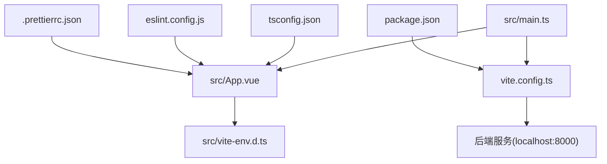
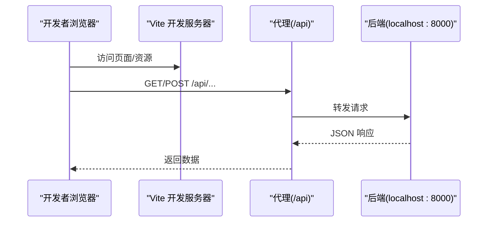
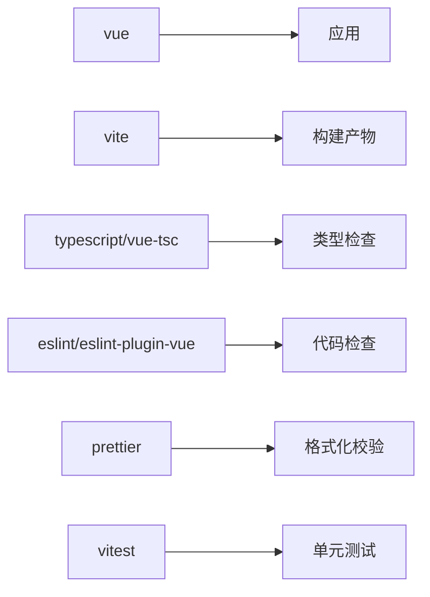

# 前端代码规范

<cite>
**本文引用的文件**
- [package.json](file://services/frontend/package.json)
- [vite.config.ts](file://services/frontend/vite.config.ts)
- [tsconfig.json](file://services/frontend/tsconfig.json)
- [eslint.config.js](file://services/frontend/eslint.config.js)
- [.prettierrc.json](file://services/frontend/.prettierrc.json)
- [main.ts](file://services/frontend/src/main.ts)
- [App.vue](file://services/frontend/src/App.vue)
- [vite-env.d.ts](file://services/frontend/src/vite-env.d.ts)
- [frontend-code-style.md](file://.rules/frontend-code-style.md)
- [09_开发规范说明.md](file://docs/09_开发规范说明.md)
</cite>

## 目录
1. [简介](#简介)
2. [项目结构](#项目结构)
3. [核心组件](#核心组件)
4. [架构总览](#架构总览)
5. [详细组件分析](#详细组件分析)
6. [依赖分析](#依赖分析)
7. [性能考虑](#性能考虑)
8. [故障排查指南](#故障排查指南)
9. [结论](#结论)
10. [附录](#附录)

## 简介
本规范面向 LLM-AutoTest 项目的前端（Vue 3 + TypeScript），统一组件开发、TypeScript 使用、代码格式化、构建与模块组织、样式管理、状态管理、API 集成、复用策略、性能优化与最佳实践。规范以仓库内现有配置与规则为依据，确保团队在“组合式 API + script setup + TS”的基线上保持一致的开发体验与质量门禁。

## 项目结构
前端位于 services/frontend，采用 Vite + Vue 3 + TypeScript 的工程化方案。当前为占位实现，后续将按“六页方向”逐步接入页面与业务逻辑。

- 入口与根组件
  - 应用入口：services/frontend/src/main.ts
  - 根组件：services/frontend/src/App.vue
- 类型与环境声明
  - Vite 客户端类型与 .vue 模块类型：services/frontend/src/vite-env.d.ts
- 构建与工具链
  - 包脚本与依赖：services/frontend/package.json
  - Vite 配置（含 dev 代理）：services/frontend/vite.config.ts
  - TypeScript 编译选项：services/frontend/tsconfig.json
  - ESLint 配置：services/frontend/eslint.config.js
  - Prettier 配置：services/frontend/.prettierrc.json
- 团队规范
  - 前端代码风格与红线：.rules/frontend-code-style.md
  - 全栈开发规范（含前端章节）：docs/09_开发规范说明.md

图示来源
- [main.ts:1-6](file://services/frontend/src/main.ts#L1-L6)
- [App.vue:1-12](file://services/frontend/src/App.vue#L1-L12)
- [vite-env.d.ts:1-9](file://services/frontend/src/vite-env.d.ts#L1-L9)
- [vite.config.ts:1-16](file://services/frontend/vite.config.ts#L1-L16)
- [package.json:1-29](file://services/frontend/package.json#L1-L29)
- [tsconfig.json:1-15](file://services/frontend/tsconfig.json#L1-L15)
- [eslint.config.js:1-17](file://services/frontend/eslint.config.js#L1-L17)
- [.prettierrc.json:1-6](file://services/frontend/.prettierrc.json#L1-L6)

章节来源
- [package.json:1-29](file://services/frontend/package.json#L1-L29)
- [vite.config.ts:1-16](file://services/frontend/vite.config.ts#L1-L16)
- [tsconfig.json:1-15](file://services/frontend/tsconfig.json#L1-L15)
- [eslint.config.js:1-17](file://services/frontend/eslint.config.js#L1-L17)
- [.prettierrc.json:1-6](file://services/frontend/.prettierrc.json#L1-L6)
- [main.ts:1-6](file://services/frontend/src/main.ts#L1-L6)
- [App.vue:1-12](file://services/frontend/src/App.vue#L1-L12)
- [vite-env.d.ts:1-9](file://services/frontend/src/vite-env.d.ts#L1-L9)
- [frontend-code-style.md:14-20](file://.rules/frontend-code-style.md#L14-L20)
- [09_开发规范说明.md:64-71](file://docs/09_开发规范说明.md#L64-L71)

## 核心组件
当前工程已具备最小可运行前端骨架，后续将基于此扩展页面与组件。

- 应用启动流程
  - main.ts 创建 Vue 应用并挂载到 #app
  - App.vue 作为根组件承载占位内容，遵循“数值来自后端”的展示口径
- 类型与环境
  - vite-env.d.ts 提供 .vue 模块类型声明，便于 IDE 解析与类型推导
- 构建与脚本
  - package.json 定义 dev/build/lint/test 脚本，构建前执行 vue-tsc 进行类型检查
- 开发与调试
  - vite.config.ts 提供 dev 代理，将 /api 请求转发至本地 orchestrator（端口 8000）

章节来源
- [main.ts:1-6](file://services/frontend/src/main.ts#L1-L6)
- [App.vue:1-12](file://services/frontend/src/App.vue#L1-L12)
- [vite-env.d.ts:1-9](file://services/frontend/src/vite-env.d.ts#L1-L9)
- [package.json:8-12](file://services/frontend/package.json#L8-L12)
- [vite.config.ts:4-15](file://services/frontend/vite.config.ts#L4-L15)

## 架构总览
前端通过 Vite 开发服务器提供热更新，并通过代理将 /api 请求转发至后端 orchestrator。后续将引入路由、状态管理与 API 层，形成“视图层 → 状态层 → API 层 → 后端”的分层架构。

图示来源
- [vite.config.ts:7-14](file://services/frontend/vite.config.ts#L7-L14)

章节来源
- [vite.config.ts:1-16](file://services/frontend/vite.config.ts#L1-L16)

## 详细组件分析

### 组件开发规范（单文件组件、Props、事件）
- 技术栈与语法
  - 使用 Vue 3 组合式 API 与 <script setup>，配合 TypeScript
- 组件命名与组织
  - 组件名 PascalCase；页面组件按“六页方向”命名对齐（如 TaskConfig.vue、PipelineDashboard.vue）
  - 公共组件放 src/components/，页面组件放 src/views/
- Props 与事件
  - Props 使用 TypeScript 接口明确类型；事件处理函数以行为命名（如 handleSaveClick）
  - 禁止内联事件处理器和重复 DOM ID
- 模板与可访问性
  - 语义化元素与标题层级；表单控件关联 label；图像 alt 有意义；键盘可完成核心操作；自定义交互需处理焦点与快捷键；动态提示对辅助技术可感知

章节来源
- [frontend-code-style.md:14-20](file://.rules/frontend-code-style.md#L14-L20)
- [frontend-code-style.md:28-33](file://.rules/frontend-code-style.md#L28-L33)
- [09_开发规范说明.md:64-69](file://docs/09_开发规范说明.md#L64-L69)

### TypeScript 使用规范（类型定义、接口设计）
- 编译与严格模式
  - tsconfig.json 启用 strict、noUnusedLocals、noUnusedParameters、isolatedModules 等，保证类型安全与模块化
- 类型来源与契约
  - 契约类型定义于 src/types/，与 schemas/contracts/ 对齐；字段名、错误码、状态含义必须与后端一致
  - 统一错误结构 {code, message, node_id?, details}
- 编码约定
  - 默认 const，需要重新赋值用 let；严格相等、模板字符串、可选链、async/await
  - 函数/变量 camelCase；组件/类型 PascalCase；常量 UPPER_SNAKE_CASE
  - 不直接将不可信内容写入 v-html/innerHTML；确需富文本渲染须安全过滤
  - 轮询逻辑需在页面离开或状态失效后停止，避免泄漏

章节来源
- [tsconfig.json:1-15](file://services/frontend/tsconfig.json#L1-L15)
- [frontend-code-style.md:35-42](file://.rules/frontend-code-style.md#L35-L42)
- [09_开发规范说明.md:64-71](file://docs/09_开发规范说明.md#L64-L71)

### 代码格式化配置（Prettier、ESLint）
- ESLint
  - 使用 @eslint/js 与 eslint-plugin-vue 的 recommended 规则集，覆盖 JS/TS/Vue
  - 忽略 dist/ 输出目录
- Prettier
  - 关闭分号、单引号、行宽 100
- 脚本集成
  - lint 脚本同时执行 ESLint 与 Prettier 校验

章节来源
- [eslint.config.js:1-17](file://services/frontend/eslint.config.js#L1-L17)
- [.prettierrc.json:1-6](file://services/frontend/.prettierrc.json#L1-L6)
- [package.json:8-12](file://services/frontend/package.json#L8-L12)

### Vite 构建配置
- 插件与目标
  - 使用 @vitejs/plugin-vue 支持 .vue 单文件组件
- 开发代理
  - 将 /api 请求代理到 http://localhost:8000，changeOrigin 开启
  - 待 schemas/contracts/ 落地后调整路径与目标
- 构建产物
  - 构建前执行 vue-tsc 进行类型检查，再打包

章节来源
- [vite.config.ts:1-16](file://services/frontend/vite.config.ts#L1-L16)
- [package.json:8-12](file://services/frontend/package.json#L8-L12)

### 模块组织方式
- 目录职责
  - src/api/：收敛全部后端调用（认证头、统一错误展示）
  - src/stores/：Pinia store，按页面域拆分
  - src/components/：公共组件
  - src/views/：页面组件（按“六页方向”命名）
  - src/types/：契约类型定义
- 约束
  - 禁止在组件内散落 fetch；禁止巨型组件或巨型 store

章节来源
- [frontend-code-style.md:14-20](file://.rules/frontend-code-style.md#L14-L20)
- [frontend-code-style.md:35-42](file://.rules/frontend-code-style.md#L35-L42)
- [09_开发规范说明.md:64-71](file://docs/09_开发规范说明.md#L64-L71)

### 样式管理规范
- 类名与选择器
  - 使用清晰稳定的 kebab-case 类名；避免深层 DOM 依赖、标签选择器与 !important
- 设计令牌
  - 优先复用颜色、间距、圆角、阴影、字体变量；同类值重复出现时抽取变量
- 响应式与状态
  - 响应式布局；保留 hover/focus-visible/disabled/loading/error 状态；动画尊重 prefers-reduced-motion

章节来源
- [frontend-code-style.md:44-49](file://.rules/frontend-code-style.md#L44-L49)

### 组件复用策略
- 拆分为可复用的基础组件（按钮、表格、表单控件等），放在 src/components/
- 页面级组件放在 src/views/，仅编排布局与业务流
- 通过 Props 与事件传递数据与行为，避免跨层级透传过深

章节来源
- [frontend-code-style.md:14-20](file://.rules/frontend-code-style.md#L14-L20)
- [09_开发规范说明.md:64-69](file://docs/09_开发规范说明.md#L64-L69)

### 状态管理模式
- 使用 Pinia 管理状态，按页面域拆分 store，避免全局单一巨型 store
- 状态变更集中、可追踪；与 API 层解耦，组件只负责 UI 与交互

章节来源
- [09_开发规范说明.md:64-71](file://docs/09_开发规范说明.md#L64-L71)

### API 集成规范
- 统一封装
  - 所有后端调用集中在 src/api/，包含认证头与统一错误展示
- 错误结构
  - 统一错误结构 {code, message, node_id?, details}
- 异步与状态
  - 异步操作呈现 loading/success/error 状态，防止重复提交
- 展示口径
  - 界面度量数值一律来自后端 API 返回的程序化汇总结果，前端不做计算或估算

章节来源
- [frontend-code-style.md:22-27](file://.rules/frontend-code-style.md#L22-L27)
- [frontend-code-style.md:35-42](file://.rules/frontend-code-style.md#L35-L42)
- [09_开发规范说明.md:64-71](file://docs/09_开发规范说明.md#L64-L71)

### 正确的组件开发模式（示例指引）
- 建议的文件与职责
  - views/TaskConfig.vue：页面级组件，编排布局与业务流
  - components/DataTable.vue：可复用表格组件，通过 Props 接收数据，通过事件上报交互
  - api/task.ts：任务相关 API 封装
  - stores/taskStore.ts：任务域状态管理
  - types/task.ts：任务相关类型定义
- 关键要点
  - 使用 <script setup lang="ts"> 与 TS 接口定义 Props/Events
  - 通过 Pinia 管理跨组件状态
  - 通过 src/api/ 统一发起请求，统一错误处理与加载态

章节来源
- [frontend-code-style.md:14-20](file://.rules/frontend-code-style.md#L14-L20)
- [frontend-code-style.md:35-42](file://.rules/frontend-code-style.md#L35-L42)
- [09_开发规范说明.md:64-71](file://docs/09_开发规范说明.md#L64-L71)

## 依赖分析
- 运行时依赖
  - vue：框架核心
- 开发依赖
  - vite、@vitejs/plugin-vue：构建与 Vue 支持
  - typescript、vue-tsc：类型系统与类型检查
  - eslint、eslint-plugin-vue、@eslint/js：代码质量
  - prettier：代码格式化
  - vitest：单元测试
- 构建脚本
  - dev：启动开发服务器
  - build：类型检查 + 打包
  - lint：ESLint + Prettier 校验
  - test：运行测试

图示来源
- [package.json:14-27](file://services/frontend/package.json#L14-L27)

章节来源
- [package.json:1-29](file://services/frontend/package.json#L1-L29)

## 性能考虑
- 构建与打包
  - 使用 Vite 原生按需加载与增量构建；保持依赖精简，避免引入无需求的大体积库
- 网络与缓存
  - 合理使用 HTTP 缓存头；对静态资源启用版本化文件名
- 渲染性能
  - 列表渲染使用稳定 key；避免不必要的重渲染；大列表考虑虚拟滚动
- 资源优化
  - 图片压缩与懒加载；首屏关键资源内联或预加载
- 可访问性与动效
  - 动画尊重 prefers-reduced-motion；避免阻塞主线程的长任务

[本节为通用指导，不直接分析具体文件]

## 故障排查指南
- 构建失败
  - 检查 TypeScript 类型错误（vue-tsc）与 ESLint 报错；确认依赖安装完整
- 开发代理问题
  - 确认后端服务在 localhost:8000 运行；检查 vite.config.ts 的代理配置
- 样式与格式问题
  - 运行 lint 脚本定位 ESLint/Prettier 问题；根据提示修复
- 可访问性问题
  - 检查表单控件是否有关联 label；键盘导航是否可用；ARIA 状态是否正确

章节来源
- [package.json:8-12](file://services/frontend/package.json#L8-L12)
- [vite.config.ts:7-14](file://services/frontend/vite.config.ts#L7-L14)
- [eslint.config.js:1-17](file://services/frontend/eslint.config.js#L1-L17)
- [.prettierrc.json:1-6](file://services/frontend/.prettierrc.json#L1-L6)

## 结论
本规范以仓库现有配置与规则为基础，明确了 Vue 3 + TypeScript 的前端开发标准，涵盖组件、类型、格式化、构建、模块组织、样式、状态、API 集成与性能优化。建议在后续“六页方向”的实现中严格遵循上述规范，确保代码一致性、可维护性与交付质量。

## 附录
- 快速命令
  - 开发：pnpm --dir services/frontend dev
  - 构建：pnpm --dir services/frontend build
  - 检查：pnpm --dir services/frontend lint
  - 测试：pnpm --dir services/frontend test
- 参考文档
  - 前端代码风格与红线：.rules/frontend-code-style.md
  - 全栈开发规范（含前端）：docs/09_开发规范说明.md

章节来源
- [package.json:8-12](file://services/frontend/package.json#L8-L12)
- [frontend-code-style.md:51-55](file://.rules/frontend-code-style.md#L51-L55)
- [09_开发规范说明.md:110-118](file://docs/09_开发规范说明.md#L110-L118)