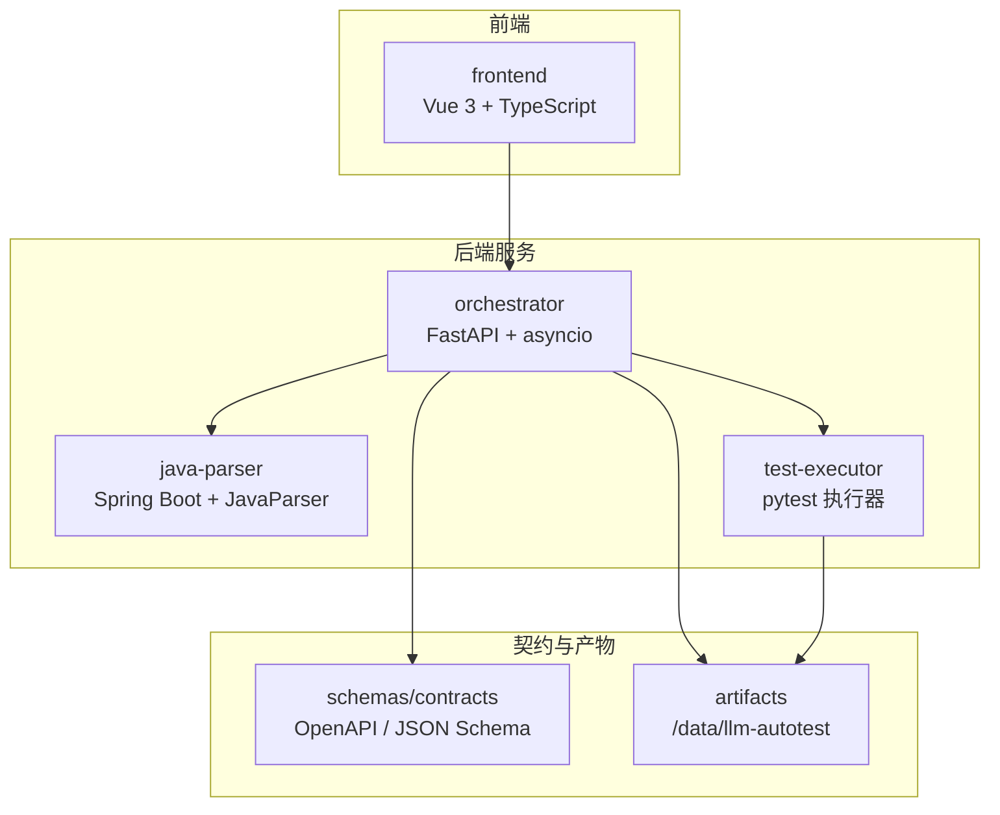
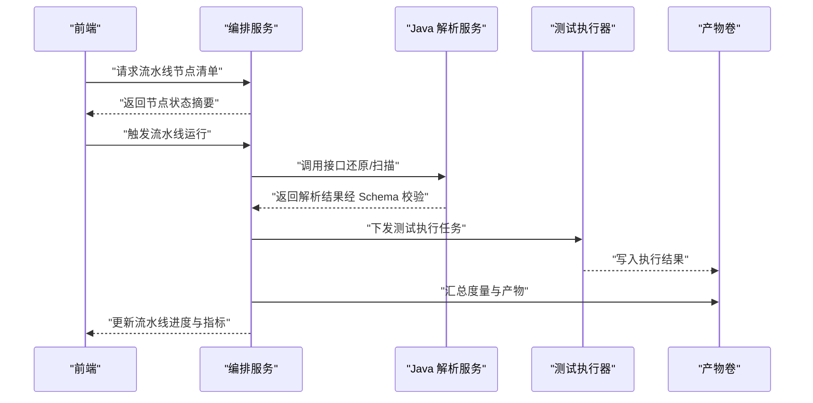
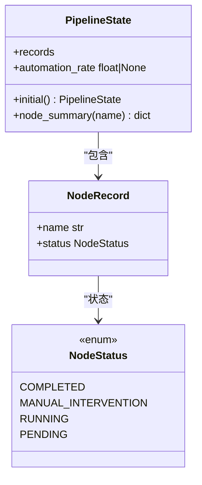
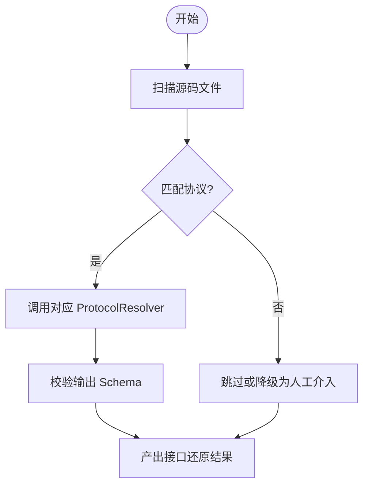
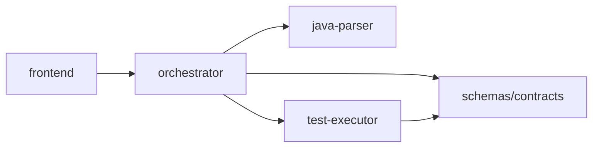

# 开发指南

<cite>
**本文引用的文件**
- [python-code-style.md](file://.rules/python-code-style.md)
- [frontend-code-style.md](file://.rules/frontend-code-style.md)
- [09_开发规范说明.md](file://docs/09_开发规范说明.md)
- [pyproject.toml (orchestrator)](file://services/orchestrator/pyproject.toml)
- [__main__.py (orchestrator)](file://services/orchestrator/src/orchestrator/__main__.py)
- [api.py (orchestrator)](file://services/orchestrator/src/orchestrator/api.py)
- [pipeline.py (orchestrator)](file://services/orchestrator/src/orchestrator/pipeline.py)
- [pom.xml (java-parser)](file://services/java-parser/pom.xml)
- [ParserApplication.java](file://services/java-parser/src/main/java/com/llmautotest/parser/ParserApplication.java)
- [ProtocolResolver.java](file://services/java-parser/src/main/java/com/llmautotest/parser/ProtocolResolver.java)
- [package.json (frontend)](file://services/frontend/package.json)
- [App.vue (frontend)](file://services/frontend/src/App.vue)
- [ci.yml](file://.github/workflows/ci.yml)
- [schemas README](file://schemas/README.md)
- [docker-compose.yml](file://deploy/docker-compose.yml)
</cite>

## 目录
1. [简介](#简介)
2. [项目结构](#项目结构)
3. [核心组件](#核心组件)
4. [架构总览](#架构总览)
5. [详细组件分析](#详细组件分析)
6. [依赖关系分析](#依赖关系分析)
7. [性能与可观测性](#性能与可观测性)
8. [调试与排障](#调试与排障)
9. [版本发布流程](#版本发布流程)
10. [插件开发指南](#插件开发指南)
11. [结论](#结论)

## 简介
本指南面向 LLM-AutoTest 项目的开发者，覆盖 Python、Java、前端代码规范、测试策略、开发环境搭建、代码提交流程、审查标准、版本发布流程，以及插件扩展（新增协议解析器、扩展流水线节点、自定义测试执行器）的实现方法。文档同时提供调试技巧、性能优化建议与常见问题解决方案，帮助团队在统一基线与红线约束下高效协作。

## 项目结构
仓库采用 Monorepo 组织，按服务划分：
- services/orchestrator：Python 编排服务，负责 9 节点流水线、断点续跑、REST API
- services/java-parser：Java 多仓库扫描与接口逆向还原服务
- services/test-executor：Python 测试脚本加载与无人值守执行
- services/frontend：Vue 3 前端界面
- schemas：结构化产物 JSON Schema（单一事实来源）
- deploy：容器编排与部署配置
- .github/workflows：CI 流水线
- .rules：各栈代码风格与规则

图表来源
- [docker-compose.yml:3-41](file://deploy/docker-compose.yml#L3-L41)
- [api.py:11-27](file://services/orchestrator/src/orchestrator/api.py#L11-L27)
- [schemas README:5-10](file://schemas/README.md#L5-L10)

章节来源
- [09_开发规范说明.md:21-35](file://docs/09_开发规范说明.md#L21-L35)
- [docker-compose.yml:3-41](file://deploy/docker-compose.yml#L3-L41)

## 核心组件
- orchestrator：提供 FastAPI 应用、健康检查、节点清单接口；定义 9 节点固定顺序与状态模型；通过异步调度驱动流水线。
- java-parser：基于 Spring Boot 暴露 REST 接口；使用 JavaParser 进行源码扫描；以 ProtocolResolver 接口实现可插拔协议解析。
- test-executor：负责加载测试脚本、执行并产出结构化结果；与 orchestrator 通过约定交互。
- frontend：Vue 3 + TypeScript，遵循前端规范，展示任务配置、监控与报告；数值口径来自后端 API。
- schemas：所有结构化产物的 JSON Schema 与契约定义，作为跨服务数据模型的单一事实来源。

章节来源
- [api.py:11-27](file://services/orchestrator/src/orchestrator/api.py#L11-L27)
- [pipeline.py:11-84](file://services/orchestrator/src/orchestrator/pipeline.py#L11-L84)
- [pom.xml:31-47](file://services/java-parser/pom.xml#L31-L47)
- [ProtocolResolver.java:6-16](file://services/java-parser/src/main/java/com/llmautotest/parser/ProtocolResolver.java#L6-L16)
- [package.json:8-13](file://services/frontend/package.json#L8-L13)
- [schemas README:5-10](file://schemas/README.md#L5-L10)

## 架构总览
系统由前端、编排服务、解析服务与执行器组成，通过 REST 与共享产物卷交互；所有结构化数据受 schemas 约束，确保跨服务一致性。

图表来源
- [api.py:16-25](file://services/orchestrator/src/orchestrator/api.py#L16-L25)
- [PipelineState:51-70](file://services/orchestrator/src/orchestrator/pipeline.py#L51-L70)
- [docker-compose.yml:3-41](file://deploy/docker-compose.yml#L3-L41)
- [schemas README:5-10](file://schemas/README.md#L5-L10)

## 详细组件分析

### Orchestrator（编排服务）
- 入口：CLI 启动 uvicorn，读取配置并创建 FastAPI 应用。
- API：健康检查、节点清单接口；业务逻辑下沉至 pipeline。
- Pipeline：定义 9 节点固定顺序与四态标注；计算自动化率（程序化汇总）。

图表来源
- [pipeline.py:11-84](file://services/orchestrator/src/orchestrator/pipeline.py#L11-L84)

章节来源
- [__main__.py:15-25](file://services/orchestrator/src/orchestrator/__main__.py#L15-L25)
- [api.py:11-27](file://services/orchestrator/src/orchestrator/api.py#L11-L27)
- [pipeline.py:23-70](file://services/orchestrator/src/orchestrator/pipeline.py#L23-L70)

### Java Parser（解析服务）
- 入口：Spring Boot 应用启动。
- 解析策略：ProtocolResolver 接口支持 rest/dubbo/grpc/graphql/soap/mq；新增协议无需改动主流程。
- 构建与质量：Maven + checkstyle；依赖锁定于 pom.xml。

图表来源
- [ProtocolResolver.java:6-16](file://services/java-parser/src/main/java/com/llmautotest/parser/ProtocolResolver.java#L6-L16)
- [pom.xml:31-47](file://services/java-parser/pom.xml#L31-L47)

章节来源
- [ParserApplication.java:8-16](file://services/java-parser/src/main/java/com/llmautotest/parser/ParserApplication.java#L8-L16)
- [ProtocolResolver.java:6-16](file://services/java-parser/src/main/java/com/llmautotest/parser/ProtocolResolver.java#L6-L16)
- [pom.xml:31-47](file://services/java-parser/pom.xml#L31-L47)

### Frontend（前端）
- 技术栈：Vue 3 + TypeScript + Vite；ESLint + Prettier；Vitest 单测。
- 职责：页面组件与 API 层分离；数值口径严格来自后端 API。
- 构建脚本：dev/build/lint/test。

章节来源
- [package.json:8-13](file://services/frontend/package.json#L8-L13)
- [frontend-code-style.md:14-20](file://.rules/frontend-code-style.md#L14-L20)
- [App.vue:1-12](file://services/frontend/src/App.vue#L1-L12)

## 依赖关系分析
- 服务间依赖：frontend → orchestrator → java-parser；test-executor 通过 profile 按需启用。
- 运行时依赖：orchestrator 依赖 FastAPI、httpx、jsonschema；java-parser 依赖 Spring Boot、JavaParser；frontend 依赖 Vue 生态。
- 产物与契约：所有结构化产物与契约位于 schemas/contracts，作为单一事实来源。

图表来源
- [docker-compose.yml:3-41](file://deploy/docker-compose.yml#L3-L41)
- [pyproject.toml:6-12](file://services/orchestrator/pyproject.toml#L6-L12)
- [pom.xml:31-47](file://services/java-parser/pom.xml#L31-L47)
- [schemas README:5-10](file://schemas/README.md#L5-L10)

章节来源
- [docker-compose.yml:3-41](file://deploy/docker-compose.yml#L3-L41)
- [pyproject.toml:6-12](file://services/orchestrator/pyproject.toml#L6-L12)
- [pom.xml:31-47](file://services/java-parser/pom.xml#L31-L47)
- [schemas README:5-10](file://schemas/README.md#L5-L10)

## 性能与可观测性
- 异步与超时：orchestrator 节点调度使用 asyncio；外部调用设置连接与读取超时，重试有限且避免重复副作用。
- 日志与度量：每次 LLM 调用记录输入摘要、输出、耗时、token 数；节点失败落盘状态、原因与时间戳，支撑断点续跑与度量采集。
- 产物路径：按任务 ID 分目录写入 artifacts，统一由 orchestrator 管理，避免并发冲突。
- 前端性能：轮询逻辑需在页面离开时停止，避免泄漏；避免 v-html/innerHTML 渲染不可信内容。

章节来源
- [python-code-style.md:38-48](file://.rules/python-code-style.md#L38-L48)
- [09_开发规范说明.md:73-101](file://docs/09_开发规范说明.md#L73-L101)
- [frontend-code-style.md:35-43](file://.rules/frontend-code-style.md#L35-L43)

## 调试与排障
- 本地启动：使用 docker-compose 启动服务，确认健康检查通过；前端 dev 模式快速迭代。
- 常见错误：
  - 端口冲突：检查 8000、8080、8081 占用情况。
  - 依赖未安装：Python 使用 uv sync；Java 使用 mvn verify；前端使用 pnpm install。
  - 契约不一致：对照 schemas/contracts 校验双方实现。
- 日志定位：查看 orchestrator 与 java-parser 的容器日志，关注节点失败落盘信息与异常堆栈。
- 单测与覆盖率：Python/Java 单测需通过；核心逻辑覆盖率目标 ≥70%。

章节来源
- [docker-compose.yml:11-16](file://deploy/docker-compose.yml#L11-L16)
- [ci.yml:9-28](file://.github/workflows/ci.yml#L9-L28)
- [ci.yml:30-44](file://.github/workflows/ci.yml#L30-L44)
- [ci.yml:45-64](file://.github/workflows/ci.yml#L45-L64)

## 版本发布流程
- 分支与提交：主干 main 受保护；特性分支 feat/、修复分支 fix/；提交信息格式 [服务名] 类型: 摘要。
- CI 门禁：Python（ruff/mypy/pytest）、Java（checkstyle/verify）、前端（eslint/prettier/vitest）、Docker 镜像构建与健康检查。
- 评审与合入：至少 1 人 review 通过；禁止 force push 到 main。
- 发布与镜像：镜像命名 llm-autotest/<service>:<版本>，与 git tag 对齐；compose 中禁止 latest。

章节来源
- [09_开发规范说明.md:103-128](file://docs/09_开发规范说明.md#L103-L128)
- [ci.yml:9-75](file://.github/workflows/ci.yml#L9-L75)

## 插件开发指南

### 新增协议解析器（Java）
- 步骤：
  1. 实现 ProtocolResolver 接口，声明 supportedProtocol 与 supports(Path)。
  2. 在扫描阶段根据文件特征过滤并调用对应解析策略。
  3. 输出结构与 schemas/contracts 对齐，并通过 Schema 校验。
  4. 添加单元测试验证不同协议场景。
- 注意事项：
  - 不修改主流程；新增协议仅通过策略注入。
  - 保持向后兼容，只允许加字段。

章节来源
- [ProtocolResolver.java:6-16](file://services/java-parser/src/main/java/com/llmautotest/parser/ProtocolResolver.java#L6-L16)
- [pom.xml:31-47](file://services/java-parser/pom.xml#L31-L47)
- [schemas README:5-10](file://schemas/README.md#L5-L10)

### 扩展流水线节点（Python）
- 步骤：
  1. 在 orchestrator 中新增节点类（后缀 Node），实现节点职责与异常处理。
  2. 将节点加入 NODE_ORDER（如需变更需评估对度量口径影响）。
  3. 在 API 层暴露节点状态查询；确保产物写入 artifacts。
  4. 编写 pytest 用例，覆盖成功、边界与失败路径。
- 注意事项：
  - 节点失败必须落盘状态、原因与时间戳，支撑断点续跑。
  - 对外函数与数据模型强制类型注解。

章节来源
- [pipeline.py:23-70](file://services/orchestrator/src/orchestrator/pipeline.py#L23-L70)
- [python-code-style.md:20-36](file://.rules/python-code-style.md#L20-L36)
- [python-code-style.md:44-48](file://.rules/python-code-style.md#L44-L48)

### 自定义测试执行器（Python）
- 步骤：
  1. 在 test-executor 中实现脚本加载与执行逻辑，产出 execution.json。
  2. 与 orchestrator 通过约定交互（HTTP/文件），确保 Schema 校验通过。
  3. 添加单测模拟被测服务与环境失败，验证二态判定。
- 注意事项：
  - 环境变量与密钥不得硬编码；使用配置文件与 secrets。
  - 执行过程记录日志与度量，便于追踪。

章节来源
- [pyproject.toml:1-9](file://services/test-executor/pyproject.toml#L1-L9)
- [schemas README:14-25](file://schemas/README.md#L14-L25)

## 结论
LLM-AutoTest 以 schemas 为单一事实来源，结合严格的代码规范与 CI 门禁，保障跨服务一致性与交付质量。通过可插拔协议解析、固定 9 节点流水线与统一的产物管理，项目具备良好扩展性与可维护性。遵循本指南可实现高效的本地开发、稳定的持续集成与可靠的版本发布。