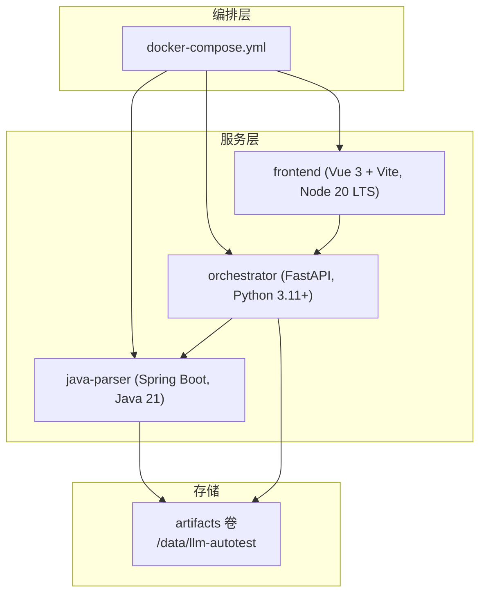
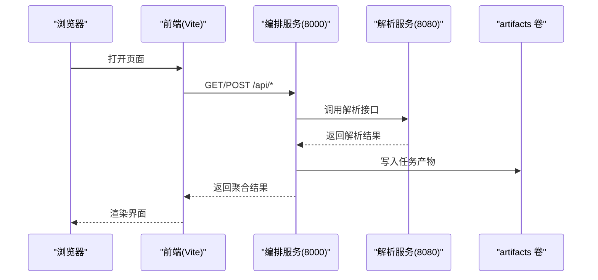
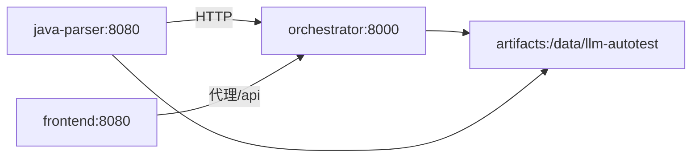

# 开发环境搭建

<cite>
**本文引用的文件**
- [deploy/docker-compose.yml](file://deploy/docker-compose.yml)
- [services/orchestrator/pyproject.toml](file://services/orchestrator/pyproject.toml)
- [services/test-executor/pyproject.toml](file://services/test-executor/pyproject.toml)
- [services/frontend/package.json](file://services/frontend/package.json)
- [services/java-parser/pom.xml](file://services/java-parser/pom.xml)
- [services/orchestrator/src/orchestrator/config.py](file://services/orchestrator/src/orchestrator/config.py)
- [services/java-parser/src/main/resources/application.yml](file://services/java-parser/src/main/resources/application.yml)
- [services/frontend/vite.config.ts](file://services/frontend/vite.config.ts)
- [services/orchestrator/Dockerfile](file://services/orchestrator/Dockerfile)
- [services/frontend/Dockerfile](file://services/frontend/Dockerfile)
- [services/java-parser/Dockerfile](file://services/java-parser/Dockerfile)
- [docs/09_开发规范说明.md](file://docs/09_开发规范说明.md)
</cite>

## 目录
1. [简介](#简介)
2. [项目结构](#项目结构)
3. [核心组件](#核心组件)
4. [架构总览](#架构总览)
5. [详细组件分析](#详细组件分析)
6. [依赖关系分析](#依赖关系分析)
7. [性能与构建优化](#性能与构建优化)
8. [故障排查指南](#故障排查指南)
9. [结论](#结论)
10. [附录：一键启动与环境变量](#附录：一键启动与环境变量)

## 简介
本指南面向首次参与 LLM-AutoTest 项目的开发者，目标是帮助你在本地快速搭建可运行的开发环境。内容涵盖 Docker 与 Docker Compose、Python 3.11+（含 uv）、Java 21 + Maven、前端工具链（Node 20 LTS + pnpm）的安装配置；环境变量设置、IDE 建议、本地调试方法；并提供一键启动命令与常见问题排查步骤。

## 项目结构
仓库采用多服务 monorepo 组织，后端包含 Python 编排服务与 Java 解析服务，前端为 Vue 3 + TypeScript 应用。容器编排由 docker-compose 统一管理，各服务通过独立 Dockerfile 构建镜像。

图表来源
- [deploy/docker-compose.yml:1-62](file://deploy/docker-compose.yml#L1-L62)
- [services/java-parser/Dockerfile:1-21](file://services/java-parser/Dockerfile#L1-L21)
- [services/orchestrator/Dockerfile:1-16](file://services/orchestrator/Dockerfile#L1-L16)
- [services/frontend/Dockerfile:1-13](file://services/frontend/Dockerfile#L1-L13)

章节来源
- [deploy/docker-compose.yml:1-62](file://deploy/docker-compose.yml#L1-L62)
- [docs/09_开发规范说明.md:11-35](file://docs/09_开发规范说明.md#L11-L35)

## 核心组件
- java-parser：基于 Spring Boot 的 Java 源码扫描与接口逆向还原服务，端口 8080，提供健康检查端点。
- orchestrator：Python FastAPI 编排服务，负责流水线调度、产物管理、REST API，默认端口 8000。
- frontend：Vue 3 + TypeScript 前端，开发时通过 Vite 代理将 /api 请求转发到 orchestrator。

章节来源
- [services/java-parser/src/main/resources/application.yml:1-8](file://services/java-parser/src/main/resources/application.yml#L1-L8)
- [services/orchestrator/src/orchestrator/config.py:1-50](file://services/orchestrator/src/orchestrator/config.py#L1-L50)
- [services/frontend/vite.config.ts:1-16](file://services/frontend/vite.config.ts#L1-L16)

## 架构总览
下图展示本地开发时的服务调用链：浏览器访问前端，Vite 开发服务器将 /api 请求代理到 orchestrator；orchestrator 调用 java-parser 完成代码解析；三者共享 artifacts 卷用于持久化产物。

图表来源
- [services/frontend/vite.config.ts:4-15](file://services/frontend/vite.config.ts#L4-L15)
- [deploy/docker-compose.yml:18-41](file://deploy/docker-compose.yml#L18-L41)
- [services/java-parser/src/main/resources/application.yml:1-8](file://services/java-parser/src/main/resources/application.yml#L1-L8)

## 详细组件分析

### Python 环境与 uv 使用（orchestrator / test-executor）
- 运行时要求：Python 3.11+。
- 包管理：uv，依赖锁定在 uv.lock。
- 安装与初始化：
  - 安装 uv（参考官方文档）。
  - 进入 services/orchestrator 或 services/test-executor，执行 uv sync 安装依赖。
  - 开发运行：uv run python -m orchestrator（或对应服务的入口模块）。
- 类型检查与测试：
  - ruff 进行 lint/format。
  - mypy 严格模式校验类型。
  - pytest 运行单测。

章节来源
- [services/orchestrator/pyproject.toml:1-53](file://services/orchestrator/pyproject.toml#L1-L53)
- [services/test-executor/pyproject.toml:1-45](file://services/test-executor/pyproject.toml#L1-L45)
- [services/orchestrator/Dockerfile:1-16](file://services/orchestrator/Dockerfile#L1-L16)

### Java 开发环境（java-parser）
- 运行时与构建：Java 21（LTS），Maven 3.9。
- 构建流程：mvn package 生成可执行 JAR；Dockerfile 使用多阶段构建，最终镜像仅包含 JRE。
- 服务端口：8080，健康检查端点 /health。
- 本地调试：可使用 IDE 直接运行 ParserApplication 或 mvn spring-boot:run。

章节来源
- [services/java-parser/pom.xml:1-83](file://services/java-parser/pom.xml#L1-L83)
- [services/java-parser/Dockerfile:1-21](file://services/java-parser/Dockerfile#L1-L21)
- [services/java-parser/src/main/resources/application.yml:1-8](file://services/java-parser/src/main/resources/application.yml#L1-L8)

### 前端开发工具链（frontend）
- 运行时：Node 20 LTS。
- 包管理器：pnpm（packageManager 指定版本）。
- 脚本：
  - dev：vite 启动开发服务器，自动代理 /api 到 http://localhost:8000。
  - build：vue-tsc 类型检查后 vite build。
  - lint：eslint + prettier 检查。
  - test：vitest 运行单测。
- 本地调试：pnpm --dir services/frontend dev 启动前端，确保 orchestrator 已在 8000 端口运行。

章节来源
- [services/frontend/package.json:1-29](file://services/frontend/package.json#L1-L29)
- [services/frontend/vite.config.ts:1-16](file://services/frontend/vite.config.ts#L1-L16)

### 环境变量与配置
- orchestrator 从环境变量读取运行配置，必填项缺失会抛出异常。
- 关键环境变量：
  - PORT：服务监听端口（默认 8000）。
  - JAVA_PARSER_URL：解析服务地址（如 http://java-parser:8080）。
  - ARTIFACTS_ROOT：产物根路径（默认 /data/llm-autotest）。
  - LLM_BASE_URL、LLM_MODEL_NAME、LLM_TEMPERATURE、LLM_TOP_P、LLM_SEED：LLM 调用参数。
- 安全提示：public_summary 不包含密钥等敏感字段，日志输出更安全。

章节来源
- [services/orchestrator/src/orchestrator/config.py:1-50](file://services/orchestrator/src/orchestrator/config.py#L1-L50)

## 依赖关系分析
- 编排顺序：java-parser → orchestrator → frontend。
- 网络端口：
  - java-parser：8080
  - orchestrator：8000
  - frontend：8080（容器内 80）
- 数据卷：artifacts 卷挂载到 /data/llm-autotest，供 java-parser 与 orchestrator 共享产物。

图表来源
- [deploy/docker-compose.yml:4-41](file://deploy/docker-compose.yml#L4-L41)

章节来源
- [deploy/docker-compose.yml:1-62](file://deploy/docker-compose.yml#L1-L62)

## 性能与构建优化
- Python 服务：
  - 使用 uv sync --frozen 加速依赖安装并保证一致性。
  - 开发时启用 uvicorn 标准模式，生产建议使用 gunicorn + uvicorn workers。
- Java 服务：
  - 多阶段构建减少镜像体积；CI 可直接 docker build。
  - checkstyle 在 verify 阶段执行，保证代码风格一致。
- 前端：
  - 使用 pnpm 提升安装速度；开发时 Vite HMR 提供热更新。
  - 构建前执行 vue-tsc 类型检查，避免运行时错误。

章节来源
- [services/orchestrator/Dockerfile:1-16](file://services/orchestrator/Dockerfile#L1-L16)
- [services/java-parser/Dockerfile:1-21](file://services/java-parser/Dockerfile#L1-L21)
- [services/java-parser/pom.xml:49-80](file://services/java-parser/pom.xml#L49-L80)
- [services/frontend/package.json:8-12](file://services/frontend/package.json#L8-L12)

## 故障排查指南
- 无法访问前端：
  - 确认 Vite 已启动且 /api 代理指向 http://localhost:8000。
  - 检查浏览器控制台是否有跨域或连接失败错误。
- orchestrator 启动失败：
  - 检查 JAVA_PARSER_URL、LLM_BASE_URL 等必填环境变量是否设置。
  - 查看日志中是否抛出“缺少必填环境变量”异常。
- java-parser 健康检查失败：
  - 确认 8080 端口未被占用，/health 可访问。
  - 若容器内 wget 不可用，检查基础镜像是否安装了 wget。
- 产物未持久化：
  - 确认 volumes.artifacts 已正确挂载，容器内路径为 /data/llm-autotest。
- 前端代理无效：
  - 确认 orchestrator 在 8000 端口运行，vite.config.ts 中 target 配置正确。

章节来源
- [services/orchestrator/src/orchestrator/config.py:32-50](file://services/orchestrator/src/orchestrator/config.py#L32-L50)
- [deploy/docker-compose.yml:11-16](file://deploy/docker-compose.yml#L11-L16)
- [services/frontend/vite.config.ts:4-15](file://services/frontend/vite.config.ts#L4-L15)

## 结论
通过本指南，你可以在本地快速搭建 LLM-AutoTest 的开发环境，包括 Python、Java、前端工具链以及容器编排。遵循环境变量与依赖管理规范，结合 IDE 与调试技巧，能够高效推进功能开发与联调。建议在提交前运行 lint、类型检查与单测，确保代码质量。

## 附录：一键启动与环境变量
- 前置条件：
  - 安装 Docker 与 Docker Compose。
  - 安装 Python 3.11+、uv。
  - 安装 Java 21、Maven 3.9。
  - 安装 Node 20 LTS、pnpm。
- 一键启动：
  - 在项目根目录执行：docker compose -f deploy/docker-compose.yml up -d
  - 如需加载 .env 文件：docker compose -f deploy/docker-compose.yml --env-file deploy/.env up -d
- 常用命令：
  - 停止服务：docker compose -f deploy/docker-compose.yml down
  - 查看日志：docker compose -f deploy/docker-compose.yml logs -f
  - 重启单个服务：docker compose -f deploy/docker-compose.yml restart <service>
- 环境变量示例（deploy/.env）：
  - JAVA_PARSER_URL=http://java-parser:8080
  - LLM_BASE_URL=https://your-api.example.com
  - LLM_MODEL_NAME=glm-5.3
  - LLM_TEMPERATURE=0.2
  - LLM_TOP_P=0.8
  - LLM_SEED=42
  - PORT=8000
  - ARTIFACTS_ROOT=/data/llm-autotest

章节来源
- [deploy/docker-compose.yml:1-62](file://deploy/docker-compose.yml#L1-L62)
- [services/orchestrator/src/orchestrator/config.py:13-21](file://services/orchestrator/src/orchestrator/config.py#L13-L21)