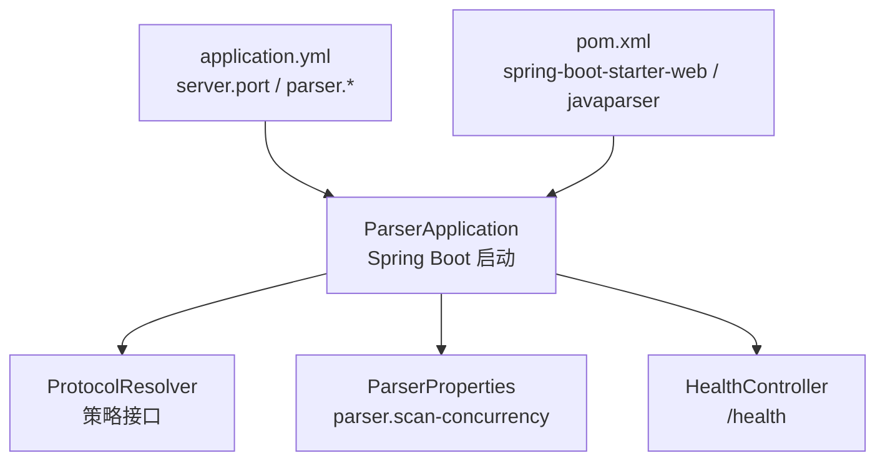
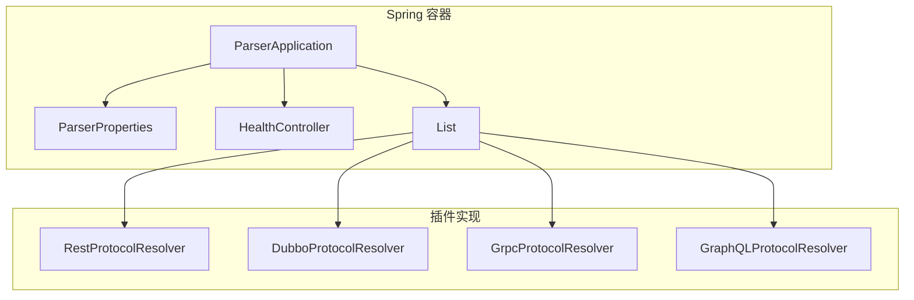
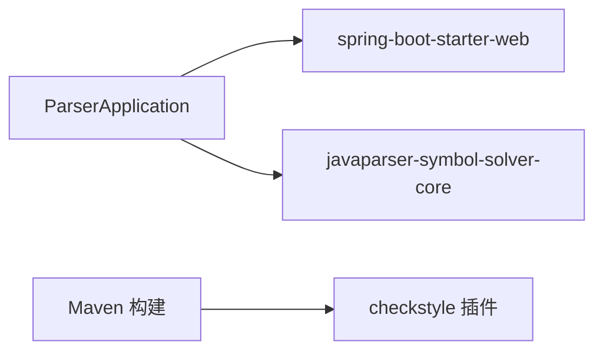
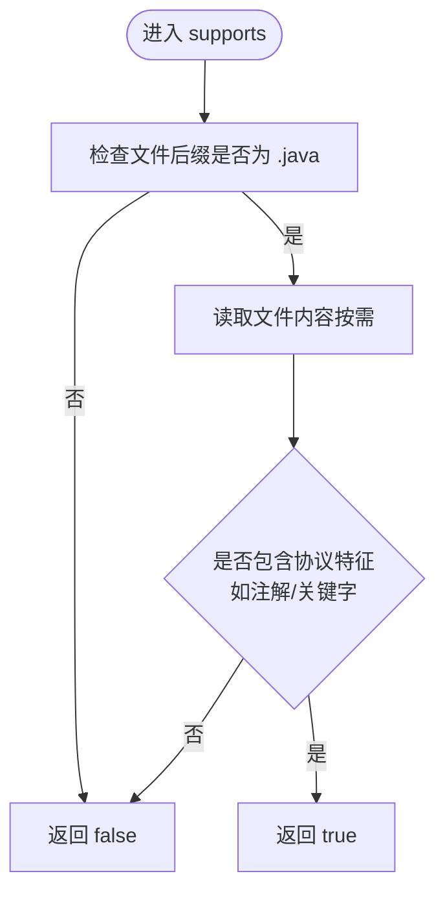

# 协议解析器插件

<cite>
**本文引用的文件**
- [ProtocolResolver.java](file://services/java-parser/src/main/java/com/llmautotest/parser/ProtocolResolver.java)
- [ParserApplication.java](file://services/java-parser/src/main/java/com/llmautotest/parser/ParserApplication.java)
- [ParserProperties.java](file://services/java-parser/src/main/java/com/llmautotest/parser/ParserProperties.java)
- [application.yml](file://services/java-parser/src/main/resources/application.yml)
- [pom.xml](file://services/java-parser/pom.xml)
- [HealthController.java](file://services/java-parser/src/main/java/com/llmautotest/parser/HealthController.java)
- [HealthControllerTest.java](file://services/java-parser/src/test/java/com/llmautotest/parser/HealthControllerTest.java)
</cite>

## 目录
1. [简介](#简介)
2. [项目结构](#项目结构)
3. [核心组件](#核心组件)
4. [架构总览](#架构总览)
5. [详细组件分析](#详细组件分析)
6. [依赖关系分析](#依赖关系分析)
7. [性能考虑](#性能考虑)
8. [故障排查指南](#故障排查指南)
9. [结论](#结论)
10. [附录](#附录)

## 简介
本文档面向希望在 Java 多仓库扫描与接口逆向还原服务中扩展新协议类型（如 REST、Dubbo、gRPC、GraphQL 等）的开发者。服务通过可插拔的 ProtocolResolver 策略接口，将“识别源码是否属于某协议”的能力解耦到独立实现中，新增协议无需修改主流程，符合 R2 风险应对要求。本文将说明接口职责、在 Spring Boot 中的注册方式、与主流程的集成点，并提供完整的插件实现示例、配置与测试建议。

## 项目结构
java-parser 模块基于 Spring Boot 3.4 + Java 21，使用 JavaParser 进行源码解析，提供健康检查端点与可配置的扫描并发度。核心入口为 ParserApplication，配置集中在 application.yml，并通过 @ConfigurationPropertiesScan 自动绑定 parser.* 配置项。

图表来源
- [ParserApplication.java:9-15](file://services/java-parser/src/main/java/com/llmautotest/parser/ParserApplication.java#L9-L15)
- [ProtocolResolver.java:7-16](file://services/java-parser/src/main/java/com/llmautotest/parser/ProtocolResolver.java#L7-L16)
- [ParserProperties.java:7-15](file://services/java-parser/src/main/java/com/llmautotest/parser/ParserProperties.java#L7-L15)
- [application.yml:1-8](file://services/java-parser/src/main/resources/application.yml#L1-L8)
- [pom.xml:31-47](file://services/java-parser/pom.xml#L31-L47)

章节来源
- [ParserApplication.java:1-17](file://services/java-parser/src/main/java/com/llmautotest/parser/ParserApplication.java#L1-L17)
- [application.yml:1-8](file://services/java-parser/src/main/resources/application.yml#L1-L8)
- [pom.xml:1-83](file://services/java-parser/pom.xml#L1-L83)

## 核心组件
- ProtocolResolver：定义协议解析策略的最小接口，包含 supportedProtocol() 与 supports(Path) 两个方法，用于标识支持的协议和过滤源码文件。
- ParserApplication：Spring Boot 应用入口，启用组件扫描与配置属性扫描。
- ParserProperties：以 record 形式声明 parser.scan-concurrency，并在构造时校验参数合法性。
- HealthController：提供 /health 健康检查端点，供编排与健康探针使用。
- application.yml：定义 server.port 与 parser.scan-concurrency。
- pom.xml：声明 Spring Boot Web 与 JavaParser 依赖，并集成 Checkstyle。

章节来源
- [ProtocolResolver.java:7-16](file://services/java-parser/src/main/java/com/llmautotest/parser/ProtocolResolver.java#L7-L16)
- [ParserApplication.java:9-15](file://services/java-parser/src/main/java/com/llmautotest/parser/ParserApplication.java#L9-L15)
- [ParserProperties.java:7-15](file://services/java-parser/src/main/java/com/llmautotest/parser/ParserProperties.java#L7-L15)
- [HealthController.java:9-16](file://services/java-parser/src/main/java/com/llmautotest/parser/HealthController.java#L9-L16)
- [application.yml:1-8](file://services/java-parser/src/main/resources/application.yml#L1-L8)
- [pom.xml:31-47](file://services/java-parser/pom.xml#L31-L47)

## 架构总览
下图展示了“新增协议插件”的整体架构：通过实现 ProtocolResolver 接口，并以 Spring Bean 的形式注册；后续主流程（扫描阶段）可通过注入所有 ProtocolResolver 实例，按 supports(Path) 对源码文件进行匹配与分发。

图表来源
- [ParserApplication.java:9-15](file://services/java-parser/src/main/java/com/llmautotest/parser/ParserApplication.java#L9-L15)
- [ProtocolResolver.java:7-16](file://services/java-parser/src/main/java/com/llmautotest/parser/ProtocolResolver.java#L7-L16)

## 详细组件分析

### ProtocolResolver 接口设计
- supportedProtocol()：返回当前策略支持的协议标识，例如 rest、dubbo、grpc、graphql、soap、mq。该标识可用于日志、统计或路由分发。
- supports(Path sourceFile)：接收源码文件路径，返回 true/false 表示该文件是否属于本协议。此方法作为扫描阶段的过滤器，决定后续由哪个解析器处理该文件。

设计要点
- 无状态：supports 仅依赖 Path 信息，便于并行扫描。
- 可扩展：新增协议只需新增一个实现类并交由 Spring 管理。
- 可组合：多个解析器可同时存在，主流程按 supports 结果选择第一个匹配的实现。

章节来源
- [ProtocolResolver.java:7-16](file://services/java-parser/src/main/java/com/llmautotest/parser/ProtocolResolver.java#L7-L16)

### 在 Spring Boot 中注册自定义解析器
- 实现 ProtocolResolver 接口，并使用 Spring 注解（如 @Component）将其注册为 Bean。
- 由于 ParserApplication 已启用 @ConfigurationPropertiesScan，且默认会扫描同包及子包下的组件，因此无需额外配置即可被容器发现。
- 若解析器位于其他包，请确保该包被 Spring 组件扫描覆盖，或在启动类上添加 @ComponentScan 指定扫描范围。

章节来源
- [ParserApplication.java:9-15](file://services/java-parser/src/main/java/com/llmautotest/parser/ParserApplication.java#L9-L15)

### 与主流程的集成方式
- 主流程（扫描阶段）应注入 List<ProtocolResolver>，遍历每个解析器调用 supports(sourceFile) 进行匹配。
- 一旦某个解析器返回 true，则将该文件交由对应解析器的解析逻辑处理。
- 建议在匹配失败时记录日志，便于定位未识别的文件类型。

注意：当前仓库未提供具体主流程代码，上述为推荐的集成模式。

### 完整插件实现示例（REST 协议）
以下示例展示如何创建一个支持 REST 协议的解析器插件。该示例演示了类结构、Bean 注册、supportedProtocol 返回值以及 supports 方法的典型判断逻辑（基于文件后缀与常见注解/关键字）。

- 类名：RestProtocolResolver
- 包名：com.llmautotest.parser（与入口同包，便于自动扫描）
- 关键行为：
  - supportedProtocol() 返回 "rest"
  - supports(Path) 根据文件后缀（如 .java）与内容特征（如包含 @RestController、@RequestMapping 等）返回 true/false

提示：不要直接复制代码，参考如下路径获取现有代码结构与约定：
- 接口定义位置：[ProtocolResolver.java:7-16](file://services/java-parser/src/main/java/com/llmautotest/parser/ProtocolResolver.java#L7-L16)
- 应用入口与扫描配置：[ParserApplication.java:9-15](file://services/java-parser/src/main/java/com/llmautotest/parser/ParserApplication.java#L9-L15)

章节来源
- [ProtocolResolver.java:7-16](file://services/java-parser/src/main/java/com/llmautotest/parser/ProtocolResolver.java#L7-L16)
- [ParserApplication.java:9-15](file://services/java-parser/src/main/java/com/llmautotest/parser/ParserApplication.java#L9-L15)

### 配置与运行
- 端口：通过 server.port 控制，默认 8080。
- 扫描并发：通过 parser.scan-concurrency 控制，默认 4，且在构造时进行正数校验。
- 环境变量覆盖：application.yml 支持通过环境变量覆盖配置值。

章节来源
- [application.yml:1-8](file://services/java-parser/src/main/resources/application.yml#L1-L8)
- [ParserProperties.java:7-15](file://services/java-parser/src/main/java/com/llmautotest/parser/ParserProperties.java#L7-L15)

### 测试用例建议
- 单元测试：针对 supports(Path) 的正反例进行测试，覆盖不同文件路径与内容特征。
- 集成测试：验证 Spring 容器能正确装配多个解析器，并按 supports 结果匹配到预期实现。
- 健康检查：复用现有 /health 端点验证服务可用性。

章节来源
- [HealthControllerTest.java:14-25](file://services/java-parser/src/test/java/com/llmautotest/parser/HealthControllerTest.java#L14-L25)
- [HealthController.java:9-16](file://services/java-parser/src/main/java/com/llmautotest/parser/HealthController.java#L9-L16)

## 依赖关系分析
- Spring Boot Web：提供 Web 能力与组件扫描。
- JavaParser Symbol Solver：作为源码解析的核心依赖，支撑后续协议识别与提取。
- Checkstyle：保证代码风格与质量。

图表来源
- [pom.xml:31-47](file://services/java-parser/pom.xml#L31-L47)
- [pom.xml:55-79](file://services/java-parser/pom.xml#L55-L79)

章节来源
- [pom.xml:31-47](file://services/java-parser/pom.xml#L31-L47)
- [pom.xml:55-79](file://services/java-parser/pom.xml#L55-L79)

## 性能考虑
- 扫描并发：通过 parser.scan-concurrency 控制并发度，避免 I/O 瓶颈与资源争用。
- supports 方法优化：尽量基于文件名/后缀快速过滤，减少不必要的文件内容读取。
- 解析器顺序：将高命中率的解析器放在前面，减少遍历次数。
- 缓存策略：对于大仓库，可对文件路径与 supports 结果做轻量缓存（注意失效策略）。

## 故障排查指南
- 服务不可用：检查 /health 端点是否返回正常状态码与预期 JSON。
- 配置错误：确认 parser.scan-concurrency 为正整数，否则启动时会抛出非法参数异常。
- 解析器未生效：确认实现类被 Spring 扫描到（包路径与注解），并确保 supports 逻辑正确。
- 端口冲突：调整 server.port 或停止占用进程。

章节来源
- [HealthControllerTest.java:20-25](file://services/java-parser/src/test/java/com/llmautotest/parser/HealthControllerTest.java#L20-L25)
- [ParserProperties.java:11-15](file://services/java-parser/src/main/java/com/llmautotest/parser/ParserProperties.java#L11-L15)
- [application.yml:1-8](file://services/java-parser/src/main/resources/application.yml#L1-L8)

## 结论
通过 ProtocolResolver 接口，本项目实现了协议解析能力的可插拔化。新增协议仅需实现接口并以 Spring Bean 注册，无需改动主流程，满足扩展性与可维护性要求。配合可配置的扫描并发与健康检查，服务具备良好的工程化基础。

## 附录

### 新增协议开发步骤清单
- 新建实现类并实现 ProtocolResolver 接口。
- 在 supportedProtocol() 中返回唯一协议标识。
- 在 supports(Path) 中实现文件匹配逻辑（优先基于路径/后缀的快速判断）。
- 将实现类放入被 Spring 扫描的包下，或使用 @Component 注册。
- 编写单元测试覆盖 supports 的正反例。
- 更新配置（如需）并验证服务启动与 /health 响应。

### 流程图：supports 判定流程

图表来源
- [ProtocolResolver.java:12-13](file://services/java-parser/src/main/java/com/llmautotest/parser/ProtocolResolver.java#L12-L13)