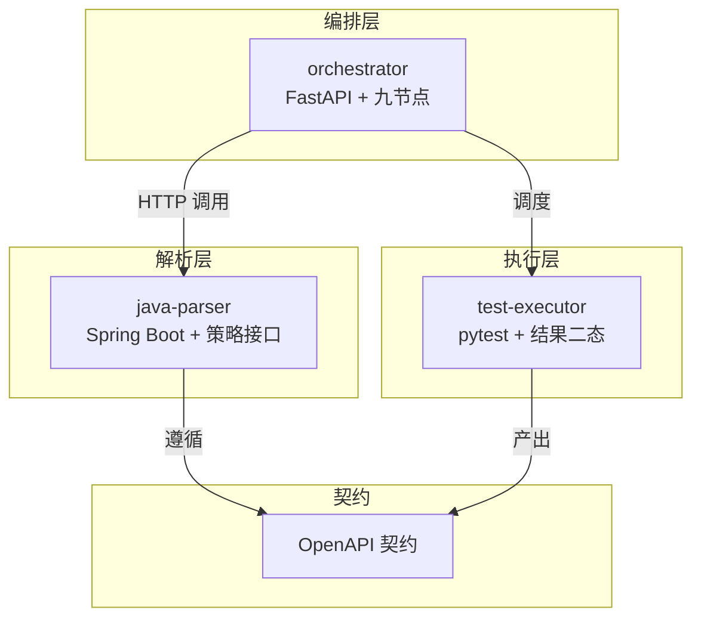
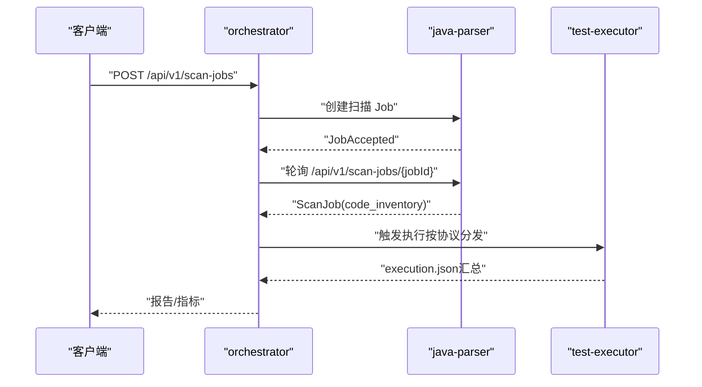
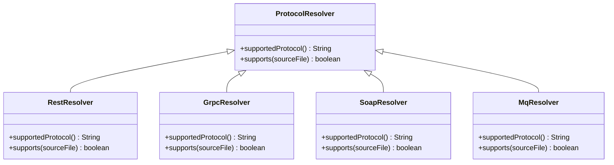
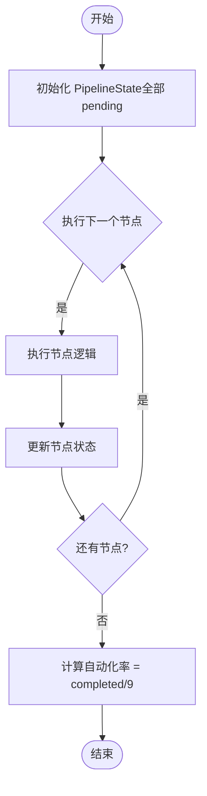
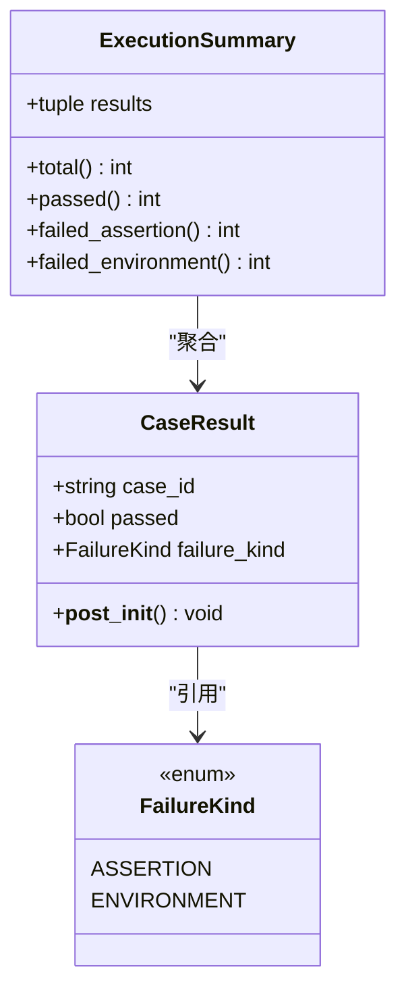
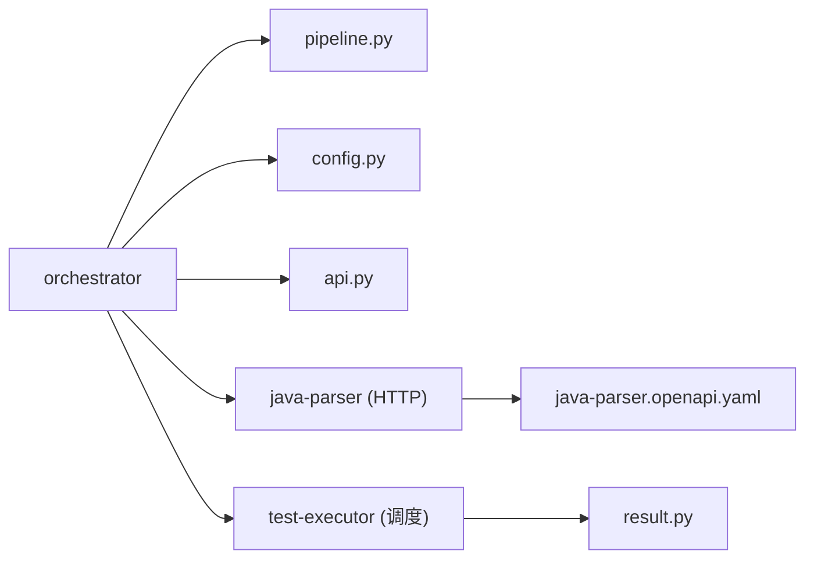

# 插件开发

<cite>
**本文引用的文件**
- [ProtocolResolver.java](file://services/java-parser/src/main/java/com/llmautotest/parser/ProtocolResolver.java)
- [ParserApplication.java](file://services/java-parser/src/main/java/com/llmautotest/parser/ParserApplication.java)
- [application.yml](file://services/java-parser/src/main/resources/application.yml)
- [java-parser.openapi.yaml](file://schemas/contracts/java-parser.openapi.yaml)
- [pipeline.py](file://services/orchestrator/src/orchestrator/pipeline.py)
- [api.py](file://services/orchestrator/src/orchestrator/api.py)
- [config.py](file://services/orchestrator/src/orchestrator/config.py)
- [__main__.py](file://services/orchestrator/src/orchestrator/__main__.py)
- [result.py](file://services/test-executor/src/executor/result.py)
- [test_pipeline.py](file://services/orchestrator/tests/test_pipeline.py)
- [test_result.py](file://services/test-executor/tests/test_result.py)
</cite>

## 目录
1. [简介](#简介)
2. [项目结构](#项目结构)
3. [核心组件](#核心组件)
4. [架构总览](#架构总览)
5. [详细组件分析](#详细组件分析)
6. [依赖关系分析](#依赖关系分析)
7. [性能与扩展性考虑](#性能与扩展性考虑)
8. [故障排查指南](#故障排查指南)
9. [结论](#结论)
10. [附录：插件开发示例](#附录：插件开发示例)

## 简介
本指南面向希望在 LLM-AutoTest 中扩展能力的开发者，聚焦三类插件化能力：
- 协议解析器扩展：通过实现 ProtocolResolver 接口，新增对 REST、gRPC、GraphQL、SOAP、MQ 等协议的静态分析与候选提取。
- 流水线节点扩展：在 orchestrator 的九节点固定口径下，理解节点职责与状态流转，为后续节点实现提供接入点。
- 测试执行器扩展：基于 test-executor 的结果模型与二态判定，扩展多协议执行 Runner，并输出统一的 execution.json。

文档同时给出插件架构设计、接口约定、数据模型规范、集成方式与完整示例（代码结构、配置、测试）。

## 项目结构
仓库采用多服务拆分：
- java-parser：Java 多仓库扫描与接口候选提取服务，暴露异步 Job API，支持可插拔协议解析策略。
- orchestrator：编排服务，定义九节点固定顺序与状态，提供健康检查与节点清单 API，负责调度下游服务。
- test-executor：测试脚本加载与无人值守执行，统一失败二态（断言失败/环境失败）与汇总。
- schemas：契约先行，定义 java-parser 的 OpenAPI 契约与数据结构。

图表来源
- [api.py:11-27](file://services/orchestrator/src/orchestrator/api.py#L11-L27)
- [PipelineState, NODE_ORDER:23-54](file://services/orchestrator/src/orchestrator/pipeline.py#L23-L54)
- [ParserApplication.java:9-15](file://services/java-parser/src/main/java/com/llmautotest/parser/ParserApplication.java#L9-L15)
- [java-parser.openapi.yaml:1-10](file://schemas/contracts/java-parser.openapi.yaml#L1-L10)

章节来源
- [api.py:11-27](file://services/orchestrator/src/orchestrator/api.py#L11-L27)
- [pipeline.py:23-54](file://services/orchestrator/src/orchestrator/pipeline.py#L23-L54)
- [ParserApplication.java:9-15](file://services/java-parser/src/main/java/com/llmautotest/parser/ParserApplication.java#L9-L15)
- [java-parser.openapi.yaml:1-10](file://schemas/contracts/java-parser.openapi.yaml#L1-L10)

## 核心组件
- 协议解析策略接口：ProtocolResolver，用于声明支持的协议标识、判断源码文件是否属于该协议，并在后续阶段产出接口候选。
- 流水线状态与节点：NODE_ORDER 固定九节点；NodeStatus 四态；PipelineState 维护节点记录与自动化率计算。
- 执行结果模型：FailureKind 区分断言失败与环境失败；CaseResult 单用例结果；ExecutionSummary 程序化汇总。
- 配置与启动：Settings 从环境变量读取；FastAPI 应用创建健康检查与节点清单端点；CLI 入口启动 uvicorn。

章节来源
- [ProtocolResolver.java:6-16](file://services/java-parser/src/main/java/com/llmautotest/parser/ProtocolResolver.java#L6-L16)
- [pipeline.py:11-54](file://services/orchestrator/src/orchestrator/pipeline.py#L11-L54)
- [result.py:10-61](file://services/test-executor/src/executor/result.py#L10-L61)
- [config.py:9-50](file://services/orchestrator/src/orchestrator/config.py#L9-L50)
- [api.py:11-27](file://services/orchestrator/src/orchestrator/api.py#L11-L27)
- [__main__.py:15-25](file://services/orchestrator/src/orchestrator/__main__.py#L15-L25)

## 架构总览
LLM-AutoTest 的插件化体现在三个层面：
- 解析层：以 Spring Boot 为载体，ProtocolResolver 作为策略接口，新增协议只需实现该接口，无需改动主流程。
- 编排层：orchestrator 将外部能力抽象为九节点，每个节点对应一个处理阶段，便于按协议/任务维度编排。
- 执行层：test-executor 以 pytest 为核心，Runner 按协议路由执行，结果统一收敛到 ExecutionSummary。

图表来源
- [java-parser.openapi.yaml:24-115](file://schemas/contracts/java-parser.openapi.yaml#L24-L115)
- [api.py:21-25](file://services/orchestrator/src/orchestrator/api.py#L21-L25)
- [pipeline.py:23-54](file://services/orchestrator/src/orchestrator/pipeline.py#L23-L54)

## 详细组件分析

### 协议解析器插件（ProtocolResolver）
- 目标：新增一种协议（如 gRPC/SOAP/MQ）的静态特征定位与候选提取。
- 关键方法：
  - supportedProtocol：返回协议标识（rest/dubbo/grpc/graphql/soap/mq）。
  - supports：基于 Path 判断源码文件是否属于本协议（用于扫描过滤）。
  - 后续解析产出：依据 schemas/contracts/java-parser.openapi.yaml 中的 InterfaceCandidate 结构，包含 candidate_id、protocol、signature、code_location、snippet、related_files、is_fallback、confidence 等字段。
- 集成方式：
  - 在 java-parser 中以 Spring 组件注册策略实现类。
  - 扫描阶段根据 supports(Path) 筛选文件，进入解析管线。
  - 产物遵循 OpenAPI 契约，供 orchestrator 侧进行 LLM 语义解析与后续生成。

图表来源
- [ProtocolResolver.java:6-16](file://services/java-parser/src/main/java/com/llmautotest/parser/ProtocolResolver.java#L6-L16)
- [java-parser.openapi.yaml:323-351](file://schemas/contracts/java-parser.openapi.yaml#L323-L351)

章节来源
- [ProtocolResolver.java:6-16](file://services/java-parser/src/main/java/com/llmautotest/parser/ProtocolResolver.java#L6-L16)
- [java-parser.openapi.yaml:274-369](file://schemas/contracts/java-parser.openapi.yaml#L274-L369)

### 流水线节点扩展（orchestrator）
- 九节点固定口径：req_parse、code_scan、interface_reconstruct、code_review、testcase_generate、auto_execute、test_report、defect_list、retest_regression。禁止增删，保证分母稳定。
- 节点状态：completed、manual_intervention、running、pending。
- PipelineState：维护 NodeRecord 集合，提供 node_summary 与 automation_rate 计算。
- 扩展点：
  - 节点内部逻辑可通过 orchestrator 的 service 层扩展（当前骨架已提供状态与清单 API）。
  - 对外暴露 /api/v1/pipeline/nodes 获取节点清单与状态。
  - 健康检查 /health 用于编排依赖。

图表来源
- [pipeline.py:23-70](file://services/orchestrator/src/orchestrator/pipeline.py#L23-L70)
- [api.py:21-25](file://services/orchestrator/src/orchestrator/api.py#L21-L25)

章节来源
- [pipeline.py:11-70](file://services/orchestrator/src/orchestrator/pipeline.py#L11-L70)
- [api.py:16-25](file://services/orchestrator/src/orchestrator/api.py#L16-L25)
- [test_pipeline.py:21-46](file://services/orchestrator/tests/test_pipeline.py#L21-L46)

### 测试执行器扩展（test-executor）
- 失败二态：FailureKind.ASSERTION（断言失败）与 FailureKind.ENVIRONMENT（环境失败），分别计入不同统计口径。
- CaseResult：单用例结果，包含 case_id、passed、failure_kind；通过时不得携带失败类型（自洽校验）。
- ExecutionSummary：汇总 total、passed、failed_assertion、failed_environment。
- 扩展点：
  - 新增协议 Runner：按协议路由执行，捕获异常分类为 assertion/environment。
  - 统一输出：将每条用例结果映射为 CaseResult，最终汇总为 ExecutionSummary，写入 execution.json。
  - 前置数据准备：在 Day 1 环境探测时识别需鉴权/造数的接口，预置到 fixtures，执行时自动加载。

图表来源
- [result.py:10-61](file://services/test-executor/src/executor/result.py#L10-L61)

章节来源
- [result.py:10-61](file://services/test-executor/src/executor/result.py#L10-L61)
- [test_result.py:10-29](file://services/test-executor/tests/test_result.py#L10-L29)

## 依赖关系分析
- orchestrator 依赖：
  - FastAPI 构建应用与健康检查。
  - pipeline 模块定义节点顺序与状态。
  - config 模块从环境变量读取运行参数。
- java-parser 依赖：
  - Spring Boot 容器与 JavaParser 符号解析库。
  - 遵循 OpenAPI 契约定义的数据结构。
- test-executor 依赖：
  - pytest 执行引擎与 pydantic/httpx 等工具。
  - 结果模型与二态判定逻辑。

图表来源
- [api.py:11-27](file://services/orchestrator/src/orchestrator/api.py#L11-L27)
- [pipeline.py:23-54](file://services/orchestrator/src/orchestrator/pipeline.py#L23-L54)
- [config.py:9-50](file://services/orchestrator/src/orchestrator/config.py#L9-L50)
- [java-parser.openapi.yaml:1-10](file://schemas/contracts/java-parser.openapi.yaml#L1-L10)
- [result.py:10-61](file://services/test-executor/src/executor/result.py#L10-L61)

章节来源
- [api.py:11-27](file://services/orchestrator/src/orchestrator/api.py#L11-L27)
- [pipeline.py:23-54](file://services/orchestrator/src/orchestrator/pipeline.py#L23-L54)
- [config.py:9-50](file://services/orchestrator/src/orchestrator/config.py#L9-L50)
- [java-parser.openapi.yaml:1-10](file://schemas/contracts/java-parser.openapi.yaml#L1-L10)
- [result.py:10-61](file://services/test-executor/src/executor/result.py#L10-L61)

## 性能与扩展性考虑
- 解析并发：java-parser 支持 scan-concurrency 配置，控制多仓库扫描并发度，避免资源争用。
- 节点冻结：九节点顺序固定，确保自动化率分母稳定，便于横向对比与度量。
- 结果汇总：ExecutionSummary 纯程序化计算，不经过 LLM，保证指标一致性与可审计性。
- 可扩展性：
  - 协议解析器以策略模式解耦，新增协议不影响主流程。
  - 执行器按协议路由 Runner，便于并行执行与隔离失败。
  - 配置集中管理，敏感参数通过环境变量注入，避免硬编码。

章节来源
- [application.yml:5-7](file://services/java-parser/src/main/resources/application.yml#L5-L7)
- [pipeline.py:23-70](file://services/orchestrator/src/orchestrator/pipeline.py#L23-L70)
- [result.py:32-61](file://services/test-executor/src/executor/result.py#L32-L61)
- [config.py:9-50](file://services/orchestrator/src/orchestrator/config.py#L9-L50)

## 故障排查指南
- 健康检查：/health 返回 {"status":"ok"}，用于编排服务健康探测。
- 节点清单：/api/v1/pipeline/nodes 返回九节点清单与状态，验证节点数与初始态。
- 配置缺失：Settings.from_env 缺少必填环境变量会抛出 RuntimeError，提示缺失项。
- 结果自洽：CaseResult 通过时若携带 failure_kind 将抛出 ValueError，确保结果一致性。
- 契约错误：java-parser 的错误结构统一为 Error（code/message/node_id/details），便于上层统一处理。

章节来源
- [api.py:16-19](file://services/orchestrator/src/orchestrator/api.py#L16-L19)
- [api.py:21-25](file://services/orchestrator/src/orchestrator/api.py#L21-L25)
- [config.py:32-50](file://services/orchestrator/src/orchestrator/config.py#L32-L50)
- [result.py:25-29](file://services/test-executor/src/executor/result.py#L25-L29)
- [java-parser.openapi.yaml:130-147](file://schemas/contracts/java-parser.openapi.yaml#L130-L147)

## 结论
LLM-AutoTest 通过策略接口、固定节点口径与统一结果模型，实现了高内聚、低耦合的插件化架构。开发者可按需扩展协议解析器、流水线节点与测试执行器，遵循契约与数据模型约定，即可无缝集成到整体流水线中。

## 附录：插件开发示例

### 示例一：新增协议解析器（gRPC）
- 步骤：
  1. 实现 ProtocolResolver 接口，返回 supportedProtocol="grpc"，并在 supports(Path) 中识别 .proto 或相关注解。
  2. 在 Spring 容器中注册为 Bean，参与扫描阶段的策略匹配。
  3. 解析产出 InterfaceCandidate，包含 code_location、related_files、confidence 等字段，遵循 OpenAPI 契约。
- 配置文件：
  - application.yml 中可调整 scan-concurrency 以优化解析吞吐。
- 测试建议：
  - 单元测试覆盖 supports(Path) 的正反例。
  - 集成测试验证产物的 InterfaceCandidate 结构与字段完整性。

章节来源
- [ProtocolResolver.java:6-16](file://services/java-parser/src/main/java/com/llmautotest/parser/ProtocolResolver.java#L6-L16)
- [application.yml:5-7](file://services/java-parser/src/main/resources/application.yml#L5-L7)
- [java-parser.openapi.yaml:323-351](file://schemas/contracts/java-parser.openapi.yaml#L323-L351)

### 示例二：添加新的流水线节点（仅说明接入点）
- 说明：当前九节点顺序冻结，禁止增删。如需扩展功能，应在现有节点内部实现逻辑扩展，或通过 orchestrator 的 service 层增加子任务编排。
- 接入点：
  - 使用 PipelineState 维护节点状态，通过 node_summary 暴露给 API。
  - 自动化率计算基于 completed/9，确保度量口径一致。
- 测试建议：
  - 验证节点清单长度为 9。
  - 验证初始态全部为 pending，automation_rate 在未实测时为 None。

章节来源
- [pipeline.py:23-70](file://services/orchestrator/src/orchestrator/pipeline.py#L23-L70)
- [test_pipeline.py:21-46](file://services/orchestrator/tests/test_pipeline.py#L21-L46)

### 示例三：自定义测试执行器（REST Runner）
- 步骤：
  1. 编写 REST Runner，使用 httpx 发起请求，捕获异常并分类为 assertion/environment。
  2. 将每条用例结果封装为 CaseResult，并通过 ExecutionSummary 汇总。
  3. 输出 execution.json，供报告层消费。
- 配置：
  - 前置数据（token/登录态）在 fixtures 中预置，执行时自动加载。
- 测试建议：
  - 验证通过用例不得携带 failure_kind。
  - 验证 summary 的 total/pass/fail 计数正确。

章节来源
- [result.py:10-61](file://services/test-executor/src/executor/result.py#L10-L61)
- [test_result.py:10-29](file://services/test-executor/tests/test_result.py#L10-L29)