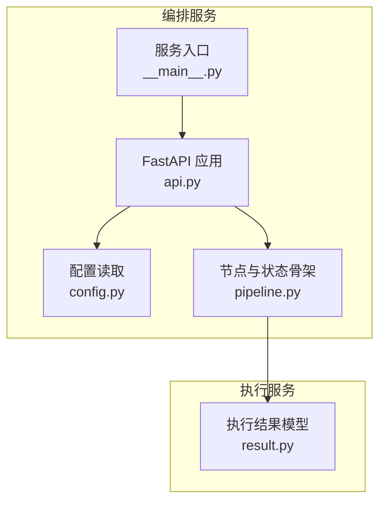
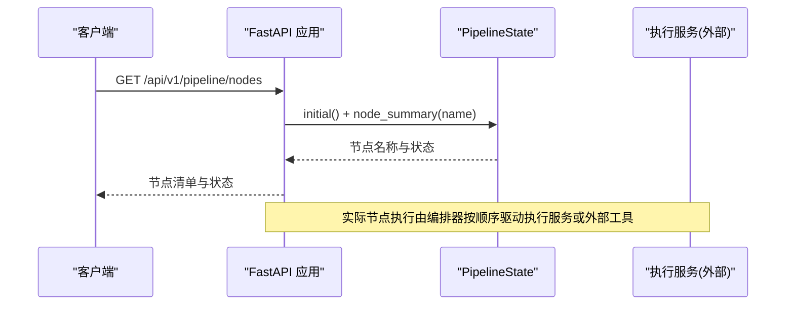
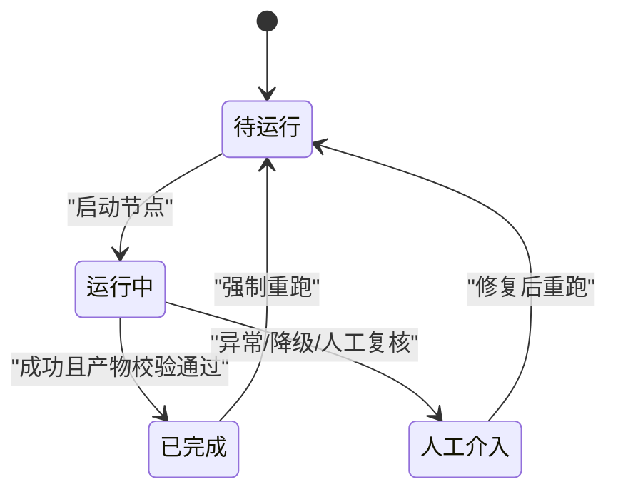
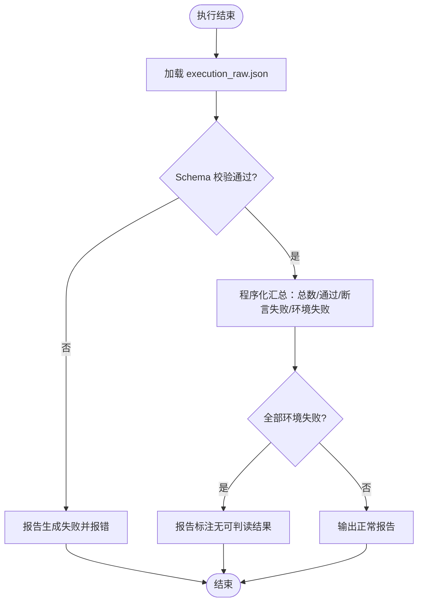
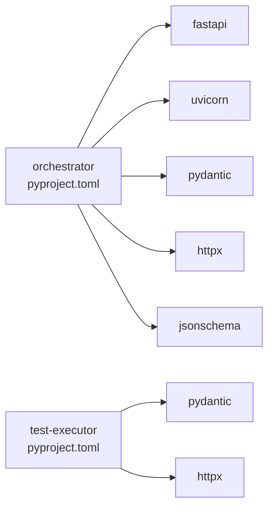

# 流水线节点插件

<cite>
**本文引用的文件列表**
- [pipeline.py](file://services/orchestrator/src/orchestrator/pipeline.py)
- [config.py](file://services/orchestrator/src/orchestrator/config.py)
- [api.py](file://services/orchestrator/src/orchestrator/api.py)
- [__main__.py](file://services/orchestrator/src/orchestrator/__main__.py)
- [result.py](file://services/test-executor/src/executor/result.py)
- [pyproject.toml（orchestrator）](file://services/orchestrator/pyproject.toml)
- [pyproject.toml（test-executor）](file://services/test-executor/pyproject.toml)
- [04_功能规格说明.md](file://docs/04_功能规格说明.md)
- [10_测试框架选型说明.md](file://docs/10_测试框架选型说明.md)
</cite>

## 目录
1. [简介](#简介)
2. [项目结构](#项目结构)
3. [核心组件](#核心组件)
4. [架构总览](#架构总览)
5. [详细组件分析](#详细组件分析)
6. [依赖关系分析](#依赖关系分析)
7. [性能考量](#性能考量)
8. [故障排查指南](#故障排查指南)
9. [结论](#结论)
10. [附录：自定义节点实现清单与示例路径](#附录自定义节点实现清单与示例路径)

## 简介
本文件面向“九节点测试流水线”的扩展需求，提供一套可操作的“节点插件”开发规范。目标是在不破坏固定九节点口径的前提下，为每个节点定义统一的生命周期、状态转换和数据传递约定，并给出如何注册新节点、管理节点间依赖、处理错误与输出结果的完整实践。文档同时覆盖编排服务（orchestrator）与执行服务（test-executor）之间的协作边界，确保新增节点既能被编排器调度，又能产出标准化的产物供下游消费。

## 项目结构
本项目采用多服务 monorepo 组织，关键目录如下：
- services/orchestrator：流水线编排服务，负责九节点顺序、状态机、REST API、配置与环境变量注入。
- services/test-executor：测试执行服务，负责用例加载、执行、结果二态判定与汇总。
- docs：需求规格与选型说明，约束了节点口径、度量口径与执行策略。

图表来源
- [api.py:11-27](file://services/orchestrator/src/orchestrator/api.py#L11-L27)
- [config.py:9-56](file://services/orchestrator/src/orchestrator/config.py#L9-L56)
- [pipeline.py:11-84](file://services/orchestrator/src/orchestrator/pipeline.py#L11-L84)
- [result.py:10-61](file://services/test-executor/src/executor/result.py#L10-L61)

章节来源
- [api.py:11-27](file://services/orchestrator/src/orchestrator/api.py#L11-L27)
- [config.py:9-56](file://services/orchestrator/src/orchestrator/config.py#L9-L56)
- [pipeline.py:11-84](file://services/orchestrator/src/orchestrator/pipeline.py#L11-L84)
- [result.py:10-61](file://services/test-executor/src/executor/result.py#L10-L61)

## 核心组件
- 节点状态枚举与四态标注：用于表达节点的运行期状态，支撑自动化率计算与人工介入统计。
- 固定九节点顺序：冻结口径，禁止增删，作为度量分母与流程基线。
- 流水线状态对象：维护所有节点记录，并提供摘要查询与自动化率计算。
- 执行结果模型：区分断言失败与环境失败，支撑报告与缺陷闭环。
- 配置与环境变量：集中管理端口、LLM 参数、产物根目录等，保证可移植与安全。

章节来源
- [pipeline.py:11-84](file://services/orchestrator/src/orchestrator/pipeline.py#L11-L84)
- [result.py:10-61](file://services/test-executor/src/executor/result.py#L10-L61)
- [config.py:9-56](file://services/orchestrator/src/orchestrator/config.py#L9-L56)

## 架构总览
下图展示了从 REST 请求到节点状态查询的调用链，以及编排器与执行服务的数据契约边界。

图表来源
- [api.py:21-25](file://services/orchestrator/src/orchestrator/api.py#L21-L25)
- [pipeline.py:51-60](file://services/orchestrator/src/orchestrator/pipeline.py#L51-L60)

章节来源
- [api.py:21-25](file://services/orchestrator/src/orchestrator/api.py#L21-L25)
- [pipeline.py:51-60](file://services/orchestrator/src/orchestrator/pipeline.py#L51-L60)

## 详细组件分析

### 节点生命周期与状态转换
- 四态定义：待运行、运行中、已完成、人工介入。降级节点按“人工介入”计入自动化率。
- 初始态：所有节点均为“待运行”。
- 转换规则（建议）：
  - PENDING → RUNNING：节点开始执行前切换。
  - RUNNING → COMPLETED：节点成功完成，产物校验通过。
  - RUNNING → MANUAL_INTERVENTION：出现异常需人工干预，或触发降级策略。
  - 任意态 → PENDING：断点续跑时，对缺失产物的节点重置为待运行。
- 自动化率：已完成节点数除以固定分母（9），未实测返回 None。

图表来源
- [pipeline.py:11-21](file://services/orchestrator/src/orchestrator/pipeline.py#L11-L21)
- [pipeline.py:51-70](file://services/orchestrator/src/orchestrator/pipeline.py#L51-L70)

章节来源
- [pipeline.py:11-21](file://services/orchestrator/src/orchestrator/pipeline.py#L11-L21)
- [pipeline.py:51-70](file://services/orchestrator/src/orchestrator/pipeline.py#L51-L70)

### 数据传递约定（节点间契约）
- 节点间以文件为接口，结构化 JSON 落盘到固定目录；节点内不依赖内存传递。
- 产物 Schema 校验不通过则拒绝复用，强制重跑该节点。
- 上游节点产物缺失时，下游节点拒绝启动并报错指明缺失项。
- 建议产物布局：
  - 任务根目录：按任务 ID 隔离。
  - 节点子目录：存放输入、中间产物、日志与元数据。
  - 共享索引：如 requirements.json、interfaces.json、execution.json 等。

章节来源
- [04_功能规格说明.md:23-31](file://docs/04_功能规格说明.md#L23-L31)

### 执行结果与失败二态
- 单条用例结果包含是否通过及失败类型（断言失败/环境失败）。
- 汇总对象提供总数、通过数、断言失败数、环境失败数的程序化统计。
- 全量环境失败时，报告应标注“无可判读结果”，而非输出 0%。

图表来源
- [result.py:17-61](file://services/test-executor/src/executor/result.py#L17-L61)
- [04_功能规格说明.md:228-232](file://docs/04_功能规格说明.md#L228-L232)

章节来源
- [result.py:17-61](file://services/test-executor/src/executor/result.py#L17-L61)
- [04_功能规格说明.md:228-232](file://docs/04_功能规格说明.md#L228-L232)

### 配置与环境变量
- 配置项包括端口、Java 解析器地址、产物根目录、LLM 调用参数、Schema 目录等。
- 必填环境变量缺失时显式报错；敏感字段不入日志。
- 公共摘要用于安全日志输出。

章节来源
- [config.py:9-56](file://services/orchestrator/src/orchestrator/config.py#L9-L56)

### 服务入口与启动
- CLI 入口统一加载配置并启动 FastAPI 服务。
- 健康检查端点用于容器编排依赖检测。

章节来源
- [__main__.py:15-25](file://services/orchestrator/src/orchestrator/__main__.py#L15-L25)
- [api.py:16-19](file://services/orchestrator/src/orchestrator/api.py#L16-L19)

## 依赖关系分析
- orchestrator 依赖 fastapi、uvicorn、pydantic、httpx、jsonschema。
- test-executor 依赖 pydantic、httpx，并通过 pytest 生态执行脚本。
- 编排器与执行器通过标准化 JSON 产物与 REST/命令进行解耦协作。

图表来源
- [pyproject.toml（orchestrator）:1-12](file://services/orchestrator/pyproject.toml#L1-L12)
- [pyproject.toml（test-executor）:1-9](file://services/test-executor/pyproject.toml#L1-L9)

章节来源
- [pyproject.toml（orchestrator）:1-12](file://services/orchestrator/pyproject.toml#L1-L12)
- [pyproject.toml（test-executor）:1-9](file://services/test-executor/pyproject.toml#L1-L9)

## 性能考量
- 节点执行尽量无状态、幂等，便于断点续跑与重试。
- LLM 调用需设置超时与重试上限，避免阻塞流水线。
- 产物写入采用原子操作（先写临时文件再替换），减少部分写入导致的校验失败。
- 大仓库扫描与接口还原需控制上下文大小与 token 用量，避免限流。

[本节为通用指导，不直接分析具体文件]

## 故障排查指南
- 节点失败：停止后续节点，输出失败节点与原因，已产出节点产物保留。
- 断点续跑：产物 Schema 校验不通过则拒绝复用，强制重跑该节点。
- 报告生成失败：若执行结果为空或损坏，禁止产出空报告，明确报错。
- 全量环境失败：报告标注“无可判读结果”，不输出误导性通过率。
- 配置缺失：启动时报错提示缺少必填环境变量。

章节来源
- [04_功能规格说明.md:27-31](file://docs/04_功能规格说明.md#L27-L31)
- [04_功能规格说明.md:228-232](file://docs/04_功能规格说明.md#L228-L232)
- [config.py:35-56](file://services/orchestrator/src/orchestrator/config.py#L35-L56)

## 结论
通过统一的节点状态机、固定的九节点口径与严格的产物契约，可以在不破坏度量口径的前提下扩展流水线能力。新增节点应遵循“文件即接口”的约定，使用标准化的结果模型与 Schema 校验，配合编排器的断点续跑与人工介入机制，形成稳定、可观测、可度量的自动化流水线。

[本节为总结性内容，不直接分析具体文件]

## 附录：自定义节点实现清单与示例路径
以下清单提供了从零实现一个自定义节点的步骤与对应代码位置参考。请根据实际业务将逻辑落地到 orchestrator 或 test-executor 中，并确保产物符合既有 Schema。

- 节点定义与注册
  - 在编排器中声明节点名称与顺序（保持九节点口径不变，可在节点内部拆分职责）。
  - 参考路径：[pipeline.py:23-34](file://services/orchestrator/src/orchestrator/pipeline.py#L23-L34)
- 生命周期管理
  - 实现节点状态转换：PENDING → RUNNING → COMPLETED/MANUAL_INTERVENTION。
  - 参考路径：[pipeline.py:11-21](file://services/orchestrator/src/orchestrator/pipeline.py#L11-L21)、[pipeline.py:51-70](file://services/orchestrator/src/orchestrator/pipeline.py#L51-L70)
- 数据传递与产物契约
  - 节点输入/输出以 JSON 文件形式落盘，遵循 Schema 校验。
  - 参考路径：[04_功能规格说明.md:23-31](file://docs/04_功能规格说明.md#L23-L31)
- 执行逻辑与错误处理
  - 节点执行失败时记录原因并标记为人工介入；支持重试与降级。
  - 参考路径：[04_功能规格说明.md:27-31](file://docs/04_功能规格说明.md#L27-L31)
- 结果输出与汇总
  - 执行结果使用 FailureKind 区分断言失败与环境失败，并程序化汇总。
  - 参考路径：[result.py:10-61](file://services/test-executor/src/executor/result.py#L10-L61)
- 配置与环境变量
  - 通过环境变量注入 LLM 参数、产物根目录、Schema 目录等。
  - 参考路径：[config.py:9-56](file://services/orchestrator/src/orchestrator/config.py#L9-L56)
- 服务集成与 API
  - 暴露健康检查与节点清单接口，便于编排与监控。
  - 参考路径：[api.py:11-27](file://services/orchestrator/src/orchestrator/api.py#L11-L27)
- 测试与验证
  - 使用 pytest 执行与验证节点行为，确保无人值守与可重复性。
  - 参考路径：[10_测试框架选型说明.md:45-53](file://docs/10_测试框架选型说明.md#L45-L53)

[本节为实施指引，不直接分析具体文件]