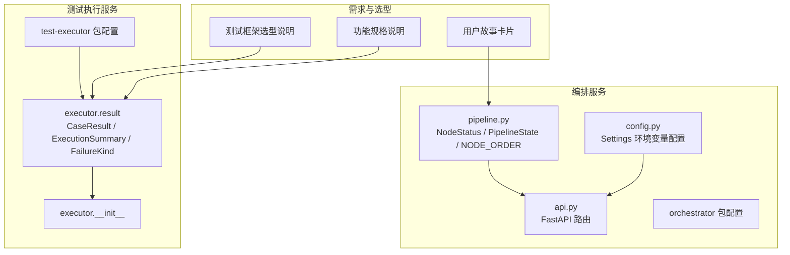
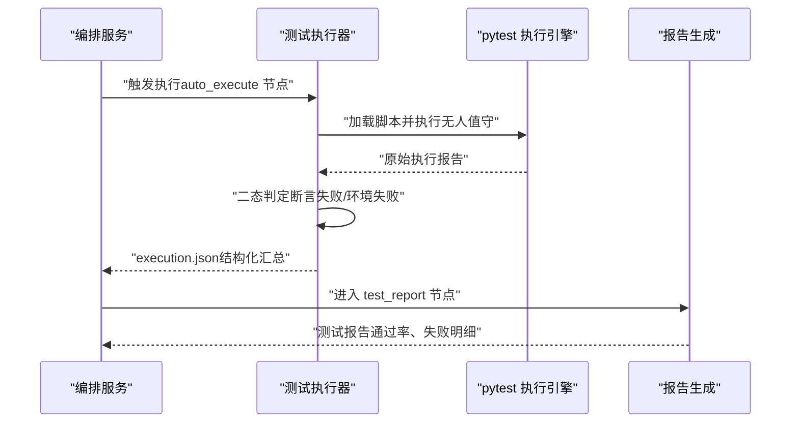
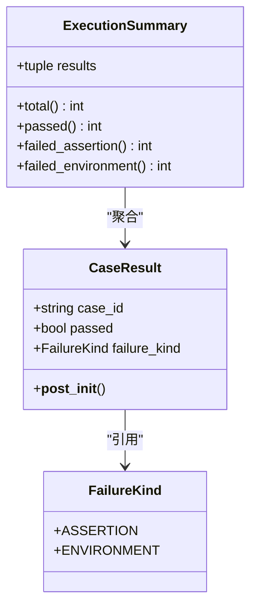
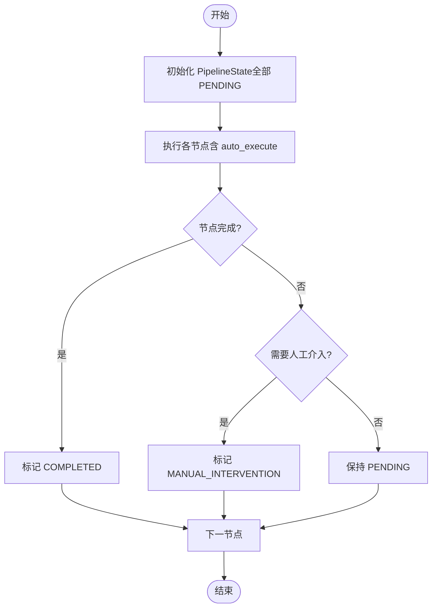
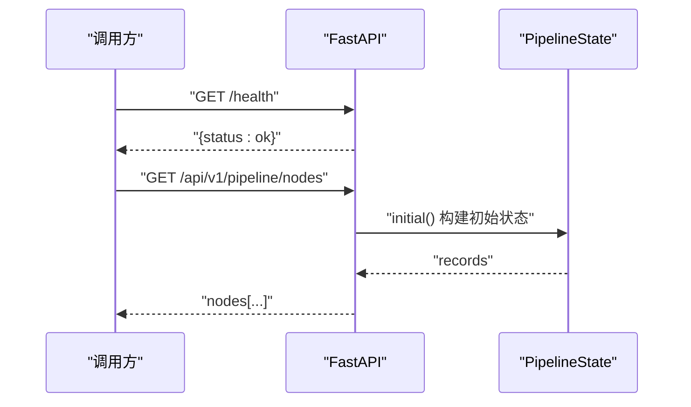
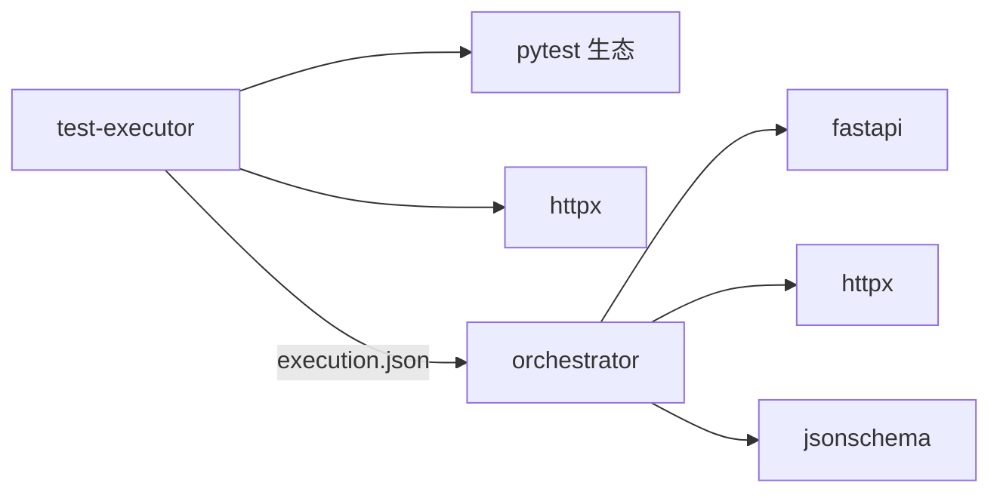

# 测试执行器插件

<cite>
**本文引用的文件**
- [services/test-executor/src/executor/__init__.py](file://services/test-executor/src/executor/__init__.py)
- [services/test-executor/src/executor/result.py](file://services/test-executor/src/executor/result.py)
- [services/test-executor/tests/test_result.py](file://services/test-executor/tests/test_result.py)
- [services/test-executor/pyproject.toml](file://services/test-executor/pyproject.toml)
- [services/orchestrator/src/orchestrator/pipeline.py](file://services/orchestrator/src/orchestrator/pipeline.py)
- [services/orchestrator/src/orchestrator/api.py](file://services/orchestrator/src/orchestrator/api.py)
- [services/orchestrator/src/orchestrator/config.py](file://services/orchestrator/src/orchestrator/config.py)
- [services/orchestrator/pyproject.toml](file://services/orchestrator/pyproject.toml)
- [docs/10_测试框架选型说明.md](file://docs/10_测试框架选型说明.md)
- [docs/03_用户故事卡片.md](file://docs/03_用户故事卡片.md)
- [docs/04_功能规格说明.md](file://docs/04_功能规格说明.md)
</cite>

## 目录
1. [简介](#简介)
2. [项目结构](#项目结构)
3. [核心组件](#核心组件)
4. [架构总览](#架构总览)
5. [详细组件分析](#详细组件分析)
6. [依赖关系分析](#依赖关系分析)
7. [性能与可扩展性](#性能与可扩展性)
8. [故障排查指南](#故障排查指南)
9. [结论](#结论)
10. [附录：扩展实现清单](#附录：扩展实现清单)

## 简介
本文件面向“测试执行器插件”的开发者，目标是说明如何扩展测试执行引擎以支持新的测试框架或执行环境，并覆盖测试结果处理、失败分类（断言失败与环境失败）和报告生成机制。文档同时给出自定义执行器的接口约定、用例适配器与结果格式化的实践建议，以及如何在编排器服务中集成执行器并与其它组件交互。

## 项目结构
仓库采用多服务 monorepo 组织，与测试执行相关的关键目录如下：
- services/test-executor：测试执行服务，提供执行结果二态判定骨架、依赖 pytest 生态与无人值守执行策略。
- services/orchestrator：编排服务，定义 9 节点流水线、REST API 与运行配置。
- docs：需求与选型文档，明确执行引擎目标、失败二态、报告产出等约束。

图表来源
- [services/test-executor/src/executor/__init__.py:1-3](file://services/test-executor/src/executor/__init__.py#L1-L3)
- [services/test-executor/src/executor/result.py:1-61](file://services/test-executor/src/executor/result.py#L1-L61)
- [services/test-executor/pyproject.toml:1-45](file://services/test-executor/pyproject.toml#L1-L45)
- [services/orchestrator/src/orchestrator/pipeline.py:1-84](file://services/orchestrator/src/orchestrator/pipeline.py#L1-L84)
- [services/orchestrator/src/orchestrator/api.py:1-28](file://services/orchestrator/src/orchestrator/api.py#L1-L28)
- [services/orchestrator/src/orchestrator/config.py:1-56](file://services/orchestrator/src/orchestrator/config.py#L1-L56)
- [docs/10_测试框架选型说明.md:1-64](file://docs/10_测试框架选型说明.md#L1-L64)
- [docs/03_用户故事卡片.md:115-229](file://docs/03_用户故事卡片.md#L115-L229)
- [docs/04_功能规格说明.md:171-213](file://docs/04_功能规格说明.md#L171-L213)

章节来源
- [services/test-executor/src/executor/__init__.py:1-3](file://services/test-executor/src/executor/__init__.py#L1-L3)
- [services/test-executor/src/executor/result.py:1-61](file://services/test-executor/src/executor/result.py#L1-L61)
- [services/test-executor/pyproject.toml:1-45](file://services/test-executor/pyproject.toml#L1-L45)
- [services/orchestrator/src/orchestrator/pipeline.py:1-84](file://services/orchestrator/src/orchestrator/pipeline.py#L1-L84)
- [services/orchestrator/src/orchestrator/api.py:1-28](file://services/orchestrator/src/orchestrator/api.py#L1-L28)
- [services/orchestrator/src/orchestrator/config.py:1-56](file://services/orchestrator/src/orchestrator/config.py#L1-L56)
- [docs/10_测试框架选型说明.md:1-64](file://docs/10_测试框架选型说明.md#L1-L64)
- [docs/03_用户故事卡片.md:115-229](file://docs/03_用户故事卡片.md#L115-L229)
- [docs/04_功能规格说明.md:171-213](file://docs/04_功能规格说明.md#L171-L213)

## 核心组件
- 执行结果二态模型：通过枚举区分“断言失败”与“环境失败”，并以不可变数据类封装单条用例结果与一次执行的汇总统计，确保数值口径程序化且稳定。
- 流水线与节点状态：编排服务定义 9 个固定节点顺序与四态标注，用于度量自动化率与追踪执行进度。
- REST API：编排服务暴露健康检查与节点清单接口，便于外部系统探测与集成。
- 配置管理：编排服务通过环境变量加载运行参数，避免硬编码敏感信息。

章节来源
- [services/test-executor/src/executor/result.py:10-61](file://services/test-executor/src/executor/result.py#L10-L61)
- [services/orchestrator/src/orchestrator/pipeline.py:11-84](file://services/orchestrator/src/orchestrator/pipeline.py#L11-L84)
- [services/orchestrator/src/orchestrator/api.py:11-27](file://services/orchestrator/src/orchestrator/api.py#L11-L27)
- [services/orchestrator/src/orchestrator/config.py:9-56](file://services/orchestrator/src/orchestrator/config.py#L9-L56)

## 架构总览
下图展示测试执行器与编排服务的协作关系：编排服务在“自动执行”节点触发执行器；执行器基于 pytest 执行脚本，产出原始报告，再按二态规则汇总为结构化结果；编排服务消费该结果并更新流水线状态，最终由报告节点生成对外报告。

图表来源
- [services/orchestrator/src/orchestrator/pipeline.py:23-34](file://services/orchestrator/src/orchestrator/pipeline.py#L23-L34)
- [services/test-executor/src/executor/result.py:17-61](file://services/test-executor/src/executor/result.py#L17-L61)
- [docs/10_测试框架选型说明.md:45-53](file://docs/10_测试框架选型说明.md#L45-L53)
- [docs/04_功能规格说明.md:179-207](file://docs/04_功能规格说明.md#L179-L207)

## 详细组件分析

### 执行结果模型与二态判定
- 失败类型枚举：将失败分为“断言失败”和“环境失败”，前者计入通过率分母，后者隔离至待环境确认，符合需求对失败分类的要求。
- 用例结果：包含用例标识、是否通过及失败类型；构造时校验一致性，禁止通过用例携带失败类型。
- 执行汇总：提供总数、通过数、断言失败数、环境失败数的只读属性，保证数值口径程序化且不经过 LLM。

图表来源
- [services/test-executor/src/executor/result.py:10-61](file://services/test-executor/src/executor/result.py#L10-L61)

章节来源
- [services/test-executor/src/executor/result.py:10-61](file://services/test-executor/src/executor/result.py#L10-L61)
- [services/test-executor/tests/test_result.py:10-29](file://services/test-executor/tests/test_result.py#L10-L29)

### 流水线与节点状态
- 节点顺序：固定 9 节点，禁止增删，确保度量口径一致。
- 节点状态：四态（已完成、人工介入、运行中、待运行），降级节点按人工介入计入。
- 自动化率：已完成节点数除以 9，骨架阶段返回 None 表示尚未实测。

图表来源
- [services/orchestrator/src/orchestrator/pipeline.py:11-70](file://services/orchestrator/src/orchestrator/pipeline.py#L11-L70)

章节来源
- [services/orchestrator/src/orchestrator/pipeline.py:11-84](file://services/orchestrator/src/orchestrator/pipeline.py#L11-L84)

### 编排服务 API
- 健康检查：供容器编排与健康探针使用。
- 节点清单：返回 9 节点名称与当前状态，便于前端或 CI 可视化。

图表来源
- [services/orchestrator/src/orchestrator/api.py:11-27](file://services/orchestrator/src/orchestrator/api.py#L11-L27)
- [services/orchestrator/src/orchestrator/pipeline.py:45-59](file://services/orchestrator/src/orchestrator/pipeline.py#L45-L59)

章节来源
- [services/orchestrator/src/orchestrator/api.py:11-27](file://services/orchestrator/src/orchestrator/api.py#L11-L27)
- [services/orchestrator/src/orchestrator/pipeline.py:45-59](file://services/orchestrator/src/orchestrator/pipeline.py#L45-L59)

### 配置与环境变量
- 配置项：端口、Java 解析器地址、产物根目录、LLM 调用参数、Schema 目录等。
- 安全摘要：公开摘要不含密钥，便于日志记录。
- 环境变量加载：缺失必填项时显式报错，保障启动期可观测性。

章节来源
- [services/orchestrator/src/orchestrator/config.py:9-56](file://services/orchestrator/src/orchestrator/config.py#L9-L56)

### 测试框架选型与执行策略
- 选定 pytest：满足 LLM 生成脚本的可加载性、五协议客户端集成、结构化结果导出、无人值守执行、失败二态区分与上手成本等要求。
- 执行命令：通过 pytest 的 JSON 报告输出原始结果，再由执行器程序化汇总为 execution.json。
- 二态标注：断言失败默认 assertion；网络/连接异常映射 environment。
- 降级策略：某协议 Runner 未就绪时，降级为“脚本生成成功 + Mock 执行演示”，并在报告中注明。

章节来源
- [docs/10_测试框架选型说明.md:10-64](file://docs/10_测试框架选型说明.md#L10-L64)
- [docs/04_功能规格说明.md:179-207](file://docs/04_功能规格说明.md#L179-L207)

## 依赖关系分析
- 测试执行服务依赖 pytest 生态与 HTTP 客户端库，用于脚本执行与可能的远程交互。
- 编排服务依赖 FastAPI、HTTP 客户端、JSON Schema 校验等，用于 API 与产物校验。
- 两者通过标准化产物（execution.json）与 REST API 解耦协作。

图表来源
- [services/test-executor/pyproject.toml:1-45](file://services/test-executor/pyproject.toml#L1-L45)
- [services/orchestrator/pyproject.toml:1-54](file://services/orchestrator/pyproject.toml#L1-L54)

章节来源
- [services/test-executor/pyproject.toml:1-45](file://services/test-executor/pyproject.toml#L1-L45)
- [services/orchestrator/pyproject.toml:1-54](file://services/orchestrator/pyproject.toml#L1-L54)

## 性能与可扩展性
- 执行性能：pytest 原生支持并行与过滤执行，可通过命令行参数控制并发度与筛选条件，适配大规模用例集。
- 可扩展点：
  - 新增执行器：实现统一的执行入口与结果适配器，将不同框架的结果映射到 CaseResult/ExecutionSummary。
  - 新增协议 Runner：在环境探测后按优先级选择 Runner，未就绪则降级为 Mock 演示。
  - 结果格式化：统一输出 execution.json，确保下游报告节点无需二次加工。
- 资源占用：headless 执行与无交互模式降低资源开销；超时与中断边界需在上层捕获并记录。

## 故障排查指南
- 启动失败：检查编排服务环境变量是否齐全，缺失必填项会抛出运行时错误。
- 执行失败：
  - 断言失败：属于业务逻辑问题，计入通过率分母。
  - 环境失败：网络/连接异常等，隔离至待环境确认，不直接进缺陷清单。
  - 超时与中断：单用例超时上限与执行中断需记录原因并保留已完成的用例结果。
- 报告不一致：核对 execution.json 的数值口径是否与原始报告一致，避免引入 LLM 处理环节。

章节来源
- [services/orchestrator/src/orchestrator/config.py:35-56](file://services/orchestrator/src/orchestrator/config.py#L35-L56)
- [docs/04_功能规格说明.md:194-207](file://docs/04_功能规格说明.md#L194-L207)
- [services/test-executor/src/executor/result.py:17-61](file://services/test-executor/src/executor/result.py#L17-L61)

## 结论
本项目以 pytest 为核心执行引擎，结合二态失败分类与程序化汇总，形成稳定的测试执行与报告链路。编排服务通过固定 9 节点与 REST API 提供可观测性与集成能力。未来扩展新框架或执行环境时，应遵循统一的结果模型与适配器约定，确保执行结果可被编排与报告模块无缝消费。

## 附录：扩展实现清单
- 执行器接口约定
  - 输入：脚本目录、协议维度、执行配置（fixtures）。
  - 输出：execution.json（包含每条用例的 case_id、passed、failure_kind 及必要元数据）。
  - 行为：无人值守执行、环境可用性探测、超时与中断处理、降级策略。
- 用例适配器
  - 将不同框架的结果转换为 CaseResult 列表，确保通过/失败与失败类型一致。
  - 对网络/连接异常映射为 environment，其余失败映射为 assertion。
- 结果格式化
  - 从原始报告提取用例级结果，计算 total、passed、failed_assertion、failed_environment。
  - 输出标准化 execution.json，供报告节点消费。
- 集成编排器服务
  - 在 auto_execute 节点触发执行器，等待 execution.json 产出。
  - 根据结果更新节点状态，进入 test_report 节点生成报告。
  - 通过 /api/v1/pipeline/nodes 暴露节点状态，供前端或 CI 查询。

章节来源
- [docs/10_测试框架选型说明.md:45-53](file://docs/10_测试框架选型说明.md#L45-L53)
- [docs/04_功能规格说明.md:179-207](file://docs/04_功能规格说明.md#L179-L207)
- [services/orchestrator/src/orchestrator/api.py:11-27](file://services/orchestrator/src/orchestrator/api.py#L11-L27)
- [services/test-executor/src/executor/result.py:17-61](file://services/test-executor/src/executor/result.py#L17-L61)