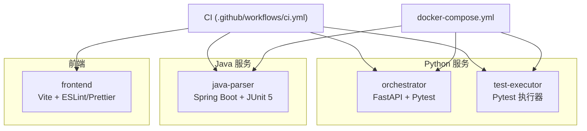
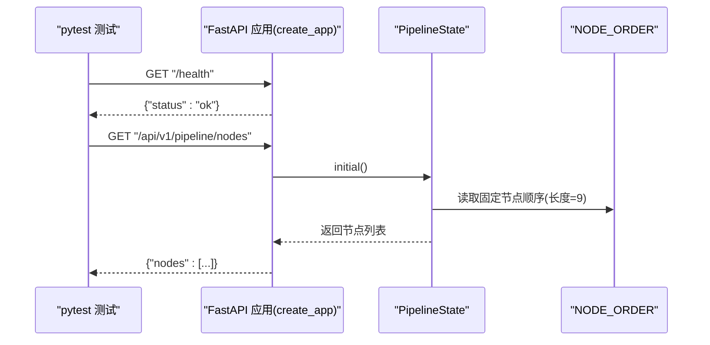
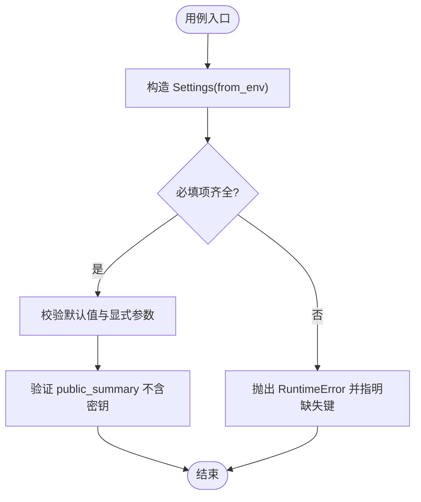
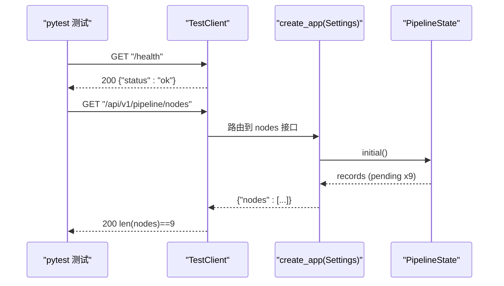
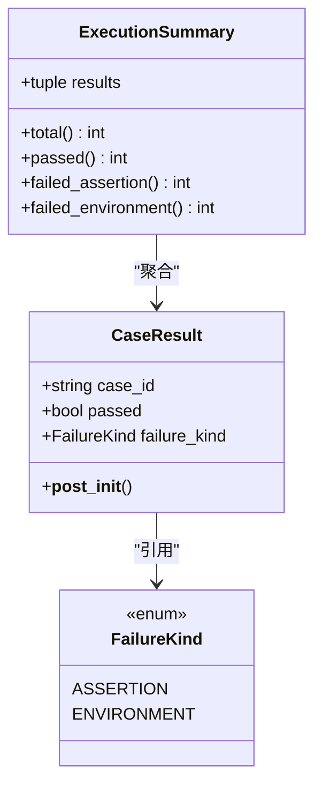
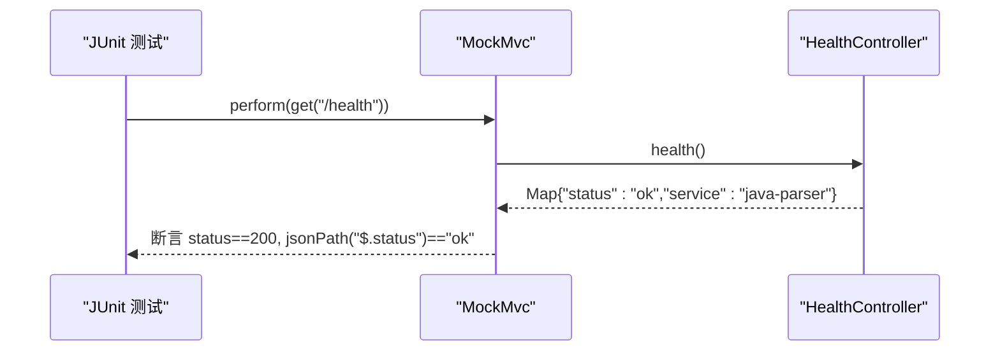
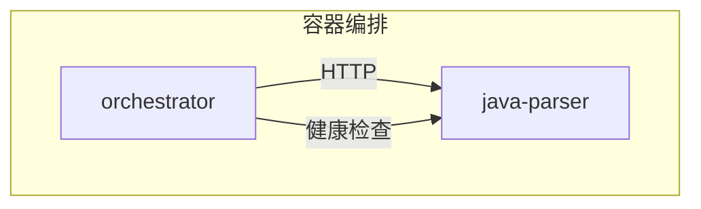
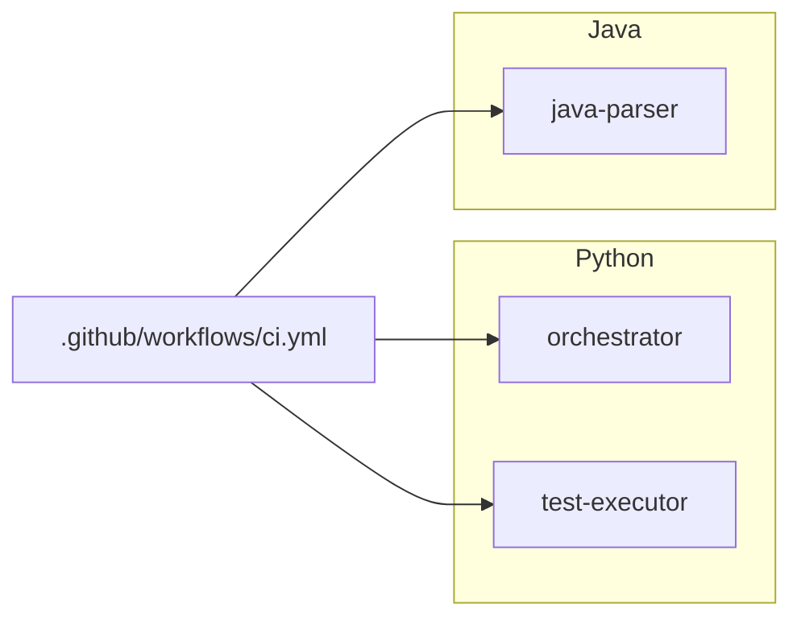

# 测试策略

<cite>
**本文引用的文件**
- [services/orchestrator/tests/test_config.py](file://services/orchestrator/tests/test_config.py)
- [services/orchestrator/tests/test_pipeline.py](file://services/orchestrator/tests/test_pipeline.py)
- [services/test-executor/tests/test_result.py](file://services/test-executor/tests/test_result.py)
- [services/java-parser/src/test/java/com/llmautotest/parser/HealthControllerTest.java](file://services/java-parser/src/test/java/com/llmautotest/parser/HealthControllerTest.java)
- [services/orchestrator/src/orchestrator/config.py](file://services/orchestrator/src/orchestrator/config.py)
- [services/orchestrator/src/orchestrator/pipeline.py](file://services/orchestrator/src/orchestrator/pipeline.py)
- [services/test-executor/src/executor/result.py](file://services/test-executor/src/executor/result.py)
- [services/java-parser/src/main/java/com/llmautotest/parser/HealthController.java](file://services/java-parser/src/main/java/com/llmautotest/parser/HealthController.java)
- [.github/workflows/ci.yml](file://.github/workflows/ci.yml)
- [services/orchestrator/pyproject.toml](file://services/orchestrator/pyproject.toml)
- [services/test-executor/pyproject.toml](file://services/test-executor/pyproject.toml)
- [services/java-parser/pom.xml](file://services/java-parser/pom.xml)
- [deploy/docker-compose.yml](file://deploy/docker-compose.yml)
- [docs/10_测试框架选型说明.md](file://docs/10_测试框架选型说明.md)
</cite>

## 目录
1. [简介](#简介)
2. [项目结构](#项目结构)
3. [核心组件](#核心组件)
4. [架构总览](#架构总览)
5. [详细组件分析](#详细组件分析)
6. [依赖关系分析](#依赖关系分析)
7. [性能与可维护性考量](#性能与可维护性考量)
8. [故障排查指南](#故障排查指南)
9. [结论](#结论)
10. [附录](#附录)

## 简介
本测试策略面向 LLM-AutoTest 多服务微服务架构，覆盖单元测试、集成测试与端到端测试的编写规范与实践。重点包括：
- 使用 pytest 作为 Python 侧统一测试框架（含异步支持），Java 侧使用 Spring Boot Test + JUnit 5。
- Mock 策略与外部依赖隔离原则，确保测试稳定、快速、可重复。
- 测试数据管理：通过环境变量注入配置、固定节点清单、结果二态分离等。
- 覆盖率要求：CI 中预留覆盖率门禁位点，建议逐步启用并设定阈值。
- 微服务间通信、异步处理与外部 API 调用的测试方法。
- 最佳实践与常见问题解决方案。

## 项目结构
本项目采用多服务 monorepo 组织，每个服务独立维护源码与测试：
- orchestrator：流水线编排服务，提供 REST API，驱动 9 个固定节点执行。
- test-executor：测试执行服务，负责加载 pytest 脚本、无人值守执行、结果汇总。
- java-parser：Java 服务，提供健康检查与接口还原能力。
- frontend：前端工程，构建与静态检查纳入 CI。
- CI：GitHub Actions 统一触发各语言栈的 lint、类型检查、测试与构建。

**图表来源**
- [.github/workflows/ci.yml:8-75](file://.github/workflows/ci.yml#L8-L75)
- [deploy/docker-compose.yml:45-61](file://deploy/docker-compose.yml#L45-L61)

**章节来源**
- [.github/workflows/ci.yml:8-75](file://.github/workflows/ci.yml#L8-L75)
- [deploy/docker-compose.yml:45-61](file://deploy/docker-compose.yml#L45-L61)

## 核心组件
- 配置与设置：orchestrator 的 Settings 从环境变量读取，禁止硬编码敏感信息，并提供不含密钥的公开摘要。
- 流水线状态：pipeline 定义 9 个固定节点顺序与四态标注，初始态全部 pending，自动化率程序化计算。
- 执行结果：test-executor 的结果模型区分“断言失败”和“环境失败”，用于通过率统计与报告生成。
- Java 健康检查：java-parser 暴露 /health 端点，供容器编排与健康探针使用。

**章节来源**
- [services/orchestrator/src/orchestrator/config.py:9-50](file://services/orchestrator/src/orchestrator/config.py#L9-L50)
- [services/orchestrator/src/orchestrator/pipeline.py:11-84](file://services/orchestrator/src/orchestrator/pipeline.py#L11-L84)
- [services/test-executor/src/executor/result.py:10-61](file://services/test-executor/src/executor/result.py#L10-L61)
- [services/java-parser/src/main/java/com/llmautotest/parser/HealthController.java:8-17](file://services/java-parser/src/main/java/com/llmautotest/parser/HealthController.java#L8-L17)

## 架构总览
下图展示 orchestrator 的 FastAPI 应用、测试客户端调用以及 pipeline 状态在测试中的交互流程。

**图表来源**
- [services/orchestrator/tests/test_pipeline.py:21-47](file://services/orchestrator/tests/test_pipeline.py#L21-L47)
- [services/orchestrator/src/orchestrator/pipeline.py:23-55](file://services/orchestrator/src/orchestrator/pipeline.py#L23-L55)

**章节来源**
- [services/orchestrator/tests/test_pipeline.py:21-47](file://services/orchestrator/tests/test_pipeline.py#L21-L47)
- [services/orchestrator/src/orchestrator/pipeline.py:23-55](file://services/orchestrator/src/orchestrator/pipeline.py#L23-L55)

## 详细组件分析

### 单元测试：配置与环境变量（orchestrator）
- 目标：验证 Settings.from_env 正确解析必填项、默认值与可选参数；public_summary 不泄露敏感信息。
- 要点：
  - 使用字典模拟环境变量，避免真实环境干扰。
  - 缺失必填项应抛出明确异常，便于定位配置问题。
  - 浮点数比较使用近似断言，避免精度问题。
- 推荐扩展：
  - 增加非法类型输入（如温度非数字）的异常路径测试。
  - 对端口、路径等边界值进行校验测试。

**图表来源**
- [services/orchestrator/tests/test_config.py:10-43](file://services/orchestrator/tests/test_config.py#L10-L43)
- [services/orchestrator/src/orchestrator/config.py:32-50](file://services/orchestrator/src/orchestrator/config.py#L32-L50)

**章节来源**
- [services/orchestrator/tests/test_config.py:10-43](file://services/orchestrator/tests/test_config.py#L10-L43)
- [services/orchestrator/src/orchestrator/config.py:32-50](file://services/orchestrator/src/orchestrator/config.py#L32-L50)

### 单元测试：流水线与 API（orchestrator）
- 目标：验证 9 节点固定清单不可增删；初始态全 pending；/health 与 /api/v1/pipeline/nodes 响应符合预期。
- 要点：
  - 使用 FastAPI TestClient 发起 HTTP 请求，无需启动真实服务器。
  - 节点数量断言为 9，体现 R-MTR-01 冻结口径。
  - 自动化率在骨架阶段返回 None，表示尚未实测。
- 推荐扩展：
  - 增加节点状态流转的集成测试（如运行中→完成）。
  - 对错误路径（未知节点名）添加 4xx 响应断言。

**图表来源**
- [services/orchestrator/tests/test_pipeline.py:21-47](file://services/orchestrator/tests/test_pipeline.py#L21-L47)
- [services/orchestrator/src/orchestrator/pipeline.py:45-71](file://services/orchestrator/src/orchestrator/pipeline.py#L45-L71)

**章节来源**
- [services/orchestrator/tests/test_pipeline.py:21-47](file://services/orchestrator/tests/test_pipeline.py#L21-L47)
- [services/orchestrator/src/orchestrator/pipeline.py:45-71](file://services/orchestrator/src/orchestrator/pipeline.py#L45-L71)

### 单元测试：执行结果二态（test-executor）
- 目标：验证 CaseResult 自洽性（通过用例不得携带失败类型）；ExecutionSummary 正确区分断言失败与环境失败。
- 要点：
  - 使用枚举 FailureKind 表达失败类别。
  - 汇总属性 total、passed、failed_assertion、failed_environment 分别计数。
- 推荐扩展：
  - 增加空结果集、大量用例的性能与内存占用测试。
  - 增加自定义失败类型的兼容性测试（若未来扩展）。

**图表来源**
- [services/test-executor/src/executor/result.py:10-61](file://services/test-executor/src/executor/result.py#L10-L61)
- [services/test-executor/tests/test_result.py:10-30](file://services/test-executor/tests/test_result.py#L10-L30)

**章节来源**
- [services/test-executor/tests/test_result.py:10-30](file://services/test-executor/tests/test_result.py#L10-L30)
- [services/test-executor/src/executor/result.py:10-61](file://services/test-executor/src/executor/result.py#L10-L61)

### 集成测试：Java 健康检查（java-parser）
- 目标：验证 /health 端点可用，返回 status=ok，满足 docker-compose 健康检查依赖。
- 要点：
  - 使用 @WebMvcTest 仅加载 Web 层，避免启动完整上下文。
  - 使用 MockMvc 发起请求并断言状态码与 JSON 字段。
- 推荐扩展：
  - 增加其他控制器或业务接口的集成测试。
  - 增加数据库/外部依赖的 Mock 场景。

**图表来源**
- [services/java-parser/src/test/java/com/llmautotest/parser/HealthControllerTest.java:14-25](file://services/java-parser/src/test/java/com/llmautotest/parser/HealthControllerTest.java#L14-L25)
- [services/java-parser/src/main/java/com/llmautotest/parser/HealthController.java:8-17](file://services/java-parser/src/main/java/com/llmautotest/parser/HealthController.java#L8-L17)

**章节来源**
- [services/java-parser/src/test/java/com/llmautotest/parser/HealthControllerTest.java:14-25](file://services/java-parser/src/test/java/com/llmautotest/parser/HealthControllerTest.java#L14-L25)
- [services/java-parser/src/main/java/com/llmautotest/parser/HealthController.java:8-17](file://services/java-parser/src/main/java/com/llmautotest/parser/HealthController.java#L8-L17)

### 端到端测试：编排与服务协同
- 目标：验证 orchestrator 与 java-parser 在容器编排下的健康检查与基本交互。
- 要点：
  - docker-compose 编排服务，java-parser 暴露 /health。
  - orchestrator 测试通过 TestClient 访问自身 API，间接依赖 pipeline 状态。
- 推荐扩展：
  - 使用 Testcontainers 启动真实依赖（如数据库、消息队列）进行更贴近生产的 E2E 测试。
  - 增加跨服务链路追踪与日志关联。

**图表来源**
- [deploy/docker-compose.yml:45-61](file://deploy/docker-compose.yml#L45-L61)
- [services/java-parser/src/main/java/com/llmautotest/parser/HealthController.java:8-17](file://services/java-parser/src/main/java/com/llmautotest/parser/HealthController.java#L8-L17)

**章节来源**
- [deploy/docker-compose.yml:45-61](file://deploy/docker-compose.yml#L45-L61)
- [services/java-parser/src/main/java/com/llmautotest/parser/HealthController.java:8-17](file://services/java-parser/src/main/java/com/llmautotest/parser/HealthController.java#L8-L17)

## 依赖关系分析
- Python 服务：
  - orchestrator：依赖 FastAPI、httpx、pydantic；开发依赖 pytest、pytest-asyncio、ruff、mypy。
  - test-executor：依赖 pydantic、httpx；开发依赖 pytest、ruff、mypy。
- Java 服务：
  - java-parser：基于 Spring Boot Starter Web，测试依赖 spring-boot-starter-test。
- CI：
  - Python：uv sync → ruff check/format → mypy → pytest。
  - Java：mvn verify（包含 checkstyle）。
  - Frontend：pnpm install → lint → build。

**图表来源**
- [.github/workflows/ci.yml:8-75](file://.github/workflows/ci.yml#L8-L75)
- [services/orchestrator/pyproject.toml:1-53](file://services/orchestrator/pyproject.toml#L1-L53)
- [services/test-executor/pyproject.toml:1-45](file://services/test-executor/pyproject.toml#L1-L45)
- [services/java-parser/pom.xml:31-47](file://services/java-parser/pom.xml#L31-L47)

**章节来源**
- [.github/workflows/ci.yml:8-75](file://.github/workflows/ci.yml#L8-L75)
- [services/orchestrator/pyproject.toml:1-53](file://services/orchestrator/pyproject.toml#L1-L53)
- [services/test-executor/pyproject.toml:1-45](file://services/test-executor/pyproject.toml#L1-L45)
- [services/java-parser/pom.xml:31-47](file://services/java-parser/pom.xml#L31-L47)

## 性能与可维护性考量
- 测试隔离：
  - 使用 TestClient 与 MockMvc 避免启动完整服务，提升速度。
  - 通过环境变量注入配置，避免污染全局状态。
- 稳定性：
  - 固定 9 节点清单，减少回归风险。
  - 结果二态分离，提高报告准确性。
- 可维护性：
  - 统一的 lint/format 与类型检查（ruff/mypy/checkstyle）。
  - CI 门禁保障代码质量。
- 覆盖率：
  - CI 已预留覆盖率命令位点，建议逐步启用并设定 ≥70% 阈值。
  - 优先覆盖关键路径：配置解析、流水线状态、结果汇总、健康检查。

[本节为通用指导，不直接分析具体文件]

## 故障排查指南
- 配置缺失：
  - 现象：Settings.from_env 抛出 RuntimeError，提示缺少必填环境变量。
  - 处理：检查 JAVA_PARSER_URL、LLM_BASE_URL、LLM_SEED 等是否配置。
- 健康检查失败：
  - 现象：/health 返回非 200 或 JSON 字段不符。
  - 处理：确认 java-parser 服务正常启动，docker-compose 编排正确。
- 节点数量不一致：
  - 现象：/api/v1/pipeline/nodes 返回节点数不为 9。
  - 处理：检查 NODE_ORDER 是否被修改，遵循 R-MTR-01 冻结口径。
- 结果二态异常：
  - 现象：CaseResult 通过但携带失败类型，抛出 ValueError。
  - 处理：修正用例结果构造逻辑，确保自洽。

**章节来源**
- [services/orchestrator/src/orchestrator/config.py:32-50](file://services/orchestrator/src/orchestrator/config.py#L32-L50)
- [services/java-parser/src/main/java/com/llmautotest/parser/HealthController.java:8-17](file://services/java-parser/src/main/java/com/llmautotest/parser/HealthController.java#L8-L17)
- [services/orchestrator/src/orchestrator/pipeline.py:23-35](file://services/orchestrator/src/orchestrator/pipeline.py#L23-L35)
- [services/test-executor/src/executor/result.py:25-30](file://services/test-executor/src/executor/result.py#L25-L30)

## 结论
本测试策略以 pytest 为核心，结合 FastAPI TestClient、MockMvc 与 Docker 编排，形成覆盖单元、集成与端到端的测试体系。通过固定节点清单、结果二态分离与环境变量配置，确保测试稳定、可重复且易于维护。建议在后续迭代中逐步引入覆盖率门禁与更贴近生产环境的 E2E 测试，进一步提升质量保障能力。

[本节为总结性内容，不直接分析具体文件]

## 附录

### 测试框架选型与执行引擎
- 选型结论：选定 pytest，理由包括 LLM 生成脚本的可加载性、五协议客户端集成、结构化结果导出、无人值守执行、失败二态区分与上手成本。
- 执行命令：pytest <脚本目录> -q --json-report --json-report-file=execution_raw.json。
- 可加载性校验：生成完成前置：python -m py_compile + pytest 收集阶段零 error。
- 二态标注：自定义 pytest plugin，断言失败默认 assertion；网络/连接类异常映射 environment。
- 汇总：test-executor 从 raw report 程序化汇总为 execution.json。

**章节来源**
- [docs/10_测试框架选型说明.md:10-53](file://docs/10_测试框架选型说明.md#L10-L53)

### CI 与覆盖率门禁
- Python：ruff check/format → mypy → pytest。
- Java：mvn verify（含 checkstyle）。
- 覆盖率：CI 已预留覆盖率命令位点，建议逐步启用并设定阈值。

**章节来源**
- [.github/workflows/ci.yml:18-44](file://.github/workflows/ci.yml#L18-L44)