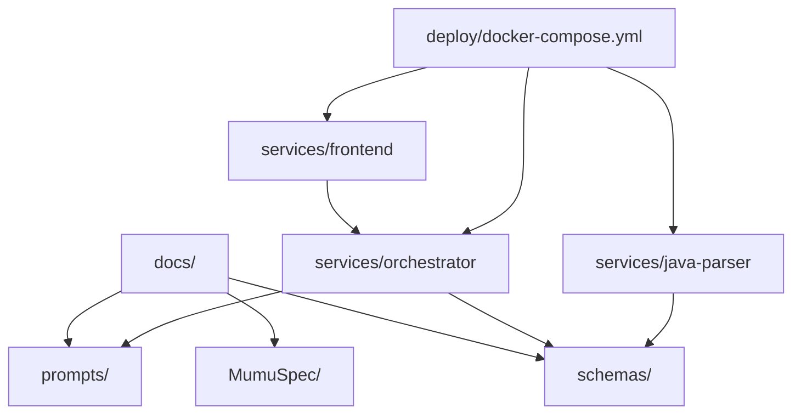
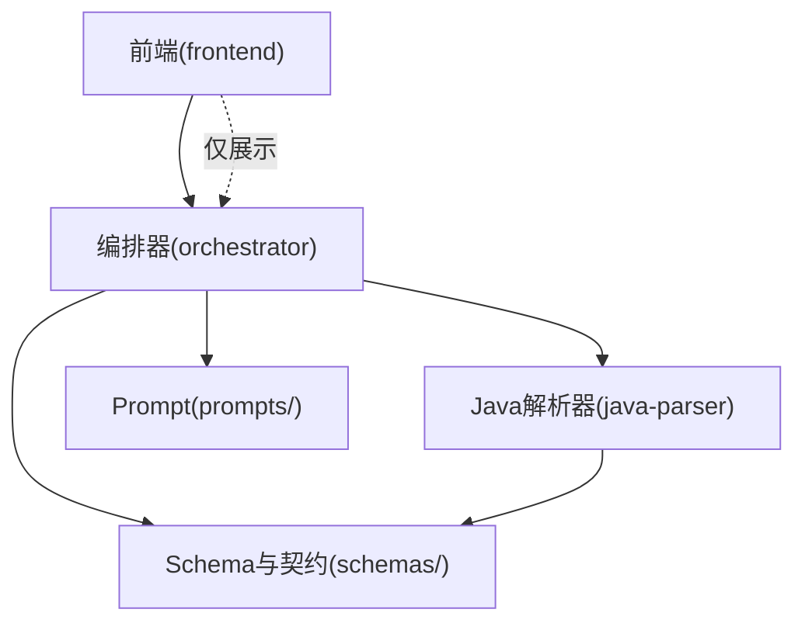
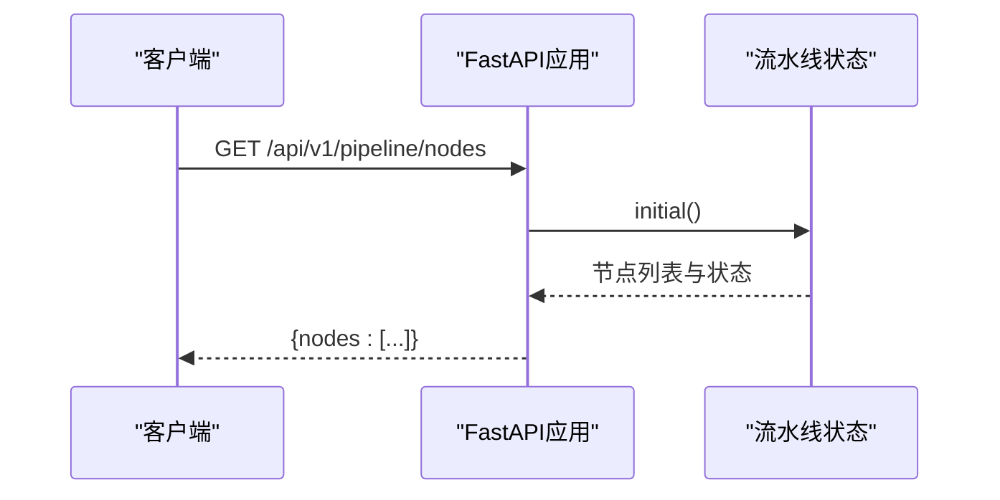
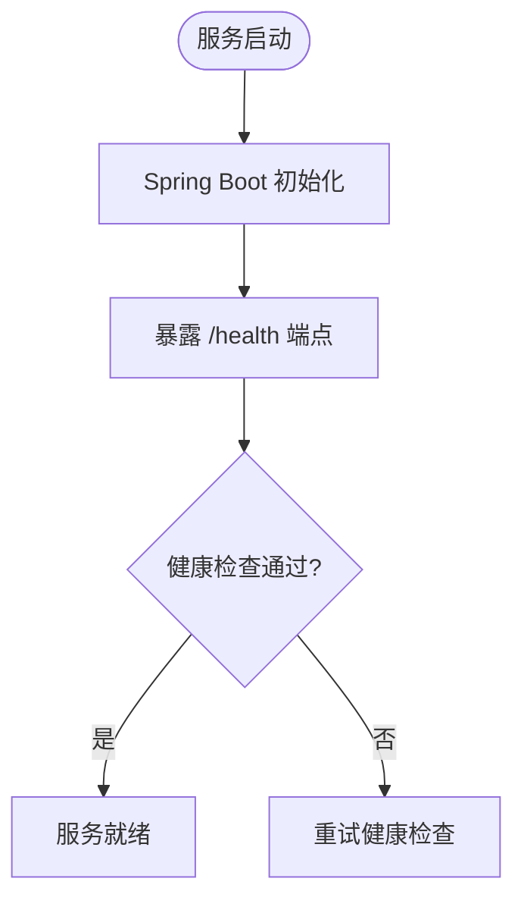
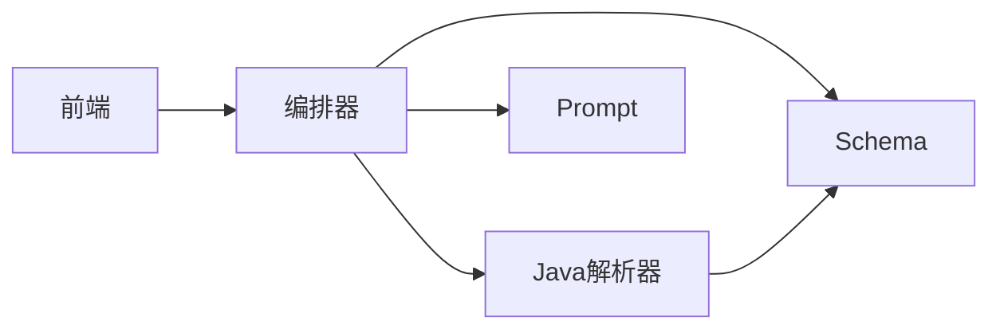

# 规范文档框架

<cite>
**本文引用的文件**
- [01-Spec写作总则与文档编号索引.md](file://MumuSpec/01-Spec写作总则与文档编号索引.md)
- [09_开发规范说明.md](file://docs/09_开发规范说明.md)
- [__main__.py](file://services/orchestrator/src/orchestrator/__main__.py)
- [api.py](file://services/orchestrator/src/orchestrator/api.py)
- [pipeline.py](file://services/orchestrator/src/orchestrator/pipeline.py)
- [ParserApplication.java](file://services/java-parser/src/main/java/com/llmautotest/parser/ParserApplication.java)
- [HealthController.java](file://services/java-parser/src/main/java/com/llmautotest/parser/HealthController.java)
- [docker-compose.yml](file://deploy/docker-compose.yml)
- [package.json](file://services/frontend/package.json)
- [schemas/README.md](file://schemas/README.md)
- [prompts/README.md](file://prompts/README.md)
</cite>

## 目录
1. [简介](#简介)
2. [项目结构](#项目结构)
3. [核心组件](#核心组件)
4. [架构总览](#架构总览)
5. [详细组件分析](#详细组件分析)
6. [依赖关系分析](#依赖关系分析)
7. [性能考虑](#性能考虑)
8. [故障排查指南](#故障排查指南)
9. [结论](#结论)
10. [附录](#附录)

## 简介
本规范文档框架面向 LLM-AutoTest 项目的“需求规格（Spec）”与“工程实施规范”双主线，目标是：
- 将 MumuSpec 的 14 篇文档体系与现有 docs/、schemas/、prompts/ 对齐，形成可执行、可追溯、可门禁的规范基线。
- 明确 orchestrator、java-parser、frontend 三栈的职责边界、契约与实现要点。
- 以 schemas/ 为结构化产物的单一事实来源，以 prompts/ 为 LLM Prompt 的唯一存放地，确保 LLM 输出可校验、可审计。
- 通过 docker-compose 编排统一启动顺序与健康检查，保障服务间依赖与产物卷一致。

该框架既服务于产品与测试团队的需求治理，也服务于研发团队的编码、构建、部署与质量门禁。

## 项目结构
仓库采用 Monorepo 组织，按“服务 + 规范 + 契约 + 模板”分层：
- docs/：需求与规范文档（含 Spec 模板与样例）
- MumuSpec/：MumuSpec 14 篇文档集合（当前已落地 01 等）
- services/：后端与前端服务（orchestrator、java-parser、test-executor、frontend）
- schemas/：结构化产物 JSON Schema 与服务间契约
- prompts/：LLM Prompt 版本化存放
- deploy/：容器编排与镜像定义
- .rules/：AI 规则与代码风格约束（由开发规范说明引用）

图表来源
- [docker-compose.yml:1-62](file://deploy/docker-compose.yml#L1-L62)
- [schemas/README.md:1-30](file://schemas/README.md#L1-L30)
- [prompts/README.md:1-15](file://prompts/README.md#L1-L15)

章节来源
- [09_开发规范说明.md:21-35](file://docs/09_开发规范说明.md#L21-L35)
- [docker-compose.yml:1-62](file://deploy/docker-compose.yml#L1-L62)

## 核心组件
- 编排器（orchestrator）
  - 职责：提供 REST API、维护 9 节点流水线状态、健康检查、与 java-parser 协作。
  - 关键入口：CLI 启动与 FastAPI 应用创建；节点清单与状态查询。
- Java 解析器（java-parser）
  - 职责：多仓库扫描与接口逆向还原；对外暴露健康检查端点。
  - 关键入口：Spring Boot 应用主类；健康控制器。
- 前端（frontend）
  - 职责：任务配置、监控、报告展示；严格使用后端返回数值，不做本地计算。
  - 关键约定：Vue 3 + TypeScript + Vite；脚本命令与依赖在 package.json 中声明。
- 结构化产物与契约（schemas/）
  - 职责：JSON Schema 定义、跨人公共语言、服务间契约；所有 LLM 输出必须经 Schema 校验。
- Prompt 管理（prompts/）
  - 职责：Prompt 版本化存储与元信息；禁止内联到代码。

章节来源
- [__main__.py:1-26](file://services/orchestrator/src/orchestrator/__main__.py#L1-L26)
- [api.py:1-28](file://services/orchestrator/src/orchestrator/api.py#L1-L28)
- [pipeline.py:1-84](file://services/orchestrator/src/orchestrator/pipeline.py#L1-L84)
- [ParserApplication.java:1-17](file://services/java-parser/src/main/java/com/llmautotest/parser/ParserApplication.java#L1-L17)
- [HealthController.java:1-18](file://services/java-parser/src/main/java/com/llmautotest/parser/HealthController.java#L1-L18)
- [package.json:1-30](file://services/frontend/package.json#L1-L30)
- [schemas/README.md:1-30](file://schemas/README.md#L1-L30)
- [prompts/README.md:1-15](file://prompts/README.md#L1-L15)

## 架构总览
系统由 orchestrator 作为编排中枢，调用 java-parser 进行接口还原，前端消费 orchestrator 提供的 API 进行可视化与操作。所有结构化产物通过 schemas/ 统一管理，Prompt 通过 prompts/ 版本化管理。

图表来源
- [api.py:11-27](file://services/orchestrator/src/orchestrator/api.py#L11-L27)
- [PipelineState:23-34](file://services/orchestrator/src/orchestrator/pipeline.py#L23-L34)
- [ParserApplication.java:8-16](file://services/java-parser/src/main/java/com/llmautotest/parser/ParserApplication.java#L8-L16)
- [schemas/README.md:5-10](file://schemas/README.md#L5-L10)
- [prompts/README.md:5-10](file://prompts/README.md#L5-L10)

## 详细组件分析

### 编排器（orchestrator）
- 启动流程
  - CLI 入口加载配置并启动 FastAPI 应用；端口与日志级别由配置决定。
- API 层
  - /health：健康检查，供编排器依赖检测。
  - /api/v1/pipeline/nodes：返回 9 节点清单与当前状态，用于前端展示与度量汇总。
- 流水线状态
  - 固定 9 节点顺序，四态标注（completed/manual_intervention/running/pending）。
  - 自动化率 = 已完成节点数 / 9，程序化汇总，不经过 LLM。

图表来源
- [__main__.py:15-21](file://services/orchestrator/src/orchestrator/__main__.py#L15-L21)
- [api.py:11-27](file://services/orchestrator/src/orchestrator/api.py#L11-L27)
- [pipeline.py:23-70](file://services/orchestrator/src/orchestrator/pipeline.py#L23-L70)

章节来源
- [__main__.py:1-26](file://services/orchestrator/src/orchestrator/__main__.py#L1-L26)
- [api.py:1-28](file://services/orchestrator/src/orchestrator/api.py#L1-L28)
- [pipeline.py:1-84](file://services/orchestrator/src/orchestrator/pipeline.py#L1-L84)

### Java 解析器（java-parser）
- 启动流程
  - Spring Boot 应用主类负责启动与属性扫描。
- 健康检查
  - /health 返回服务名与状态，供编排器健康检测。

图表来源
- [ParserApplication.java:8-16](file://services/java-parser/src/main/java/com/llmautotest/parser/ParserApplication.java#L8-L16)
- [HealthController.java:8-16](file://services/java-parser/src/main/java/com/llmautotest/parser/HealthController.java#L8-L16)

章节来源
- [ParserApplication.java:1-17](file://services/java-parser/src/main/java/com/llmautotest/parser/ParserApplication.java#L1-L17)
- [HealthController.java:1-18](file://services/java-parser/src/main/java/com/llmautotest/parser/HealthController.java#L1-L18)

### 前端（frontend）
- 技术栈与脚本
  - Vue 3 + TypeScript + Vite；脚本包含 dev/build/lint/test。
- 数据口径
  - 界面数值一律来自后端 API 的程序化汇总结果，前端不做任何数值计算或估算。

章节来源
- [package.json:1-30](file://services/frontend/package.json#L1-L30)
- [09_开发规范说明.md:64-71](file://docs/09_开发规范说明.md#L64-L71)

### 结构化产物与契约（schemas/）
- 单一事实来源
  - 每个 Schema 含 schema_version；结构变更必须升版本。
  - orchestrator/test-executor 的 pydantic 模型与 Schema 一一对应；java-parser 返回结构与 contracts/ 契约对齐。
- 横切约定
  - ID 命名、时间戳格式、协议枚举、错误结构等统一。
- Prompt 与 Schema 的关系
  - Prompt 要求 LLM 输出的结构必须在 schemas/ 有对应 Schema；校验失败按节点失败处理。

章节来源
- [schemas/README.md:1-30](file://schemas/README.md#L1-L30)
- [prompts/README.md:5-15](file://prompts/README.md#L5-L15)

### Prompt 管理（prompts/）
- 版本化存放
  - 文件名遵循 <节点>-<用途>-v<版本>.md；头部包含元信息与变更记录。
- 红线约束
  - 禁止在代码中内联 Prompt 字符串；变更必须升版本号。

章节来源
- [prompts/README.md:1-15](file://prompts/README.md#L1-L15)

## 依赖关系分析
- 服务间依赖
  - orchestrator 依赖 java-parser 的健康检查；frontend 依赖 orchestrator。
- 产物与契约
  - 所有结构化产物通过 schemas/ 管理；LLM 输出需经 Schema 校验。
- Prompt 与实现
  - 各节点通过 prompts/ 加载 Prompt，并按 Schema 校验输出。

图表来源
- [docker-compose.yml:18-41](file://deploy/docker-compose.yml#L18-L41)
- [schemas/README.md:5-10](file://schemas/README.md#L5-L10)
- [prompts/README.md:5-10](file://prompts/README.md#L5-L10)

章节来源
- [docker-compose.yml:1-62](file://deploy/docker-compose.yml#L1-L62)
- [schemas/README.md:1-30](file://schemas/README.md#L1-L30)
- [prompts/README.md:1-15](file://prompts/README.md#L1-L15)

## 性能考虑
- 流水线节点固定为 9 个，分母稳定，便于度量与对比。
- 自动化率由程序化汇总产生，避免 LLM 引入的不确定性。
- 健康检查与编排顺序确保服务启动稳定性，减少冷启动失败对整体吞吐的影响。
- 产物卷挂载路径统一，便于并行读取与备份策略优化。

[本节为通用指导，无需特定文件来源]

## 故障排查指南
- 健康检查失败
  - 检查 orchestrator 与 java-parser 的 /health 端点是否可达。
  - 确认 docker-compose 编排顺序与健康检查配置。
- 流水线状态异常
  - 查看 pipeline 节点状态是否为四态之一；未完成的节点需定位原因并重试。
- 产物校验失败
  - 确认 LLM 输出是否符合 schemas/ 对应 Schema；失败按节点失败处理，不走降级截取。
- Prompt 问题
  - 确认 Prompt 文件版本与元信息完整；变更需升版本并在文件内追加变更记录。

章节来源
- [api.py:16-19](file://services/orchestrator/src/orchestrator/api.py#L16-L19)
- [HealthController.java:12-16](file://services/java-parser/src/main/java/com/llmautotest/parser/HealthController.java#L12-L16)
- [pipeline.py:11-20](file://services/orchestrator/src/orchestrator/pipeline.py#L11-L20)
- [schemas/README.md:5-10](file://schemas/README.md#L5-L10)
- [prompts/README.md:5-10](file://prompts/README.md#L5-L10)

## 结论
本规范文档框架以 MumuSpec 为核心，结合现有 docs/、schemas/、prompts/ 与三栈服务实现，形成从需求到实现、从契约到产物的闭环。通过固定流水线口径、统一 Schema 与 Prompt 管理、以及严格的编排与健康检查，确保项目在演进过程中具备可追溯、可验证、可扩展的能力。后续可将 MumuSpec 的 14 篇文档逐步补齐，并与 .rules/ 中的 AI 规则联动，进一步提升自动化与质量门禁水平。

[本节为总结性内容，无需特定文件来源]

## 附录
- 写作铁律与顺序
  - PRD 不写 SQL、API 不写像素、契约真源、不混层、写作顺序 R1→R2→R3→R4。
- 编号规则
  - REQ/US/API/TC 编号格式统一，便于追踪矩阵建立。
- 14 篇文档索引
  - 明确每篇文档的阶段与作用，支撑全生命周期治理。

章节来源
- [01-Spec写作总则与文档编号索引.md:29-63](file://MumuSpec/01-Spec写作总则与文档编号索引.md#L29-L63)
- [01-Spec写作总则与文档编号索引.md:80-89](file://MumuSpec/01-Spec写作总则与文档编号索引.md#L80-L89)