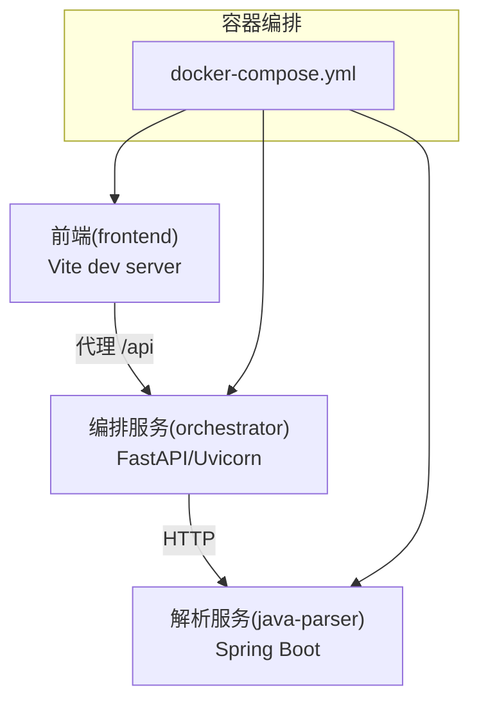
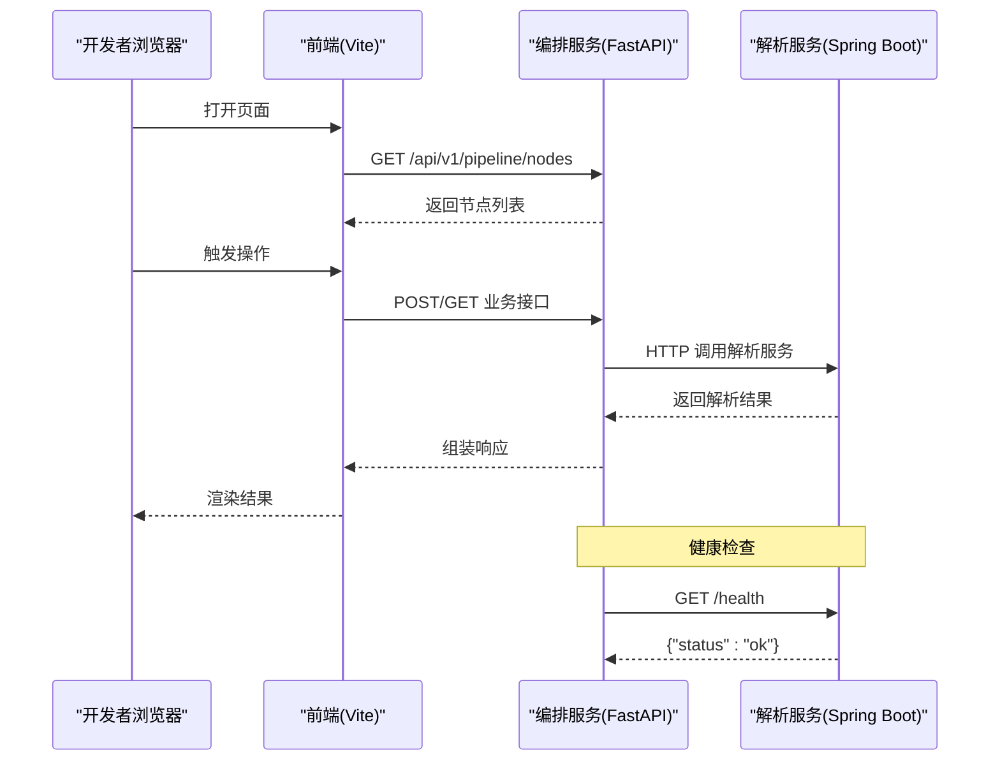
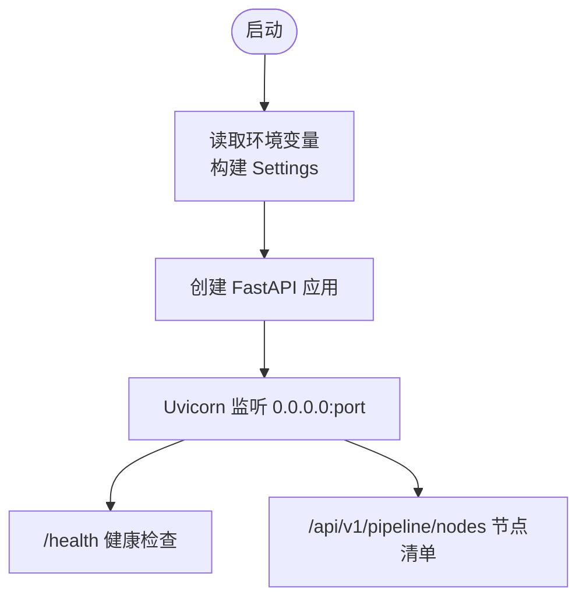
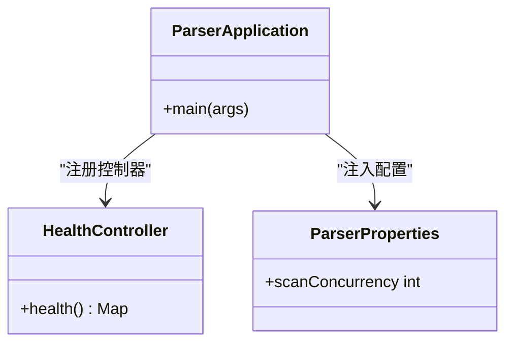
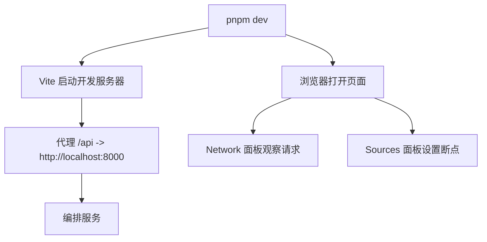
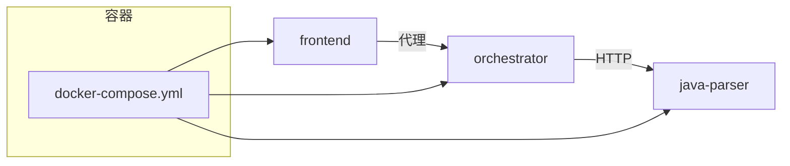

# 调试指南

<cite>
**本文引用的文件**
- [services/orchestrator/src/orchestrator/__main__.py](file://services/orchestrator/src/orchestrator/__main__.py)
- [services/orchestrator/src/orchestrator/api.py](file://services/orchestrator/src/orchestrator/api.py)
- [services/orchestrator/src/orchestrator/config.py](file://services/orchestrator/src/orchestrator/config.py)
- [services/orchestrator/pyproject.toml](file://services/orchestrator/pyproject.toml)
- [services/orchestrator/Dockerfile](file://services/orchestrator/Dockerfile)
- [services/java-parser/src/main/java/com/llmautotest/parser/ParserApplication.java](file://services/java-parser/src/main/java/com/llmautotest/parser/ParserApplication.java)
- [services/java-parser/src/main/java/com/llmautotest/parser/HealthController.java](file://services/java-parser/src/main/java/com/llmautotest/parser/HealthController.java)
- [services/java-parser/src/main/resources/application.yml](file://services/java-parser/src/main/resources/application.yml)
- [services/java-parser/pom.xml](file://services/java-parser/pom.xml)
- [services/java-parser/Dockerfile](file://services/java-parser/Dockerfile)
- [services/frontend/src/main.ts](file://services/frontend/src/main.ts)
- [services/frontend/package.json](file://services/frontend/package.json)
- [services/frontend/vite.config.ts](file://services/frontend/vite.config.ts)
- [services/frontend/Dockerfile](file://services/frontend/Dockerfile)
- [deploy/docker-compose.yml](file://deploy/docker-compose.yml)
</cite>

## 目录
1. [简介](#简介)
2. [项目结构](#项目结构)
3. [核心组件](#核心组件)
4. [架构总览](#架构总览)
5. [详细组件分析](#详细组件分析)
6. [依赖关系分析](#依赖关系分析)
7. [性能考虑](#性能考虑)
8. [故障排查指南](#故障排查指南)
9. [结论](#结论)
10. [附录](#附录)

## 简介
本调试指南面向 LLM-AutoTest 项目的多语言服务（Python 编排服务、Java 解析服务、前端应用），提供本地与容器环境下的断点调试、远程调试、浏览器调试方法；同时给出日志分析方法、性能监控工具使用建议、常见错误排查与优化技巧，并总结调试工具与配置的最佳实践。

## 项目结构
本项目由三个主要服务组成：
- Python 编排服务（orchestrator）：基于 FastAPI + Uvicorn，负责流水线编排与对外 REST API。
- Java 解析服务（java-parser）：基于 Spring Boot，负责代码扫描与接口逆向还原。
- 前端应用（frontend）：Vue 3 + Vite，开发期通过代理转发到 orchestrator。

图表来源
- [deploy/docker-compose.yml:1-62](file://deploy/docker-compose.yml#L1-L62)
- [services/frontend/vite.config.ts:1-16](file://services/frontend/vite.config.ts#L1-L16)
- [services/orchestrator/src/orchestrator/__main__.py:15-21](file://services/orchestrator/src/orchestrator/__main__.py#L15-L21)
- [services/java-parser/src/main/java/com/llmautotest/parser/ParserApplication.java:13-15](file://services/java-parser/src/main/java/com/llmautotest/parser/ParserApplication.java#L13-L15)

章节来源
- [deploy/docker-compose.yml:1-62](file://deploy/docker-compose.yml#L1-L62)
- [services/frontend/vite.config.ts:1-16](file://services/frontend/vite.config.ts#L1-L16)
- [services/orchestrator/src/orchestrator/__main__.py:15-21](file://services/orchestrator/src/orchestrator/__main__.py#L15-L21)
- [services/java-parser/src/main/java/com/llmautotest/parser/ParserApplication.java:13-15](file://services/java-parser/src/main/java/com/llmautotest/parser/ParserApplication.java#L13-L15)

## 核心组件
- 编排服务（orchestrator）
  - 入口：通过命令行启动 Uvicorn 并加载 FastAPI 应用。
  - 配置：从环境变量读取端口、下游服务地址、产物路径与 LLM 调用参数。
  - API：提供健康检查与节点清单等端点。
- 解析服务（java-parser）
  - 入口：Spring Boot 应用主类。
  - 配置：application.yml 中定义服务端口与解析并发度。
  - 健康检查：暴露 /health 供编排器探测。
- 前端（frontend）
  - 开发服务器：Vite 默认端口，开发时代理 /api 到 orchestrator。
  - 构建：生产镜像占位（待正式构建流程启用）。

章节来源
- [services/orchestrator/src/orchestrator/__main__.py:15-21](file://services/orchestrator/src/orchestrator/__main__.py#L15-L21)
- [services/orchestrator/src/orchestrator/config.py:9-49](file://services/orchestrator/src/orchestrator/config.py#L9-L49)
- [services/orchestrator/src/orchestrator/api.py:11-27](file://services/orchestrator/src/orchestrator/api.py#L11-L27)
- [services/java-parser/src/main/java/com/llmautotest/parser/ParserApplication.java:13-15](file://services/java-parser/src/main/java/com/llmautotest/parser/ParserApplication.java#L13-L15)
- [services/java-parser/src/main/resources/application.yml:1-8](file://services/java-parser/src/main/resources/application.yml#L1-L8)
- [services/java-parser/src/main/java/com/llmautotest/parser/HealthController.java:12-16](file://services/java-parser/src/main/java/com/llmautotest/parser/HealthController.java#L12-L16)
- [services/frontend/vite.config.ts:4-15](file://services/frontend/vite.config.ts#L4-L15)

## 架构总览
下图展示请求在前后端的流转路径与健康检查链路，便于定位问题发生在哪个环节。

图表来源
- [services/frontend/vite.config.ts:4-15](file://services/frontend/vite.config.ts#L4-L15)
- [services/orchestrator/src/orchestrator/api.py:16-25](file://services/orchestrator/src/orchestrator/api.py#L16-L25)
- [services/java-parser/src/main/java/com/llmautotest/parser/HealthController.java:12-16](file://services/java-parser/src/main/java/com/llmautotest/parser/HealthController.java#L12-L16)

## 详细组件分析

### Python 编排服务（orchestrator）调试
- 本地运行与断点调试
  - 直接运行模块入口以启动 Uvicorn 服务，可在 IDE 中设置断点调试 FastAPI 路由与业务逻辑。
  - 关键入口：命令行启动函数会创建应用实例并绑定 host/port。
  - 配置项：端口、下游解析服务地址、产物根目录、LLM 相关参数均从环境变量读取；缺失必填项将抛出运行时异常。
  - 健康检查：/health 用于编排器健康探测。
- 容器内调试
  - 镜像暴露 8000 端口，CMD 通过 uv run 执行模块入口。
  - 建议在 docker-compose 中映射端口并在 IDE 中附加进程进行调试。
- 常用命令
  - 本地运行：python -m orchestrator
  - 单元测试：pytest
  - 代码质量：ruff、mypy（见 pyproject 配置）

图表来源
- [services/orchestrator/src/orchestrator/__main__.py:15-21](file://services/orchestrator/src/orchestrator/__main__.py#L15-L21)
- [services/orchestrator/src/orchestrator/config.py:32-49](file://services/orchestrator/src/orchestrator/config.py#L32-L49)
- [services/orchestrator/src/orchestrator/api.py:16-25](file://services/orchestrator/src/orchestrator/api.py#L16-L25)
- [services/orchestrator/Dockerfile:13-15](file://services/orchestrator/Dockerfile#L13-L15)

章节来源
- [services/orchestrator/src/orchestrator/__main__.py:15-21](file://services/orchestrator/src/orchestrator/__main__.py#L15-L21)
- [services/orchestrator/src/orchestrator/config.py:9-49](file://services/orchestrator/src/orchestrator/config.py#L9-L49)
- [services/orchestrator/src/orchestrator/api.py:11-27](file://services/orchestrator/src/orchestrator/api.py#L11-L27)
- [services/orchestrator/pyproject.toml:1-53](file://services/orchestrator/pyproject.toml#L1-L53)
- [services/orchestrator/Dockerfile:1-16](file://services/orchestrator/Dockerfile#L1-L16)

### Java 解析服务（java-parser）调试
- 本地运行与远程调试
  - 入口为 Spring Boot 主类，可通过 Maven 插件或 IDE 直接运行。
  - 远程调试：在 JVM 启动参数中添加调试端口（如 -agentlib:jdwp=...），IDE 中配置远程调试连接该端口。
  - 配置：application.yml 定义服务端口与解析并发度；ParserProperties 校验并发度必须为正数。
  - 健康检查：/health 返回服务标识与健康状态。
- 容器内调试
  - 镜像基于 JRE 运行打包的 jar，暴露 8080 端口。
  - 可在 docker-compose 中映射端口并通过 IDE 附加进程调试。

图表来源
- [services/java-parser/src/main/java/com/llmautotest/parser/ParserApplication.java:13-15](file://services/java-parser/src/main/java/com/llmautotest/parser/ParserApplication.java#L13-L15)
- [services/java-parser/src/main/java/com/llmautotest/parser/HealthController.java:12-16](file://services/java-parser/src/main/java/com/llmautotest/parser/HealthController.java#L12-L16)
- [services/java-parser/src/main/java/com/llmautotest/parser/ParserProperties.java:7-15](file://services/java-parser/src/main/java/com/llmautotest/parser/ParserProperties.java#L7-L15)

章节来源
- [services/java-parser/src/main/java/com/llmautotest/parser/ParserApplication.java:13-15](file://services/java-parser/src/main/java/com/llmautotest/parser/ParserApplication.java#L13-L15)
- [services/java-parser/src/main/java/com/llmautotest/parser/HealthController.java:12-16](file://services/java-parser/src/main/java/com/llmautotest/parser/HealthController.java#L12-L16)
- [services/java-parser/src/main/resources/application.yml:1-8](file://services/java-parser/src/main/resources/application.yml#L1-L8)
- [services/java-parser/pom.xml:31-47](file://services/java-parser/pom.xml#L31-L47)
- [services/java-parser/Dockerfile:10-20](file://services/java-parser/Dockerfile#L10-L20)

### 前端应用（frontend）调试
- 本地开发与断点调试
  - 使用 Vite 开发服务器，默认开启热重载。
  - 开发期通过 vite.config.ts 中的代理将 /api 请求转发到 orchestrator（localhost:8000）。
  - 在浏览器开发者工具的 Sources 面板设置断点，Network 面板查看请求与响应。
- 测试与构建
  - 脚本：dev/build/lint/test（package.json）。
  - 生产镜像当前为占位 nginx，待正式构建流程启用。

图表来源
- [services/frontend/package.json:8-12](file://services/frontend/package.json#L8-L12)
- [services/frontend/vite.config.ts:4-15](file://services/frontend/vite.config.ts#L4-L15)
- [services/frontend/src/main.ts:1-5](file://services/frontend/src/main.ts#L1-L5)

章节来源
- [services/frontend/package.json:1-29](file://services/frontend/package.json#L1-L29)
- [services/frontend/vite.config.ts:1-16](file://services/frontend/vite.config.ts#L1-L16)
- [services/frontend/src/main.ts:1-5](file://services/frontend/src/main.ts#L1-L5)
- [services/frontend/Dockerfile:1-13](file://services/frontend/Dockerfile#L1-L13)

## 依赖关系分析
- 前端依赖 Vite、Vue 生态，开发期通过代理访问后端。
- 编排服务依赖 FastAPI、Uvicorn、Pydantic、httpx、jsonschema。
- 解析服务依赖 Spring Boot Web 与 JavaParser 符号求解器。
- 容器编排通过 docker-compose 串联各服务，并共享 artifacts 卷。

图表来源
- [services/frontend/vite.config.ts:4-15](file://services/frontend/vite.config.ts#L4-L15)
- [services/orchestrator/pyproject.toml:6-12](file://services/orchestrator/pyproject.toml#L6-L12)
- [services/java-parser/pom.xml:31-47](file://services/java-parser/pom.xml#L31-L47)
- [deploy/docker-compose.yml:1-62](file://deploy/docker-compose.yml#L1-L62)

章节来源
- [services/orchestrator/pyproject.toml:1-53](file://services/orchestrator/pyproject.toml#L1-L53)
- [services/java-parser/pom.xml:1-83](file://services/java-parser/pom.xml#L1-L83)
- [deploy/docker-compose.yml:1-62](file://deploy/docker-compose.yml#L1-L62)

## 性能考虑
- 解析并发度：java-parser 的 scan-concurrency 可调节，避免过高导致资源争用。
- 网络开销：减少不必要的跨服务调用，合理缓存中间结果。
- 日志级别：生产环境降低日志级别，避免 I/O 瓶颈。
- 容器资源：为各服务设置合理的 CPU/内存限制，防止 OOM。
- 健康检查间隔：根据服务负载调整 healthcheck 的 interval/timeout/retries。

[本节为通用指导，不直接分析具体文件]

## 故障排查指南
- 启动失败
  - Python 服务：检查必填环境变量是否齐全；缺失将抛出运行时异常。
  - Java 服务：检查 application.yml 端口占用与解析并发度是否为正数。
  - 前端：确认 vite.config.ts 代理目标可达。
- 健康检查失败
  - 编排服务：访问 /health 验证返回状态。
  - 解析服务：访问 /health 验证服务标识与健康状态。
- 请求不通
  - 前端代理：确认 /api 被正确转发到 orchestrator。
  - 编排服务：确认 JAVA_PARSER_URL 指向正确的 java-parser 地址。
- 日志分析
  - Python：使用 logging 统一输出，按任务 ID 归档，便于追踪。
  - Java：使用 SLF4J 输出结构化日志，结合任务上下文。
- 常见错误
  - 环境变量缺失：显式报错，补齐后重启。
  - 端口冲突：修改端口或释放占用。
  - 网络不可达：检查容器网络与端口映射。

章节来源
- [services/orchestrator/src/orchestrator/config.py:32-49](file://services/orchestrator/src/orchestrator/config.py#L32-L49)
- [services/java-parser/src/main/resources/application.yml:1-8](file://services/java-parser/src/main/resources/application.yml#L1-L8)
- [services/java-parser/src/main/java/com/llmautotest/parser/HealthController.java:12-16](file://services/java-parser/src/main/java/com/llmautotest/parser/HealthController.java#L12-L16)
- [services/orchestrator/src/orchestrator/api.py:16-19](file://services/orchestrator/src/orchestrator/api.py#L16-L19)
- [services/frontend/vite.config.ts:4-15](file://services/frontend/vite.config.ts#L4-L15)

## 结论
通过上述调试方法与实践，可以快速定位并解决 LLM-AutoTest 项目在本地与容器环境中的常见问题。建议结合日志规范、健康检查与性能调优，形成稳定的开发与排障流程。

## 附录
- 调试工具与最佳实践
  - Python：使用 IDE 断点调试 Uvicorn 进程；通过 pytest 快速验证单元逻辑；使用 ruff/mypy 保障代码质量。
  - Java：使用 Spring Boot 插件或 IDE 运行；配置 JDWP 进行远程调试；利用 checkstyle 保证代码风格。
  - 前端：使用 Vite 热重载与浏览器开发者工具；通过代理集中调试后端接口。
  - 容器：使用 docker-compose 一键拉起服务；通过端口映射与卷挂载实现持久化与调试。
  - 日志：统一日志格式与级别；按任务 ID 归档；避免在生产环境输出敏感信息。
  - 性能：合理设置并发度与资源限制；关注健康检查与慢查询；定期评估瓶颈。

[本节为通用指导，不直接分析具体文件]