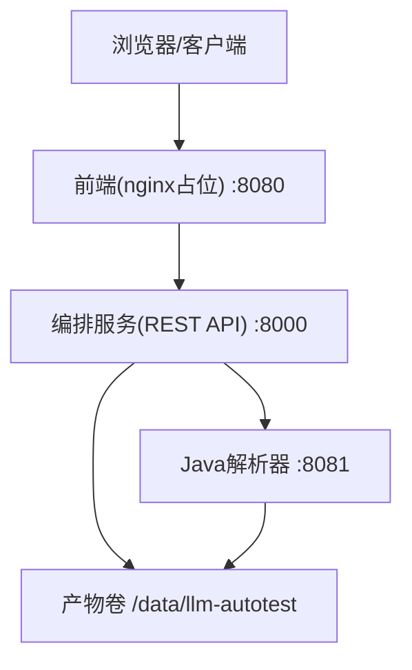
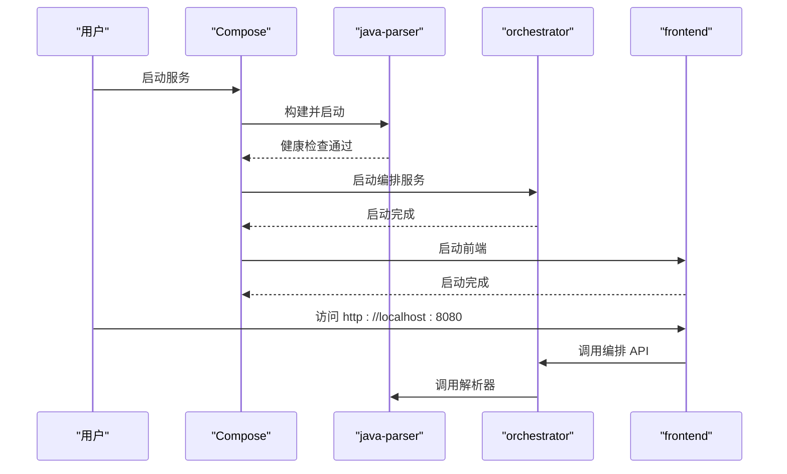

# 快速开始

<cite>
**本文引用的文件**
- [deploy/docker-compose.yml](file://deploy/docker-compose.yml)
- [services/orchestrator/src/orchestrator/config.py](file://services/orchestrator/src/orchestrator/config.py)
- [services/orchestrator/Dockerfile](file://services/orchestrator/Dockerfile)
- [services/java-parser/Dockerfile](file://services/java-parser/Dockerfile)
- [services/frontend/Dockerfile](file://services/frontend/Dockerfile)
- [services/java-parser/src/main/resources/application.yml](file://services/java-parser/src/main/resources/application.yml)
- [services/orchestrator/src/orchestrator/__main__.py](file://services/orchestrator/src/orchestrator/__main__.py)
- [services/frontend/package.json](file://services/frontend/package.json)
- [services/orchestrator/pyproject.toml](file://services/orchestrator/pyproject.toml)
- [services/java-parser/pom.xml](file://services/java-parser/pom.xml)
- [docs/09_开发规范说明.md](file://docs/09_开发规范说明.md)
</cite>

## 目录
1. [简介](#简介)
2. [环境要求](#环境要求)
3. [安装与首次运行](#安装与首次运行)
4. [docker-compose 配置与环境变量](#docker-compose-配置与环境变量)
5. [验证服务是否成功启动](#验证服务是否成功启动)
6. [执行第一个测试任务](#执行第一个测试任务)
7. [常见问题与排障](#常见问题与排障)
8. [架构概览](#架构概览)
9. [依赖关系分析](#依赖关系分析)
10. [性能与扩展建议](#性能与扩展建议)
11. [结论](#结论)

## 简介
本指南面向从零开始的新用户，目标是帮助你在最短时间内完成 LLM-AutoTest 平台的本地部署并成功执行第一个测试任务。平台采用多服务容器化编排，包含前端、编排服务（orchestrator）、Java 解析器（java-parser）等组件，通过 Docker Compose 一键拉起。

## 环境要求
- 操作系统：Windows、macOS 或 Linux（支持 Docker 即可）
- Docker Engine：建议使用较新版本（如 24+），确保支持 compose v2
- Docker Compose：使用 compose v2（命令为 docker compose）
- 网络：本机端口 8000、8080、8081 未被占用
- 磁盘：至少预留数 GB 空间用于镜像与产物卷

说明：
- 编排文件默认将 orchestrator 暴露到 8000，java-parser 暴露到 8081，前端占位页面暴露到 8080。
- Java 解析器基于 Java 21 LTS 构建与运行；Python 编排服务基于 Python 3.11；前端当前为占位镜像，后续将替换为 Vue 3 构建产物。

章节来源
- [deploy/docker-compose.yml:1-62](file://deploy/docker-compose.yml#L1-L62)
- [services/java-parser/Dockerfile:1-21](file://services/java-parser/Dockerfile#L1-L21)
- [services/orchestrator/Dockerfile:1-16](file://services/orchestrator/Dockerfile#L1-L16)
- [services/frontend/Dockerfile:1-13](file://services/frontend/Dockerfile#L1-L13)
- [services/java-parser/pom.xml:1-83](file://services/java-parser/pom.xml#L1-L83)
- [services/orchestrator/pyproject.toml:1-53](file://services/orchestrator/pyproject.toml#L1-L53)
- [services/frontend/package.json:1-29](file://services/frontend/package.json#L1-L29)

## 安装与首次运行
步骤如下：
1. 克隆仓库到本地
2. 进入项目根目录
3. 准备环境变量文件 deploy/.env（见下一节）
4. 使用 Docker Compose 启动全部服务
5. 等待健康检查通过后访问前端与 API

命令示例（在 Windows PowerShell 中）：
- docker compose -f deploy/docker-compose.yml --env-file deploy/.env up -d

说明：
- 该命令会按顺序构建镜像并启动服务，编排文件中已定义服务间依赖与健康检查。
- 首次启动需要下载基础镜像与构建各服务镜像，耗时取决于网络与机器性能。

章节来源
- [deploy/docker-compose.yml:1-62](file://deploy/docker-compose.yml#L1-L62)

## docker-compose 配置与环境变量
### 服务与端口
- java-parser：内部 8080，映射到宿主机 8081
- orchestrator：内部 8000，映射到宿主机 8000
- frontend：内部 80，映射到宿主机 8080（当前为占位页面）
- test-executor：可选 profile exec，按需启用
- mock-services：可选 profile mock，按需启用

### 数据持久化
- 共享卷 artifacts，挂载路径 /data/llm-autotest，用于存放解析与执行产物

### 环境变量（orchestrator）
orchestrator 从环境变量读取运行参数，必填项缺失时会直接报错提示。常用变量包括：
- JAVA_PARSER_URL：Java 解析器地址，例如 http://java-parser:8080
- LLM_BASE_URL：LLM 服务基址（仅允许 GLM-5.3）
- LLM_MODEL_NAME：模型名称，默认 glm-5.3
- LLM_TEMPERATURE：采样温度，默认 0.2
- LLM_TOP_P：Top-P，默认 0.8
- LLM_SEED：随机种子（可选）
- PORT：服务监听端口，默认 8000
- ARTIFACTS_ROOT：产物根目录，默认 /data/llm-autotest

注意：
- 所有配置均通过环境变量注入，禁止硬编码敏感信息。
- 日志输出会包含不含密钥的配置摘要，便于排查。

章节来源
- [deploy/docker-compose.yml:18-32](file://deploy/docker-compose.yml#L18-L32)
- [services/orchestrator/src/orchestrator/config.py:9-50](file://services/orchestrator/src/orchestrator/config.py#L9-L50)
- [services/orchestrator/src/orchestrator/__main__.py:15-21](file://services/orchestrator/src/orchestrator/__main__.py#L15-L21)

## 验证服务是否成功启动
- 访问前端占位页：http://localhost:8080
- 访问编排 API：http://localhost:8000（根据实际路由查看）
- 访问 Java 解析器健康检查：http://localhost:8081/health

健康检查机制：
- java-parser 提供 /health 端点，compose 会定期探测其健康状态，只有健康后才启动依赖它的 orchestrator。

章节来源
- [deploy/docker-compose.yml:4-16](file://deploy/docker-compose.yml#L4-L16)
- [deploy/docker-compose.yml:18-32](file://deploy/docker-compose.yml#L18-L32)

## 执行第一个测试任务
当前阶段前端为占位页面，真正的任务编排入口由 orchestrator 的 REST API 提供。你可以：
- 调用 orchestrator 的 API 提交任务（具体接口以 API 文档为准）
- 或通过后续版本的前端界面进行可视化操作

提示：
- 若需启用测试执行器（test-executor），请使用 profiles exec 启动：
  - docker compose -f deploy/docker-compose.yml --env-file deploy/.env --profile exec up -d
- 若需启用 Mock 服务（mock-services），请使用 profiles mock 启动：
  - docker compose -f deploy/docker-compose.yml --env-file deploy/.env --profile mock up -d

章节来源
- [deploy/docker-compose.yml:43-56](file://deploy/docker-compose.yml#L43-L56)

## 常见问题与排障
- 端口冲突
  - 现象：启动失败或无法访问
  - 处理：修改 compose 中的端口映射，确保 8000、8080、8081 未被占用
- 环境变量缺失
  - 现象：orchestrator 启动时报错提示缺少必填环境变量
  - 处理：检查 deploy/.env 是否包含 JAVA_PARSER_URL、LLM_BASE_URL、LLM_SEED 等必填项
- 健康检查失败
  - 现象：orchestrator 未启动或反复重启
  - 处理：确认 java-parser 的 /health 可访问，检查网络与服务端口
- 产物卷权限问题
  - 现象：写入 /data/llm-autotest 失败
  - 处理：检查宿主机的卷挂载权限与磁盘空间
- 前端显示占位页
  - 说明：当前前端为占位镜像，待 V2.1 正式构建流程启用后替换为真实界面

章节来源
- [deploy/docker-compose.yml:11-16](file://deploy/docker-compose.yml#L11-L16)
- [services/orchestrator/src/orchestrator/config.py:32-50](file://services/orchestrator/src/orchestrator/config.py#L32-L50)
- [services/frontend/Dockerfile:1-13](file://services/frontend/Dockerfile#L1-L13)

## 架构概览
下图展示了核心服务及其交互关系：

图表来源
- [deploy/docker-compose.yml:4-41](file://deploy/docker-compose.yml#L4-L41)

章节来源
- [deploy/docker-compose.yml:1-62](file://deploy/docker-compose.yml#L1-L62)

## 依赖关系分析
- 启动顺序与依赖
  - java-parser 先启动并通过健康检查
  - orchestrator 依赖 java-parser 健康后启动
  - frontend 依赖 orchestrator 后启动
- 运行时依赖
  - orchestrator 依赖 LLM 服务（GLM-5.3）
  - java-parser 基于 Spring Boot + JavaParser
  - 前端当前为占位镜像，后续将接入 Vue 3 构建产物

图表来源
- [deploy/docker-compose.yml:4-41](file://deploy/docker-compose.yml#L4-L41)

章节来源
- [deploy/docker-compose.yml:18-41](file://deploy/docker-compose.yml#L18-L41)

## 性能与扩展建议
- 并发扫描
  - 可通过 application.yml 调整 parser.scan-concurrency（默认 4）以提升多仓库扫描并发度
- 资源限制
  - 建议在 compose 中为各服务设置 CPU/内存限制，避免资源争用
- 缓存与产物
  - 合理划分产物目录结构，按任务 ID 分目录管理，便于备份与清理
- 扩展性
  - 可按需启用 test-executor 与 mock-services profiles，按需扩展执行与模拟能力

章节来源
- [services/java-parser/src/main/resources/application.yml:1-8](file://services/java-parser/src/main/resources/application.yml#L1-L8)
- [deploy/docker-compose.yml:43-56](file://deploy/docker-compose.yml#L43-L56)

## 结论
通过以上步骤，你可以在本地快速部署 LLM-AutoTest 平台，并基于编排服务的 API 执行第一个测试任务。随着前端界面的完善与执行器的启用，你将获得更完整的端到端体验。建议在正式环境中结合 CI/CD 与监控体系，持续优化稳定性与性能。