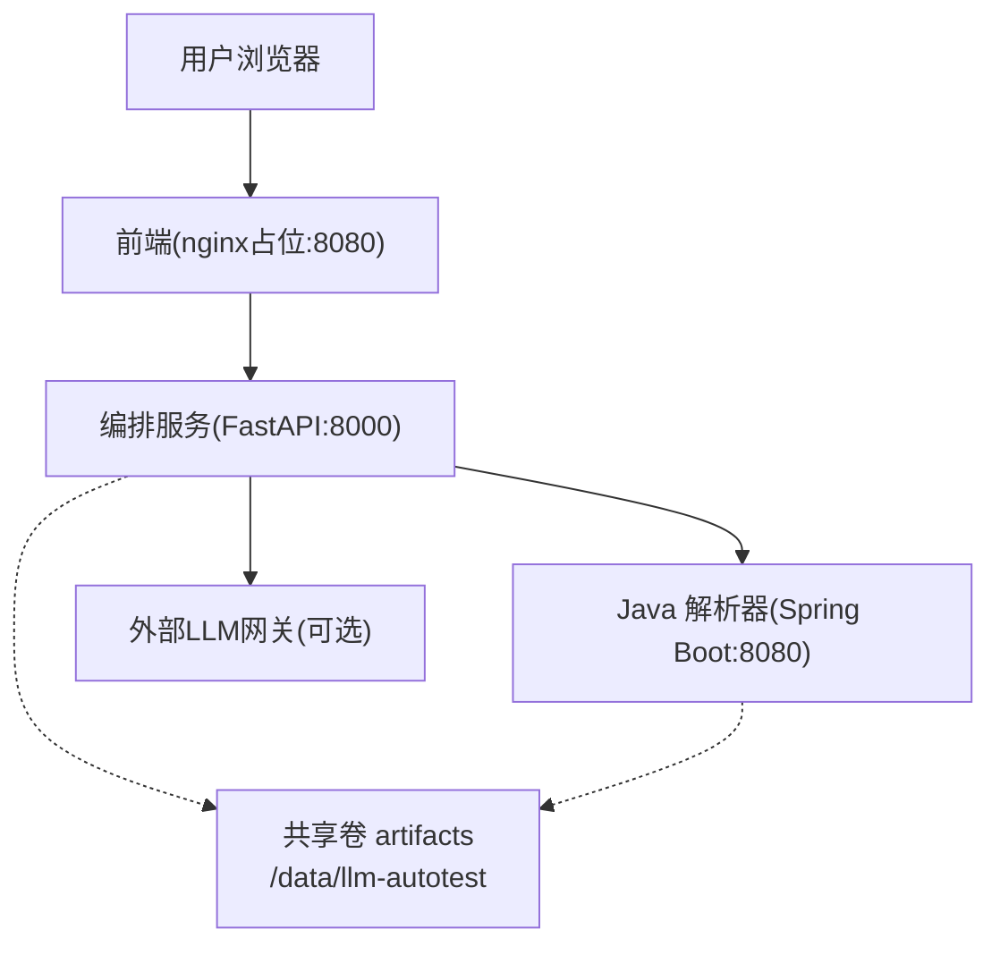
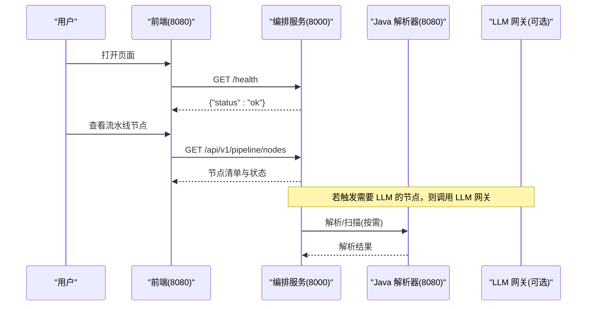
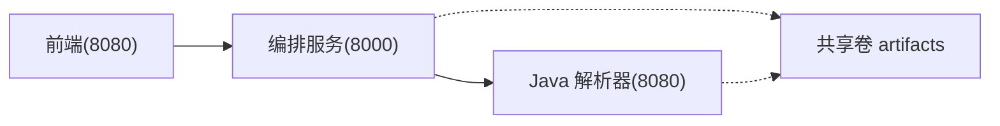

# 快速开始

<cite>
**本文引用的文件**
- [deploy/docker-compose.yml](file://deploy/docker-compose.yml)
- [services/java-parser/Dockerfile](file://services/java-parser/Dockerfile)
- [services/java-parser/pom.xml](file://services/java-parser/pom.xml)
- [services/orchestrator/Dockerfile](file://services/orchestrator/Dockerfile)
- [services/orchestrator/pyproject.toml](file://services/orchestrator/pyproject.toml)
- [services/orchestrator/src/orchestrator/config.py](file://services/orchestrator/src/orchestrator/config.py)
- [services/orchestrator/src/orchestrator/api.py](file://services/orchestrator/src/orchestrator/api.py)
- [services/frontend/package.json](file://services/frontend/package.json)
- [services/frontend/Dockerfile](file://services/frontend/Dockerfile)
- [schemas/README.md](file://schemas/README.md)
- [schemas/samples/interfaces.sample.json](file://schemas/samples/interfaces.sample.json)
- [schemas/samples/execution.sample.json](file://schemas/samples/execution.sample.json)
- [docs/kickoff/README.md](file://docs/kickoff/README.md)
</cite>

## 目录
1. [简介](#简介)
2. [项目结构](#项目结构)
3. [核心组件](#核心组件)
4. [架构总览](#架构总览)
5. [详细组件分析](#详细组件分析)
6. [依赖关系分析](#依赖关系分析)
7. [性能与稳定性建议](#性能与稳定性建议)
8. [故障排查指南](#故障排查指南)
9. [结论](#结论)
10. [附录：常用命令与环境变量](#附录：常用命令与环境变量)

## 简介
本指南面向首次接触 LLM-AutoTest 的新手，目标是在 30 分钟内完成环境准备、服务启动与基本使用。你将学会：
- 安装并配置 Docker、Docker Compose
- 克隆仓库、准备环境变量
- 一键拉起编排服务（Java 解析器、编排服务、前端占位）
- 通过 API 查看流水线节点状态
- 理解产物 Schema 与示例数据
- 解决常见端口冲突、依赖缺失、服务连接失败等问题

## 项目结构
仓库采用多服务编排：
- Java 解析器：提供源码扫描与接口逆向能力
- 编排服务：负责 9 节点流水线编排、产物管理、REST API
- 前端：当前为占位镜像，后续将接入真实界面
- 共享卷：统一挂载 /data/llm-autotest 用于持久化产物
- 契约与样本：schemas/contracts 与 schemas/samples 定义结构化产物规范与样例

图表来源
- [deploy/docker-compose.yml:3-41](file://deploy/docker-compose.yml#L3-L41)
- [services/java-parser/Dockerfile:10-20](file://services/java-parser/Dockerfile#L10-L20)
- [services/orchestrator/Dockerfile:1-15](file://services/orchestrator/Dockerfile#L1-L15)
- [services/frontend/Dockerfile:1-13](file://services/frontend/Dockerfile#L1-L13)

章节来源
- [deploy/docker-compose.yml:1-62](file://deploy/docker-compose.yml#L1-L62)
- [services/java-parser/Dockerfile:1-21](file://services/java-parser/Dockerfile#L1-L21)
- [services/orchestrator/Dockerfile:1-16](file://services/orchestrator/Dockerfile#L1-L16)
- [services/frontend/Dockerfile:1-13](file://services/frontend/Dockerfile#L1-L13)

## 核心组件
- Java 解析器：基于 Spring Boot + JavaParser，暴露健康检查与接口还原能力；容器内监听 8080，对外映射 8081
- 编排服务：FastAPI 应用，提供健康检查与流水线节点清单等 API；默认监听 8000
- 前端：当前为 nginx 占位镜像，对外映射 8080
- 共享卷：artifacts 卷统一存放产物，便于备份与跨容器访问

关键要点
- 所有服务通过 docker compose 编排，按依赖顺序启动
- 编排服务依赖 Java 解析器健康检查通过后才启动
- 前端依赖编排服务可用

章节来源
- [deploy/docker-compose.yml:3-41](file://deploy/docker-compose.yml#L3-L41)
- [services/java-parser/pom.xml:1-83](file://services/java-parser/pom.xml#L1-L83)
- [services/orchestrator/src/orchestrator/api.py:1-28](file://services/orchestrator/src/orchestrator/api.py#L1-L28)

## 架构总览
下图展示了请求在编排服务中的流转路径，以及与健康检查、外部 LLM 的交互。

图表来源
- [services/orchestrator/src/orchestrator/api.py:11-27](file://services/orchestrator/src/orchestrator/api.py#L11-L27)
- [deploy/docker-compose.yml:18-32](file://deploy/docker-compose.yml#L18-L32)

## 详细组件分析

### 环境准备与版本要求
- Python：>=3.11（编排服务运行环境）
- Node.js：建议使用 pnpm@9.x（前端开发工具链）
- Java：JDK 21 LTS（Java 解析器构建与运行）
- Maven：3.9+（Java 解析器构建）
- Docker Engine 与 Docker Compose：用于一键编排服务

说明
- 编排服务通过 uv 同步依赖，镜像基础为 python:3.11-slim
- Java 解析器使用 maven:3.9-eclipse-temurin-21 进行多阶段构建，运行时使用 JRE 21
- 前端使用 pnpm 作为包管理器，脚本包含 dev/build/lint/test

章节来源
- [services/orchestrator/pyproject.toml:1-14](file://services/orchestrator/pyproject.toml#L1-L14)
- [services/orchestrator/Dockerfile:1-15](file://services/orchestrator/Dockerfile#L1-L15)
- [services/java-parser/pom.xml:24-29](file://services/java-parser/pom.xml#L24-L29)
- [services/java-parser/Dockerfile:3-10](file://services/java-parser/Dockerfile#L3-L10)
- [services/frontend/package.json:1-29](file://services/frontend/package.json#L1-L29)

### 安装 Docker 与 Docker Compose
- 安装 Docker Engine（参考官方文档）
- 安装 Docker Compose（v2 插件或独立二进制）
- 验证安装：docker --version、docker compose version

提示
- 确保当前用户有权限执行 docker 命令（必要时加入 docker 组）
- Windows 用户可使用 Docker Desktop

### 克隆仓库与准备环境变量
- 克隆仓库到本地
- 进入 deploy 目录，创建 .env 文件，填入必要的环境变量（见附录）
- 关键变量包括：JAVA_PARSER_URL、LLM_BASE_URL、LLM_MODEL_NAME、LLM_API_KEY、LLM_TEMPERATURE、LLM_TOP_P、LLM_SEED、LLM_TIMEOUT_S、ARTIFACTS_ROOT、SCHEMAS_DIR、PORT

注意
- 必填项缺失时，编排服务启动会抛出明确错误，便于定位
- 敏感字段（如 API Key）不会出现在公开摘要中

章节来源
- [services/orchestrator/src/orchestrator/config.py:9-55](file://services/orchestrator/src/orchestrator/config.py#L9-L55)
- [docs/kickoff/README.md:11-14](file://docs/kickoff/README.md#L11-L14)

### 启动服务
- 在项目根目录执行：docker compose -f deploy/docker-compose.yml --env-file deploy/.env up -d
- 等待服务就绪后，访问：
  - 前端占位页：http://localhost:8080
  - 编排服务健康检查：http://localhost:8000/health
  - Java 解析器健康检查：http://localhost:8081/health

说明
- 编排服务会在 Java 解析器健康检查通过后启动
- 前端依赖编排服务可用

章节来源
- [deploy/docker-compose.yml:3-41](file://deploy/docker-compose.yml#L3-L41)

### 基本使用示例
- 查看流水线节点清单：GET http://localhost:8000/api/v1/pipeline/nodes
- 预期返回节点名称与当前状态的汇总信息
- 产物与示例：
  - schemas/README.md 定义了结构化产物的约定与目录规划
  - schemas/samples/interfaces.sample.json 展示接口还原样例
  - schemas/samples/execution.sample.json 展示执行结果样例

章节来源
- [services/orchestrator/src/orchestrator/api.py:21-25](file://services/orchestrator/src/orchestrator/api.py#L21-L25)
- [schemas/README.md:1-30](file://schemas/README.md#L1-L30)
- [schemas/samples/interfaces.sample.json:1-75](file://schemas/samples/interfaces.sample.json#L1-L75)
- [schemas/samples/execution.sample.json:1-63](file://schemas/samples/execution.sample.json#L1-L63)

### 本地开发模式（可选）
- 前端：进入 services/frontend，使用 pnpm 安装依赖并运行 dev 脚本
- 编排服务：使用 uv 安装依赖后直接运行模块入口
- Java 解析器：使用 Maven 构建并运行

注意
- 本地开发需保证各服务端口不冲突
- 可通过修改环境变量指向本地服务地址

章节来源
- [services/frontend/package.json:8-12](file://services/frontend/package.json#L8-L12)
- [services/orchestrator/Dockerfile:13-15](file://services/orchestrator/Dockerfile#L13-L15)
- [services/java-parser/Dockerfile:3-8](file://services/java-parser/Dockerfile#L3-L8)

## 依赖关系分析
- 编排服务依赖 Java 解析器的健康检查
- 前端依赖编排服务可用
- 共享卷 artifacts 被编排服务与 Java 解析器共同使用

图表来源
- [deploy/docker-compose.yml:18-41](file://deploy/docker-compose.yml#L18-L41)

章节来源
- [deploy/docker-compose.yml:18-41](file://deploy/docker-compose.yml#L18-L41)

## 性能与稳定性建议
- 合理设置 LLM 超时与采样参数，避免长时间阻塞
- 使用共享卷持久化产物，便于调试与备份
- 在生产环境中限制并发与资源配额，避免资源争用
- 对健康检查端点保持最小开销，确保编排可靠性

[本节为通用建议，无需特定文件引用]

## 故障排查指南
- 端口冲突
  - 现象：服务无法启动或访问失败
  - 处理：检查 8000、8080、8081 是否被占用，调整 docker-compose 端口映射
- 依赖缺失
  - 现象：编排服务启动时报缺少环境变量
  - 处理：在 deploy/.env 中补齐 JAVA_PARSER_URL、LLM_BASE_URL、LLM_SEED 等必填项
- 服务连接失败
  - 现象：编排服务无法访问 Java 解析器
  - 处理：确认 JAVA_PARSER_URL 指向正确地址；检查网络连通性与防火墙策略
- 健康检查失败
  - 现象：编排服务未启动或前端不可用
  - 处理：查看 Java 解析器健康检查日志；确保 wget 可用（镜像已内置）
- 产物读写异常
  - 现象：无法读取或写入 /data/llm-autotest
  - 处理：检查 volumes 挂载权限与磁盘空间

章节来源
- [deploy/docker-compose.yml:11-16](file://deploy/docker-compose.yml#L11-L16)
- [services/orchestrator/src/orchestrator/config.py:36-55](file://services/orchestrator/src/orchestrator/config.py#L36-L55)
- [services/java-parser/Dockerfile:17-18](file://services/java-parser/Dockerfile#L17-L18)

## 结论
通过本指南，你可以在 30 分钟内完成 LLM-AutoTest 的环境准备、服务启动与基本使用。后续可基于 schemas 与 samples 扩展流水线节点，结合 LLM 实现需求解析、接口还原、用例生成与执行闭环。

[本节为总结性内容，无需特定文件引用]

## 附录：常用命令与环境变量
- 启动服务
  - docker compose -f deploy/docker-compose.yml --env-file deploy/.env up -d
- 停止服务
  - docker compose -f deploy/docker-compose.yml down
- 查看日志
  - docker compose -f deploy/docker-compose.yml logs -f orchestrator
  - docker compose -f deploy/docker-compose.yml logs -f java-parser
- 常用环境变量
  - PORT：编排服务监听端口（默认 8000）
  - JAVA_PARSER_URL：Java 解析器地址（例如 http://java-parser:8080）
  - ARTIFACTS_ROOT：产物根目录（默认 /data/llm-autotest）
  - LLM_BASE_URL：LLM 网关地址
  - LLM_MODEL_NAME：模型名称（默认 glm-5.3）
  - LLM_API_KEY：API 密钥（可为空）
  - LLM_TEMPERATURE：温度（默认 0.2）
  - LLM_TOP_P：Top-P（默认 0.8）
  - LLM_SEED：随机种子（可选）
  - LLM_TIMEOUT_S：单次调用超时（默认 120）
  - SCHEMAS_DIR：Schema 目录（默认 schemas）

章节来源
- [deploy/docker-compose.yml:23-26](file://deploy/docker-compose.yml#L23-L26)
- [services/orchestrator/src/orchestrator/config.py:13-24](file://services/orchestrator/src/orchestrator/config.py#L13-L24)
- [services/orchestrator/src/orchestrator/config.py:36-55](file://services/orchestrator/src/orchestrator/config.py#L36-L55)