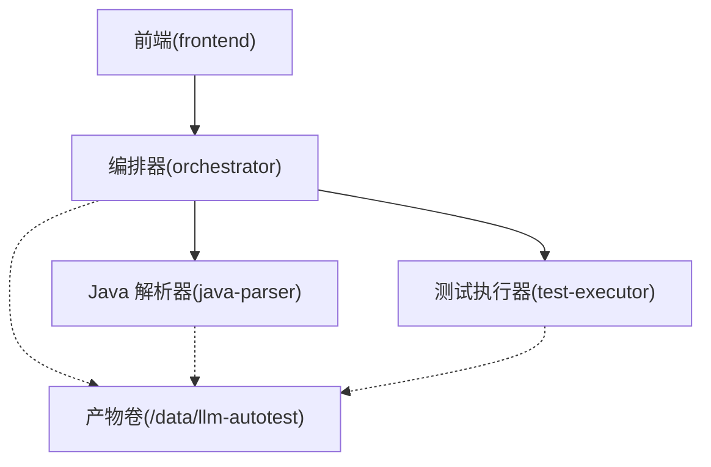
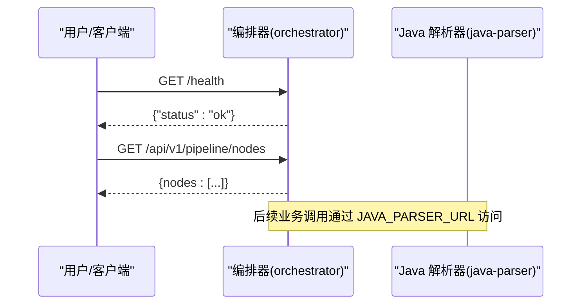
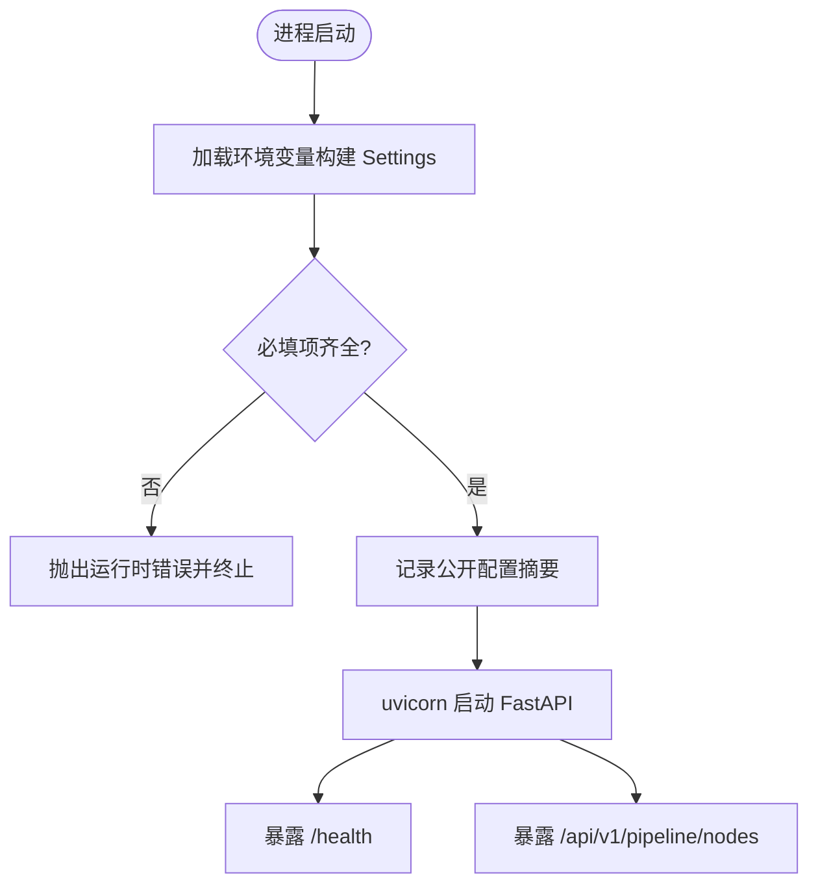
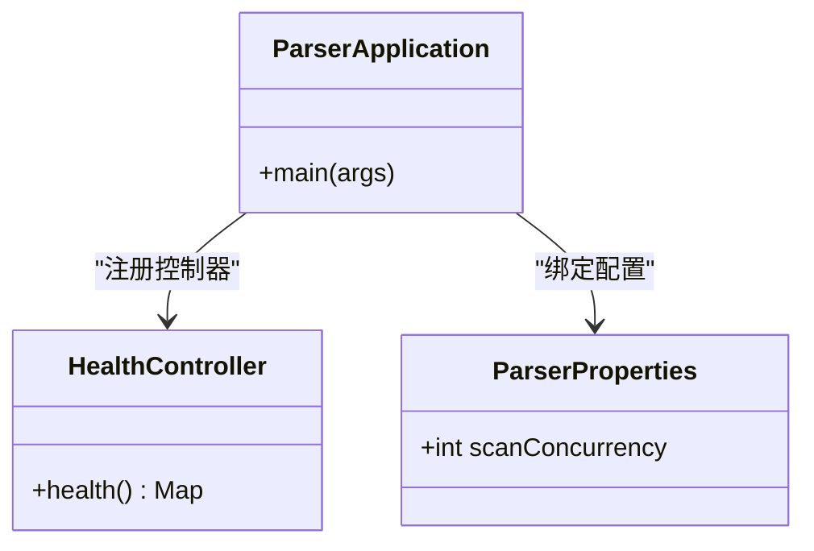
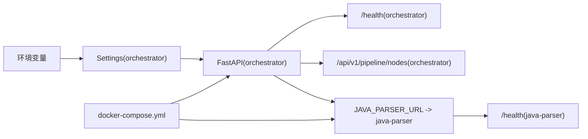

# 故障排查

<cite>
**本文引用的文件**
- [services/orchestrator/src/orchestrator/config.py](file://services/orchestrator/src/orchestrator/config.py)
- [services/orchestrator/src/orchestrator/api.py](file://services/orchestrator/src/orchestrator/api.py)
- [services/orchestrator/src/orchestrator/pipeline.py](file://services/orchestrator/src/orchestrator/pipeline.py)
- [services/orchestrator/src/orchestrator/__main__.py](file://services/orchestrator/src/orchestrator/__main__.py)
- [services/java-parser/src/main/java/com/llmautotest/parser/ParserApplication.java](file://services/java-parser/src/main/java/com/llmautotest/parser/ParserApplication.java)
- [services/java-parser/src/main/java/com/llmautotest/parser/HealthController.java](file://services/java-parser/src/main/java/com/llmautotest/parser/HealthController.java)
- [services/java-parser/src/main/java/com/llmautotest/parser/ParserProperties.java](file://services/java-parser/src/main/java/com/llmautotest/parser/ParserProperties.java)
- [services/java-parser/src/main/resources/application.yml](file://services/java-parser/src/main/resources/application.yml)
- [services/test-executor/src/executor/result.py](file://services/test-executor/src/executor/result.py)
- [deploy/docker-compose.yml](file://deploy/docker-compose.yml)
- [services/orchestrator/pyproject.toml](file://services/orchestrator/pyproject.toml)
- [docs/09_开发规范说明.md](file://docs/09_开发规范说明.md)
</cite>

## 目录
1. [简介](#简介)
2. [项目结构](#项目结构)
3. [核心组件](#核心组件)
4. [架构总览](#架构总览)
5. [详细组件分析](#详细组件分析)
6. [依赖关系分析](#依赖关系分析)
7. [性能考虑](#性能考虑)
8. [故障排查指南](#故障排查指南)
9. [结论](#结论)
10. [附录](#附录)

## 简介
本指南面向 LLM-AutoTest 的运维与研发人员，聚焦启动失败、服务通信异常、数据解析错误等常见问题，提供基于代码与配置的排障流程、日志分析方法、调试技巧与性能调优建议。内容严格依据仓库中的服务实现、编排配置与开发规范整理，确保可操作、可追溯。

## 项目结构
LLM-AutoTest 采用多服务微服务架构：
- orchestrator：Python FastAPI 编排服务，负责流水线节点状态、健康检查与对外 API。
- java-parser：Spring Boot Java 服务，提供代码扫描与接口逆向能力，暴露健康检查端点。
- test-executor：测试执行结果模型（骨架），用于断言与环境失败的区分。
- frontend：前端服务（当前文档不深入）。
- deploy/docker-compose.yml：统一编排入口，定义服务间依赖、端口映射、卷挂载与健康检查。

图表来源
- [deploy/docker-compose.yml:1-62](file://deploy/docker-compose.yml#L1-L62)
- [services/orchestrator/src/orchestrator/api.py:11-27](file://services/orchestrator/src/orchestrator/api.py#L11-L27)
- [services/java-parser/src/main/java/com/llmautotest/parser/HealthController.java:9-17](file://services/java-parser/src/main/java/com/llmautotest/parser/HealthController.java#L9-L17)

章节来源
- [deploy/docker-compose.yml:1-62](file://deploy/docker-compose.yml#L1-L62)

## 核心组件
- 编排器配置：Settings 从环境变量读取，包含端口、java-parser 地址、产物根路径、LLM 调用参数；提供不含密钥的配置摘要用于日志安全输出。
- 编排器 API：FastAPI 应用，提供健康检查与流水线节点清单接口。
- 流水线状态：固定 9 节点顺序与四态标注（已完成、人工介入、运行中、待运行），自动化率按完成数/9 计算。
- Java 解析器：Spring Boot 应用，暴露 /health 健康检查，scan-concurrency 通过配置注入并校验为正整数。
- 执行结果：CaseResult 与 ExecutionSummary 将失败区分为“断言失败”和“环境失败”，保证统计口径一致。

章节来源
- [services/orchestrator/src/orchestrator/config.py:9-50](file://services/orchestrator/src/orchestrator/config.py#L9-L50)
- [services/orchestrator/src/orchestrator/api.py:11-27](file://services/orchestrator/src/orchestrator/api.py#L11-L27)
- [services/orchestrator/src/orchestrator/pipeline.py:11-84](file://services/orchestrator/src/orchestrator/pipeline.py#L11-L84)
- [services/java-parser/src/main/java/com/llmautotest/parser/ParserProperties.java:7-16](file://services/java-parser/src/main/java/com/llmautotest/parser/ParserProperties.java#L7-L16)
- [services/test-executor/src/executor/result.py:10-61](file://services/test-executor/src/executor/result.py#L10-L61)

## 架构总览
编排器作为控制面，通过 REST 暴露健康检查与流水线节点信息；Java 解析器作为数据面，提供代码扫描与接口还原能力；两者通过 docker-compose 编排，共享产物卷；test-executor 在需要时参与执行与结果汇总。

图表来源
- [services/orchestrator/src/orchestrator/api.py:16-25](file://services/orchestrator/src/orchestrator/api.py#L16-L25)
- [services/java-parser/src/main/java/com/llmautotest/parser/HealthController.java:12-16](file://services/java-parser/src/main/java/com/llmautotest/parser/HealthController.java#L12-L16)

## 详细组件分析

### 编排器（orchestrator）
- 启动流程：__main__ 初始化日志、加载 Settings、记录公开配置摘要、使用 uvicorn 启动 FastAPI 应用。
- 配置加载：Settings.from_env 强制读取必填环境变量（如 JAVA_PARSER_URL、LLM_BASE_URL、LLM_SEED 等），缺失则抛出运行时错误；public_summary 不包含敏感字段。
- API 层：/health 健康检查；/api/v1/pipeline/nodes 返回九节点清单与当前状态（骨架阶段均为待运行）。
- 流水线：NODE_ORDER 固定为 9 个节点名；PipelineState 维护节点记录与自动化率计算。

图表来源
- [services/orchestrator/src/orchestrator/__main__.py:15-21](file://services/orchestrator/src/orchestrator/__main__.py#L15-L21)
- [services/orchestrator/src/orchestrator/config.py:32-50](file://services/orchestrator/src/orchestrator/config.py#L32-L50)
- [services/orchestrator/src/orchestrator/api.py:16-25](file://services/orchestrator/src/orchestrator/api.py#L16-L25)

章节来源
- [services/orchestrator/src/orchestrator/__main__.py:1-26](file://services/orchestrator/src/orchestrator/__main__.py#L1-L26)
- [services/orchestrator/src/orchestrator/config.py:1-50](file://services/orchestrator/src/orchestrator/config.py#L1-L50)
- [services/orchestrator/src/orchestrator/api.py:1-28](file://services/orchestrator/src/orchestrator/api.py#L1-L28)
- [services/orchestrator/src/orchestrator/pipeline.py:1-84](file://services/orchestrator/src/orchestrator/pipeline.py#L1-L84)

### Java 解析器（java-parser）
- 应用入口：Spring Boot 主类启用配置属性扫描。
- 健康检查：/health 返回服务标识，供编排器健康检查使用。
- 配置：application.yml 设置默认端口与扫描并发度；ParserProperties 校验 scanConcurrency 必须为正数。

图表来源
- [services/java-parser/src/main/java/com/llmautotest/parser/ParserApplication.java:8-15](file://services/java-parser/src/main/java/com/llmautotest/parser/ParserApplication.java#L8-L15)
- [services/java-parser/src/main/java/com/llmautotest/parser/HealthController.java:9-17](file://services/java-parser/src/main/java/com/llmautotest/parser/HealthController.java#L9-L17)
- [services/java-parser/src/main/java/com/llmautotest/parser/ParserProperties.java:7-16](file://services/java-parser/src/main/java/com/llmautotest/parser/ParserProperties.java#L7-L16)

章节来源
- [services/java-parser/src/main/java/com/llmautotest/parser/ParserApplication.java:1-17](file://services/java-parser/src/main/java/com/llmautotest/parser/ParserApplication.java#L1-L17)
- [services/java-parser/src/main/java/com/llmautotest/parser/HealthController.java:1-18](file://services/java-parser/src/main/java/com/llmautotest/parser/HealthController.java#L1-L18)
- [services/java-parser/src/main/java/com/llmautotest/parser/ParserProperties.java:1-17](file://services/java-parser/src/main/java/com/llmautotest/parser/ParserProperties.java#L1-L17)
- [services/java-parser/src/main/resources/application.yml:1-8](file://services/java-parser/src/main/resources/application.yml#L1-L8)

### 测试执行结果（test-executor）
- 失败二态：断言失败计入通过率分母；环境失败隔离至待环境确认，不计入通过率分母。
- 一致性校验：通过的用例不得携带失败类型，否则抛出值错误。

章节来源
- [services/test-executor/src/executor/result.py:1-61](file://services/test-executor/src/executor/result.py#L1-L61)

## 依赖关系分析
- 编排器依赖环境变量（JAVA_PARSER_URL、LLM_* 等）与 FastAPI/Uvicorn 生态。
- Java 解析器依赖 Spring Boot 与 application.yml 配置。
- docker-compose 定义服务间依赖、端口映射、卷挂载与健康检查策略。

图表来源
- [services/orchestrator/src/orchestrator/config.py:32-50](file://services/orchestrator/src/orchestrator/config.py#L32-L50)
- [services/orchestrator/src/orchestrator/api.py:16-25](file://services/orchestrator/src/orchestrator/api.py#L16-L25)
- [services/java-parser/src/main/java/com/llmautotest/parser/HealthController.java:12-16](file://services/java-parser/src/main/java/com/llmautotest/parser/HealthController.java#L12-L16)
- [deploy/docker-compose.yml:18-32](file://deploy/docker-compose.yml#L18-L32)

章节来源
- [deploy/docker-compose.yml:1-62](file://deploy/docker-compose.yml#L1-L62)
- [services/orchestrator/pyproject.toml:1-53](file://services/orchestrator/pyproject.toml#L1-L53)

## 性能考虑
- Java 解析器并发：scan-concurrency 控制多仓库扫描并发度，需根据资源与目标规模调整，避免过大导致内存/CPU 压力。
- 编排器 I/O：HTTPX 调用解析器时应关注超时与重试策略（当前骨架未实现，需在后续扩展中补充）。
- 产物卷：统一挂载 /data/llm-autotest，注意磁盘 I/O 与备份策略对整体吞吐的影响。
- 前端与服务端口：避免端口冲突（编排器 8000、前端 8080、解析器 8081 映射到宿主机）。

[本节为通用性能讨论，不直接分析具体文件]

## 故障排查指南

### 一、启动失败
常见症状
- 编排器进程退出或无法监听端口。
- Java 解析器容器启动后健康检查失败。

定位步骤
- 检查环境变量是否齐全且正确：
  - 必填项包括 JAVA_PARSER_URL、LLM_BASE_URL、LLM_SEED 等；缺失会触发运行时错误。
  - 参考配置摘要输出，确认非敏感字段是否正确加载。
- 检查端口占用与映射：
  - 编排器默认端口 8000；Java 解析器默认 8080（容器内），宿主机映射 8081。
- 查看健康检查：
  - 编排器 /health 应返回 ok。
  - Java 解析器 /health 应返回服务标识。

相关实现参考
- 环境变量读取与报错：[services/orchestrator/src/orchestrator/config.py:32-50](file://services/orchestrator/src/orchestrator/config.py#L32-L50)
- 启动与日志：[services/orchestrator/src/orchestrator/__main__.py:15-21](file://services/orchestrator/src/orchestrator/__main__.py#L15-L21)
- 健康检查端点：[services/orchestrator/src/orchestrator/api.py:16-19](file://services/orchestrator/src/orchestrator/api.py#L16-L19)、[services/java-parser/src/main/java/com/llmautotest/parser/HealthController.java:12-16](file://services/java-parser/src/main/java/com/llmautotest/parser/HealthController.java#L12-L16)
- 编排与健康检查策略：[deploy/docker-compose.yml:11-16](file://deploy/docker-compose.yml#L11-L16)、[deploy/docker-compose.yml:18-32](file://deploy/docker-compose.yml#L18-L32)

修复建议
- 补齐缺失的环境变量，确保 URL 可达。
- 释放被占用的端口或调整映射。
- 若 Java 解析器健康检查失败，检查其端口与配置（scan-concurrency 必须为正数）。

章节来源
- [services/orchestrator/src/orchestrator/config.py:32-50](file://services/orchestrator/src/orchestrator/config.py#L32-L50)
- [services/orchestrator/src/orchestrator/__main__.py:15-21](file://services/orchestrator/src/orchestrator/__main__.py#L15-L21)
- [services/java-parser/src/main/java/com/llmautotest/parser/ParserProperties.java:10-15](file://services/java-parser/src/main/java/com/llmautotest/parser/ParserProperties.java#L10-L15)
- [deploy/docker-compose.yml:11-16](file://deploy/docker-compose.yml#L11-L16)

### 二、服务通信异常
常见症状
- 编排器无法访问 Java 解析器。
- 健康检查通过但业务调用失败。

定位步骤
- 验证 JAVA_PARSER_URL 指向的容器内地址与端口是否可达。
- 检查 docker-compose 中 depends_on 条件为 service_healthy，确保编排器在解析器健康后再启动。
- 检查网络连通性与防火墙规则（容器间网络）。

相关实现参考
- 环境变量注入：[deploy/docker-compose.yml:23-26](file://deploy/docker-compose.yml#L23-L26)
- 健康检查依赖：[deploy/docker-compose.yml:29-32](file://deploy/docker-compose.yml#L29-L32)
- 健康检查端点：[services/java-parser/src/main/java/com/llmautotest/parser/HealthController.java:12-16](file://services/java-parser/src/main/java/com/llmautotest/parser/HealthController.java#L12-L16)

修复建议
- 修正 JAVA_PARSER_URL 为容器内部可达地址。
- 确保解析器健康检查通过后再拉起编排器。
- 如需跨主机或复杂网络，检查 Docker 网络模式与端口暴露。

章节来源
- [deploy/docker-compose.yml:23-32](file://deploy/docker-compose.yml#L23-L32)
- [services/java-parser/src/main/java/com/llmautotest/parser/HealthController.java:12-16](file://services/java-parser/src/main/java/com/llmautotest/parser/HealthController.java#L12-L16)

### 三、数据解析错误
常见症状
- 执行结果不一致或统计口径异常。
- 用例通过却携带失败类型。

定位步骤
- 检查 CaseResult 的一致性约束：通过的用例不得携带 failure_kind。
- 检查 ExecutionSummary 的统计口径：断言失败与环境失败分别计数，避免误算通过率。
- 核对流水线节点状态与自动化率计算：分母固定为 9，未完成节点不计入完成率。

相关实现参考
- 失败二态与一致性校验：[services/test-executor/src/executor/result.py:10-30](file://services/test-executor/src/executor/result.py#L10-L30)
- 统计口径：[services/test-executor/src/executor/result.py:38-61](file://services/test-executor/src/executor/result.py#L38-L61)
- 流水线节点与自动化率：[services/orchestrator/src/orchestrator/pipeline.py:23-71](file://services/orchestrator/src/orchestrator/pipeline.py#L23-L71)

修复建议
- 在执行器侧明确区分断言失败与环境失败，并在报告中分列。
- 对异常结果进行落盘与归档，便于断点续跑与审计。
- 保持自动化率口径稳定（分母=9），降级节点按“人工介入”计入。

章节来源
- [services/test-executor/src/executor/result.py:10-61](file://services/test-executor/src/executor/result.py#L10-L61)
- [services/orchestrator/src/orchestrator/pipeline.py:23-71](file://services/orchestrator/src/orchestrator/pipeline.py#L23-L71)

### 四、日志分析方法
- Python 日志：统一使用 logging，JSON 行格式便于聚合与分析；节点失败需落盘（状态+原因+时间戳）。
- Java 日志：使用 SLF4J；节点日志按任务 ID 归档。
- 禁止 print 调试代码合入主干。

相关规范参考
- 日志与异常处理规范：[docs/09_开发规范说明.md:96-101](file://docs/09_开发规范说明.md#L96-L101)

实践建议
- 在编排器启动时记录公开配置摘要，便于快速定位配置问题。
- 对关键调用（如 HTTPX 请求、文件读写）增加结构化日志与异常堆栈。
- 结合 docker logs 与编排器日志，按任务 ID 追踪端到端链路。

章节来源
- [docs/09_开发规范说明.md:96-101](file://docs/09_开发规范说明.md#L96-L101)
- [services/orchestrator/src/orchestrator/__main__.py:11-21](file://services/orchestrator/src/orchestrator/__main__.py#L11-L21)

### 五、调试技巧
- 本地快速验证：
  - 使用 docker compose 启动服务，优先观察健康检查是否通过。
  - 通过 curl 访问 /health 与 /api/v1/pipeline/nodes 验证 API 可用性。
- 环境变量最小化：
  - 仅配置必要项（如 JAVA_PARSER_URL、LLM_BASE_URL、LLM_SEED），逐步添加其他参数。
- 单测辅助：
  - 使用 pytest 验证 Settings 构建与边界情况（缺失必填项、摘要不含密钥）。

相关实现参考
- 健康检查与 API：[services/orchestrator/src/orchestrator/api.py:16-25](file://services/orchestrator/src/orchestrator/api.py#L16-L25)
- 环境变量与测试：[services/orchestrator/tests/test_config.py:10-42](file://services/orchestrator/tests/test_config.py#L10-L42)

章节来源
- [services/orchestrator/src/orchestrator/api.py:16-25](file://services/orchestrator/src/orchestrator/api.py#L16-L25)
- [services/orchestrator/tests/test_config.py:10-42](file://services/orchestrator/tests/test_config.py#L10-L42)

### 六、性能调优策略
- 调整 Java 解析器并发度：
  - 修改 parser.scan-concurrency，避免过高导致资源争用。
- 优化 I/O：
  - 合理设置产物卷挂载与备份策略，减少磁盘瓶颈。
- 监控与限流：
  - 对 HTTPX 调用增加超时与重试上限，防止雪崩。
- 端口与资源：
  - 避免端口冲突，合理分配 CPU/内存配额。

相关配置参考
- 解析器并发配置：[services/java-parser/src/main/resources/application.yml:5-8](file://services/java-parser/src/main/resources/application.yml#L5-L8)
- 配置校验：[services/java-parser/src/main/java/com/llmautotest/parser/ParserProperties.java:10-15](file://services/java-parser/src/main/java/com/llmautotest/parser/ParserProperties.java#L10-L15)

章节来源
- [services/java-parser/src/main/resources/application.yml:5-8](file://services/java-parser/src/main/resources/application.yml#L5-L8)
- [services/java-parser/src/main/java/com/llmautotest/parser/ParserProperties.java:10-15](file://services/java-parser/src/main/java/com/llmautotest/parser/ParserProperties.java#L10-L15)

### 七、问题诊断工具与流程
- 健康检查：
  - 编排器：GET /health
  - Java 解析器：GET /health
- 编排依赖：
  - docker-compose 中 depends_on 与 healthcheck 确保启动顺序。
- 日志采集：
  - 使用 docker logs 收集各服务日志，结合任务 ID 进行关联分析。

相关实现参考
- 健康检查与依赖：[deploy/docker-compose.yml:11-16](file://deploy/docker-compose.yml#L11-L16)、[deploy/docker-compose.yml:29-32](file://deploy/docker-compose.yml#L29-L32)
- 健康检查端点：[services/orchestrator/src/orchestrator/api.py:16-19](file://services/orchestrator/src/orchestrator/api.py#L16-L19)、[services/java-parser/src/main/java/com/llmautotest/parser/HealthController.java:12-16](file://services/java-parser/src/main/java/com/llmautotest/parser/HealthController.java#L12-L16)

章节来源
- [deploy/docker-compose.yml:11-32](file://deploy/docker-compose.yml#L11-L32)
- [services/orchestrator/src/orchestrator/api.py:16-19](file://services/orchestrator/src/orchestrator/api.py#L16-L19)
- [services/java-parser/src/main/java/com/llmautotest/parser/HealthController.java:12-16](file://services/java-parser/src/main/java/com/llmautotest/parser/HealthController.java#L12-L16)

### 八、预防措施与最佳实践
- 配置管理：
  - 所有运行参数通过环境变量注入，禁止硬编码；使用 public_summary 输出非敏感配置摘要。
- 异常处理：
  - 捕获异常后必须记录日志并转为节点失败状态，禁止静默吞掉异常。
- 契约与质量门禁：
  - 遵循 CI 门禁标准，确保镜像可启动并通过健康检查；契约测试保障双方接口一致。
- 日志规范：
  - Python 使用 logging JSON 行格式；Java 使用 SLF4J；按任务 ID 归档。

相关规范参考
- 配置与日志规范：[docs/09_开发规范说明.md:96-101](file://docs/09_开发规范说明.md#L96-L101)
- 配置安全摘要：[services/orchestrator/src/orchestrator/config.py:23-30](file://services/orchestrator/src/orchestrator/config.py#L23-L30)

章节来源
- [docs/09_开发规范说明.md:96-101](file://docs/09_开发规范说明.md#L96-L101)
- [services/orchestrator/src/orchestrator/config.py:23-30](file://services/orchestrator/src/orchestrator/config.py#L23-L30)

## 结论
通过对编排器、Java 解析器与执行结果模型的代码与配置分析，本文给出了覆盖启动失败、服务通信异常、数据解析错误的系统化排障流程，并结合日志规范与性能调优建议，帮助团队快速定位与解决问题。建议在实施中持续完善 HTTPX 调用、产物持久化与监控告警，以提升系统的稳定性与可观测性。

## 附录
- 常用命令
  - 启动服务：docker compose -f deploy/docker-compose.yml up -d
  - 查看健康检查：curl http://localhost:8000/health；curl http://localhost:8081/health
  - 查看节点清单：curl http://localhost:8000/api/v1/pipeline/nodes
- 关键端口
  - 编排器：8000
  - 前端：8080
  - Java 解析器：8081（容器内 8080）

[本节为操作性附录，不直接分析具体文件]