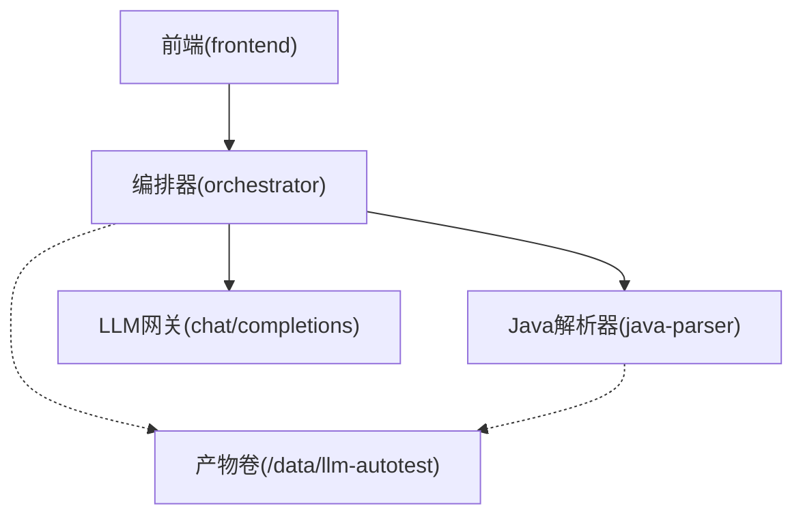
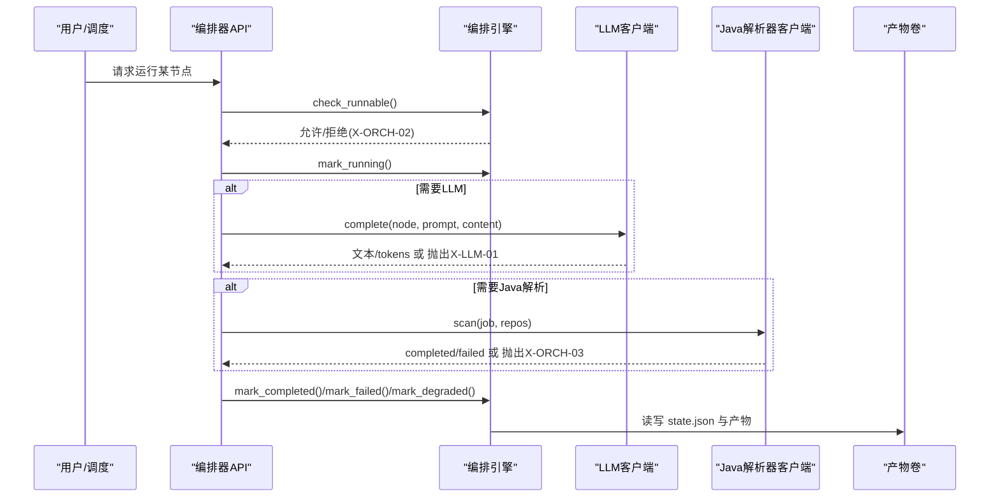
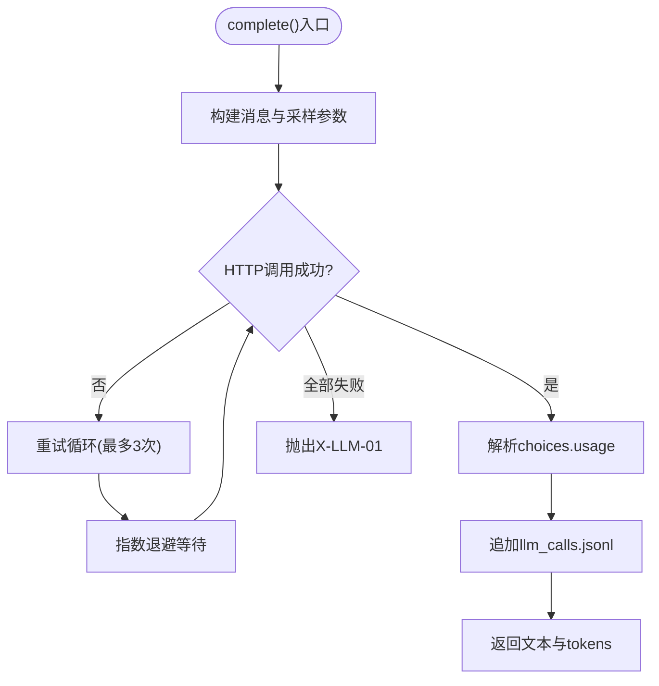
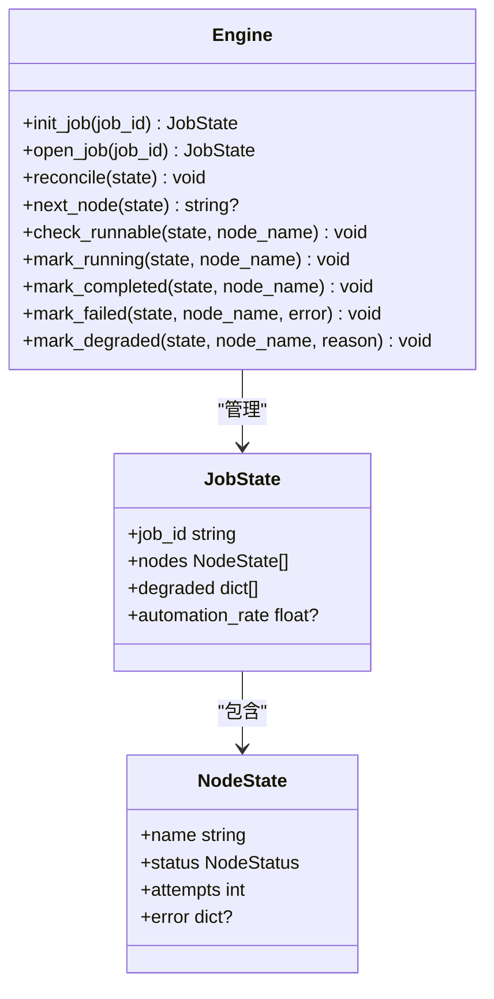
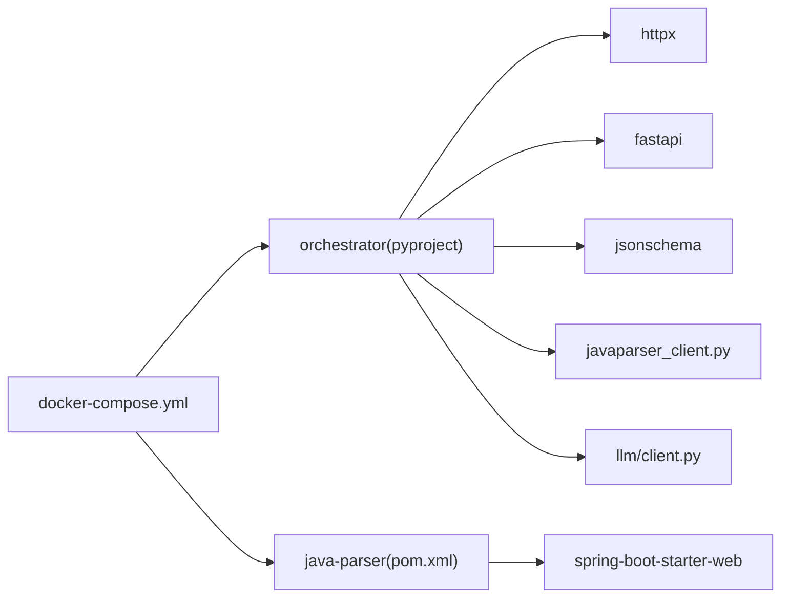

# 故障排查

<cite>
**本文引用的文件**
- [services/orchestrator/src/orchestrator/errors.py](file://services/orchestrator/src/orchestrator/errors.py)
- [services/orchestrator/src/orchestrator/config.py](file://services/orchestrator/src/orchestrator/config.py)
- [services/orchestrator/src/orchestrator/api.py](file://services/orchestrator/src/orchestrator/api.py)
- [services/orchestrator/src/orchestrator/llm/client.py](file://services/orchestrator/src/orchestrator/llm/client.py)
- [services/orchestrator/src/orchestrator/pipeline.py](file://services/orchestrator/src/orchestrator/pipeline.py)
- [services/orchestrator/src/orchestrator/engine.py](file://services/orchestrator/src/orchestrator/engine.py)
- [services/orchestrator/src/orchestrator/javaparser_client.py](file://services/orchestrator/src/orchestrator/javaparser_client.py)
- [services/java-parser/src/main/java/com/llmautotest/parser/HealthController.java](file://services/java-parser/src/main/java/com/llmautotest/parser/HealthController.java)
- [services/java-parser/src/main/resources/application.yml](file://services/java-parser/src/main/resources/application.yml)
- [deploy/docker-compose.yml](file://deploy/docker-compose.yml)
- [services/orchestrator/tests/test_llm_client.py](file://services/orchestrator/tests/test_llm_client.py)
- [services/orchestrator/tests/test_engine.py](file://services/orchestrator/tests/test_engine.py)
- [services/orchestrator/pyproject.toml](file://services/orchestrator/pyproject.toml)
- [services/java-parser/pom.xml](file://services/java-parser/pom.xml)
- [docs/09_开发规范说明.md](file://docs/09_开发规范说明.md)
</cite>

## 目录
1. [简介](#简介)
2. [项目结构](#项目结构)
3. [核心组件](#核心组件)
4. [架构总览](#架构总览)
5. [详细组件分析](#详细组件分析)
6. [依赖关系分析](#依赖关系分析)
7. [性能注意事项](#性能注意事项)
8. [故障排查指南](#故障排查指南)
9. [结论](#结论)
10. [附录](#附录)

## 简介
本故障排查文档面向 LLM-AutoTest 的运维与开发者，聚焦常见系统问题（服务启动失败、API 调用错误、数据处理异常、LLM 服务连接问题等）的定位与解决。文档基于代码实现梳理了健康检查机制、错误码体系、重试与降级策略、断点续跑与产物对账逻辑，并提供可操作的诊断步骤、日志分析方法与调优建议，帮助快速定位根因并恢复服务。

## 项目结构
LLM-AutoTest 由多个服务组成：编排器（orchestrator）、Java 解析器（java-parser）、前端（frontend），以及可选的执行器（test-executor）。容器编排通过 docker-compose 管理，共享产物卷 artifacts，用于持久化状态与中间产物。

图表来源
- [deploy/docker-compose.yml:1-62](file://deploy/docker-compose.yml#L1-L62)
- [services/java-parser/src/main/resources/application.yml:1-8](file://services/java-parser/src/main/resources/application.yml#L1-L8)

章节来源
- [deploy/docker-compose.yml:1-62](file://deploy/docker-compose.yml#L1-L62)

## 核心组件
- 统一错误模型：PipelineError 提供 code/message/node_id/details 的统一结构，所有对外错误必须来自约定错误码表。
- 配置中心：Settings 从环境变量加载，禁止硬编码采样参数；提供不含密钥的配置摘要用于日志安全输出。
- API 层：FastAPI 应用暴露 /health 与节点清单接口，便于编排与健康探测。
- LLM 客户端：OpenAI 兼容调用，带留痕、超时与指数退避重试，网络/超时/5xx 归为可重试错误。
- 编排引擎：state.json 持久化、断点续跑、跳序防护、降级清单、完成判据强制（以产物为准）。
- Java 解析器客户端：创建扫描 job 并轮询至终态，通信失败归 X-ORCH-03，契约错误透传。

章节来源
- [services/orchestrator/src/orchestrator/errors.py:1-39](file://services/orchestrator/src/orchestrator/errors.py#L1-L39)
- [services/orchestrator/src/orchestrator/config.py:1-56](file://services/orchestrator/src/orchestrator/config.py#L1-L56)
- [services/orchestrator/src/orchestrator/api.py:1-28](file://services/orchestrator/src/orchestrator/api.py#L1-L28)
- [services/orchestrator/src/orchestrator/llm/client.py:1-202](file://services/orchestrator/src/orchestrator/llm/client.py#L1-L202)
- [services/orchestrator/src/orchestrator/engine.py:1-302](file://services/orchestrator/src/orchestrator/engine.py#L1-L302)
- [services/orchestrator/src/orchestrator/javaparser_client.py:1-162](file://services/orchestrator/src/orchestrator/javaparser_client.py#L1-L162)

## 架构总览
编排器作为中枢，协调 LLM 与 Java 解析器，并通过产物卷维护流水线状态与结果。健康检查端点在各服务中暴露，供编排器与容器编排使用。

图表来源
- [services/orchestrator/src/orchestrator/api.py:11-27](file://services/orchestrator/src/orchestrator/api.py#L11-L27)
- [services/orchestrator/src/orchestrator/engine.py:140-265](file://services/orchestrator/src/orchestrator/engine.py#L140-L265)
- [services/orchestrator/src/orchestrator/llm/client.py:60-121](file://services/orchestrator/src/orchestrator/llm/client.py#L60-L121)
- [services/orchestrator/src/orchestrator/javaparser_client.py:70-121](file://services/orchestrator/src/orchestrator/javaparser_client.py#L70-L121)

## 详细组件分析

### 统一错误与错误码
- PipelineError 定义统一的错误结构，包含 code/message/node_id/details，字符串化输出便于日志定位。
- 错误码分类：
  - X-LLM-01：LLM 调用超时/网络失败（可重试）
  - X-LLM-02：LLM 输出未过 Schema 校验（不重试，人工介入）
  - X-LLM-03：Prompt 文件缺失/元信息不合规（配置错误，人工介入）
  - X-ORCH-01：产物校验失败/state.json 损坏/job 不存在
  - X-ORCH-02：断点续跑跳序请求（前序未完成）
  - X-ORCH-03：java-parser 服务不可达/通信失败

章节来源
- [services/orchestrator/src/orchestrator/errors.py:1-39](file://services/orchestrator/src/orchestrator/errors.py#L1-L39)

### 配置与环境变量
- Settings 从环境变量读取端口、LLM 基址、模型名、鉴权 key、温度、top_p、seed、超时、Schema 目录等。
- public_summary 提供不含密钥的配置摘要，用于日志安全输出。
- 缺失必填环境变量会抛出运行时错误，便于启动期快速发现配置问题。

章节来源
- [services/orchestrator/src/orchestrator/config.py:1-56](file://services/orchestrator/src/orchestrator/config.py#L1-L56)

### 健康检查与API
- orchestrator 提供 /health 返回 {"status":"ok"}，供 docker-compose 健康检查使用。
- /api/v1/pipeline/nodes 返回九节点清单与当前状态，便于监控面板展示。
- java-parser 提供 /health 返回 service 标识，便于区分健康源。

章节来源
- [services/orchestrator/src/orchestrator/api.py:11-27](file://services/orchestrator/src/orchestrator/api.py#L11-L27)
- [services/java-parser/src/main/java/com/llmautotest/parser/HealthController.java:1-18](file://services/java-parser/src/main/java/com/llmautotest/parser/HealthController.java#L1-L18)
- [deploy/docker-compose.yml:11-16](file://deploy/docker-compose.yml#L11-L16)

### LLM 客户端：重试、留痕与错误分类
- 每次调用写入 llm_calls.jsonl 留痕，包含 call_id、node、prompt 版本、采样参数、输入/输出摘要、耗时、tokens、是否成功、错误码。
- 重试策略：仅网络/超时/5xx 视为可重试，最多 3 次尝试（首发+2次重试），指数退避默认 5s/20s。
- 错误分类：
  - 网络/超时/5xx → 抛出可重试内部错误，最终转为 X-LLM-01
  - 4xx → 直接失败（鉴权/参数错误），同样以 X-LLM-01 记录并在 message 注明
  - 响应结构异常 → X-LLM-01

图表来源
- [services/orchestrator/src/orchestrator/llm/client.py:60-121](file://services/orchestrator/src/orchestrator/llm/client.py#L60-L121)
- [services/orchestrator/src/orchestrator/llm/client.py:123-170](file://services/orchestrator/src/orchestrator/llm/client.py#L123-L170)
- [services/orchestrator/src/orchestrator/llm/client.py:172-188](file://services/orchestrator/src/orchestrator/llm/client.py#L172-L188)

章节来源
- [services/orchestrator/src/orchestrator/llm/client.py:1-202](file://services/orchestrator/src/orchestrator/llm/client.py#L1-L202)
- [services/orchestrator/tests/test_llm_client.py:49-157](file://services/orchestrator/tests/test_llm_client.py#L49-L157)

### 编排引擎：断点续跑、跳序防护与完成判据
- 以产物为准进行 reconcile：产物存在且合规 → completed；状态 completed 但产物失效 → 回退 pending 并记录错误。
- 跳序防护：请求运行某节点时，其前序节点必须全部 completed（否则抛 X-ORCH-02）。
- 完成判据强制：mark_completed 前校验对应产物是否存在且合规，否则拒绝。
- 降级处理：将节点置为 manual_intervention，加入 degraded 清单，分母固定为 9。

图表来源
- [services/orchestrator/src/orchestrator/engine.py:43-96](file://services/orchestrator/src/orchestrator/engine.py#L43-L96)
- [services/orchestrator/src/orchestrator/engine.py:133-265](file://services/orchestrator/src/orchestrator/engine.py#L133-L265)

章节来源
- [services/orchestrator/src/orchestrator/engine.py:1-302](file://services/orchestrator/src/orchestrator/engine.py#L1-L302)
- [services/orchestrator/tests/test_engine.py:39-181](file://services/orchestrator/tests/test_engine.py#L39-L181)

### Java 解析器客户端：轮询与契约错误透传
- 创建扫描 job 后轮询至 completed/failed，未知状态或超时均视为通信失败（X-ORCH-03）。
- 契约错误体（含 code/message）原样透传，并将 node_id 归位到 code_scan。

章节来源
- [services/orchestrator/src/orchestrator/javaparser_client.py:1-162](file://services/orchestrator/src/orchestrator/javaparser_client.py#L1-L162)

## 依赖关系分析
- orchestrator 依赖 httpx 发起异步 HTTP 请求，依赖 fastapi 暴露 API，依赖 jsonschema 进行产物校验（在 ArtifactStore 中结合 schemas_dir）。
- java-parser 基于 Spring Boot 提供 REST 接口，暴露 /health 与扫描相关接口。
- docker-compose 编排 orchestrator 与 java-parser，共享 artifacts 卷，并通过 healthcheck 确保依赖就绪。

图表来源
- [services/orchestrator/pyproject.toml:1-57](file://services/orchestrator/pyproject.toml#L1-L57)
- [services/java-parser/pom.xml:1-83](file://services/java-parser/pom.xml#L1-L83)
- [deploy/docker-compose.yml:1-62](file://deploy/docker-compose.yml#L1-L62)

章节来源
- [services/orchestrator/pyproject.toml:1-57](file://services/orchestrator/pyproject.toml#L1-L57)
- [services/java-parser/pom.xml:1-83](file://services/java-parser/pom.xml#L1-L83)
- [deploy/docker-compose.yml:1-62](file://deploy/docker-compose.yml#L1-L62)

## 性能注意事项
- LLM 调用：
  - 合理设置 LLM_TIMEOUT_S，避免过长阻塞；默认 120s，可根据网络质量调整。
  - 重试退避间隔（默认 5s/20s）影响总体耗时，测试环境可注入 0 加速。
  - 关注 llm_calls.jsonl 中的 duration_ms 与 tokens，识别慢调用与高消耗场景。
- Java 解析器：
  - scan-concurrency 控制多仓库扫描并发度，默认 4，可按资源情况调优。
  - 单次 HTTP 请求超时 DEFAULT_TIMEOUT_S=30s，轮询间隔 DEFAULT_POLL_INTERVAL_S=2s，最大等待 DEFAULT_MAX_WAIT_S=600s，可按任务规模调整。
- 产物与状态：
  - state.json 采用原子写（tmp+replace），减少竞争与损坏风险。
  - 产物校验严格，避免“伪完成”导致后续节点误判。

[本节为通用指导，不直接分析具体文件]

## 故障排查指南

### 服务启动失败
- 现象：orchestrator 或 java-parser 无法启动或健康检查失败。
- 排查步骤：
  - 检查 docker-compose 健康检查：/health 是否返回 ok。
  - 检查环境变量：JAVA_PARSER_URL、LLM_BASE_URL、LLM_MODEL_NAME、LLM_SEED、LLM_TIMEOUT_S、SCHEMAS_DIR 等是否齐全。
  - 检查端口映射：orchestrator 8000、java-parser 8081（容器内 8080）。
  - 查看容器日志：确认缺少必填环境变量导致的启动报错。
- 参考实现：
  - orchestrator /health 与健康检查依赖
  - java-parser /health 与健康检查依赖
  - Settings.from_env 必填项校验

章节来源
- [services/orchestrator/src/orchestrator/api.py:16-19](file://services/orchestrator/src/orchestrator/api.py#L16-L19)
- [services/java-parser/src/main/java/com/llmautotest/parser/HealthController.java:12-16](file://services/java-parser/src/main/java/com/llmautotest/parser/HealthController.java#L12-L16)
- [services/orchestrator/src/orchestrator/config.py:35-56](file://services/orchestrator/src/orchestrator/config.py#L35-L56)
- [deploy/docker-compose.yml:11-16](file://deploy/docker-compose.yml#L11-L16)

### API 调用错误
- 现象：/api/v1/pipeline/nodes 返回异常或节点状态不正确。
- 排查步骤：
  - 确认 orchestrator 已启动且 /health 正常。
  - 检查 state.json 是否可读且结构合规，损坏将触发 X-ORCH-01。
  - 核对 NODE_ORDER 与 NODE_ARTIFACTS 映射是否一致。
- 参考实现：
  - nodes 接口返回九节点清单
  - engine.open_job/load/save 对 state.json 的健壮性处理

章节来源
- [services/orchestrator/src/orchestrator/api.py:21-26](file://services/orchestrator/src/orchestrator/api.py#L21-L26)
- [services/orchestrator/src/orchestrator/engine.py:271-302](file://services/orchestrator/src/orchestrator/engine.py#L271-L302)

### 数据处理异常
- 现象：节点标记完成失败或状态与产物不一致。
- 排查步骤：
  - 检查 mark_completed 前产物是否存在且合规（interface_reconstruct 需两份产物）。
  - 使用 open_job 触发 reconcile，自动修复状态与产物差异。
  - 若 state.json 损坏，将抛出 X-ORCH-01，需重建或修复。
- 参考实现：
  - NODE_ARTIFACTS 映射与完成判据
  - reconcile 对账逻辑与降级回退

章节来源
- [services/orchestrator/src/orchestrator/engine.py:25-35](file://services/orchestrator/src/orchestrator/engine.py#L25-L35)
- [services/orchestrator/src/orchestrator/engine.py:161-180](file://services/orchestrator/src/orchestrator/engine.py#L161-L180)
- [services/orchestrator/tests/test_engine.py:107-127](file://services/orchestrator/tests/test_engine.py#L107-L127)

### LLM 服务连接问题
- 现象：LLM 调用失败，出现 X-LLM-01。
- 排查步骤：
  - 检查 LLM_BASE_URL、LLM_API_KEY、LLM_TIMEOUT_S 配置是否正确。
  - 查看 llm_calls.jsonl 留痕，确认 input_digest/output_digest、duration_ms、error 字段。
  - 若 4xx 错误，通常为鉴权/参数错误，无需重试；若 5xx/网络异常，系统将自动重试最多 3 次。
- 参考实现：
  - LlmClient.complete/_request_once 的错误分类与重试
  - 留痕写入与序号接续

章节来源
- [services/orchestrator/src/orchestrator/llm/client.py:60-121](file://services/orchestrator/src/orchestrator/llm/client.py#L60-L121)
- [services/orchestrator/src/orchestrator/llm/client.py:123-170](file://services/orchestrator/src/orchestrator/llm/client.py#L123-L170)
- [services/orchestrator/tests/test_llm_client.py:99-145](file://services/orchestrator/tests/test_llm_client.py#L99-L145)

### Java 解析器通信失败
- 现象：扫描 job 轮询超时或返回未知状态，抛出 X-ORCH-03。
- 排查步骤：
  - 检查 JAVA_PARSER_URL 是否可达，端口映射是否正确。
  - 查看轮询间隔与最大等待时间，必要时调整 DEFAULT_POLL_INTERVAL_S 与 DEFAULT_MAX_WAIT_S。
  - 若契约错误体包含 code/message，将透传并归位 node_id=code_scan。
- 参考实现：
  - _poll_scan_job 轮询逻辑与超时判定
  - _contract_error 透传契约错误

章节来源
- [services/orchestrator/src/orchestrator/javaparser_client.py:98-121](file://services/orchestrator/src/orchestrator/javaparser_client.py#L98-L121)
- [services/orchestrator/src/orchestrator/javaparser_client.py:154-161](file://services/orchestrator/src/orchestrator/javaparser_client.py#L154-L161)

### 跳序与断点续跑问题
- 现象：请求运行非首节点被拒绝，或重启后节点状态异常。
- 排查步骤：
  - 使用 check_runnable 验证前序节点是否 completed（或 manual_intervention）。
  - 使用 open_job 触发 reconcile，自动修复状态与产物差异。
  - 若 state.json 损坏或不匹配，将抛出 X-ORCH-01。
- 参考实现：
  - check_runnable 跳序防护
  - open_job/reconcile 断点续跑与对账

章节来源
- [services/orchestrator/src/orchestrator/engine.py:196-220](file://services/orchestrator/src/orchestrator/engine.py#L196-L220)
- [services/orchestrator/src/orchestrator/engine.py:153-159](file://services/orchestrator/src/orchestrator/engine.py#L153-L159)
- [services/orchestrator/tests/test_engine.py:60-67](file://services/orchestrator/tests/test_engine.py#L60-L67)

### 健康检查与监控指标
- 健康检查：
  - orchestrator /health 返回 {"status":"ok"}
  - java-parser /health 返回 {"status":"ok","service":"java-parser"}
- 监控指标建议：
  - LLM 调用成功率、平均耗时、重试次数（来自 llm_calls.jsonl）
  - 节点自动化率 = completed/9（engine.automation_rate）
  - 降级节点清单与原因（state.degraded）
  - Java 解析器扫描耗时与轮询次数

章节来源
- [services/orchestrator/src/orchestrator/api.py:16-19](file://services/orchestrator/src/orchestrator/api.py#L16-L19)
- [services/java-parser/src/main/java/com/llmautotest/parser/HealthController.java:12-16](file://services/java-parser/src/main/java/com/llmautotest/parser/HealthController.java#L12-L16)
- [services/orchestrator/src/orchestrator/engine.py:126-131](file://services/orchestrator/src/orchestrator/engine.py#L126-L131)
- [services/orchestrator/src/orchestrator/llm/client.py:84-100](file://services/orchestrator/src/orchestrator/llm/client.py#L84-L100)

### 调试工具与技巧
- 日志级别与格式：
  - Python 使用 logging 统一配置（JSON 行格式），按任务 ID 归档节点日志。
  - 禁止裸 except/pass，捕获后必须记日志并重新抛出或转为节点失败状态。
- 断点调试：
  - 使用 pytest + pytest-asyncio 进行异步测试，结合 MockTransport 模拟 LLM/Java 解析器响应。
- 性能分析：
  - 观察 llm_calls.jsonl 的 duration_ms 与 tokens，识别慢调用与高消耗。
  - 调整 LLM_TIMEOUT_S、重试退避间隔、scan-concurrency 等参数。

章节来源
- [docs/09_开发规范说明.md:96-119](file://docs/09_开发规范说明.md#L96-L119)
- [services/orchestrator/tests/test_llm_client.py:49-157](file://services/orchestrator/tests/test_llm_client.py#L49-L157)
- [services/java-parser/src/main/resources/application.yml:5-8](file://services/java-parser/src/main/resources/application.yml#L5-L8)

## 结论
本故障排查文档基于代码实现梳理了 LLM-AutoTest 的关键组件与常见故障场景，提供了健康检查、错误码体系、重试与降级策略、断点续跑与产物对账的诊断方法。通过合理利用留痕文件、状态文件与 API 接口，可以快速定位问题根源并采取相应优化措施。建议在生产环境中持续监控 LLM 调用指标与节点自动化率，及时调整超时与并发参数，保障系统稳定运行。

## 附录
- 常用命令：
  - 启动服务：docker compose -f deploy/docker-compose.yml --env-file deploy/.env up -d
  - 查看健康：curl http://localhost:8000/health；curl http://localhost:8081/health
  - 查看节点清单：curl http://localhost:8000/api/v1/pipeline/nodes
- 关键路径：
  - 产物卷：/data/llm-autotest（容器内）
  - LLM 留痕：{job_dir}/llm_calls.jsonl
  - 状态文件：{job_dir}/state.json

[本节为补充信息，不直接分析具体文件]