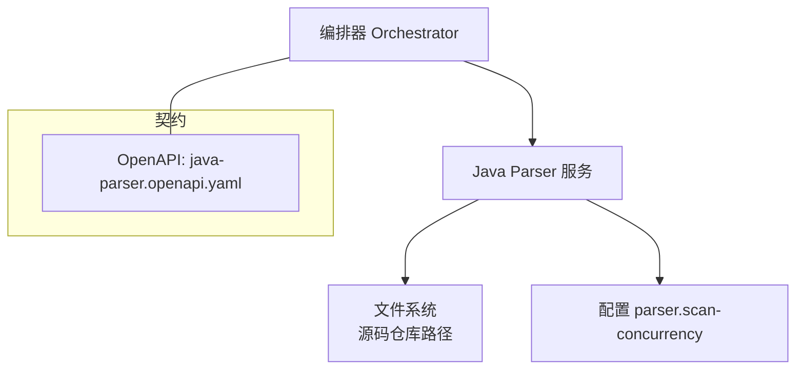
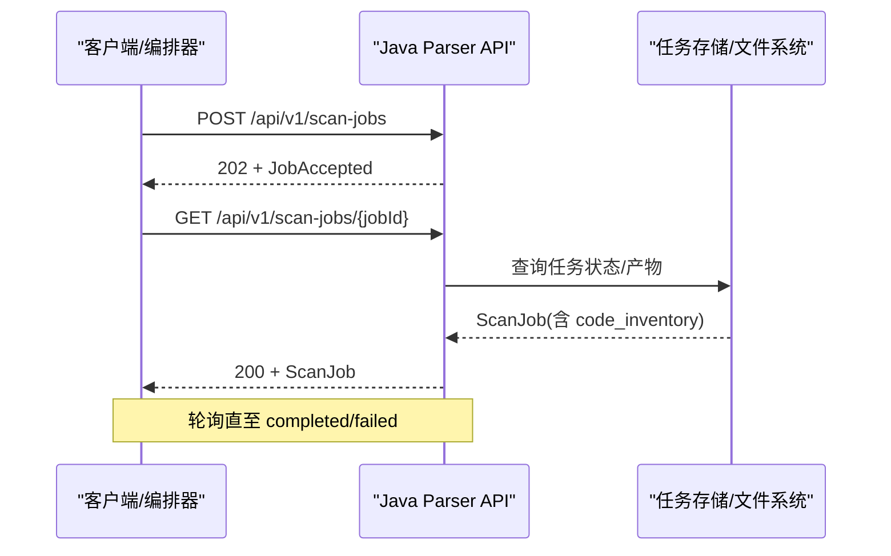
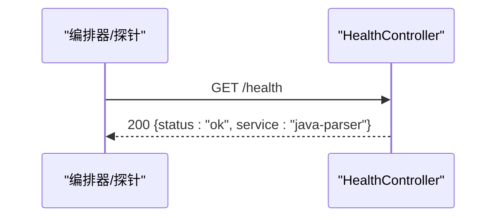
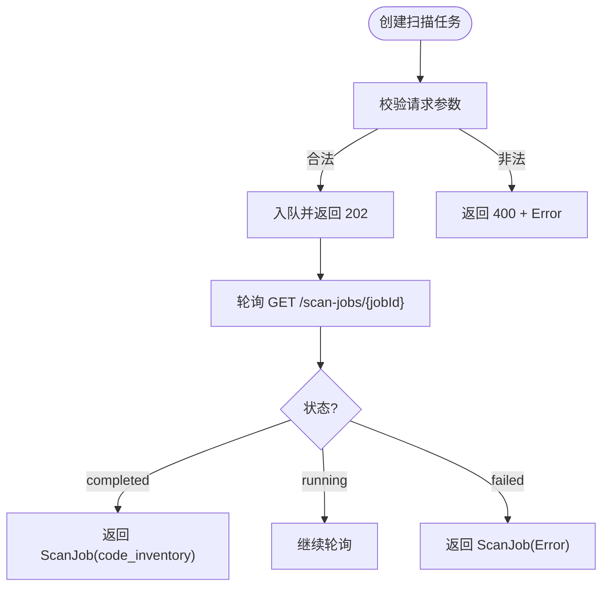
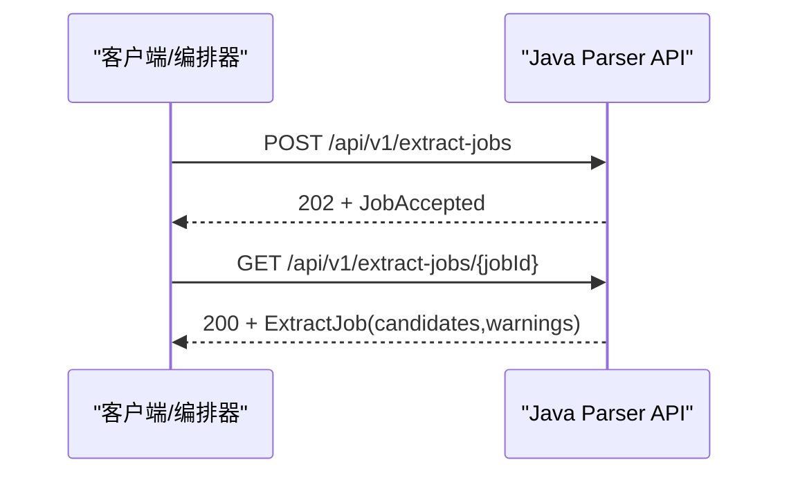
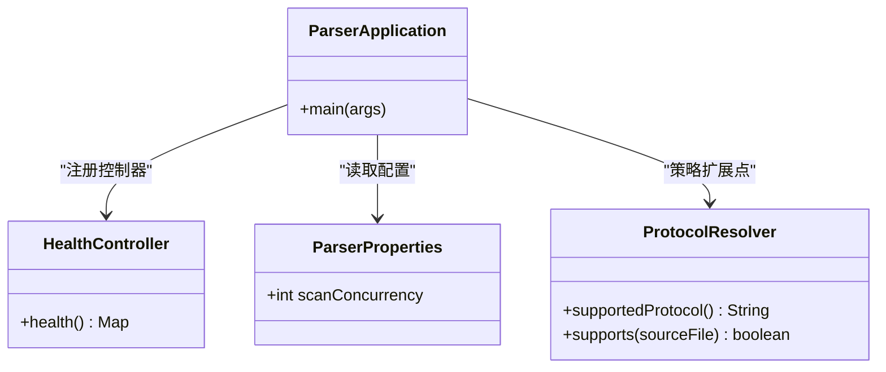

# API契约定义

<cite>
**本文引用的文件**
- [java-parser.openapi.yaml](file://schemas/contracts/java-parser.openapi.yaml)
- [HealthController.java](file://services/java-parser/src/main/java/com/llmautotest/parser/HealthController.java)
- [ParserApplication.java](file://services/java-parser/src/main/java/com/llmautotest/parser/ParserApplication.java)
- [ProtocolResolver.java](file://services/java-parser/src/main/java/com/llmautotest/parser/ProtocolResolver.java)
- [ParserProperties.java](file://services/java-parser/src/main/java/com/llmautotest/parser/ParserProperties.java)
- [application.yml](file://services/java-parser/src/main/resources/application.yml)
- [HealthControllerTest.java](file://services/java-parser/src/test/java/com/llmautotest/parser/HealthControllerTest.java)
- [README.md](file://schemas/README.md)
</cite>

## 目录
1. [简介](#简介)
2. [项目结构](#项目结构)
3. [核心组件](#核心组件)
4. [架构总览](#架构总览)
5. [详细组件分析](#详细组件分析)
6. [依赖关系分析](#依赖关系分析)
7. [性能与扩展性](#性能与扩展性)
8. [故障排查指南](#故障排查指南)
9. [结论](#结论)
10. [附录：API调用示例与客户端集成](#附录api调用示例与客户端集成)

## 简介
本文件为 java-parser 服务的 API 契约文档，聚焦 OpenAPI 规范实现、服务间通信协议和数据交换格式。内容覆盖 REST API 接口、请求/响应结构、错误处理机制、版本管理与向后兼容性策略、迁移指南，以及客户端集成与故障排查方法。该服务承担多仓库静态扫描与接口候选提取的“静态侧”职责，后续由编排器（orchestrator）进行 LLM 语义解析。

## 项目结构
- schemas/contracts/java-parser.openapi.yaml：OpenAPI 3.1.0 契约，定义健康检查、扫描任务、候选提取任务的接口与数据模型。
- services/java-parser：Spring Boot 服务实现，当前已落地 /health 端点；其余接口按契约预留。
- schemas/README.md：结构化产物 Schema 约定与横切约定（ID 命名、时间戳、协议枚举、错误结构等）。

图表来源
- [java-parser.openapi.yaml:1-11](file://schemas/contracts/java-parser.openapi.yaml#L1-L11)
- [application.yml:1-8](file://services/java-parser/src/main/resources/application.yml#L1-L8)

章节来源
- [java-parser.openapi.yaml:1-11](file://schemas/contracts/java-parser.openapi.yaml#L1-L11)
- [application.yml:1-8](file://services/java-parser/src/main/resources/application.yml#L1-L8)

## 核心组件
- 健康检查控制器：提供 /health GET 端点，返回服务存活状态，供容器编排与健康探针使用。
- 应用入口：Spring Boot 启动类，启用配置属性扫描。
- 协议解析策略接口：定义可扩展的协议识别与解析策略（rest/grpc/graphql/soap/mq），便于新增协议时不改动主流程。
- 配置属性：通过 application.yml 注入 scan-concurrency，控制多仓库扫描并发度。
- OpenAPI 契约：统一描述接口、请求/响应、错误结构与状态码。

章节来源
- [HealthController.java:1-18](file://services/java-parser/src/main/java/com/llmautotest/parser/HealthController.java#L1-L18)
- [ParserApplication.java:1-17](file://services/java-parser/src/main/java/com/llmautotest/parser/ParserApplication.java#L1-L17)
- [ProtocolResolver.java:1-17](file://services/java-parser/src/main/java/com/llmautotest/parser/ProtocolResolver.java#L1-L17)
- [ParserProperties.java:1-17](file://services/java-parser/src/main/java/com/llmautotest/parser/ParserProperties.java#L1-L17)
- [java-parser.openapi.yaml:12-116](file://schemas/contracts/java-parser.openapi.yaml#L12-L116)

## 架构总览
java-parser 采用“异步 Job”模式：客户端 POST 创建任务，服务端立即返回受理结果；客户端通过 GET 轮询任务状态与产物。契约定义了扫描与候选提取两类任务的生命周期与数据结构。

图表来源
- [java-parser.openapi.yaml:24-70](file://schemas/contracts/java-parser.openapi.yaml#L24-L70)

章节来源
- [java-parser.openapi.yaml:24-70](file://schemas/contracts/java-parser.openapi.yaml#L24-L70)

## 详细组件分析

### 健康检查接口
- 路径与方法：GET /health
- 响应体：包含 status=ok、service=java-parser 的对象
- 用途：容器编排与健康探针
- 测试：单元测试断言状态码与字段值

图表来源
- [HealthController.java:12-16](file://services/java-parser/src/main/java/com/llmautotest/parser/HealthController.java#L12-L16)
- [HealthControllerTest.java:20-25](file://services/java-parser/src/test/java/com/llmautotest/parser/HealthControllerTest.java#L20-L25)

章节来源
- [HealthController.java:1-18](file://services/java-parser/src/main/java/com/llmautotest/parser/HealthController.java#L1-L18)
- [HealthControllerTest.java:1-27](file://services/java-parser/src/test/java/com/llmautotest/parser/HealthControllerTest.java#L1-L27)

### 扫描任务接口
- 创建任务：POST /api/v1/scan-jobs
  - 请求体：ScanRequest（job_id、repositories，至少两个仓库）
  - 成功响应：202 + JobAccepted（job_id、status=queued）
  - 失败响应：400 + Error（如 repositories 为空）
- 查询任务：GET /api/v1/scan-jobs/{jobId}
  - 成功响应：200 + ScanJob（含 code_inventory.repositories）
  - 未找到：404 + Error

图表来源
- [java-parser.openapi.yaml:24-70](file://schemas/contracts/java-parser.openapi.yaml#L24-L70)
- [java-parser.openapi.yaml:185-273](file://schemas/contracts/java-parser.openapi.yaml#L185-L273)

章节来源
- [java-parser.openapi.yaml:24-70](file://schemas/contracts/java-parser.openapi.yaml#L24-L70)
- [java-parser.openapi.yaml:185-273](file://schemas/contracts/java-parser.openapi.yaml#L185-L273)

### 候选提取任务接口
- 创建任务：POST /api/v1/extract-jobs
  - 请求体：ExtractRequest（job_id、repositories、protocols 可选）
  - 成功响应：202 + JobAccepted
- 查询任务：GET /api/v1/extract-jobs/{jobId}
  - 成功响应：200 + ExtractJob（candidates、warnings）
  - 未找到：404 + Error

图表来源
- [java-parser.openapi.yaml:72-116](file://schemas/contracts/java-parser.openapi.yaml#L72-L116)
- [java-parser.openapi.yaml:274-369](file://schemas/contracts/java-parser.openapi.yaml#L274-L369)

章节来源
- [java-parser.openapi.yaml:72-116](file://schemas/contracts/java-parser.openapi.yaml#L72-L116)
- [java-parser.openapi.yaml:274-369](file://schemas/contracts/java-parser.openapi.yaml#L274-L369)

### 数据模型与协议
- 仓库输入 RepositoryInput：name、path、branch、is_fallback、include_paths
- 仓库扫描状态 RepoScanStatus：ok、empty、truncated、error
- 源码清单 SourceFile：repo、module、path
- 代码位置 CodeLocation：repo、file、start_line、end_line
- 关联文件 RelatedFile：role 枚举 controller/service/dto/proto/wsdl/listener/other
- 接口候选 InterfaceCandidate：protocol、signature、code_location、snippet、related_files、is_fallback、confidence
- 协议枚举：rest、grpc、graphql、soap、mq

章节来源
- [java-parser.openapi.yaml:162-369](file://schemas/contracts/java-parser.openapi.yaml#L162-L369)

### 错误处理机制
- 统一错误结构 Error：code、message、node_id（可选）、details（可选）
- 典型状态码：
  - 400：请求非法（如 repositories 为空）
  - 404：job 不存在
- 设计原则：message 不得泄漏堆栈或路径细节；details 用于结构化补充信息

章节来源
- [java-parser.openapi.yaml:130-148](file://schemas/contracts/java-parser.openapi.yaml#L130-L148)
- [java-parser.openapi.yaml:41-70](file://schemas/contracts/java-parser.openapi.yaml#L41-L70)

### 版本管理与向后兼容
- OpenAPI info.version：0.1.0（草案）
- 路径前缀：/api/v1，便于未来演进至 v2
- 数据模型版本：code_inventory.schema_version，变更需升版本，禁止原地改语义
- 横切约定：ID 命名、时间戳、协议枚举、is_fallback 透传、错误结构统一

章节来源
- [java-parser.openapi.yaml:5-8](file://schemas/contracts/java-parser.openapi.yaml#L5-L8)
- [java-parser.openapi.yaml:255-273](file://schemas/contracts/java-parser.openapi.yaml#L255-L273)
- [README.md:5-10](file://schemas/README.md#L5-L10)

### 迁移指南
- 从 v0.1 到后续版本：
  - 保持 /api/v1 路径稳定，新增能力优先以新路径或新字段形式引入
  - 对 code_inventory 等关键产物升级 schema_version，旧消费者可基于 version 分支兼容
  - 新增协议枚举值时，客户端应忽略未知枚举项
- 建议：
  - 在编排层增加版本协商与降级逻辑
  - 对关键字段添加必填校验与默认值，降低破坏性变更风险

章节来源
- [java-parser.openapi.yaml:255-273](file://schemas/contracts/java-parser.openapi.yaml#L255-L273)
- [README.md:5-10](file://schemas/README.md#L5-L10)

## 依赖关系分析
- Spring Boot 应用入口与配置：
  - ParserApplication：启动类，启用配置属性扫描
  - application.yml：server.port、parser.scan-concurrency
  - ParserProperties：绑定 parser.* 配置，限制并发度为正数
- 健康检查：
  - HealthController：/health GET
  - HealthControllerTest：验证健康端点行为
- 协议扩展：
  - ProtocolResolver：定义协议解析策略接口，支持 rest/grpc/graphql/soap/mq

图表来源
- [ParserApplication.java:8-15](file://services/java-parser/src/main/java/com/llmautotest/parser/ParserApplication.java#L8-L15)
- [HealthController.java:9-16](file://services/java-parser/src/main/java/com/llmautotest/parser/HealthController.java#L9-L16)
- [ParserProperties.java:6-15](file://services/java-parser/src/main/java/com/llmautotest/parser/ParserProperties.java#L6-L15)
- [ProtocolResolver.java:6-16](file://services/java-parser/src/main/java/com/llmautotest/parser/ProtocolResolver.java#L6-L16)

章节来源
- [ParserApplication.java:1-17](file://services/java-parser/src/main/java/com/llmautotest/parser/ParserApplication.java#L1-L17)
- [application.yml:1-8](file://services/java-parser/src/main/resources/application.yml#L1-L8)
- [ParserProperties.java:1-17](file://services/java-parser/src/main/java/com/llmautotest/parser/ParserProperties.java#L1-L17)
- [HealthController.java:1-18](file://services/java-parser/src/main/java/com/llmautotest/parser/HealthController.java#L1-L18)
- [ProtocolResolver.java:1-17](file://services/java-parser/src/main/java/com/llmautotest/parser/ProtocolResolver.java#L1-L17)

## 性能与扩展性
- 并发控制：parser.scan-concurrency 控制多仓库扫描并发度，避免资源争用
- 大仓库处理：RepositoryInput.include_paths 支持截断扫描范围，提升吞吐
- 编码异常：RepoScanStatus 记录 encoding_skipped，跳过异常编码文件不影响整体流程
- 协议扩展：ProtocolResolver 支持新增协议而不改动主流程，增强可维护性

章节来源
- [application.yml:5-8](file://services/java-parser/src/main/resources/application.yml#L5-L8)
- [ParserProperties.java:6-15](file://services/java-parser/src/main/java/com/llmautotest/parser/ParserProperties.java#L6-L15)
- [java-parser.openapi.yaml:162-236](file://schemas/contracts/java-parser.openapi.yaml#L162-L236)
- [ProtocolResolver.java:6-16](file://services/java-parser/src/main/java/com/llmautotest/parser/ProtocolResolver.java#L6-L16)

## 故障排查指南
- 健康检查失败：
  - 检查 /health 是否返回 200 且 status=ok
  - 参考单元测试用例验证预期行为
- 任务创建失败（400）：
  - 检查 repositories 是否为空或不符合最小数量要求
- 任务查询失败（404）：
  - 确认 jobId 是否存在于任务存储中
- 错误结构：
  - 解析 Error.code 与 Error.message，必要时查看 details
  - 避免将 message 中的内部路径/堆栈暴露给上层

章节来源
- [HealthControllerTest.java:20-25](file://services/java-parser/src/test/java/com/llmautotest/parser/HealthControllerTest.java#L20-L25)
- [java-parser.openapi.yaml:41-70](file://schemas/contracts/java-parser.openapi.yaml#L41-L70)
- [java-parser.openapi.yaml:130-148](file://schemas/contracts/java-parser.openapi.yaml#L130-L148)

## 结论
java-parser 通过 OpenAPI 契约明确定义了健康检查、扫描与候选提取三类接口的行为与数据结构，采用异步 Job 模式与统一错误结构，具备良好的可观测性与可维护性。配合可配置的并发度与可扩展的协议解析策略，能够支撑多仓库静态分析与接口候选提取的核心目标。版本管理遵循 schema_version 与路径前缀策略，确保向后兼容与平滑迁移。

## 附录：API调用示例与客户端集成

### 健康检查
- 方法：GET /health
- 期望响应：200，包含 status=ok、service=java-parser

章节来源
- [HealthController.java:12-16](file://services/java-parser/src/main/java/com/llmautotest/parser/HealthController.java#L12-L16)

### 创建扫描任务
- 方法：POST /api/v1/scan-jobs
- 请求体：ScanRequest（job_id、repositories，至少两个仓库）
- 期望响应：202 + JobAccepted（job_id、status=queued）

章节来源
- [java-parser.openapi.yaml:24-47](file://schemas/contracts/java-parser.openapi.yaml#L24-L47)
- [java-parser.openapi.yaml:185-198](file://schemas/contracts/java-parser.openapi.yaml#L185-L198)

### 查询扫描任务
- 方法：GET /api/v1/scan-jobs/{jobId}
- 期望响应：200 + ScanJob（含 code_inventory.repositories）

章节来源
- [java-parser.openapi.yaml:48-70](file://schemas/contracts/java-parser.openapi.yaml#L48-L70)
- [java-parser.openapi.yaml:255-273](file://schemas/contracts/java-parser.openapi.yaml#L255-L273)

### 创建候选提取任务
- 方法：POST /api/v1/extract-jobs
- 请求体：ExtractRequest（job_id、repositories、protocols 可选）
- 期望响应：202 + JobAccepted

章节来源
- [java-parser.openapi.yaml:72-92](file://schemas/contracts/java-parser.openapi.yaml#L72-L92)
- [java-parser.openapi.yaml:274-290](file://schemas/contracts/java-parser.openapi.yaml#L274-L290)

### 查询候选提取任务
- 方法：GET /api/v1/extract-jobs/{jobId}
- 期望响应：200 + ExtractJob（candidates、warnings）

章节来源
- [java-parser.openapi.yaml:93-116](file://schemas/contracts/java-parser.openapi.yaml#L93-L116)
- [java-parser.openapi.yaml:353-369](file://schemas/contracts/java-parser.openapi.yaml#L353-L369)

### 客户端集成要点
- 重试与退避：对 404 与 running 状态进行指数退避轮询
- 错误处理：解析 Error 结构，记录 code 与 message，必要时上报 details
- 版本兼容：依据 code_inventory.schema_version 选择解析逻辑
- 并发控制：根据 parser.scan-concurrency 调整上游调度节奏

章节来源
- [java-parser.openapi.yaml:130-148](file://schemas/contracts/java-parser.openapi.yaml#L130-L148)
- [java-parser.openapi.yaml:255-273](file://schemas/contracts/java-parser.openapi.yaml#L255-L273)
- [application.yml:5-8](file://services/java-parser/src/main/resources/application.yml#L5-L8)