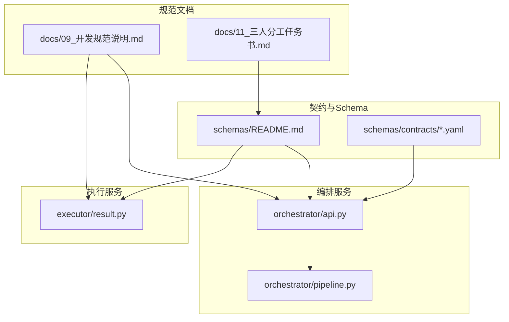
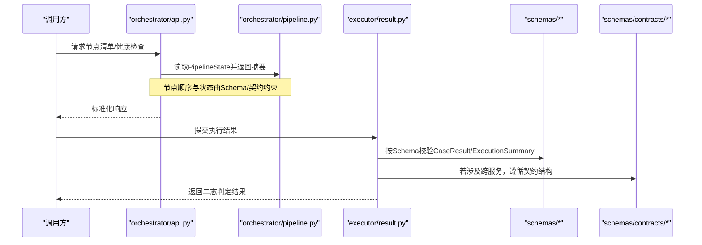
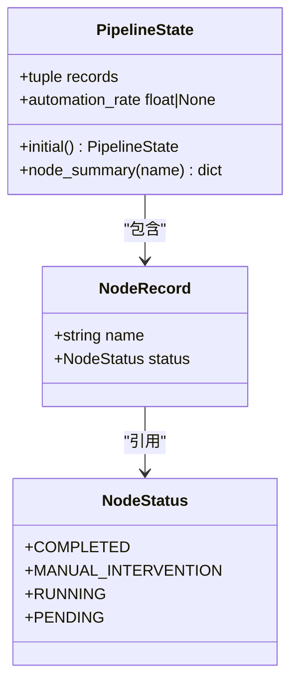
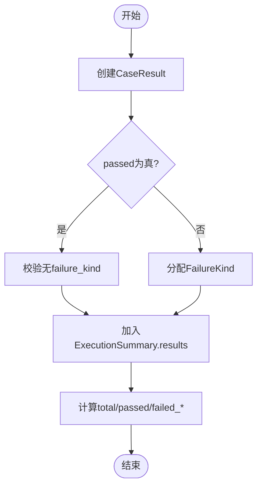
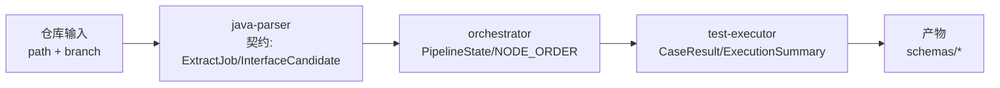

# Schema约定与规范

<cite>
**本文引用的文件**
- [schemas/README.md](file://schemas/README.md)
- [schemas/contracts/java-parser.openapi.yaml](file://schemas/contracts/java-parser.openapi.yaml)
- [services/orchestrator/src/orchestrator/api.py](file://services/orchestrator/src/orchestrator/api.py)
- [services/orchestrator/src/orchestrator/pipeline.py](file://services/orchestrator/src/orchestrator/pipeline.py)
- [services/test-executor/src/executor/result.py](file://services/test-executor/src/executor/result.py)
- [docs/09_开发规范说明.md](file://docs/09_开发规范说明.md)
- [docs/11_三人分工任务书.md](file://docs/11_三人分工任务书.md)
</cite>

## 目录
1. [引言](#引言)
2. [项目结构](#项目结构)
3. [核心组件](#核心组件)
4. [架构总览](#架构总览)
5. [详细组件分析](#详细组件分析)
6. [依赖关系分析](#依赖关系分析)
7. [性能考虑](#性能考虑)
8. [故障排查指南](#故障排查指南)
9. [结论](#结论)
10. [附录](#附录)

## 引言
本规范定义LLM-AutoTest项目的Schema约定，明确JSON Schema版本管理、ID命名、时间戳格式、协议枚举与错误结构等横切约定；阐明“Schema为单一事实来源”的原则，以及orchestrator与test-executor中数据模型与Schema的一一对应关系。本文同时给出最佳实践与常见问题排查指引，帮助团队在需求澄清、接口还原、用例生成、执行与度量全链路保持一致的数据契约。

## 项目结构
- schemas：集中存放全部结构化产物的JSON Schema与跨服务契约（OpenAPI/JSON Schema）。
- services/orchestrator：Python服务，负责9节点流水线编排、状态查询与健康检查；其对外API仅做协议转换与校验，业务逻辑下沉至pipeline等模块。
- services/test-executor：Python服务，负责测试脚本加载与无人值守执行，提供断言失败与环境失败的二态判定结果。
- docs：需求与规范文档，包含开发规范、分工任务书等，对Schema横切约定进行权威约束。

图表来源
- [schemas/README.md:1-30](file://schemas/README.md#L1-L30)
- [schemas/contracts/java-parser.openapi.yaml:116-168](file://schemas/contracts/java-parser.openapi.yaml#L116-L168)
- [services/orchestrator/src/orchestrator/api.py:1-28](file://services/orchestrator/src/orchestrator/api.py#L1-L28)
- [services/orchestrator/src/orchestrator/pipeline.py:1-84](file://services/orchestrator/src/orchestrator/pipeline.py#L1-L84)
- [services/test-executor/src/executor/result.py:1-61](file://services/test-executor/src/executor/result.py#L1-L61)
- [docs/09_开发规范说明.md:73-101](file://docs/09_开发规范说明.md#L73-L101)
- [docs/11_三人分工任务书.md:270-285](file://docs/11_三人分工任务书.md#L270-L285)

章节来源
- [schemas/README.md:1-30](file://schemas/README.md#L1-L30)
- [docs/09_开发规范说明.md:21-35](file://docs/09_开发规范说明.md#L21-L35)

## 核心组件
- JSON Schema与契约
  - 所有结构化产物均位于schemas目录，每个Schema需包含schema_version字段，结构变更必须升版本，禁止原地改语义。
  - 跨服务契约（如java-parser）通过OpenAPI/JSON Schema定义，确保三方对齐。
- orchestrator
  - API层只做协议转换与校验；健康检查与节点清单接口暴露当前PipelineState。
  - Pipeline定义9个固定节点顺序与四态标注，自动化率分母固定为9。
- test-executor
  - 执行结果采用“断言失败/环境失败”二态区分，保证通过率口径一致。
  - CaseResult与ExecutionSummary提供程序化汇总能力，数值不经LLM处理。

章节来源
- [schemas/README.md:5-10](file://schemas/README.md#L5-L10)
- [services/orchestrator/src/orchestrator/api.py:1-28](file://services/orchestrator/src/orchestrator/api.py#L1-L28)
- [services/orchestrator/src/orchestrator/pipeline.py:1-84](file://services/orchestrator/src/orchestrator/pipeline.py#L1-L84)
- [services/test-executor/src/executor/result.py:1-61](file://services/test-executor/src/executor/result.py#L1-L61)

## 架构总览
下图展示Schema作为单一事实来源如何贯穿orchestrator与test-executor，并与跨服务契约对齐。

图表来源
- [services/orchestrator/src/orchestrator/api.py:11-27](file://services/orchestrator/src/orchestrator/api.py#L11-L27)
- [services/orchestrator/src/orchestrator/pipeline.py:23-70](file://services/orchestrator/src/orchestrator/pipeline.py#L23-L70)
- [services/test-executor/src/executor/result.py:17-61](file://services/test-executor/src/executor/result.py#L17-L61)
- [schemas/contracts/java-parser.openapi.yaml:116-168](file://schemas/contracts/java-parser.openapi.yaml#L116-L168)

## 详细组件分析

### JSON Schema版本管理与单一事实来源原则
- 版本管理策略
  - 每个Schema定义必须包含schema_version字段；结构变更必须升版本，禁止原地改语义。
  - 跨服务契约（OpenAPI/JSON Schema）变更只允许加字段（可选），删改字段须全服务同步升级并在部署编排中声明启动顺序依赖。
- 单一事实来源
  - orchestrator与test-executor中的pydantic模型需与schemas中的JSON Schema一一对应；java-parser返回结构与contracts/契约对齐。
  - LLM输出（需求条目、接口还原、用例草案、Review标注）必须通过对应Schema校验后才可进入下游产物。
- 产物持久化
  - 所有结构化产物按任务ID分目录写入挂载卷，路径约定统一由orchestrator的artifacts模块管理，禁止各节点自行拼路径。

章节来源
- [schemas/README.md:5-10](file://schemas/README.md#L5-L10)
- [docs/09_开发规范说明.md:81-94](file://docs/09_开发规范说明.md#L81-L94)
- [docs/09_开发规范说明.md:123-129](file://docs/09_开发规范说明.md#L123-L129)

### ID命名规范
- 命名规则
  - 需求条目：REQ-001
  - 接口候选：CAND-001
  - 接口：IF-<协议大写>-001（例如IF-REST-001）
  - 用例：TC-001
  - 缺陷：DEF-001
  - 任务：job-<UUID>
- 序号要求
  - 三位零填充，跨仓库全局递增。
- 一致性保障
  - 该约定为三人公共语言，任何中间产物不得丢弃或改写ID格式。

章节来源
- [docs/11_三人分工任务书.md:270-280](file://docs/11_三人分工任务书.md#L270-L280)

### 时间戳格式
- 一律使用UTC、ISO-8601字符串（例如2026-09-15T08:30:00Z）。
- 禁止本地时区，确保审计口径一致。

章节来源
- [docs/11_三人分工任务书.md:270-280](file://docs/11_三人分工任务书.md#L270-L280)

### 协议枚举值
- 统一小写字符串：rest / grpc / graphql / soap / mq。
- 与java-parser契约一致，禁止REST、Rest等变体。

章节来源
- [schemas/contracts/java-parser.openapi.yaml:286-289](file://schemas/contracts/java-parser.openapi.yaml#L286-L289)
- [schemas/contracts/java-parser.openapi.yaml:323-331](file://schemas/contracts/java-parser.openapi.yaml#L323-L331)
- [docs/11_三人分工任务书.md:270-280](file://docs/11_三人分工任务书.md#L270-L280)

### 错误结构定义
- 三栈统一错误响应结构：{code, message, node_id?, details}
- code为稳定错误码；message为可理解错误信息，不得泄漏堆栈/路径细节；node_id为关联的流水线节点（可选）；details为结构化补充（如无效路径列表）。

章节来源
- [schemas/contracts/java-parser.openapi.yaml:130-147](file://schemas/contracts/java-parser.openapi.yaml#L130-L147)
- [docs/09_开发规范说明.md:89-94](file://docs/09_开发规范说明.md#L89-L94)

### orchestrator：API与Pipeline
- API职责
  - 健康检查：返回{"status": "ok"}。
  - 节点清单：返回9节点固定口径与当前状态，供前端监控。
- Pipeline职责
  - 定义NODE_ORDER（9个节点）与NodeStatus（completed/manual_intervention/running/pending）。
  - PipelineState提供initial()初始化与automation_rate计算（分母固定为9）。

图表来源
- [services/orchestrator/src/orchestrator/pipeline.py:11-70](file://services/orchestrator/src/orchestrator/pipeline.py#L11-L70)

章节来源
- [services/orchestrator/src/orchestrator/api.py:11-27](file://services/orchestrator/src/orchestrator/api.py#L11-L27)
- [services/orchestrator/src/orchestrator/pipeline.py:1-84](file://services/orchestrator/src/orchestrator/pipeline.py#L1-L84)

### test-executor：执行结果与二态判定
- FailureKind
  - assertion：断言失败，计入跑通口径。
  - environment：环境失败，隔离至待环境确认，不计入通过率分母。
- CaseResult
  - case_id、passed、failure_kind；通过后不得携带失败类型（一致性校验）。
- ExecutionSummary
  - results：单条用例结果集合。
  - total、passed、failed_assertion、failed_environment：程序化汇总属性，数值不经LLM。

图表来源
- [services/test-executor/src/executor/result.py:10-61](file://services/test-executor/src/executor/result.py#L10-L61)

章节来源
- [services/test-executor/src/executor/result.py:1-61](file://services/test-executor/src/executor/result.py#L1-L61)

### 横切约定与最佳实践
- 横切约定
  - ID命名、时间戳、协议枚举、is_fallback透传、错误结构统一。
  - is_fallback从仓库输入一路透传到defects/metrics，任何中间产物不得丢弃。
- 最佳实践
  - LLM输出必须先过Schema校验，失败按节点失败处理，禁止降级截取可用部分。
  - 报告/度量中的数字只能由execution.json等结构化产物程序化汇总产生，禁止LLM生成或修改。
  - 降级节点按“人工介入”计入并在产物中显式记录降级清单，禁止静默跳过。
  - 兜底仓库结果单独标注、分列呈现，避免虚假正向结论。

章节来源
- [schemas/README.md:5-10](file://schemas/README.md#L5-L10)
- [docs/09_开发规范说明.md:73-94](file://docs/09_开发规范说明.md#L73-L94)
- [docs/11_三人分工任务书.md:270-285](file://docs/11_三人分工任务书.md#L270-L285)

## 依赖关系分析
- 契约驱动
  - java-parser的ExtractJob、InterfaceCandidate等结构受schemas/contracts约束，确保扫描与还原阶段产出一致。
- 服务耦合
  - orchestrator依赖pipeline定义节点顺序与状态；test-executor依赖result模块进行二态判定。
- 数据流
  - 输入（仓库+分支）→ java-parser（契约）→ orchestrator（节点编排）→ test-executor（执行与汇总）→ 产物（schemas）。

图表来源
- [schemas/contracts/java-parser.openapi.yaml:162-168](file://schemas/contracts/java-parser.openapi.yaml#L162-L168)
- [schemas/contracts/java-parser.openapi.yaml:323-368](file://schemas/contracts/java-parser.openapi.yaml#L323-L368)
- [services/orchestrator/src/orchestrator/pipeline.py:23-70](file://services/orchestrator/src/orchestrator/pipeline.py#L23-L70)
- [services/test-executor/src/executor/result.py:17-61](file://services/test-executor/src/executor/result.py#L17-L61)

章节来源
- [schemas/contracts/java-parser.openapi.yaml:116-168](file://schemas/contracts/java-parser.openapi.yaml#L116-L168)
- [services/orchestrator/src/orchestrator/pipeline.py:1-84](file://services/orchestrator/src/orchestrator/pipeline.py#L1-L84)
- [services/test-executor/src/executor/result.py:1-61](file://services/test-executor/src/executor/result.py#L1-L61)

## 性能考虑
- 节点顺序固定为9，自动化率分母固定，便于度量与对比。
- 执行结果汇总通过属性计算，避免重复遍历与冗余计算。
- 契约与Schema校验前置，减少下游异常与返工成本。

[本节为通用指导，不直接分析具体文件]

## 故障排查指南
- LLM输出校验失败
  - 现象：下游无法消费LLM输出。
  - 排查：确认输出是否符合对应Schema；检查schema_version是否匹配；查看节点日志中的校验错误详情。
- 执行结果不一致
  - 现象：通过率口径异常。
  - 排查：确认CaseResult.passed与failure_kind一致性；检查ExecutionSummary.failed_*统计是否正确。
- 契约不一致
  - 现象：orchestrator与java-parser联调失败。
  - 排查：核对schemas/contracts中的接口定义；确认协议枚举与字段命名一致；必要时升级契约版本并同步实现。

章节来源
- [docs/09_开发规范说明.md:73-101](file://docs/09_开发规范说明.md#L73-L101)
- [services/test-executor/src/executor/result.py:25-30](file://services/test-executor/src/executor/result.py#L25-L30)
- [schemas/contracts/java-parser.openapi.yaml:130-147](file://schemas/contracts/java-parser.openapi.yaml#L130-L147)

## 结论
本规范以Schema为单一事实来源，统一了ID命名、时间戳、协议枚举与错误结构等横切约定；明确了orchestrator与test-executor中的数据模型与Schema的一一对应关系，并通过契约驱动跨服务协作。遵循本规范可有效降低联调成本、提升数据一致性与可维护性。

[本节为总结，不直接分析具体文件]

## 附录
- 关键参考
  - schemas/README.md：Schema目录约定与横切约定。
  - schemas/contracts/java-parser.openapi.yaml：跨服务契约（健康检查、错误结构、仓库输入、接口候选等）。
  - docs/09_开发规范说明.md：开发规范、红线与契约要求。
  - docs/11_三人分工任务书.md：横切约定与统一口径。

章节来源
- [schemas/README.md:1-30](file://schemas/README.md#L1-L30)
- [schemas/contracts/java-parser.openapi.yaml:116-168](file://schemas/contracts/java-parser.openapi.yaml#L116-L168)
- [docs/09_开发规范说明.md:73-101](file://docs/09_开发规范说明.md#L73-L101)
- [docs/11_三人分工任务书.md:270-285](file://docs/11_三人分工任务书.md#L270-L285)