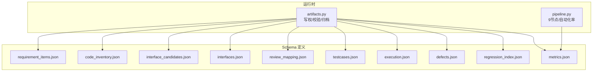
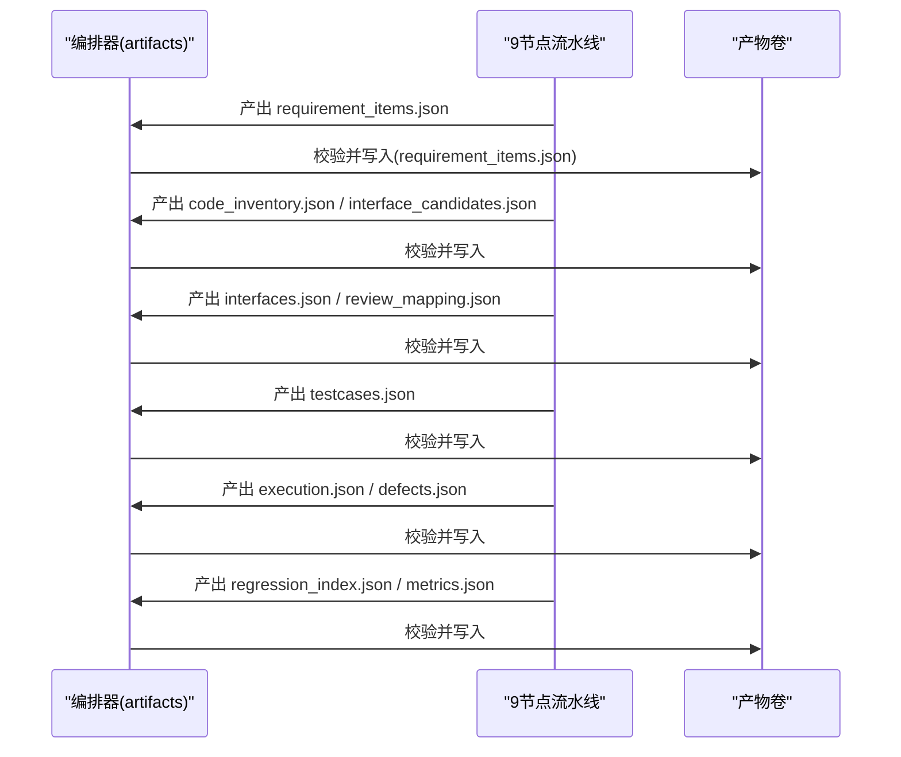
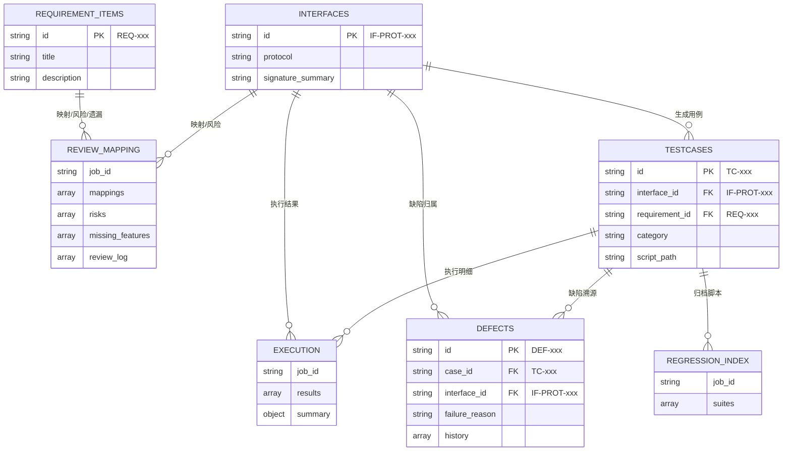
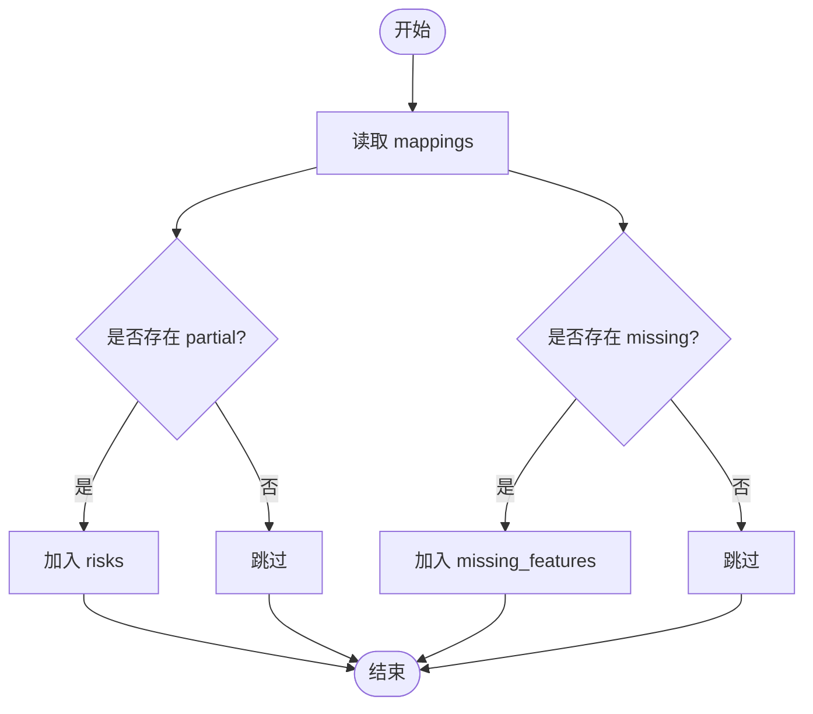
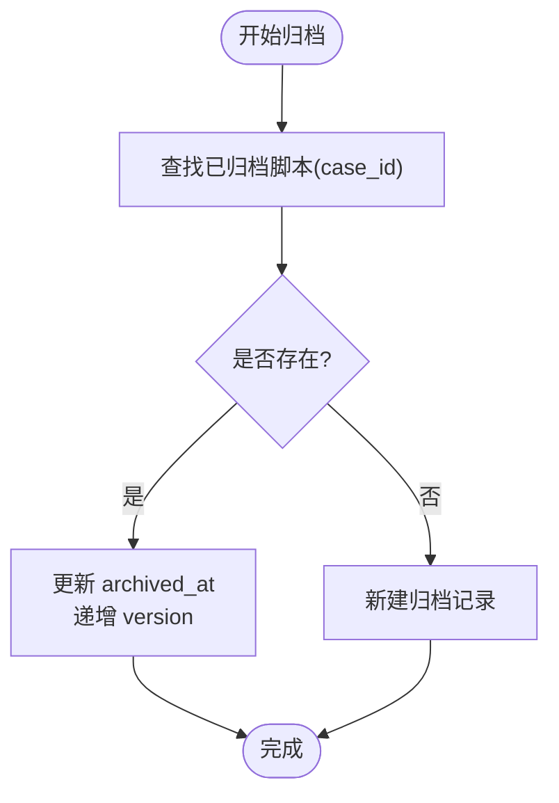
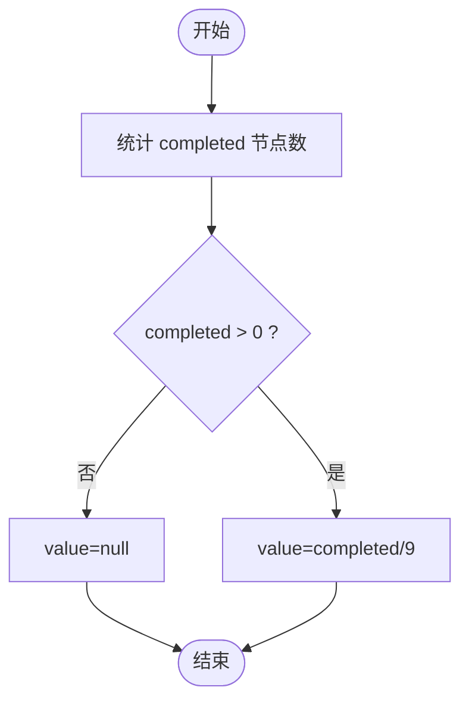
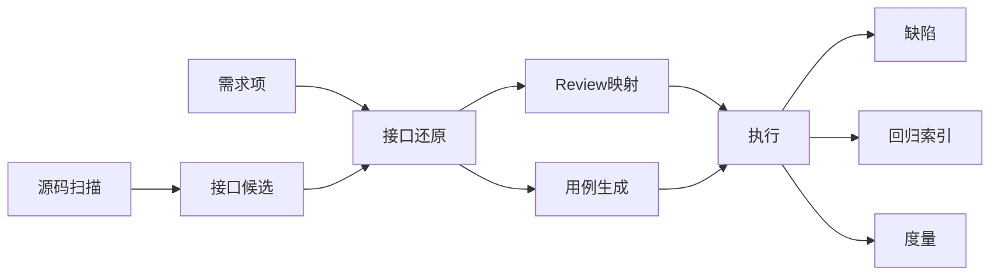
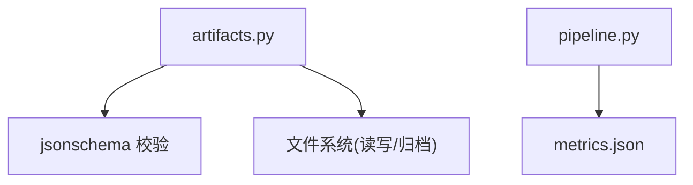

# 实体关系映射

<cite>
**本文引用的文件**
- [schemas/requirement_items.json](file://schemas/requirement_items.json)
- [schemas/code_inventory.json](file://schemas/code_inventory.json)
- [schemas/interface_candidates.json](file://schemas/interface_candidates.json)
- [schemas/interfaces.json](file://schemas/interfaces.json)
- [schemas/review_mapping.json](file://schemas/review_mapping.json)
- [schemas/testcases.json](file://schemas/testcases.json)
- [schemas/execution.json](file://schemas/execution.json)
- [schemas/defects.json](file://schemas/defects.json)
- [schemas/regression_index.json](file://schemas/regression_index.json)
- [schemas/metrics.json](file://schemas/metrics.json)
- [services/orchestrator/src/orchestrator/artifacts.py](file://services/orchestrator/src/orchestrator/artifacts.py)
- [services/orchestrator/src/orchestrator/pipeline.py](file://services/orchestrator/src/orchestrator/pipeline.py)
</cite>

## 目录
1. [简介](#简介)
2. [项目结构](#项目结构)
3. [核心组件](#核心组件)
4. [架构总览](#架构总览)
5. [详细组件分析](#详细组件分析)
6. [依赖分析](#依赖分析)
7. [性能考虑](#性能考虑)
8. [故障排查指南](#故障排查指南)
9. [结论](#结论)
10. [附录](#附录)

## 简介
本文件面向 LLM-AutoTest 的数据层，系统化梳理各数据实体之间的关联关系与映射规则，重点说明：
- Review 映射表的“三视图”设计（映射表/风险/遗漏）及其一致性约束
- 回归资产索引的组织方式与幂等归档策略
- 度量指标的计算口径与完整性处理
- 主外键约束、引用完整性与数据一致性保证机制
- 实体关系图与 ER 图，以及数据流向与依赖关系
- 数据迁移策略与版本兼容性方案

## 项目结构
- 数据模型以 JSON Schema 形式集中定义于 schemas/ 目录，每个产物对应一个 schema 文件，文件名与产物名一一对应。
- 产物落盘与写权由 orchestrator 的 artifacts.py 统一管理，确保：
  - 产物存在即节点完成（通过 schema 校验）
  - 写方排他（orchestrator 或 test-executor 二选一）
  - 原子写入（临时文件 + replace）
- 流水线节点顺序与自动化率计算在 pipeline.py 中固定为 9 个节点，分母固定为 9。

图表来源
- [services/orchestrator/src/orchestrator/artifacts.py:24-50](file://services/orchestrator/src/orchestrator/artifacts.py#L24-L50)
- [services/orchestrator/src/orchestrator/pipeline.py:23-34](file://services/orchestrator/src/orchestrator/pipeline.py#L23-L34)

章节来源
- [services/orchestrator/src/orchestrator/artifacts.py:24-50](file://services/orchestrator/src/orchestrator/artifacts.py#L24-L50)
- [services/orchestrator/src/orchestrator/pipeline.py:23-34](file://services/orchestrator/src/orchestrator/pipeline.py#L23-L34)

## 核心组件
- 需求解析条目（requirement_items.json）：以 REQ-xxx 标识需求项，作为后续映射与追溯的根。
- 源码扫描清单（code_inventory.json）：仓库级扫描结果，包含状态与文件清单。
- 接口候选清单（interface_candidates.json）：静态侧定位的接口候选，供语义补全消费。
- 接口还原清单（interfaces.json）：经 LLM 补全后的接口签名与参数，承载协议维度信息。
- Review 映射表（review_mapping.json）：三视图（映射表/风险/遗漏）+ 审核日志。
- 用例与脚本元数据（testcases.json）：按接口生成用例，携带预期与可加载性。
- 执行结果（execution.json）：用例执行明细与汇总，含失败分类与降级协议记录。
- 本地缺陷记录（defects.json）：仅断言失败入缺陷清单，带生命周期历史。
- 回归资产索引（regression_index.json）：按协议组织脚本，支持幂等重档与漂移告警。
- 度量指标（metrics.json）：自动化率与节点状态，数值程序化汇总。

章节来源
- [schemas/requirement_items.json:1-44](file://schemas/requirement_items.json#L1-L44)
- [schemas/code_inventory.json:1-57](file://schemas/code_inventory.json#L1-L57)
- [schemas/interface_candidates.json:1-58](file://schemas/interface_candidates.json#L1-L58)
- [schemas/interfaces.json:1-70](file://schemas/interfaces.json#L1-L70)
- [schemas/review_mapping.json:1-81](file://schemas/review_mapping.json#L1-L81)
- [schemas/testcases.json:1-35](file://schemas/testcases.json#L1-L35)
- [schemas/execution.json:1-59](file://schemas/execution.json#L1-L59)
- [schemas/defects.json:1-54](file://schemas/defects.json#L1-L54)
- [schemas/regression_index.json:1-50](file://schemas/regression_index.json#L1-L50)
- [schemas/metrics.json:1-49](file://schemas/metrics.json#L1-L49)

## 架构总览
从数据流角度，LLM-AutoTest 将 9 个流水线节点与 10 个产物绑定，形成稳定的输入输出契约：
- 上游产出（需求、源码扫描、接口候选）驱动下游（接口还原、Review、用例生成、执行、缺陷、回归、度量）。
- 所有 JSON 产物均受 schema 强约束；Markdown 报告仅检查存在性与非空。
- 写权隔离避免并发冲突；归档机制保障重跑安全。

图表来源
- [services/orchestrator/src/orchestrator/artifacts.py:24-50](file://services/orchestrator/src/orchestrator/artifacts.py#L24-L50)
- [services/orchestrator/src/orchestrator/artifacts.py:75-96](file://services/orchestrator/src/orchestrator/artifacts.py#L75-L96)

章节来源
- [services/orchestrator/src/orchestrator/artifacts.py:24-50](file://services/orchestrator/src/orchestrator/artifacts.py#L24-L50)
- [services/orchestrator/src/orchestrator/artifacts.py:75-96](file://services/orchestrator/src/orchestrator/artifacts.py#L75-L96)

## 详细组件分析

### 实体关系与ER图
以下 ER 图展示核心实体及主要外键关系（基于 schema 字段约定）：
- 需求项（requirement_items）→ Review 映射（review_mapping.mappings.risks.missing_features）
- 接口（interfaces）→ Review 映射、用例（testcases）、执行（execution）、缺陷（defects）、回归索引（regression_index）
- 用例（testcases）→ 执行（execution）、缺陷（defects）、回归索引（regression_index）
- 执行（execution）→ 缺陷（defects）
- 回归索引（regression_index）→ 用例（testcases）

图表来源
- [schemas/requirement_items.json:1-44](file://schemas/requirement_items.json#L1-L44)
- [schemas/interfaces.json:1-70](file://schemas/interfaces.json#L1-L70)
- [schemas/review_mapping.json:1-81](file://schemas/review_mapping.json#L1-L81)
- [schemas/testcases.json:1-35](file://schemas/testcases.json#L1-L35)
- [schemas/execution.json:1-59](file://schemas/execution.json#L1-L59)
- [schemas/defects.json:1-54](file://schemas/defects.json#L1-L54)
- [schemas/regression_index.json:1-50](file://schemas/regression_index.json#L1-L50)

章节来源
- [schemas/requirement_items.json:1-44](file://schemas/requirement_items.json#L1-L44)
- [schemas/interfaces.json:1-70](file://schemas/interfaces.json#L1-L70)
- [schemas/review_mapping.json:1-81](file://schemas/review_mapping.json#L1-L81)
- [schemas/testcases.json:1-35](file://schemas/testcases.json#L1-L35)
- [schemas/execution.json:1-59](file://schemas/execution.json#L1-L59)
- [schemas/defects.json:1-54](file://schemas/defects.json#L1-L54)
- [schemas/regression_index.json:1-50](file://schemas/regression_index.json#L1-L50)

### Review 映射表的多视图设计与一致性
- 视图一：需求-代码映射表（mappings），描述需求与接口的实现状态与置信度，并附带证据位置。
- 视图二：风险清单（risks），当映射状态为 partial 时自动进入，用于提示潜在风险。
- 视图三：遗漏功能清单（missing_features），提取 mapping 中的 missing 条目，保证与映射表一致。
- 审核日志（review_log）：人工决策（通过/驳回）与回流标记，形成闭环。

一致性规则
- risks 与 missing_features 由 mappings 派生，避免手工维护不一致。
- 所有条目通过正则约束 ID 格式，便于跨文件关联。

图表来源
- [schemas/review_mapping.json:10-63](file://schemas/review_mapping.json#L10-L63)

章节来源
- [schemas/review_mapping.json:10-63](file://schemas/review_mapping.json#L10-L63)

### 回归资产索引的组织方式
- 按协议维度组织 suites（rest/grpc/graphql/soap/mq），不同协议有不同质量要求。
- 每个脚本记录 case_id、script_path、requirement_id、interface_id、archived_at、version。
- 幂等重档：同用例重复归档时更新 archived_at；覆盖归档时递增 version。
- 漂移告警：重跑结果与沉淀不一致时，记录 drift_warnings，交由人工判断不自动删除。

图表来源
- [schemas/regression_index.json:10-47](file://schemas/regression_index.json#L10-L47)

章节来源
- [schemas/regression_index.json:10-47](file://schemas/regression_index.json#L10-L47)

### 度量指标的计算逻辑
- 自动化率 = 已完成节点数 / 9（分母固定为 9，禁止缩减）。
- nodes 数组固定 9 项，逐项记录 name、status、degraded、intervention_reason、automation_path。
- 数据不完整时 value 为 null，避免误导；measured_at 仅正式验收数值作为基线。

图表来源
- [schemas/metrics.json:6-47](file://schemas/metrics.json#L6-L47)
- [services/orchestrator/src/orchestrator/pipeline.py:61-70](file://services/orchestrator/src/orchestrator/pipeline.py#L61-L70)

章节来源
- [schemas/metrics.json:6-47](file://schemas/metrics.json#L6-L47)
- [services/orchestrator/src/orchestrator/pipeline.py:61-70](file://services/orchestrator/src/orchestrator/pipeline.py#L61-L70)

### 主外键约束、引用完整性与数据一致性
- 主键约定：
  - 需求项：id 匹配 ^REQ-\d{3}$
  - 接口：id 匹配 ^IF-(REST|GRPC|GRAPHQL|SOAP|MQ)-\d{3}$
  - 用例：id 匹配 ^TC-\d{3}$
  - 缺陷：id 匹配 ^DEF-\d{3}$
  - 候选：candidate_id 匹配 ^CAND-\d{3}$
- 外键与引用完整性：
  - testcases.interface_id → interfaces.id
  - testcases.requirement_id → requirement_items.id
  - execution.results[].interface_id → interfaces.id
  - defects.case_id → testcases.id；defects.interface_id → interfaces.id
  - regression_index.suites[].scripts[].case_id → testcases.id；interface_id → interfaces.id；requirement_id → requirement_items.id
  - review_mapping.mappings.risks.missing_features 引用 requirement_id 与 interface_id
- 一致性保证：
  - 所有 JSON 产物通过 Draft202012Validator 校验，拒绝不符合 schema 的写入。
  - 写权排他：artifacts.py 维护 _WRITE_OWNERS，防止多服务同时写入同一产物。
  - 原子写入：tmp 文件 + replace，避免半写状态。
  - 节点完成判据：产物存在且通过校验（Markdown 仅检查非空）。

章节来源
- [schemas/requirement_items.json:10-20](file://schemas/requirement_items.json#L10-L20)
- [schemas/interfaces.json:10-20](file://schemas/interfaces.json#L10-L20)
- [schemas/testcases.json:10-20](file://schemas/testcases.json#L10-L20)
- [schemas/execution.json:10-20](file://schemas/execution.json#L10-L20)
- [schemas/defects.json:10-20](file://schemas/defects.json#L10-L20)
- [schemas/regression_index.json:10-30](file://schemas/regression_index.json#L10-L30)
- [schemas/review_mapping.json:10-63](file://schemas/review_mapping.json#L10-L63)
- [services/orchestrator/src/orchestrator/artifacts.py:75-96](file://services/orchestrator/src/orchestrator/artifacts.py#L75-L96)
- [services/orchestrator/src/orchestrator/artifacts.py:120-131](file://services/orchestrator/src/orchestrator/artifacts.py#L120-L131)

### 数据流向与依赖关系
- 上游：requirement_items、code_inventory、interface_candidates
- 中游：interfaces、review_mapping、testcases
- 下游：execution、defects、regression_index、metrics
- 依赖方向严格单向，避免循环依赖；所有下游均可追溯到上游实体。

图表来源
- [schemas/requirement_items.json:1-44](file://schemas/requirement_items.json#L1-L44)
- [schemas/code_inventory.json:1-57](file://schemas/code_inventory.json#L1-L57)
- [schemas/interface_candidates.json:1-58](file://schemas/interface_candidates.json#L1-L58)
- [schemas/interfaces.json:1-70](file://schemas/interfaces.json#L1-L70)
- [schemas/review_mapping.json:1-81](file://schemas/review_mapping.json#L1-L81)
- [schemas/testcases.json:1-35](file://schemas/testcases.json#L1-L35)
- [schemas/execution.json:1-59](file://schemas/execution.json#L1-L59)
- [schemas/defects.json:1-54](file://schemas/defects.json#L1-L54)
- [schemas/regression_index.json:1-50](file://schemas/regression_index.json#L1-L50)
- [schemas/metrics.json:1-49](file://schemas/metrics.json#L1-L49)

## 依赖分析
- 组件耦合：
  - 产物间通过 ID 模式进行弱耦合引用，降低强类型数据库约束成本。
  - artifacts.py 集中管理写权与校验，解耦业务逻辑与存储细节。
- 外部依赖：
  - jsonschema.Draft202012Validator 用于 schema 校验
  - 文件系统操作（Path、shutil）用于原子写入与归档
- 循环依赖：
  - 数据模型无循环引用；流程方向明确，避免环状依赖。

图表来源
- [services/orchestrator/src/orchestrator/artifacts.py:18-20](file://services/orchestrator/src/orchestrator/artifacts.py#L18-L20)
- [services/orchestrator/src/orchestrator/artifacts.py:75-96](file://services/orchestrator/src/orchestrator/artifacts.py#L75-L96)
- [services/orchestrator/src/orchestrator/pipeline.py:61-70](file://services/orchestrator/src/orchestrator/pipeline.py#L61-L70)

章节来源
- [services/orchestrator/src/orchestrator/artifacts.py:18-20](file://services/orchestrator/src/orchestrator/artifacts.py#L18-L20)
- [services/orchestrator/src/orchestrator/artifacts.py:75-96](file://services/orchestrator/src/orchestrator/artifacts.py#L75-L96)
- [services/orchestrator/src/orchestrator/pipeline.py:61-70](file://services/orchestrator/src/orchestrator/pipeline.py#L61-L70)

## 性能考虑
- 批量写入与校验：建议对大数组字段（如 mappings、results）分批校验与写入，减少单次 payload 大小。
- 归档策略：使用 move 而非 copy，避免额外 I/O 开销。
- 指标计算：自动化率仅在必要时重新计算，缓存中间状态以减少重复统计。
- 索引优化：对高频查询字段（如 case_id、interface_id）建立内存索引以提升检索效率。

[本节提供通用指导，无需特定文件来源]

## 故障排查指南
- 校验失败：
  - 现象：写入抛出 PipelineError，提示产物校验失败。
  - 排查：检查对应 schema 必填字段、枚举值、正则格式；确认 job_id 前缀与 ID 格式。
  - 参考路径：[artifacts.py:75-96](file://services/orchestrator/src/orchestrator/artifacts.py#L75-L96)
- 写权冲突：
  - 现象：非所属服务尝试写入被拒。
  - 排查：核对 _WRITE_OWNERS 配置，确认当前服务角色。
  - 参考路径：[artifacts.py:144-157](file://services/orchestrator/src/orchestrator/artifacts.py#L144-L157)
- 节点未完成：
  - 现象：is_node_completed 返回 False。
  - 排查：检查产物是否存在、是否为空（Markdown）、是否通过 schema 校验。
  - 参考路径：[artifacts.py:120-131](file://services/orchestrator/src/orchestrator/artifacts.py#L120-L131)
- 回归漂移：
  - 现象：drift_warnings 出现。
  - 排查：对比重跑结果与归档脚本，人工判断是否变更合理。
  - 参考路径：[regression_index.json:36-47](file://schemas/regression_index.json#L36-L47)

章节来源
- [services/orchestrator/src/orchestrator/artifacts.py:75-96](file://services/orchestrator/src/orchestrator/artifacts.py#L75-L96)
- [services/orchestrator/src/orchestrator/artifacts.py:120-131](file://services/orchestrator/src/orchestrator/artifacts.py#L120-L131)
- [services/orchestrator/src/orchestrator/artifacts.py:144-157](file://services/orchestrator/src/orchestrator/artifacts.py#L144-L157)
- [schemas/regression_index.json:36-47](file://schemas/regression_index.json#L36-L47)

## 结论
- LLM-AutoTest 通过严格的 schema 约束与写权隔离，构建了高可靠的数据管线。
- Review 三视图与回归索引、度量指标共同支撑了可追溯、可审计的质量闭环。
- 建议在后续迭代中持续完善异常编码处理、截断范围标注与降级原因记录，进一步提升鲁棒性。

[本节总结性内容，无需特定文件来源]

## 附录

### 数据迁移策略与版本兼容性
- 版本控制：
  - 每个 schema 与产物均包含 schema_version 字段，当前为 1.0。
  - 升级时需同步更新 schema 与产物，保持向后兼容。
- 迁移步骤：
  - 新增字段：保持可选，旧产物仍可被新 schema 校验通过。
  - 废弃字段：保留一段时间并标记 deprecated，逐步清理。
  - 枚举扩展：新增枚举值需兼容旧值，避免破坏既有数据。
- 兼容性处理：
  - 读取端需容忍未知字段（additionalProperties 允许扩展）。
  - 写入端在升级后先校验再替换，确保原子性。
- 回滚策略：
  - 归档旧产物（archive 目录），支持快速回滚到上一版本。
  - 若 schema 不兼容，优先恢复旧 schema 与产物快照。

章节来源
- [schemas/requirement_items.json:1-10](file://schemas/requirement_items.json#L1-L10)
- [schemas/interfaces.json:1-10](file://schemas/interfaces.json#L1-L10)
- [schemas/review_mapping.json:1-10](file://schemas/review_mapping.json#L1-L10)
- [schemas/testcases.json:1-10](file://schemas/testcases.json#L1-L10)
- [schemas/execution.json:1-10](file://schemas/execution.json#L1-L10)
- [schemas/defects.json:1-10](file://schemas/defects.json#L1-L10)
- [schemas/regression_index.json:1-10](file://schemas/regression_index.json#L1-L10)
- [schemas/metrics.json:1-10](file://schemas/metrics.json#L1-L10)
- [services/orchestrator/src/orchestrator/artifacts.py:133-142](file://services/orchestrator/src/orchestrator/artifacts.py#L133-L142)