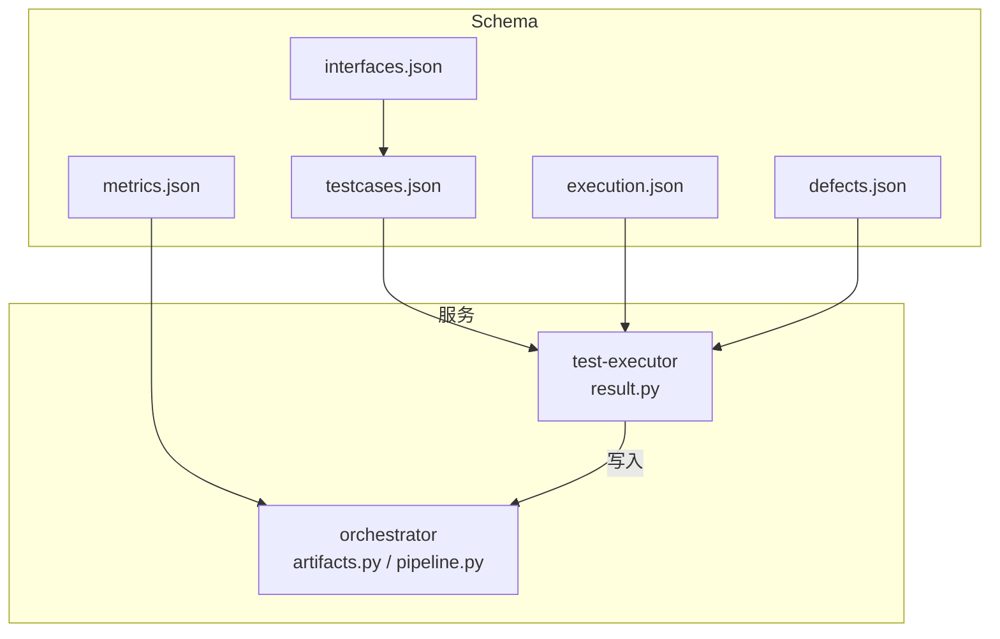
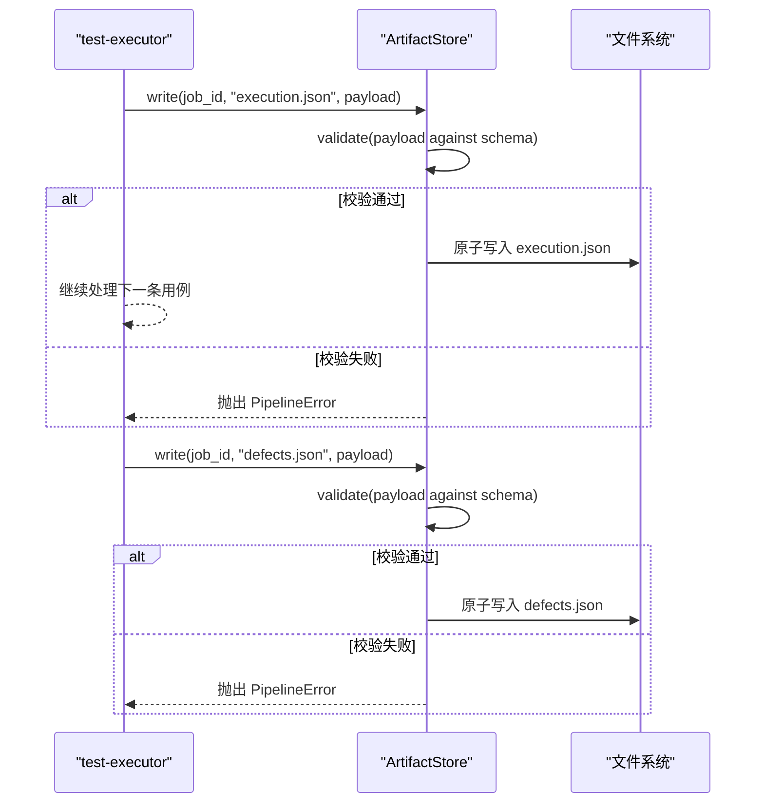
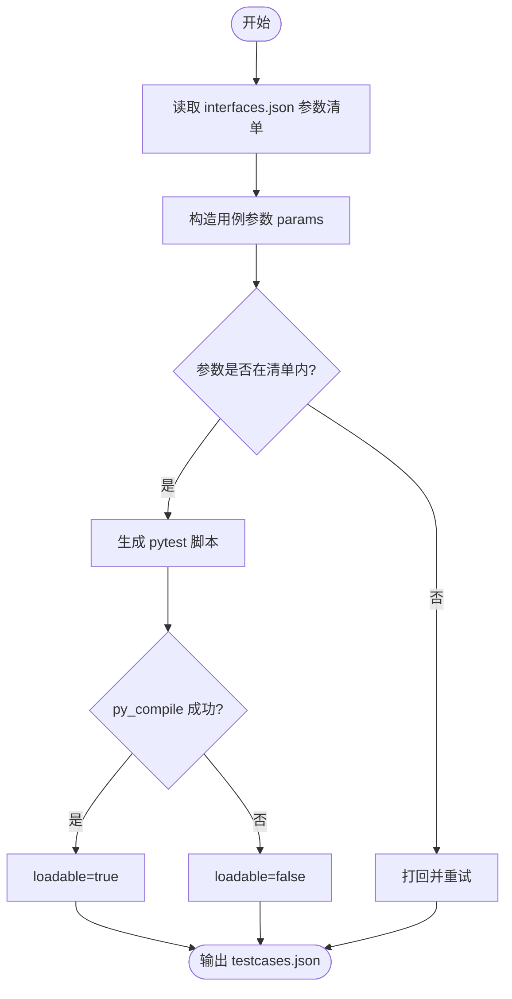
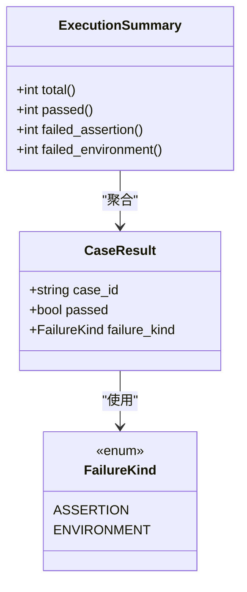
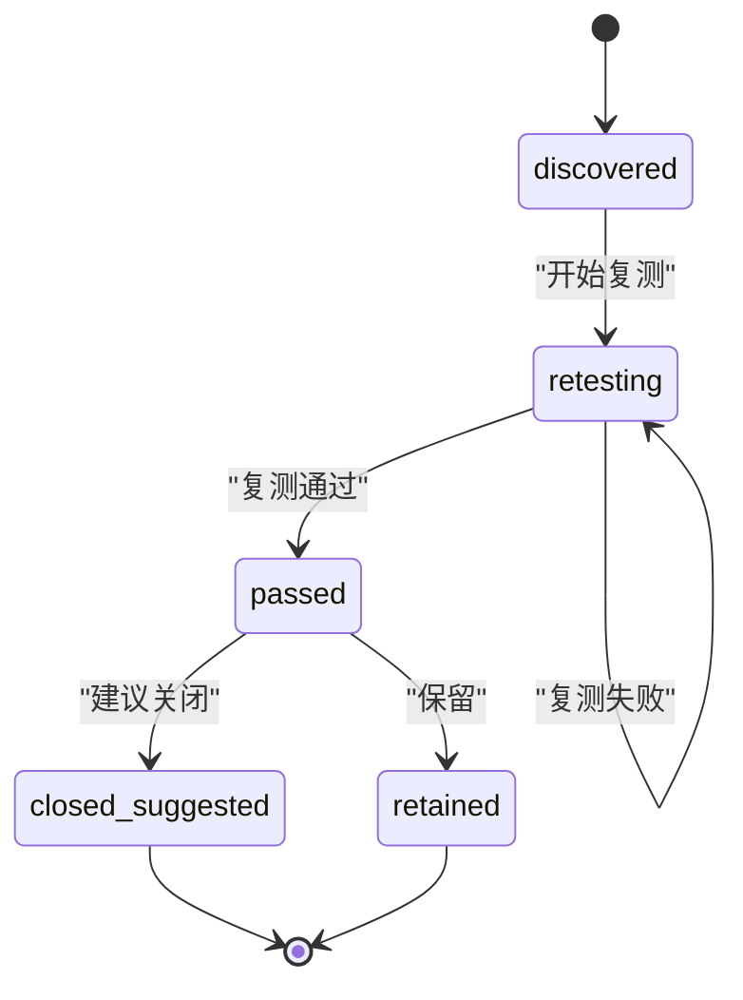
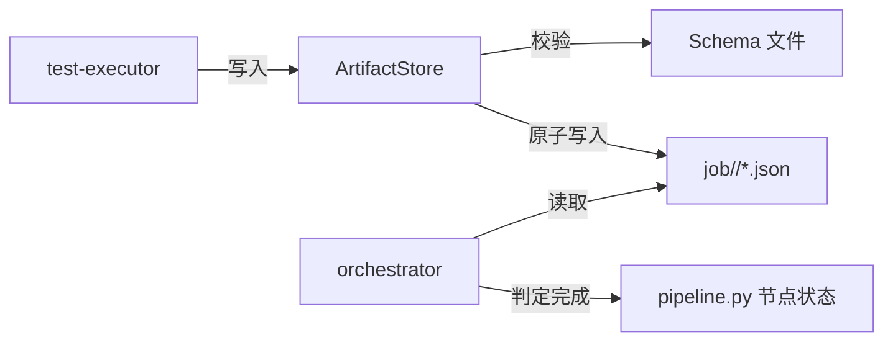

# 执行与测试数据模型

<cite>
**本文引用的文件**
- [schemas/execution.json](file://schemas/execution.json)
- [schemas/testcases.json](file://schemas/testcases.json)
- [schemas/defects.json](file://schemas/defects.json)
- [schemas/interfaces.json](file://schemas/interfaces.json)
- [schemas/metrics.json](file://schemas/metrics.json)
- [schemas/samples/execution.sample.json](file://schemas/samples/execution.sample.json)
- [services/test-executor/src/executor/result.py](file://services/test-executor/src/executor/result.py)
- [services/test-executor/tests/test_result.py](file://services/test-executor/tests/test_result.py)
- [services/orchestrator/src/orchestrator/artifacts.py](file://services/orchestrator/src/orchestrator/artifacts.py)
- [services/orchestrator/src/orchestrator/pipeline.py](file://services/orchestrator/src/orchestrator/pipeline.py)
</cite>

## 目录
1. [简介](#简介)
2. [项目结构](#项目结构)
3. [核心组件](#核心组件)
4. [架构总览](#架构总览)
5. [详细组件分析](#详细组件分析)
6. [依赖关系分析](#依赖关系分析)
7. [性能考虑](#性能考虑)
8. [故障排查指南](#故障排查指南)
9. [结论](#结论)
10. [附录：JSON示例与查询模式](#附录json示例与查询模式)

## 简介
本文件聚焦 LLM-AutoTest 的“执行与测试”相关数据模型，围绕三类核心对象进行系统化说明：
- 测试用例（testcases）：用例元数据、脚本信息、断言依据与参数来源约束。
- 执行结果（execution）：二态失败设计（断言失败 vs 环境失败）、超时与跳过语义、汇总统计与降级协议记录。
- 缺陷记录（defects）：与用例/接口的双向关联、生命周期事件、复现信息与兜底标记透传。

同时给出与接口清单（interfaces）和度量（metrics）的衔接关系，并提供完整的 JSON 示例与常用查询模式，帮助读者快速理解并正确使用这些数据结构。

## 项目结构
与执行与测试相关的核心 Schema 位于 schemas 目录；执行侧实现位于 services/test-executor；产物落盘与写权校验由 orchestrator 统一管理。

图表来源
- [schemas/testcases.json:1-35](file://schemas/testcases.json#L1-L35)
- [schemas/execution.json:1-59](file://schemas/execution.json#L1-L59)
- [schemas/defects.json:1-54](file://schemas/defects.json#L1-L54)
- [schemas/interfaces.json:1-70](file://schemas/interfaces.json#L1-L70)
- [schemas/metrics.json:1-49](file://schemas/metrics.json#L1-L49)
- [services/test-executor/src/executor/result.py:1-61](file://services/test-executor/src/executor/result.py#L1-L61)
- [services/orchestrator/src/orchestrator/artifacts.py:1-157](file://services/orchestrator/src/orchestrator/artifacts.py#L1-L157)
- [services/orchestrator/src/orchestrator/pipeline.py:1-84](file://services/orchestrator/src/orchestrator/pipeline.py#L1-L84)

章节来源
- [schemas/testcases.json:1-35](file://schemas/testcases.json#L1-L35)
- [schemas/execution.json:1-59](file://schemas/execution.json#L1-L59)
- [schemas/defects.json:1-54](file://schemas/defects.json#L1-L54)
- [schemas/interfaces.json:1-70](file://schemas/interfaces.json#L1-L70)
- [schemas/metrics.json:1-49](file://schemas/metrics.json#L1-L49)
- [services/test-executor/src/executor/result.py:1-61](file://services/test-executor/src/executor/result.py#L1-L61)
- [services/orchestrator/src/orchestrator/artifacts.py:1-157](file://services/orchestrator/src/orchestrator/artifacts.py#L1-L157)
- [services/orchestrator/src/orchestrator/pipeline.py:1-84](file://services/orchestrator/src/orchestrator/pipeline.py#L1-L84)

## 核心组件
- 测试用例（testcases）：描述每个用例的标识、归属接口、分类、标题、预期、脚本路径与可加载性校验等。
- 执行结果（execution）：逐条用例的执行结果、失败类型、耗时、时间戳，以及整体汇总与降级协议记录。
- 缺陷记录（defects）：仅由断言失败产生，包含复现步骤、状态流转历史、是否基于新版本复测、是否兜底埋入等。
- 接口清单（interfaces）：用例参数来源的唯一权威，用于校验用例参数合法性。
- 度量（metrics）：流水线节点自动化率与状态，独立于执行结果但与之协同。

章节来源
- [schemas/testcases.json:1-35](file://schemas/testcases.json#L1-L35)
- [schemas/execution.json:1-59](file://schemas/execution.json#L1-L59)
- [schemas/defects.json:1-54](file://schemas/defects.json#L1-L54)
- [schemas/interfaces.json:1-70](file://schemas/interfaces.json#L1-L70)
- [schemas/metrics.json:1-49](file://schemas/metrics.json#L1-L49)

## 架构总览
执行与测试的数据流遵循“生成—执行—产物校验—归档”的闭环：
- test-executor 负责产出 execution.json 与 defects.json，并通过 orchestrator 的 ArtifactStore 进行 Schema 校验与原子落盘。
- orchestrator 维护 artifacts 清单与写权隔离，确保各服务只写自己负责的产物。
- metrics.json 由 orchestrator 产出，反映流水线节点完成度与自动化率。

图表来源
- [services/orchestrator/src/orchestrator/artifacts.py:75-96](file://services/orchestrator/src/orchestrator/artifacts.py#L75-L96)
- [services/orchestrator/src/orchestrator/artifacts.py:98-112](file://services/orchestrator/src/orchestrator/artifacts.py#L98-L112)
- [services/orchestrator/src/orchestrator/artifacts.py:144-157](file://services/orchestrator/src/orchestrator/artifacts.py#L144-L157)

章节来源
- [services/orchestrator/src/orchestrator/artifacts.py:1-157](file://services/orchestrator/src/orchestrator/artifacts.py#L1-L157)

## 详细组件分析

### 测试用例（testcases）
- 标识与溯源
  - case id 格式固定为 TC-xxx，interface_id 格式为 IF-XXX-xxx，支持 requirement_id 溯源至需求项。
- 分类与覆盖
  - category 限定为 normal/boundary/exception，要求每接口三类各至少一条。
- 参数与断言
  - params 必须来自 interfaces.json 的参数清单，出现清单外参数即打回；expected 作为断言依据。
- 脚本与可加载性
  - script_path 指向生成的 pytest 脚本；loadable 表示 py_compile + 收集零 error 的校验结果。
- 置信度
  - low_confidence 用于标注 unknown 参数用例的低置信度提示。

图表来源
- [schemas/testcases.json:10-31](file://schemas/testcases.json#L10-L31)
- [schemas/interfaces.json:30-43](file://schemas/interfaces.json#L30-L43)

章节来源
- [schemas/testcases.json:1-35](file://schemas/testcases.json#L1-L35)
- [schemas/interfaces.json:1-70](file://schemas/interfaces.json#L1-L70)

### 执行结果（execution）
- 二态失败设计
  - failure_kind 枚举 assertion/environment/null，分别对应“断言失败”与“环境失败”，通过 R-EXEC-03/X-EXEC-01 分离处理。
  - 断言失败计入通过率分母并进入缺陷清单；环境失败隔离至待环境确认，不计入通过率分母。
- 其他字段
  - timeout 标记执行超时；skipped_reason 记录前置缺失导致的跳过；duration_ms 与 timestamp 提供耗时与时间信息。
- 汇总统计
  - summary.total/passed/failed_assertion/failed_environment/interrupted 由程序化汇总，不经 LLM。
- 降级协议
  - degraded_protocols 显式记录降级协议与原因，如 MQ 异步消费场景。

图表来源
- [services/test-executor/src/executor/result.py:10-61](file://services/test-executor/src/executor/result.py#L10-L61)

章节来源
- [schemas/execution.json:1-59](file://schemas/execution.json#L1-L59)
- [services/test-executor/src/executor/result.py:1-61](file://services/test-executor/src/executor/result.py#L1-L61)
- [services/test-executor/tests/test_result.py:1-30](file://services/test-executor/tests/test_result.py#L1-L30)

### 缺陷记录（defects）
- 触发条件
  - 仅断言失败进入缺陷清单；环境失败不入本清单（隔离至待环境确认）。
- 关联关系
  - case_id 与 interface_id 与用例/接口双向关联，便于回溯。
- 复现信息
  - reproduce.script_path 指向用例脚本，params 携带复现实例参数。
- 状态与生命周期
  - status 枚举：discovered → retesting → passed → closed_suggested/retained；history 记录事件与时间戳，形成可审计的生命周期。
- 版本与兜底
  - based_on_new_version 标注复测时代码变更；is_fallback 透传兜底仓库标记。

图表来源
- [schemas/defects.json:30-48](file://schemas/defects.json#L30-L48)

章节来源
- [schemas/defects.json:1-54](file://schemas/defects.json#L1-L54)

### 接口清单（interfaces）与用例参数约束
- 接口签名与参数位置
  - REST 含 method+path；其他协议含 service/method；params 中 in 指定 path/query/body/header。
- 未知参数处理
  - type 可为 unknown，并允许设置 default 以支撑边界默认值。
- 用例参数校验
  - 用例 params 只能来自 interfaces.json 的参数清单，否则打回。

章节来源
- [schemas/interfaces.json:1-70](file://schemas/interfaces.json#L1-L70)
- [schemas/testcases.json:21-25](file://schemas/testcases.json#L21-L25)

### 度量（metrics）与流水线节点
- 自动化率
  - automation_rate.value 为已完成节点数/9，分母固定为 9；当数据不完整时 value 为 null。
- 节点状态
  - nodes 数组固定 9 个节点名称与状态，支持降级与人工介入标注。
- 与执行的关系
  - auto_execute/test_report/defect_list/retest_regression 等节点与执行流程紧密相关。

章节来源
- [schemas/metrics.json:1-49](file://schemas/metrics.json#L1-L49)
- [services/orchestrator/src/orchestrator/pipeline.py:23-34](file://services/orchestrator/src/orchestrator/pipeline.py#L23-L34)

## 依赖关系分析
- 写权与产物清单
  - orchestrator 定义 ARTIFACT_FILES 与 _WRITE_OWNERS，明确 test-executor 负责 testcases.json、execution.json、defects.json、regression_index.json；orchestrator 负责 metrics.json 等。
- 校验与落盘
  - ArtifactStore.write 先校验再原子写入；校验失败抛出 PipelineError；MD 报告仅检查存在性与非空。
- 节点完成判据
  - is_node_completed 判定产物存在且通过 Schema 校验（或 MD 非空），作为节点完成的唯一标准。

图表来源
- [services/orchestrator/src/orchestrator/artifacts.py:24-50](file://services/orchestrator/src/orchestrator/artifacts.py#L24-L50)
- [services/orchestrator/src/orchestrator/artifacts.py:75-96](file://services/orchestrator/src/orchestrator/artifacts.py#L75-L96)
- [services/orchestrator/src/orchestrator/artifacts.py:120-131](file://services/orchestrator/src/orchestrator/artifacts.py#L120-L131)
- [services/orchestrator/src/orchestrator/pipeline.py:23-34](file://services/orchestrator/src/orchestrator/pipeline.py#L23-L34)

章节来源
- [services/orchestrator/src/orchestrator/artifacts.py:1-157](file://services/orchestrator/src/orchestrator/artifacts.py#L1-L157)
- [services/orchestrator/src/orchestrator/pipeline.py:1-84](file://services/orchestrator/src/orchestrator/pipeline.py#L1-L84)

## 性能考虑
- 汇总计算复杂度
  - ExecutionSummary 对 results 进行线性扫描，total/passed/failed_assertion/failed_environment 均为 O(n)。
- 产物写入开销
  - 每次写入先做 Schema 校验，再原子替换目标文件；大体积 payloads 可能带来 I/O 压力，建议分批写入与合理分页。
- 超时与环境失败
  - timeout 标记有助于快速识别环境问题，避免阻塞后续用例；建议在编排层对超时用例进行重试或隔离。

[本节为通用指导，不直接分析具体文件]

## 故障排查指南
- 产物校验失败
  - 现象：写入 execution.json/defects.json 时报错。
  - 排查：核对必填字段、枚举值、正则格式（如 job_id/case_id/interface_id）；参考 Schema 中的 required 与 enum 约束。
- 写权冲突
  - 现象：尝试写入不属于当前服务的产物被拒绝。
  - 排查：确认当前服务是否为该产物的写方（_WRITE_OWNERS）；test-executor 仅能写 testcases/execution/defects/regression_index。
- 用例参数异常
  - 现象：用例参数不在接口清单中导致打回。
  - 排查：对照 interfaces.json 的 params 清单修正用例参数；unknown 类型需补充 default。
- 执行超时与环境失败
  - 现象：failure_kind=environment 且 timeout=true。
  - 排查：检查被测服务连通性、网络策略与资源配额；将此类失败隔离至待环境确认，不影响通过率统计。

章节来源
- [services/orchestrator/src/orchestrator/artifacts.py:75-96](file://services/orchestrator/src/orchestrator/artifacts.py#L75-L96)
- [services/orchestrator/src/orchestrator/artifacts.py:144-157](file://services/orchestrator/src/orchestrator/artifacts.py#L144-L157)
- [schemas/execution.json:19-28](file://schemas/execution.json#L19-L28)
- [schemas/testcases.json:21-25](file://schemas/testcases.json#L21-L25)

## 结论
本数据模型通过严格的 Schema 约束与二态失败设计，实现了测试用例生成、执行与缺陷管理的清晰边界与可追溯性。execution.json 的汇总统计与 defects.json 的生命周期管理共同构成了质量门禁的核心基础；配合 interfaces.json 的参数权威与 metrics.json 的流水线度量，形成了端到端的自动化测试闭环。

[本节为总结性内容，不直接分析具体文件]

## 附录：JSON示例与查询模式

### 完整 JSON 示例
- 执行结果示例
  - 参考路径：[schemas/samples/execution.sample.json](file://schemas/samples/execution.sample.json)
  - 说明：包含通过、断言失败、环境失败、超时与降级协议的样例。

章节来源
- [schemas/samples/execution.sample.json:1-63](file://schemas/samples/execution.sample.json#L1-L63)

### 常用查询模式
- 按接口维度统计通过率
  - 输入：execution.json
  - 分组键：interface_id
  - 指标：passed/total 比率
  - 注意：failed_environment 不计入通过率分母（由 ExecutionSummary.failed_environment 隔离）

- 定位断言失败用例
  - 过滤条件：results.passed=false 且 results.failure_kind="assertion"
  - 关联：通过 case_id 查找 testcases.json 获取 expected 与 script_path

- 提取环境失败用例
  - 过滤条件：results.failure_kind="environment"
  - 动作：隔离至待环境确认，不进入缺陷清单

- 缺陷生命周期追踪
  - 输入：defects.json
  - 字段：status/history.event
  - 用途：审计从发现到关闭建议/保留的全链路事件

- 用例参数合规性检查
  - 输入：testcases.json + interfaces.json
  - 规则：testcases.cases[].params 的键集合必须是 interfaces.interfaces[].params[].name 的子集

- 降级协议统计
  - 输入：execution.json.degraded_protocols
  - 指标：按 protocol 分组计数，辅助评估不同协议的自动化可行性

[本节为概念性查询模式，不直接分析具体文件]