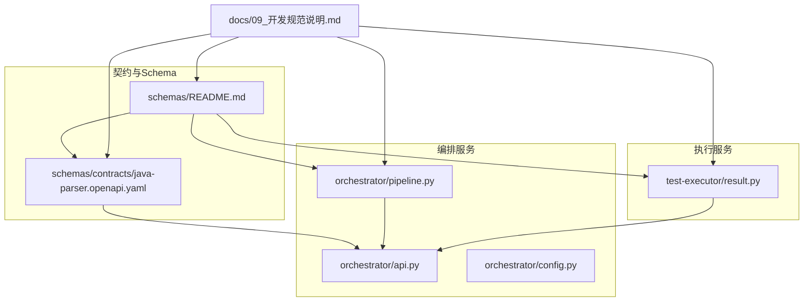
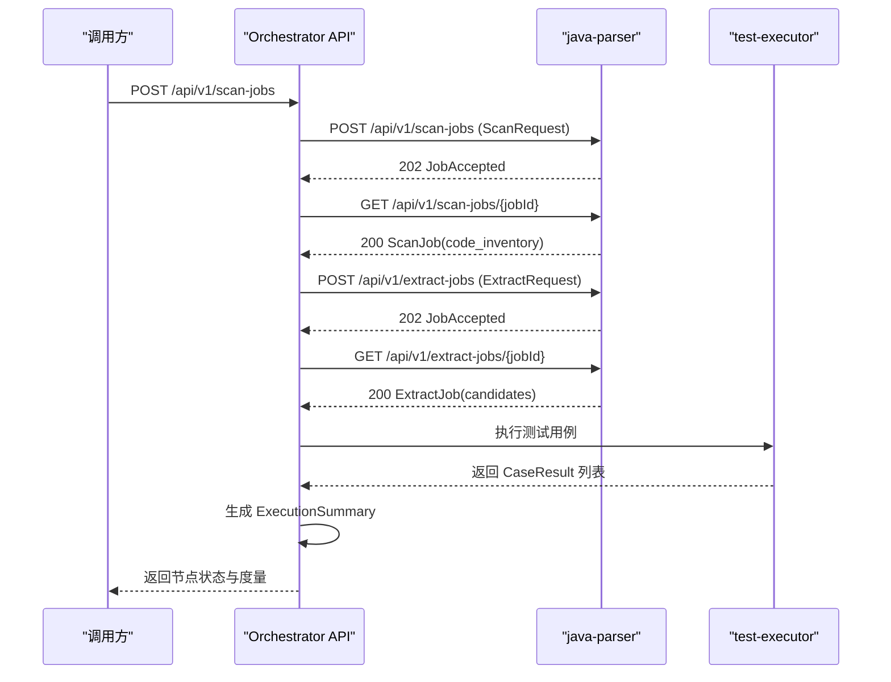
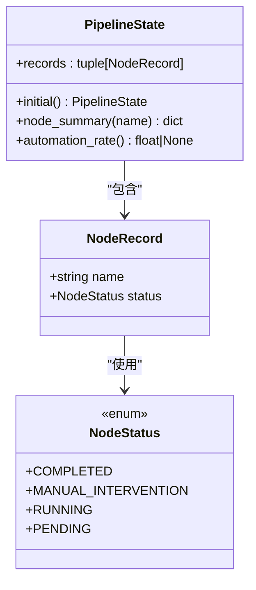
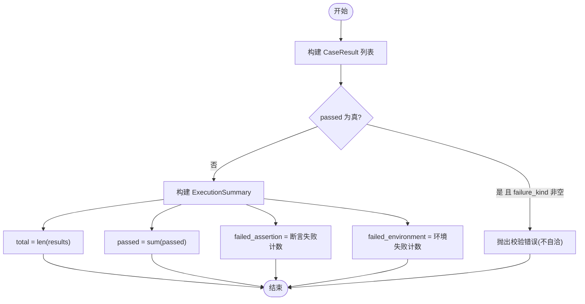
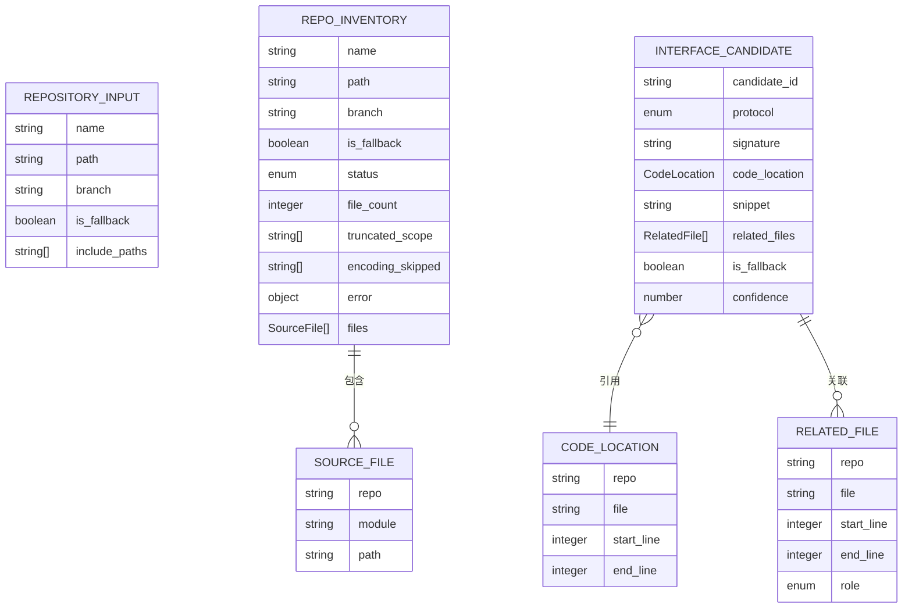
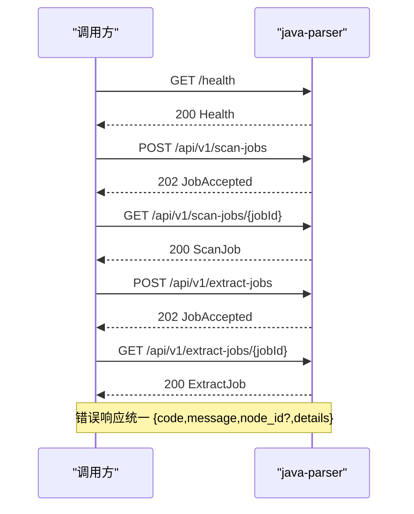
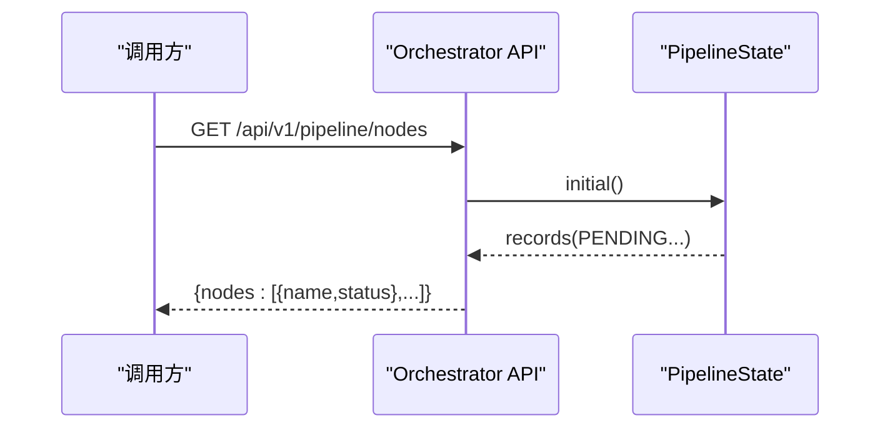
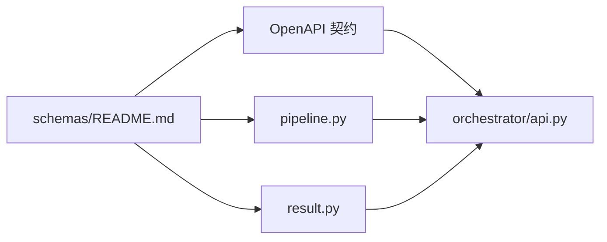
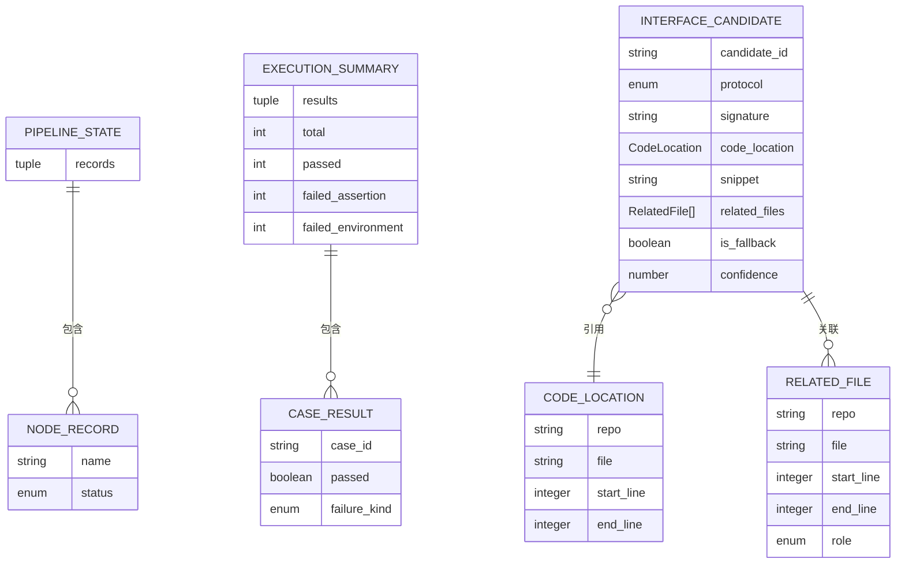

# 数据模型

<cite>
**本文引用的文件**
- [schemas/README.md](file://schemas/README.md)
- [schemas/contracts/java-parser.openapi.yaml](file://schemas/contracts/java-parser.openapi.yaml)
- [services/orchestrator/src/orchestrator/pipeline.py](file://services/orchestrator/src/orchestrator/pipeline.py)
- [services/test-executor/src/executor/result.py](file://services/test-executor/src/executor/result.py)
- [services/orchestrator/src/orchestrator/api.py](file://services/orchestrator/src/orchestrator/api.py)
- [services/orchestrator/src/orchestrator/config.py](file://services/orchestrator/src/orchestrator/config.py)
- [docs/09_开发规范说明.md](file://docs/09_开发规范说明.md)
</cite>

## 目录
1. [引言](#引言)
2. [项目结构](#项目结构)
3. [核心组件](#核心组件)
4. [架构总览](#架构总览)
5. [详细组件分析](#详细组件分析)
6. [依赖关系分析](#依赖关系分析)
7. [性能考量](#性能考量)
8. [故障排查指南](#故障排查指南)
9. [结论](#结论)
10. [附录](#附录)

## 引言
本文件聚焦 LLM-AutoTest 的数据模型，覆盖 JSON Schema 定义、OpenAPI 契约、数据流转规则与业务约束。重点解释流水线状态模型、节点记录结构、测试结果格式与接口候选信息；提供实体关系图、字段定义、数据类型与业务规则；说明数据验证规则、版本管理策略与数据迁移路径；并给出数据序列化与反序列化的最佳实践。

## 项目结构
- schemas：集中存放所有结构化产物的 JSON Schema 与跨服务契约（OpenAPI）。
- services/orchestrator：编排 9 个固定节点的流水线，暴露 REST API 查询节点状态。
- services/test-executor：执行测试用例，产出断言与环境失败分离的执行结果。
- docs：开发与契约规范，明确 Schema 为单一事实来源、错误结构统一、产物持久化等红线。

图表来源
- [schemas/README.md:1-30](file://schemas/README.md#L1-L30)
- [schemas/contracts/java-parser.openapi.yaml:1-369](file://schemas/contracts/java-parser.openapi.yaml#L1-L369)
- [services/orchestrator/src/orchestrator/pipeline.py:1-84](file://services/orchestrator/src/orchestrator/pipeline.py#L1-L84)
- [services/test-executor/src/executor/result.py:1-61](file://services/test-executor/src/executor/result.py#L1-L61)
- [services/orchestrator/src/orchestrator/api.py:1-28](file://services/orchestrator/src/orchestrator/api.py#L1-L28)
- [docs/09_开发规范说明.md:1-133](file://docs/09_开发规范说明.md#L1-L133)

章节来源
- [schemas/README.md:1-30](file://schemas/README.md#L1-L30)
- [docs/09_开发规范说明.md:21-35](file://docs/09_开发规范说明.md#L21-L35)

## 核心组件
- 流水线状态模型：固定 9 节点顺序与四态标注（completed/manual_intervention/running/pending），自动化率按“已完成节点数/9”计算。
- 节点记录结构：每个节点包含 name 与 status，初始态全部 pending。
- 测试结果格式：单条用例结果区分通过与否，失败类型分为 assertion 与 environment；汇总统计严格程序化，不经过 LLM。
- 接口候选信息：静态扫描提取的接口候选，包含协议、签名、代码位置、源码片段、关联文件、置信度与兜底标记。

章节来源
- [services/orchestrator/src/orchestrator/pipeline.py:11-84](file://services/orchestrator/src/orchestrator/pipeline.py#L11-L84)
- [services/test-executor/src/executor/result.py:10-61](file://services/test-executor/src/executor/result.py#L10-L61)
- [schemas/contracts/java-parser.openapi.yaml:162-369](file://schemas/contracts/java-parser.openapi.yaml#L162-L369)

## 架构总览
下图展示 orchestrator 与 java-parser 之间的异步任务交互，以及 test-executor 的结果回传路径。

图表来源
- [schemas/contracts/java-parser.openapi.yaml:24-115](file://schemas/contracts/java-parser.openapi.yaml#L24-L115)
- [services/orchestrator/src/orchestrator/api.py:11-27](file://services/orchestrator/src/orchestrator/api.py#L11-L27)
- [services/test-executor/src/executor/result.py:17-61](file://services/test-executor/src/executor/result.py#L17-L61)

## 详细组件分析

### 流水线状态模型与节点记录
- 节点顺序固定为 9 项，禁止增删，确保度量口径一致。
- 节点状态四态：completed、manual_intervention、running、pending。
- PipelineState 提供初始态构造、单节点摘要与自动化率计算。

图表来源
- [services/orchestrator/src/orchestrator/pipeline.py:11-84](file://services/orchestrator/src/orchestrator/pipeline.py#L11-L84)

章节来源
- [services/orchestrator/src/orchestrator/pipeline.py:23-70](file://services/orchestrator/src/orchestrator/pipeline.py#L23-L70)

### 测试结果格式与汇总
- CaseResult：case_id、passed、failure_kind（可选）。通过时不得携带失败类型，否则抛出校验错误。
- FailureKind：assertion（计入通过率分母）、environment（隔离至待环境确认，不计入通过率分母）。
- ExecutionSummary：对 results 进行程序化汇总，提供 total、passed、failed_assertion、failed_environment。

图表来源
- [services/test-executor/src/executor/result.py:17-61](file://services/test-executor/src/executor/result.py#L17-L61)

章节来源
- [services/test-executor/src/executor/result.py:10-61](file://services/test-executor/src/executor/result.py#L10-L61)

### 接口候选信息与静态扫描
- RepositoryInput：仓库输入（name、path、branch、is_fallback、include_paths）。
- RepoInventory：仓库扫描结果（status、file_count、truncated_scope、encoding_skipped、error、files）。
- SourceFile：源码文件清单（repo、module、path）。
- InterfaceCandidate：接口候选（candidate_id、protocol、signature、code_location、snippet、related_files、is_fallback、confidence）。
- CodeLocation：代码定位（repo、file、start_line、end_line）。
- RelatedFile：关联文件（role 枚举：controller/service/dto/proto/wsdl/listener/other）。

图表来源
- [schemas/contracts/java-parser.openapi.yaml:162-369](file://schemas/contracts/java-parser.openapi.yaml#L162-L369)

章节来源
- [schemas/contracts/java-parser.openapi.yaml:162-369](file://schemas/contracts/java-parser.openapi.yaml#L162-L369)

### OpenAPI 契约与错误结构
- 健康检查：GET /health。
- 扫描任务：POST /api/v1/scan-jobs，GET /api/v1/scan-jobs/{jobId}。
- 提取任务：POST /api/v1/extract-jobs，GET /api/v1/extract-jobs/{jobId}。
- 统一错误结构：{code, message, node_id?, details}。

图表来源
- [schemas/contracts/java-parser.openapi.yaml:12-115](file://schemas/contracts/java-parser.openapi.yaml#L12-L115)
- [schemas/contracts/java-parser.openapi.yaml:130-148](file://schemas/contracts/java-parser.openapi.yaml#L130-L148)

章节来源
- [schemas/contracts/java-parser.openapi.yaml:12-115](file://schemas/contracts/java-parser.openapi.yaml#L12-L115)

### 编排 API 与配置
- FastAPI 应用创建，暴露 /health 与 /api/v1/pipeline/nodes。
- 节点清单与当前状态由 PipelineState.initial() 生成，遵循 9 节点固定口径。
- 配置来自环境变量，端口、java-parser URL、制品根路径、LLM 参数等。

图表来源
- [services/orchestrator/src/orchestrator/api.py:11-27](file://services/orchestrator/src/orchestrator/api.py#L11-L27)
- [services/orchestrator/src/orchestrator/pipeline.py:51-59](file://services/orchestrator/src/orchestrator/pipeline.py#L51-L59)

章节来源
- [services/orchestrator/src/orchestrator/api.py:11-27](file://services/orchestrator/src/orchestrator/api.py#L11-L27)
- [services/orchestrator/src/orchestrator/config.py:9-50](file://services/orchestrator/src/orchestrator/config.py#L9-L50)

## 依赖关系分析
- orchestrator 依赖 pipeline 模块定义节点顺序与状态，并通过 API 暴露状态查询。
- test-executor 独立产出执行结果，供 orchestrator 汇总。
- java-parser 通过 OpenAPI 契约对外提供扫描与提取能力，返回结构化产物。
- schemas/README.md 规定 Schema 为单一事实来源，跨服务对齐。

图表来源
- [schemas/contracts/java-parser.openapi.yaml:1-369](file://schemas/contracts/java-parser.openapi.yaml#L1-L369)
- [services/orchestrator/src/orchestrator/api.py:1-28](file://services/orchestrator/src/orchestrator/api.py#L1-L28)
- [services/orchestrator/src/orchestrator/pipeline.py:1-84](file://services/orchestrator/src/orchestrator/pipeline.py#L1-L84)
- [services/test-executor/src/executor/result.py:1-61](file://services/test-executor/src/executor/result.py#L1-L61)
- [schemas/README.md:1-30](file://schemas/README.md#L1-L30)

章节来源
- [schemas/README.md:1-30](file://schemas/README.md#L1-L30)
- [schemas/contracts/java-parser.openapi.yaml:1-369](file://schemas/contracts/java-parser.openapi.yaml#L1-L369)

## 性能考量
- 流水线自动化率计算基于固定 9 节点，避免动态扩展导致口径漂移。
- 执行结果汇总仅通过程序化聚合，避免 LLM 引入不确定性。
- 大仓库扫描支持截断范围与编码跳过，减少解析开销。

[本节为通用指导，无需特定文件引用]

## 故障排查指南
- 统一错误结构：所有服务返回 {code, message, node_id?, details}，便于定位与追踪。
- 节点失败必须落盘：状态、原因、时间戳，支撑断点续跑。
- 日志要求：Python 使用 logging 统一配置，Java 使用 SLF4J，按任务 ID 归档。

章节来源
- [schemas/contracts/java-parser.openapi.yaml:130-148](file://schemas/contracts/java-parser.openapi.yaml#L130-L148)
- [docs/09_开发规范说明.md:96-101](file://docs/09_开发规范说明.md#L96-L101)

## 结论
本数据模型以 schemas/ 为单一事实来源，结合 OpenAPI 契约与 Python 数据类，形成稳定的跨服务数据结构。流水线状态模型与测试结果格式确保度量口径一致与可追溯性。通过严格的验证规则与版本管理策略，保障数据在 LLM-AutoTest 全链路的可靠性与可维护性。

[本节为总结性内容，无需特定文件引用]

## 附录

### 实体关系图（数据模型）

图表来源
- [services/orchestrator/src/orchestrator/pipeline.py:37-70](file://services/orchestrator/src/orchestrator/pipeline.py#L37-L70)
- [services/test-executor/src/executor/result.py:17-61](file://services/test-executor/src/executor/result.py#L17-L61)
- [schemas/contracts/java-parser.openapi.yaml:291-369](file://schemas/contracts/java-parser.openapi.yaml#L291-L369)

### 字段定义与业务规则
- 横切约定：ID 命名规范（REQ-001/CAND-001/IF-<协议>-001/TC-001/DEF-001）、UTC ISO-8601 时间戳、协议枚举小写、is_fallback 全链路透传、错误结构统一。
- 版本管理：每个 Schema 含 schema_version，结构变更必须升版本，禁止原地改语义。
- 产物持久化：按任务 ID 分目录写入挂载卷，路径由 orchestrator 统一管理。

章节来源
- [schemas/README.md:5-10](file://schemas/README.md#L5-L10)
- [docs/09_开发规范说明.md:81-87](file://docs/09_开发规范说明.md#L81-L87)

### 数据验证规则
- LLM 输出必须通过对应 Schema 校验后方可进入下游产物。
- 执行结果一致性：通过的用例不得携带失败类型，否则抛出校验错误。
- 契约先行：服务间 REST 接口先在 schemas/contracts/ 定义，评审通过后实现。

章节来源
- [schemas/README.md:7-9](file://schemas/README.md#L7-L9)
- [services/test-executor/src/executor/result.py:25-29](file://services/test-executor/src/executor/result.py#L25-L29)
- [docs/09_开发规范说明.md:89-94](file://docs/09_开发规范说明.md#L89-L94)

### 版本管理与数据迁移路径
- 版本基线：Python 3.11+、Java 21、Node 20 LTS，包管理锁定依赖。
- 迁移策略：Schema 变更需升版本；契约变更只允许加字段（可选），删改字段须全服务同步升级并在部署中声明启动顺序依赖。
- 制品路径：统一前缀 /data/llm-autotest/，按任务 ID 分目录。

章节来源
- [docs/09_开发规范说明.md:11-20](file://docs/09_开发规范说明.md#L11-L20)
- [docs/09_开发规范说明.md:89-94](file://docs/09_开发规范说明.md#L89-L94)
- [docs/09_开发规范说明.md:123-129](file://docs/09_开发规范说明.md#L123-L129)

### 数据序列化与反序列化最佳实践
- 使用 pydantic BaseModel 定义跨节点传递的数据结构，与 schemas/ 中的 JSON Schema 一一对应。
- 对外 API 层只做协议转换与校验，业务逻辑下沉到 service 层。
- 所有数值指标（通过率、自动化率、接口数、缺陷数）由 execution.json 等结构化产物程序化汇总产生，禁止 LLM 改写数字。

章节来源
- [docs/09_开发规范说明.md:46-54](file://docs/09_开发规范说明.md#L46-L54)
- [services/orchestrator/src/orchestrator/api.py:1-28](file://services/orchestrator/src/orchestrator/api.py#L1-L28)
- [docs/09_开发规范说明.md:81-87](file://docs/09_开发规范说明.md#L81-L87)