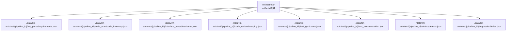
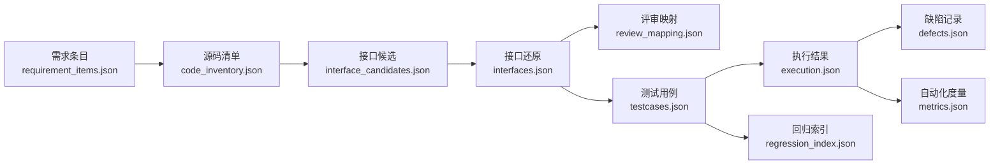
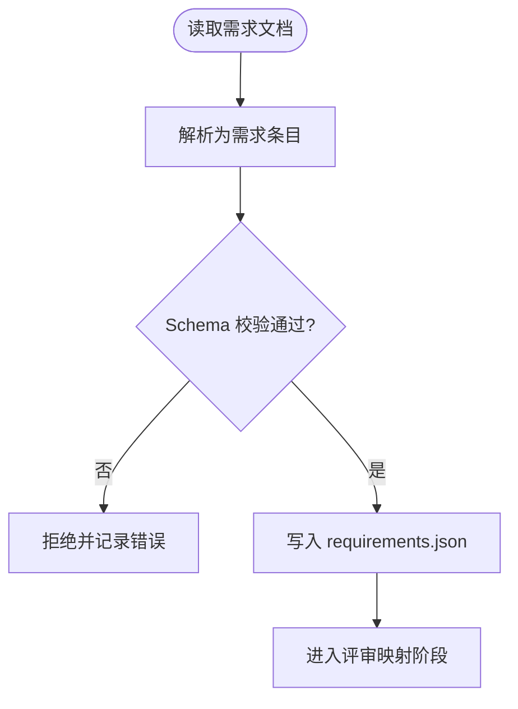
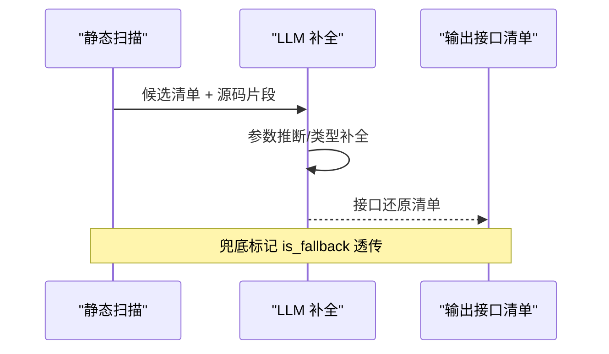
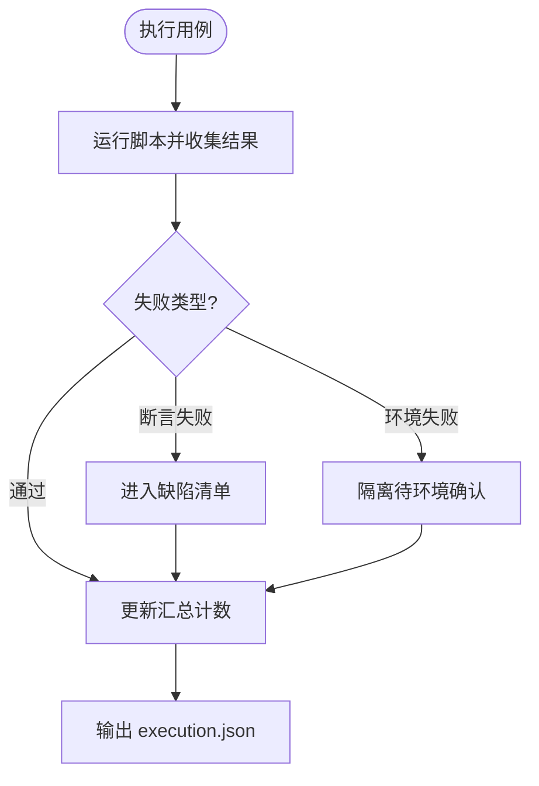
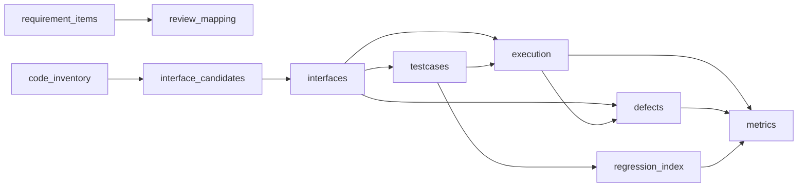

# 数据模型

<cite>
**本文引用的文件**
- [schemas/README.md](file://schemas/README.md)
- [MumuSpec/10-数据模型与存储规格.md](file://MumuSpec/10-数据模型与存储规格.md)
- [schemas/requirement_items.json](file://schemas/requirement_items.json)
- [schemas/code_inventory.json](file://schemas/code_inventory.json)
- [schemas/interface_candidates.json](file://schemas/interface_candidates.json)
- [schemas/interfaces.json](file://schemas/interfaces.json)
- [schemas/review_mapping.json](file://schemas/review_mapping.json)
- [schemas/testcases.json](file://schemas/testcases.json)
- [schemas/execution.json](file://schemas/execution.json)
- [schemas/defects.json](file://schemas/defects.json)
- [schemas/regression_index.json](file://schemas/regression_index.json)
- [schemas/metrics.json](file://schemas/metrics.json)
- [schemas/samples/execution.sample.json](file://schemas/samples/execution.sample.json)
- [schemas/samples/interfaces.sample.json](file://schemas/samples/interfaces.sample.json)
- [schemas/samples/interface_candidates.sample.json](file://schemas/samples/interface_candidates.sample.json)
</cite>

## 目录
1. [简介](#简介)
2. [项目结构](#项目结构)
3. [核心组件](#核心组件)
4. [架构总览](#架构总览)
5. [详细组件分析](#详细组件分析)
6. [依赖关系分析](#依赖关系分析)
7. [性能考虑](#性能考虑)
8. [故障排查指南](#故障排查指南)
9. [结论](#结论)
10. [附录](#附录)

## 简介
本文件为 LLM-AutoTest 的数据模型规范，聚焦于所有核心数据实体的结构与关系，覆盖需求条目、代码清单、接口候选与还原、评审映射、测试用例、执行记录、缺陷记录、回归资产索引与自动化度量等。文档以 schemas/ 下的 JSON Schema 为单一事实来源，结合 MumuSpec 的存储规格说明，给出字段定义、约束、关联关系、序列化格式、存储策略、迁移与版本管理、以及示例与查询模式，帮助开发者理解并正确使用数据。

## 项目结构
- 产物 Schema 统一存放于 schemas/，每个 Schema 文件对应一个结构化产物，包含 schema_version、job_id 等横切字段，并通过 JSON Schema 进行强校验。
- 存储采用文件系统（JSON），按任务 ID（pipeline_id/job_id）分目录组织，由 orchestrator 的 artifacts 模块统一管理路径。
- 样本数据位于 schemas/samples/，标注 _fake: true，用于演示与联调，不得作为生产数据。

图表来源
- [MumuSpec/10-数据模型与存储规格.md:35-64](file://MumuSpec/10-数据模型与存储规格.md#L35-L64)

章节来源
- [schemas/README.md:1-30](file://schemas/README.md#L1-L30)
- [MumuSpec/10-数据模型与存储规格.md:29-64](file://MumuSpec/10-数据模型与存储规格.md#L29-L64)

## 核心组件
本节概述各数据模型的核心职责与关键字段：
- 需求解析条目（requirement_items.json）：从多格式需求文档中抽取的需求项，含优先级、来源位置、golden 比对结果等。
- 源码扫描清单（code_inventory.json）：仓库四态（ok/empty/truncated/error）、文件清单、编码跳过、错误信息等。
- 接口候选清单（interface_candidates.json）：静态侧定位的接口候选，含签名、相关源文件、片段、置信度等。
- 接口还原清单（interfaces.json）：LLM 补全后的接口清单，含参数、返回类型、代码位置、兜底标记、置信度等。
- 评审映射（review_mapping.json）：需求-代码映射三视图（映射表、风险清单、遗漏功能），含人工审核日志。
- 测试用例（testcases.json）：生成的用例与脚本元数据，含分类、预期、可加载性、低置信度标记等。
- 执行结果（execution.json）：用例执行明细与程序化汇总，区分断言失败与环境失败，支持降级协议记录。
- 缺陷记录（defects.json）：本地缺陷生命周期管理，含复现步骤、状态流转、历史审计、兜底透传等。
- 回归资产索引（regression_index.json）：按协议归档用例脚本，支持版本递增与漂移告警。
- 自动化度量（metrics.json）：固定 9 节点口径的自动化率计算，含节点状态与降级原因。

章节来源
- [schemas/requirement_items.json:1-44](file://schemas/requirement_items.json#L1-L44)
- [schemas/code_inventory.json:1-57](file://schemas/code_inventory.json#L1-L57)
- [schemas/interface_candidates.json:1-58](file://schemas/interface_candidates.json#L1-L58)
- [schemas/interfaces.json:1-70](file://schemas/interfaces.json#L1-L70)
- [schemas/review_mapping.json:1-81](file://schemas/review_mapping.json#L1-L81)
- [schemas/testcases.json:1-35](file://schemas/testcases.json#L1-L35)
- [schemas/execution.json:1-59](file://schemas/execution.json#L1-L59)
- [schemas/defects.json:1-54](file://schemas/defects.json#L1-L54)
- [schemas/regression_index.json:1-50](file://schemas/regression_index.json#L1-L50)
- [schemas/metrics.json:1-49](file://schemas/metrics.json#L1-L49)

## 架构总览
下图展示数据在流水线中的流转与依赖关系：需求解析 → 源码扫描 → 接口候选 → 接口还原 → 评审映射 → 用例生成 → 执行 → 缺陷 → 回归索引 → 度量汇总。

图表来源
- [schemas/requirement_items.json:1-44](file://schemas/requirement_items.json#L1-L44)
- [schemas/code_inventory.json:1-57](file://schemas/code_inventory.json#L1-L57)
- [schemas/interface_candidates.json:1-58](file://schemas/interface_candidates.json#L1-L58)
- [schemas/interfaces.json:1-70](file://schemas/interfaces.json#L1-L70)
- [schemas/review_mapping.json:1-81](file://schemas/review_mapping.json#L1-L81)
- [schemas/testcases.json:1-35](file://schemas/testcases.json#L1-L35)
- [schemas/execution.json:1-59](file://schemas/execution.json#L1-L59)
- [schemas/defects.json:1-54](file://schemas/defects.json#L1-L54)
- [schemas/regression_index.json:1-50](file://schemas/regression_index.json#L1-L50)
- [schemas/metrics.json:1-49](file://schemas/metrics.json#L1-L49)

## 详细组件分析

### 需求解析条目（requirement_items.json）
- 用途：承载从需求文档中解析出的需求项，供后续评审与追踪使用。
- 关键字段：
  - schema_version：固定版本号，用于向后兼容与演进。
  - job_id：任务标识，用于隔离不同运行实例。
  - source_file：来源文档路径与格式。
  - items[]：需求项数组，每项含 id/title/description/priority/source_location/golden_match。
- 约束与规则：
  - id 遵循 REQ-xxx 命名；priority 枚举 P0/P1/P2。
  - golden_match 用于预置基准比对，非现场人工判断。
- 存储与序列化：JSON 文件，UTF-8；schema_version 必须匹配当前规范。
- 索引与主键：items[].id 全局唯一。
- 关联关系：通过 requirement_id 与 review_mapping.mappings[].requirement_id 建立需求到实现状态的映射。

图表来源
- [schemas/requirement_items.json:1-44](file://schemas/requirement_items.json#L1-L44)

章节来源
- [schemas/requirement_items.json:1-44](file://schemas/requirement_items.json#L1-L44)

### 源码扫描清单（code_inventory.json）
- 用途：记录仓库检出状态、文件清单与异常信息，支撑后续接口定位与覆盖率评估。
- 关键字段：
  - repositories[]：仓库级对象，含 name/path/branch/is_fallback/status/file_count 等。
  - files[]：源码文件清单，含 repo/module/path。
  - error：错误对象，含 code/message/details。
- 约束与规则：
  - status 枚举 ok/empty/truncated/error；truncated_scope 注明截断范围；encoding_skipped 记录跳过文件。
  - repositories 至少两个仓库（G3）。
- 存储与序列化：JSON；error 结构统一便于下游处理。
- 索引与主键：无显式主键，通常以 path 或 file.path 作为定位键。
- 关联关系：与 interface_candidates.code_location.repo 及 interfaces.code_location.repo 对齐。

章节来源
- [schemas/code_inventory.json:1-57](file://schemas/code_inventory.json#L1-L57)

### 接口候选清单（interface_candidates.json）
- 用途：静态侧定位的接口候选，提供签名、相关源文件与片段，供 LLM 语义补全。
- 关键字段：
  - candidates[]：候选对象，含 candidate_id/protocol/signature/code_location/snippet/related_files/is_fallback/confidence。
  - warnings：单文件解析失败等警告。
- 约束与规则：
  - protocol 枚举 rest/grpc/graphql/soap/mq；confidence 0~1。
  - related_files.role 枚举 controller/service/dto/proto/wsdl/listener/other。
- 存储与序列化：JSON；warnings 不中断流程。
- 索引与主键：candidates[].candidate_id 全局唯一。
- 关联关系：与 interfaces[].candidate_id 建立溯源；与 code_inventory.repositories[].path 对齐仓库上下文。

章节来源
- [schemas/interface_candidates.json:1-58](file://schemas/interface_candidates.json#L1-L58)

### 接口还原清单（interfaces.json）
- 用途：LLM 补全后的接口清单，承载签名、参数、返回类型、代码位置、置信度与兜底标记。
- 关键字段：
  - interfaces[]：接口对象，含 id/protocol/signature/params/returns/candidate_id/code_location/is_fallback/confidence。
  - signature.method/path/service_method/summary；params.in 枚举 path/query/body/header。
- 约束与规则：
  - id 遵循 IF-PROTOCOL-xxx；protocol 小写枚举；confidence 0~1。
  - is_fallback 全链路透传，用于兜底分支识别。
- 存储与序列化：JSON；与契约 ExtractJob 一致。
- 索引与主键：interfaces[].interface_id 全局唯一；可按 protocol 建索引。
- 关联关系：
  - 与 testcases.interface_id 关联用例生成。
  - 与 execution.interface_id 关联执行结果。
  - 与 defects.interface_id 关联缺陷定位。

图表来源
- [schemas/interface_candidates.json:1-58](file://schemas/interface_candidates.json#L1-L58)
- [schemas/interfaces.json:1-70](file://schemas/interfaces.json#L1-L70)

章节来源
- [schemas/interfaces.json:1-70](file://schemas/interfaces.json#L1-L70)

### 评审映射（review_mapping.json）
- 用途：三视图（需求-代码映射、风险清单、遗漏功能）与人工审核日志。
- 关键字段：
  - mappings[]：requirement_id/interface_id/status/confidence/evidence。
  - risks[]：requirement_id/interface_id/description。
  - missing_features[]：requirement_id/title。
  - review_log[]：requirement_id/decision/timestamp 等。
- 约束与规则：
  - status 枚举 implemented/partial/missing/undetermined；decision 枚举 approved/rejected。
  - 风险清单由 partial 自动派生，保证一致性。
- 存储与序列化：JSON；review_log 记录闭环。
- 索引与主键：mappings[].requirement_id 唯一；risks/missing_features 可由 mappings 派生。
- 关联关系：与 requirement_items.items[].id 与 interfaces[].id 双向关联。

章节来源
- [schemas/review_mapping.json:1-81](file://schemas/review_mapping.json#L1-L81)

### 测试用例（testcases.json）
- 用途：生成的用例与脚本元数据，确保每接口三类用例（normal/boundary/exception）且可加载。
- 关键字段：
  - cases[]：id/interface_id/requirement_id/category/title/params/expected/script_path/loadable/low_confidence。
- 约束与规则：
  - category 枚举 normal/boundary/exception；loadable 表示 py_compile + 收集零 error。
  - params 仅允许来自 interfaces.json 的参数名与结构。
- 存储与序列化：JSON；script_path 指向 pytest 脚本相对路径。
- 索引与主键：cases[].id 全局唯一；可按 interface_id 分组。
- 关联关系：与 interfaces[].id 溯源；与 execution.case_id 关联执行结果。

章节来源
- [schemas/testcases.json:1-35](file://schemas/testcases.json#L1-L35)

### 执行结果（execution.json）
- 用途：用例执行明细与程序化汇总，区分断言失败与环境失败，支持降级协议记录。
- 关键字段：
  - results[]：case_id/interface_id/passed/failure_kind/failure_reason/timeout/skipped_reason/duration_ms/timestamp。
  - summary：total/passed/failed_assertion/failed_environment/interrupted。
  - degraded_protocols[]：protocol/mode/reason。
- 约束与规则：
  - failure_kind 枚举 assertion/environment/null；timestamp UTC ISO-8601。
  - 数值汇总不经 LLM，保证客观性。
- 存储与序列化：JSON；summary 为固定骨架 ExecutionSummary。
- 索引与主键：results[].case_id 唯一；可按 interface_id 聚合。
- 关联关系：与 testcases.id 与 interfaces.id 关联；failure_kind=assertion 时进入缺陷清单。

图表来源
- [schemas/execution.json:1-59](file://schemas/execution.json#L1-L59)

章节来源
- [schemas/execution.json:1-59](file://schemas/execution.json#L1-L59)

### 缺陷记录（defects.json）
- 用途：本地缺陷生命周期管理，仅断言失败进入，环境失败隔离。
- 关键字段：
  - defects[]：id/case_id/interface_id/failure_reason/reproduce/status/history/is_fallback/based_on_new_version。
  - reproduce.script_path/params；history.event/timestamp。
- 约束与规则：
  - status 枚举 discovered/retesting/passed/closed_suggested/retained。
  - history 记录时间戳流转，支持审计。
- 存储与序列化：JSON；is_fallback 随兜底标记透传。
- 索引与主键：defects[].id 全局唯一；可按 case_id/interface_id 查询。
- 关联关系：与 execution.results[].case_id 双向关联；与 testcases.id 关联复现脚本。

章节来源
- [schemas/defects.json:1-54](file://schemas/defects.json#L1-L54)

### 回归资产索引（regression_index.json）
- 用途：按协议维度归档用例脚本，支持版本递增与漂移告警。
- 关键字段：
  - suites[]：protocol/scripts[]；scripts 含 case_id/script_path/requirement_id/interface_id/archived_at/version。
  - drift_warnings[]：case_id/detail。
- 约束与规则：
  - archived_at 幂等更新；version 覆盖归档时递增。
  - REST 完整实现，其他协议最小可用级。
- 存储与序列化：JSON；scripts 移动非复制。
- 索引与主键：按 case_id 去重归档；drift_warnings 提示人工判断。
- 关联关系：与 testcases.id 与 interfaces.id 溯源。

章节来源
- [schemas/regression_index.json:1-50](file://schemas/regression_index.json#L1-L50)

### 自动化度量（metrics.json）
- 用途：固定 9 节点口径的自动化率计算，避免误导数值。
- 关键字段：
  - automation_rate.value/numerator/denominator/data_complete。
  - nodes[]：name/status/degraded/degrade_reason/intervention_reason/automation_path。
  - caveat/measured_at。
- 约束与规则：
  - denominator 固定为 9；value 可为 null（数据不完整）。
  - 节点名称枚举 req_parse/code_scan/interface_reconstruct/code_review/testcase_generate/auto_execute/test_report/defect_list/retest_regression。
- 存储与序列化：JSON；measured_at 仅正式验收数值作为基线。
- 索引与主键：nodes[].name 唯一；automation_rate.data_complete 指示完整性。
- 关联关系：基于 execution/defects/regression 等节点产出汇总。

章节来源
- [schemas/metrics.json:1-49](file://schemas/metrics.json#L1-L49)

## 依赖关系分析
- 上游依赖：
  - requirement_items → review_mapping.mappings
  - code_inventory → interface_candidates.code_location
  - interface_candidates → interfaces.candidate_id
  - interfaces → testcases.interface_id / execution.interface_id / defects.interface_id
  - testcases → execution.case_id / regression_index.scripts.case_id
  - execution → defects（断言失败）/ metrics.nodes
  - defects → metrics.nodes（缺陷列表节点）
  - regression_index → metrics.nodes（回归重跑节点）

图表来源
- [schemas/requirement_items.json:1-44](file://schemas/requirement_items.json#L1-L44)
- [schemas/code_inventory.json:1-57](file://schemas/code_inventory.json#L1-L57)
- [schemas/interface_candidates.json:1-58](file://schemas/interface_candidates.json#L1-L58)
- [schemas/interfaces.json:1-70](file://schemas/interfaces.json#L1-L70)
- [schemas/review_mapping.json:1-81](file://schemas/review_mapping.json#L1-L81)
- [schemas/testcases.json:1-35](file://schemas/testcases.json#L1-L35)
- [schemas/execution.json:1-59](file://schemas/execution.json#L1-L59)
- [schemas/defects.json:1-54](file://schemas/defects.json#L1-L54)
- [schemas/regression_index.json:1-50](file://schemas/regression_index.json#L1-L50)
- [schemas/metrics.json:1-49](file://schemas/metrics.json#L1-L49)

章节来源
- [schemas/README.md:1-30](file://schemas/README.md#L1-L30)

## 性能考虑
- 文件体积控制：大仓库扫描时注意 truncated_scope 与 encoding_skipped 的裁剪，减少 IO 与解析开销。
- 批量写入：execution 与 defects 建议批处理写入，降低频繁 I/O。
- 索引设计：对高频查询字段（如 interface_id、case_id、protocol）建立外部索引或按目录分片，提升检索效率。
- 降级策略：对 MQ 等高成本协议采用 Mock 执行降级，减少执行耗时。

[本节为通用指导，无需特定文件引用]

## 故障排查指南
- 常见错误：
  - Schema 校验失败：检查 schema_version 与必填字段是否缺失；参考 schemas/README 横切约定。
  - 接口还原置信度低：关注 confidence 与 is_fallback，必要时切换兜底仓库。
  - 执行超时：timeout=true 时检查网络与服务可用性，调整超时阈值。
  - 环境失败：failure_kind=environment 时隔离处理，不进入缺陷清单。
- 定位方法：
  - 通过 job_id 聚合同一任务的产物，快速定位问题链路。
  - 使用 review_mapping.review_log 查看人工决策与回流情况。
  - 使用 regression_index.drift_warnings 检查回归漂移。

章节来源
- [schemas/execution.json:1-59](file://schemas/execution.json#L1-L59)
- [schemas/defects.json:1-54](file://schemas/defects.json#L1-L54)
- [schemas/review_mapping.json:1-81](file://schemas/review_mapping.json#L1-L81)
- [schemas/regression_index.json:1-50](file://schemas/regression_index.json#L1-L50)

## 结论
本数据模型以 JSON Schema 为单一事实来源，贯穿需求解析、源码扫描、接口还原、评审、用例生成、执行、缺陷、回归与度量全流程。通过统一的 schema_version、job_id 与横切约定，保障跨模块一致性与向后兼容。建议在生产环境中严格遵循 Schema 校验、合理设计索引与存储策略，并结合示例数据进行验证与调试。

[本节为总结，无需特定文件引用]

## 附录

### 字段与约束速查表
- 需求条目：id(REQ-xxx)、title、description、priority(P0/P1/P2)、source_location、golden_match
- 源码清单：repositories[].status(ok/empty/truncated/error)、files[].repo/module/path、error.code/message/details
- 接口候选：candidate_id(CAND-xxx)、protocol、signature、code_location、snippet、related_files.role、confidence
- 接口还原：id(IF-PROTOCOL-xxx)、protocol、signature.method/path/service_method、params.in、returns.type、code_location、is_fallback、confidence
- 评审映射：mappings[].status(implemented/partial/missing/undetermined)、risks[]、missing_features[]、review_log[].decision(approved/rejected)
- 测试用例：category(normal/boundary/exception)、loadable、low_confidence、params 仅来自 interfaces
- 执行结果：results[].failure_kind(assertion/environment/null)、summary.total/passed/failed_assertion/failed_environment、degraded_protocols[]
- 缺陷记录：status(discovered/retesting/passed/closed_suggested/retained)、history.event/timestamp、reproduce.script_path
- 回归索引：suites[].protocol、scripts[].archived_at/version、drift_warnings[]
- 自动化度量：automation_rate.denominator=9、nodes[].name 枚举、caveat/measured_at

章节来源
- [schemas/requirement_items.json:1-44](file://schemas/requirement_items.json#L1-L44)
- [schemas/code_inventory.json:1-57](file://schemas/code_inventory.json#L1-L57)
- [schemas/interface_candidates.json:1-58](file://schemas/interface_candidates.json#L1-L58)
- [schemas/interfaces.json:1-70](file://schemas/interfaces.json#L1-L70)
- [schemas/review_mapping.json:1-81](file://schemas/review_mapping.json#L1-L81)
- [schemas/testcases.json:1-35](file://schemas/testcases.json#L1-L35)
- [schemas/execution.json:1-59](file://schemas/execution.json#L1-L59)
- [schemas/defects.json:1-54](file://schemas/defects.json#L1-L54)
- [schemas/regression_index.json:1-50](file://schemas/regression_index.json#L1-L50)
- [schemas/metrics.json:1-49](file://schemas/metrics.json#L1-L49)

### 数据样本与查询示例
- 执行结果样本：见 schemas/samples/execution.sample.json，展示通过/断言失败/环境失败/超时/降级协议等场景。
- 接口还原样本：见 schemas/samples/interfaces.sample.json，展示 REST/gRPC 接口签名、参数、返回类型与代码位置。
- 接口候选样本：见 schemas/samples/interface_candidates.sample.json，展示静态定位、相关源文件与片段。

查询示例（概念性）：
- 按接口查询用例：筛选 testcases.cases[].interface_id = "IF-REST-001"
- 统计执行通过率：计算 execution.summary.passed / execution.summary.total
- 定位缺陷复现实例：根据 defects.defects[].reproduce.script_path 直接运行脚本
- 检查回归漂移：读取 regression_index.drift_warnings[] 并人工判断

章节来源
- [schemas/samples/execution.sample.json:1-63](file://schemas/samples/execution.sample.json#L1-L63)
- [schemas/samples/interfaces.sample.json:1-75](file://schemas/samples/interfaces.sample.json#L1-L75)
- [schemas/samples/interface_candidates.sample.json:1-62](file://schemas/samples/interface_candidates.sample.json#L1-L62)

### 存储策略与迁移
- 存储策略：文件系统 JSON，按 pipeline_id/job_id 分目录；orchestrator artifacts 模块统一管理路径。
- 迁移策略：
  - schema_version 升版本，禁止原地改语义；变更需保持向后兼容。
  - 新增可选字段优先，避免破坏旧版解析。
  - 对关键枚举（protocol/status）扩展时需评估下游影响。
- 版本管理：
  - 当前 schema_version 为 1.0；未来升级需在 README 与 MumuSpec 中同步更新。
  - 样本数据标注 _fake: true，不得混入生产。

章节来源
- [schemas/README.md:1-30](file://schemas/README.md#L1-L30)
- [MumuSpec/10-数据模型与存储规格.md:29-64](file://MumuSpec/10-数据模型与存储规格.md#L29-L64)