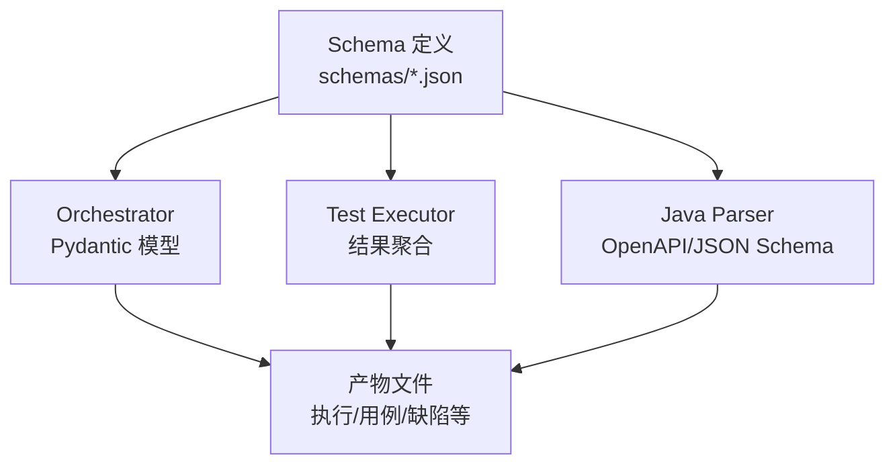
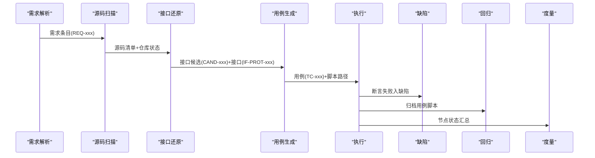
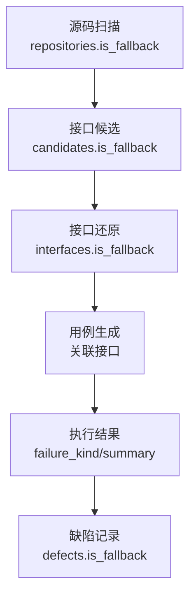
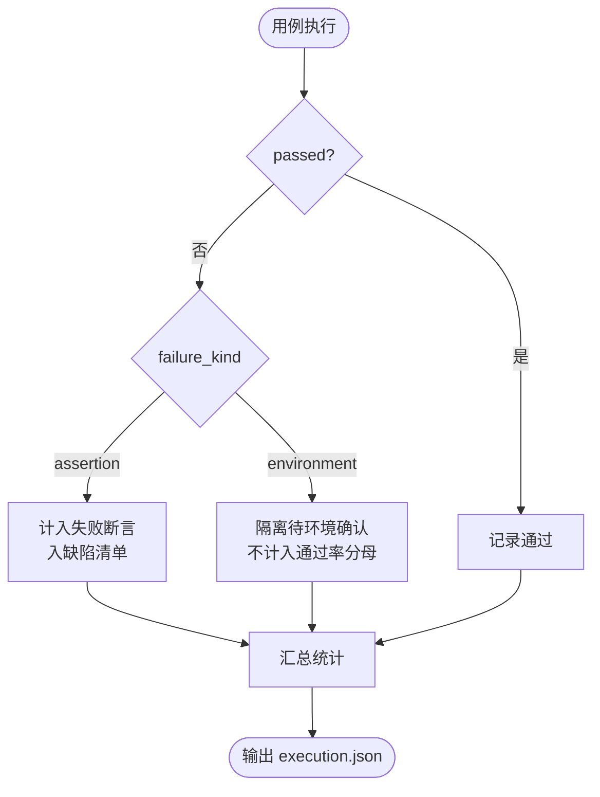
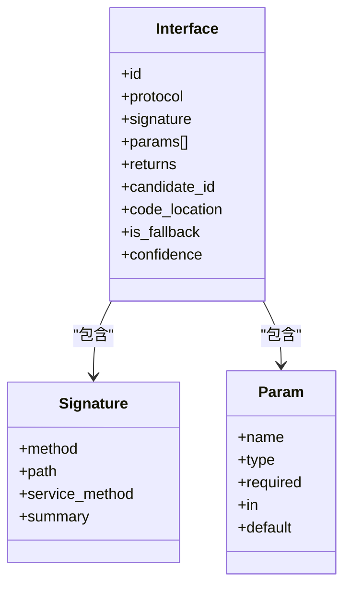
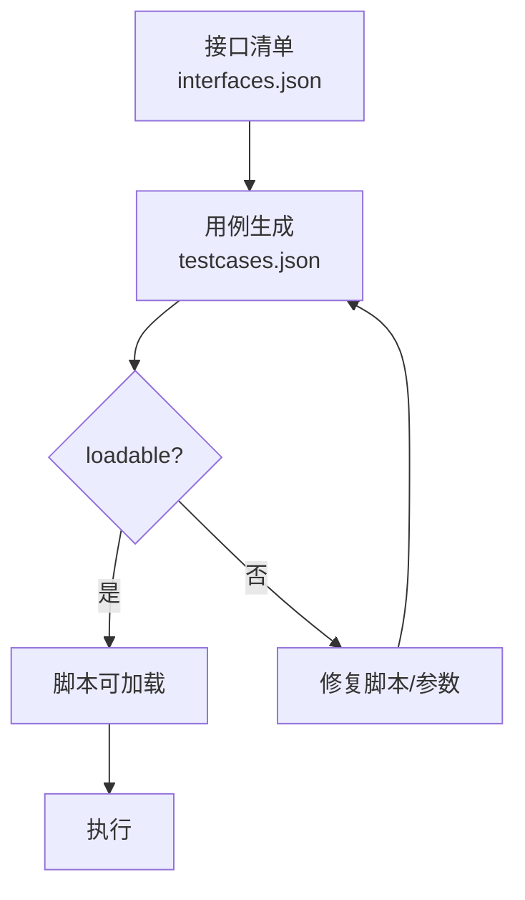
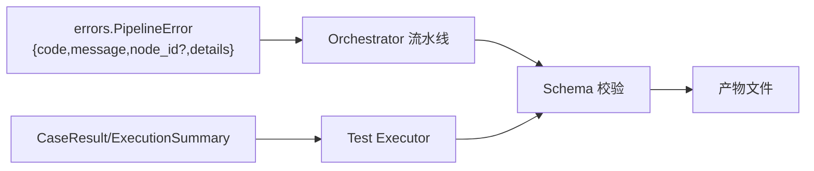

# 数据验证规则

<cite>
**本文引用的文件**
- [schemas/README.md](file://schemas/README.md)
- [schemas/requirement_items.json](file://schemas/requirement_items.json)
- [schemas/code_inventory.json](file://schemas/code_inventory.json)
- [schemas/interface_candidates.json](file://schemas/interface_candidates.json)
- [schemas/interfaces.json](file://schemas/interfaces.json)
- [schemas/testcases.json](file://schemas/testcases.json)
- [schemas/execution.json](file://schemas/execution.json)
- [schemas/defects.json](file://schemas/defects.json)
- [schemas/regression_index.json](file://schemas/regression_index.json)
- [schemas/metrics.json](file://schemas/metrics.json)
- [schemas/samples/execution.sample.json](file://schemas/samples/execution.sample.json)
- [schemas/samples/interfaces.sample.json](file://schemas/samples/interfaces.sample.json)
- [schemas/samples/interface_candidates.sample.json](file://schemas/samples/interface_candidates.sample.json)
- [services/orchestrator/src/orchestrator/errors.py](file://services/orchestrator/src/orchestrator/errors.py)
- [services/test-executor/src/executor/result.py](file://services/test-executor/src/executor/result.py)
</cite>

## 目录
1. [简介](#简介)
2. [项目结构](#项目结构)
3. [核心组件](#核心组件)
4. [架构总览](#架构总览)
5. [详细组件分析](#详细组件分析)
6. [依赖关系分析](#依赖关系分析)
7. [性能考虑](#性能考虑)
8. [故障排查指南](#故障排查指南)
9. [结论](#结论)
10. [附录：样本数据与使用指南](#附录样本数据与使用指南)

## 简介
本文件系统化说明 LLM-AutoTest 的数据验证规则，覆盖 Schema 验证机制、数据完整性检查与业务规则校验。重点阐述横切约定（ID 命名规范、时间戳格式、协议枚举、错误结构）以及 is_fallback 标志的全链路透传与错误处理策略。同时提供常见验证失败场景与解决方案，并基于样本数据给出正确数据格式的实践指导。

## 项目结构
- schemas 目录为结构化产物的 JSON Schema 单一事实来源，orchestrator/test-executor 的 Pydantic 模型与之对齐，java-parser 返回结构与 contracts 契约一致。
- 每个 Schema 必须包含 schema_version；结构变更需升版本，禁止原地改语义。
- LLM 输出在进入下游产物前必须通过对应 Schema 校验。

图表来源
- [schemas/README.md:5-10](file://schemas/README.md#L5-L10)

章节来源
- [schemas/README.md:5-10](file://schemas/README.md#L5-L10)

## 核心组件
- 需求解析条目：requirement_items.json
- 源码清单：code_inventory.json
- 接口候选清单：interface_candidates.json
- 接口还原清单：interfaces.json
- 用例与脚本元数据：testcases.json
- 执行结果：execution.json
- 本地缺陷记录：defects.json
- 回归资产索引：regression_index.json
- 自动化率度量：metrics.json

这些 Schema 共同构成全链路数据契约，贯穿“需求→代码扫描→接口还原→用例生成→执行→缺陷→回归→度量”的流程。

章节来源
- [schemas/requirement_items.json:1-44](file://schemas/requirement_items.json#L1-L44)
- [schemas/code_inventory.json:1-57](file://schemas/code_inventory.json#L1-L57)
- [schemas/interface_candidates.json:1-58](file://schemas/interface_candidates.json#L1-L58)
- [schemas/interfaces.json:1-70](file://schemas/interfaces.json#L1-L70)
- [schemas/testcases.json:1-35](file://schemas/testcases.json#L1-L35)
- [schemas/execution.json:1-59](file://schemas/execution.json#L1-L59)
- [schemas/defects.json:1-54](file://schemas/defects.json#L1-L54)
- [schemas/regression_index.json:1-50](file://schemas/regression_index.json#L1-L50)
- [schemas/metrics.json:1-49](file://schemas/metrics.json#L1-L49)

## 架构总览
下图展示从需求到度量的端到端数据流，强调 Schema 在各阶段的约束与校验点。

图表来源
- [schemas/requirement_items.json:1-44](file://schemas/requirement_items.json#L1-L44)
- [schemas/code_inventory.json:1-57](file://schemas/code_inventory.json#L1-L57)
- [schemas/interface_candidates.json:1-58](file://schemas/interface_candidates.json#L1-L58)
- [schemas/interfaces.json:1-70](file://schemas/interfaces.json#L1-L70)
- [schemas/testcases.json:1-35](file://schemas/testcases.json#L1-L35)
- [schemas/execution.json:1-59](file://schemas/execution.json#L1-L59)
- [schemas/defects.json:1-54](file://schemas/defects.json#L1-L54)
- [schemas/regression_index.json:1-50](file://schemas/regression_index.json#L1-L50)
- [schemas/metrics.json:1-49](file://schemas/metrics.json#L1-L49)

## 详细组件分析

### 横切约定（强制要求）
- ID 命名规范
  - 需求：REQ-三位数字
  - 候选：CAND-三位数字
  - 接口：IF-大写协议名-三位数字（REST/GRPC/GRAPHQL/SOAP/MQ）
  - 用例：TC-三位数字
  - 缺陷：DEF-三位数字
- 时间戳：UTC ISO-8601 日期时间格式
- 协议枚举：小写 rest/grpc/graphql/soap/mq
- 错误结构：{code, message, node_id?, details}

上述约定在多个 Schema 中通过 pattern、enum、format 等约束体现，并在 orchestrator 的错误模型中统一实现。

章节来源
- [schemas/README.md:10](file://schemas/README.md#L10)
- [schemas/requirement_items.json:15-22](file://schemas/requirement_items.json#L15-L22)
- [schemas/interface_candidates.json:15-18](file://schemas/interface_candidates.json#L15-L18)
- [schemas/interfaces.json:15-18](file://schemas/interfaces.json#L15-L18)
- [schemas/testcases.json:14-19](file://schemas/testcases.json#L14-L19)
- [schemas/execution.json:19-28](file://schemas/execution.json#L19-L28)
- [schemas/defects.json:15-20](file://schemas/defects.json#L15-L20)
- [schemas/regression_index.json:13-18](file://schemas/regression_index.json#L13-L18)
- [services/orchestrator/src/orchestrator/errors.py:17-38](file://services/orchestrator/src/orchestrator/errors.py#L17-L38)

### is_fallback 标志与全链路透传
- 含义：标记该条目来自兜底仓库或降级路径，用于后续分列统计与质量评估。
- 透传位置：
  - 源码清单 repositories.is_fallback
  - 接口候选 candidates.is_fallback
  - 接口还原 interfaces.is_fallback
  - 缺陷 defects.is_fallback（演示埋入缺陷随兜底标记透传）
- 影响：
  - 报告与度量中可区分真实实现与兜底实现
  - 回归与度量口径对降级节点有明确标注

图表来源
- [schemas/code_inventory.json:16-22](file://schemas/code_inventory.json#L16-L22)
- [schemas/interface_candidates.json:15-18](file://schemas/interface_candidates.json#L15-L18)
- [schemas/interfaces.json:15-18](file://schemas/interfaces.json#L15-L18)
- [schemas/defects.json:15-20](file://schemas/defects.json#L15-L20)

章节来源
- [schemas/code_inventory.json:16-22](file://schemas/code_inventory.json#L16-L22)
- [schemas/interface_candidates.json:15-18](file://schemas/interface_candidates.json#L15-L18)
- [schemas/interfaces.json:15-18](file://schemas/interfaces.json#L15-L18)
- [schemas/defects.json:15-20](file://schemas/defects.json#L15-L20)

### 执行结果与失败二态
- 失败类型：
  - assertion：断言失败，计入通过率分母，进入缺陷清单
  - environment：环境失败，隔离至待环境确认，不计入通过率分母
- 汇总字段：total/passed/failed_assertion/failed_environment/interrupted
- 超时与跳过：timeout、skipped_reason 用于记录执行异常与前置缺失

图表来源
- [schemas/execution.json:19-28](file://schemas/execution.json#L19-L28)
- [services/test-executor/src/executor/result.py:10-60](file://services/test-executor/src/executor/result.py#L10-L60)

章节来源
- [schemas/execution.json:19-28](file://schemas/execution.json#L19-L28)
- [services/test-executor/src/executor/result.py:10-60](file://services/test-executor/src/executor/result.py#L10-L60)

### 接口还原与参数校验
- 接口签名：REST 含 method+path；其他协议含 service_method；必须有 summary
- 参数：name/type/required 必填；in 限定 path/query/body/header；unknown 类型时允许 default 边界值
- 溯源：candidate_id 指向静态候选；code_location 定位源码位置
- 置信度：confidence 范围 0~1

图表来源
- [schemas/interfaces.json:15-64](file://schemas/interfaces.json#L15-L64)

章节来源
- [schemas/interfaces.json:15-64](file://schemas/interfaces.json#L15-L64)

### 用例生成与脚本加载校验
- 用例 id：TC-三位数字；interface_id：IF-大写协议-三位数字；可选 requirement_id：REQ-三位数字
- 分类：normal/boundary/exception，每接口三类各至少一条
- 参数：仅允许来自 interfaces.json 的参数名与结构
- 脚本：script_path 指向生成的 pytest 脚本；loadable 表示 py_compile + 收集零 error 的校验结果
- 低置信度：low_confidence 标记 unknown 参数用例

图表来源
- [schemas/testcases.json:14-30](file://schemas/testcases.json#L14-L30)

章节来源
- [schemas/testcases.json:14-30](file://schemas/testcases.json#L14-L30)

### 回归资产索引与漂移告警
- 按协议组织 suites，scripts 包含 case_id/script_path/requirement_id/interface_id/archived_at/version
- archived_at 幂等更新；version 覆盖归档递增
- drift_warnings：回归重跑结果与沉淀不一致时标漂移，交人工判断不自动删除

章节来源
- [schemas/regression_index.json:13-47](file://schemas/regression_index.json#L13-L47)

### 自动化率度量
- automation_rate.value 可为 null（数据不完整时），denominator 固定为 9
- nodes 数组固定 9 个节点，status 为 completed/manual_intervention
- degraded 与 degrade_reason 标注降级节点原因
- caveat 声明口径限制，不得外推生产预期

章节来源
- [schemas/metrics.json:10-46](file://schemas/metrics.json#L10-L46)

## 依赖关系分析
- Orchestrator 统一错误模型与流水线错误码，确保跨模块错误结构一致
- Test Executor 将执行结果按“断言失败/环境失败”二态聚合，驱动缺陷与度量
- 所有产物均受对应 JSON Schema 约束，LLM 输出必须先过校验再进入下游

图表来源
- [services/orchestrator/src/orchestrator/errors.py:17-38](file://services/orchestrator/src/orchestrator/errors.py#L17-L38)
- [services/test-executor/src/executor/result.py:17-60](file://services/test-executor/src/executor/result.py#L17-L60)
- [schemas/README.md:7-10](file://schemas/README.md#L7-L10)

章节来源
- [services/orchestrator/src/orchestrator/errors.py:17-38](file://services/orchestrator/src/orchestrator/errors.py#L17-L38)
- [services/test-executor/src/executor/result.py:17-60](file://services/test-executor/src/executor/result.py#L17-L60)
- [schemas/README.md:7-10](file://schemas/README.md#L7-L10)

## 性能考虑
- 优先进行轻量级 Schema 校验，避免昂贵 LLM 调用后才发现结构错误
- 对大数组（如 results/cases）分批校验与写入，降低内存峰值
- 对 unknown 类型参数尽量提前收敛默认值，减少下游分支复杂度
- 对超时与环境失败快速隔离，避免阻塞整体流水线

## 故障排查指南
- 错误结构
  - 统一使用 {code, message, node_id?, details}，禁止表外错误码
  - PipelineError.to_dict() 仅在存在时附带 node_id/details
- 常见失败场景与解决
  - 时间戳非 UTC ISO-8601：修正为 date-time 格式
  - ID 不符合模式（如 TC-001、IF-REST-001、REQ-001）：按横切约定调整
  - 协议枚举大小写错误：统一为小写 rest/grpc/graphql/soap/mq
  - 用例参数不在接口清单：依据 interfaces.json 修正参数名与结构
  - 执行结果 passed 与 failure_kind 冲突：通过的用例不得携带失败类型
  - 环境失败未隔离：将 failure_kind 设为 environment，不入缺陷清单
  - 指标 value 为 null：当数据不完整时保持 null，避免误导数值
- 参考实现
  - 统一错误模型：PipelineError
  - 执行结果一致性校验：CaseResult.__post_init__

章节来源
- [services/orchestrator/src/orchestrator/errors.py:17-38](file://services/orchestrator/src/orchestrator/errors.py#L17-L38)
- [services/test-executor/src/executor/result.py:25-29](file://services/test-executor/src/executor/result.py#L25-L29)
- [schemas/execution.json:19-28](file://schemas/execution.json#L19-L28)
- [schemas/testcases.json:21-29](file://schemas/testcases.json#L21-L29)
- [schemas/metrics.json:10-19](file://schemas/metrics.json#L10-L19)

## 结论
本项目的数据验证以 JSON Schema 为单一事实来源，结合 Orchestrator 的统一错误模型与 Test Executor 的执行结果二态，形成强约束、可追溯、可度量的全链路数据体系。严格遵循横切约定与 is_fallback 透传，有助于在复杂多协议环境下保证数据一致性与质量可控。

## 附录：样本数据与使用指南
- 执行结果样本：execution.sample.json
  - 展示通过/断言失败/环境失败/超时的用例样例
  - 演示 degraded_protocols 的 MQ 降级记录
- 接口还原样本：interfaces.sample.json
  - 展示 REST/gRPC 接口签名、参数位置、未知类型与默认值
  - 展示 is_fallback 与 confidence 的使用
- 接口候选样本：interface_candidates.sample.json
  - 展示静态特征定位、相关文件和 snippet 上下文
  - 展示 is_fallback 与 confidence 的静态定位置信度

使用建议
- 以样本为模板构造新数据，确保字段齐全、格式合规
- 对 unknown 类型参数补充 default 边界值，提升用例稳定性
- 对 is_fallback 标记的条目在报告中单独分列，便于质量评估
- 对执行失败先区分断言与环境失败，再决定是否进入缺陷清单

章节来源
- [schemas/samples/execution.sample.json:1-63](file://schemas/samples/execution.sample.json#L1-L63)
- [schemas/samples/interfaces.sample.json:1-75](file://schemas/samples/interfaces.sample.json#L1-L75)
- [schemas/samples/interface_candidates.sample.json:1-62](file://schemas/samples/interface_candidates.sample.json#L1-L62)