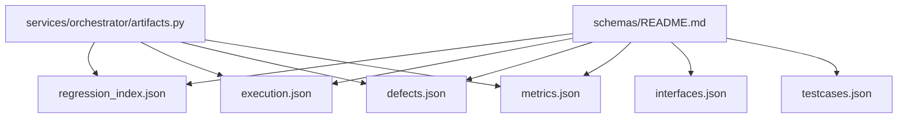
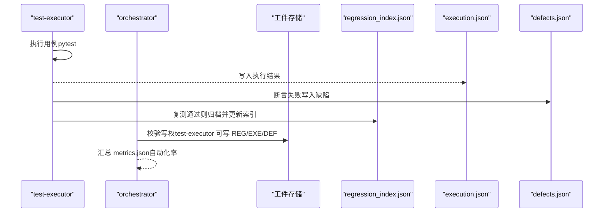
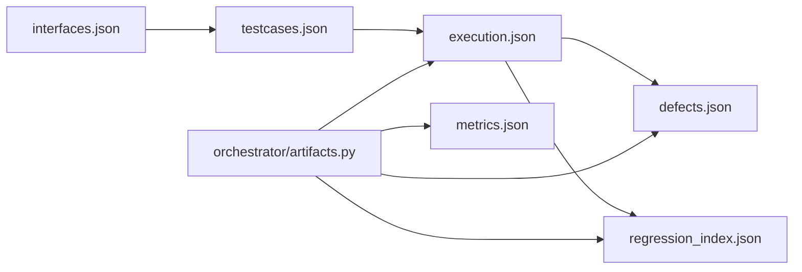

# 回归资产索引Schema

<cite>
**本文引用的文件**
- [regression_index.json](file://schemas/regression_index.json)
- [execution.json](file://schemas/execution.json)
- [defects.json](file://schemas/defects.json)
- [metrics.json](file://schemas/metrics.json)
- [interfaces.json](file://schemas/interfaces.json)
- [testcases.json](file://schemas/testcases.json)
- [README.md](file://schemas/README.md)
- [execution.sample.json](file://schemas/samples/execution.sample.json)
- [artifacts.py](file://services/orchestrator/src/orchestrator/artifacts.py)
- [04_功能规格说明.md](file://docs/04_功能规格说明.md)
- [10_测试框架选型说明.md](file://docs/10_测试框架选型说明.md)
- [07_UI演示设计.md](file://docs/07_UI演示设计.md)
</cite>

## 目录
1. [简介](#简介)
2. [项目结构](#项目结构)
3. [核心组件](#核心组件)
4. [架构总览](#架构总览)
5. [详细组件分析](#详细组件分析)
6. [依赖关系分析](#依赖关系分析)
7. [性能与执行优化](#性能与执行优化)
8. [故障排查指南](#故障排查指南)
9. [结论](#结论)
10. [附录：配置与执行示例](#附录：配置与执行示例)

## 简介
本文件面向“回归资产索引Schema”，围绕 schemas/regression_index.json 的结构、语义与使用方式，系统化说明回归用例集组织、执行历史与结果关联、覆盖率与自动化率度量、性能基线与漂移告警等主题。同时给出回归测试策略、资产管理体系、用例选择算法与执行优化机制，并提供回归分析报告与趋势预测方法，以及可操作的配置与执行示例。

## 项目结构
回归资产索引位于 schemas/regression_index.json，属于结构化产物集合的一部分。该集合以 JSON Schema 为单一事实来源，orchestrator 与 test-executor 的模型与之对齐，确保跨服务一致性与可校验性。

图表来源
- [README.md:12-29](file://schemas/README.md#L12-L29)
- [artifacts.py:32-49](file://services/orchestrator/src/orchestrator/artifacts.py#L32-L49)

章节来源
- [README.md:12-29](file://schemas/README.md#L12-L29)
- [artifacts.py:32-49](file://services/orchestrator/src/orchestrator/artifacts.py#L32-L49)

## 核心组件
- 回归资产索引（regression_index.json）：定义回归套件、脚本清单、漂移告警等，作为回归资产的权威索引。
- 执行结果（execution.json）：记录每条用例的执行状态、失败类型、耗时与时间戳，并汇总统计。
- 缺陷记录（defects.json）：仅收录断言失败的用例，支持复测生命周期与历史追踪。
- 自动化率度量（metrics.json）：按9节点口径统计自动化率，标注降级与人工介入原因。
- 接口还原（interfaces.json）：提供接口签名、参数、返回与代码位置，支撑用例生成与溯源。
- 用例元数据（testcases.json）：描述生成的用例、预期、脚本路径与可加载性校验结果。

章节来源
- [regression_index.json:1-49](file://schemas/regression_index.json#L1-L49)
- [execution.json:1-59](file://schemas/execution.json#L1-L59)
- [defects.json:1-54](file://schemas/defects.json#L1-L54)
- [metrics.json:1-49](file://schemas/metrics.json#L1-L49)
- [interfaces.json:1-70](file://schemas/interfaces.json#L1-L70)
- [testcases.json:1-34](file://schemas/testcases.json#L1-L34)

## 架构总览
回归流程的关键交互如下：test-executor 产出 execution.json；通过规则将断言失败用例写入 defects.json；对复测通过的用例进行归档，更新 regression_index.json；orchestrator 负责统一读写权限与工件目录管理；metrics.json 由 orchestrator 汇总自动化率。

图表来源
- [execution.json:1-59](file://schemas/execution.json#L1-L59)
- [defects.json:1-54](file://schemas/defects.json#L1-L54)
- [regression_index.json:1-49](file://schemas/regression_index.json#L1-L49)
- [artifacts.py:32-49](file://services/orchestrator/src/orchestrator/artifacts.py#L32-L49)

## 详细组件分析

### regression_index.json 字段详解
- schema_version：固定为 "1.0"，用于版本控制与向后兼容。
- job_id：以 "job-" 开头的字符串，标识一次流水线或任务实例。
- suites：按协议维度组织的回归套件数组，每个套件包含 protocol 与 scripts。
  - protocol：枚举 rest/grpc/graphql/soap/mq，体现多协议覆盖。
  - scripts：脚本清单，每项包含：
    - case_id：用例编号，形如 TC-xxx。
    - script_path：归档后的脚本路径（移动非复制）。
    - requirement_id：需求条目 ID，形如 REQ-xxx，用于溯源。
    - interface_id：接口 ID，形如 IF-XXX-xxx，用于接口级追溯。
    - archived_at：归档时间（UTC ISO-8601），幂等重档会更新时间。
    - version：归档版本号，递增表示覆盖更新。
- drift_warnings：回归漂移告警列表，当重跑结果与沉淀时不一致时记录，交由人工判断，不自动删除资产。

章节来源
- [regression_index.json:1-49](file://schemas/regression_index.json#L1-L49)

### 执行结果与缺陷闭环
- execution.json 提供每条用例的执行结果、失败类型（断言失败/环境失败）、超时标记、跳过原因、耗时与时间戳，并汇总 total/passed/failed_assertion/failed_environment/interrupted。
- defects.json 仅收录断言失败用例，支持复测状态流转与历史事件追踪，便于回归闭环。

章节来源
- [execution.json:1-59](file://schemas/execution.json#L1-L59)
- [defects.json:1-54](file://schemas/defects.json#L1-L54)

### 覆盖率与自动化率度量
- metrics.json 定义自动化率计算口径：无人工节点数/9，分母固定为9，避免缩减口径导致误导。
- nodes 数组列出9个流程节点的状态、是否降级、降级原因、人工介入原因与可自动化路径建议。
- caveat 声明本项目口径不等于生产口径，不得直接外推。

章节来源
- [metrics.json:1-49](file://schemas/metrics.json#L1-L49)

### 性能基线与趋势预测
- 性能基线可从 execution.json 的 duration_ms 与 summary.total/passed/failed_* 提取，形成每次执行的基线快照。
- 趋势预测建议：
  - 基于多次 execution.json 的通过率与平均耗时构建时间序列，观察退化趋势。
  - 结合 regression_index.json 的 drift_warnings 识别回归漂移用例，定位不稳定用例。
  - 使用 metrics.json 的 nodes.degraded 与 intervention_reason 分析瓶颈节点，指导优化投入。

[本节为概念性内容，不直接分析具体文件]

### 用例选择算法与执行优化机制
- 用例选择策略：
  - 优先选择最近变更接口相关用例（依据 interfaces.json 的 code_location 与 interface_id）。
  - 高优先级：REST 完整实现；其他协议最小可用级（X-REG-03）。
  - 低置信度用例（testcases.json.low_confidence）需人工复核后再纳入回归。
- 执行优化：
  - 环境可用性探测优先于执行：REST > gRPC > GraphQL > SOAP/MQ（R-EXEC-02）。
  - 失败分类隔离：断言失败进缺陷清单，环境失败隔离待确认（R-EXEC-03）。
  - 前置数据准备在流程启动前完成，执行时无人工介入（R-EXEC-04）。
  - 超时与中断处理：单用例超时上限，服务崩溃剩余用例标中断（X-EXEC-02/X-EXEC-04）。

章节来源
- [interfaces.json:1-70](file://schemas/interfaces.json#L1-L70)
- [testcases.json:1-34](file://schemas/testcases.json#L1-L34)
- [04_功能规格说明.md:194-208](file://docs/04_功能规格说明.md#L194-L208)

### 回归分析报告与趋势预测
- 报告内容应包含：
  - 总用例数、通过数、失败数、通过率、失败明细（含失败原因与失败类型）。
  - 降级协议清单与原因（degraded_protocols）。
  - 回归漂移告警（drift_warnings）及人工判断建议。
  - 自动化率大数与分节点分解（metrics.json）。
- 趋势预测：
  - 对比多次 execution.json 的通过率与耗时分布，识别退化趋势。
  - 跟踪 drift_warnings 的变化，评估回归稳定性。
  - 结合 metrics.json 的节点状态变化，评估自动化推进效果。

章节来源
- [execution.json:1-59](file://schemas/execution.json#L1-L59)
- [metrics.json:1-49](file://schemas/metrics.json#L1-L49)
- [regression_index.json:1-49](file://schemas/regression_index.json#L1-L49)

## 依赖关系分析
- orchestrator 通过 artifacts.py 管理工件目录与写权，明确各文件的写入方（orchestrator/test-executor）。
- regression_index.json 与 execution.json、defects.json、metrics.json 共同构成回归闭环的数据链。
- interfaces.json 与 testcases.json 为上游输入，影响用例选择与执行范围。

图表来源
- [artifacts.py:32-49](file://services/orchestrator/src/orchestrator/artifacts.py#L32-L49)
- [interfaces.json:1-70](file://schemas/interfaces.json#L1-L70)
- [testcases.json:1-34](file://schemas/testcases.json#L1-L34)
- [execution.json:1-59](file://schemas/execution.json#L1-L59)
- [defects.json:1-54](file://schemas/defects.json#L1-L54)
- [metrics.json:1-49](file://schemas/metrics.json#L1-L49)

章节来源
- [artifacts.py:32-49](file://services/orchestrator/src/orchestrator/artifacts.py#L32-L49)

## 性能与执行优化
- 执行命令与无头模式：采用 pytest 的 JSON 报告输出，便于程序化汇总（F-RPT-02）。
- 可加载性校验：生成后执行 py_compile 与收集阶段零 error，确保脚本可运行（R-GEN-03）。
- 二态标注：自定义插件区分断言失败与环境失败，提升缺陷质量与回归准确性（R-EXEC-03）。
- 归档与重跑：按协议维度组织脚本目录，回归重跑即对归档目录再次执行（R-REG-02/F-REG-03）。

章节来源
- [10_测试框架选型说明.md:45-53](file://docs/10_测试框架选型说明.md#L45-L53)
- [04_功能规格说明.md:194-208](file://docs/04_功能规格说明.md#L194-L208)

## 故障排查指南
- 环境不可达：对应协议用例标记“环境失败”，不判为缺陷（X-EXEC-01）。
- 执行超时：单用例超时上限，超时记失败并附超时原因（X-EXEC-02）。
- Runner 未就绪：降级为“脚本生成成功+Mock执行演示”，报告中注明（X-EXEC-03）。
- 服务崩溃：已完成用例结果保留，剩余用例标记“中断”（X-EXEC-04）。
- 前置数据缺失：对应用例标记“前置缺失”跳过并记录，不判为缺陷（X-EXEC-05）。
- 回归漂移：重跑结果与沉淀不一致，记录 drift_warnings，交人工判断（X-REG-02）。

章节来源
- [execution.json:1-59](file://schemas/execution.json#L1-L59)
- [regression_index.json:1-49](file://schemas/regression_index.json#L1-L49)
- [04_功能规格说明.md:194-208](file://docs/04_功能规格说明.md#L194-L208)

## 结论
回归资产索引以协议维度组织脚本清单，配合执行结果、缺陷记录与自动化率度量，形成完整的回归闭环。通过明确的字段约束、漂移告警与执行优化策略，保障回归的稳定性和可维护性。建议在持续集成中定期产出 execution.json 与 metrics.json，并结合 regression_index.json 的 drift_warnings 进行趋势分析与优化决策。

[本节为总结性内容，不直接分析具体文件]

## 附录：配置与执行示例
- 执行命令（无头、JSON 报告）：
  - pytest <脚本目录> -q --json-report --json-report-file=execution_raw.json
- 可加载性校验：
  - python -m py_compile 与 pytest 收集阶段零 error
- 归档与重跑：
  - 按 R-REG-02 协议维度组织 pytest 脚本目录
  - 回归重跑即对归档目录再次执行 pytest（F-REG-03）
- UI 演示要点：
  - 资产树按协议维度组织，REST 完整实现，其他协议最小可用级
  - 一键重跑全量，回归漂移告警交人工判断
  - 度量报告展示自动化率大数与分节点分解

章节来源
- [10_测试框架选型说明.md:45-53](file://docs/10_测试框架选型说明.md#L45-L53)
- [07_UI演示设计.md:78-85](file://docs/07_UI演示设计.md#L78-L85)
- [execution.sample.json:1-63](file://schemas/samples/execution.sample.json#L1-L63)