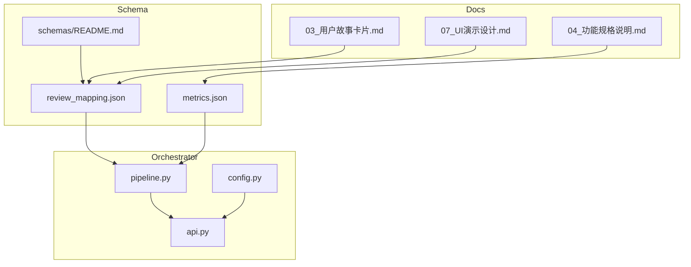
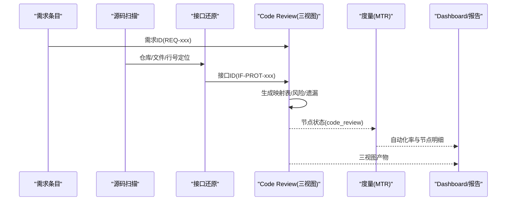
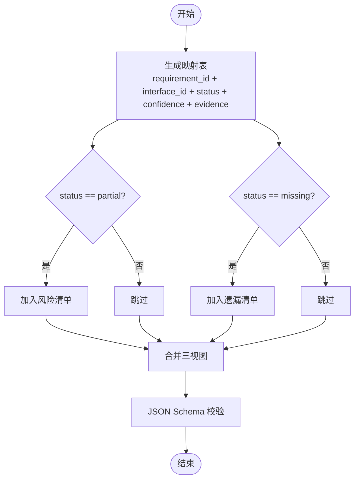
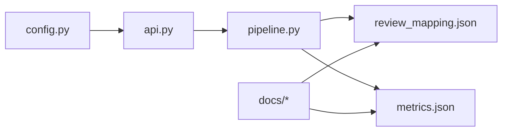

# 审查映射Schema

<cite>
**本文引用的文件**
- [schemas/review_mapping.json](file://schemas/review_mapping.json)
- [schemas/README.md](file://schemas/README.md)
- [services/orchestrator/src/orchestrator/pipeline.py](file://services/orchestrator/src/orchestrator/pipeline.py)
- [services/orchestrator/src/orchestrator/config.py](file://services/orchestrator/src/orchestrator/config.py)
- [services/orchestrator/src/orchestrator/api.py](file://services/orchestrator/src/orchestrator/api.py)
- [schemas/metrics.json](file://schemas/metrics.json)
- [docs/03_用户故事卡片.md](file://docs/03_用户故事卡片.md)
- [docs/04_功能规格说明.md](file://docs/04_功能规格说明.md)
- [docs/06_需求定稿冻结.md](file://docs/06_需求定稿冻结.md)
- [docs/07_UI演示设计.md](file://docs/07_UI演示设计.md)
</cite>

## 目录
1. [简介](#简介)
2. [项目结构](#项目结构)
3. [核心组件](#核心组件)
4. [架构总览](#架构总览)
5. [详细组件分析](#详细组件分析)
6. [依赖关系分析](#依赖关系分析)
7. [性能与可扩展性](#性能与可扩展性)
8. [故障排查指南](#故障排查指南)
9. [结论](#结论)
10. [附录](#附录)

## 简介
本文件围绕“审查映射Schema”展开，聚焦 review_mapping.json 的结构与使用方式，解释三视图（映射表、风险清单、遗漏功能清单）的生成与消费流程，并给出代码与接口的关联关系、风险评估模型、遗漏分析方法、规则自定义与扩展机制、质量度量指标与报告生成方法，以及审查结果分析与改进建议示例。

## 项目结构
- schemas 目录集中存放所有结构化产物的 JSON Schema，review_mapping.json 是模块4（REVIEW）的核心产物定义之一。
- orchestrator 服务提供流水线编排能力，固定9节点口径，其中“code_review”节点负责产出 review_mapping.json。
- metrics.json 定义自动化率度量，作为审查结果的量化补充。
- 文档（docs）中明确了验收标准、UI展示与口径约定，支撑三视图在界面与报告中的呈现。



图表来源
- [schemas/review_mapping.json:1-81](file://schemas/review_mapping.json#L1-L81)
- [schemas/metrics.json:1-49](file://schemas/metrics.json#L1-L49)
- [schemas/README.md:1-30](file://schemas/README.md#L1-L30)
- [services/orchestrator/src/orchestrator/pipeline.py:1-84](file://services/orchestrator/src/orchestrator/pipeline.py#L1-L84)
- [services/orchestrator/src/orchestrator/api.py:1-28](file://services/orchestrator/src/orchestrator/api.py#L1-L28)
- [services/orchestrator/src/orchestrator/config.py:1-56](file://services/orchestrator/src/orchestrator/config.py#L1-L56)
- [docs/03_用户故事卡片.md:67-88](file://docs/03_用户故事卡片.md#L67-L88)
- [docs/04_功能规格说明.md:288-306](file://docs/04_功能规格说明.md#L288-L306)
- [docs/07_UI演示设计.md:44-59](file://docs/07_UI演示设计.md#L44-L59)

章节来源
- [schemas/README.md:1-30](file://schemas/README.md#L1-L30)
- [services/orchestrator/src/orchestrator/pipeline.py:1-84](file://services/orchestrator/src/orchestrator/pipeline.py#L1-L84)
- [services/orchestrator/src/orchestrator/api.py:1-28](file://services/orchestrator/src/orchestrator/api.py#L1-L28)
- [services/orchestrator/src/orchestrator/config.py:1-56](file://services/orchestrator/src/orchestrator/config.py#L1-L56)

## 核心组件
- 审查映射Schema（review_mapping.json）：定义“需求-接口-代码位置”的映射表、风险清单、遗漏功能清单与人工审核日志，要求一次生成、三视图同源输出。
- 流水线编排（orchestrator）：固定9节点顺序，其中 code_review 节点负责生成 review_mapping.json；metrics 节点汇总自动化率。
- 度量Schema（metrics.json）：以9为分母计算自动化率，记录每个节点状态与瓶颈分析。
- 文档规范：明确验收标准、UI展示与口径约束，确保三视图可被前端与报告系统消费。

章节来源
- [schemas/review_mapping.json:1-81](file://schemas/review_mapping.json#L1-L81)
- [services/orchestrator/src/orchestrator/pipeline.py:23-34](file://services/orchestrator/src/orchestrator/pipeline.py#L23-L34)
- [schemas/metrics.json:1-49](file://schemas/metrics.json#L1-L49)
- [docs/03_用户故事卡片.md:67-88](file://docs/03_用户故事卡片.md#L67-L88)

## 架构总览
下图展示了从需求解析到Code Review三视图生成的端到端数据流，以及度量指标的汇聚点。



图表来源
- [services/orchestrator/src/orchestrator/pipeline.py:23-34](file://services/orchestrator/src/orchestrator/pipeline.py#L23-L34)
- [schemas/review_mapping.json:10-78](file://schemas/review_mapping.json#L10-L78)
- [schemas/metrics.json:21-46](file://schemas/metrics.json#L21-L46)
- [docs/07_UI演示设计.md:44-59](file://docs/07_UI演示设计.md#L44-L59)

## 详细组件分析

### 审查映射Schema结构与字段语义
- 顶层字段
  - schema_version：固定为“1.0”，用于版本控制。
  - job_id：任务标识，匹配“job-”前缀。
  - mappings：视图一，需求×接口的映射数组。
  - risks：视图二，风险清单，由映射派生。
  - missing_features：视图三，遗漏功能清单，由映射派生。
  - review_log：人工审核记录，支持通过/驳回与回流标记。
- 映射项（mappings 子项）
  - requirement_id：需求ID，匹配“REQ-三位数字”。
  - interface_id：接口ID，匹配“IF-协议大写-三位数字”。
  - status：四态枚举，“implemented/partial/missing/undetermined”。
  - confidence：置信度[0,1]，用于评估映射可靠性。
  - evidence：证据对象，包含 code_location（repo/file/start_line/end_line）与 note。
- 风险项（risks 子项）
  - requirement_id、interface_id、description（必填）。
- 遗漏项（missing_features 子项）
  - requirement_id、title（必填）。
- 审核日志（review_log 子项）
  - requirement_id、decision（approved/rejected）、reason、resubmitted、timestamp（UTC ISO-8601）。

章节来源
- [schemas/review_mapping.json:1-81](file://schemas/review_mapping.json#L1-L81)

### 三视图生成与一致性保证
- 视图一（映射表）：由LLM或静态分析将需求条目与接口候选进行关联，标注实现状态与置信度，并提供代码位置证据。
- 视图二（风险清单）：对映射表中“partial”自动进入风险清单，同时结合程序化规则派生其他风险（如接口缺失、证据不足等）。
- 视图三（遗漏功能清单）：从映射表中提取“missing”条目，程序化派生以保证与映射一致。
- 一致性校验：三视图需在一次生成中完成，并通过Schema校验；遗漏清单必须与映射中的“missing”完全一致。



图表来源
- [schemas/review_mapping.json:10-78](file://schemas/review_mapping.json#L10-L78)
- [docs/03_用户故事卡片.md:67-88](file://docs/03_用户故事卡片.md#L67-L88)

### 代码与接口的关联关系
- 关联键：requirement_id 与 interface_id 构成映射主键，evidence.code_location 提供精确到仓库/文件/行号的定位。
- 接口ID命名：IF-协议大写-三位数字，便于按协议维度聚合与统计。
- 证据链：当 status=implemented 时，应提供有效的 code_location；当 status=undetermined 时，confidence 较低且需人工复核。

章节来源
- [schemas/review_mapping.json:16-36](file://schemas/review_mapping.json#L16-L36)
- [docs/07_UI演示设计.md:44-59](file://docs/07_UI演示设计.md#L44-L59)

### 风险评估模型
- 触发条件：
  - 自动触发：映射中 status=partial 的条目自动进入风险清单。
  - 程序化派生：基于证据缺失、置信度过低、接口未识别等规则生成风险。
- 风险描述：每条风险需包含 description，并可关联 requirement_id 与 interface_id。
- 处理闭环：人工审核 review_log 记录 decision（approved/rejected），必要时 resubmitted 回流重新生成。

章节来源
- [schemas/review_mapping.json:39-78](file://schemas/review_mapping.json#L39-L78)
- [docs/03_用户故事卡片.md:67-88](file://docs/03_用户故事卡片.md#L67-L88)

### 遗漏分析方法
- 提取规则：从映射表中筛选 status=missing 的条目，生成 missing_features 列表。
- 一致性保证：遗漏清单与映射表保持严格一致，可通过程序校验。
- 标题生成：title 字段用于对外展示，便于报告与UI呈现。

章节来源
- [schemas/review_mapping.json:52-63](file://schemas/review_mapping.json#L52-L63)
- [docs/03_用户故事卡片.md:67-88](file://docs/03_用户故事卡片.md#L67-L88)

### 审查规则的自定义与扩展机制
- Schema驱动：review_mapping.json 作为单一事实源，新增字段或枚举需在Schema中显式声明，禁止原地改语义。
- 配置注入：orchestrator 通过环境变量加载配置（如 schemas_dir、LLM参数），可在不改动代码的情况下调整行为。
- 节点扩展：9节点口径冻结，但可在 code_review 节点内部扩展规则引擎（例如新增风险派生规则、置信度阈值策略）。
- 校验前置：所有LLM输出必须通过对应Schema校验后才进入下游，保障扩展安全。

章节来源
- [schemas/README.md:5-10](file://schemas/README.md#L5-L10)
- [services/orchestrator/src/orchestrator/config.py:9-56](file://services/orchestrator/src/orchestrator/config.py#L9-L56)
- [services/orchestrator/src/orchestrator/pipeline.py:23-34](file://services/orchestrator/src/orchestrator/pipeline.py#L23-L34)

### 质量度量指标与报告生成
- 自动化率：以9为分母，无人工节点数/9；数据不完整时 value 为 null，避免误导。
- 节点明细：记录每个节点的状态（completed/manual_intervention）、降级原因、介入原因与可自动化路径建议。
- 报告口径：项目口径≠生产口径，不得直接外推；仅正式验收数值作为基线。
- 与三视图联动：code_review 节点状态影响自动化率；风险与遗漏清单可作为报告的关键发现。

```mermaid
classDiagram
class Metrics {
+schema_version
+job_id
+automation_rate {value, numerator, denominator, data_complete}
+nodes[] {name, status, degraded, degrade_reason, intervention_reason, automation_path}
+caveat
+measured_at
}
class PipelineState {
+records[]
+automation_rate() float|null
}
Metrics --> PipelineState : "读取节点状态"
```

图表来源
- [schemas/metrics.json:1-49](file://schemas/metrics.json#L1-L49)
- [services/orchestrator/src/orchestrator/pipeline.py:45-70](file://services/orchestrator/src/orchestrator/pipeline.py#L45-L70)

章节来源
- [schemas/metrics.json:1-49](file://schemas/metrics.json#L1-L49)
- [services/orchestrator/src/orchestrator/pipeline.py:45-70](file://services/orchestrator/src/orchestrator/pipeline.py#L45-L70)
- [docs/04_功能规格说明.md:288-306](file://docs/04_功能规格说明.md#L288-L306)

### 审查结果分析与改进建议示例
- 典型场景1：某需求映射为 partial，置信度0.6，证据代码位置存在但不完整。
  - 分析：可能因多分支实现或框架注解导致定位不全。
  - 建议：增强静态特征定位，按接口分块送入LLM；补充证据后提升置信度。
- 典型场景2：某需求映射为 missing，无接口候选。
  - 分析：接口还原失败或未被识别。
  - 建议：优先修复接口还原环节；若环境不可用，采用Mock执行并降级标注。
- 典型场景3：风险清单中出现多条“证据不足”的风险。
  - 分析：置信度过低或代码位置缺失。
  - 建议：引入抽样核对（如按ID升序取前5条比对），完善证据链。
- 度量联动：若 code_review 节点为 manual_intervention，自动化率下降；需记录介入原因与可自动化路径建议。

章节来源
- [schemas/review_mapping.json:16-78](file://schemas/review_mapping.json#L16-L78)
- [docs/03_用户故事卡片.md:67-88](file://docs/03_用户故事卡片.md#L67-L88)
- [docs/04_功能规格说明.md:288-306](file://docs/04_功能规格说明.md#L288-L306)

## 依赖关系分析
- Orchestrator 依赖 pipeline 定义的9节点顺序与状态机，API层暴露健康检查与节点清单。
- review_mapping.json 与 metrics.json 共同构成审查与度量的核心产物，受 schemas/README.md 的横切约定约束。
- 文档（docs）定义了验收标准与UI展示，反向约束Schema字段与枚举值。



图表来源
- [services/orchestrator/src/orchestrator/api.py:1-28](file://services/orchestrator/src/orchestrator/api.py#L1-L28)
- [services/orchestrator/src/orchestrator/pipeline.py:1-84](file://services/orchestrator/src/orchestrator/pipeline.py#L1-L84)
- [services/orchestrator/src/orchestrator/config.py:1-56](file://services/orchestrator/src/orchestrator/config.py#L1-L56)
- [schemas/review_mapping.json:1-81](file://schemas/review_mapping.json#L1-L81)
- [schemas/metrics.json:1-49](file://schemas/metrics.json#L1-L49)
- [docs/03_用户故事卡片.md:67-88](file://docs/03_用户故事卡片.md#L67-L88)

章节来源
- [services/orchestrator/src/orchestrator/api.py:1-28](file://services/orchestrator/src/orchestrator/api.py#L1-L28)
- [services/orchestrator/src/orchestrator/pipeline.py:1-84](file://services/orchestrator/src/orchestrator/pipeline.py#L1-L84)
- [services/orchestrator/src/orchestrator/config.py:1-56](file://services/orchestrator/src/orchestrator/config.py#L1-L56)

## 性能与可扩展性
- 性能要点：
  - 静态特征定位优先，按接口分块送入LLM，降低token消耗与限流风险。
  - 三视图一次生成，减少重复计算与I/O开销。
- 可扩展性：
  - Schema驱动扩展：新增字段或枚举需升级 schema_version，禁止原地改语义。
  - 配置化：通过环境变量注入LLM参数与Schema目录，支持不同运行环境。
  - 节点内扩展：在 code_review 节点内增加规则引擎，不影响9节点口径。

章节来源
- [schemas/README.md:5-10](file://schemas/README.md#L5-L10)
- [services/orchestrator/src/orchestrator/config.py:9-56](file://services/orchestrator/src/orchestrator/config.py#L9-L56)
- [docs/02_立项提案.md:80-93](file://docs/02_立项提案.md#L80-L93)

## 故障排查指南
- Schema校验失败：
  - 检查字段类型、枚举值与正则匹配（如 requirement_id、interface_id）。
  - 确认 schema_version 与 required 字段齐全。
- 三视图不一致：
  - 验证 missing_features 是否完全来自映射表的 missing 条目。
  - 检查 risks 是否包含所有 partial 条目。
- 自动化率异常：
  - 确认9节点状态完整，数据不完整时 value 应为 null。
  - 核查降级节点是否按“人工介入”计入并在报告中注明。
- LLM调用问题：
  - 检查环境变量配置（LLM_BASE_URL、LLM_MODEL_NAME、LLM_TIMEOUT_S等）。
  - 关注限流与成本，采用分块策略与静态定位优先。

章节来源
- [schemas/review_mapping.json:1-81](file://schemas/review_mapping.json#L1-L81)
- [schemas/metrics.json:1-49](file://schemas/metrics.json#L1-L49)
- [services/orchestrator/src/orchestrator/config.py:9-56](file://services/orchestrator/src/orchestrator/config.py#L9-L56)
- [docs/06_需求定稿冻结.md:37-50](file://docs/06_需求定稿冻结.md#L37-L50)

## 结论
review_mapping.json 作为审查映射的核心Schema，提供了需求-接口-代码位置的映射表、风险清单与遗漏功能清单三视图，并通过人工审核日志形成闭环。配合 orchestrator 的9节点口径与 metrics.json 的度量体系，可实现从代码审查到质量度量的全链路管理。通过Schema驱动与配置化扩展，可在不破坏既有口径的前提下持续优化审查规则与报告质量。

## 附录
- 关键验收标准参考：
  - 映射表覆盖率、证据抽样核对、三视图一次生成。
  - 自动化率口径与降级策略。
- UI与报告：
  - Dashboard展示九节点状态、接口还原清单、自动化率卡片与映射表摘要。
  - 三视图同源的视图切换器与人工审核面板。

章节来源
- [docs/03_用户故事卡片.md:67-88](file://docs/03_用户故事卡片.md#L67-L88)
- [docs/07_UI演示设计.md:44-59](file://docs/07_UI演示设计.md#L44-L59)
- [docs/04_功能规格说明.md:288-306](file://docs/04_功能规格说明.md#L288-L306)