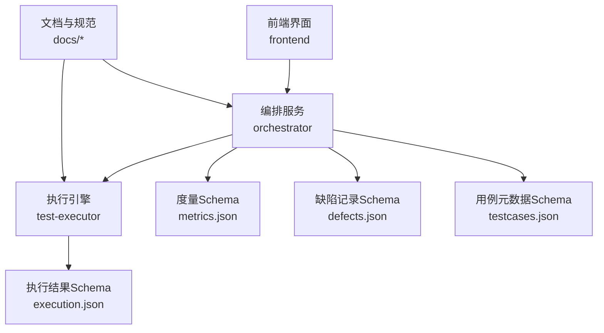
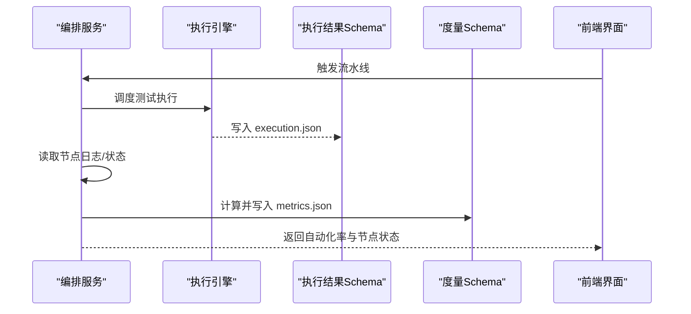
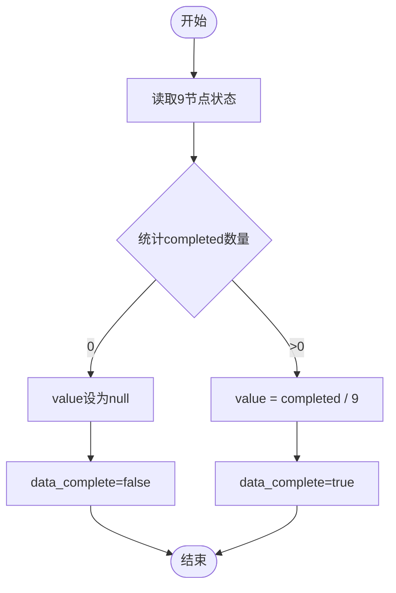
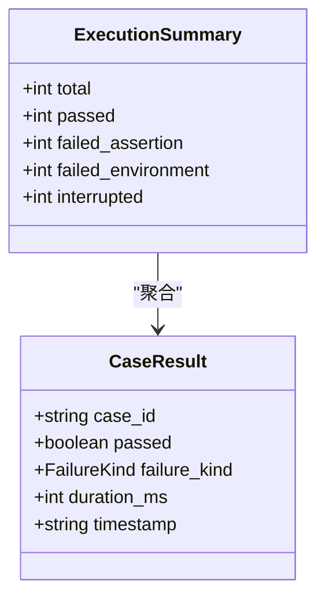
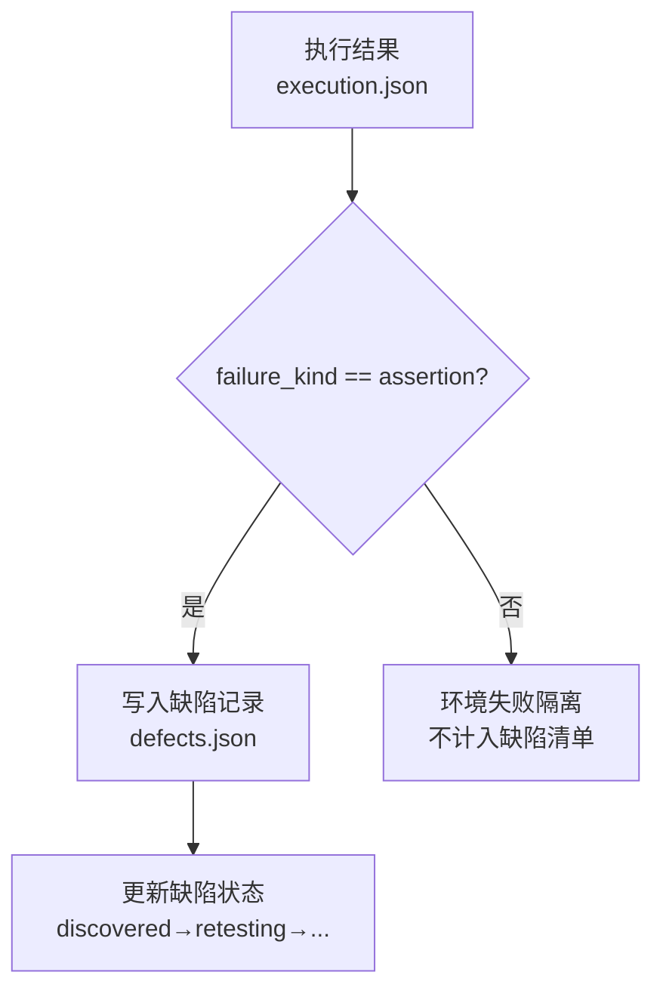
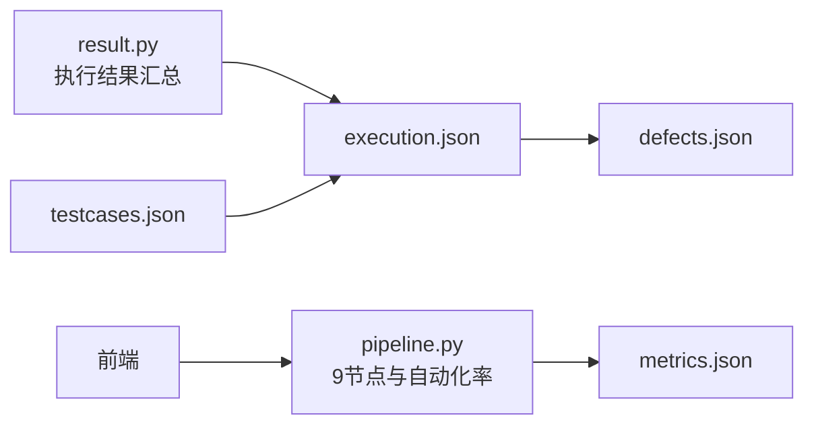

# 度量指标Schema

<cite>
**本文引用的文件**
- [schemas/metrics.json](file://schemas/metrics.json)
- [schemas/execution.json](file://schemas/execution.json)
- [schemas/defects.json](file://schemas/defects.json)
- [schemas/testcases.json](file://schemas/testcases.json)
- [schemas/samples/execution.sample.json](file://schemas/samples/execution.sample.json)
- [services/orchestrator/src/orchestrator/pipeline.py](file://services/orchestrator/src/orchestrator/pipeline.py)
- [services/test-executor/src/executor/result.py](file://services/test-executor/src/executor/result.py)
- [docs/02_立项提案.md](file://docs/02_立项提案.md)
- [docs/03_用户故事卡片.md](file://docs/03_用户故事卡片.md)
- [docs/04_功能规格说明.md](file://docs/04_功能规格说明.md)
- [docs/09_开发规范说明.md](file://docs/09_开发规范说明.md)
- [docs/07_UI演示设计.md](file://docs/07_UI演示设计.md)
</cite>

## 目录
1. [引言](#引言)
2. [项目结构](#项目结构)
3. [核心组件](#核心组件)
4. [架构总览](#架构总览)
5. [详细组件分析](#详细组件分析)
6. [依赖关系分析](#依赖关系分析)
7. [性能与可观测性](#性能与可观测性)
8. [故障排查指南](#故障排查指南)
9. [结论](#结论)
10. [附录：示例与配置](#附录示例与配置)

## 引言
本文件围绕“自动化率度量”的 Schema 与实现，系统化说明 metrics.json 的结构、计算口径、数据采集机制、可视化展示与告警建议，并给出质量趋势分析与改进建议。同时提供度量报告生成与监控配置的参考示例，帮助团队在验收与后续迭代中持续度量与改进。

## 项目结构
本项目将结构化产物统一以 JSON Schema 管理，度量相关的关键文件包括：
- schemas/metrics.json：定义自动化率度量的数据模型（模块 10 MTR）
- schemas/execution.json：定义执行结果与汇总（模块 6 EXEC），作为通过率等数值的数据源
- schemas/defects.json：本地缺陷记录（模块 8 DEF），用于缺陷密度等衍生指标
- schemas/testcases.json：用例元数据（模块 5 GEN），支撑覆盖率与用例规模统计
- services/orchestrator：编排服务，维护 9 节点状态并计算自动化率
- services/test-executor：执行引擎，产出断言与环境失败二态的执行结果
- docs/*：需求、规格、UI 设计与开发规范，约束度量口径与呈现方式

图表来源
- [services/orchestrator/src/orchestrator/pipeline.py:1-84](file://services/orchestrator/src/orchestrator/pipeline.py#L1-L84)
- [services/test-executor/src/executor/result.py:1-61](file://services/test-executor/src/executor/result.py#L1-L61)
- [schemas/metrics.json:1-48](file://schemas/metrics.json#L1-L48)
- [schemas/execution.json:1-59](file://schemas/execution.json#L1-L59)
- [schemas/defects.json:1-54](file://schemas/defects.json#L1-L54)
- [schemas/testcases.json:1-35](file://schemas/testcases.json#L1-L35)

章节来源
- [docs/09_开发规范说明.md:21-35](file://docs/09_开发规范说明.md#L21-L35)
- [docs/09_开发规范说明.md:81-87](file://docs/09_开发规范说明.md#L81-L87)

## 核心组件
- 自动化率度量（MTR）：基于 9 节点固定口径，统计无人工介入节点数 / 9；分母固定为 9，降级节点按人工介入计入。
- 执行结果（EXEC）：区分断言失败与环境失败，程序化汇总通过/失败/中断等计数。
- 缺陷记录（DEF）：仅断言失败进入缺陷清单，支持复测生命周期与历史审计。
- 用例元数据（GEN）：用例分类、参数溯源、脚本加载校验等，支撑覆盖率与规模统计。

章节来源
- [schemas/metrics.json:1-48](file://schemas/metrics.json#L1-L48)
- [schemas/execution.json:1-59](file://schemas/execution.json#L1-L59)
- [schemas/defects.json:1-54](file://schemas/defects.json#L1-L54)
- [schemas/testcases.json:1-35](file://schemas/testcases.json#L1-L35)

## 架构总览
度量体系由“编排 + 执行 + 产物 Schema”构成：编排器维护 9 节点状态并计算自动化率；执行引擎产出执行结果；所有数值均通过 Schema 校验后程序化汇总，不经过 LLM。

图表来源
- [services/orchestrator/src/orchestrator/pipeline.py:23-70](file://services/orchestrator/src/orchestrator/pipeline.py#L23-L70)
- [schemas/execution.json:1-59](file://schemas/execution.json#L1-L59)
- [schemas/metrics.json:1-48](file://schemas/metrics.json#L1-L48)

## 详细组件分析

### 自动化率度量（metrics.json）
- 顶层字段
  - schema_version：版本控制，变更需升版本
  - job_id：任务标识，匹配 job- 前缀
  - automation_rate：自动化率对象，包含 value、numerator、denominator、data_complete
  - nodes：9 节点逐项状态数组，固定枚举名称与状态
  - caveat：项目口径声明，不得外推至生产
  - measured_at：测量时间戳（UTC ISO-8601）
- 关键规则
  - 分母固定为 9，禁止缩减；降级节点按“人工介入”计入
  - 数据不完整时 value 为 null，避免误导
  - 每个节点记录 status、degraded、degrade_reason、intervention_reason、automation_path

图表来源
- [schemas/metrics.json:10-46](file://schemas/metrics.json#L10-L46)
- [services/orchestrator/src/orchestrator/pipeline.py:61-70](file://services/orchestrator/src/orchestrator/pipeline.py#L61-L70)

章节来源
- [schemas/metrics.json:1-48](file://schemas/metrics.json#L1-L48)
- [docs/04_功能规格说明.md:288-306](file://docs/04_功能规格说明.md#L288-L306)
- [docs/03_用户故事卡片.md:197-212](file://docs/03_用户故事卡片.md#L197-L212)

### 执行效率与通过率（execution.json）
- results：每条用例的结果，包含 case_id、interface_id、passed、failure_kind、duration_ms、timestamp 等
- summary：程序化汇总 total、passed、failed_assertion、failed_environment、interrupted
- degraded_protocols：降级协议清单，显式记录降级模式与原因
- 失败二态：断言失败计入通过率分母；环境失败隔离待确认，不计入通过率分母

图表来源
- [schemas/execution.json:10-56](file://schemas/execution.json#L10-L56)
- [services/test-executor/src/executor/result.py:17-61](file://services/test-executor/src/executor/result.py#L17-L61)

章节来源
- [schemas/execution.json:1-59](file://schemas/execution.json#L1-L59)
- [services/test-executor/src/executor/result.py:1-61](file://services/test-executor/src/executor/result.py#L1-L61)
- [schemas/samples/execution.sample.json:1-63](file://schemas/samples/execution.sample.json#L1-L63)

### 缺陷密度（defects.json）
- defects：仅断言失败进入缺陷清单，支持复测流程与历史审计
- 关键字段：id、case_id、interface_id、failure_reason、reproduce、status、history、is_fallback
- 与执行结果的关联：通过 case_id 与 interface_id 双向关联，便于定位问题范围

图表来源
- [schemas/execution.json:19-28](file://schemas/execution.json#L19-L28)
- [schemas/defects.json:10-50](file://schemas/defects.json#L10-L50)

章节来源
- [schemas/defects.json:1-54](file://schemas/defects.json#L1-L54)
- [docs/09_开发规范说明.md:81-87](file://docs/09_开发规范说明.md#L81-L87)

### 测试覆盖率（testcases.json）
- cases：用例元数据，包含 id、interface_id、requirement_id、category、expected、script_path、loadable、low_confidence
- 覆盖率建议口径（示例）：已覆盖接口数 / 接口总数；或已验证需求条目数 / 需求条目总数
- 结合 execution.json 的 passed 与 testcases.json 的 category 可派生“按类别覆盖率”

章节来源
- [schemas/testcases.json:1-35](file://schemas/testcases.json#L1-L35)
- [docs/09_开发规范说明.md:81-87](file://docs/09_开发规范说明.md#L81-L87)

### 指标可视化与告警
- 可视化
  - 流水线总览 Dashboard：顶部 9 节点状态条，右侧自动化率度量卡片，底部映射表摘要
  - 前端展示口径：数值一律来自后端 API，前端不做计算
- 告警建议
  - 自动化率低于阈值（如 <30%）：触发瓶颈治理专项
  - 执行失败率上升（断言失败占比升高）：触发回归风险预警
  - 缺陷密度异常增长：触发代码质量门禁加强
  - 环境失败占比高：触发环境问题排查与稳定性治理

章节来源
- [docs/07_UI演示设计.md:44-59](file://docs/07_UI演示设计.md#L44-L59)
- [docs/09_开发规范说明.md:64-71](file://docs/09_开发规范说明.md#L64-L71)

### 质量趋势分析与改进建议
- 趋势维度
  - 自动化率：按 job_id 序列观察，关注 data_complete 与 value 变化
  - 通过率：按 execution.summary 跟踪 passed/failed_assertion/failed_environment
  - 缺陷密度：按 job_id 统计 defects 数量与类型分布
  - 覆盖率：结合 testcases 与 execution 结果，评估覆盖提升
- 改进建议
  - 针对 manual_intervention 节点进行瓶颈分析（degrade_reason、intervention_reason）
  - 优先优化高频降级的协议或环节（如 MQ 异步消费场景）
  - 强化前置条件与数据准备，降低 skipped_reason 与 environment 失败
  - 对 low_confidence 用例进行增强与回归沉淀

章节来源
- [docs/04_功能规格说明.md:288-306](file://docs/04_功能规格说明.md#L288-L306)
- [schemas/execution.json:44-56](file://schemas/execution.json#L44-L56)
- [schemas/testcases.json:10-30](file://schemas/testcases.json#L10-L30)

## 依赖关系分析
- 编排服务依赖 9 节点顺序与状态，计算自动化率
- 执行引擎产出 execution.json，供度量与报告使用
- 缺陷记录与执行结果通过 case_id 与 interface_id 关联
- 前端仅展示后端返回的数值，不参与计算

图表来源
- [services/orchestrator/src/orchestrator/pipeline.py:23-70](file://services/orchestrator/src/orchestrator/pipeline.py#L23-L70)
- [services/test-executor/src/executor/result.py:17-61](file://services/test-executor/src/executor/result.py#L17-L61)
- [schemas/metrics.json:1-48](file://schemas/metrics.json#L1-L48)
- [schemas/execution.json:1-59](file://schemas/execution.json#L1-L59)
- [schemas/defects.json:1-54](file://schemas/defects.json#L1-L54)
- [schemas/testcases.json:1-35](file://schemas/testcases.json#L1-L35)

章节来源
- [docs/09_开发规范说明.md:81-87](file://docs/09_开发规范说明.md#L81-L87)

## 性能与可观测性
- 采集成本：节点日志与产物落盘为轻量操作，注意按 job_id 归档，避免大文件扫描
- 计算开销：自动化率与执行汇总均为 O(n) 遍历，n 为节点/用例数量，性能可控
- 可观测性：节点执行日志、产物 Schema 校验失败日志、错误结构统一，便于追踪

章节来源
- [docs/09_开发规范说明.md:96-101](file://docs/09_开发规范说明.md#L96-L101)
- [schemas/execution.json:19-28](file://schemas/execution.json#L19-L28)

## 故障排查指南
- 自动化率为 null
  - 检查 data_complete 是否为 false，确认 9 节点是否全部就绪
  - 核对 pipeline 中 completed 计数逻辑
- 通过率异常
  - 检查 failure_kind 是否正确标注（assertion vs environment）
  - 核对 summary 各字段一致性（total = passed + failed_assertion + failed_environment + interrupted）
- 缺陷清单为空
  - 确认执行结果中是否存在断言失败
  - 检查缺陷记录写入路径与权限
- 前端显示不一致
  - 确认前端未做数值计算，直接消费后端 API
  - 核对 API 返回结构与 Schema 一致

章节来源
- [services/orchestrator/src/orchestrator/pipeline.py:61-70](file://services/orchestrator/src/orchestrator/pipeline.py#L61-L70)
- [services/test-executor/src/executor/result.py:25-61](file://services/test-executor/src/executor/result.py#L25-L61)
- [schemas/execution.json:32-56](file://schemas/execution.json#L32-L56)
- [docs/09_开发规范说明.md:64-71](file://docs/09_开发规范说明.md#L64-L71)

## 结论
本度量体系以 JSON Schema 为单一事实来源，确保自动化率、通过率、缺陷密度、覆盖率等指标的程序化汇总与可追溯。通过 9 节点固定口径与失败二态分离，既保证口径一致，又便于问题定位与改进。配合可视化与告警，可在验收与后续迭代中持续驱动质量提升。

## 附录：示例与配置

### 度量报告生成示例
- 输入
  - execution.json：执行结果与汇总
  - defects.json：缺陷记录
  - testcases.json：用例元数据
- 处理
  - 从 execution.json 汇总通过率、超时、跳过等
  - 从 defects.json 统计缺陷密度与状态流转
  - 从 testcases.json 计算覆盖率（按接口/需求）
  - 从 orchestrator 的 9 节点状态计算自动化率
- 输出
  - metrics.json：自动化率与节点明细
  - 报告页面：Dashboard 展示自动化率、通过率、缺陷密度、覆盖率趋势

章节来源
- [schemas/metrics.json:1-48](file://schemas/metrics.json#L1-L48)
- [schemas/execution.json:1-59](file://schemas/execution.json#L1-L59)
- [schemas/defects.json:1-54](file://schemas/defects.json#L1-L54)
- [schemas/testcases.json:1-35](file://schemas/testcases.json#L1-L35)

### 监控配置示例
- 指标采集
  - 定时拉取 artifacts 下的 metrics.json、execution.json、defects.json
  - 解析并存储到时序数据库或报表系统
- 告警规则
  - 自动化率连续 N 次低于阈值
  - 断言失败率环比上升超过阈值
  - 缺陷密度突增或环境失败占比过高
- 可视化
  - 仪表盘：自动化率趋势、通过率趋势、缺陷密度趋势、覆盖率趋势
  - 下钻：按 job_id、协议、节点查看明细

章节来源
- [docs/07_UI演示设计.md:44-59](file://docs/07_UI演示设计.md#L44-L59)
- [docs/09_开发规范说明.md:81-87](file://docs/09_开发规范说明.md#L81-L87)