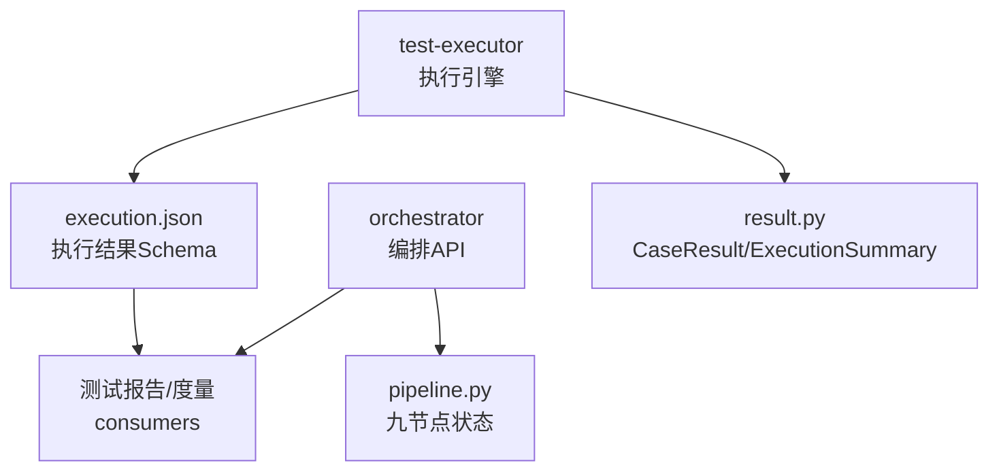
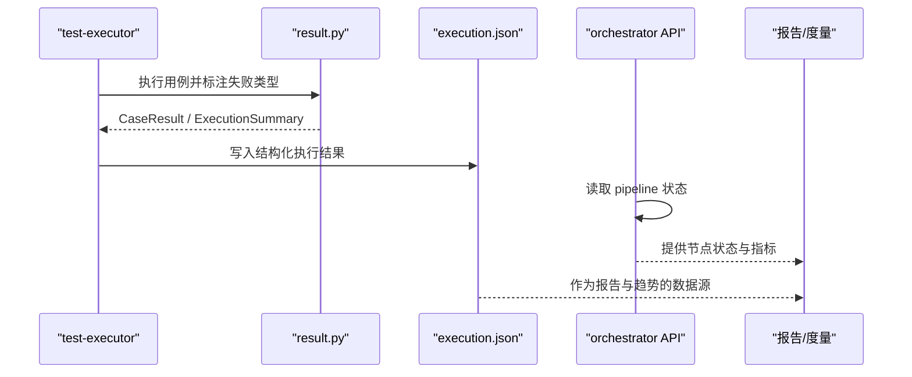
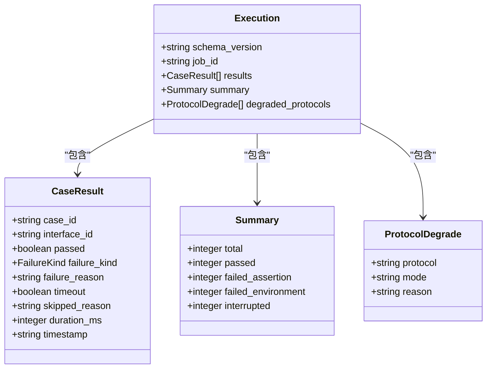
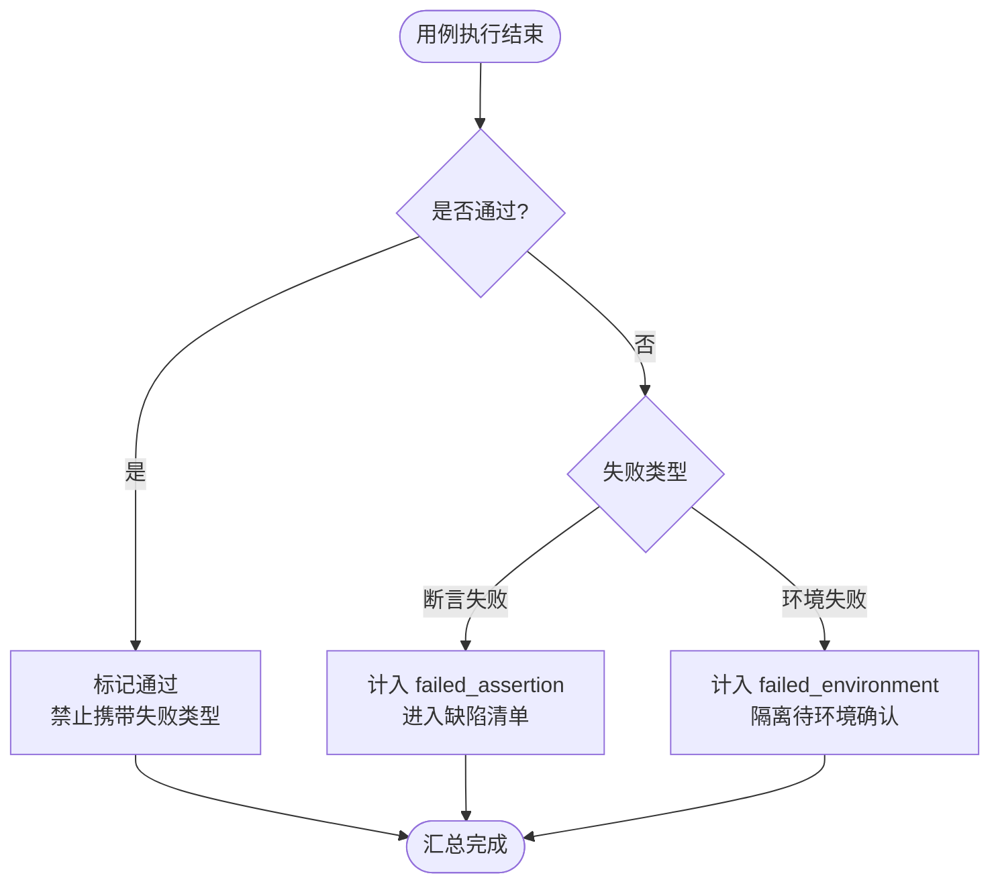
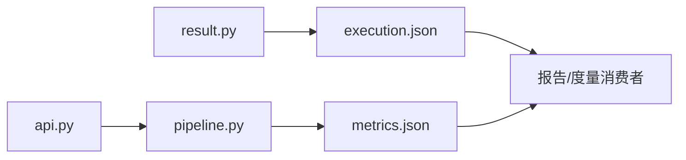

# 执行结果Schema

<cite>
**本文引用的文件**
- [execution.json](file://schemas/execution.json)
- [execution.sample.json](file://schemas/samples/execution.sample.json)
- [result.py](file://services/test-executor/src/executor/result.py)
- [test_result.py](file://services/test-executor/tests/test_result.py)
- [pipeline.py](file://services/orchestrator/src/orchestrator/pipeline.py)
- [api.py](file://services/orchestrator/src/orchestrator/api.py)
- [README.md（schemas）](file://schemas/README.md)
- [04_功能规格说明.md](file://docs/04_功能规格说明.md)
- [10_测试框架选型说明.md](file://docs/10_测试框架选型说明.md)
- [03_用户故事卡片.md](file://docs/03_用户故事卡片.md)
- [metrics.json](file://schemas/metrics.json)
</cite>

## 目录
1. [简介](#简介)
2. [项目结构](#项目结构)
3. [核心组件](#核心组件)
4. [架构总览](#架构总览)
5. [详细组件分析](#详细组件分析)
6. [依赖关系分析](#依赖关系分析)
7. [性能与资源考量](#性能与资源考量)
8. [故障排查指南](#故障排查指南)
9. [结论](#结论)
10. [附录：查询与统计示例](#附录：查询与统计示例)

## 简介
本文件围绕“执行结果 Schema”展开，聚焦 execution.json 的结构、断言二态（通过/失败）、环境失败分离、执行时间与资源消耗字段、测试结果收集与分析机制、失败分类与根因分析能力、测试报告生成与质量趋势分析，以及测试结果查询与统计的实用示例。文档以仓库中已落地的 Schema、骨架实现与规范为依据，确保内容可追溯、可验证。

## 项目结构
- schemas/execution.json：定义执行结果的 JSON Schema，包含用例级 results、汇总 summary、降级协议清单等。
- schemas/samples/execution.sample.json：提供符合 Schema 的样例数据，便于理解字段含义与取值范围。
- services/test-executor/src/executor/result.py：实现 CaseResult、ExecutionSummary 与 FailureKind，支撑“断言失败/环境失败”的二态判定与汇总。
- services/orchestrator：编排服务，提供流水线节点状态与 API；与执行产物对接后用于报告与度量。
- docs/*：需求、规格与选型说明，明确执行引擎、报告与度量的口径与约束。

图表来源
- [execution.json:1-59](file://schemas/execution.json#L1-L59)
- [result.py:10-61](file://services/test-executor/src/executor/result.py#L10-L61)
- [pipeline.py:11-84](file://services/orchestrator/src/orchestrator/pipeline.py#L11-L84)
- [api.py:11-27](file://services/orchestrator/src/orchestrator/api.py#L11-L27)

章节来源
- [execution.json:1-59](file://schemas/execution.json#L1-L59)
- [execution.sample.json:1-63](file://schemas/samples/execution.sample.json#L1-L63)
- [result.py:10-61](file://services/test-executor/src/executor/result.py#L10-L61)
- [pipeline.py:11-84](file://services/orchestrator/src/orchestrator/pipeline.py#L11-L84)
- [api.py:11-27](file://services/orchestrator/src/orchestrator/api.py#L11-L27)
- [README.md（schemas）:1-30](file://schemas/README.md#L1-L30)

## 核心组件
- 执行结果对象（results）：每条用例的执行记录，包含用例ID、接口ID、是否通过、失败类型、失败原因、是否超时、跳过原因、耗时与时间戳。
- 汇总对象（summary）：程序化汇总，包含总用例数、通过数、断言失败数、环境失败数、中断数。
- 降级协议清单（degraded_protocols）：记录哪些协议采用“脚本生成成功 + Mock 执行演示”的降级路径及原因。
- 失败二态枚举（FailureKind）：assertion 与 environment，用于区分缺陷与环境问题。
- 单用例结果（CaseResult）：携带 case_id、passed、failure_kind，并在构造时校验一致性。
- 执行汇总（ExecutionSummary）：基于 CaseResult 计算 total、passed、failed_assertion、failed_environment。

章节来源
- [execution.json:10-56](file://schemas/execution.json#L10-L56)
- [result.py:10-61](file://services/test-executor/src/executor/result.py#L10-L61)
- [execution.sample.json:5-61](file://schemas/samples/execution.sample.json#L5-L61)

## 架构总览
执行结果从 test-executor 产出，遵循 execution.json Schema；orchestrator 暴露流水线节点状态与聚合信息；报告与度量消费 execution.json 与 metrics.json，形成可视化与趋势分析。

图表来源
- [result.py:17-61](file://services/test-executor/src/executor/result.py#L17-L61)
- [execution.json:1-59](file://schemas/execution.json#L1-L59)
- [api.py:11-27](file://services/orchestrator/src/orchestrator/api.py#L11-L27)

## 详细组件分析

### execution.json 结构与字段语义
- schema_version：固定为字符串常量，用于版本控制。
- job_id：任务标识，匹配模式要求以特定前缀开头。
- results：数组，每项代表一条用例的执行结果，必填字段包括用例ID、接口ID、是否通过、时间戳；可选字段包括失败类型、失败原因、是否超时、跳过原因、耗时。
- summary：程序化汇总，必填字段包括 total、passed、failed_assertion、failed_environment；可选字段 interrupted 表示服务崩溃导致剩余用例中断。
- degraded_protocols：数组，记录降级的协议、模式与原因。

图表来源
- [execution.json:1-59](file://schemas/execution.json#L1-L59)

章节来源
- [execution.json:1-59](file://schemas/execution.json#L1-L59)
- [execution.sample.json:1-63](file://schemas/samples/execution.sample.json#L1-L63)

### 断言二态与环境失败分离
- 失败类型枚举：assertion（断言失败）与 environment（环境失败）。
- 规则：
  - 断言失败计入通过率分母，进入缺陷清单。
  - 环境失败隔离至“待环境确认”，不直接进缺陷清单。
  - 通过用例不得携带失败类型（构造时校验）。
- 汇总：
  - failed_assertion：仅统计断言失败。
  - failed_environment：仅统计环境失败。
  - total/pass 按实际用例计数。

图表来源
- [result.py:10-61](file://services/test-executor/src/executor/result.py#L10-L61)
- [test_result.py:10-29](file://services/test-executor/tests/test_result.py#L10-L29)

章节来源
- [result.py:10-61](file://services/test-executor/src/executor/result.py#L10-L61)
- [test_result.py:10-29](file://services/test-executor/tests/test_result.py#L10-L29)
- [04_功能规格说明.md:179-207](file://docs/04_功能规格说明.md#L179-L207)

### 执行时间与资源消耗
- 执行时间：每条用例记录 duration_ms（毫秒），可用于计算平均耗时、P95/P99 等分布指标。
- 超时：timeout 布尔字段标记是否触发用例级超时上限。
- 资源消耗：当前 Schema 未显式记录 CPU/内存等资源指标；可在上层消费端结合执行器日志或运行时探针进行补充采集，但不改变 execution.json 的契约。

章节来源
- [execution.json:14-28](file://schemas/execution.json#L14-L28)
- [execution.sample.json:6-47](file://schemas/samples/execution.sample.json#L6-L47)
- [04_功能规格说明.md:201-207](file://docs/04_功能规格说明.md#L201-L207)

### 测试结果收集与分析机制
- 收集路径：test-executor 使用 pytest 插件体系捕获原始结果，并通过自定义 hook 将异常分类映射到 FailureKind，最终程序化汇总为 execution.json。
- 分析要点：
  - 按接口维度聚合通过率、失败类型分布、耗时分布。
  - 识别高频失败接口与失败类型，定位瓶颈。
  - 结合 degraded_protocols 解释降级场景对整体通过率的影响。

章节来源
- [10_测试框架选型说明.md:27-53](file://docs/10_测试框架选型说明.md#L27-L53)
- [execution.json:10-56](file://schemas/execution.json#L10-L56)

### 失败分类与根因分析
- 分类：
  - assertion：断言失败，通常由业务逻辑或预期不一致引起。
  - environment：环境/连接失败，如网络不可达、超时、前置数据缺失等。
  - skipped：前置数据无法准备时跳过，记录 skipped_reason。
- 根因线索：
  - failure_reason 提供失败描述。
  - timeout 指示是否为超时导致。
  - skipped_reason 指明跳过原因（例如“前置缺失”）。
  - degraded_protocols 中的 reason 解释协议级降级原因。

章节来源
- [execution.json:19-27](file://schemas/execution.json#L19-L27)
- [execution.json:44-56](file://schemas/execution.json#L44-L56)
- [execution.sample.json:13-40](file://schemas/samples/execution.sample.json#L13-L40)
- [04_功能规格说明.md:201-207](file://docs/04_功能规格说明.md#L201-L207)

### 测试报告生成与质量趋势分析
- 报告生成：
  - 自动包含总用例数、通过数、失败数、通过率、失败明细（含失败原因）。
  - 数值来自 execution.json 的 summary 与 results，不经 LLM 处理。
- 质量趋势：
  - 基于多次执行的 execution.json 与 metrics.json，观察通过率、失败类型占比、耗时分布的变化。
  - 结合 pipeline 自动化率（nodes 状态）评估端到端效率。

章节来源
- [03_用户故事卡片.md:144-153](file://docs/03_用户故事卡片.md#L144-L153)
- [execution.json:32-43](file://schemas/execution.json#L32-L43)
- [metrics.json:1-48](file://schemas/metrics.json#L1-L48)

## 依赖关系分析
- result.py 提供数据结构与校验逻辑，被 test-executor 在执行阶段使用。
- execution.json 作为单一事实来源，供 orchestrator 下游消费（报告、度量）。
- pipeline.py 定义九节点状态与自动化率计算入口，与 metrics.json 协同呈现整体自动化水平。
- api.py 暴露健康检查与节点列表，便于外部系统探测与集成。

图表来源
- [result.py:10-61](file://services/test-executor/src/executor/result.py#L10-L61)
- [execution.json:1-59](file://schemas/execution.json#L1-L59)
- [pipeline.py:11-84](file://services/orchestrator/src/orchestrator/pipeline.py#L11-L84)
- [metrics.json:1-48](file://schemas/metrics.json#L1-L48)
- [api.py:11-27](file://services/orchestrator/src/orchestrator/api.py#L11-L27)

章节来源
- [result.py:10-61](file://services/test-executor/src/executor/result.py#L10-L61)
- [execution.json:1-59](file://schemas/execution.json#L1-L59)
- [pipeline.py:11-84](file://services/orchestrator/src/orchestrator/pipeline.py#L11-L84)
- [metrics.json:1-48](file://schemas/metrics.json#L1-L48)
- [api.py:11-27](file://services/orchestrator/src/orchestrator/api.py#L11-L27)

## 性能与资源考量
- 执行耗时：通过 duration_ms 可评估用例性能基线；建议关注长尾用例（P95/P99）与超时用例（timeout=true）。
- 资源监控：当前 Schema 不记录 CPU/内存；建议在执行层增加资源探针，输出到独立指标文件，避免污染 execution.json 契约。
- 汇总开销：ExecutionSummary 的计算为 O(n)，n 为用例数量，适合批量汇总。

[本节为通用指导，不直接分析具体文件]

## 故障排查指南
- 通过用例携带失败类型：构造时会抛出异常，需检查用例执行分支是否正确设置 passed 与 failure_kind。
- 环境失败：优先检查被测服务可达性、网络连通性与前置数据准备；若为超时，检查 timeout 配置与目标服务响应。
- 跳过用例：查看 skipped_reason 是否为“前置缺失”，并修复上游数据或鉴权配置。
- 服务崩溃中断：summary.interrupted 非零时，检查执行进程日志与资源限制（内存/CPU/磁盘）。

章节来源
- [result.py:25-29](file://services/test-executor/src/executor/result.py#L25-L29)
- [execution.json:32-43](file://schemas/execution.json#L32-L43)
- [execution.json:19-27](file://schemas/execution.json#L19-L27)
- [04_功能规格说明.md:201-207](file://docs/04_功能规格说明.md#L201-L207)

## 结论
execution.json 提供了清晰、稳定的执行结果契约，支持断言二态与环境失败分离，便于缺陷闭环与质量趋势分析。配合 orchestrator 的流水线状态与 metrics.json，可实现端到端的自动化率度量与报告生成。建议在上层消费端扩展资源监控与趋势可视化，进一步提升可观测性与决策效率。

[本节为总结，不直接分析具体文件]

## 附录：查询与统计示例
以下示例基于 execution.json 的字段，展示常见查询与统计思路（不涉及具体代码实现）：
- 通过率统计：passed / total。
- 断言失败率：failed_assertion / total。
- 环境失败率：failed_environment / total。
- 超时占比：count(timeout=true) / total。
- 按接口维度聚合：按 interface_id 分组统计通过率与失败类型分布。
- 耗时分布：基于 duration_ms 计算均值、中位数、P95/P99。
- 降级影响：统计 degraded_protocols 中各协议的降级次数与原因。
- 中断影响：当 summary.interrupted > 0 时，提示本次执行不完整，需结合日志定位崩溃点。

章节来源
- [execution.json:10-56](file://schemas/execution.json#L10-L56)
- [execution.sample.json:5-61](file://schemas/samples/execution.sample.json#L5-L61)