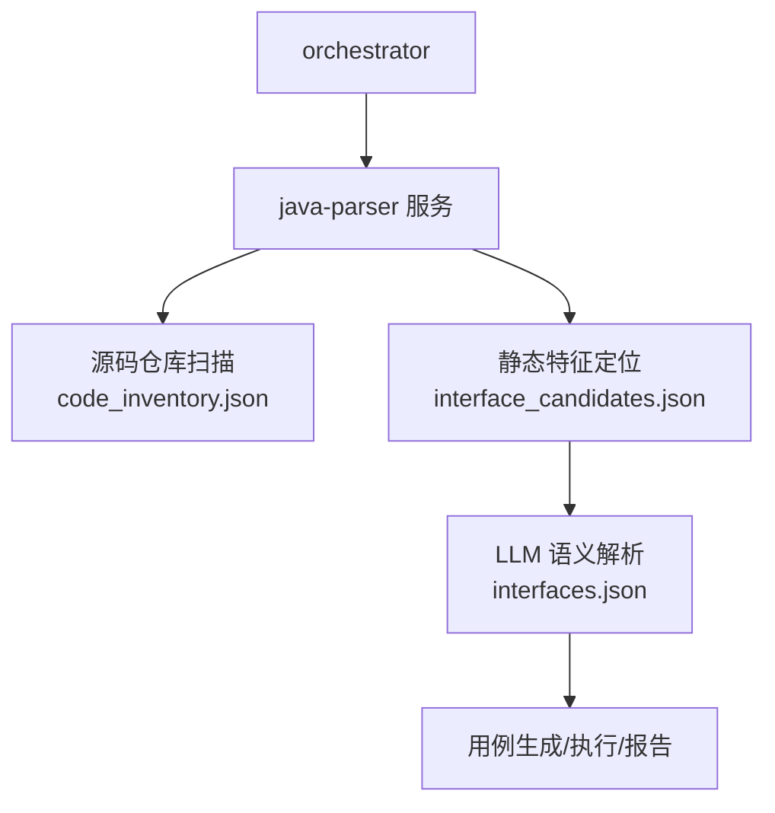
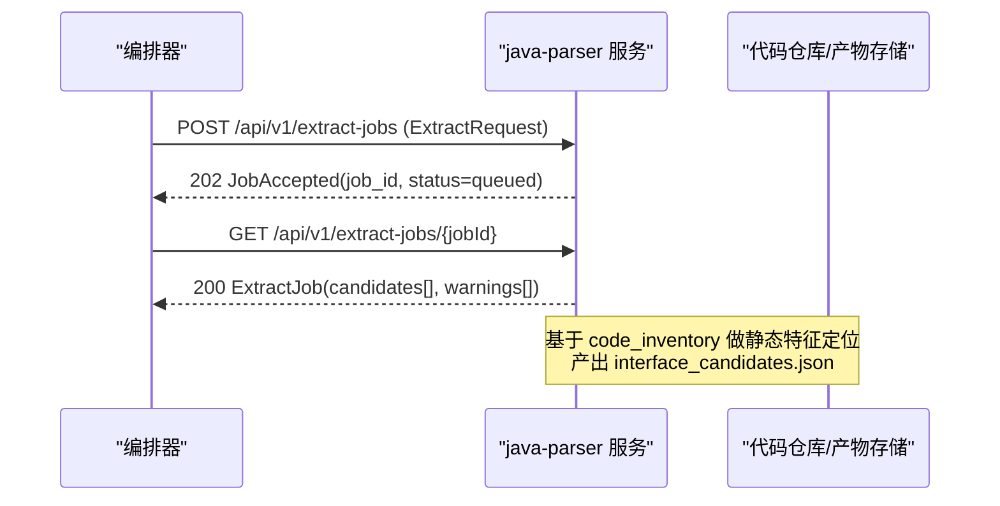
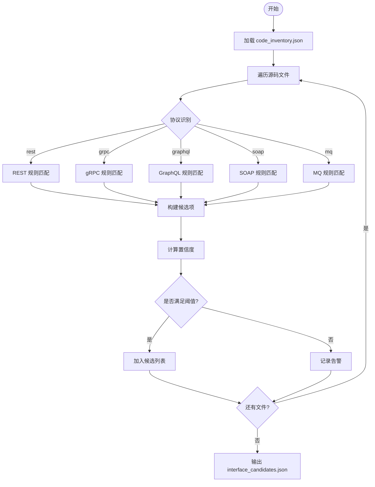
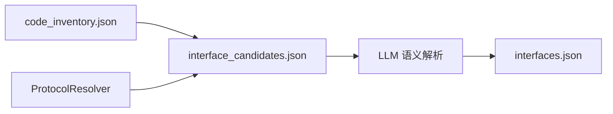

# 接口候选清单Schema

<cite>
**本文引用的文件**
- [schemas/interface_candidates.json](file://schemas/interface_candidates.json)
- [schemas/contracts/java-parser.openapi.yaml](file://schemas/contracts/java-parser.openapi.yaml)
- [schemas/README.md](file://schemas/README.md)
- [services/java-parser/src/main/java/com/llmautotest/parser/ProtocolResolver.java](file://services/java-parser/src/main/java/com/llmautotest/parser/ProtocolResolver.java)
- [services/java-parser/src/main/java/com/llmautotest/parser/ParserApplication.java](file://services/java-parser/src/main/java/com/llmautotest/parser/ParserApplication.java)
- [schemas/samples/interface_candidates.sample.json](file://schemas/samples/interface_candidates.sample.json)
- [docs/09_开发规范说明.md](file://docs/09_开发规范说明.md)
- [docs/02_立项提案.md](file://docs/02_立项提案.md)
- [docs/06_需求定稿冻结.md](file://docs/06_需求定稿冻结.md)
</cite>

## 目录
1. [简介](#简介)
2. [项目结构](#项目结构)
3. [核心组件](#核心组件)
4. [架构总览](#架构总览)
5. [详细组件分析](#详细组件分析)
6. [依赖关系分析](#依赖关系分析)
7. [性能与扩展性](#性能与扩展性)
8. [故障排查指南](#故障排查指南)
9. [结论](#结论)
10. [附录：API契约与使用示例](#附录api契约与使用示例)

## 简介
本文件面向“接口候选清单”这一结构化产物，系统性说明 interface_candidates.json 的字段定义、取值约束、与 Java 解析器服务契约的对齐方式、接口提取算法与候选筛选逻辑、多协议支持与扩展机制，以及 API 契约验证与使用示例。该清单是模块 3（REV）静态侧的核心产出，供 orchestrator 侧 LLM 语义解析消费，并作为后续接口还原、用例生成与 Code Review 的上游数据源。

## 项目结构
- schemas/interface_candidates.json：接口候选清单的 JSON Schema，定义顶层结构与候选项字段。
- schemas/contracts/java-parser.openapi.yaml：java-parser 服务的 OpenAPI 契约，其中 ExtractJob 与 InterfaceCandidate 与 interface_candidates.json 一一对应。
- schemas/README.md：Schema 管理约定与横切约定（ID 命名、协议枚举、错误结构等）。
- services/java-parser：Java 解析服务，提供可插拔协议解析策略（ProtocolResolver），支撑多协议候选提取。
- schemas/samples/interface_candidates.sample.json：符合 Schema 的样例数据，便于开发与演示。

图表来源
- [schemas/contracts/java-parser.openapi.yaml:72-115](file://schemas/contracts/java-parser.openapi.yaml#L72-L115)
- [schemas/interface_candidates.json:1-58](file://schemas/interface_candidates.json#L1-L58)

章节来源
- [schemas/README.md:1-30](file://schemas/README.md#L1-L30)
- [schemas/interface_candidates.json:1-58](file://schemas/interface_candidates.json#L1-L58)
- [schemas/contracts/java-parser.openapi.yaml:1-115](file://schemas/contracts/java-parser.openapi.yaml#L1-L115)

## 核心组件
- 接口候选清单（interface_candidates.json）
  - 顶层字段：schema_version、job_id、candidates、warnings
  - candidates 数组中的每个候选项包含：candidate_id、protocol、signature、code_location、snippet、related_files、is_fallback、confidence
- Java 解析服务契约（ExtractJob / InterfaceCandidate）
  - ExtractJob 包含 candidates 与 warnings
  - InterfaceCandidate 字段与 interface_candidates.json 完全对齐
- 协议解析策略（ProtocolResolver）
  - 支持 rest/grpc/graphql/soap/mq 等协议的识别与过滤
  - 新增协议通过实现 ProtocolResolver 接入，不改动主流程

章节来源
- [schemas/interface_candidates.json:1-58](file://schemas/interface_candidates.json#L1-L58)
- [schemas/contracts/java-parser.openapi.yaml:274-368](file://schemas/contracts/java-parser.openapi.yaml#L274-L368)
- [services/java-parser/src/main/java/com/llmautotest/parser/ProtocolResolver.java:1-17](file://services/java-parser/src/main/java/com/llmautotest/parser/ProtocolResolver.java#L1-L17)

## 架构总览
接口候选清单由 java-parser 服务基于 code_inventory 进行静态特征定位后产出，并通过 orchestrator 的异步 job 模式对外暴露。其关键交互如下：

图表来源
- [schemas/contracts/java-parser.openapi.yaml:72-115](file://schemas/contracts/java-parser.openapi.yaml#L72-L115)
- [schemas/contracts/java-parser.openapi.yaml:274-368](file://schemas/contracts/java-parser.openapi.yaml#L274-L368)

章节来源
- [schemas/contracts/java-parser.openapi.yaml:72-115](file://schemas/contracts/java-parser.openapi.yaml#L72-L115)
- [schemas/contracts/java-parser.openapi.yaml:274-368](file://schemas/contracts/java-parser.openapi.yaml#L274-L368)

## 详细组件分析

### 接口候选清单 Schema 字段详解
- schema_version：固定为字符串版本标识，用于 Schema 演进与兼容性控制。
- job_id：任务 ID，需以特定前缀开头，确保与编排器归档一致。
- candidates：静态特征定位产物数组，每项为一个接口候选。
  - candidate_id：候选唯一标识，遵循 CAND-xxx 格式。
  - protocol：协议类型，枚举值包括 rest、grpc、graphql、soap、mq。
  - signature：静态可确定的接口签名（如 HTTP 方法+路径、gRPC service/method）。
  - code_location：代码位置信息，包含 repo、file、start_line、end_line。
  - snippet：接口定义源码片段，供 LLM 语义解析上下文使用。
  - related_files：关联文件列表，标注角色（controller/service/dto/proto/wsdl/listener/other）及行号区间。
  - is_fallback：是否来自兜底演示仓库，贯穿全链路。
  - confidence：静态定位置信度，范围 0~1。
- warnings：告警清单，记录单文件解析失败或候选数低于底线等提示。

章节来源
- [schemas/interface_candidates.json:1-58](file://schemas/interface_candidates.json#L1-L58)
- [schemas/contracts/java-parser.openapi.yaml:291-368](file://schemas/contracts/java-parser.openapi.yaml#L291-L368)

### 与 Java 解析器契约的对齐关系
- ExtractJob 与 interface_candidates.json 的顶层结构一致，均包含 candidates 与 warnings。
- InterfaceCandidate 与候选项字段完全对应，保证双方数据结构一致性。
- 协议枚举在契约中统一为小写，避免歧义。
- 错误结构统一为 {code, message, node_id?, details}，便于三栈统一处理。

章节来源
- [schemas/contracts/java-parser.openapi.yaml:274-368](file://schemas/contracts/java-parser.openapi.yaml#L274-L368)
- [schemas/README.md:1-30](file://schemas/README.md#L1-L30)

### 接口提取算法与候选筛选逻辑
- 输入：code_inventory.json（源码清单，含仓库、模块、文件路径）。
- 静态特征定位：
  - 基于注解、proto/WSDL、监听器等静态标记识别接口候选。
  - 对每个候选记录 code_location、snippet 与 related_files。
- 协议识别：
  - 通过 ProtocolResolver 策略判断文件是否属于某协议。
  - 支持 rest/grpc/graphql/soap/mq，可扩展新协议。
- 候选筛选：
  - 置信度评估：根据匹配强度、上下文完整性计算 confidence。
  - 告警记录：当候选数低于阈值时记录警告，必要时建议切换兜底仓库。
  - 兜底仓库透传：is_fallback 随候选项传递，便于下游分列统计。

图表来源
- [schemas/interface_candidates.json:1-58](file://schemas/interface_candidates.json#L1-L58)
- [services/java-parser/src/main/java/com/llmautotest/parser/ProtocolResolver.java:1-17](file://services/java-parser/src/main/java/com/llmautotest/parser/ProtocolResolver.java#L1-L17)

章节来源
- [schemas/interface_candidates.json:1-58](file://schemas/interface_candidates.json#L1-L58)
- [services/java-parser/src/main/java/com/llmautotest/parser/ProtocolResolver.java:1-17](file://services/java-parser/src/main/java/com/llmautotest/parser/ProtocolResolver.java#L1-L17)

### 多协议支持与扩展机制
- 内置协议：rest、grpc、graphql、soap、mq。
- 扩展方式：实现 ProtocolResolver 接口，注册新的协议识别策略。
- 设计原则：新增协议不改主流程，保持高内聚低耦合。

章节来源
- [services/java-parser/src/main/java/com/llmautotest/parser/ProtocolResolver.java:1-17](file://services/java-parser/src/main/java/com/llmautotest/parser/ProtocolResolver.java#L1-L17)
- [schemas/contracts/java-parser.openapi.yaml:284-289](file://schemas/contracts/java-parser.openapi.yaml#L284-L289)

## 依赖关系分析
- orchestrator 依赖 java-parser 提供的 ExtractJob 接口获取候选清单。
- interface_candidates.json 依赖 code_inventory.json 作为输入。
- 下游 LLM 语义解析依赖候选清单中的 snippet 与 related_files 进行接口还原。
- 协议解析策略通过 ProtocolResolver 解耦，便于替换与扩展。

图表来源
- [schemas/interface_candidates.json:1-58](file://schemas/interface_candidates.json#L1-L58)
- [schemas/contracts/java-parser.openapi.yaml:274-368](file://schemas/contracts/java-parser.openapi.yaml#L274-L368)
- [services/java-parser/src/main/java/com/llmautotest/parser/ProtocolResolver.java:1-17](file://services/java-parser/src/main/java/com/llmautotest/parser/ProtocolResolver.java#L1-L17)

章节来源
- [schemas/interface_candidates.json:1-58](file://schemas/interface_candidates.json#L1-L58)
- [schemas/contracts/java-parser.openapi.yaml:274-368](file://schemas/contracts/java-parser.openapi.yaml#L274-L368)
- [services/java-parser/src/main/java/com/llmautotest/parser/ProtocolResolver.java:1-17](file://services/java-parser/src/main/java/com/llmautotest/parser/ProtocolResolver.java#L1-L17)

## 性能与扩展性
- 静态特征定位优先于 LLM 调用，减少 token 消耗与延迟。
- 候选筛选基于置信度阈值，避免低质量结果进入下游。
- 协议解析策略可插拔，新增协议无需修改主流程，提升扩展性。
- 兜底仓库结果单独标注，避免影响真实仓库指标统计。

[本节为通用指导，不直接分析具体文件]

## 故障排查指南
- 单文件解析失败：记录到 warnings，不中断整体流程。
- 候选数低于阈值：记录警告，建议切换兜底仓库。
- 协议识别失败：检查 ProtocolResolver 实现是否正确注册。
- 错误响应结构：统一使用 {code, message, node_id?, details}，便于前端展示与日志追踪。

章节来源
- [schemas/contracts/java-parser.openapi.yaml:130-147](file://schemas/contracts/java-parser.openapi.yaml#L130-L147)
- [schemas/interface_candidates.json:51-55](file://schemas/interface_candidates.json#L51-L55)

## 结论
接口候选清单 Schema 明确了静态特征定位产物的结构、字段约束与对齐契约，支撑多协议识别与可扩展的解析策略。通过与 java-parser 服务契约的一致性设计，确保了上下游数据流转的稳定性和可维护性。结合置信度评估与告警机制，提升了候选质量与系统鲁棒性。

[本节为总结性内容，不直接分析具体文件]

## 附录：API契约与使用示例

### API 契约
- 创建提取任务：POST /api/v1/extract-jobs
- 查询任务状态：GET /api/v1/extract-jobs/{jobId}
- 返回结构：ExtractJob（包含 candidates 与 warnings）

章节来源
- [schemas/contracts/java-parser.openapi.yaml:72-115](file://schemas/contracts/java-parser.openapi.yaml#L72-L115)
- [schemas/contracts/java-parser.openapi.yaml:274-368](file://schemas/contracts/java-parser.openapi.yaml#L274-L368)

### 使用示例
- 参考 schemas/samples/interface_candidates.sample.json 了解候选项结构。
- 验证工具：使用 JSON Schema 校验器验证 interface_candidates.json 是否符合定义。
- 下游消费：orchestrator 读取 candidates 数组，传递给 LLM 进行语义解析。

章节来源
- [schemas/samples/interface_candidates.sample.json:1-62](file://schemas/samples/interface_candidates.sample.json#L1-L62)
- [schemas/interface_candidates.json:1-58](file://schemas/interface_candidates.json#L1-L58)