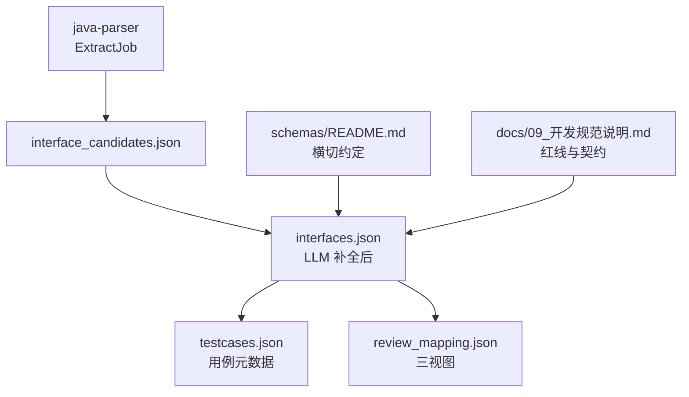
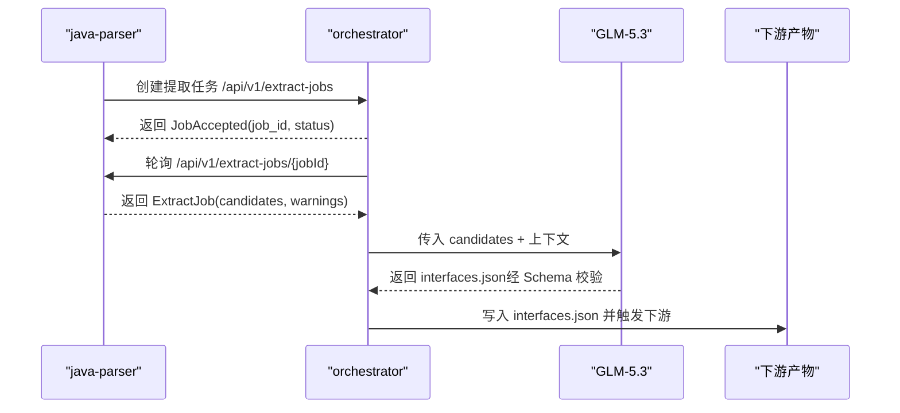
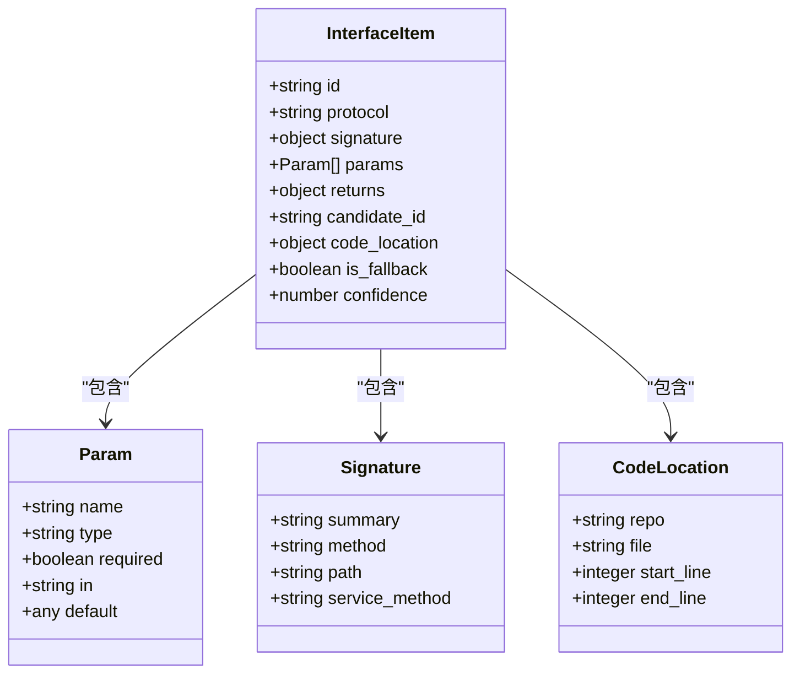
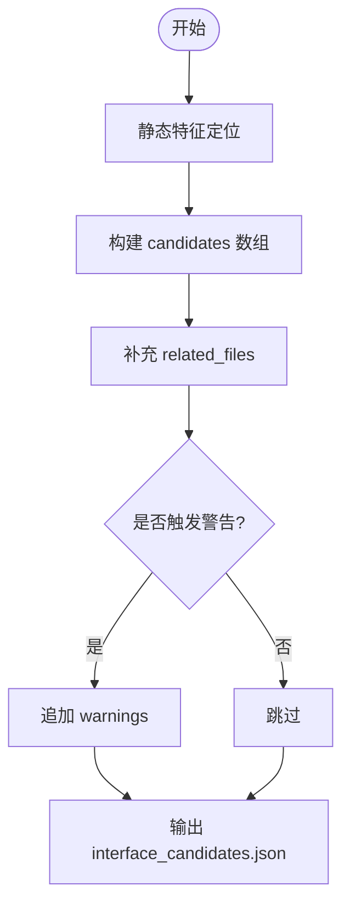
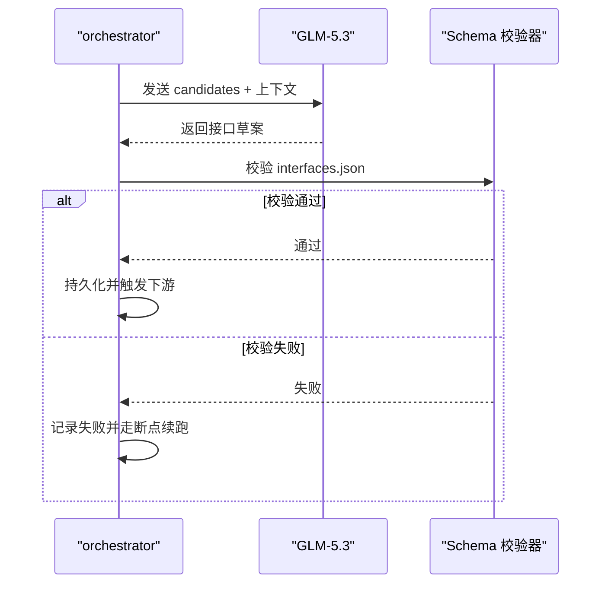
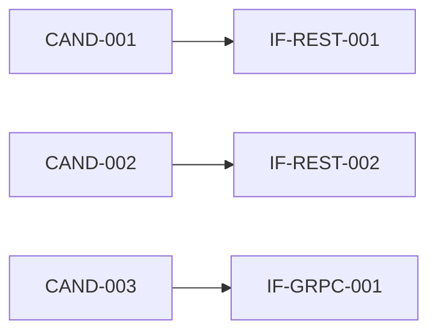
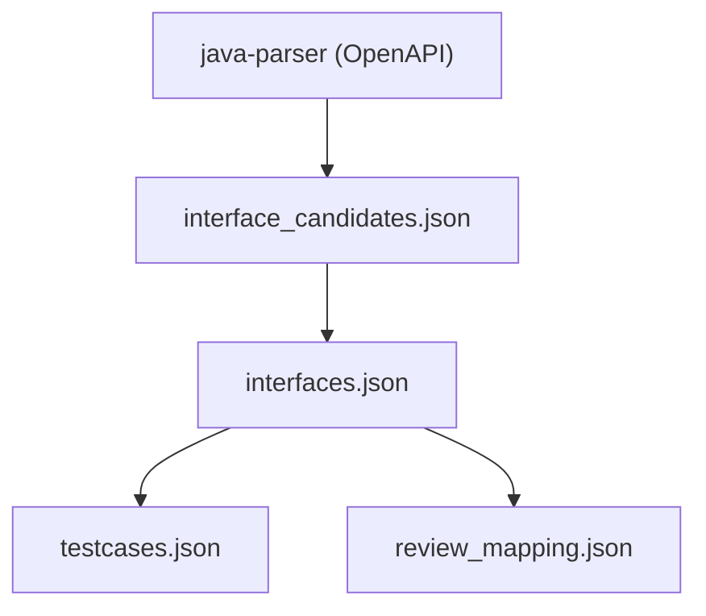

# 接口还原清单Schema

<cite>
**本文引用的文件**
- [schemas/interfaces.json](file://schemas/interfaces.json)
- [schemas/interface_candidates.json](file://schemas/interface_candidates.json)
- [schemas/samples/interfaces.sample.json](file://schemas/samples/interfaces.sample.json)
- [schemas/samples/interface_candidates.sample.json](file://schemas/samples/interface_candidates.sample.json)
- [schemas/contracts/java-parser.openapi.yaml](file://schemas/contracts/java-parser.openapi.yaml)
- [schemas/README.md](file://schemas/README.md)
- [docs/09_开发规范说明.md](file://docs/09_开发规范说明.md)
</cite>

## 目录
1. [简介](#简介)
2. [项目结构](#项目结构)
3. [核心组件](#核心组件)
4. [架构总览](#架构总览)
5. [详细组件分析](#详细组件分析)
6. [依赖关系分析](#依赖关系分析)
7. [性能与稳定性考量](#性能与稳定性考量)
8. [故障排查指南](#故障排查指南)
9. [结论](#结论)
10. [附录](#附录)

## 简介
本文件面向“接口还原清单”的 Schema 与端到端流程，聚焦以下目标：
- 解释 interfaces.json 的结构、字段约束与语义约定（含接口 ID 命名 IF-<协议>-001）。
- 明确接口定义、参数规范、返回值结构与错误处理约定。
- 阐述 LLM 补全过程与接口标准化流程，以及与接口候选清单的映射关系。
- 说明接口版本管理与向后兼容性策略。
- 提供接口定义验证与生成测试用例的示例路径与要点。

## 项目结构
schemas 目录集中存放所有结构化产物的 JSON Schema，其中与接口还原相关的关键文件包括：
- interfaces.json：LLM 补全后的接口还原清单（模块 3 REV，主笔：甲；D2 载体）
- interface_candidates.json：静态侧接口候选清单（模块 3 REV，主笔：乙；D1 载体）
- samples/*：跨人假数据样例，用于演示与校验
- contracts/java-parser.openapi.yaml：java-parser 服务契约，定义 ExtractJob 产物与接口候选结构

图表来源
- [schemas/contracts/java-parser.openapi.yaml:274-369](file://schemas/contracts/java-parser.openapi.yaml#L274-L369)
- [schemas/interface_candidates.json:1-58](file://schemas/interface_candidates.json#L1-L58)
- [schemas/interfaces.json:1-70](file://schemas/interfaces.json#L1-L70)
- [schemas/README.md:1-30](file://schemas/README.md#L1-L30)
- [docs/09_开发规范说明.md:73-94](file://docs/09_开发规范说明.md#L73-L94)

章节来源
- [schemas/README.md:1-30](file://schemas/README.md#L1-L30)
- [docs/09_开发规范说明.md:73-94](file://docs/09_开发规范说明.md#L73-L94)

## 核心组件
- 接口还原清单（interfaces.json）
  - 顶层字段：schema_version、job_id、interfaces
  - 每个接口项包含：id、protocol、signature、params、returns、candidate_id、code_location、is_fallback、confidence
- 接口候选清单（interface_candidates.json）
  - 顶层字段：schema_version、job_id、candidates、warnings
  - 每个候选项包含：candidate_id、protocol、signature、code_location、snippet、related_files、is_fallback、confidence
- 服务契约（java-parser.openapi.yaml）
  - 定义 ExtractRequest/ExtractJob/InterfaceCandidate 等结构，作为候选清单的事实源之一

关键约束与约定（横切）：
- 统一 ID 命名：IF-<协议>-001、CAND-001、REQ-001、TC-001、DEF-001
- 时间戳使用 UTC ISO-8601
- 协议枚举小写：rest/grpc/graphql/soap/mq
- is_fallback 全链路透传
- 错误结构统一：{code, message, node_id?, details}

章节来源
- [schemas/interfaces.json:1-70](file://schemas/interfaces.json#L1-L70)
- [schemas/interface_candidates.json:1-58](file://schemas/interface_candidates.json#L1-L58)
- [schemas/contracts/java-parser.openapi.yaml:274-369](file://schemas/contracts/java-parser.openapi.yaml#L274-L369)
- [schemas/README.md:5-11](file://schemas/README.md#L5-L11)
- [docs/09_开发规范说明.md:89-94](file://docs/09_开发规范说明.md#L89-L94)

## 架构总览
从代码扫描到接口还原的端到端流程如下：
- java-parser 执行静态特征定位，产出接口候选清单（interface_candidates.json），并通过 ExtractJob 暴露给 orchestrator
- orchestrator 将候选清单交给 LLM 进行语义解析与补全，产出接口还原清单（interfaces.json）
- 下游消费方基于接口还原清单生成用例元数据（testcases.json）、审查映射（review_mapping.json）等

图表来源
- [schemas/contracts/java-parser.openapi.yaml:72-115](file://schemas/contracts/java-parser.openapi.yaml#L72-L115)
- [schemas/contracts/java-parser.openapi.yaml:274-369](file://schemas/contracts/java-parser.openapi.yaml#L274-L369)
- [docs/09_开发规范说明.md:73-79](file://docs/09_开发规范说明.md#L73-L79)

## 详细组件分析

### 接口还原清单（interfaces.json）
- 顶层结构
  - schema_version：固定为 "1.0"
  - job_id：以 "job-" 开头，标识一次流水线任务
  - interfaces：数组，至少一项
- 接口项字段
  - id：严格匹配 IF-<协议>-001（协议枚举：REST/GRPC/GRAPHQL/SOAP/MQ）
  - protocol：小写协议名
  - signature：对象，必须包含 summary；REST 含 method/path，其他协议含 service_method
  - params：入参数组，每项必须包含 name/type/required；REST 可标注 in（path/query/body/header）；unknown 类型需标注 default 边界默认值
  - returns：返回体描述（type/description）
  - candidate_id：溯源至静态候选（CAND-001 格式）
  - code_location：仓库、文件、起止行号
  - is_fallback：兜底仓库标记，全链路透传
  - confidence：置信度 [0,1]

图表来源
- [schemas/interfaces.json:10-66](file://schemas/interfaces.json#L10-L66)

章节来源
- [schemas/interfaces.json:1-70](file://schemas/interfaces.json#L1-L70)
- [schemas/samples/interfaces.sample.json:1-75](file://schemas/samples/interfaces.sample.json#L1-L75)

### 接口候选清单（interface_candidates.json）
- 顶层结构
  - schema_version：固定为 "1.0"
  - job_id：以 "job-" 开头
  - candidates：静态特征定位产物，供 LLM 语义解析消费
  - warnings：单文件解析失败或候选数低于底线等告警
- 候选项字段
  - candidate_id：CAND-001 格式
  - protocol：小写协议枚举
  - signature：静态可确定签名（如 HTTP 方法+路径或服务方法）
  - code_location：仓库、文件、起止行号
  - snippet：源码片段（LLM 上下文）
  - related_files：Controller→Service→DTO 的直接关联（角色：controller/service/dto/proto/wsdl/listener/other）
  - is_fallback：兜底仓库标记
  - confidence：静态定位置信度

图表来源
- [schemas/interface_candidates.json:10-55](file://schemas/interface_candidates.json#L10-L55)
- [schemas/contracts/java-parser.openapi.yaml:274-369](file://schemas/contracts/java-parser.openapi.yaml#L274-L369)

章节来源
- [schemas/interface_candidates.json:1-58](file://schemas/interface_candidates.json#L1-L58)
- [schemas/samples/interface_candidates.sample.json:1-62](file://schemas/samples/interface_candidates.sample.json#L1-L62)
- [schemas/contracts/java-parser.openapi.yaml:274-369](file://schemas/contracts/java-parser.openapi.yaml#L274-L369)

### LLM 补全过程与接口标准化流程
- 输入：interface_candidates.json（candidates + warnings）
- 处理：
  - 对每个候选进行语义解析，推断参数、返回体、协议细节
  - 生成标准化接口项（满足 interfaces.json Schema）
  - 通过 Schema 校验后方可进入下游
- 输出：interfaces.json
- 约束：
  - 仅允许 GLM-5.3
  - 输出必须通过 Schema 校验，失败按节点失败处理
  - 数字不经 LLM，度量由程序化汇总产生

图表来源
- [docs/09_开发规范说明.md:73-79](file://docs/09_开发规范说明.md#L73-L79)
- [schemas/interfaces.json:1-70](file://schemas/interfaces.json#L1-L70)

章节来源
- [docs/09_开发规范说明.md:73-79](file://docs/09_开发规范说明.md#L73-L79)
- [schemas/interfaces.json:1-70](file://schemas/interfaces.json#L1-L70)

### 与接口候选清单的映射关系
- 一对一映射：每个 interfaces.json 中的接口项通过 candidate_id 指向一个 interface_candidates.json 中的候选
- 信息增强：LLM 在候选基础上补充参数、返回体、协议细节与置信度
- 兜底标记透传：is_fallback 从候选到接口项保持一致，便于分列统计

图表来源
- [schemas/samples/interfaces.sample.json:1-75](file://schemas/samples/interfaces.sample.json#L1-L75)
- [schemas/samples/interface_candidates.sample.json:1-62](file://schemas/samples/interface_candidates.sample.json#L1-L62)

章节来源
- [schemas/samples/interfaces.sample.json:1-75](file://schemas/samples/interfaces.sample.json#L1-L75)
- [schemas/samples/interface_candidates.sample.json:1-62](file://schemas/samples/interface_candidates.sample.json#L1-L62)

### 接口版本管理与向后兼容性策略
- 每个 Schema 含 schema_version 字段，结构变更必须升版本，禁止原地改语义
- 契约变更只允许加字段（可选），删改字段须全服务同步升级并在编排中声明启动顺序依赖
- 错误结构统一，便于跨服务兼容

章节来源
- [schemas/README.md:5-11](file://schemas/README.md#L5-L11)
- [docs/09_开发规范说明.md:86-94](file://docs/09_开发规范说明.md#L86-L94)

### 接口定义验证与生成测试用例示例
- 验证
  - 使用 JSON Schema 校验器对 interfaces.json 进行强校验，确保字段、枚举、正则、范围均符合约束
  - 校验失败时按节点失败处理，不降级截取
- 生成用例
  - 基于 interfaces.json 的 params/returns 生成三类用例：normal/boundary/exception
  - 用例元数据遵循 testcases.json 结构，携带 interface_id 与 requirement_id（可追溯）
  - 脚本路径与 loadable 标志用于后续执行与收集

章节来源
- [docs/09_开发规范说明.md:73-79](file://docs/09_开发规范说明.md#L73-L79)
- [schemas/testcases.json:1-35](file://schemas/testcases.json#L1-L35)

## 依赖关系分析
- 上游依赖
  - java-parser 的 ExtractJob 与 InterfaceCandidate 结构决定候选清单内容
- 内部依赖
  - interfaces.json 依赖 interface_candidates.json 的候选项进行语义补全
- 下游依赖
  - testcases.json 依赖 interfaces.json 的参数与返回体生成用例
  - review_mapping.json 依赖需求与接口映射，辅助风险与遗漏识别

图表来源
- [schemas/contracts/java-parser.openapi.yaml:274-369](file://schemas/contracts/java-parser.openapi.yaml#L274-L369)
- [schemas/interface_candidates.json:1-58](file://schemas/interface_candidates.json#L1-L58)
- [schemas/interfaces.json:1-70](file://schemas/interfaces.json#L1-L70)
- [schemas/testcases.json:1-35](file://schemas/testcases.json#L1-L35)
- [schemas/review_mapping.json:1-81](file://schemas/review_mapping.json#L1-L81)

章节来源
- [schemas/contracts/java-parser.openapi.yaml:274-369](file://schemas/contracts/java-parser.openapi.yaml#L274-L369)
- [schemas/interface_candidates.json:1-58](file://schemas/interface_candidates.json#L1-L58)
- [schemas/interfaces.json:1-70](file://schemas/interfaces.json#L1-L70)
- [schemas/testcases.json:1-35](file://schemas/testcases.json#L1-L35)
- [schemas/review_mapping.json:1-81](file://schemas/review_mapping.json#L1-L81)

## 性能与稳定性考量
- 静态扫描阶段
  - 超大仓库支持 include_paths 截断，避免资源耗尽
  - 编码异常文件跳过并记录，保证流程继续
- LLM 调用阶段
  - 仅使用 GLM-5.3，采样参数显式配置
  - 输出强制 Schema 校验，失败即节点失败，避免污染下游
- 产物管理
  - 产物按任务 ID 归档，便于断点续跑与回溯
  - is_fallback 透传，保障分列统计准确性

章节来源
- [schemas/contracts/java-parser.openapi.yaml:162-235](file://schemas/contracts/java-parser.openapi.yaml#L162-L235)
- [docs/09_开发规范说明.md:73-79](file://docs/09_开发规范说明.md#L73-L79)
- [docs/09_开发规范说明.md:86-94](file://docs/09_开发规范说明.md#L86-L94)

## 故障排查指南
- 常见错误
  - 请求非法（repositories 为空）：检查 ExtractRequest 必填字段
  - job 不存在：确认 jobId 是否正确传递
  - 单文件解析失败：查看 warnings，定位具体文件与原因
- 处理建议
  - 依据统一错误结构 {code, message, node_id?, details} 进行日志记录与重试
  - 若候选数低于底线，考虑启用兜底仓库并记录告警
  - 校验失败时回退到断点续跑，避免静默降级

章节来源
- [schemas/contracts/java-parser.openapi.yaml:130-148](file://schemas/contracts/java-parser.openapi.yaml#L130-L148)
- [schemas/interface_candidates.json:51-55](file://schemas/interface_candidates.json#L51-L55)
- [docs/09_开发规范说明.md:96-101](file://docs/09_开发规范说明.md#L96-L101)

## 结论
interfaces.json 作为接口还原的核心产物，承载了从静态候选到语义补全的完整链路。通过严格的 Schema 约束、统一的横切约定与契约对齐，确保了接口定义的标准化与可追溯性。配合 LLM 补全与下游用例生成，形成闭环的自动化测试资产生产流程。版本化与向后兼容策略保障了长期演进的可维护性。

## 附录
- 示例数据
  - 接口还原清单示例：[schemas/samples/interfaces.sample.json](file://schemas/samples/interfaces.sample.json)
  - 接口候选清单示例：[schemas/samples/interface_candidates.sample.json](file://schemas/samples/interface_candidates.sample.json)
- 参考规范
  - Schema 目录说明：[schemas/README.md](file://schemas/README.md)
  - 开发规范与红线：[docs/09_开发规范说明.md](file://docs/09_开发规范说明.md)
- 服务契约
  - java-parser OpenAPI：[schemas/contracts/java-parser.openapi.yaml](file://schemas/contracts/java-parser.openapi.yaml)