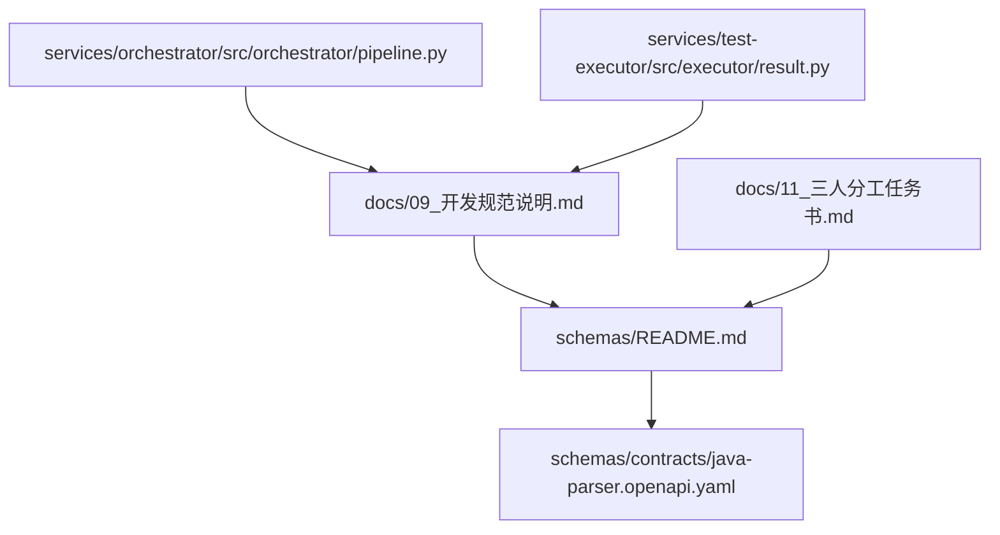
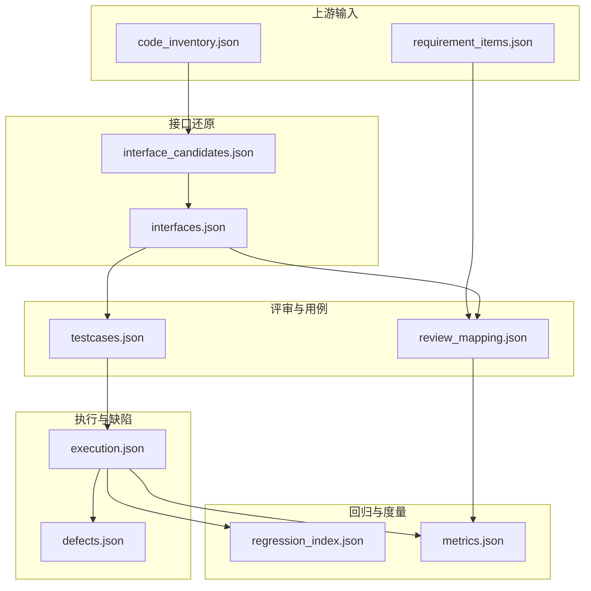
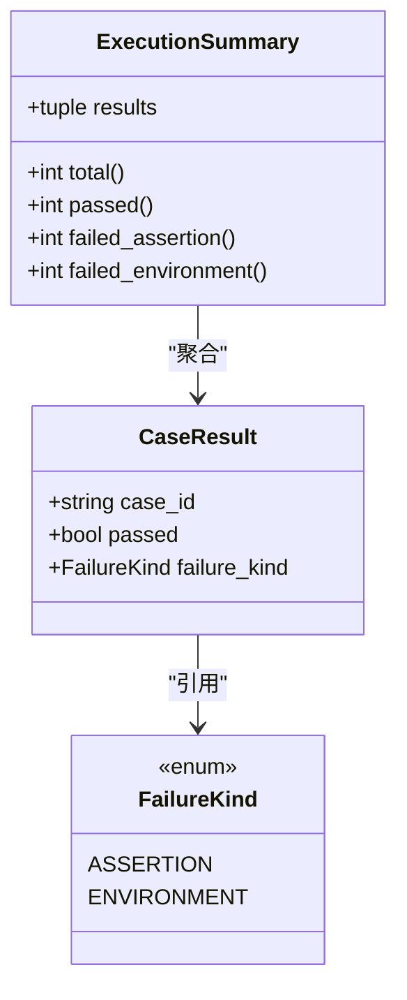
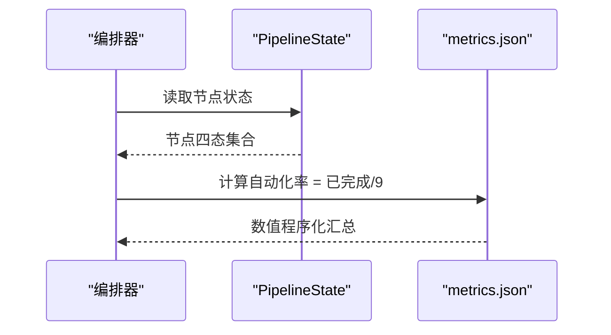
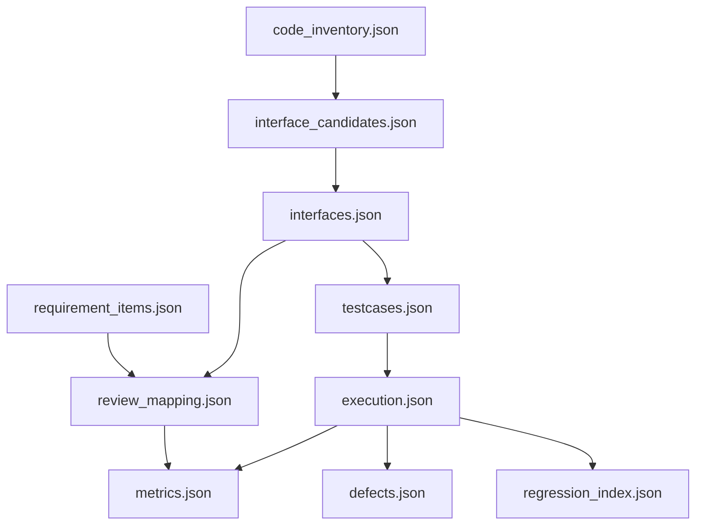
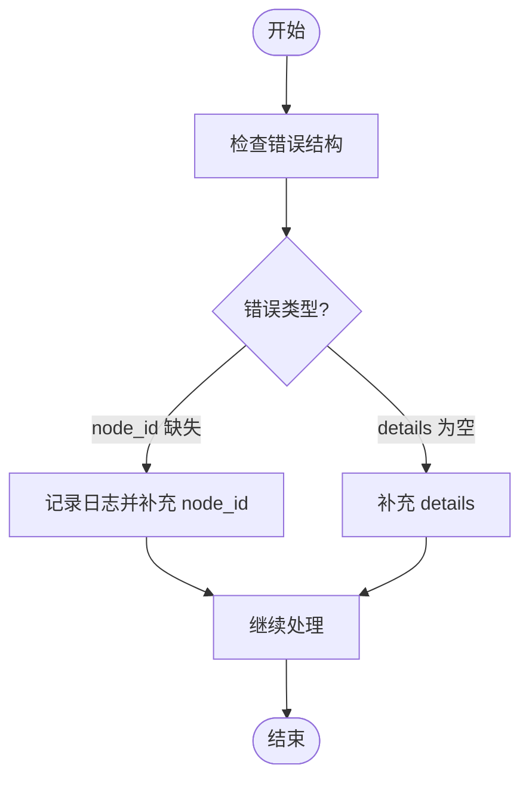

# 核心数据Schema

<cite>
**本文引用的文件**
- [schemas/README.md](file://schemas/README.md)
- [schemas/contracts/java-parser.openapi.yaml](file://schemas/contracts/java-parser.openapi.yaml)
- [docs/09_开发规范说明.md](file://docs/09_开发规范说明.md)
- [docs/11_三人分工任务书.md](file://docs/11_三人分工任务书.md)
- [services/orchestrator/src/orchestrator/pipeline.py](file://services/orchestrator/src/orchestrator/pipeline.py)
- [services/orchestrator/src/orchestrator/api.py](file://services/orchestrator/src/orchestrator/api.py)
- [services/orchestrator/src/orchestrator/config.py](file://services/orchestrator/src/orchestrator/config.py)
- [services/test-executor/src/executor/result.py](file://services/test-executor/src/executor/result.py)
</cite>

## 目录
1. [引言](#引言)
2. [项目结构](#项目结构)
3. [核心组件](#核心组件)
4. [架构总览](#架构总览)
5. [详细组件分析](#详细组件分析)
6. [依赖关系分析](#依赖关系分析)
7. [性能与一致性考虑](#性能与一致性考虑)
8. [故障排查指南](#故障排查指南)
9. [结论](#结论)
10. [附录：Schema 验证示例与最佳实践](#附录schema-验证示例与最佳实践)

## 引言
本文件聚焦于“核心数据 Schema”的权威说明，覆盖 10 个产物 Schema 的定义、字段约定、校验规则与业务含义，并给出 Schema 之间的关系图、数据流转路径与版本演进历史。同时提供 Schema 验证的使用示例与最佳实践，确保 LLM 输出与下游服务在统一契约下稳定协作。

## 项目结构
- schemas/ 是全部结构化产物的 JSON Schema 存放目录，作为跨模块的数据模型单一事实来源。
- contracts/ 保存服务间契约（如 OpenAPI），与 Schema 对齐，保证 orchestrator、java-parser、test-executor 之间的接口一致。
- 开发规范明确：所有数值类指标必须程序化汇总，禁止由 LLM 生成或改写；Schema 变更需升版本，禁止原地改语义。

**图表来源**
- [schemas/README.md:1-30](file://schemas/README.md#L1-L30)
- [docs/09_开发规范说明.md:81-94](file://docs/09_开发规范说明.md#L81-L94)
- [docs/11_三人分工任务书.md:245-280](file://docs/11_三人分工任务书.md#L245-L280)

**章节来源**
- [schemas/README.md:1-30](file://schemas/README.md#L1-L30)
- [docs/09_开发规范说明.md:81-94](file://docs/09_开发规范说明.md#L81-L94)

## 核心组件
- 横切约定：ID 命名、时间戳格式、协议枚举、is_fallback 透传、错误结构等，贯穿全部 10 个 Schema。
- 版本管理：每个 Schema 根节点含 schema_version；结构变更必须升版本，禁止原地改语义。
- 单一事实来源：orchestrator / test-executor 中的 pydantic 模型与 Schema 一一对应；java-parser 返回结构与 contracts/ 契约对齐。
- 校验前置：LLM 输出必须通过对应 Schema 校验后才可进入下游产物。

**章节来源**
- [schemas/README.md:5-10](file://schemas/README.md#L5-L10)
- [docs/09_开发规范说明.md:81-94](file://docs/09_开发规范说明.md#L81-L94)
- [docs/11_三人分工任务书.md:245-280](file://docs/11_三人分工任务书.md#L245-L280)

## 架构总览
下图展示 10 个产物 Schema 在流水线中的位置与依赖关系，以及它们如何支撑 9 节点口径与度量计算。

**图表来源**
- [docs/11_三人分工任务书.md:245-280](file://docs/11_三人分工任务书.md#L245-L280)
- [schemas/README.md:12-27](file://schemas/README.md#L12-L27)

## 详细组件分析

### 1) requirement_items.json（需求解析条目）
- 业务含义：从 Word/Markdown/Excel 需求文档中抽取的结构化需求条目，供后续映射与用例生成使用。
- 关键字段约定（依据横切约定）：
  - id：REQ-xxx 形式，三位零填充，全局递增。
  - timestamp：UTC ISO-8601。
  - is_fallback：兜底标记全链路透传。
  - schema_version：两位简化语义化版本，从 1.0 起。
- 验证规则：
  - 必填字段存在且类型正确；id 符合命名规范；时间戳为 UTC ISO-8601。
  - LLM 输出必须先过 Schema 校验再进入下游。
- 上下游关系：
  - 被 review_mapping.json 消费，用于需求-代码映射。
  - 参与 metrics.json 自动化率统计（节点完成度）。

**章节来源**
- [schemas/README.md:12-27](file://schemas/README.md#L12-L27)
- [docs/11_三人分工任务书.md:245-280](file://docs/11_三人分工任务书.md#L245-L280)

### 2) code_inventory.json（源码清单）
- 业务含义：仓库扫描结果，包含仓库四态（正常/空/截断/路径错误）及文件清单。
- 关键字段约定：
  - schema_version、job_id、repositories（数组）。
  - repositories 项包含 repo/module/path 等信息（与 java-parser 契约对齐）。
- 验证规则：
  - 与 java-parser 契约保持一致；缺失必填字段时报错。
  - 编码异常记录但不中断整体扫描。
- 上下游关系：
  - 被 interface_candidates.json 消费，用于静态特征定位。
  - 被 orchestrator 编排写入产物卷。

**章节来源**
- [schemas/contracts/java-parser.openapi.yaml:255-273](file://schemas/contracts/java-parser.openapi.yaml#L255-L273)
- [docs/11_三人分工任务书.md:75-101](file://docs/11_三人分工任务书.md#L75-L101)

### 3) interface_candidates.json（接口候选清单）
- 业务含义：基于 code_inventory 的源文件内容做静态特征定位（注解/proto/WSDL 等），产出接口候选清单（含代码位置与关联文件上下文），供 orchestrator 侧 LLM 语义解析使用。
- 关键字段约定：
  - 协议类型、签名、代码位置（仓库+文件+行号）、源码片段、关联文件链、is_fallback。
  - schema_version。
- 验证规则：
  - 与 ExtractJob 契约一致；候选数 < 5 时告警。
  - 单个文件解析失败记录原因跳过，不阻塞整体。
- 上下游关系：
  - 被 interfaces.json 消费，进行 LLM 补全参数与签名。

**章节来源**
- [schemas/contracts/java-parser.openapi.yaml:76-115](file://schemas/contracts/java-parser.openapi.yaml#L76-L115)
- [docs/11_三人分工任务书.md:85-101](file://docs/11_三人分工任务书.md#L85-L101)

### 4) interfaces.json（接口还原清单）
- 业务含义：LLM 对候选接口进行语义补全后的最终接口清单，作为用例生成的唯一输入源。
- 关键字段约定：
  - 协议、签名、参数名与结构、溯源字段（需求条目 ID + 接口 ID）。
  - schema_version、is_fallback。
- 验证规则：
  - 参数名与结构仅来自接口定义；违规用例丢弃重生成。
  - 脚本必须可被框架加载（语法校验作为生成完成的前置条件）。
- 上下游关系：
  - 被 testcases.json 消费；被 metrics.json 统计。

**章节来源**
- [docs/11_三人分工任务书.md:151-169](file://docs/11_三人分工任务书.md#L151-L169)
- [docs/11_三人分工任务书.md:201-208](file://docs/11_三人分工任务书.md#L201-L208)

### 5) review_mapping.json（映射表/风险/遗漏三视图）
- 业务含义：需求条目 × 接口的映射，标注四态（已实现/部分实现/未实现/无法判断）+ 置信度；派生风险清单与遗漏清单。
- 关键字段约定：
  - 需求条目 ID、接口 ID、状态、置信度、is_fallback。
  - schema_version。
- 验证规则：
  - 找不到相关代码标“未实现”；LLM 无法判断标“无法判断”并计入风险清单。
  - 代码定位失败降级为“无法判断”，不阻塞其余条目。
- 上下游关系：
  - 被 metrics.json 消费，影响自动化率与瓶颈分析。

**章节来源**
- [docs/04_功能规格说明.md:142-148](file://docs/04_功能规格说明.md#L142-L148)
- [docs/11_三人分工任务书.md:35-43](file://docs/11_三人分工任务书.md#L35-L43)

### 6) testcases.json（生成的用例与脚本元数据）
- 业务含义：按接口生成用例与脚本元数据，每条用例携带需求条目 ID + 接口 ID。
- 关键字段约定：
  - 用例 ID（TC-xxx）、协议、参数、脚本路径、溯源字段。
  - schema_version。
- 验证规则：
  - 每接口 ≥3 条用例（正常/边界/异常各 ≥1）。
  - 参数一致性约束：参数名与结构仅来自 interfaces.json。
  - 脚本语法校验通过方可进入执行。
- 上下游关系：
  - 被 execution.json 消费；被 regression_index.json 沉淀。

**章节来源**
- [docs/11_三人分工任务书.md:121-144](file://docs/11_三人分工任务书.md#L121-L144)

### 7) execution.json（执行结果）
- 业务含义：一次执行的程序化汇总，区分“断言失败”与“环境失败”两态。
- 关键字段约定：
  - results（CaseResult 列表），每个结果包含 case_id、passed、failure_kind。
  - failure_kind 枚举：assertion / environment。
  - schema_version。
- 验证规则：
  - 通过的用例不得携带失败类型（自洽校验）。
  - 环境失败隔离至待环境确认，不计入通过率分母。
- 上下游关系：
  - 被 defects.json、regression_index.json、metrics.json 消费。

**图表来源**
- [services/test-executor/src/executor/result.py:10-61](file://services/test-executor/src/executor/result.py#L10-L61)

**章节来源**
- [services/test-executor/src/executor/result.py:1-61](file://services/test-executor/src/executor/result.py#L1-L61)

### 8) defects.json（本地缺陷记录）
- 业务含义：记录“断言失败”的缺陷；环境失败隔离到“待环境确认”。
- 关键字段约定：
  - 缺陷 ID（DEF-xxx）、用例 ID、失败类型、复测状态、时间戳。
  - schema_version、is_fallback。
- 验证规则：
  - 仅断言失败进入缺陷；环境失败不入缺陷。
  - 复测流程带时间戳与状态流转。
- 上下游关系：
  - 被 metrics.json 消费，影响缺陷闭环度量。

**章节来源**
- [docs/11_三人分工任务书.md:134-144](file://docs/11_三人分工任务书.md#L134-L144)
- [docs/11_三人分工任务书.md:245-280](file://docs/11_三人分工任务书.md#L245-L280)

### 9) regression_index.json（回归资产索引）
- 业务含义：将复测通过的脚本移动（非复制）到按协议分目录的回归区，重复归档不产生重复文件。
- 关键字段约定：
  - 脚本路径、协议、上次运行时间、是否漂移。
  - schema_version。
- 验证规则：
  - 移动而非复制；重复归档去重。
  - 与当初不一致时标“回归漂移”，交人工判断不自动删。
- 上下游关系：
  - 被 metrics.json 消费，体现回归覆盖率。

**章节来源**
- [docs/11_三人分工任务书.md:134-144](file://docs/11_三人分工任务书.md#L134-L144)

### 10) metrics.json（自动化率度量）
- 业务含义：自动化率 = 已完成节点数 ÷ 9（分母固定为 9，禁止增删）；其他数值均由 execution.json 等结构化产物程序化汇总产生。
- 关键字段约定：
  - automation_rate（float | None）、节点状态摘要、timestamp。
  - schema_version。
- 验证规则：
  - 数字不经 LLM；全部由程序化汇总。
  - 降级节点按“人工介入”计入。
- 上下游关系：
  - 被前端展示；被 orchestrator API 暴露。

**图表来源**
- [services/orchestrator/src/orchestrator/pipeline.py:23-70](file://services/orchestrator/src/orchestrator/pipeline.py#L23-L70)
- [docs/09_开发规范说明.md:81-87](file://docs/09_开发规范说明.md#L81-L87)

**章节来源**
- [services/orchestrator/src/orchestrator/pipeline.py:23-70](file://services/orchestrator/src/orchestrator/pipeline.py#L23-L70)
- [docs/09_开发规范说明.md:81-87](file://docs/09_开发规范说明.md#L81-L87)

## 依赖关系分析
- 上游输入：requirement_items.json、code_inventory.json。
- 接口还原：interface_candidates.json → interfaces.json。
- 评审与用例：review_mapping.json ← requirement_items.json + interfaces.json；testcases.json ← interfaces.json。
- 执行与缺陷：execution.json ← testcases.json；defects.json ← execution.json。
- 回归与度量：regression_index.json ← execution.json；metrics.json ← execution.json + review_mapping.json + pipeline 状态。

**图表来源**
- [docs/11_三人分工任务书.md:245-280](file://docs/11_三人分工任务书.md#L245-L280)
- [schemas/README.md:12-27](file://schemas/README.md#L12-L27)

**章节来源**
- [docs/11_三人分工任务书.md:245-280](file://docs/11_三人分工任务书.md#L245-L280)

## 性能与一致性考虑
- 大仓库截断：当文件数超阈值时只扫核心模块，并在产物中标注截断范围，避免阻塞。
- 单文件失败容错：解析失败记录原因并跳过，不中断整体扫描。
- 数字口径一致：所有数值（通过率、自动化率、接口数、缺陷数）由程序化汇总，禁止 LLM 生成或改写。
- 版本控制：Schema 变更升版本，禁止原地改语义；向后兼容只允许加可选字段。

**章节来源**
- [docs/11_三人分工任务书.md:95-101](file://docs/11_三人分工任务书.md#L95-L101)
- [docs/09_开发规范说明.md:81-94](file://docs/09_开发规范说明.md#L81-L94)

## 故障排查指南
- 常见错误结构：{code, message, node_id?, details}，三栈统一。
- 执行失败分类：断言失败计入跑通口径；环境失败隔离至待环境确认。
- 节点失败落盘：状态 + 原因 + 时间戳，作为断点续跑依据。
- 配置与环境：缺失必填环境变量会显式报错；健康检查用于编排依赖。

**图表来源**
- [schemas/contracts/java-parser.openapi.yaml:130-148](file://schemas/contracts/java-parser.openapi.yaml#L130-L148)
- [docs/09_开发规范说明.md:96-101](file://docs/09_开发规范说明.md#L96-L101)

**章节来源**
- [schemas/contracts/java-parser.openapi.yaml:130-148](file://schemas/contracts/java-parser.openapi.yaml#L130-L148)
- [docs/09_开发规范说明.md:96-101](file://docs/09_开发规范说明.md#L96-L101)

## 结论
本方案以 schemas/ 为单一事实来源，结合 contracts/ 契约与开发规范，确保 10 个产物 Schema 在 9 节点流水线中稳定流转。通过严格的版本管理、横切约定与程序化汇总，保障数据一致性与可观测性，并为前端展示与度量计算提供可靠基础。

## 附录：Schema 验证示例与最佳实践
- 验证入口：
  - 使用 jsonschema 库对 LLM 输出进行校验，校验失败按节点失败处理，禁止降级截取可用部分。
  - 参考 orchestrator 依赖：jsonschema >= 4.23。
- 最佳实践：
  - 所有 LLM 输出在进入下游前必须通过对应 Schema 校验。
  - 保持 schema_version 与结构变更同步升级；向后兼容只加可选字段。
  - 使用横切约定统一 ID、时间戳、协议枚举、is_fallback 透传与错误结构。
  - 度量数值一律程序化汇总，禁止 LLM 生成或改写。
- 示例步骤（概念性）：
  - 加载对应 Schema 文件。
  - 对 LLM 输出调用 validate(data, schema)。
  - 捕获异常并记录错误信息（code/message/details）。
  - 校验通过后写入 artifacts_root 指定目录，供下游消费。

**章节来源**
- [docs/09_开发规范说明.md:73-87](file://docs/09_开发规范说明.md#L73-L87)
- [services/orchestrator/u v.lock:486-493](file://services/orchestrator/uv.lock#L486-L493)