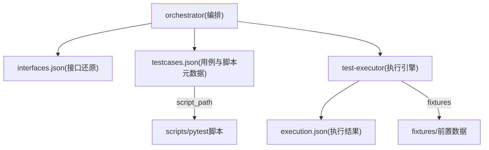
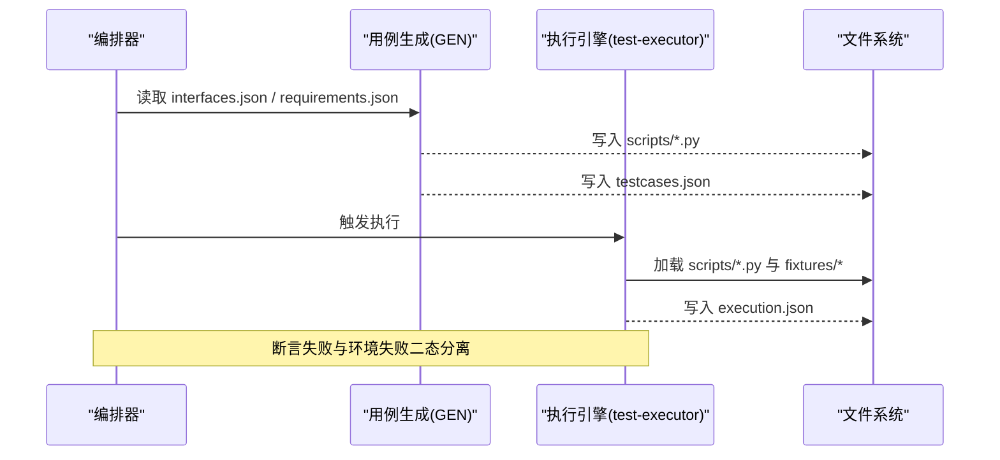
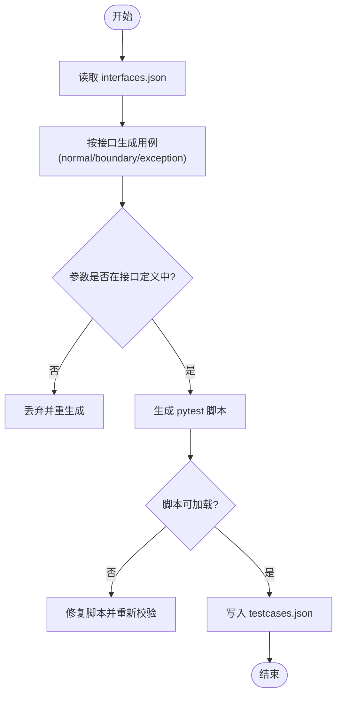
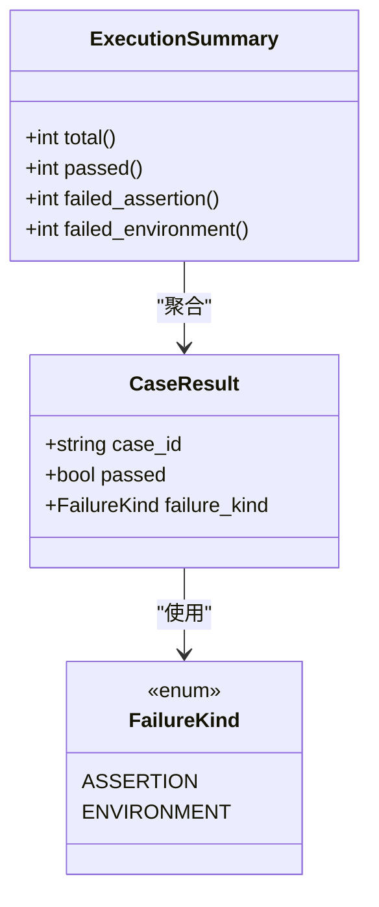
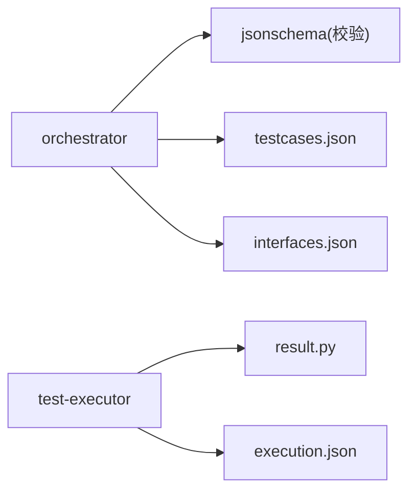

# 测试用例Schema

<cite>
**本文引用的文件**
- [schemas/README.md](file://schemas/README.md)
- [schemas/testcases.json](file://schemas/testcases.json)
- [schemas/interfaces.json](file://schemas/interfaces.json)
- [schemas/execution.json](file://schemas/execution.json)
- [schemas/samples/execution.sample.json](file://schemas/samples/execution.sample.json)
- [docs/04_功能规格说明.md](file://docs/04_功能规格说明.md)
- [docs/12_开发设计说明.md](file://docs/12_开发设计说明.md)
- [services/test-executor/src/executor/result.py](file://services/test-executor/src/executor/result.py)
- [services/orchestrator/pyproject.toml](file://services/orchestrator/pyproject.toml)
</cite>

## 目录
1. [简介](#简介)
2. [项目结构](#项目结构)
3. [核心组件](#核心组件)
4. [架构总览](#架构总览)
5. [详细组件分析](#详细组件分析)
6. [依赖关系分析](#依赖关系分析)
7. [性能考虑](#性能考虑)
8. [故障排查指南](#故障排查指南)
9. [结论](#结论)
10. [附录](#附录)

## 简介
本文件围绕“测试用例Schema”展开，聚焦 schemas/testcases.json 的结构与约束，解释用例ID、描述、前置条件、测试步骤、预期结果、关联接口等字段的含义与使用方式；同时说明用例生成算法要点、脚本元数据管理、用例分类与标签体系、执行策略、版本管理与依赖关系，并给出用例生成与执行的实践示例。

## 项目结构
- schemas/ 存放全部结构化产物的 JSON Schema，testcases.json 是“用例与脚本元数据”的权威定义。
- interfaces.json 提供接口签名与参数清单，作为用例参数的唯一来源（F-GEN-02）。
- execution.json 定义执行结果与汇总，用于断言失败与环境失败的二态分离。
- docs/04_功能规格说明.md 定义了模块5（GEN）的功能与交互规则。
- docs/12_开发设计说明.md 规定了产物目录布局与写入权限隔离。
- services/test-executor/src/executor/result.py 实现执行结果的二态模型与汇总逻辑。
- services/orchestrator/pyproject.toml 声明了编排服务对 jsonschema 的依赖，用于Schema校验。

图表来源
- [docs/12_开发设计说明.md:50-75](file://docs/12_开发设计说明.md#L50-L75)
- [services/orchestrator/pyproject.toml:6-12](file://services/orchestrator/pyproject.toml#L6-L12)

章节来源
- [schemas/README.md:1-30](file://schemas/README.md#L1-L30)
- [docs/12_开发设计说明.md:50-75](file://docs/12_开发设计说明.md#L50-L75)

## 核心组件
- testcases.json：定义用例与脚本元数据的Schema，包含用例ID、关联接口、需求溯源、分类、标题、参数、预期结果、脚本路径、可加载性标志、低置信度标记等。
- interfaces.json：定义接口签名、协议、参数位置与类型、代码定位、兜底标记、置信度等，作为用例参数的权威来源。
- execution.json：定义执行结果数组与汇总对象，支持断言失败与环境失败的二态分离，以及降级协议记录。
- result.py：以数据类形式实现 CaseResult 与 ExecutionSummary，强制通过用例不得携带失败类型，并提供程序化汇总。

章节来源
- [schemas/testcases.json:1-35](file://schemas/testcases.json#L1-L35)
- [schemas/interfaces.json:1-70](file://schemas/interfaces.json#L1-L70)
- [schemas/execution.json:1-59](file://schemas/execution.json#L1-L59)
- [services/test-executor/src/executor/result.py:1-61](file://services/test-executor/src/executor/result.py#L1-L61)

## 架构总览
用例生成与执行的关键流程如下：
- 输入：interfaces.json（接口还原清单）+ requirements.json（需求条目，用于断言语义）。
- 生成：按接口生成用例（每接口≥3条：正常/边界/异常各≥1），产出 pytest 脚本与 testcases.json。
- 校验：参数一致性校验（仅允许来自 interfaces.json 的参数名与结构），脚本语法校验（py_compile + 收集零报错）。
- 执行：test-executor 加载脚本并执行，输出 execution.json（含 results 与 summary）。
- 归档：缺陷记录 defects.json（仅断言失败进入），回归索引 regression_index.json，度量 metrics.json。

图表来源
- [docs/04_功能规格说明.md:151-168](file://docs/04_功能规格说明.md#L151-L168)
- [docs/12_开发设计说明.md:50-75](file://docs/12_开发设计说明.md#L50-L75)
- [services/test-executor/src/executor/result.py:17-61](file://services/test-executor/src/executor/result.py#L17-L61)

## 详细组件分析

### testcases.json 字段详解
- schema_version：固定为字符串常量，表示Schema版本。
- job_id：任务标识，必须以“job-”开头。
- cases：用例数组，每个用例必须包含以下必填字段：
  - id：用例ID，格式 TC-XXX（三位数字）。
  - interface_id：关联接口ID，格式 IF-PROTOCOL-XXX（如 IF-REST-001）。
  - requirement_id：可选的需求条目ID，格式 REQ-XXX，用于溯源。
  - category：用例分类，枚举 normal/boundary/exception，要求每接口三类各≥1。
  - title：用例标题（非空字符串）。
  - params：参数对象，名称与结构必须来自 interfaces.json，出现清单外参数即打回。
  - expected：预期结果描述（断言依据）。
  - script_path：生成的 pytest 脚本相对路径。
  - loadable：布尔值，表示 py_compile + 收集零 error 的校验结果。
  - low_confidence：布尔值，标注 unknown 参数用例的低置信度。

注意：
- “用例描述、前置条件、测试步骤”在Schema中未显式字段，通常由 title、expected、params 与脚本内容共同表达；若需扩展，应通过升级Schema版本并在下游同步更新。
- 标签体系：category 即为用例分类；如需更细粒度标签，可在 params 或外部索引中维护，但需保持与Schema兼容。

章节来源
- [schemas/testcases.json:1-35](file://schemas/testcases.json#L1-L35)
- [docs/04_功能规格说明.md:151-168](file://docs/04_功能规格说明.md#L151-L168)

### 用例生成算法与脚本元数据管理
- 生成规则：
  - 每接口至少3条用例，覆盖 normal、boundary、exception 三类。
  - 参数一致性：仅允许使用 interfaces.json 中定义的参数名与结构。
  - 脚本可加载性：生成后必须进行语法校验（编译+收集零报错），loadable 标志反映该结果。
  - 溯源：每条用例携带 requirement_id 与 interface_id。
- 元数据管理：
  - testcases.json 集中管理用例与脚本路径，scripts/ 目录存放实际 pytest 脚本。
  - fixtures/ 目录存放前置数据（鉴权token、造数数据），执行时自动加载。

图表来源
- [docs/04_功能规格说明.md:151-168](file://docs/04_功能规格说明.md#L151-L168)
- [schemas/testcases.json:1-35](file://schemas/testcases.json#L1-L35)

### 执行策略与结果二态
- 执行结果二态：
  - 断言失败：计入通过率分母，进入缺陷清单。
  - 环境失败：隔离至待环境确认，不计入通过率分母。
- 汇总：
  - total、passed、failed_assertion、failed_environment 四项为必需字段。
  - interrupted：服务崩溃后剩余用例标中断。
  - degraded_protocols：记录降级协议及原因（脚本生成成功+Mock执行演示）。

图表来源
- [services/test-executor/src/executor/result.py:10-61](file://services/test-executor/src/executor/result.py#L10-L61)
- [schemas/execution.json:1-59](file://schemas/execution.json#L1-L59)

章节来源
- [schemas/execution.json:1-59](file://schemas/execution.json#L1-L59)
- [services/test-executor/src/executor/result.py:1-61](file://services/test-executor/src/executor/result.py#L1-L61)

### 用例版本管理与依赖关系
- 版本管理：
  - 每个Schema含 schema_version 字段，结构变更必须升版本，禁止原地改语义。
  - testcases.json 的版本与下游（orchestrator/test-executor）的Pydantic模型一一对应。
- 依赖关系：
  - testcases.json 依赖 interfaces.json（参数来源）。
  - execution.json 依赖 testcases.json（case_id 与 interface_id 对应）。
  - defects.json 依赖 execution.json（仅断言失败进入缺陷清单）。

章节来源
- [schemas/README.md:1-30](file://schemas/README.md#L1-L30)
- [schemas/testcases.json:1-35](file://schemas/testcases.json#L1-L35)
- [schemas/execution.json:1-59](file://schemas/execution.json#L1-L59)

### 实际示例：用例生成与执行
- 用例生成示例：
  - 输入：interfaces.json 中的 REST 接口签名。
  - 输出：scripts/ 下的 pytest 脚本 + testcases.json（包含 id、interface_id、category、title、params、expected、script_path、loadable、low_confidence）。
- 执行示例：
  - 输入：testcases.json 与 fixtures/ 前置数据。
  - 输出：execution.json（results 数组 + summary 汇总 + degraded_protocols 降级清单）。

参考样例：
- execution.sample.json 展示了多用例执行结果、断言失败与环境失败的区别、超时标记与降级协议记录。

章节来源
- [schemas/samples/execution.sample.json:1-63](file://schemas/samples/execution.sample.json#L1-L63)
- [docs/04_功能规格说明.md:151-168](file://docs/04_功能规格说明.md#L151-L168)

## 依赖关系分析
- orchestrator 依赖 jsonschema 进行Schema校验。
- test-executor 依赖 result.py 中的 FailureKind、CaseResult、ExecutionSummary 实现执行结果二态与汇总。
- 产物写入权限排他：每个产物仅一个写方，避免并发冲突。

图表来源
- [services/orchestrator/pyproject.toml:6-12](file://services/orchestrator/pyproject.toml#L6-L12)
- [services/test-executor/src/executor/result.py:1-61](file://services/test-executor/src/executor/result.py#L1-L61)
- [docs/12_开发设计说明.md:50-75](file://docs/12_开发设计说明.md#L50-L75)

章节来源
- [services/orchestrator/pyproject.toml:6-12](file://services/orchestrator/pyproject.toml#L6-L12)
- [docs/12_开发设计说明.md:50-75](file://docs/12_开发设计说明.md#L50-L75)

## 性能考虑
- 用例生成阶段：
  - 参数一致性校验应在生成后立即执行，减少无效脚本数量。
  - 脚本语法校验（py_compile + 收集）作为前置条件，避免执行阶段失败。
- 执行阶段：
  - 断言失败与环境失败分离，有助于快速定位问题，提升调试效率。
  - 降级协议（如MQ）采用Mock执行演示，降低端到端依赖成本。

[本节提供通用指导，不直接分析具体文件]

## 故障排查指南
- Schema校验失败：
  - 检查 testcases.json 是否满足必填字段与格式约束（如 id、interface_id、category）。
  - 确认 parameters 仅包含 interfaces.json 中定义的参数。
- 执行失败：
  - 区分断言失败与环境失败，优先处理环境失败（连接超时、服务不可用）。
  - 查看 execution.json 的 summary 与 degraded_protocols，了解降级情况。
- 脚本不可加载：
  - 检查 script_path 指向的文件是否存在且语法正确。
  - 确认 loadable 标志为 true。

章节来源
- [schemas/testcases.json:1-35](file://schemas/testcases.json#L1-L35)
- [schemas/execution.json:1-59](file://schemas/execution.json#L1-L59)
- [services/test-executor/src/executor/result.py:17-61](file://services/test-executor/src/executor/result.py#L17-L61)

## 结论
testcases.json 作为用例与脚本元数据的权威定义，结合 interfaces.json 的参数约束与 execution.json 的执行结果二态，构成了从生成到执行的完整闭环。通过严格的Schema校验、脚本可加载性验证与执行结果分类，系统实现了高可靠性的自动化测试流水线。建议在实际使用中遵循版本升版规范，确保上下游模型一致，并通过 fixtures 与降级策略提升执行稳定性。

[本节为总结性内容，不直接分析具体文件]

## 附录
- 关键术语：
  - 用例ID：TC-XXX（三位数字）。
  - 接口ID：IF-PROTOCOL-XXX（如 IF-REST-001）。
  - 需求ID：REQ-XXX（用于溯源）。
  - 分类：normal、boundary、exception。
- 相关文档：
  - 模块5（GEN）功能规格：docs/04_功能规格说明.md。
  - 产物目录布局：docs/12_开发设计说明.md。
  - 执行结果二态：services/test-executor/src/executor/result.py。

[本节为补充信息，不直接分析具体文件]