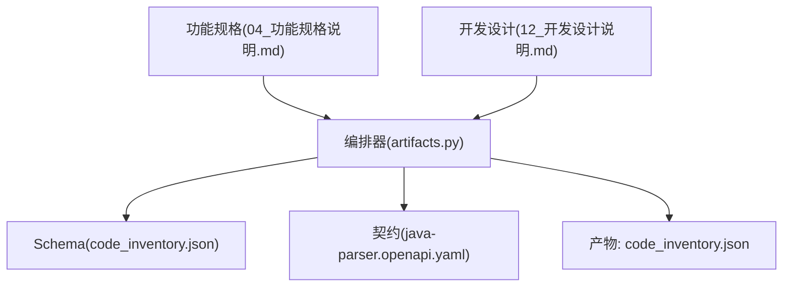
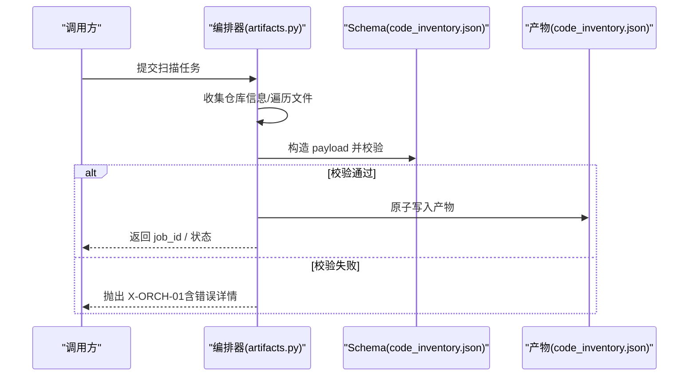
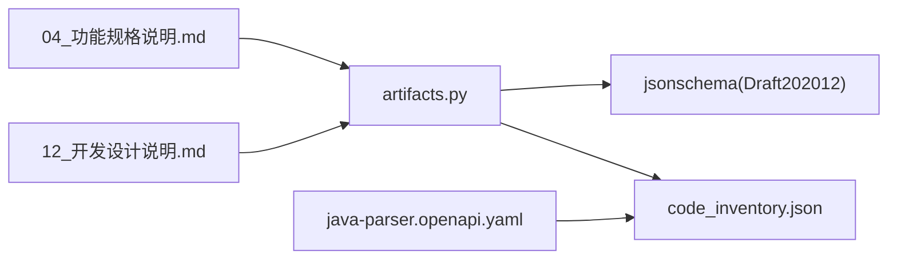

# 源码清单Schema

<cite>
**本文引用的文件**
- [schemas/code_inventory.json](file://schemas/code_inventory.json)
- [schemas/README.md](file://schemas/README.md)
- [schemas/contracts/java-parser.openapi.yaml](file://schemas/contracts/java-parser.openapi.yaml)
- [docs/04_功能规格说明.md](file://docs/04_功能规格说明.md)
- [docs/12_开发设计说明.md](file://docs/12_开发设计说明.md)
- [services/orchestrator/src/orchestrator/artifacts.py](file://services/orchestrator/src/orchestrator/artifacts.py)
</cite>

## 目录
1. [简介](#简介)
2. [项目结构](#项目结构)
3. [核心组件](#核心组件)
4. [架构总览](#架构总览)
5. [详细组件分析](#详细组件分析)
6. [依赖关系分析](#依赖关系分析)
7. [性能考虑](#性能考虑)
8. [故障排查指南](#故障排查指南)
9. [结论](#结论)
10. [附录：字段定义与使用示例](#附录字段定义与使用示例)

## 简介
本文件面向“源码清单Schema”（code_inventory.json）的完整说明，覆盖仓库四态（新增、修改、删除、未变更）的代码文件清单组织方式、字段语义、扫描算法与增量更新机制、对测试影响分析方法，以及实际使用示例和性能优化建议。该Schema是模块2（CODE）的核心产物，作为后续接口还原、用例生成等下游节点的输入基础。

## 项目结构
- Schema定义位于 schemas/code_inventory.json，描述顶层对象、仓库数组、文件项的结构与约束。
- 契约层在 schemas/contracts/java-parser.openapi.yaml 中引用并复用 RepoInventory/SourceFile 等概念，保证服务间一致。
- 编排侧通过 services/orchestrator/src/orchestrator/artifacts.py 进行产物落盘与Schema校验，确保 code_inventory.json 必须通过校验才被视为“节点完成”。
- 需求与边界规则在 docs/04_功能规格说明.md 中明确（F-CODE-01~03、X-CODE-01~03）。
- 编排状态机与产物布局在 docs/12_开发设计说明.md 中约定，其中 code_scan 节点以 code_inventory.json 过校验为完成判据。

图表来源
- [services/orchestrator/src/orchestrator/artifacts.py:75-112](file://services/orchestrator/src/orchestrator/artifacts.py#L75-L112)
- [schemas/code_inventory.json:1-57](file://schemas/code_inventory.json#L1-L57)
- [schemas/contracts/java-parser.openapi.yaml:207-249](file://schemas/contracts/java-parser.openapi.yaml#L207-L249)

章节来源
- [schemas/code_inventory.json:1-57](file://schemas/code_inventory.json#L1-L57)
- [schemas/README.md:1-30](file://schemas/README.md#L1-L30)
- [schemas/contracts/java-parser.openapi.yaml:207-249](file://schemas/contracts/java-parser.openapi.yaml#L207-L249)
- [docs/04_功能规格说明.md:64-87](file://docs/04_功能规格说明.md#L64-L87)
- [docs/12_开发设计说明.md:17-46](file://docs/12_开发设计说明.md#L17-L46)
- [services/orchestrator/src/orchestrator/artifacts.py:75-112](file://services/orchestrator/src/orchestrator/artifacts.py#L75-L112)

## 核心组件
- 顶层对象：包含 schema_version、job_id、repositories。
- 仓库对象：name、path、branch、is_fallback、status、file_count，可选 truncated_scope、encoding_skipped、error、files。
- 文件对象：repo、module、path。
- 四态映射：ok、empty、truncated、error，分别对应正常、无可分析内容、超大仓库截断、硬错误。

章节来源
- [schemas/code_inventory.json:6-54](file://schemas/code_inventory.json#L6-L54)
- [docs/04_功能规格说明.md:64-87](file://docs/04_功能规格说明.md#L64-L87)

## 架构总览
代码扫描阶段由编排器驱动，产出 code_inventory.json；编排器通过Schema严格校验，只有校验通过的产物才视为节点完成，从而允许下游节点继续执行。

图表来源
- [services/orchestrator/src/orchestrator/artifacts.py:75-112](file://services/orchestrator/src/orchestrator/artifacts.py#L75-L112)
- [schemas/code_inventory.json:6-54](file://schemas/code_inventory.json#L6-L54)

章节来源
- [services/orchestrator/src/orchestrator/artifacts.py:75-112](file://services/orchestrator/src/orchestrator/artifacts.py#L75-L112)
- [docs/12_开发设计说明.md:17-46](file://docs/12_开发设计说明.md#L17-L46)

## 详细组件分析

### Schema结构与字段语义
- schema_version：固定字符串，用于版本控制。
- job_id：任务标识，需匹配特定前缀。
- repositories：仓库列表，至少两项，体现多仓库扫描能力。
- 仓库字段：
  - name/path/branch/is_fallback：仓库元信息。
  - status：四态枚举，决定流程走向。
  - file_count：统计值，便于评估规模。
  - truncated_scope：当触发超大仓库截断时记录实际扫描范围。
  - encoding_skipped：异常编码文件记录，便于审计。
  - error：结构化错误信息（code/message/details）。
  - files：源码文件清单，每项包含 repo/module/path。
- 文件字段：
  - repo/module/path：定位到具体仓库与模块内的相对路径。

章节来源
- [schemas/code_inventory.json:6-54](file://schemas/code_inventory.json#L6-L54)
- [schemas/contracts/java-parser.openapi.yaml:207-249](file://schemas/contracts/java-parser.openapi.yaml#L207-L249)

### 仓库四态与流程影响
- ok：正常扫描完成，进入下游。
- empty：无可分析内容，属于正常态，流程继续。
- truncated：超大仓库按配置仅扫描核心目录，需在 truncated_scope 注明范围。
- error：硬错误（如路径不存在），流程终止或降级处理。

章节来源
- [docs/04_功能规格说明.md:64-87](file://docs/04_功能规格说明.md#L64-L87)
- [schemas/code_inventory.json:22-29](file://schemas/code_inventory.json#L22-L29)

### 文件路径、变更类型、时间戳、开发者信息
- 文件路径：由 path 表示仓库内相对路径，结合 repo/module 可唯一定位。
- 变更类型：当前Schema未内置“新增/修改/删除/未变更”字段；如需表达变更类型，应在上游扫描逻辑中基于Git diff或增量对比结果，将变更类型映射为业务标签并在下游消费时解读。
- 时间戳：横切约定要求UTC ISO-8601时间戳；可在上层产物（如execution.json）中使用，但code_inventory.json本身不强制包含时间戳字段。
- 开发者信息：不在Schema中定义；若需要，应在上游扫描或下游分析环节附加，并通过统一的错误/元数据字段传递。

章节来源
- [schemas/README.md:5-10](file://schemas/README.md#L5-L10)
- [schemas/code_inventory.json:42-50](file://schemas/code_inventory.json#L42-L50)

### 识别与分析代码变更对测试的影响
- 输入：code_inventory.json + 源文件内容（R-REV-01）。
- 方法：
  - 静态特征定位：优先从注解/proto/WSDL等特征文件入手，减少全文盲扫（R-REV-02）。
  - 关联文件选择：Controller → Service 接口签名 → DTO 定义，分块调用LLM，降低上下文成本（R-REV-04）。
  - 位置溯源：每个接口带代码位置（仓库+文件+行号区间），便于映射表与人工抽查（R-REV-03）。
- 输出：interfaces.json（接口还原清单），供用例生成与执行使用。

章节来源
- [docs/04_功能规格说明.md:90-115](file://docs/04_功能规格说明.md#L90-L115)
- [schemas/contracts/java-parser.openapi.yaml:72-109](file://schemas/contracts/java-parser.openapi.yaml#L72-L109)

### 文件扫描算法与增量更新机制
- 扫描范围过滤：按目录/后缀（.java）过滤，排除测试代码与生成代码目录（F-CODE-02）。
- 超大仓库策略：当文件数超阈值时，仅扫描配置指定的核心模块目录，并在 truncated_scope 注明范围（X-CODE-03）。
- 编码处理：统一UTF-8读取，异常编码文件记录但跳过内容解析（R-CODE-03）。
- 增量更新建议：
  - 在上层实现中维护上次扫描的快照（文件集合+哈希），本次扫描计算diff，得到新增/修改/删除/未变更四类变更集。
  - 将变更类型作为业务标签附加到下游分析（例如在接口还原阶段仅对变更文件做深度解析）。
  - 对于空仓库（X-CODE-02）直接标记为正常态，避免阻塞流程。

章节来源
- [docs/04_功能规格说明.md:64-87](file://docs/04_功能规格说明.md#L64-L87)
- [schemas/code_inventory.json:22-29](file://schemas/code_inventory.json#L22-L29)

### 编排与产物管理
- 产物文件名与Schema一一对应，禁止自造别名。
- 写权排他：orchestrator负责code_inventory.json写入，test-executor无权写入。
- 节点完成判据：产物存在且通过Schema校验。
- 归档机制：重跑前旧产物移入archive目录，禁止原地覆盖。

章节来源
- [services/orchestrator/src/orchestrator/artifacts.py:24-50](file://services/orchestrator/src/orchestrator/artifacts.py#L24-L50)
- [services/orchestrator/src/orchestrator/artifacts.py:75-112](file://services/orchestrator/src/orchestrator/artifacts.py#L75-L112)
- [services/orchestrator/src/orchestrator/artifacts.py:133-142](file://services/orchestrator/src/orchestrator/artifacts.py#L133-L142)
- [docs/12_开发设计说明.md:50-75](file://docs/12_开发设计说明.md#L50-L75)

## 依赖关系分析
- orchestrator.artifacts 依赖 jsonschema 进行Draft202012校验。
- code_inventory.json 被 java-parser 契约引用，作为接口候选提取的输入基础。
- 功能规格定义了扫描边界与异常分支，指导实现与验收。

图表来源
- [services/orchestrator/src/orchestrator/artifacts.py:18-20](file://services/orchestrator/src/orchestrator/artifacts.py#L18-L20)
- [schemas/contracts/java-parser.openapi.yaml:207-249](file://schemas/contracts/java-parser.openapi.yaml#L207-L249)
- [docs/04_功能规格说明.md:64-87](file://docs/04_功能规格说明.md#L64-L87)
- [docs/12_开发设计说明.md:17-46](file://docs/12_开发设计说明.md#L17-L46)

章节来源
- [services/orchestrator/src/orchestrator/artifacts.py:18-20](file://services/orchestrator/src/orchestrator/artifacts.py#L18-L20)
- [schemas/contracts/java-parser.openapi.yaml:207-249](file://schemas/contracts/java-parser.openapi.yaml#L207-L249)

## 性能考虑
- 大仓库截断：通过 truncated_scope 限制扫描范围，降低IO与解析成本。
- 编码跳过：异常编码文件记录但不解析，避免阻塞。
- 分块与上下文管理：接口还原阶段采用分块调用与关联文件选择，减少LLM上下文大小与token消耗。
- 原子写入：产物写入采用tmp+replace，避免部分写入导致的读取不一致。

章节来源
- [docs/04_功能规格说明.md:64-87](file://docs/04_功能规格说明.md#L64-L87)
- [docs/04_功能规格说明.md:90-115](file://docs/04_功能规格说明.md#L90-L115)
- [services/orchestrator/src/orchestrator/artifacts.py:91-96](file://services/orchestrator/src/orchestrator/artifacts.py#L91-L96)

## 故障排查指南
- 仓库路径不存在：status=error，错误码X-CODE-01，检查输入路径与权限。
- 无可分析内容：status=empty，流程继续，检查过滤规则与目录结构。
- 超大仓库截断：status=truncated，核对 truncated_scope 是否符合预期。
- 产物校验失败：X-ORCH-01，查看errors详情，修正payload结构。
- 编码异常：encoding_skipped记录异常文件，确认是否影响下游解析。

章节来源
- [docs/04_功能规格说明.md:64-87](file://docs/04_功能规格说明.md#L64-L87)
- [docs/12_开发设计说明.md:87-104](file://docs/12_开发设计说明.md#L87-L104)
- [services/orchestrator/src/orchestrator/artifacts.py:82-90](file://services/orchestrator/src/orchestrator/artifacts.py#L82-L90)

## 结论
code_inventory.json作为模块2的核心产物，通过严格的Schema约束与编排器校验，保障了多仓库扫描结果的可靠性与一致性。配合功能规格中的边界与异常分支，可实现稳健的增量扫描与下游接口还原、用例生成等流程。建议在实现中补充变更类型标注与增量对比机制，以提升分析与执行效率。

## 附录：字段定义与使用示例

### 字段定义表
- schema_version：字符串常量，用于版本控制。
- job_id：字符串，匹配特定前缀，用于任务标识。
- repositories：数组，至少两项，包含仓库元信息与文件清单。
- 仓库字段：
  - name/path/branch/is_fallback：仓库基本信息。
  - status：枚举，ok/empty/truncated/error。
  - file_count：整数，非负。
  - truncated_scope：字符串数组，截断后实际扫描目录。
  - encoding_skipped：字符串数组，异常编码跳过文件。
  - error：对象，code/message/details。
  - files：数组，元素为文件对象。
- 文件字段：
  - repo/module/path：定位到仓库与模块内的相对路径。

章节来源
- [schemas/code_inventory.json:6-54](file://schemas/code_inventory.json#L6-L54)

### 使用示例（示意）
- 场景：多仓库扫描，其中一个仓库为空，另一个仓库因过大被截断。
- 期望：repositories中包含两个仓库对象，一个status=empty，另一个status=truncated并附带truncated_scope；整体产物通过Schema校验。
- 下游：接口还原阶段基于files中的文件路径与内容进行静态特征定位，生成接口候选清单。

章节来源
- [docs/04_功能规格说明.md:64-87](file://docs/04_功能规格说明.md#L64-L87)
- [schemas/contracts/java-parser.openapi.yaml:72-109](file://schemas/contracts/java-parser.openapi.yaml#L72-L109)