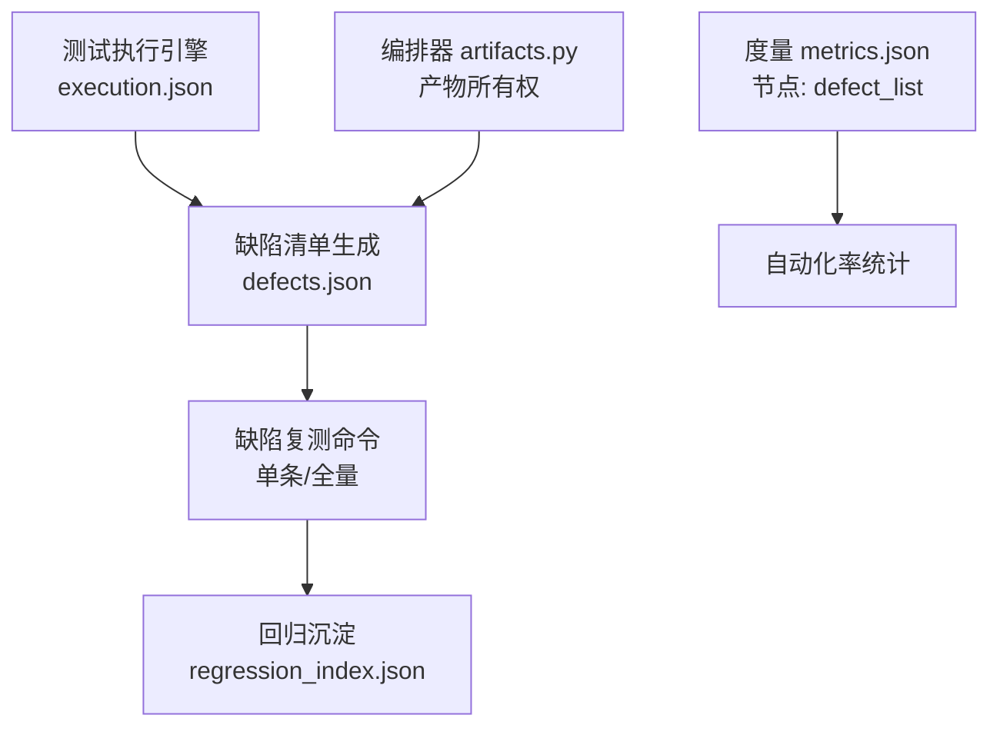
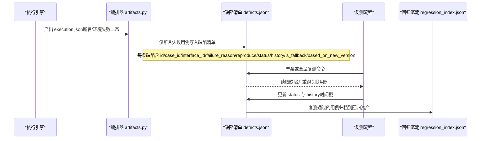
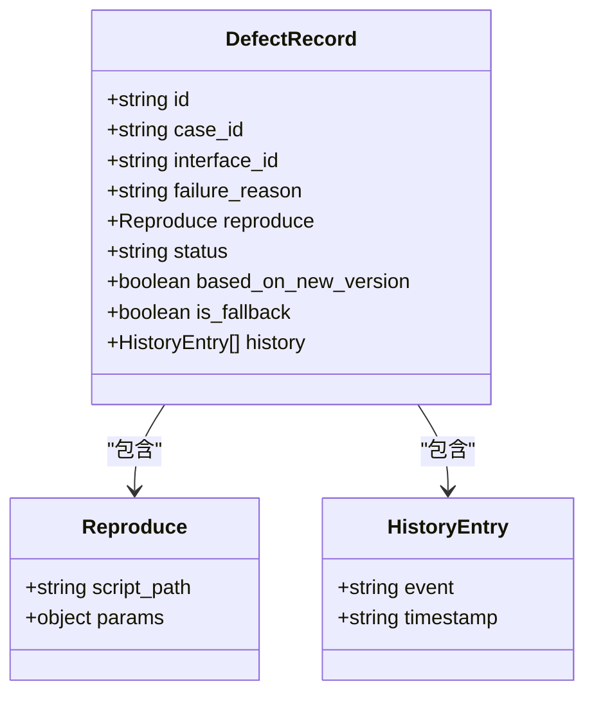
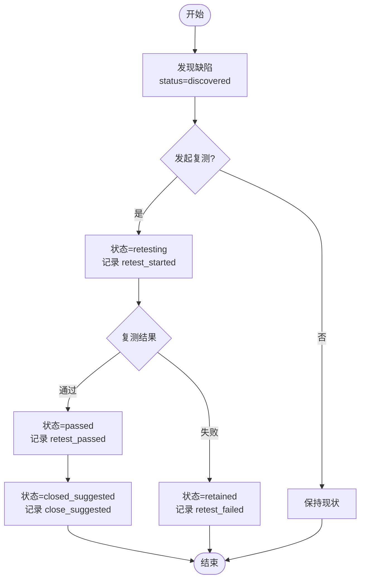
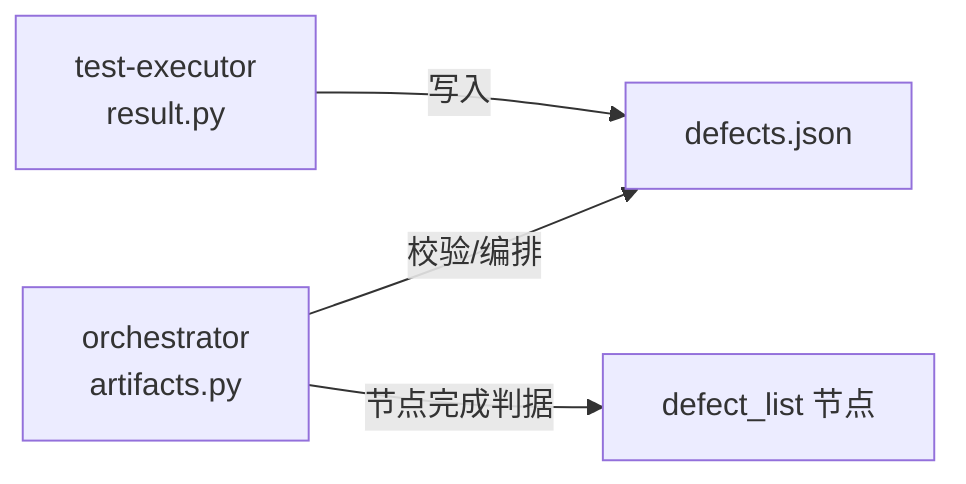

# 缺陷记录Schema

<cite>
**本文引用的文件**
- [schemas/defects.json](file://schemas/defects.json)
- [schemas/README.md](file://schemas/README.md)
- [docs/04_功能规格说明.md](file://docs/04_功能规格说明.md)
- [docs/07_UI演示设计.md](file://docs/07_UI演示设计.md)
- [docs/12_开发设计说明.md](file://docs/12_开发设计说明.md)
- [services/orchestrator/src/orchestrator/artifacts.py](file://services/orchestrator/src/orchestrator/artifacts.py)
- [services/test-executor/src/executor/result.py](file://services/test-executor/src/executor/result.py)
- [schemas/metrics.json](file://schemas/metrics.json)
</cite>

## 目录
1. [引言](#引言)
2. [项目结构](#项目结构)
3. [核心组件](#核心组件)
4. [架构总览](#架构总览)
5. [详细组件分析](#详细组件分析)
6. [依赖关系分析](#依赖关系分析)
7. [性能与可维护性考虑](#性能与可维护性考虑)
8. [故障排查指南](#故障排查指南)
9. [结论](#结论)
10. [附录：字段规范与示例路径](#附录字段规范与示例路径)

## 引言
本文件面向“本地缺陷记录”（模块 8 DEF）的 Schema 与工作机制，围绕 defects.json 的结构、缺陷生命周期、分类与度量、以及实际跟踪管理流程进行系统化说明。该 Schema 是自动化流水线中“断言失败 → 缺陷清单 → 复测 → 回归沉淀”闭环的核心数据契约，强调：
- 仅将“断言失败”用例纳入缺陷清单；“环境失败”隔离至待环境确认，不进入缺陷清单。
- 缺陷以本地 JSON 文件形式存在，不对接外部缺陷管理系统。
- 通过 schema_version、job_id、历史事件时间戳等实现版本化与可审计。

## 项目结构
缺陷相关的数据与流程分布在以下位置：
- Schema 定义：schemas/defects.json
- 编排与产物归属：services/orchestrator/src/orchestrator/artifacts.py
- 执行结果二态分离：services/test-executor/src/executor/result.py
- 功能规格与交互规则：docs/04_功能规格说明.md
- UI 演示中的缺陷闭环页面：docs/07_UI演示设计.md
- 节点完成判据与续跑策略：docs/12_开发设计说明.md
- 度量口径（含 defect_list 节点）：schemas/metrics.json

图表来源
- [schemas/defects.json:1-54](file://schemas/defects.json#L1-L54)
- [services/orchestrator/src/orchestrator/artifacts.py:32-49](file://services/orchestrator/src/orchestrator/artifacts.py#L32-L49)
- [schemas/metrics.json:21-40](file://schemas/metrics.json#L21-L40)

章节来源
- [schemas/defects.json:1-54](file://schemas/defects.json#L1-L54)
- [services/orchestrator/src/orchestrator/artifacts.py:32-49](file://services/orchestrator/src/orchestrator/artifacts.py#L32-L49)
- [schemas/metrics.json:21-40](file://schemas/metrics.json#L21-L40)

## 核心组件
- 顶层对象
  - schema_version：固定为 "1.0"，用于 Schema 版本控制。
  - job_id：以 "job-" 开头，标识一次运行任务。
  - defects：缺陷数组，每个元素代表一条缺陷记录。
- 缺陷记录字段
  - id：缺陷编号，格式为 DEF-001。
  - case_id：关联的用例编号，格式为 TC-001，与用例双向关联。
  - interface_id：关联的接口编号，格式为 IF-<协议>-001。
  - failure_reason：失败原因描述。
  - reproduce：复现步骤，包含 script_path（用例脚本引用）和可选 params。
  - status：缺陷状态枚举，见下文生命周期。
  - based_on_new_version：布尔值，标记复测时代码是否已变更。
  - is_fallback：布尔值，透传演示埋入缺陷的兜底标记。
  - history：事件时间线，记录状态流转及 UTC ISO-8601 时间戳。

章节来源
- [schemas/defects.json:1-54](file://schemas/defects.json#L1-L54)
- [schemas/README.md:5-10](file://schemas/README.md#L5-L10)

## 架构总览
缺陷清单由执行结果驱动，遵循“断言失败进缺陷清单，环境失败隔离”的规则；随后支持对缺陷发起复测，并根据复测结果更新状态与历史；最终通过回归沉淀形成资产索引。

图表来源
- [services/test-executor/src/executor/result.py:10-29](file://services/test-executor/src/executor/result.py#L10-L29)
- [services/orchestrator/src/orchestrator/artifacts.py:32-49](file://services/orchestrator/src/orchestrator/artifacts.py#L32-L49)
- [schemas/defects.json:10-49](file://schemas/defects.json#L10-L49)

章节来源
- [services/test-executor/src/executor/result.py:10-29](file://services/test-executor/src/executor/result.py#L10-L29)
- [services/orchestrator/src/orchestrator/artifacts.py:32-49](file://services/orchestrator/src/orchestrator/artifacts.py#L32-L49)
- [schemas/defects.json:10-49](file://schemas/defects.json#L10-L49)

## 详细组件分析

### 缺陷记录数据结构（defects.json）
- 顶层约束
  - required：schema_version、job_id、defects。
  - schema_version 固定为 "1.0"，确保向后兼容。
  - job_id 必须以 "job-" 开头，便于追踪单次运行。
- 缺陷项约束
  - required：id、case_id、interface_id、failure_reason、reproduce、status、history、is_fallback。
  - id：正则匹配 DEF-001 格式。
  - case_id：正则匹配 TC-001 格式，与用例双向关联。
  - interface_id：正则匹配 IF-<协议>-001 格式。
  - failure_reason：非空字符串。
  - reproduce：必须包含 script_path，params 为可选参数对象。
  - status：枚举 ["discovered", "retesting", "passed", "closed_suggested", "retained"]。
  - based_on_new_version：布尔值，标注复测时代码是否变更。
  - is_fallback：布尔值，透传演示分支的兜底标记。
  - history：事件数组，每项包含 event 与 timestamp（UTC ISO-8601）。

图表来源
- [schemas/defects.json:10-49](file://schemas/defects.json#L10-L49)

章节来源
- [schemas/defects.json:10-49](file://schemas/defects.json#L10-L49)

### 缺陷生命周期与工作流
- 状态枚举
  - discovered：发现缺陷。
  - retesting：复测中。
  - passed：复测通过。
  - closed_suggested：关闭建议。
  - retained：保留（仍失败）。
- 事件与时间戳
  - history 记录每次状态变化事件（如 discovered、retest_started、retest_passed、retest_failed、close_suggested、retained），附带 UTC ISO-8601 时间戳，形成可审计的生命周期。
- 工作流
  - 断言失败用例进入缺陷清单（R-DEF-01）。
  - 对缺陷发起复测（F-DEF-02），根据结果更新状态与历史（F-DEF-03）。
  - 复测通过 → 关闭建议；仍失败 → 保留。
  - 基于新版本复测时，标记 based_on_new_version。

图表来源
- [schemas/defects.json:30-48](file://schemas/defects.json#L30-L48)
- [docs/04_功能规格说明.md:235-258](file://docs/04_功能规格说明.md#L235-L258)

章节来源
- [schemas/defects.json:30-48](file://schemas/defects.json#L30-L48)
- [docs/04_功能规格说明.md:235-258](file://docs/04_功能规格说明.md#L235-L258)

### 缺陷分类、优先级评估与分配机制
- 分类依据
  - 仅“断言失败”进入缺陷清单；“环境失败”隔离至待环境确认，不入缺陷清单（R-DEF-01 / X-EXEC-01）。
- 优先级评估
  - 项目未定义缺陷级别（如 P0/P1/P2）字段；优先级由业务侧在评审与报告中决定，不在 Schema 内体现。
- 分配机制
  - 未定义分配字段；缺陷与用例、接口通过 ID 双向关联，便于定位责任方。
- 备注
  - 若需扩展优先级与分配，可在 Schema 新增字段并保持 schema_version 升级（遵循 schemas/README.md 约定）。

章节来源
- [schemas/defects.json:10-20](file://schemas/defects.json#L10-L20)
- [schemas/README.md:5-10](file://schemas/README.md#L5-L10)
- [docs/04_功能规格说明.md:247-258](file://docs/04_功能规格说明.md#L247-L258)

### 缺陷统计分析与质量度量
- 指标来源
  - 自动化率度量（metrics.json）包含 9 个节点的逐个状态，其中包含 "defect_list" 节点，用于衡量缺陷清单生成的自动化程度。
- 统计维度
  - 缺陷数量、状态分布、历史事件计数可用于趋势分析。
  - 结合 execution.json 的断言/环境失败二态，区分真实缺陷与环境问题。
- 注意事项
  - 项目口径 ≠ 生产口径；自动化率基于本地缺陷记录等节点定义，不得直接外推为生产预期（X-MTR-04）。

章节来源
- [schemas/metrics.json:21-40](file://schemas/metrics.json#L21-L40)
- [docs/04_功能规格说明.md:235-258](file://docs/04_功能规格说明.md#L235-L258)

### 缺陷跟踪与管理的实际示例
- 端到端流程
  - 执行阶段：执行引擎产出 execution.json，区分断言失败与环境失败。
  - 缺陷清单：仅断言失败用例写入 defects.json，包含用例脚本引用（reproduce.script_path）。
  - 复测阶段：对指定缺陷或全量缺陷发起复测，更新状态与历史。
  - 回归沉淀：复测通过的用例归档至回归资产索引。
- 界面展示
  - 缺陷闭环页展示缺陷 ↔ 用例双向关联、复现步骤引用、生命周期时间线。
  - 报告页 KPI 数值由 execution.json 程序化汇总，不经 LLM。

章节来源
- [services/test-executor/src/executor/result.py:10-29](file://services/test-executor/src/executor/result.py#L10-L29)
- [docs/07_UI演示设计.md:61-76](file://docs/07_UI演示设计.md#L61-L76)
- [docs/04_功能规格说明.md:235-258](file://docs/04_功能规格说明.md#L235-L258)

## 依赖关系分析
- 产物所有权
  - artifacts.py 明确 defects.json 由 test-executor 写入，orchestrator 负责编排与校验。
- 节点完成判据
  - 开发设计说明指出：节点完成的唯一判据是产物存在且通过对应 Schema 校验；defect_list 节点要求 defects.json 过校验。
- 执行结果二态
  - result.py 定义 FailureKind 与 CaseResult，确保通过用例不自带失败类型，保障缺陷清单准确性。

图表来源
- [services/orchestrator/src/orchestrator/artifacts.py:32-49](file://services/orchestrator/src/orchestrator/artifacts.py#L32-L49)
- [docs/12_开发设计说明.md:17-26](file://docs/12_开发设计说明.md#L17-L26)
- [services/test-executor/src/executor/result.py:10-29](file://services/test-executor/src/executor/result.py#L10-L29)

章节来源
- [services/orchestrator/src/orchestrator/artifacts.py:32-49](file://services/orchestrator/src/orchestrator/artifacts.py#L32-L49)
- [docs/12_开发设计说明.md:17-26](file://docs/12_开发设计说明.md#L17-L26)
- [services/test-executor/src/executor/result.py:10-29](file://services/test-executor/src/executor/result.py#L10-L29)

## 性能与可维护性考虑
- Schema 版本化
  - 所有结构化产物均含 schema_version，结构变更必须升版本，禁止原地改语义（schemas/README.md）。
- 产物校验
  - 节点完成以产物通过 Schema 校验为准，避免无效产物进入下游。
- 可扩展性
  - 如需新增字段（如优先级、分配人），应在 Schema 中新增属性并升级 schema_version，同时更新上下游处理逻辑。

章节来源
- [schemas/README.md:5-10](file://schemas/README.md#L5-L10)
- [docs/12_开发设计说明.md:17-26](file://docs/12_开发设计说明.md#L17-L26)

## 故障排查指南
- 常见错误
  - 环境失败误入缺陷清单：检查 execution.json 的 failure_kind 是否为 assertion。
  - 缺陷 ID 不符合规范：确保 id 符合 DEF-001 格式。
  - 复测历史缺失：确保每次状态变化都记录事件与时间戳。
- 定位方法
  - 查看 artifacts.py 中产物所有权与目录布局，确认 defects.json 由 test-executor 写入。
  - 使用 Schema 校验工具验证 defects.json 是否符合约束。
  - 结合 UI 缺陷闭环页的时间线与复测按钮，快速定位问题用例与接口。

章节来源
- [services/orchestrator/src/orchestrator/artifacts.py:32-49](file://services/orchestrator/src/orchestrator/artifacts.py#L32-L49)
- [schemas/defects.json:10-49](file://schemas/defects.json#L10-L49)
- [docs/07_UI演示设计.md:61-76](file://docs/07_UI演示设计.md#L61-L76)

## 结论
defects.json 作为本地缺陷记录的 Schema，提供了严格的字段约束与生命周期管理，支撑“断言失败 → 缺陷清单 → 复测 → 回归沉淀”的闭环。通过执行结果二态分离、产物校验与度量口径，系统实现了可审计、可扩展、可度量的缺陷跟踪能力。后续可按需在 Schema 中扩展优先级与分配字段，但应保持版本化与一致性。

## 附录：字段规范与示例路径
- 字段规范
  - id：DEF-001 格式。
  - case_id：TC-001 格式，与用例双向关联。
  - interface_id：IF-<协议>-001 格式。
  - failure_reason：非空字符串。
  - reproduce：必须包含 script_path，params 可选。
  - status：discovered / retesting / passed / closed_suggested / retained。
  - based_on_new_version：布尔值。
  - is_fallback：布尔值。
  - history：事件数组，event 与 timestamp（UTC ISO-8601）。
- 示例路径
  - 缺陷清单 Schema：[schemas/defects.json](file://schemas/defects.json)
  - 执行结果二态：[services/test-executor/src/executor/result.py](file://services/test-executor/src/executor/result.py)
  - 产物所有权：[services/orchestrator/src/orchestrator/artifacts.py](file://services/orchestrator/src/orchestrator/artifacts.py)
  - 功能规格（模块 8 缺陷闭环）：[docs/04_功能规格说明.md](file://docs/04_功能规格说明.md)
  - UI 缺陷闭环页：[docs/07_UI演示设计.md](file://docs/07_UI演示设计.md)
  - 度量节点（defect_list）：[schemas/metrics.json](file://schemas/metrics.json)