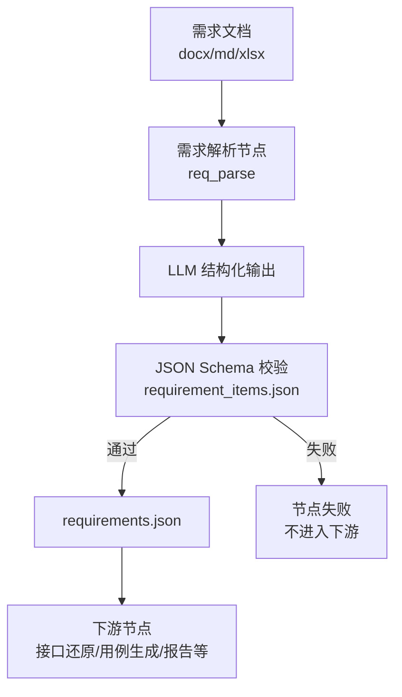
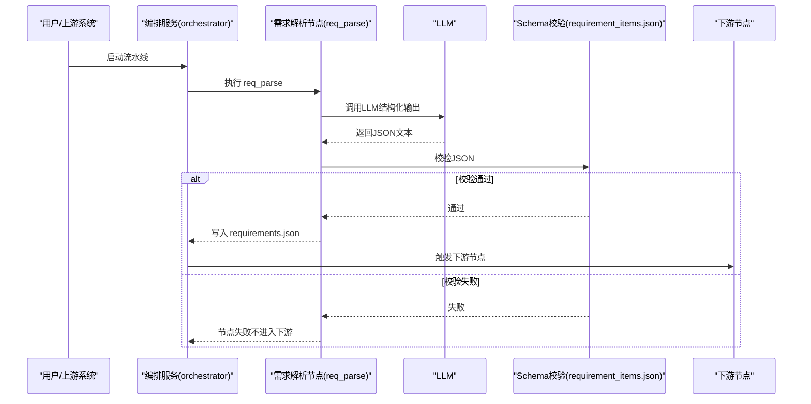
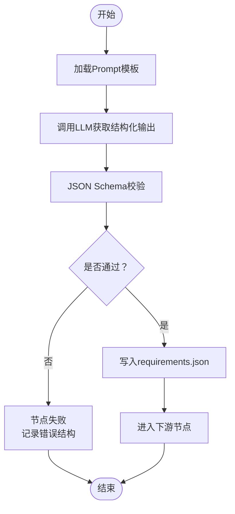
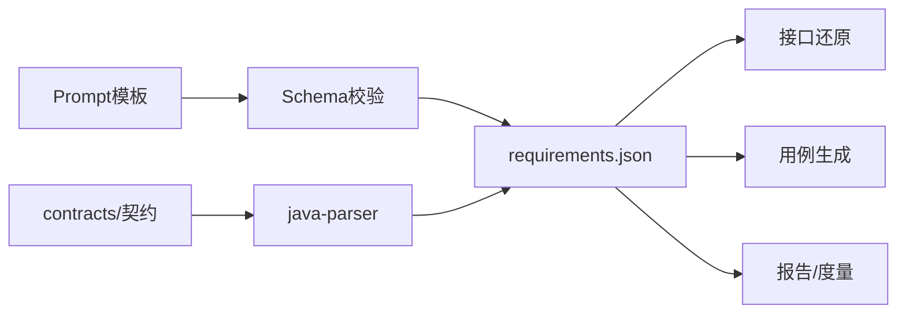

# 需求解析条目Schema

<cite>
**本文引用的文件**
- [requirement_items.json](file://schemas/requirement_items.json)
- [schemas/README.md](file://schemas/README.md)
- [04_功能规格说明.md](file://docs/04_功能规格说明.md)
- [prompts/README.md](file://prompts/README.md)
- [_template.md](file://prompts/_template.md)
- [pipeline.py](file://services/orchestrator/src/orchestrator/pipeline.py)
- [api.py](file://services/orchestrator/src/orchestrator/api.py)
- [python-code-style.md](file://.rules/python-code-style.md)
</cite>

## 目录
1. [简介](#简介)
2. [项目结构中的位置](#项目结构中的位置)
3. [核心字段定义与校验规则](#核心字段定义与校验规则)
4. [Schema版本管理与向后兼容](#schemaversion管理与向后兼容)
5. [在流水线中的作用与数据流](#在流水线中的作用与数据流)
6. [LLM输出校验：使用示例与最佳实践](#llm输出校验使用示例与最佳实践)
7. [依赖关系与集成点](#依赖关系与集成点)
8. [性能与可维护性建议](#性能与可维护性建议)
9. [故障排查指南](#故障排查指南)
10. [结论](#结论)

## 简介
本文件面向“需求解析（REQ）”产物的结构化数据模型，围绕 schemas/requirement_items.json 进行完整说明。该Schema用于约束LLM从Word/Markdown/Excel需求文档中抽取的结构化需求条目，确保后续Code Review、用例生成等下游节点能够稳定消费标准化输入。

## 项目结构中的位置
- Schema定义位于 schemas/requirement_items.json，是需求解析模块的单一事实来源。
- 与 prompts/ 下的Prompt模板形成“提示词→结构化输出→Schema校验”的闭环：Prompt要求LLM输出符合对应Schema，校验失败按节点失败处理，禁止截取可用部分。
- orchestrator 将需求解析作为流水线第一个节点（req_parse），其产物 requirements.json 由下游节点消费。

**图表来源**
- [pipeline.py:23-34](file://services/orchestrator/src/orchestrator/pipeline.py#L23-L34)
- [prompts/README.md:12-17](file://prompts/README.md#L12-L17)
- [requirement_items.json:1-44](file://schemas/requirement_items.json#L1-L44)

**章节来源**
- [pipeline.py:23-34](file://services/orchestrator/src/orchestrator/pipeline.py#L23-L34)
- [prompts/README.md:12-17](file://prompts/README.md#L12-L17)
- [requirement_items.json:1-44](file://schemas/requirement_items.json#L1-L44)

## 核心字段定义与校验规则
以下字段均来源于 schemas/requirement_items.json，并遵循横切约定（ID命名、时间戳格式、错误结构等）。

- schema_version
  - 类型：字符串；固定值 const = "1.0"
  - 业务含义：标识当前Schema版本，便于未来演进与兼容性控制
  - 校验规则：必须等于 "1.0"

- job_id
  - 类型：字符串；正则 pattern = "^job-"
  - 业务含义：本次解析任务的唯一标识，便于追踪与断点续跑
  - 校验规则：必须以 "job-" 开头

- source_file
  - 类型：字符串；描述包含来源文档路径与格式（docx/md/xlsx）
  - 业务含义：记录需求文档来源，便于溯源与问题定位
  - 校验规则：无额外格式限制，但需体现来源信息

- items（数组）
  - 类型：对象数组；至少包含1项（minItems=1）
  - 业务含义：每条需求条目为一次抽取结果，供下游复用
  - 校验规则：每项必须满足子对象约束

  - id
    - 类型：字符串；正则 pattern = "^REQ-\\d{3}$"
    - 业务含义：需求ID，全局唯一、跨格式稳定，用于映射表与用例溯源
    - 校验规则：必须匹配 REQ-XXX 三位数字编号

  - title
    - 类型：字符串；最小长度 minLength=1
    - 业务含义：需求标题，便于展示与检索
    - 校验规则：非空字符串

  - description
    - 类型：字符串；描述为“功能点结构化描述”
    - 业务含义：对需求条目的结构化说明，供用例生成与Review参考
    - 校验规则：无额外格式限制，但应具可读性与结构性

  - priority
    - 类型：字符串；枚举 ["P0", "P1", "P2"]
    - 业务含义：优先级标记，影响排期与验收策略
    - 校验规则：仅允许 P0/P1/P2

  - source_location（可选）
    - 类型：对象；描述“文档内溯源（章节号/表格坐标）”
    - 属性：
      - section：字符串
      - line：整数，最小值为1
    - 业务含义：定位原始需求文档中的出处，便于人工复核与审计
    - 校验规则：line >= 1

  - golden_match（可选）
    - 类型：对象；描述“G2 比对结果：预置 golden 基准，非现场人工判断”
    - 必填：matched
    - 属性：
      - matched：布尔值
      - golden_id：字符串，pattern = "^REQ-\\d{3}$"
    - 业务含义：与预置golden基准比对的结果，用于自动化验收（AC1）
    - 校验规则：golden_id 必须匹配 REQ-XXX 格式

注意：
- 横切约定要求ID命名统一为 REQ-001 形式；时间戳使用UTC ISO-8601；错误结构为 {code, message, node_id?, details}。
- 若需要复杂度评估或关联代码模块等扩展字段，应在未来Schema版本中以新增字段方式引入，并通过schema_version管理兼容性。

**章节来源**
- [requirement_items.json:1-44](file://schemas/requirement_items.json#L1-L44)
- [schemas/README.md:5-10](file://schemas/README.md#L5-L10)
- [04_功能规格说明.md:48-53](file://docs/04_功能规格说明.md#L48-L53)

## Schema版本管理与向后兼容
- 每个Schema定义含 schema_version 字段；结构变更必须升版本，禁止原地改语义。
- 当前 requirement_items.json 的 schema_version 固定为 "1.0"。
- 向后兼容策略：
  - 新增可选字段：保持旧版消费者可忽略新字段，不影响既有流程。
  - 修改必填字段或枚举值：必须升级 schema_version，并在上游（Prompt与校验器）同步更新。
  - 删除或重命名字段：视为破坏性变更，需升级版本并迁移历史产物。
- 断点续跑采用固定Schema，不引入版本号比对机制：产物Schema校验不通过则拒绝复用，强制重跑该节点。

**章节来源**
- [schemas/README.md:5-10](file://schemas/README.md#L5-L10)
- [04_功能规格说明.md:27-31](file://docs/04_功能规格说明.md#L27-L31)
- [requirement_items.json:1-10](file://schemas/requirement_items.json#L1-L10)

## 在流水线中的作用与数据流
- 需求解析节点（req_parse）是流水线第一个节点，负责将多格式需求文档解析为结构化条目 JSON。
- 产出 requirements.json 由下游节点（接口还原、用例生成、报告等）消费。
- Prompt模板要求LLM输出必须符合对应Schema；校验失败按节点失败处理，禁止截取可用部分。
- 编排服务提供健康检查与节点清单API，便于外部监控与集成。

**图表来源**
- [pipeline.py:23-34](file://services/orchestrator/src/orchestrator/pipeline.py#L23-L34)
- [prompts/README.md:12-17](file://prompts/README.md#L12-L17)
- [api.py:16-25](file://services/orchestrator/src/orchestrator/api.py#L16-L25)

**章节来源**
- [pipeline.py:23-34](file://services/orchestrator/src/orchestrator/pipeline.py#L23-L34)
- [api.py:16-25](file://services/orchestrator/src/orchestrator/api.py#L16-L25)
- [prompts/README.md:12-17](file://prompts/README.md#L12-L17)

## LLM输出校验：使用示例与最佳实践
- 使用示例
  - 在Prompt模板中明确声明：LLM输出须符合 schemas/<对应schema>.json，校验失败按节点失败处理，禁止截取可用部分。
  - 在编排层加载对应Schema并进行JSON Schema校验；校验失败时记录错误（遵循横切错误结构），并终止后续节点。
- 最佳实践
  - 严格遵循横切约定：ID命名 REQ-001；时间戳UTC ISO-8601；协议枚举小写；is_fallback全链路透传。
  - 边界输入先验证、规范化，再进入业务逻辑；LLM输出属于边界输入，必须通过Schema校验。
  - 避免降级为“截取可用部分”，保证数据一致性与可追溯性。
  - 对文件和网络资源使用上下文管理器；结构化产物按任务ID分目录写入，路径统一经编排管理。

**图表来源**
- [_template.md:15-17](file://prompts/_template.md#L15-L17)
- [python-code-style.md:29-36](file://.rules/python-code-style.md#L29-L36)
- [requirement_items.json:1-44](file://schemas/requirement_items.json#L1-L44)

**章节来源**
- [_template.md:15-17](file://prompts/_template.md#L15-L17)
- [python-code-style.md:29-36](file://.rules/python-code-style.md#L29-L36)
- [requirement_items.json:1-44](file://schemas/requirement_items.json#L1-L44)

## 依赖关系与集成点
- 与Prompt模板的耦合：Prompt明确要求LLM输出符合对应Schema，校验失败按节点失败处理。
- 与编排服务的耦合：orchestrator 将需求解析作为首个节点，产物requirements.json被下游消费。
- 与契约对齐：Schema是数据模型的单一事实来源；java-parser返回结构与contracts/契约对齐。
- 与测试与度量：Golden基准用于AC1自动化验收；断点续跑拒绝Schema不通过的产物复用。

**图表来源**
- [schemas/README.md:5-10](file://schemas/README.md#L5-L10)
- [prompts/README.md:12-17](file://prompts/README.md#L12-L17)
- [pipeline.py:23-34](file://services/orchestrator/src/orchestrator/pipeline.py#L23-L34)

**章节来源**
- [schemas/README.md:5-10](file://schemas/README.md#L5-L10)
- [prompts/README.md:12-17](file://prompts/README.md#L12-L17)
- [pipeline.py:23-34](file://services/orchestrator/src/orchestrator/pipeline.py#L23-L34)

## 性能与可维护性建议
- 校验前置：尽早进行Schema校验，减少无效下游计算。
- 增量校验：对items数组逐项校验，快速定位错误条目。
- 缓存与复用：对于相同job_id与source_file的产物，可在Schema校验通过后复用，避免重复LLM调用。
- 日志与度量：记录每次LLM调用的输入摘要、输出摘要、耗时与token数，支撑半自动采集口径。
- 可维护性：Schema变更必须升版本；新增字段优先采用可选字段，保持向后兼容。

[本节为通用指导，无需具体文件引用]

## 故障排查指南
- 常见错误
  - ID格式不符：id未匹配 REQ-XXX，需修正编号格式。
  - 优先级非法：priority不在枚举范围内，需改为 P0/P1/P2。
  - 缺失必填字段：缺少 id/title/description 或 schema_version/job_id/items。
  - 源位置行号无效：source_location.line < 1。
  - Golden基准比对失败：golden_match.matched 为 false，需核对golden_id与期望条目。
- 处理策略
  - 校验失败按节点失败处理，不进入下游；记录错误结构 {code, message, node_id?, details}。
  - 断点续跑：产物Schema校验不通过则拒绝复用，强制重跑该节点。
  - 定位问题：结合 source_location 与 golden_match 回溯原始文档与基准。

**章节来源**
- [requirement_items.json:1-44](file://schemas/requirement_items.json#L1-L44)
- [04_功能规格说明.md:27-31](file://docs/04_功能规格说明.md#L27-L31)
- [schemas/README.md:5-10](file://schemas/README.md#L5-L10)

## 结论
requirement_items.json 为需求解析模块的核心数据契约，定义了需求条目的结构化字段、校验规则与版本管理策略。通过与Prompt模板和编排流水线的紧密集成，确保LLM输出的稳定性与可追溯性。建议在后续迭代中继续遵循“Schema为单一事实来源”的原则，以可扩展、向后兼容的方式演进数据结构。