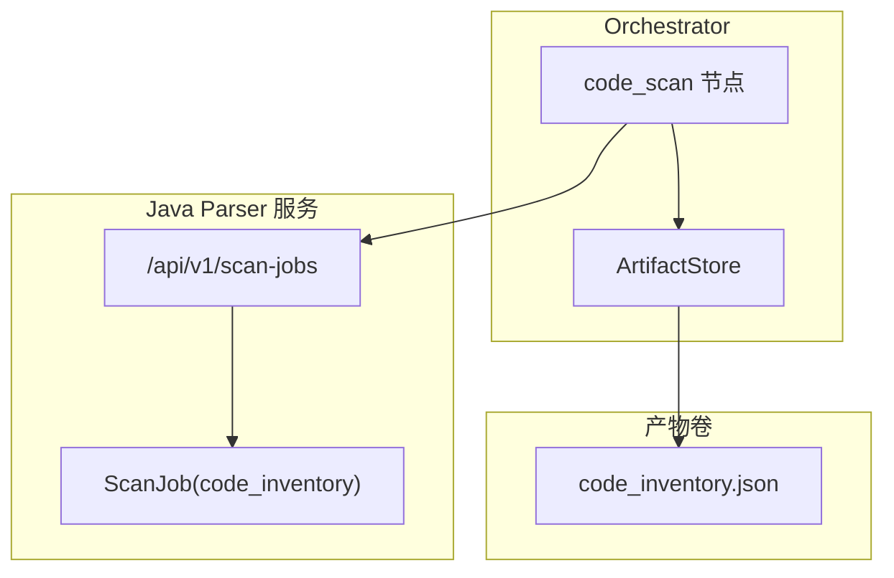
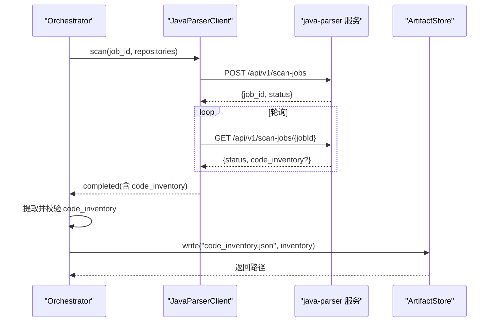
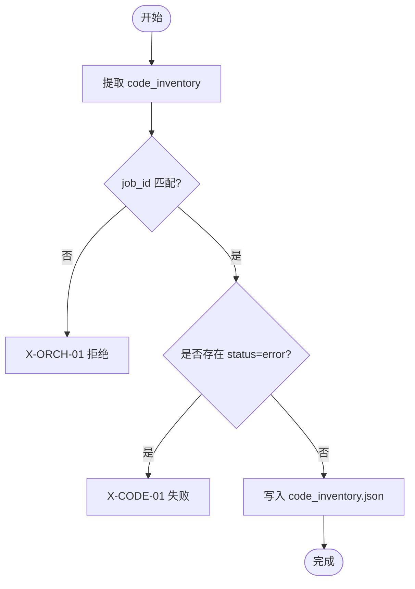
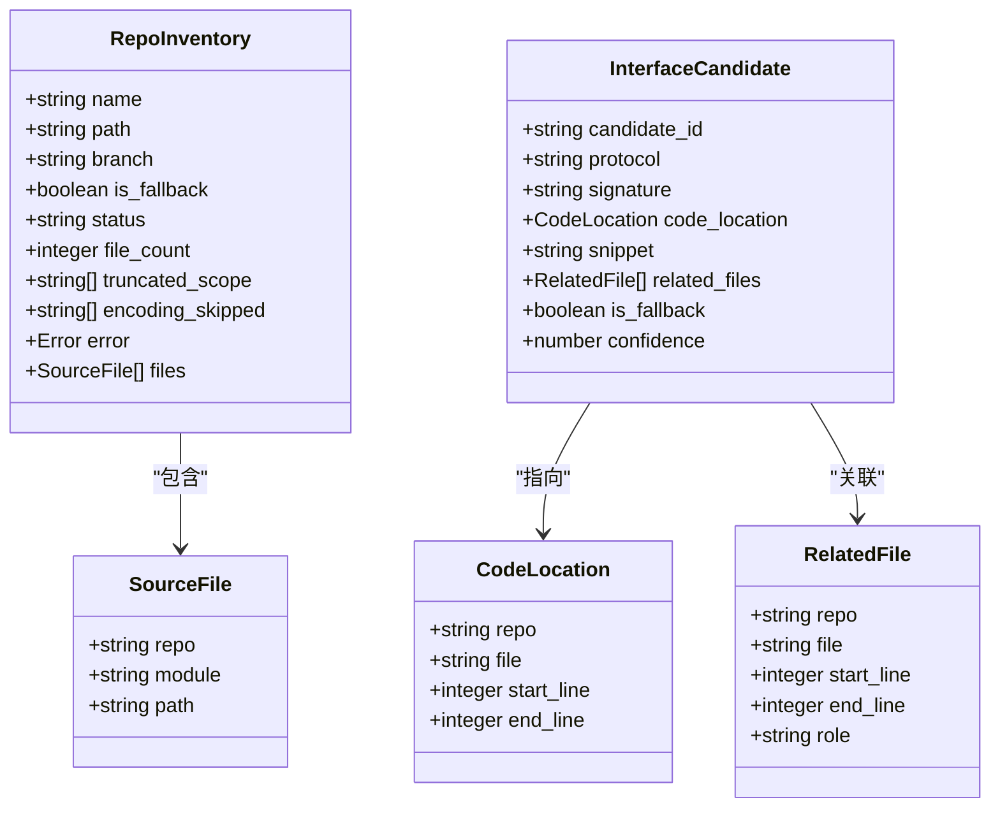
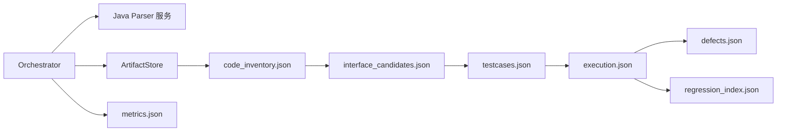

# 代码数据模型

<cite>
**本文引用的文件**
- [schemas/code_inventory.json](file://schemas/code_inventory.json)
- [schemas/contracts/java-parser.openapi.yaml](file://schemas/contracts/java-parser.openapi.yaml)
- [services/orchestrator/src/orchestrator/nodes/code_scan.py](file://services/orchestrator/src/orchestrator/nodes/code_scan.py)
- [services/orchestrator/src/orchestrator/javaparser_client.py](file://services/orchestrator/src/orchestrator/javaparser_client.py)
- [services/orchestrator/src/orchestrator/artifacts.py](file://services/orchestrator/src/orchestrator/artifacts.py)
- [schemas/metrics.json](file://schemas/metrics.json)
- [schemas/testcases.json](file://schemas/testcases.json)
- [schemas/regression_index.json](file://schemas/regression_index.json)
- [schemas/defects.json](file://schemas/defects.json)
</cite>

## 目录
1. [简介](#简介)
2. [项目结构](#项目结构)
3. [核心组件](#核心组件)
4. [架构总览](#架构总览)
5. [详细组件分析](#详细组件分析)
6. [依赖关系分析](#依赖关系分析)
7. [性能与索引优化](#性能与索引优化)
8. [故障排查指南](#故障排查指南)
9. [结论](#结论)
10. [附录：JSON 示例与字段说明](#附录json-示例与字段说明)

## 简介
本文件聚焦 LLM-AutoTest 的“代码数据模型”，围绕 CodeInventory（源码扫描清单）展开，系统阐述其数据结构、仓库扫描结果组织方式、类与方法元数据的承载位置、层次与依赖关系建模思路、质量指标的计算口径，以及多仓库扫描结果的合并策略与冲突处理机制。同时给出基于 Schema 的完整 JSON 结构指引，并讨论索引与查询性能考量。

## 项目结构
- 数据契约与产物 Schema 集中在 schemas/ 目录，其中 code_inventory.json 定义源码扫描清单的结构；java-parser.openapi.yaml 定义 Java 解析服务接口契约，明确 ScanJob 响应中的 code_inventory 结构与字段语义。
- Orchestrator 负责编排流水线节点，code_scan 节点调用 java-parser 完成多仓库扫描，并将 code_inventory.json 落盘到产物卷，由 ArtifactStore 进行写权校验与 Schema 校验。
- 其他相关产物（如 metrics、testcases、regression_index、defects）与 code_inventory 形成上下游关联，用于后续接口还原、测试生成、执行与度量汇总。

图表来源
- [services/orchestrator/src/orchestrator/nodes/code_scan.py:26-49](file://services/orchestrator/src/orchestrator/nodes/code_scan.py#L26-L49)
- [services/orchestrator/src/orchestrator/javaparser_client.py:70-80](file://services/orchestrator/src/orchestrator/javaparser_client.py#L70-L80)
- [schemas/contracts/java-parser.openapi.yaml:254-273](file://schemas/contracts/java-parser.openapi.yaml#L254-L273)
- [services/orchestrator/src/orchestrator/artifacts.py:75-96](file://services/orchestrator/src/orchestrator/artifacts.py#L75-L96)

章节来源
- [schemas/code_inventory.json:1-57](file://schemas/code_inventory.json#L1-L57)
- [schemas/contracts/java-parser.openapi.yaml:254-273](file://schemas/contracts/java-parser.openapi.yaml#L254-L273)
- [services/orchestrator/src/orchestrator/nodes/code_scan.py:26-94](file://services/orchestrator/src/orchestrator/nodes/code_scan.py#L26-L94)
- [services/orchestrator/src/orchestrator/artifacts.py:24-50](file://services/orchestrator/src/orchestrator/artifacts.py#L24-L50)

## 核心组件
- CodeInventory（源码扫描清单）
  - 顶层字段：schema_version、job_id、repositories
  - repositories：数组，每个元素为 RepoInventory，包含 name、path、branch、is_fallback、status、file_count、truncated_scope、encoding_skipped、error、files
  - files：SourceFile 数组，包含 repo、module、path
- Java Parser 客户端
  - 创建扫描任务并轮询至 completed/failed，将契约错误透传为 PipelineError
- code_scan 节点
  - 提取 code_inventory，强制 job_id 归属校验，检查仓库级 error 状态，写入产物
- ArtifactStore
  - 产物落盘前进行 Schema 校验与写权排他校验，原子写入，提供 is_node_completed 判据

章节来源
- [schemas/code_inventory.json:1-57](file://schemas/code_inventory.json#L1-L57)
- [schemas/contracts/java-parser.openapi.yaml:207-253](file://schemas/contracts/java-parser.openapi.yaml#L207-L253)
- [services/orchestrator/src/orchestrator/javaparser_client.py:28-80](file://services/orchestrator/src/orchestrator/javaparser_client.py#L28-L80)
- [services/orchestrator/src/orchestrator/nodes/code_scan.py:52-94](file://services/orchestrator/src/orchestrator/nodes/code_scan.py#L52-L94)
- [services/orchestrator/src/orchestrator/artifacts.py:75-131](file://services/orchestrator/src/orchestrator/artifacts.py#L75-L131)

## 架构总览
CodeInventory 是代码扫描阶段的产物，承载多仓库扫描结果与文件清单。Orchestrator 通过 code_scan 节点调用 Java Parser 服务，获取 ScanJob 响应中的 code_inventory，并进行归属校验与仓库错误检查后落盘。后续节点可基于该清单进行接口候选提取、测试用例生成与执行等。

图表来源
- [services/orchestrator/src/orchestrator/javaparser_client.py:70-121](file://services/orchestrator/src/orchestrator/javaparser_client.py#L70-L121)
- [schemas/contracts/java-parser.openapi.yaml:24-70](file://schemas/contracts/java-parser.openapi.yaml#L24-L70)
- [services/orchestrator/src/orchestrator/nodes/code_scan.py:38-49](file://services/orchestrator/src/orchestrator/nodes/code_scan.py#L38-L49)
- [services/orchestrator/src/orchestrator/artifacts.py:75-96](file://services/orchestrator/src/orchestrator/artifacts.py#L75-L96)

## 详细组件分析

### CodeInventory 数据结构
- schema_version：固定字符串，标识 Schema 版本
- job_id：以 job- 开头的任务 ID，用于产物归属与归档
- repositories：仓库扫描结果数组，至少两项（G3：≥2 个仓库）
  - name：仓库显示名
  - path：已检出正确分支的本地路径
  - branch：分支名
  - is_fallback：是否兜底演示仓库（结果单独标注、不计入 G3）
  - status：四态枚举
    - ok：正常
    - empty：无可分析内容（流程继续）
    - truncated：超大仓库按 include_paths 截断（记录 truncated_scope）
    - error：硬错误（X-CODE-01），节点失败
  - file_count：扫描到的文件数
  - truncated_scope：截断后的实际扫描目录列表
  - encoding_skipped：异常编码跳过文件列表
  - error：错误对象（code、message、details）
  - files：SourceFile 数组（repo、module、path）

章节来源
- [schemas/code_inventory.json:6-54](file://schemas/code_inventory.json#L6-L54)
- [schemas/contracts/java-parser.openapi.yaml:199-253](file://schemas/contracts/java-parser.openapi.yaml#L199-L253)

### 仓库扫描流程与错误处理
- code_scan 节点在收到 ScanJob 响应后：
  - 提取 code_inventory，强制 job_id 归属一致
  - 检查任一仓库 status=error，则抛出 X-CODE-01 失败
  - 将 code_inventory 写入 artifacts，Schema 校验通过后标记节点完成

图表来源
- [services/orchestrator/src/orchestrator/nodes/code_scan.py:52-94](file://services/orchestrator/src/orchestrator/nodes/code_scan.py#L52-L94)

章节来源
- [services/orchestrator/src/orchestrator/nodes/code_scan.py:52-94](file://services/orchestrator/src/orchestrator/nodes/code_scan.py#L52-L94)

### 多仓库扫描结果合并策略与冲突处理
- 合并策略
  - repositories 数组直接拼接各仓库扫描结果，保持仓库边界清晰
  - 对每个仓库独立记录 status、file_count、truncated_scope、encoding_skipped、error
  - files 数组仅包含仓库内相对路径与模块信息，不跨仓库合并
- 冲突处理
  - 若任一仓库 status=error，整体节点失败（X-CODE-01），上游需根据错误码定位问题
  - empty/truncated 为正常态，如实落盘，流程继续
  - 兜底仓库（is_fallback=true）结果单独标注，不计入 G3 达成

章节来源
- [schemas/code_inventory.json:10-54](file://schemas/code_inventory.json#L10-L54)
- [schemas/contracts/java-parser.openapi.yaml:162-198](file://schemas/contracts/java-parser.openapi.yaml#L162-L198)
- [services/orchestrator/src/orchestrator/nodes/code_scan.py:78-94](file://services/orchestrator/src/orchestrator/nodes/code_scan.py#L78-L94)

### 代码实体层次关系与依赖关系分析
- 当前 CodeInventory 主要承载仓库与文件清单（repo/module/path），未直接包含类与方法元数据
- 接口候选提取阶段（extract-jobs）会基于 code_inventory 的源文件内容做静态特征定位，产出 InterfaceCandidate，包含协议、签名、代码位置、片段和相关文件角色（controller/service/dto/proto/wsdl/listener/other）
- 依赖关系可通过 RelatedFile 与 CodeLocation 建立 Controller → Service → DTO 的直接关联文件链，供后续 LLM 语义解析使用

图表来源
- [schemas/contracts/java-parser.openapi.yaml:242-351](file://schemas/contracts/java-parser.openapi.yaml#L242-L351)

章节来源
- [schemas/contracts/java-parser.openapi.yaml:242-351](file://schemas/contracts/java-parser.openapi.yaml#L242-L351)

### 代码质量指标计算方式
- 自动化率度量（metrics.json）
  - automation_rate.value = 无人工节点数 / 9（分母固定为 9，不因降级缩减）
  - data_complete 表示数据完整性，不完整时 value 为 null
  - nodes 数组记录 9 个节点的状态与降级原因
- 与 CodeInventory 的关系
  - code_scan 节点状态直接影响自动化率分子计数
  - 若 code_scan 降级为人工介入，仍计入分母，但分子不增加

章节来源
- [schemas/metrics.json:6-48](file://schemas/metrics.json#L6-L48)
- [services/orchestrator/src/orchestrator/nodes/code_scan.py:1-9](file://services/orchestrator/src/orchestrator/nodes/code_scan.py#L1-L9)

## 依赖关系分析
- Orchestrator 依赖 java-parser 服务提供扫描能力
- code_scan 节点依赖 ArtifactStore 进行产物落盘与校验
- CodeInventory 作为下游接口候选提取、测试生成、执行与度量的基础数据

图表来源
- [services/orchestrator/src/orchestrator/artifacts.py:24-50](file://services/orchestrator/src/orchestrator/artifacts.py#L24-L50)
- [schemas/contracts/java-parser.openapi.yaml:24-115](file://schemas/contracts/java-parser.openapi.yaml#L24-L115)

章节来源
- [services/orchestrator/src/orchestrator/artifacts.py:24-50](file://services/orchestrator/src/orchestrator/artifacts.py#L24-L50)
- [schemas/contracts/java-parser.openapi.yaml:24-115](file://schemas/contracts/java-parser.openapi.yaml#L24-L115)

## 性能与索引优化
- 扫描范围控制
  - 超大仓库通过 include_paths 指定核心模块目录，减少扫描范围，提升性能（X-CODE-03）
  - truncated_scope 记录实际扫描范围，便于回溯与审计
- 产物校验与落盘
  - ArtifactStore 在写入前进行 Schema 校验，避免无效数据进入下游
  - 原子写入（tmp + replace）保证一致性
- 查询性能建议
  - 基于 repository.name、branch、status、file_count 建立索引，支持快速筛选
  - 对 files.path 建立前缀索引，支持按模块或包路径检索
  - 对 interface_candidates.code_location.repo/file/start_line/end_line 建立复合索引，支持代码溯源查询
  - 对 testcases.interface_id、regression_index.suites.protocol 建立索引，支持用例与回归套件快速聚合

[本节为通用性能建议，不直接分析具体文件]

## 故障排查指南
- 通信失败（X-ORCH-03）
  - 现象：java-parser 不可达、超时、HTTP 异常、轮询耗尽
  - 处理：检查网络与服务健康，调整 poll_interval_s 与 max_wait_s
- 产物缺失（X-ORCH-01）
  - 现象：响应缺 code_inventory 或 job_id 不匹配
  - 处理：确认 java-parser 输出符合契约，确保 job_id 传递一致
- 仓库硬错误（X-CODE-01）
  - 现象：任一仓库 status=error
  - 处理：根据 error.code/message/details 定位路径、分支或权限问题
- 写权冲突（X-ORCH-01）
  - 现象：非所属服务尝试写入产物
  - 处理：确认服务与产物所有权映射，避免越权写入

章节来源
- [services/orchestrator/src/orchestrator/javaparser_client.py:123-161](file://services/orchestrator/src/orchestrator/javaparser_client.py#L123-L161)
- [services/orchestrator/src/orchestrator/nodes/code_scan.py:52-94](file://services/orchestrator/src/orchestrator/nodes/code_scan.py#L52-L94)
- [services/orchestrator/src/orchestrator/artifacts.py:144-157](file://services/orchestrator/src/orchestrator/artifacts.py#L144-L157)

## 结论
CodeInventory 作为代码扫描阶段的核心产物，提供了多仓库扫描结果与文件清单，支撑后续的接口候选提取、测试生成与执行。通过明确的 Schema 与契约，系统实现了严格的产物校验与错误透传，保障了数据一致性与可追溯性。结合 include_paths 与 truncated_scope，系统在大规模仓库场景下具备可扩展性。配合合理的索引策略，可有效提升查询与聚合性能。

[本节为总结性内容，不直接分析具体文件]

## 附录：JSON 示例与字段说明
以下为基于 Schema 的完整结构指引（不含具体值，仅展示字段层级与约束）：

- code_inventory.json
  - schema_version: 固定字符串
  - job_id: 以 job- 开头
  - repositories: 数组，每项包含 name、path、branch、is_fallback、status、file_count、truncated_scope、encoding_skipped、error、files
  - files: 数组，每项包含 repo、module、path

- 接口候选（extract-jobs 产物）
  - candidates: 数组，每项包含 candidate_id、protocol、signature、code_location、snippet、related_files、is_fallback、confidence
  - warnings: 字符串数组

- 测试用例（testcases.json）
  - cases: 数组，每项包含 id、interface_id、requirement_id、category、title、params、expected、script_path、loadable、low_confidence

- 回归资产索引（regression_index.json）
  - suites: 数组，每项包含 protocol、scripts
  - scripts: 数组，每项包含 case_id、script_path、requirement_id、interface_id、archived_at、version
  - drift_warnings: 数组，每项包含 case_id、detail

- 缺陷记录（defects.json）
  - defects: 数组，每项包含 id、case_id、interface_id、failure_reason、reproduce、status、history、is_fallback

章节来源
- [schemas/code_inventory.json:1-57](file://schemas/code_inventory.json#L1-L57)
- [schemas/contracts/java-parser.openapi.yaml:274-369](file://schemas/contracts/java-parser.openapi.yaml#L274-L369)
- [schemas/testcases.json:1-35](file://schemas/testcases.json#L1-L35)
- [schemas/regression_index.json:1-50](file://schemas/regression_index.json#L1-L50)
- [schemas/defects.json:1-27](file://schemas/defects.json#L1-L27)