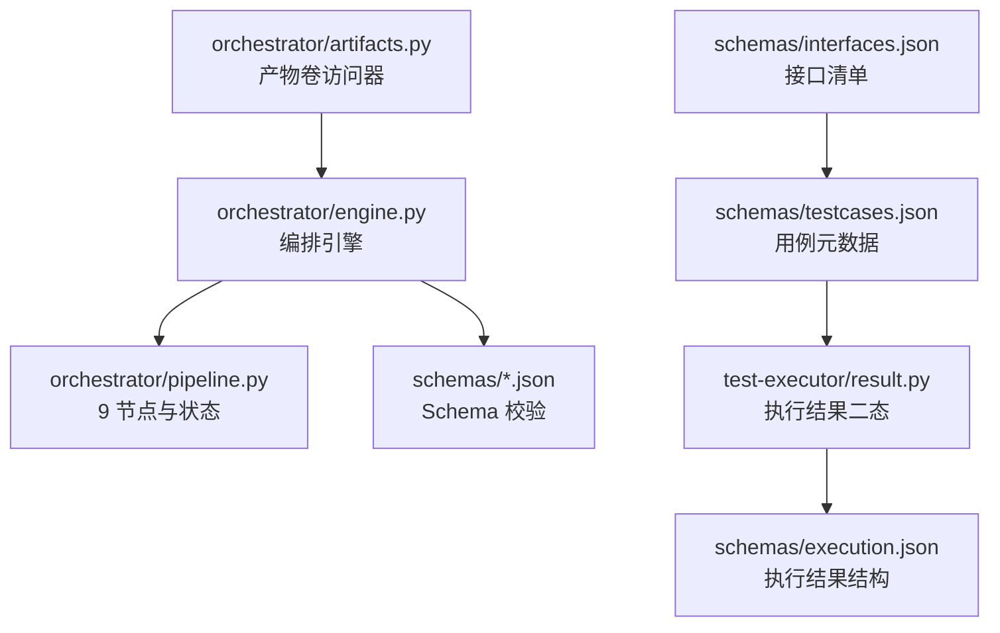
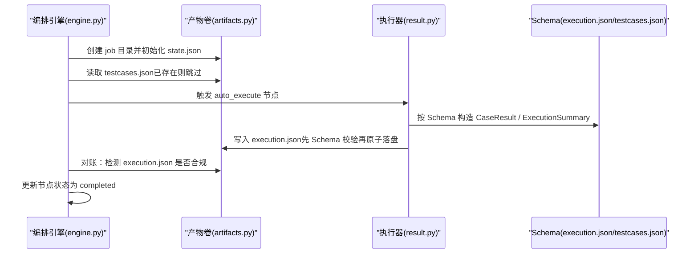
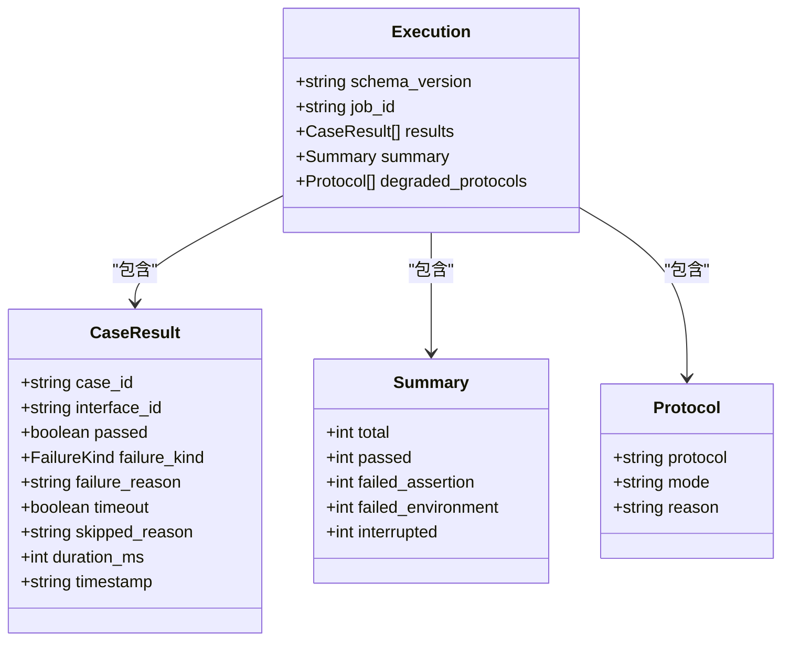
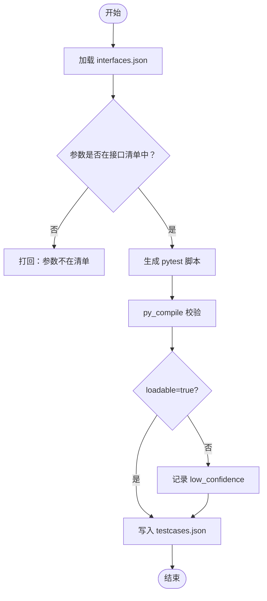
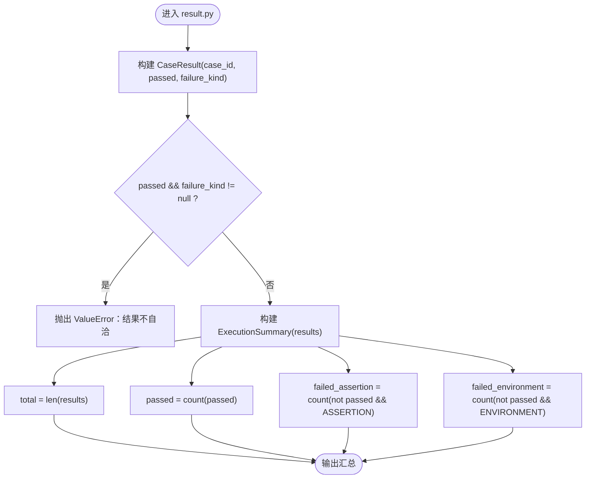
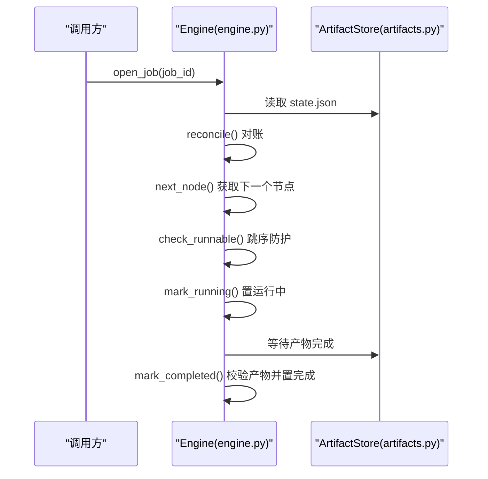
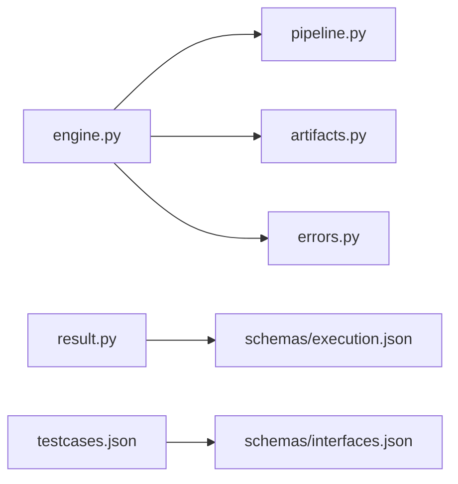

# 执行数据模型

<cite>
**本文引用的文件**
- [execution.json](file://schemas/execution.json)
- [testcases.json](file://schemas/testcases.json)
- [execution.sample.json](file://schemas/samples/execution.sample.json)
- [interfaces.json](file://schemas/interfaces.json)
- [result.py](file://services/test-executor/src/executor/result.py)
- [engine.py](file://services/orchestrator/src/orchestrator/engine.py)
- [pipeline.py](file://services/orchestrator/src/orchestrator/pipeline.py)
- [artifacts.py](file://services/orchestrator/src/orchestrator/artifacts.py)
- [errors.py](file://services/orchestrator/src/orchestrator/errors.py)
- [10-数据模型与存储规格.md](file://MumuSpec/10-数据模型与存储规格.md)
- [04_功能规格说明.md](file://docs/04_功能规格说明.md)
</cite>

## 目录
1. [引言](#引言)
2. [项目结构](#项目结构)
3. [核心组件](#核心组件)
4. [架构总览](#架构总览)
5. [详细组件分析](#详细组件分析)
6. [依赖关系分析](#依赖关系分析)
7. [性能考量](#性能考量)
8. [故障排查指南](#故障排查指南)
9. [结论](#结论)
10. [附录：JSON 示例与字段说明](#附录json-示例与字段说明)

## 引言
本文件聚焦 LLM-AutoTest 的“执行数据模型”，围绕测试执行（Execution）与测试用例（TestCase）的数据结构、状态管理、结果收集、断言验证、错误处理、生命周期与环境配置、并发控制、超时与重试、持久化策略与性能优化进行系统化说明。文档以 schemas 中的 JSON Schema 为真源，结合 orchestrator 与 test-executor 的实现骨架，给出可落地的实现建议与可视化图示。

## 项目结构
- 产物与 Schema
  - schemas/execution.json：定义 execution.json 的结构与约束（用例结果、汇总、降级协议等）。
  - schemas/testcases.json：定义 testcases.json 的结构与约束（用例元数据、脚本路径、置信度等）。
  - schemas/interfaces.json：接口还原清单，作为用例参数来源与溯源依据。
  - schemas/samples/execution.sample.json：执行结果的样例，便于理解字段含义与取值范围。
- 编排与持久化
  - orchestrator/artifacts.py：产物卷访问器，负责目录布局、写权排他、Schema 校验、节点完成判据。
  - orchestrator/engine.py：流水线编排引擎，state.json 持久化、断点续跑、跳序防护、降级清单。
  - orchestrator/pipeline.py：9 节点固定顺序与四态标注（completed/manual_intervention/running/pending）。
  - orchestrator/errors.py：统一错误结构与错误码。
- 执行侧
  - test-executor/result.py：执行结果判定骨架，区分“断言失败”和“环境失败”。

图表来源
- [artifacts.py:1-157](file://services/orchestrator/src/orchestrator/artifacts.py#L1-L157)
- [engine.py:1-302](file://services/orchestrator/src/orchestrator/engine.py#L1-L302)
- [pipeline.py:1-84](file://services/orchestrator/src/orchestrator/pipeline.py#L1-L84)
- [execution.json:1-59](file://schemas/execution.json#L1-L59)
- [testcases.json:1-35](file://schemas/testcases.json#L1-L35)
- [interfaces.json:1-70](file://schemas/interfaces.json#L1-L70)
- [result.py:1-61](file://services/test-executor/src/executor/result.py#L1-L61)

章节来源
- [artifacts.py:1-157](file://services/orchestrator/src/orchestrator/artifacts.py#L1-L157)
- [engine.py:1-302](file://services/orchestrator/src/orchestrator/engine.py#L1-L302)
- [pipeline.py:1-84](file://services/orchestrator/src/orchestrator/pipeline.py#L1-L84)
- [execution.json:1-59](file://schemas/execution.json#L1-L59)
- [testcases.json:1-35](file://schemas/testcases.json#L1-L35)
- [interfaces.json:1-70](file://schemas/interfaces.json#L1-L70)
- [result.py:1-61](file://services/test-executor/src/executor/result.py#L1-L61)

## 核心组件
- 执行结果模型（execution.json）
  - 根对象包含 schema_version、job_id、results、summary，可选 degraded_protocols。
  - results 数组每项代表单条用例的执行结果，包含 case_id、interface_id、passed、failure_kind、failure_reason、timeout、skipped_reason、duration_ms、timestamp。
  - summary 提供程序化汇总：total、passed、failed_assertion、failed_environment、interrupted。
- 用例元数据模型（testcases.json）
  - 根对象包含 schema_version、job_id、cases。
  - cases 数组每项包含 id、interface_id、requirement_id（可选）、category、title、params、expected、script_path、loadable、low_confidence。
- 执行结果判定（result.py）
  - FailureKind 枚举：assertion、environment。
  - CaseResult：单条用例结果，带一致性校验（通过时不得携带 failure_kind）。
  - ExecutionSummary：基于 CaseResult 计算 total、passed、failed_assertion、failed_environment。
- 编排与持久化（engine.py、artifacts.py、pipeline.py）
  - 9 节点固定顺序与四态；state.json 原子写入；断点续跑与对账；跳序防护；降级标记。
  - 产物完成判据：文件存在且通过 Schema 校验（Markdown 仅检查非空）。

章节来源
- [execution.json:1-59](file://schemas/execution.json#L1-L59)
- [testcases.json:1-35](file://schemas/testcases.json#L1-L35)
- [result.py:1-61](file://services/test-executor/src/executor/result.py#L1-L61)
- [engine.py:1-302](file://services/orchestrator/src/orchestrator/engine.py#L1-L302)
- [artifacts.py:1-157](file://services/orchestrator/src/orchestrator/artifacts.py#L1-L157)
- [pipeline.py:1-84](file://services/orchestrator/src/orchestrator/pipeline.py#L1-L84)

## 架构总览
下图展示从用例生成到执行、结果落盘、编排对账的整体流程。

图表来源
- [engine.py:133-265](file://services/orchestrator/src/orchestrator/engine.py#L133-L265)
- [artifacts.py:75-131](file://services/orchestrator/src/orchestrator/artifacts.py#L75-L131)
- [execution.json:1-59](file://schemas/execution.json#L1-L59)
- [testcases.json:1-35](file://schemas/testcases.json#L1-L35)
- [result.py:17-61](file://services/test-executor/src/executor/result.py#L17-L61)

## 详细组件分析

### 执行结果模型（execution.json）
- 关键字段
  - case_id：用例标识，需匹配 TC-xxx 格式。
  - interface_id：关联接口标识，需匹配 IF-XXX-xxx 格式。
  - passed：布尔值表示用例是否通过。
  - failure_kind：失败类型，二态：assertion（断言失败）或 environment（环境失败），null 表示未失败。
  - failure_reason：失败原因描述。
  - timeout：是否因超时而失败。
  - skipped_reason：跳过原因（如“前置缺失”）。
  - duration_ms：执行耗时（毫秒）。
  - timestamp：UTC ISO-8601 时间戳。
- 汇总字段（summary）
  - total：总用例数。
  - passed：通过数。
  - failed_assertion：断言失败数（计入通过率分母）。
  - failed_environment：环境失败数（隔离至待环境确认，不计入通过率分母）。
  - interrupted：服务崩溃后剩余用例中断计数。
- 降级协议（degraded_protocols）
  - protocol：协议类型（rest/grpc/graphql/soap/mq）。
  - mode：降级模式（脚本生成成功+Mock执行演示）。
  - reason：降级原因。

图表来源
- [execution.json:1-59](file://schemas/execution.json#L1-L59)

章节来源
- [execution.json:1-59](file://schemas/execution.json#L1-L59)

### 用例元数据模型（testcases.json）
- 关键字段
  - id：用例标识，TC-xxx 格式。
  - interface_id：关联接口标识，IF-XXX-xxx 格式。
  - requirement_id：需求编号（REQ-xxx），用于溯源。
  - category：用例类别（normal/boundary/exception）。
  - title：用例标题。
  - params：参数对象，参数名与结构必须来自 interfaces.json，出现清单外参数即打回。
  - expected：预期结果描述（断言依据）。
  - script_path：生成的 pytest 脚本相对路径。
  - loadable：脚本可加载性校验结果（py_compile + 收集零 error）。
  - low_confidence：低置信度标记（unknown 参数用例）。

图表来源
- [testcases.json:1-35](file://schemas/testcases.json#L1-L35)
- [interfaces.json:1-70](file://schemas/interfaces.json#L1-L70)

章节来源
- [testcases.json:1-35](file://schemas/testcases.json#L1-L35)
- [interfaces.json:1-70](file://schemas/interfaces.json#L1-L70)

### 执行结果判定与汇总（result.py）
- 失败二态
  - assertion：断言失败，计入通过率分母。
  - environment：环境失败，隔离至待环境确认，不计入通过率分母。
- CaseResult 一致性校验
  - 通过的用例不得携带 failure_kind，否则抛出异常。
- ExecutionSummary 计算
  - total：用例总数。
  - passed：通过数。
  - failed_assertion：断言失败数。
  - failed_environment：环境失败数。

图表来源
- [result.py:10-61](file://services/test-executor/src/executor/result.py#L10-L61)

章节来源
- [result.py:1-61](file://services/test-executor/src/executor/result.py#L1-L61)

### 编排引擎与状态管理（engine.py、pipeline.py）
- 节点状态四态
  - completed：已完成。
  - manual_intervention：人工介入（含降级）。
  - running：运行中。
  - pending：待运行。
- 9 节点固定顺序
  - req_parse → code_scan → interface_reconstruct → code_review → testcase_generate → auto_execute → test_report → defect_list → retest_regression。
- 断点续跑与对账
  - open_job：加载 state.json 并对账，产物在而状态未记则补齐 completed；状态 completed 但产物失效则回退 pending。
- 跳序防护
  - check_runnable：前序节点必须全部 completed（降级节点视同已处理）。
- 节点完成判据
  - mark_completed：先验产物判据，未达标拒绝。
- 降级标记
  - mark_degraded：置 manual_intervention 并记录降级清单。

图表来源
- [engine.py:153-265](file://services/orchestrator/src/orchestrator/engine.py#L153-L265)
- [pipeline.py:11-34](file://services/orchestrator/src/orchestrator/pipeline.py#L11-L34)
- [artifacts.py:120-131](file://services/orchestrator/src/orchestrator/artifacts.py#L120-L131)

章节来源
- [engine.py:1-302](file://services/orchestrator/src/orchestrator/engine.py#L1-L302)
- [pipeline.py:1-84](file://services/orchestrator/src/orchestrator/pipeline.py#L1-L84)

### 产物持久化与写权排他（artifacts.py）
- 目录布局
  - <root>/<job_id>/{scripts, fixtures, logs, archive}。
- 写权排他
  - 每个产物只允许一个服务写入（orchestrator/test-executor 二分）。
- Schema 校验
  - 写入前先校验 payload 是否符合对应 Schema，失败即拒绝。
- 节点完成判据
  - 产物存在且通过 Schema 校验（Markdown 仅检查非空）。
- 归档机制
  - 重跑前归档旧产物，禁止原地覆盖。

章节来源
- [artifacts.py:1-157](file://services/orchestrator/src/orchestrator/artifacts.py#L1-L157)

### 错误处理与错误码（errors.py）
- 统一错误结构
  - PipelineError：包含 code、message、node_id、details。
- 关键错误码
  - X-ORCH-01：产物校验失败。
  - X-ORCH-02：断点续跑跳序请求。
  - X-LLM-01/02/03：LLM 相关错误（超时/网络失败、输出未过 Schema、Prompt 不合规）。

章节来源
- [errors.py:1-39](file://services/orchestrator/src/orchestrator/errors.py#L1-L39)

## 依赖关系分析
- 模块耦合
  - orchestrator/engine.py 依赖 pipeline.py（节点顺序与状态）、artifacts.py（产物读写与校验）、errors.py（错误结构）。
  - test-executor/result.py 独立于 orchestrator，产出 CaseResult 与 ExecutionSummary，供上层聚合为 execution.json。
  - schemas/* 作为契约，约束所有结构化产物的字段与取值。
- 外部依赖
  - jsonschema：用于 Schema 校验。
  - 文件系统：产物与 state.json 的持久化。

图表来源
- [engine.py:1-302](file://services/orchestrator/src/orchestrator/engine.py#L1-L302)
- [pipeline.py:1-84](file://services/orchestrator/src/orchestrator/pipeline.py#L1-L84)
- [artifacts.py:1-157](file://services/orchestrator/src/orchestrator/artifacts.py#L1-L157)
- [result.py:1-61](file://services/test-executor/src/executor/result.py#L1-L61)
- [execution.json:1-59](file://schemas/execution.json#L1-L59)
- [testcases.json:1-35](file://schemas/testcases.json#L1-L35)
- [interfaces.json:1-70](file://schemas/interfaces.json#L1-L70)

章节来源
- [engine.py:1-302](file://services/orchestrator/src/orchestrator/engine.py#L1-L302)
- [pipeline.py:1-84](file://services/orchestrator/src/orchestrator/pipeline.py#L1-L84)
- [artifacts.py:1-157](file://services/orchestrator/src/orchestrator/artifacts.py#L1-L157)
- [result.py:1-61](file://services/test-executor/src/executor/result.py#L1-L61)
- [execution.json:1-59](file://schemas/execution.json#L1-L59)
- [testcases.json:1-35](file://schemas/testcases.json#L1-L35)
- [interfaces.json:1-70](file://schemas/interfaces.json#L1-L70)

## 性能考量
- 产物校验与落盘
  - 写入前先 Schema 校验，避免无效产物污染；采用 tmp + replace 原子落盘，减少竞争与损坏风险。
- 断点续跑与对账
  - 以产物为准修正状态，降低重复执行成本；对账仅在打开 job 时进行，避免频繁 IO。
- 执行侧优化建议
  - 批量用例执行时，优先复用连接与上下文（如 HTTP 客户端池、gRPC channel）。
  - 超时与重试策略应可配置，避免长尾用例阻塞整体进度。
  - 结果聚合阶段使用流式写入或缓冲合并，减少磁盘 I/O 次数。
- 报告与度量
  - 自动化率与汇总数值由程序化计算，不经 LLM，保证一致性与可复现性。

[本节为通用指导，不直接分析具体文件]

## 故障排查指南
- 常见错误与定位
  - X-ORCH-01：产物校验失败。检查 execution.json/testcases.json 是否符合 Schema，关注必填字段与枚举值。
  - X-ORCH-02：跳序请求。检查前序节点是否 completed，必要时重新运行上游节点。
  - 执行结果不一致：CaseResult 一致性校验失败（通过却携带 failure_kind），检查 result.py 的构建逻辑。
- 调试步骤
  - 查看 state.json 中节点的 error 字段与 attempts。
  - 检查 artifacts 目录下的产物是否存在且非空。
  - 核对 execution.json 的 results 与 summary 是否一致（如 total=passed+failed_assertion+failed_environment+interrupted）。
- 降级与人工介入
  - 若某协议 Runner 不可用，将被降级为“脚本生成成功+Mock执行演示”，并在 degraded_protocols 中记录原因。
  - 降级节点状态为 manual_intervention，后续节点继续推进。

章节来源
- [errors.py:1-39](file://services/orchestrator/src/orchestrator/errors.py#L1-L39)
- [engine.py:221-265](file://services/orchestrator/src/orchestrator/engine.py#L221-L265)
- [execution.json:1-59](file://schemas/execution.json#L1-L59)
- [result.py:17-30](file://services/test-executor/src/executor/result.py#L17-L30)

## 结论
本执行数据模型以 schemas 为契约，结合 orchestrator 的编排与持久化能力，以及 test-executor 的结果判定骨架，实现了测试执行的标准化数据结构、状态管理与错误处理。通过断点续跑、对账与降级机制，系统在复杂环境下具备较强的鲁棒性。建议在后续实现中完善并发控制、超时与重试策略，并持续优化产物校验与落盘性能。

[本节为总结，不直接分析具体文件]

## 附录：JSON 示例与字段说明
- execution.json 示例
  - 参考 schemas/samples/execution.sample.json，包含多条用例的执行结果、汇总与降级协议信息。
- testcases.json 示例
  - 参考 schemas/testcases.json，包含用例元数据、参数、脚本路径与置信度等信息。
- interfaces.json 示例
  - 参考 schemas/interfaces.json，包含接口签名、参数、返回类型与代码位置等。

章节来源
- [execution.sample.json:1-63](file://schemas/samples/execution.sample.json#L1-L63)
- [testcases.json:1-35](file://schemas/testcases.json#L1-L35)
- [interfaces.json:1-70](file://schemas/interfaces.json#L1-L70)